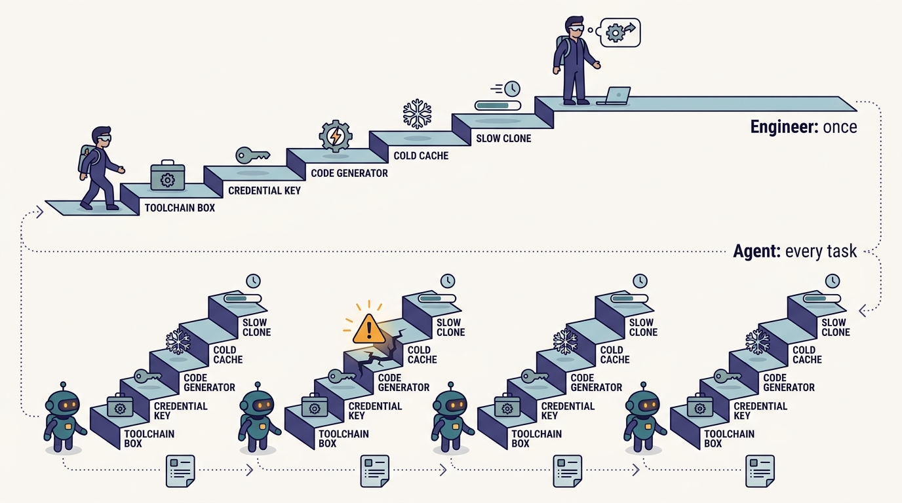
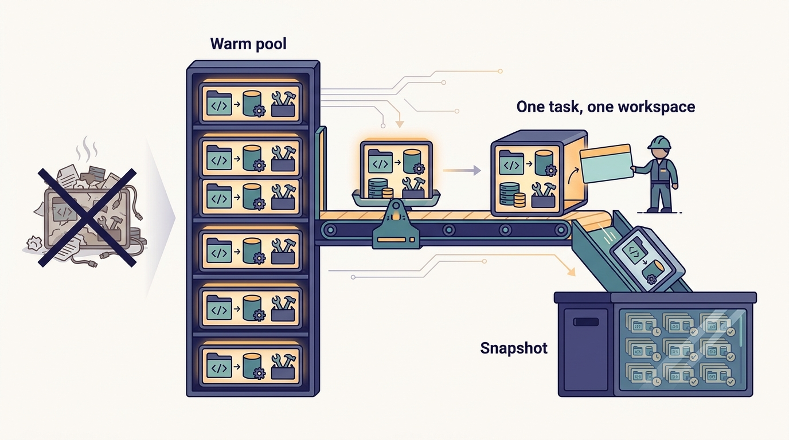

> **IN THIS CHAPTER, YOU WILL:** Trace Uber's DevPods from a fix for monorepo-scale laptop pain to the workspace layer under its AI agents. You will see how flavors, warm pools, pre-built images and the "mega DevPod" work as far as the public record shows, and what a smaller company needs before a cloud workspace pays off.

> **WHY IT MATTERS:** A background coding agent is only as good as the environment it wakes up in. If an engineer needs a day to get a working build, an agent will not get one at all; the workspace is where the "AI-ready" claim becomes true or false.

> **KEY POINTS:**
>
> * **DevPods were built to solve a human problem, not an AI one.** Uber moved to per-language monorepos in 2017–2018, and the code, build artifacts and setup outgrew laptops. Cloud workspaces with build caches and build/test service levels were the answer; agents arrived later and found the environment ready.
> * **What an agent needs from a workspace is what DevPods already standardized.** A known image, a warm cache, a single build command, isolation, parallelism and seconds-to-start. Uber added two things for the AI era: AI harnesses pre-installed in every pod and a "mega DevPod" holding every repository, so Minion can make cross-repository changes.
> * **The workspace is a multiplier, not a foundation on its own.** A cloud box over an inconsistent build is a faster way to fail. For most companies the order is standard build first, scripted environment second, managed cloud workspace third, and a vendor sandbox is often enough for the agent tier.

> **BUILT ON:** The per-language monorepos and Bazel ([[monorepos-and-one-build]]), Uber's Kubernetes compute platform, the standard build contract that makes one top-level `AGENTS.md`/`CLAUDE.md` work, and the AIFX harness layer ([[aifx-harness-layer]]) installed in every pod.

 
Ask an engineer who has set up a large codebase on a new laptop how long it took, and the answer is rarely "an hour". Toolchains, credentials, generated code, a cold build cache, a monorepo that takes twenty minutes to clone: each costs time, and each fails in its own way. Engineers absorb that cost once per laptop and then forget it. **A coding agent pays it on every task**, because each task wants a fresh, clean workspace, and it has no patience or tacit knowledge to fall back on when step seven of the setup guide is out of date.

**Figure 1:** *An engineer absorbs setup cost once per laptop; a coding agent pays it on every task unless the workspace is ready before it asks.*

Uber solved the human version of this problem years before agents existed. Its **DevPods** are cloud development environments: containers on Kubernetes, one "flavor" per monorepo, started from a pre-built image that already holds the repository and its build caches. In the October 2026 Pragmatic Engineer episode, Uber Distinguished Engineer Uday Kiran Medisetty told host Gergely Orosz that when the AI era arrived, "even the agents need the similar workspaces and cloud boxes. And we are able to kind of latch on to that." Minion, Uber's background coding agent, runs on a DevPod; so does every interactive Claude Code, Codex or OpenCode session an engineer starts in the cloud.

This chapter explains what DevPods are, why they exist, what changed when agents became their users, and what a company without Uber's platform budget should copy. It is the third chapter of Part I: [[build-what-does-not-exist]] covers why Uber built so much in-house, [[monorepos-and-one-build]] covers the monorepos and the standard build that DevPods depend on, and [[contracts-and-context-propagation]] covers the less visible foundations (typed contracts, ownership data and trace baggage) that make an agent's work inside the workspace verifiable.

## The Problem Uber Had: Monorepos That Outgrew the Laptop

Uber's 2022 engineering post on DevPods starts from the state of its code in 2017: "thousands of repositories with 10+ programming languages, 4000+ services, 500+ Web Apps, 9+ build tools and 6+ configuration tools." Medisetty described the same period in the episode: every service had its own repository, there were "at least two, three build systems, two, three testing systems", and a central team that wanted to upgrade a library had to visit every repository. Around 2017–2018 Uber moved to **one monorepo per language** (Go, Java, iOS, Android and others), still deploying microservices, but from shared repositories with one build system, Bazel. The details of that move belong to [[monorepos-and-one-build]].

The monorepos fixed dependency management and then created a new problem. The 2022 post says the local edit–build–run loop got slower: larger builds, several gigabytes of artifacts, and a setup that was hard to reproduce remotely. The largest monorepo held **over 70 million lines of code** by 2022. In the episode, Medisetty put it simply: once the repositories were big enough, "it was pretty hard to run the build and… getting all of those systems set up on your local laptop."

Three costs made the laptop the wrong unit of development at that scale:

| Cost | What it looked like on a laptop | Why it grows with the monorepo |
| --- | --- | --- |
| **Setup** | Install toolchains, generate code, configure credentials, warm the cache | Every new tool, language or code generator adds a step; drift between laptops makes failures personal |
| **Build and test time** | Cold Bazel builds, gigabytes of artifacts, a CPU shared with the IDE and video calls | Build graphs grow with the code; a laptop does not |
| **Variance** | "Works on my machine"; different OS from production; no service level the platform team can promise | The platform team cannot set a build-time target on hardware it does not control |

The third row matters most for this book. Medisetty said the cloud boxes let Uber "have really good SLAs on your build time, on your test time." A **service level on the inner loop** is only possible when the platform team owns the machine. That ownership is what later made the same environment usable by agents, which need predictability more than people do.

## What Uber Built: DevPods, Flavors and the Mega DevPod

### The DevPod as documented in 2022

The fullest public description is the December 2022 Uber engineering post "Devpod: Improving Developer Productivity at Uber with Remote Development" (Strukčinskas, Badem and Jokubauskas). It is nearly four years old as of October 2026, so details may have changed. It describes:

- **Containers on Kubernetes with persistent volumes**, so work survives restarts. A custom resource definition and a small **Devpod Operator** translate a request for a DevPod into standard Kubernetes resources, so there is no separate metadata database to keep in sync.
- **Idle cost control** through volume snapshots: the operator reacts to VolumeSnapshotContents and PersistentVolumeClaims, deletes the containers of inactive environments and moves the disks of shut-down ones to cheaper storage.
- **Images based on Debian**, to match Uber's production operating system, published on update channels (stable by default, release candidate, nightly, or pinned).
- **Clusters outside the production data centers**, in five regions (Oregon, Virginia, the Netherlands, Mumbai and São Paulo) so engineers in Europe and Asia-Pacific get low latency.
- **Up to 48 cores and 96 GB of RAM** per environment, with experiments above 90 cores.
- **Six flavors** (Docker images): Go, Java, Android, Web, ML and Base. A **flavor** is a DevPod image prepared for one monorepo or kind of work, with its toolchain and caches.
- **IDE choice**: VS Code (remote or in the browser), JetBrains Gateway over SSH, or vim and emacs in a terminal.

The post's numbers show what the move bought. Go builds were **2.5× faster at p95** for long builds and **1.8× faster at p75** than on laptops. `git status` stayed **under 4 seconds at p95** on the 70-million-line monorepo. More than **60% of Uber's software engineers** had adopted DevPods by November 2022. Provisioning took **2–3 minutes**, and the stated goal was **under 3 seconds through pre-provisioned pools**. Availability was capped at the cloud provider's 99.5%.

### The DevPod as described in 2026

The episode picks up where the 2022 post left off, and it suggests the provisioning goal was met. Medisetty showed his own list of DevPods in the web interface and described creating one "within a matter of seconds." When Orosz guessed that the speed came from keeping things warm, Medisetty confirmed it: the DevPods run on Kubernetes clusters "on separate multiple clouds," "everything is warmed up," and a new DevPod is cloned "from the pre-built image" with "build caches, everything, repositories, everything, already cloned." Medisetty and Adam Huda's AI Engineer World's Fair 2026 talk, "Agentic SDLC at Uber," adds a name for the warm capacity: Uber keeps pre-provisioned Kubernetes **"balloon pods"** ready for allocation, with repository snapshots and search indexes already present.

Two further changes are AI-era additions, both from the episode:

1. **AI tools installed by default.** "You don't have to go through even installing" Claude Code, Codex or OpenCode; "they're all there in the DevPod." The harnesses are wrapped by AIFX, Uber's harness layer, so settings, skills and plugins follow the user between a laptop and any DevPod ([[aifx-harness-layer]]). Medisetty said this made it easy "even for non-engineers in the company to create a DevPod and start playing with" coding agents.
2. **The mega DevPod.** "We also created like now a mega dev pod with all of the repositories… because then I can have my agents create PRs across the repositories." Later in the episode he described "a devpod flavor that has all of the repositories, and optimized for minion usage." The AI Engineer talk describes the same change as per-language DevPods giving way to "a mega DevPod" that "brings all repositories into one environment for autonomous coding."

---begin mermaid---
flowchart LR
    U["Engineer, Minion or non-engineer"] -->|"request a DevPod of a flavor"| W["DevPod web, CLI or agent platform"]
    W --> OP["Devpod Operator on Kubernetes"]
    POOL["Warm pool of pre-provisioned pods"] --> OP
    IMG["Pre-built flavor image"] --> OP
    SNAP["Repository snapshot, build cache, search index"] --> OP
    OP --> POD["Running DevPod"]
    POD --> H["Harnesses via AIFX: Claude Code, Codex, OpenCode"]
    POD --> B["One build and test command: Bazel"]
    POD -->|"idle"| S["Snapshot to cheaper storage"]
---end mermaid---
**Figure 2:** *A DevPod is assembled from parts that already exist before anyone asks for it: a warm pod, a pre-built image and a snapshot of the code and caches. The request only binds them. The operator and snapshot behaviour are from Uber's 2022 post; the warm pool and pre-installed harnesses are from the 2026 episode and AI Engineer talk; how the parts are wired in 2026 is not documented.*

### A short timeline

| When | State | Source |
| --- | --- | --- |
| 2017 | Thousands of repositories, 9+ build tools; the "before" picture | Uber blog, Dec 2022 |
| 2017–2018 | Move to per-language monorepos on Bazel | Podcast, Oct 2026; Uber blog (Go monorepo), May 2020 |
| 2017 (per the episode) | DevPods "being developed", in Orosz's recollection; the show notes say Uber "created" them in 2017 | Podcast and show notes, Oct 2026 |
| Nov 2022 | 60%+ of engineers on DevPods; six flavors; provisioning 2–3 min, goal under 3 s | Uber blog, Dec 2022 |
| 2025 | Minion, the background coding agent, built on DevPods | Show notes, Oct 2026 |
| 2026 | Seconds to start from warm pools; harnesses pre-installed; mega DevPod for Minion | Podcast, Oct 2026; AI Engineer talk, 2026 |

The dates need a caveat. The 2022 post uses 2017 as the problem baseline and implies that DevPods followed the monorepo move. No public source found for this book dates the first DevPod to 2017. The safest reading is that **DevPods grew out of the 2017–2018 monorepo move (the episode dates them to 2017) and were mainstream by 2022**.

### What changes when the user is an agent

A human uses one or two DevPods for days. An agent platform may want hundreds of them for minutes each. The episode and the AI Engineer talk describe three adjustments, and each one turns a convenience into a requirement:

- **Start time moves from "nice" to "load-bearing".** A two-minute provisioning time is tolerable once a day. For an agent that starts a task from a Slack message, two minutes per task dominates the wait and invites shortcuts, such as reusing a dirty workspace. Warm pools and snapshots are what make **one task, one fresh workspace** affordable.
- **Scope moves from one repository to all of them.** An engineer chooses a flavor because they know which monorepo they work in. An agent following a Slack thread may need to change a Go service, its Java client and a web screen. The **mega DevPod** removes the choice: every repository, every toolchain, and the context to search across them. Medisetty said Minion "can work across repositories and generate one PR or multiple PRs across repositories based on the plan and spec." Minion's design belongs to [[minion]].
- **Instructions move from people to files.** Because the build and test commands are the same in every module, Medisetty said Uber could write one `AGENTS.md` and one `CLAUDE.md` "at the top folder": "Once we set up the top level files, most teams will get like really good value out of the bat. They don't have to like really go into per module setup." The workspace makes those files true: the commands they describe are installed and warm.

---begin mermaid---
flowchart TB
    subgraph Interactive["Interactive DevPods"]
        F1["Go flavor"]
        F2["Java flavor"]
        F3["Android, Web, ML, Base flavors"]
    end
    subgraph Agent["Agent DevPods"]
        M["Mega DevPod: all repositories"]
    end
    E["Engineer in IDE or harness"] --> F1
    E --> F2
    N["Non-engineer trying a coding agent"] --> F3
    S["Slack or web request"] --> MIN["Minion"]
    MIN --> M
    M -->|"one or many PRs"| PR["Pull requests across repositories"]
    F1 --> PR
    F2 --> PR
---end mermaid---
**Figure 3:** *One workspace system, three kinds of user. People pick a flavor matched to their monorepo; Minion gets a flavor holding every repository so one plan can produce pull requests across repositories. The grouping is the author's reading of the episode, not an Uber diagram.*

## The Foundation Underneath

The episode's show notes compress the history into one line: "Minion – built in 2025 – is powered by DevPods, which Uber created in 2017." That sentence hides a stack of dependencies. A DevPod is fast and useful only because of what sits beneath it, and the same is true of an agent running inside one.

| Foundation | What DevPods take from it | What breaks without it |
| --- | --- | --- |
| **Per-language monorepos** ([[monorepos-and-one-build]]) | A small number of repositories to snapshot, cache and pre-clone; a mega DevPod is feasible because "all repositories" is a short list | With thousands of repositories, "clone everything" is neither fast nor meaningful |
| **Bazel and the standard build contract** | One build and test command per module; hermetic, cacheable outputs that can be pre-warmed into an image | A warm cache is useless if every module builds differently; agents need per-module instructions |
| **Kubernetes compute platform** | Scheduling, persistent volumes, snapshots, operators; Uber completed its own move from Mesos to Kubernetes in 2024 (Uber blog, Apr 2025) | A bespoke VM fleet for developer boxes, run by a team that also has to build the developer experience |
| **Ownership and access control** ([[contracts-and-context-propagation]]) | Which credentials a pod carries, what the user (or the agent acting for a user) may read and change | Agents get either too much access or none |
| **AIFX** ([[aifx-harness-layer]]) | Harnesses, plugins, skills and settings that arrive pre-configured in every pod | Each pod is a fresh install; settings drift between laptop and cloud |
| **The platform organization** | A developer-platform team with a mandate since Uber's 2014 "Programs & Platforms" split (Pragmatic Engineer, Sep 2021) | Nobody owns the inner loop as a product |

The second row is the one most often skipped by imitators. A DevPod pre-loads a build cache; that cache is only valid if builds are **deterministic and shared**. Bazel provides this, which is why the 2022 post's 2.5× speedup on Go builds is plausible: the pod is not only a bigger machine, it starts with the work already done. A company whose builds are not cacheable gets a bigger machine and a cold start.

**Figure 4:** *A warm pool of pre-built workspaces with code, caches and tools already present makes one fresh workspace per agent task affordable.*

The cost of building all this was large and spread over years. Uber's 2022 post lists an operator, snapshotting, five regions, update channels, IDE integrations and cost controls, all before agents. The AI-era additions were small by comparison: pre-install the harnesses, add a flavor with every repository, and keep enough warm capacity to start in seconds. That gap between a decade of platform work and a year of AI work is the book's thesis, set out in [[the-harness-is-the-easy-part]].

## What an Agent Needs From a Workspace

Stated as properties rather than products, the list below is what DevPods give agents that a laptop cannot. It is also the checklist I would use to judge any agent sandbox, bought or built.

| Property | Why the agent needs it | Laptop | DevPod (as described) |
| --- | --- | --- | --- |
| **Known, reproducible image** | The agent cannot debug its own toolchain; a failure must mean the code, not the machine | Drifts per person | Pre-built flavor images on update channels |
| **Warm state** | Cold clones and builds burn minutes and tokens before work begins | Warm only for the owner's current branch | Snapshots with repositories, build caches and search indexes |
| **Seconds to start** | One fresh workspace per task keeps runs independent | Not applicable | Warm pools ("balloon pods") |
| **Parallelism** | One engineer may run several agent sessions; a platform runs many | One machine | "You can have any number of them" (episode) |
| **Isolation** | A misbehaving agent must not damage the user's machine or other runs | Shares the user's machine, files and credentials | Separate containers on separate clusters |
| **Long runs while the user is away** | Background agents work while the laptop sleeps | Stops when the lid closes | Runs in the cloud |
| **Full code reach** | Cross-repository changes need every repository and a way to search it | Usually one or two repositories cloned | Mega DevPod |
| **Same commands as humans** | Instructions in `AGENTS.md` work only if the environment matches | Varies | One build and test command per module |
| **Platform-owned service levels** | Build and test time can be targeted, measured and improved | No | Build and test SLAs (episode) |
| **Cost control** | Idle agent workspaces are pure waste | Sunk cost | Snapshot and delete idle pods |

Two properties are missing from the table because the public record does not describe them: **network egress policy** for agent pods and **credential scoping** for an agent acting on behalf of a user. Uber's May 2026 post "Solving the Identity Crisis for AI Agents" describes tokens carrying an actor chain (user, then agent) and short-lived, audience-scoped exchanges; how that applies inside a DevPod has not been described. Both are properties a reader's own design must decide explicitly.

## Design Choices and Trade-offs

| Choice | Option A | Option B | When A is right | When B is right |
| --- | --- | --- | --- | --- |
| **Where development runs** | Laptop with a scripted setup | Cloud workspace | Small repositories, cold builds under a few minutes, few languages | Large monorepos, long builds, many new joiners, background agents |
| **Workspace scope** | Per-repository flavors | One "mega" workspace with everything | Humans who work in one area; smaller images; faster snapshots | Agents making cross-repository changes; questions that span codebases |
| **Lifetime** | Persistent, per person | Ephemeral, per task | Interactive work with state worth keeping | Agent runs; reproducibility; clean blast radius |
| **Start-up model** | Provision on request | Warm pool of pre-built pods | Low volume; cost matters more than latency | High volume of short agent tasks; interactive "seconds to start" |
| **Build or buy** | Build on your own Kubernetes | Buy a managed CDE or agent sandbox | You already run a large Kubernetes platform and need deep integration with internal build caches, identity and networks | You have no platform team for it; your code and build fit a vendor's model |
| **Network placement** | Inside the corporate network, near internal services | Isolated, with brokered access | Agents and humans must call internal services and staging | Untrusted or experimental agents; regulatory isolation |

The mega DevPod is a trade-off, not an upgrade. A workspace with every repository is larger to snapshot and slower to refresh, and it gives an agent a wider area it can change. Uber's answer, as described, is to keep per-language flavors for people and use the mega flavor for Minion, where cross-repository reach is the point. A plausible reading — not a documented description — is that the mega DevPod depends heavily on snapshotting and pre-built search indexes, because cloning and indexing every repository per task would defeat the seconds-to-start goal.

## Elsewhere in the Industry

**GitHub (2021).** In August 2021 GitHub wrote that its own engineers had moved to Codespaces, its cloud development environment product. Bootstrapping a codespace for the github.com repository, almost 13 GB on disk, took upwards of 45 minutes. A shallow clone, a nightly pre-built image and pools of pre-built codespaces brought it down to about **10 seconds**. The path is the same as Uber's: the cost was setup time, and the fix was doing the setup before anyone asked for a workspace.

**Stripe (2026).** Stripe's February 2026 posts on "Minions", its one-shot coding agents, describe each run starting on an isolated, pre-warmed **devbox**, ready in about 10 seconds; the devboxes are AWS EC2 instances kept warm in a pool. More than a thousand minion-produced pull requests are merged each week, and humans review all of them. The shape matches Uber's: a pre-warmed, isolated workspace per run, with the agent's speed bounded by how quickly that workspace is ready. One difference: Stripe's devboxes are virtual machines, Uber's DevPods are containers.

**Gitpod, now Ona (2025).** In September 2025 Gitpod, one of the best-known cloud development environment vendors, renamed itself **Ona** and repositioned as a platform for software engineering agents, with sandboxed environments, agents and guardrails as its three parts (The Register and InfoQ, Sep 2025). The vendor market followed the same arc as Uber's internal platform: the workspace was built for people and found its second customer in agents.

The vendor-hosted agents (GitHub's Copilot coding agent on GitHub Actions, May 2025; OpenAI's Codex Cloud) supply a workspace too, but it is generic: a fresh runner that knows only what the repository's own setup configuration tells it. Spotify's December 2025 post on its background coding agent, Honk, makes the opposite point: its agent runs in a deliberately limited sandbox with few binaries and minimal access to other systems, which the authors tie to predictability and security. Thoughtworks put "sandboxed execution for coding agents" in the Trial ring of its April 2026 Technology Radar. The industry agrees that agents need a workspace; it does not yet agree on **how much of the company should be reachable from it**.

## If You Are Not Uber

The question is not "should we build DevPods?" It is "what is the cheapest way to give people and agents a reproducible, warm workspace?" For most companies the answer is cheaper than Uber's.

**Prerequisites, in order.** (1) A build that works from a clean checkout with one documented command per module. (2) A scripted environment, such as a dev container definition or a Nix or Docker setup, that brings a clean machine to a working build without human steps. (3) A cacheable build, so pre-warming is worth anything. Without the first two, a cloud workspace only moves a broken setup somewhere else.

| Company size | Minimum viable version | Buy, build or open source | What not to copy |
| --- | --- | --- | --- |
| **≈50 engineers** | A dev container definition in each repository, used on laptops and by a vendor agent's runner; one `AGENTS.md` with the build and test commands | Buy: a hosted CDE or the agent vendor's sandbox; open-source dev container tooling | A Kubernetes operator, regions, flavors; a "mega" workspace when you have a few repositories that fit on a laptop |
| **≈500 engineers** | A managed CDE for the largest repositories, with prebuilds on a nightly image and a shared remote build cache; agents run in the same images | Buy a CDE (hosted or self-hosted); build the image pipeline and cache yourself | Building your own CDE control plane; per-person persistent pods for agents |
| **≈5,000 engineers** | A platform-owned workspace service: flavors per monorepo, warm pools, snapshots, idle cost control, build and test service levels, and an agent flavor with wider repository reach | Build on your Kubernetes platform if you already run one well; otherwise a self-hosted CDE vendor with deep customization | Opening every repository and every internal service to every agent by default |

**Sequencing.** Measure first: time from a clean machine to a green build, and p50/p95 build time for the largest repository. If the first is under an hour and the second under a few minutes, laptops plus a vendor sandbox for agents are probably enough. If not, fix the build before buying workspaces. Then give agents the same image people use, so instructions and results transfer.

**Where Uber's choice does not hold.** Uber built DevPods because no vendor met its scale, network and security constraints, the pattern [[build-what-does-not-exist]] describes. In 2026 the vendor market is mature, and most companies' repositories fit a vendor's model. Building is right only when the workspace must sit deep inside internal networks, identity and build caches that a vendor cannot reach.

## Failure Modes

- **The fast box on a slow build.** A company buys cloud workspaces before making builds cacheable. Workspaces start in seconds and then spend ten minutes building. Agents time out or burn tokens waiting.
- **Image rot.** The pre-built image drifts from what CI runs. The agent's checks pass in the workspace and fail in CI, and the agent cannot tell why. The fix is one image pipeline feeding both, which the 2022 post's update channels hint at.
- **The pet workspace.** Agent runs reuse long-lived workspaces to save start-up time. State from one task leaks into the next; results stop being reproducible. Warm pools exist to avoid this.
- **The skeleton key.** A mega workspace with every repository also carries every credential the user has. An agent following a prompt-injected instruction can change code far outside its task. The answer is scoped credentials and policy on what an agent may push, not a smaller clone.
- **Idle spend.** Workspaces are cheap individually and expensive as a fleet; agent workspaces left running after a task are pure waste. Uber's snapshot-and-delete approach (2022) and its spend tiers for background agents ([[token-spend-governance]]) address different halves of this.
- **Cloud availability as a development outage.** The 2022 post notes a 99.5% availability cap from the cloud provider. When the workspace platform fails, both engineers and agents stop. A laptop fallback path is worth keeping.

## What the Record Does Not Say

- **When DevPods started.** The episode and show notes say 2017; Uber's 2022 post uses 2017 as the "before" state. No public source gives a launch date.
- **Current scale.** The last public adoption figure is "over 60%" of engineers in November 2022. How many DevPods run at once, and how many of them are agents, is not public.
- **How the mega DevPod is built.** Its size, how it stays fresh, whether it uses sparse checkouts or virtual file systems, and how long a snapshot takes to refresh are not described.
- **Which clouds.** Medisetty said "separate multiple clouds"; Uber's compute runs on its own data centers, Oracle Cloud and Google Cloud (Uber blog, Apr 2025), but the DevPod clusters' providers are not named.
- **Security model for agent pods.** Network egress, credential scoping and audit for an agent inside a DevPod are not described, beyond the general agent-identity design in the May 2026 post.
- **Cost.** Neither the per-pod cost nor the cost of warm capacity is public.

## Questions to Ask

1. How long does it take, from a clean machine, to get a green build and test run of our largest repository? Who owns that number?
2. Can an agent run our build and tests from a fresh checkout using only what is written in one instruction file?
3. Is our build cacheable and shared, so that pre-warming a workspace saves real time?
4. Do agents run in the same image as our CI and our engineers? If not, which one is the truth?
5. Does each agent task get a fresh workspace? If not, what state leaks between tasks?
6. Which repositories and which credentials does an agent workspace need, and which does it have?
7. What is the start-up time of an agent workspace, and what share of a typical agent run does it consume?
8. Who pays for idle workspaces, and what deletes them?
9. Would a vendor's sandbox meet our network and identity needs, and what would we have to build around it?

## From Workspaces to Contracts

A DevPod gives an agent a place to work: the code, the tools and a warm build. It does not tell the agent which service owns a field, who to ask about a failing test, or how to send one test request to a branch build among thousands of production services. Those answers come from foundations that are even less visible than the workspace: the typed interface definitions, the ownership graph, the trace baggage and the standardized frameworks that [[contracts-and-context-propagation]] covers next.

## Sources and Evidence

### The source episode

- [Uber's AI infra, from the inside](https://newsletter.pragmaticengineer.com/p/ubers-ai-infra-from-the-inside) — *The Pragmatic Engineer* podcast, Gergely Orosz with Uday Kiran Medisetty, 2026. DevPod backstory, flavors, warm pools, multiple clouds, pre-installed harnesses, mega DevPod and the Minion flavor; show notes for the "created in 2017" framing.

### Uber engineering sources

- [Devpod: Improving Developer Productivity at Uber with Remote Development](https://www.uber.com/blog/devpod-improving-developer-productivity-at-uber/) — Uber blog, Strukčinskas, Badem and Jokubauskas, 2022. Architecture, flavors, regions, performance, adoption, provisioning goal.
- [Agentic SDLC at Uber: Building Blocks for Uber's Software Factory](https://ai.engineer/talks/17-YSUHo6Lk-agentic-sdlc-at-uber-building-blocks-ubers) — AI Engineer World's Fair talk, Medisetty and Adam Huda, 2026. Mega DevPod, balloon pods, snapshots and search indexes, Minion stopping at a draft PR.
- [Building Uber's Go Monorepo with Bazel](https://www.uber.com/blog/go-monorepo-bazel/) — Uber blog, Zhongpeng Lin, 2020. Timing of the Go monorepo move.
- [Migrating Uber's Compute Platform to Kubernetes: A Technical Journey](https://www.uber.com/blog/migrating-ubers-compute-platform-to-kubernetes-a-technical-journey/) — Uber blog, Bhave and Krishnan, 2025. Kubernetes as Uber's compute platform; Oracle Cloud and Google Cloud.
- [Solving the Identity Crisis for AI Agents](https://www.uber.com/us/en/blog/solving-the-agent-identity-crisis/) — Uber blog, Mathew, Borole and Huang, 2026. Actor-chain tokens for agents acting for users.
- [The Platform and Program Split at Uber](https://newsletter.pragmaticengineer.com/p/program-platform-split-uber) — *The Pragmatic Engineer*, Gergely Orosz, 2021. The 2014 origin of Uber's platform organization.

### Industry and research sources

- [GitHub's Engineering Team has moved to Codespaces](https://github.blog/2021-08-11-githubs-engineering-team-moved-codespaces/) — The GitHub Blog, 2021. 45-minute bootstrap reduced to about 10 seconds with prebuilds.
- [Minions: Stripe's one-shot, end-to-end coding agents](https://stripe.dev/blog/minions-stripes-one-shot-end-to-end-coding-agents) and [Part 2](https://stripe.dev/blog/minions-stripes-one-shot-end-to-end-coding-agents-part-2) — Stripe Dev Blog, Alistair Gray, 2026. Pre-warmed devboxes in about 10 seconds; EC2 warm pool; human review of all PRs.
- [Gitpod reinvents itself as Ona in pivot to AI agent platform](https://www.theregister.com/2025/09/03/gitpod_rebrands_as_ona/) — The Register, 2025; and [InfoQ coverage](https://www.infoq.com/news/2025/09/gitpod-ona), 2025. The CDE vendor market turning to agents.
- [GitHub Copilot: Meet the new coding agent](https://github.blog/news-insights/product-news/github-copilot-meet-the-new-coding-agent/) — The GitHub Blog, Thomas Dohmke, 2025. Vendor-hosted agent workspace on GitHub Actions.
- [Background Coding Agents: Predictable Results Through Strong Feedback Loops (Honk, Part 3)](https://engineering.atspotify.com/2025/12/feedback-loops-background-coding-agents-part-3) — Spotify Engineering, Charas and Bruggmann, 2025. Limited sandbox for predictability and security.
- [Sandboxed execution for coding agents](https://www.thoughtworks.com/radar/techniques/sandboxed-execution-for-coding-agents) — Thoughtworks Technology Radar, Vol. 34, 2026. Sandboxing as a baseline; ephemeral versus persistent trade-offs.

Statements about Uber's AI-era systems are Uber's own account unless another source is cited; recommendations and labeled inferences are the author's judgement.
