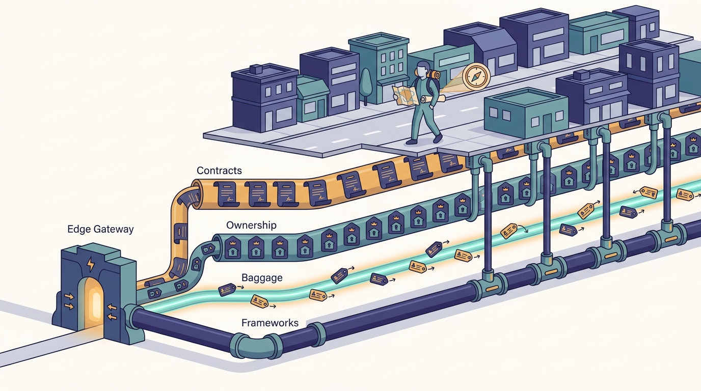
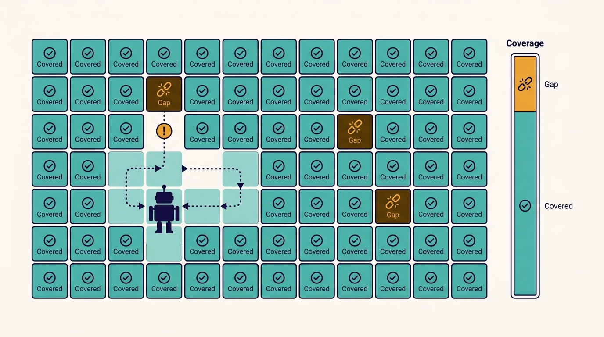

> **IN THIS CHAPTER, YOU WILL:** Take apart five pre-AI foundations at Uber (the IDL registry, uOwn ownership data, Jaeger trace baggage, standardized language frameworks and the Edge Gateway) and see which AI-era system each one made cheap: the MCP Gateway, the context graph, Slate, Capri and agent debugging.

> **WHY IT MATTERS:** These foundations rarely get a budget line, because their value is spread across every team. They are also the hardest to retrofit: each needs every service to comply, and that takes years. A leader who wants agents to call, test and debug services needs to know which of these properties the estate already has.

> **KEY POINTS:**
>
> * **Machine-readable metadata, kept for engineers, is what agents run on.** Typed contracts became tool definitions, ownership records became routing and approval, and trace baggage became test isolation. Uber did not design any of them for AI; it designed them so thousands of services could be operated by thousands of engineers.
> * **The value is in coverage, not in the technology.** Jaeger, Thrift and Protobuf are open source. What made them load-bearing at Uber was that nearly every service used them, which took years of retrofitting and, per Medisetty, is still being finished by AI-driven change campaigns.
> * **Copy the properties, in order.** Typed contracts in one registry, ownership for every deployable, context propagated through every hop, one framework that carries cross-cutting behavior, and one front door. Each is useful to humans on day one, so none has to wait for an AI business case.

> **BUILT ON:** Thrift and Protobuf interface definitions (from 2016 or earlier), uOwn (2015 onward), Jaeger tracing (2015–2016, open source since 2017), Uber's Go and Java service frameworks such as Fx, and the Edge Gateway (2020), on top of the monorepos in [[monorepos-and-one-build]].

 
Some infrastructure is visible: a build system, a deploy pipeline, a workspace like the DevPods of [[devpods]]. Other infrastructure is visible only when it is missing. Nobody praises the fact that every service has a typed interface definition in one place, that every deployable has an owner on record, or that a header set at the edge survives forty hops. **These properties are what let an agent act on a system it has never seen**: find the right API, call it with the right schema, know whom to notify, and send a test request to a branch build without touching production users.

In the October 2026 Pragmatic Engineer episode, Uber Distinguished Engineer Uday Kiran Medisetty and host Gergely Orosz kept returning to this point. The MCP Gateway was quick to build "because we already had good IDL registry across all of our services." Slate could route test traffic because "we had tracing built out and because it's like propagated across the stack." Capri could capture production traffic "with just one middleware because now we have standardized language frameworks across all the services." The show notes summarize: "Uber's MCP Gateway was fast to build, thanks to existing Thrift and Protobuf registries. Jaeger tracing made Slate routing and Context graph easier."

This chapter owns those foundations. It explains what each one is, how Uber built it as far as the public record shows, what it cost, and which AI system it later carried. The AI systems themselves belong to Part II and Part III: [[mcp-gateway]], [[context-graph]], [[slate]] and [[capri]].

## The Problem Uber Had: Thousands of Services, Thousands of Engineers

Uber's service count grew from a two-service core in 2014 to more than 2,000 microservices by early 2017, and its own 2025–2026 figures range from about 4,000 to "over 6,000 microservices," depending on what is counted (see [[monorepos-and-one-build]]). Uber's 2020 post on its domain-oriented microservice architecture gives a sense of what that meant for the people operating it: one root-cause investigation crossed about **50 services owned by 12 teams**.

At that scale, four questions come up many times a day, and each needs a machine-readable answer:

| Question | Who asks it | What answers it at Uber |
| --- | --- | --- |
| What does this service accept and return? | Callers, client generators, the gateway, now agents | **Thrift or Protobuf IDLs in one registry** |
| Who owns this service, and who is on call? | Incident responders, reviewers, migration owners, now agents | **uOwn** |
| What happened to this request, and can I steer it? | Debuggers, testers, routing infrastructure | **Jaeger trace context and baggage** |
| How do I add behavior to every service at once? | Platform teams | **Standardized language frameworks** |

A fifth piece, the **Edge Gateway**, sits in front of all of them: one entry point where external requests are authenticated, tagged and routed. Each of these existed for engineers years before an agent called anything. Together they turn a large distributed system into something a program can navigate.

**Figure 1:** *Five unglamorous foundations run under every service like utilities; they let an agent act on a system it has never seen.*

## Foundation 1: Typed Contracts in One IDL Registry

An **interface definition language (IDL)** file declares a service's methods and the types of their requests and responses; code generators turn it into clients and servers. An **IDL registry** is the single place where every service's IDL can be found.

**What the record shows.** Uber's July 2016 post on its tech stack names **Thrift** as the company's IDL. In the episode, Medisetty said Uber started with Thrift, later added Protobuf, and "all of the new services in the last few years, they're all protobuf"; older services usually switch when they are rewritten. Orosz added the framing: Uber services expose "Thrift or Protocol Buffers as strong contracts." Uber's May 2021 post on its API gateway shows how far the contracts reach: gateway APIs are defined as YAML plus Thrift IDL stored in git, code is generated with the open-source Zanzibar library, and a CI job blocks backward-incompatible schema changes for mobile clients.

**What it later carried.** The MCP Gateway. Medisetty described it in the episode: "since we have all of the IDLs in one single registry, we could use that registry to generate a default MCP spec" for any service, including request and response schemas and descriptions. Uber's October 2026 post "Designing MCP Gateway" gives the mechanism: an **AutoCrawler**, a Cadence workflow triggered on a schedule, "continuously scans Uber's IDL registry for APIs," parses the Protobuf or Thrift files to "extract method names, request and response schemas, and documentation comments," and uses an LLM to write "agent-friendly MCP tool descriptions." The post reports more than 800 MCP servers and 5,000 tools. The full design belongs to [[mcp-gateway]].

**Why it was cheap.** The hard parts of turning an API into a tool are knowing the API exists, knowing its exact schema, and knowing it will not change shape silently. The registry answered the first two; Uber's compatibility checks answered the third. What remained was translation and description writing, which Medisetty said fell to "the same team that works on our API Gateway," already "in the business of building API Gateway" and protocol transformations.

**What it did not solve.** Medisetty also said some generated tools were **3,000–4,000 tokens** long, which is why Uber added LLM-optimized descriptions and later projected tools as command-line calls. A contract describes structure; it says little about *when* to call an endpoint. Doc comments in IDL files, written for humans over a decade, became the raw material for tool descriptions. Their quality now affects how well agents choose tools.

## Foundation 2: Ownership Metadata (uOwn)

**What the record shows.** In the episode, Medisetty listed **uOwn** among the systems Uber had to build because nothing on the market did it in 2015: a system "that will enable anyone in the company to identify who owns a specific asset," used, as Orosz recalled, during outages to find the owning team and who is on call. No public Uber blog post, paper or talk about uOwn was found for this book, so its design is Uber's own account only.

Indirect evidence shows ownership data is assumed platform-wide. Uber's 2025 post on controlling monorepo rollouts and its NSDI '26 failover paper both work with per-service tiers (T0–T5 criticality). The October 2026 MCP Gateway post calls its registry "a single source of truth for discovery, ownership, and enablement," and requires that each tool description change "must be approved by server owners."

**What it later carried.** Three AI-era systems lean on knowing who owns what:

- **Shepherd**, Uber's large-scale change platform, "knows what are the unique modules owned by different teams" and opens one pull request per module, routed to its owners, according to Medisetty. Its agentic campaigns depend on the same routing ([[shepherd-and-fox]]).
- **The context graph** has a node for every employee and edges to assets, PRs, on-call events and incidents, per the episode. Ownership is what links a person to a service ([[context-graph]]).
- **MCP Gateway enablement**: every auto-generated server starts disabled, and owners review and enable it (Uber blog, Oct 2026).

> **INFERENCE, NOT DOCUMENTED:** The record does not say that the MCP registry, Shepherd or the context graph read ownership from uOwn directly. Given that uOwn is described as the company's ownership system, it is the plausible source, but the integration is not described.

**Why it matters more with agents.** A person who opens a pull request in the wrong place gets redirected by a colleague. An agent that opens hundreds of pull requests needs ownership data to route each one, to know whose approval enables a tool, and to tell an on-call engineer which team's change broke a service. **Ownership data that is 90% accurate is fine for people and expensive for agents**, because the 10% becomes misrouted work at machine speed.

## Foundation 3: Trace Context and Baggage

**Trace context** is the trace and span identifiers that let a tracing system stitch one request's hops into a tree. **Baggage** is arbitrary key–value data carried alongside that context through every hop of a request. Trace context records what happened; baggage lets infrastructure change what happens.

**What the record shows.** Uber's February 2017 post "Evolving Distributed Tracing at Uber Engineering" (Yuri Shkuro) dates the work: a two-engineer tracing team in New York took on distributed tracing in 2015; the first tracer, Merckx, worked only inside the Python monolith; Uber's RPC protocol TChannel carried trace fields from 2015; and **Jaeger** ran in hundreds of services by 2016, with clients in Go, Java, Node.js and Python. Jaeger was open-sourced in April 2017, became a Cloud Native Computing Foundation project that September and graduated in October 2019. (In the episode Medisetty placed Jaeger in "maybe 2017–18"; the documented dates are earlier.)

The link from tracing to routing is documented in two later posts:

- Uber's March 2020 post on multitenancy (Amit Gud) describes **tenancy context**, attached "as it enters an edge gateway," kept "for the life of the request," and propagated by every service; it notes that propagation "can be achieved with open source tools like OpenTracing and Jaeger." A `services_under_test` field lets routing send test traffic to a test build. The post rejects parallel staging stacks because of hardware cost, drift and unreliable results.
- Uber's October 2022 post on **SLATE** (Short-Lived Application Testing Environment) gives the concrete mechanism: test tenancy travels as Jaeger baggage under the key `request-tenancy`; the **Edge Gateway** looks up the environment's routing information and injects a `routing-overrides` key into the baggage; a per-host routing agent then sends the request to the service under test instead of production. "Services need no routing logic of their own." In the episode Medisetty describes the same step at the mesh level: as the request moves through the service mesh, the mesh "knows this baggage" and routes it to the Slate environment. Uber's October 2026 MCP Gateway post names that mesh's sidecar, **Muttley**, "Uber's service mesh sidecar that runs alongside all back-end services"; no source says whether Muttley or the 2022 host routing agent acts on Slate's overrides today.

Uber's August 2024 post on its backend integration testing strategy (BITS) says routing overrides now ride **OpenTelemetry** baggage, which suggests a migration from Jaeger clients to OpenTelemetry. The same post reports that every test is force-sampled with Jaeger and that the resulting trace index maps which services each test covers.

---begin mermaid---
sequenceDiagram
    participant Dev as Engineer or agent
    participant Edge as Edge Gateway
    participant A as Service A production
    participant Agent as Host routing agent
    participant B as Service B branch build
    Dev->>Edge: request from a test account pinned to a Slate env
    Edge->>Edge: look up routing info for the env
    Edge->>A: request with baggage request-tenancy and routing-overrides
    A->>Agent: call to Service B, baggage propagated by framework
    Agent->>B: override matches, route to service under test
    B-->>A: response
    A-->>Edge: response
    Edge-->>Dev: response
---end mermaid---
**Figure 2:** *Routing one test request to a branch build inside production, as Uber's 2022 SLATE post describes it. Service A has no routing code; it only has to propagate the baggage it received. One service that drops the baggage breaks routing for every service behind it.*

**What it later carried.** **Slate** for agents: Medisetty described agents creating Slate environments through MCP or the command line, deploying a branch and testing it end to end, with before-and-after reports attached to pull requests ([[slate]]). The show notes also credit Jaeger with making the context graph easier, though the episode does not explain how.

**Why it was expensive.** Baggage routing works only if **every** service on the path propagates the context, including through queues and asynchronous work. Medisetty was explicit: "This thing took years to make sure that all existing services were retrofitted with this and all new services were built with this in mind." The work is not finished. He described an AI-based Shepherd campaign to "fix context propagation across all the services so that tracing works better," with prompts and skills an agent runs across every module ([[shepherd-and-fox]]). That is a neat loop: **AI is now used to repair the foundation that AI depends on**.

## Foundation 4: Standardized Language Frameworks

A **standardized language framework** here means the shared libraries every service in a language starts from: the server, the RPC clients, configuration, logging, metrics, tracing and middleware hooks. When all services use it, adding behavior to the framework adds it to the fleet.

**What the record shows.** Uber's open-source Go framework **Fx** describes itself in its README as "the backbone of nearly all Go services at Uber." Uber's 2020 Edge Gateway post says the gateway is built on Glue, an internal framework on top of Fx. The episode says Uber standardized on Go and Java for backend services around 2018–2019; no single Uber post declares that policy, but the Go and Java monorepos are where the platform investment goes ([[monorepos-and-one-build]]).

**What it later carried.** **Capri**, Uber's capture-and-replay system. Medisetty said Uber can "capture real production traffic with just one middleware because now we have standardized language frameworks," recording inbound requests and every downstream request and response ([[capri]]). The framework is also, plausibly, where baggage propagation is automated, so individual services do not hand-carry headers.

The contrast with Uber's own earlier writing is instructive. Uber's June 2022 post on **Shadower**, a load-testing tool, explained why Uber did *not* use a shared in-process library for traffic shadowing at the time: filtering in production is complex, and every service pays the CPU and memory cost. It captured traffic off the wire with eBPF instead. Capri, as described in 2026, takes the in-process middleware route.

> **INFERENCE, NOT DOCUMENTED:** The likely enabler of that reversal is framework coverage. Once nearly every service runs the same framework, one well-tested middleware is cheaper to maintain than packet capture that has to reassemble many protocols, and it can see decoded requests and downstream calls directly.

**Why it matters more with agents.** Every cross-cutting capability an agent needs (capture, replay, tagging, routing, telemetry) has to be installed in every service. With one framework per language, that is one change and one rollout; with a dozen ad-hoc stacks, it is a dozen projects that never finish.

## Foundation 5: The Edge Gateway

**What the record shows.** Uber's August 2020 post "Designing Edge Gateway, Uber's API Lifecycle Management Platform," co-written by Medisetty with Pavel Astakhov and Madan Thangavelu, describes three generations of Uber's mobile front door. The first (2014) was the dispatch and API pair, routing on a `messageType` field. The second, **RTAPI** (Real-Time API, from 2015), was one of Uber's largest Node.js applications: 800,000 requests per second at peak, about a million lines of code, 400+ downstream services owned by 100+ teams, and commits from 40% of engineering. It became a bottleneck because business logic leaked into it. The third, the **Edge Gateway**, is a Go service with no business logic at the edge, configured through a UI (authentication, request transforms, header propagation, rate limiting, load shedding) and adopting gRPC; the migration took about two years. Medisetty joined Uber in May 2015 on the RTAPI team, so this is his own history.

In the episode he described the gateway as of 2026: it supports REST, gRPC, webhooks and GraphQL; "all APIs go through one single entry point where we can build a whole bunch of tooling around that on monitoring, on alerting"; it has its own capture-and-replay that uses Capri behind the scenes; and Uber automatically tags "which is a required dependency, which is an optional dependency," metadata that helps "both engineers to debug faster and also agents to debug faster." Webhooks, GraphQL, the Capri-based replay and the dependency tags are podcast-only.

**What it carried.** Three roles: the place where test tenancy and routing overrides enter the baggage (2022 SLATE post); the place where capture and replay can see every external request (episode); and a source of dependency metadata for diagnosing alerts (episode), which feeds the debugging work in [[wisdom-and-debug-assist]]. The NSDI '26 paper on Uber's failover architecture, which Medisetty co-authored, adds documented context for the dependency tags: Uber hardened more than **4,000 unsafe "fail-close" dependencies** while cutting failover spare capacity from 2× to 1.3×. Knowing which dependencies are required and which are optional is the same knowledge, put to a different use.

## How the Foundations Map to AI Systems

---begin mermaid---
flowchart LR
    IDL["IDL registry: Thrift and Protobuf"] --> MCP["MCP Gateway"]
    OWN["uOwn ownership"] --> MCP
    OWN --> SH["Shepherd campaigns"]
    OWN --> CG["Context graph"]
    JG["Jaeger trace context and baggage"] --> SL["Slate"]
    JG --> CG
    FW["Standardized language frameworks"] --> CA["Capri capture and replay"]
    FW --> JG
    EG["Edge Gateway"] --> SL
    EG --> CA
    EG --> DBG["Agent debugging context"]
    SH -->|"agentic campaign fixes propagation"| JG
---end mermaid---
**Figure 3:** *Each AI-era system draws on one or more pre-AI foundations. The IDL-to-MCP, baggage-to-Slate, framework-to-Capri and Edge-Gateway links are described by Uber; the uOwn links to MCP Gateway, Shepherd and the context graph are the author's inference from the episode. The arrow back into Jaeger is the AI-driven repair campaign Medisetty described.*

| Foundation | Built for | Era | AI system it carries | Evidence for the link |
| --- | --- | --- | --- | --- |
| IDL registry | Code generation, compatibility, gateway configuration | 2016 or earlier (Thrift); Protobuf later | MCP Gateway | Uber blog, Oct 2026; podcast |
| uOwn | Incidents and on-call lookup | From 2015 (podcast) | Shepherd routing, context graph, tool enablement | Podcast; link inferred |
| Jaeger and baggage | Debugging latency and failures; test tenancy | 2015–2016; open source 2017; baggage routing documented 2020–2022 | Slate for agents; context graph | Uber blogs 2017, 2020, 2022, 2024; podcast |
| Language frameworks | Consistency across services; platform rollout | Fx open source (README: nearly all Go services) | Capri; plausibly automatic propagation | Fx README; podcast |
| Edge Gateway | One front door for mobile; API lifecycle | 2020 (third generation) | Slate routing overrides; capture and replay; debugging metadata | Uber blogs 2020, 2022; podcast |

## Design Choices and Trade-offs

| Choice | Option A | Option B | When A is right | When B is right |
| --- | --- | --- | --- | --- |
| **Contract style** | IDL-first (Thrift, Protobuf), code generated | Code-first, schemas inferred or written afterward (often OpenAPI) | Many services and languages; compatibility checks; machine consumers including agents | Few services; public HTTP APIs where OpenAPI is the norm |
| **Where contracts live** | One registry (or monorepo path) for all IDLs | Each repository holds its own | You want discovery, crawling and compatibility checks fleet-wide | Small estates where search is enough |
| **Test isolation** | Route test requests inside a shared environment by propagated context | Separate staging stacks per team or per developer | Large estates where full copies drift and cost too much (Uber's 2020 argument) | Small estates, strict data isolation, or no propagation coverage |
| **Who acts on routing** | Infrastructure (mesh sidecar, host agent, gateway) | Each service's own code | Always, if you can; services stay unaware | Only as a stopgap |
| **Cross-cutting behavior** | One mandated framework per language | Libraries teams may adopt | You need fleet-wide capture, tracing or policy | Early-stage companies still choosing their stack |
| **Traffic capture** | In-process middleware | Packet capture off the wire | High framework coverage; need for decoded payloads and downstream calls | Heterogeneous services; no shared framework (Uber's 2022 Shadower argument) |
| **Front door** | One edge gateway for all external traffic | Per-domain or per-product gateways | You want one place for tenancy tagging, capture and policy | Domains with very different protocols or ownership |

The common thread: **each option A is a centralizing bet that pays off only with near-total coverage**. A registry with half the services, baggage that half the services propagate, or a framework half the services use gives agents an inconsistent world. The estate is navigable only to the extent the property is universal.

**Figure 4:** *Each centralizing foundation pays off only with near-total coverage; agents meet the gaps first.*

## Elsewhere in the Industry

**Lyft (2021–2022).** Lyft's developer-infrastructure team replaced per-developer environments with **staging overrides**: branch builds deployed into shared staging without registering in service discovery, with override metadata carried as OpenTracing baggage and a modified Envoy filter rerouting matching requests (as summarized by InfoQ in March 2022). The mechanism is Uber's; the difference is location. Lyft isolates inside **staging**, Uber inside **production** with production dependencies by default.

**Signadot and the standards (2023–2024).** Signadot, a vendor of Kubernetes sandboxes, routes requests with a key carried in OpenTelemetry `baggage` and `tracestate` headers; its documentation lists `uberctx-sd-routing-key`, the Jaeger-style header, as the legacy default, which shows how Uber's tracing conventions spread into the industry's tools. Its docs state the same precondition Uber learned: every service on the path must propagate the headers. The W3C **Baggage** specification, a Candidate Recommendation since May 2024, standardizes the `baggage` header with minimum limits of 64 members and 8,192 bytes, so a company starting today does not need Uber's proprietary headers.

**Agents and contracts.** The Model Context Protocol defines tools with JSON Schema inputs, which is close to what an IDL already holds. Any company with a schema registry can generate tool definitions the way Uber's AutoCrawler does; the reverse, writing schemas for undocumented endpoints so agents can call them, is far harder. Spotify's 2025 posts on its background coding agent make a related point from the other side: it keeps the agent's tool set small, because each added tool makes behavior less predictable. Generated tools are cheap; well-described ones are not.

## If You Are Not Uber

These foundations are the part of Uber's story that copies best, because each is useful to people today and none needs a large AI budget. They are also the part that takes longest, so start now.

**Order matters.** Ownership first (it is cheap and everything else routes through it). Typed contracts second. Context propagation third, through a framework or auto-instrumentation rather than by hand. One front door, where you have a choice, fourth.

| Company size | Minimum viable version | Buy, build or open source | What not to copy |
| --- | --- | --- | --- |
| **≈50 engineers** | An owner and on-call rotation for every deployable, in a file next to the code; OpenAPI or Protobuf for every internal API in the repository; OpenTelemetry auto-instrumentation | Open source (OpenTelemetry, Protobuf or OpenAPI tooling); a hosted catalog if you want a UI | A custom ownership system; baggage-routed testing in production; a home-grown gateway |
| **≈500 engineers** | A service catalog with owners, tiers and links to schemas; schema compatibility checks in CI; W3C trace context and baggage propagated by a shared framework; a sandbox tool that routes on baggage for the most-tested paths | Open source catalog (for example Backstage) or a vendor; vendor sandbox routing; one internal framework template per language | Mandating one framework before you have two languages' worth of services; routing in production before propagation coverage is measured |
| **≈5,000 engineers** | One IDL registry crawled by tools; ownership as a graph (people, teams, services, data); measured propagation coverage with automated repair; frameworks that carry capture, tracing and policy; one edge layer that sets tenancy | Build where the integration is the value (registry crawling, ownership graph); buy or adopt open source for tracing and mesh | Treating coverage as done; letting the edge accept tenancy or routing baggage from untrusted clients |

**Measure coverage, not adoption.** For each foundation, track the share of services that comply: services with a registered schema, with a valid owner, that propagate baggage end to end (a synthetic request with a marker key, checked at the leaves), and that run the standard framework. Agents will hit the gaps first.

**Where Uber's path does not hold.** Uber's foundations came from building almost everything in-house at a time when vendors could not meet its scale ([[build-what-does-not-exist]]). In 2026 OpenTelemetry, schema registries, service catalogs and sandbox routers are available off the shelf. What cannot be bought is coverage: the work of getting every team to adopt them.

## Failure Modes

- **Baggage that leaks in from outside.** If the edge accepts routing or tenancy baggage from external clients, anyone can steer requests toward test builds or mark traffic as test traffic. Uber's design sets tenancy at the edge; an imitator must also **strip** inbound baggage it did not set.
- **The silent drop.** One service, queue consumer or thread pool loses the context, and every request behind it routes to production. Tests pass against the wrong build. Coverage checks catch this; code review does not.
- **Baggage bloat.** Teams discover baggage and start carrying business data in it. Headers grow, every hop pays, and the W3C limits are hit. Keep baggage for infrastructure keys.
- **Stale ownership at machine speed.** An agent campaign opens hundreds of pull requests routed to teams that no longer own the code; reviews stall and the campaign is blamed. Ownership accuracy needs its own metric before agent campaigns scale.
- **Contracts without meaning.** Auto-generated tools from IDLs with empty or misleading doc comments produce agents that call the wrong endpoint with valid arguments. Medisetty's 3,000–4,000-token tool descriptions show the opposite failure: too much text. Both need curation and owner review, which Uber's October 2026 post builds in.
- **Framework exceptions.** A few critical services run outside the standard framework "for performance." They become the gap where capture, routing and telemetry do not work, and usually the place agents most need to test.
- **Two gateways, two truths.** An edge gateway and an MCP gateway with separate authentication, rate limits and redaction rules drift apart. Uber had the same team build both, which reduces that risk.

## What the Record Does Not Say

- **uOwn's design**: data model, how ownership is kept current, and whether it is the source for the MCP registry, Shepherd and the context graph.
- **The IDL registry itself**: whether it is a service, a monorepo path or both, and how compatibility checks work outside the API gateway.
- **Propagation coverage**: what share of services propagate baggage end to end today, and how many the AI-driven Shepherd campaign has fixed.
- **The Jaeger-to-OpenTelemetry migration**: the 2024 BITS post implies one; its extent is not described.
- **The Java framework**: Fx is documented for Go; the Java equivalent is not named publicly.
- **Edge Gateway's 2026 features**: webhooks, GraphQL, Capri-based replay and the required-versus-optional dependency tags are podcast-only, and how the tags are computed is not described.
- **How Jaeger made the context graph easier**: the show notes say it did; neither the episode nor any written source explains how.

## Questions to Ask

1. What share of our services has a machine-readable contract in one place an agent could crawl?
2. What share of our deployables has a current owner and on-call rotation, and how would we know if it were wrong?
3. If we send a request with a marker baggage key through our most important flow, does every hop receive it, including queues and background jobs?
4. Where does trace context enter our system, and do we strip context we did not set?
5. Which cross-cutting behaviors (tracing, capture, policy, tenancy) can we add to every service with one change, and which need every team to act?
6. Are our IDL or OpenAPI doc comments good enough to become tool descriptions an agent would choose correctly from?
7. Could we tell, for any service, which of its dependencies are required and which are optional?
8. Which of these foundations would we fund for humans alone, and which are we only considering because of AI?

## From Foundations to Gateways

Part I has covered the decade before AI: the in-house platforms ([[build-what-does-not-exist]]), the monorepos and one build ([[monorepos-and-one-build]]), the DevPods ([[devpods]]) and, in this chapter, the contracts, ownership data and propagated context underneath them. Part II turns to what Uber built on top, starting with the first AI-era decision it made in late 2023: send every model request in the company through one door. That is [[model-gateway]].

## Sources and Evidence

### The source episode

- [Uber's AI infra, from the inside](https://newsletter.pragmaticengineer.com/p/ubers-ai-infra-from-the-inside) — *The Pragmatic Engineer* podcast, Gergely Orosz with Uday Kiran Medisetty, 2026. IDL registry and MCP generation, uOwn, Jaeger baggage and the years of retrofitting, standardized frameworks and Capri, Edge Gateway endpoint types and dependency tags, the AI Shepherd propagation campaign; show notes for the foundation-to-AI mapping.

### Uber engineering sources

- [Designing MCP Gateway: Uber's MCP Management Platform](https://www.uber.com/blog/designing-mcp-gateway/) — Uber blog, Srivastava, Mehndiratta and Gill, 2026. AutoCrawler over the IDL registry, LLM-written descriptions, ownership and enablement, Muttley, scale.
- [Evolving Distributed Tracing at Uber Engineering](https://www.uber.com/blog/distributed-tracing/) — Uber blog, Yuri Shkuro, 2017. Jaeger history, Merckx, TChannel, open-sourcing.
- [Why We Leverage Multi-tenancy in Uber's Microservice Architecture](https://www.uber.com/blog/multitenancy-microservice-architecture/) — Uber blog, Amit Gud, 2020. Tenancy context at the edge, propagation, `services_under_test`, the case against parallel staging.
- [Simplifying Developer Testing Through SLATE](https://www.uber.com/blog/simplifying-developer-testing-through-slate) — Uber blog, Srivastava, Srivastava and Rathi, 2022. `request-tenancy` baggage, Edge Gateway routing overrides, host routing agent.
- [Shifting E2E Testing Left at Uber](https://www.uber.com/blog/shifting-e2e-testing-left) — Uber blog, 2024. OpenTelemetry baggage for routing overrides; Jaeger-sampled test index.
- [Designing Edge Gateway, Uber's API Lifecycle Management Platform](https://www.uber.com/blog/gatewayuberapi/) — Uber blog, Astakhov, Thangavelu and Medisetty, 2020. Three gateway generations, RTAPI numbers, Glue and Fx.
- [The Architecture of Uber's API gateway](https://www.uber.com/blog/architecture-api-gateway/) — Uber blog, Thangavelu, Parwal and Patali, 2021. YAML plus Thrift IDL, Zanzibar code generation, compatibility checks.
- [The Uber Engineering Tech Stack, Part I: The Foundation](https://www.uber.com/blog/tech-stack-part-one-foundation/) — Uber blog, Lucie Lozinski, 2016. Thrift as Uber's IDL.
- [Introducing Domain-Oriented Microservice Architecture](https://www.uber.com/blog/microservice-architecture/) — Uber blog, Adam Gluck, 2020. 50 services and 12 teams in one investigation.
- [Introducing Shadower: A Minimalistic Load Testing Tool](https://www.uber.com/rs/en/blog/introducing-shadower-a-minimalistic-load-testing-tool/) — Uber blog, Cristian Velazquez, 2022. The 2022 argument against in-process capture.
- [uber-go/fx](https://github.com/uber-go/fx) — Uber open source, README (current). Fx as "the backbone of nearly all Go services at Uber."
- [Uber's Failover Architecture](https://www.cs.ubc.ca/~bestchai/papers/nsdi26-ufa2.pdf) — USENIX NSDI '26, Bansal et al. with Medisetty, 2026. 4,000+ fail-close dependencies hardened; service tiers.
- [Controlling the Rollout of Large-Scale Monorepo Changes](https://www.uber.com/blog/controlling-the-rollout-of-large-scale-monorepo-changes/) — Uber blog, Lorincz, Alvarez and Vestergaard, 2025. Tiered per-service metadata used platform-wide.

### Industry and research sources

- [Scaling and Automating Microservice Testing at Lyft](https://www.infoq.com/news/2022/03/scaling-testing-acceptance-lyft/) — InfoQ, Vasco Veloso, 2022. Lyft staging overrides with OpenTracing baggage and Envoy.
- [Set up Header Propagation](https://signadot.com/docs/guides/set-up-context-propagation) — Signadot documentation (current). Baggage routing keys, legacy `uberctx-` header, propagation requirement.
- [W3C Propagation format for distributed context: Baggage](https://www.w3.org/TR/baggage/) — W3C Candidate Recommendation Snapshot, 2024. The `baggage` header and its limits.
- [Background Coding Agents: Context Engineering (Honk, Part 2)](https://engineering.atspotify.com/2025/11/context-engineering-background-coding-agents-part-2) — Spotify Engineering, Charas and Bruggmann, 2025. A deliberately small agent tool set.

Statements about Uber's AI-era systems are Uber's own account unless another source is cited; recommendations and labeled inferences are the author's judgement.
