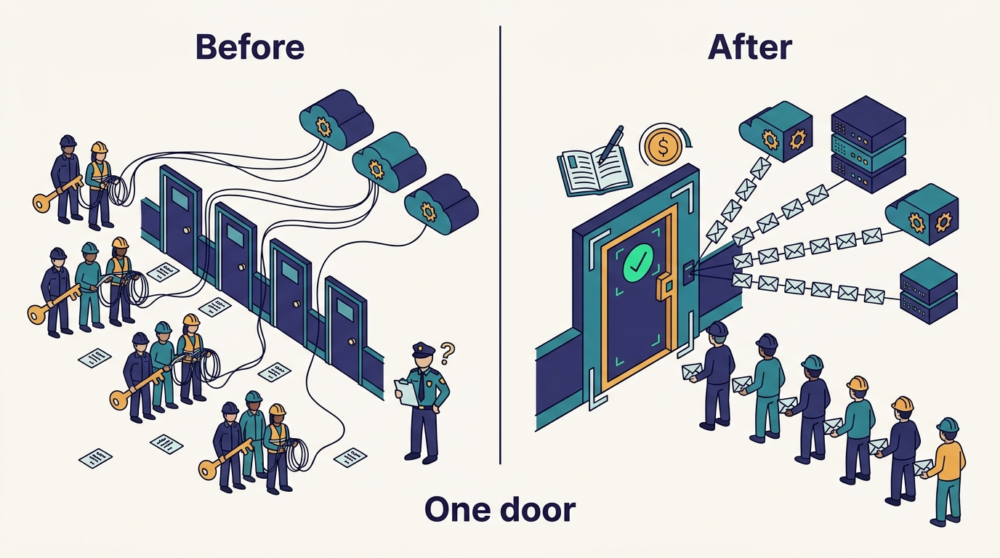
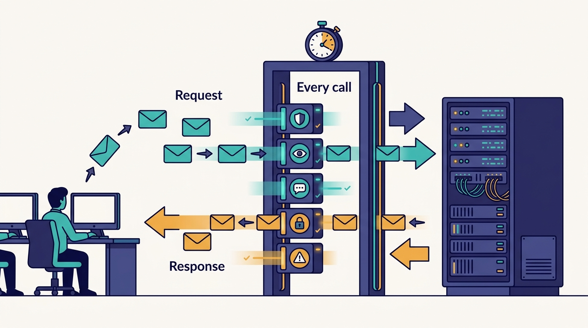
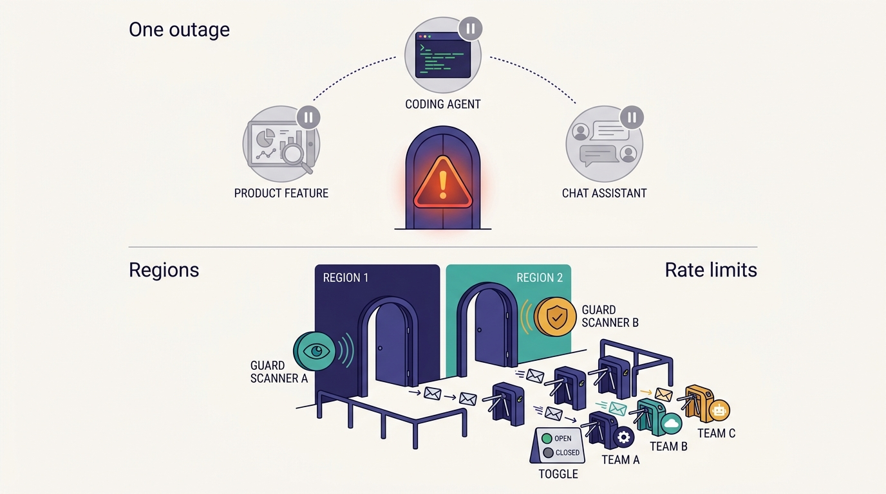

> **IN THIS CHAPTER, YOU WILL:** Follow Uber's Model Gateway from its 2023 origin on the Michelangelo ML platform to its 2026 role as the path for every model request at Uber. You will see what AI Guard does on that path, and why per-project attribution turned out to matter more than the API shape.

> **WHY IT MATTERS:** Model gateways are now a standard part of AI architecture. Building one is easy; the hard decisions are about who may bypass it, what runs inline, and how much latency and failure coupling the organization will accept for consistent policy.

> **KEY POINTS:**
>
> * **The gateway is a policy decision, not an API adapter.** OpenAI- and Anthropic-compatible endpoints make switching vendors cheap. What gives Uber's gateway its value is the rule, as Medisetty described it, that no model request bypasses it, so security, attribution, audit and spend controls apply everywhere at once.
> * **Identity comes from the ML platform, not from the gateway.** Teams call the gateway with a Michelangelo project ID and a caller token. Michelangelo has given Uber a registry of AI projects with owners since 2016–2017, and that registry is what makes per-project and per-user attribution, budgets and security review possible.
> * **Inline guardrails turn the gateway into a hot path you must engineer for.** AI Guard runs a set of specialized safety and policy models on every request and response, under a latency budget Uber has put at under 100 ms. That buys one security baseline, at the price of latency, failure coupling and a single point of failure, all of which need explicit design.

> **BUILT ON:** Michelangelo, Uber's ML platform (2016–), with its project model, serving stack and GenAI layer; the build-it-in-house platform habit of [[build-what-does-not-exist]]; the security review and data-handling standards Uber's Engineering Security team already applied to services.

 
Every company that adopts large language models (LLMs) meets the same problem within a few months. One team calls OpenAI with a key in an environment variable, another uses a cloud provider's SDK, a third runs an open-weight model on its own GPUs. Each has its own logging, or none. When the security team asks which prompts contained customer data, nobody can answer. When finance asks what the company spends on models, the answer is a pile of vendor invoices that maps to no team.

Uber's answer, started in late 2023 and still in place as of October 2026, is the **Model Gateway**: one internal service through which, according to Uday Kiran Medisetty, Uber Distinguished Engineer, "every model request at Uber goes". It speaks the OpenAI- and Anthropic-compatible APIs, hides closed and open-weight models from every vendor behind them, and carries a stack of middleware. The first and most important piece is **AI Guard**, the security team's inline content and policy check.

This chapter is the first of Part II, the "agnostic building blocks" Medisetty described in the October 2026 Pragmatic Engineer episode. It explains why the gateway exists, how it works as far as the public record shows, what it stands on, and what a company that is not Uber should copy. The next two chapters apply the same idea to coding harnesses ([[aifx-harness-layer]]) and to tools ([[mcp-gateway]]). **The pattern repeats: put one door in front of something that changes quickly, and make the door the place where policy lives.**

## The Problem Uber Had: Many Teams, Many Vendors, No Single Point of Control

In the episode, Medisetty described the starting position plainly. When ChatGPT and the GPT models launched, many internal teams wanted to use them for different use cases, and the platform team wanted to make that easy. (He first said "late 2013, early 2014"; Orosz checked, and Medisetty corrected it to late 2023 and early 2024.) Uber already had the documented scale problems that make ad-hoc vendor access dangerous:

- **Sensitive data everywhere.** Uber's systems carry rider and earner names, phone numbers, locations and payment details in dozens of countries. Sending any of it to an external model provider is a data-handling decision, not a coding one.
- **Many consumers at once.** Uber's 2024 GenAI Gateway post counted more than 60 LLM use cases across about 30 customer teams within the gateway's first year or so. The October 2024 Genie post describes an on-call copilot, launched in September 2023, answering about 45,000 questions a month in Slack. Each of these would otherwise have built its own integration.
- **A market that changed every quarter.** The model that was best in 2023 was not the best in 2024, and the 2026 models differ again. Medisetty framed the whole AI foundations program around that fact: because models and harnesses change so quickly, Uber wanted building blocks that are harness- and model-agnostic.

The show notes for the episode, written by host Gergely Orosz, put the decision even more sharply: in 2023 Uber's platform team decided that "everything built with AI needs to be model- and harness-agnostic." The Model Gateway was the first building block to follow from it.

The **model-agnostic principle**, as this book uses the term, is that no product or tool at Uber should depend on a particular model vendor's API, keys or SDK. Applications name a model; the platform decides how that model is reached, under which policy, and at whose cost. That principle is cheap to state and expensive to enforce, and the gateway is the enforcement point.

**Figure 1:** *The gateway's value is the rule that no model request bypasses it, which turns scattered vendor keys into one door where security, attribution and cost are handled once.*

## What Uber Built: One API, One Identity Model, One Middleware Stack

### The Lineage: Four Names for One System

The same system appears under four names in Uber's public record, and a reader comparing sources should treat them as one lineage:

| Name | Where it appears | Date |
| --- | --- | --- |
| Michelangelo Gateway | Genie on-call copilot post | Oct 2024 (describing usage since Sept 2023) |
| GenAI Gateway | "Navigating the LLM Landscape" post | Jul 2024 |
| AI Gateway | "Solving the Identity Crisis for AI Agents" post | May 2026 |
| Model Gateway | AI Engineer World's Fair 2026 talk; the October 2026 episode | 2026 |

Medisetty dates the start to late 2023, when the first wave of LLMs launched. No written source gives a build date, but the Genie post's statement that the September 2023 copilot logged usage "through Michelangelo Gateway" is consistent with a gateway in production by late 2023.

### The 2024 Documented Design

The best documented version is the one in [Uber's July 2024 engineering post](https://www.uber.com/blog/genai-gateway/) by Tse-Chi Wang and Roopansh Bansal. Because it is more than two years old, parts of it have certainly changed, but its core choices are still visible in the 2026 descriptions.

- **A Go service that mirrors the OpenAI API.** The authors call this "a pivotal design decision": any team can use an OpenAI-style client, and the gateway translates for other vendors. In 2024 those were OpenAI, Google's Vertex AI (Uber open-sourced its [`go-vertex-ai`](https://github.com/uber/go-vertex-ai) client library) and models Uber hosted itself, such as Llama 2.
- **PII redaction with un-redaction.** Before a request goes to an external vendor, a redactor replaces personally identifiable information (PII) with numbered placeholders such as `ANONYMIZED_NAME_0`, keeps the mapping, and restores the original values in the vendor's response before returning it. The post admits the redactor adds latency and can reduce answer quality, without giving figures.
- **Security review before access.** Uber's Engineering Security team reviewed each use case against the company's data-handling standard before granting gateway access.
- **Audit logs for three audiences.** The same logs served cost attribution, security audits and quality evaluation.
- **Scale in 2024:** about 16 million queries a month at a peak of 25 queries per second.

### The 2026 System as Medisetty Described It

In the October 2026 episode, Medisetty described the gateway from a team's point of view. A team creates a GenAI project on Michelangelo, then "they create a client, they give their project ID, which they initialized in Michelangelo. And then the caller token, and that's all." Behind that one call:

1. **One OpenAI-compatible and Anthropic-compatible API**, with every vendor's models, open-weight and closed-weight, behind it. Anthropic compatibility, absent from the 2024 post, is confirmed in the 2026 AI Engineer talk by Medisetty and Adam Huda.
2. **AI Guard**, described below, on every request and response.
3. **Per-user and per-caller attribution**, possible because every project is tracked in the gateway.
4. **Spend limits per project and per user**, added during 2026, which [[token-spend-governance]] turns into the spend-tier system.
5. **Audit logging and session traces.**
6. **Billing and cache-hit-rate tracking**, which matter more as prompt caching becomes the main cost lever.
7. **A future entry point for model routing.** Medisetty described routing as something the gateway is well placed for, not as a finished feature.

The 2026 AI Engineer talk adds numbers the episode does not give: an identity step using SPIFFE/SPIRE workload identity, a data anonymizer that redacts more than 20 PII types, "5 specialized safety/policy models", all middleware finishing in under 100 ms, more than 800 internal projects, and more than 100 million model requests a day. A vendor-published summary of the talk (Port, August 2026) repeats those figures. Taken together with the 2024 post, **daily volume grew roughly two hundredfold in two years** (from about half a million queries a day to more than 100 million), though the two sources may not count requests the same way.

---begin mermaid---
flowchart LR
    A["Product service or agent"] -->|"project ID plus caller token"| G["Model Gateway"]
    H["Coding harness via AIFX"] -->|"OpenAI or Anthropic API"| G
    G --> I["Identity and project lookup in Michelangelo"]
    I --> R["PII redaction"]
    R --> AG["AI Guard request checks"]
    AG --> V1["Closed-weight vendor models"]
    AG --> V2["Open-weight models hosted by Uber"]
    V1 --> AG2["AI Guard response checks"]
    V2 --> AG2
    AG2 --> U["Un-redaction"]
    U -->|"response"| A
    G -.-> L["Attribution, spend limits, audit logs, session traces, cache-hit tracking"]
---end mermaid---
**Figure 2:** *The request path as Uber's sources describe it. Every caller presents a Michelangelo project identity; redaction and AI Guard wrap the vendor call in both directions; attribution and audit hang off the same path. The exact order of steps inside the gateway is not documented — this ordering follows the 2024 post and the 2026 talk.*

### AI Guard

**AI Guard** is the inline safety and policy layer of the gateway. Medisetty described it as the first middleware added to the gateway, run by the security team to make sure no sensitive content is sent back to the user. It consists of "five different sets of fine-tuned models" covering content, safety policy and communications policy, and it "runs on every request and every response with strict latency guardrails." The show notes add that AI Guard also measures latency and flags overly slow models or queries.

Written sources confirm the role and fill in the threat list. Uber's [May 2026 agent identity post](https://www.uber.com/us/en/blog/solving-the-agent-identity-crisis/) says the AI Gateway mediates outbound calls to OpenAI and Anthropic, with AI Guard handling **prompt injection, jailbreaks and PII redaction**. The 2026 talk gives the "5 specialized safety/policy models" and the under-100 ms middleware budget. An RSA Conference 2026 session titled "AI Guard: Securing LLMs, Agents and AI Applications at Uber Scale" (speaker Junyan Guo) lists latency hardening, failure coupling, shadow-mode rollout and parallel execution of guard models across CPU and GPU among its topics; only the abstract was visible to the research behind this book, so treat those details as the session's agenda, not as a documented design. The word "fine-tuned" appears only in the episode.

The design point that matters is in Medisetty's last sentence on the topic: "This helped a lot to make sure that all of our projects have the same standard baselines." **A guard that runs in the gateway is a baseline nobody can forget to install.** The alternative, a guard library each product team adds to its own code, gives the security team no way to know whether it is present, which version runs, or whether a new model has been added without it.

**Figure 3:** *A guard that runs in the gateway is a baseline nobody can forget to install: AI Guard checks every request and every response, inside a middleware budget Uber has put at under 100 ms.*

> **INFERENCE, NOT DOCUMENTED:** Running five classifiers on both the request and the response under 100 ms almost certainly means running them in parallel, on small models served close to the gateway, with a policy for what happens when a classifier times out (fail open or fail closed, perhaps differently per project risk class). The RSAC agenda's mention of "parallel rail execution" and "failure coupling" fits that reading, but Uber has not described its timeout policy.

## The Foundation Underneath: Why Michelangelo Made This a Product, Not a Proxy

A gateway that forwards HTTP requests can be built in a week. Uber's took longer and does more because it was built, in Medisetty's words, as "a Michelangelo GenAI product" on an ML platform that already existed. Three Michelangelo assets do most of the work.

**1. A registry of AI projects with owners.** Michelangelo was introduced publicly in [September 2017](https://www.uber.com/blog/michelangelo-machine-learning-platform/) as Uber's end-to-end ML platform. By the [May 2024 "From Predictive to Generative" post](https://www.uber.com/blog/from-predictive-to-generative-ai/) it had about 400 active ML projects and more than 5,000 production models. Every model at Uber already belonged to a Michelangelo project with an owning team. When the gateway asked callers for their Michelangelo project ID, it inherited that ownership model whole. Per-project attribution, per-project budgets and per-project security review need nothing new: the project is already the unit of ownership, and [[build-what-does-not-exist]] shows how much of Uber's later AI work rests on that kind of ownership metadata.

**2. A serving stack for models Uber runs itself.** Putting open-weight and closed-weight models behind one gateway works only if someone serves the open-weight models. Michelangelo's GenAI layer, per the 2024 post, included a model catalog, an LLM evaluation framework, a prompt engineering toolkit with versioned templates under code review, and Ray-based fine-tuning. The gateway could therefore route to Uber-hosted Llama models in 2024 and to open-weight models in 2026 without a separate infrastructure project. Without that, "model-agnostic" would mean "vendor-agnostic among API vendors".

**3. An existing governance channel.** The 2024 post's per-use-case security review against the data-handling standard is not an AI invention; it is how Uber's security team already reviewed services. The gateway gave that review a single technical enforcement point.

Michelangelo's core was [open-sourced on 20 May 2026](https://michelangelo-ai.org/blog/open-source-launch/) (Apache-2.0, in beta); Medisetty noted that the GenAI and agentic components Uber is building are not yet in the open-source version.

| Gateway capability | Pre-AI foundation it reuses | What it would cost without it |
| --- | --- | --- |
| Per-project attribution and budgets | Michelangelo project registry with owners | A new registry of "AI apps" that drifts from the real ownership graph |
| Open-weight models behind the same API | Michelangelo model serving, GPU fleet, fine-tuning | A separate inference platform before the first open model can be offered |
| Security review per use case | Engineering Security's data-handling standard and review process | A new approval process with no enforcement point |
| Session traces and audit logs | Uber's existing logging and observability infrastructure | A separate logging pipeline for AI traffic |
| Workload identity for callers (2026) | SPIFFE/SPIRE workload identity, which Uber's 2026 agent identity post also uses for agents (the sources do not say when Uber adopted it) | Long-lived API keys copied into services |

## Design Choices and Trade-offs

Every company building a model gateway faces the same set of choices. Uber's choices are visible in the record; the alternatives are where a smaller company may reasonably differ.

| Decision | Uber's choice (as described) | Alternative | When the alternative is right |
| --- | --- | --- | --- |
| Access path | **All** model requests through the gateway, no exceptions | Gateway for production apps; direct vendor access for experiments | Fewer than ~100 engineers, no regulated data, and a security team that can audit vendor keys directly |
| API shape | Mirror OpenAI and Anthropic APIs | Uber-defined canonical API | When you need strong abstraction over provider differences and can afford maintaining client SDKs |
| Guardrails | Inline on every request and response | Asynchronous scanning of logs after the fact | Low-risk internal use where blocking matters less than detection, or latency budgets are tight |
| Identity | Michelangelo project + caller token; workload identity in 2026 | Per-team vendor API keys | Never at scale; acceptable for a pilot |
| Model hosting | Closed vendors and Uber-hosted open-weight models | Vendor APIs only | When no team can operate GPU inference, or volumes do not justify it |
| Build vs buy | Built on the in-house ML platform | LiteLLM, Kong, Cloudflare or a cloud provider's gateway | Almost always, unless you already run an ML platform with a project model |

The trade-off that deserves the most attention is the one the episode does not dwell on: **a mandatory gateway is a single point of failure.** If every model request goes through one service, an outage of that service is an outage of every AI feature, every coding agent and every internal assistant at the same moment. The RSAC session's "failure coupling" topic suggests Uber treats this as a real engineering concern. The usual mitigations are the ones any tier-0 service uses: multiple regions, independent deployment of the guard models from the routing path, per-tenant rate limits so one runaway agent cannot starve others, and a documented decision about what each guard does when it is slow.

**Figure 4:** *A mandatory gateway is a single point of failure: an outage stops every AI feature at once, so it needs tier-0 treatment with multiple regions, independent guard deployment, per-tenant rate limits and a decided timeout policy.*

The second trade-off is the **lowest-common-denominator problem.** An OpenAI-compatible API is a translation layer, and every vendor ships features (extended thinking controls, prompt-caching parameters, new tool-use formats) before any compatible layer supports them. Offering both OpenAI- and Anthropic-compatible endpoints, as Uber does in 2026, is a practical answer: the two dominant client shapes cover most callers, and features specific to one vendor reach that vendor's callers without waiting for a canonical abstraction. The cost is that the gateway team has to track two moving API surfaces.

---begin mermaid---
flowchart TB
    D["Model-agnostic principle, 2023"] --> MG["Model Gateway"]
    MG --> AG["AI Guard baseline"]
    MG --> AT["Per-project and per-user attribution"]
    AT --> ST["Spend tiers"]
    AT --> CC["Cost visibility in harness status lines"]
    MG --> AU["Audit logs and session traces"]
    AU --> TA["Trace analysis for skills and grounding"]
    MG --> RT["Model routing, positioned as a future step"]
    MG --> HA["Harness-agnostic layer AIFX"]
---end mermaid---
**Figure 5:** *What the single door made possible later. Spend tiers, cost feedback, trace analysis and harness portability all assume one place where every model request is identified and recorded. Routing is shown as Medisetty described it: a direction, not a shipped feature.*

## Elsewhere in the Industry

Model gateways are no longer an Uber peculiarity; they are a product category.

- **LiteLLM.** Thoughtworks' Technology Radar has placed LiteLLM in **Trial** since October 2024; the [April 2026 entry](https://www.thoughtworks.com/en-us/radar/languages-and-frameworks/litellm) calls it a "sensible default" for request tracing, access control and guardrails, while warning that provider-specific features bring coupling back and that its `drop_params` option can silently discard parameters. The [LiteLLM proxy](https://docs.litellm.ai/docs/simple_proxy) exposes one OpenAI-compatible endpoint for more than 100 providers, issues virtual keys with per-key model lists, budgets and rate limits, and records the cost of every request. That is most of Uber's 2024 feature list as open source.
- **Managed gateways.** [Cloudflare AI Gateway](https://developers.cloudflare.com/ai-gateway/) offers logging, caching, rate limiting and fallback routing across providers. [Kong AI Gateway](https://developer.konghq.com/ai-gateway/) adds token-based rate limits, per-request cost and the ability to publish existing APIs as MCP tools — a sign that the model gateway and the tool gateway of [[mcp-gateway]] are converging into one control point.
- **The difference.** None of these products knows who owns a project, which data classification a use case was approved for, or which team should pay. Uber's gateway is valuable less for its proxying than for being joined to Michelangelo's project registry and the security team's approval records. A company that buys a gateway still has to supply that metadata itself.

## If You Are Not Uber

The minimum viable version is small. **One endpoint, one identity per calling application, one log, and a written rule that nothing calls a model vendor directly.** Everything else can follow.

**Prerequisites.** You need an owner for each calling application (even a spreadsheet), a data-classification rule that says what may leave the company, and a security team willing to enforce "no direct vendor keys" by revoking them.

**Sequencing.**

1. Stand up an open-source or managed gateway with OpenAI- and Anthropic-compatible endpoints. Issue one virtual key per application or team, never per person.
2. Revoke direct vendor keys in production. Keep a short, time-boxed sandbox exception for experiments.
3. Turn on request logging with attribution to the owning team, and send a monthly cost report per team.
4. Add PII redaction for the data classes your policy names; measure its latency and quality cost on real traffic before making it mandatory.
5. Add inline guard models (prompt-injection and content classifiers) in shadow mode first, measuring flagged rates and latency, then enforce.
6. Only then consider model routing, caching policy and self-hosted open-weight models.

| Company size | What to run | What to skip |
| --- | --- | --- |
| ≈50 engineers | A managed gateway or LiteLLM; one key per app; logs and a cost dashboard | Self-hosted models, custom guard models, an internal "AI project" registry |
| ≈500 engineers | Self-hosted LiteLLM or Kong; keys tied to service ownership; PII redaction; one or two guard classifiers in shadow, then enforced; per-team budgets | Building your own gateway service; fine-tuning guard models |
| ≈5,000 engineers | A gateway joined to your ML platform or service catalog for identity; workload identity instead of keys; a guard model set owned by security with a latency SLO; multi-region deployment; hosted open-weight models where volume justifies | Mirroring every vendor feature in a canonical API |

**What not to copy.** Do not copy the five-model guard stack before you have measured what your traffic needs; a single prompt-injection classifier plus redaction covers most of the risk for internal tools. Do not build a gateway on top of an ML platform you do not have. And do not make the gateway mandatory before it is as reliable as the vendor it fronts: engineers will route around a gateway that is slower or less available than the API behind it.

## Failure Modes

- **The bypass.** One team keeps a direct vendor key "for latency" or "for a new feature the gateway does not support yet". The bypass becomes the path for the most sensitive traffic, because that is where the newest features are used. The remedy is organizational (key revocation, procurement controls) as much as technical.
- **The gateway outage that takes everything down.** When the gateway is mandatory, its availability is the availability of every AI feature and every coding agent. Imitators often run the gateway as an ordinary service with ordinary on-call; it needs tier-0 treatment.
- **Guardrails that quietly degrade quality.** The 2024 post admits that redaction can reduce answer quality. A guard that blocks or rewrites too much pushes users to bypass it. Track the flagged rate and the false-positive rate per guard, and review them with the teams affected.
- **Latency stacking.** Each middleware adds a few milliseconds; five classifiers in sequence, on both directions, add many. Without an explicit budget (Uber's is reported as under 100 ms for the whole stack), latency grows one well-intended check at a time.
- **Attribution without ownership.** Per-key cost reports are useless if keys map to people who left or to a shared "platform" account. Attribution only works when it is joined to a maintained ownership record.
- **Compatibility drift.** A compatible API that lags vendor releases by months turns the gateway into the reason engineers cannot use the latest model capabilities.

## What the Record Does Not Say

- Whether AI Guard fails open or fails closed when a guard model times out, and whether that differs by project risk.
- What the five guard models are, how they were trained, and what the "fine-tuned" in the episode refers to (no written source uses the word).
- How Uber handles provider outages: whether the gateway fails over across vendors automatically, and whether callers opt in.
- Whether caching (semantic or exact-match) happens in the gateway, or only vendor prompt caching is tracked.
- How the gateway's own availability is engineered: regions, deployment independence of middleware, rate limits between tenants.
- When model routing will move from "good entry point" to production, and on what signal (cost, benchmark score on Uber's internal SWE benchmark, latency).
- How the 2024 per-use-case security review scales to more than 800 projects; whether it is still manual.

## Questions to Ask

1. Is there any path in our company by which code reaches a model vendor without passing a control point we own? Who holds those keys?
2. What is the unit of attribution for model spend — person, team, application, project — and is it joined to an ownership record someone maintains?
3. What does our gateway do when a guard check is slow or down, and who decided that?
4. What latency budget have we set for everything that runs inline, and who has to approve adding to it?
5. Which vendor features do our callers need that the compatible API does not expose, and how long do they wait?
6. Would a gateway outage be a tier-0 incident for us? Is the gateway run like one?
7. Do we need self-hosted models at all, or is "vendor-agnostic among API vendors" enough for the next two years?
8. Could we answer the security team's question "which prompts contained customer data last month" today?

The Model Gateway gave Uber one door for models. The next problem was that engineers do not call models directly: they use coding harnesses such as Claude Code, Codex and OpenCode, each with its own settings, plugins and tool configuration. [[aifx-harness-layer]] describes how Uber applied the same single-door idea to the harness itself.

## Sources and Evidence

**The source episode**

- [Uber's AI infra, from the inside](https://newsletter.pragmaticengineer.com/p/ubers-ai-infra-from-the-inside), *The Pragmatic Engineer* podcast, Gergely Orosz with Uday Kiran Medisetty, 2026 (14 October) — the Model Gateway's origin, Michelangelo project ID and caller token, AI Guard, attribution, spend limits, audit logs and routing as a future step; the show notes' "model- and harness-agnostic" decision and AI Guard latency flagging.

**Uber engineering sources**

- [Navigating the LLM Landscape: Uber's Innovation with GenAI Gateway](https://www.uber.com/blog/genai-gateway/), Tse-Chi Wang and Roopansh Bansal, Uber Blog, 2024 — Go service, OpenAI-compatible API, vendors, PII redaction and un-redaction, security review, audit logs, 2024 scale.
- [Genie: Uber's Gen AI On-Call Copilot](https://www.uber.com/blog/genie-ubers-gen-ai-on-call-copilot/), Nicholas Marcott, Eduards Sidorovics and Paarth Chothani, Uber Blog, 2024 — usage logged through "Michelangelo Gateway" since September 2023.
- [Meet Michelangelo: Uber's Machine Learning Platform](https://www.uber.com/blog/michelangelo-machine-learning-platform/), Mike Del Balso and Jeremy Hermann, Uber Blog, 2017 — the ML platform the gateway is built on.
- [From Predictive to Generative – How Michelangelo Accelerates Uber's AI Journey](https://www.uber.com/blog/from-predictive-to-generative-ai/), Kai Wang, Joseph Wang and Min Cai, Uber Blog, 2024 — Michelangelo scale and its GenAI layer.
- [Michelangelo is Now Open Source](https://michelangelo-ai.org/blog/open-source-launch/), the Michelangelo team, 2026 — the May 2026 open-source release.
- [Solving the Identity Crisis for AI Agents](https://www.uber.com/us/en/blog/solving-the-agent-identity-crisis/), Matt Mathew, Prasad Borole and Meng Huang, Uber Blog, 2026 — the AI Gateway and AI Guard's prompt-injection, jailbreak and PII roles.
- [Agentic SDLC at Uber: Building Blocks for Uber's Software Factory](https://ai.engineer/talks/17-YSUHo6Lk-agentic-sdlc-at-uber-building-blocks-ubers), Uday Kiran Medisetty and Adam Huda, AI Engineer World's Fair, 2026 — Anthropic compatibility, SPIRE identity, 20+ PII types, five safety and policy models, under-100 ms middleware, 800+ projects, 100M+ requests a day.
- [How Uber built an AI software factory for agentic coding](https://newsletter.port.io/p/how-uber-built-a-software-factory), Zohar Einy, Port newsletter, 2026 — vendor-published summary of the talk, repeating its figures.
- AI Guard: Securing LLMs, Agents and AI Applications at Uber Scale, Junyan Guo, RSA Conference, 2026 — session topics only; the page could not be fetched in full.

**Industry and research sources**

- [LiteLLM](https://www.thoughtworks.com/en-us/radar/languages-and-frameworks/litellm), Thoughtworks Technology Radar, 2026 (Vol. 34) — gateways as a "sensible default" and the limits of the abstraction.
- [LiteLLM AI Gateway documentation](https://docs.litellm.ai/docs/simple_proxy), BerriAI, current as of 2026 — virtual keys, budgets, per-request cost.
- [Cloudflare AI Gateway documentation](https://developers.cloudflare.com/ai-gateway/), Cloudflare, current as of 2026 — the managed-service form of the pattern.
- [Kong AI Gateway documentation](https://developer.konghq.com/ai-gateway/), Kong, current as of 2026 — token rate limits, cost and MCP publication in one gateway.

Statements about Uber's AI-era systems are Uber's own account unless another source is cited; recommendations and labeled inferences are the author's judgement.
