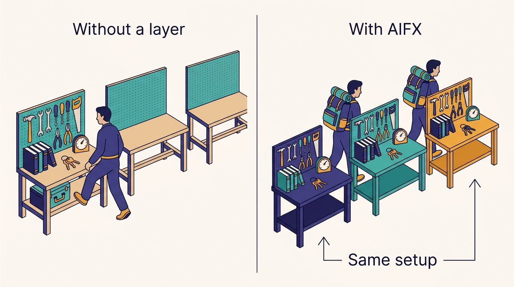
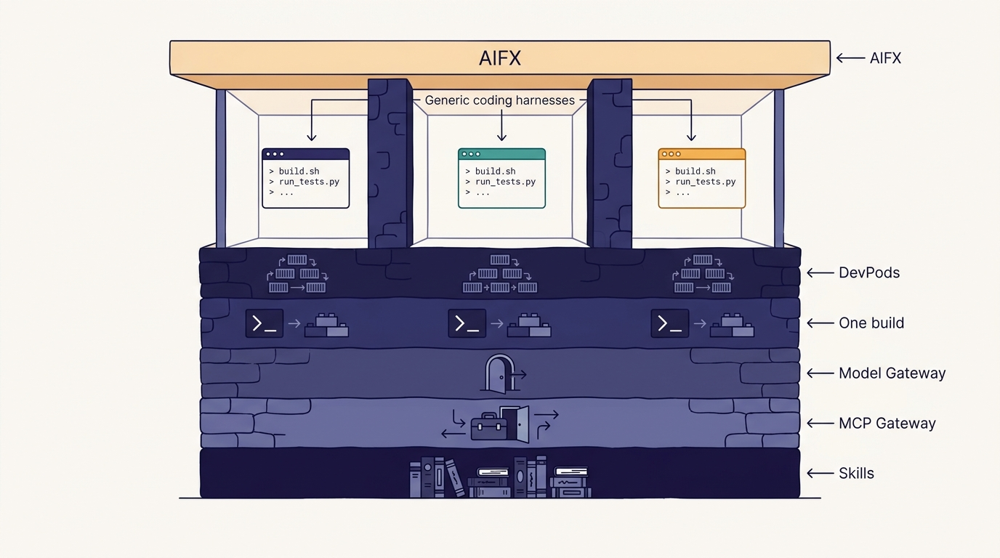

> **IN THIS CHAPTER, YOU WILL:** See how Uber's AIFX layer sits above Claude Code, Codex and OpenCode: personas with default plugins and skills, centrally managed and per-user synced settings, one install command for every harness, and a status line that carries tips and spend. You will also see what AIFX owns and what it deliberately leaves to the harness.

> **WHY IT MATTERS:** Coding harnesses have changed faster than any other part of the AI stack. In early 2026, according to a March 2026 Pragmatic Engineer report, one harness doubled its share of Uber's engineers in two months. An organization that configures each harness separately pays a migration tax every time engineers move, and it loses control of what tools and policies those engineers run.

> **KEY POINTS:**
>
> * **Harness churn is a design assumption, not a risk to be managed away.** Uber went from enabling Cursor in early 2025 to supporting Claude Code, Codex and OpenCode in 2026. AIFX (AI Foundations), as Medisetty described it, makes the harness a replaceable client by owning everything engineers would otherwise lose in a switch: settings, skills, plugins and tool configuration.
> * **AIFX owns distribution, identity and feedback, not the agent loop.** One `plugin add` updates every harness, whether or not it is in use. Personas install default skills. Central settings reach every user, per-user settings follow them between laptop and DevPods, and the status line shows tips and spend. The harness keeps its own model loop and user interface.
> * **The layer only works because the layers under it are already standard.** AIFX can stay thin because the [[model-gateway]] handles models, the [[mcp-gateway]] handles tools, the [[skills-monorepo]] handles skills and DevPods arrive with every harness pre-installed. A company without those layers that copies AIFX gets only a configuration-sync script.

> **BUILT ON:** [[devpods]] (pre-built images with every harness installed), the [[model-gateway]] (one model endpoint and per-user attribution), the [[mcp-gateway]] (one tool catalog), the per-language monorepos and standard build commands of [[monorepos-and-one-build]], and Uber's habit of shipping internal command-line tools to every engineer.

 
A **coding harness** is the program that wraps a model in an agent loop for software work: it reads files, runs commands, calls tools, holds the session and decides when to ask the human. Claude Code, Codex and OpenCode are harnesses; so are Cursor's agent mode and GitHub Copilot's agent. Each one has its own settings file, its own plugin and skill locations, its own way to register Model Context Protocol (MCP) servers, its own permission model and its own update cycle.

For an individual engineer, that is a minor nuisance. For a company with several thousand engineers, it is a governance and productivity problem. **Every harness switch resets an engineer's setup to zero**, and every new harness is a new place where security settings, tool access and cost controls must be configured again. In the October 2026 Pragmatic Engineer episode, Uday Kiran Medisetty, Uber Distinguished Engineer, described the question Uber asked after building its Model Gateway: "how do we make it easy for engineers to switch across harnesses? If I'm using Claude Code, then if I switch to Codex then I need to carry forward all of my settings, all the skills, all the tools, all the plugins."

Uber's answer is **AIFX**, short for AI Foundations: an internal layer that wraps every supported harness. This chapter explains what AIFX does as far as the public record shows, why harness churn makes it worth building, what it depends on, and how a smaller company can get most of the benefit with much less.

## The Problem Uber Had: Engineers Kept Moving, and Configuration Did Not

The evidence that harnesses churn comes from Uber's own numbers. In a March 2026 Pragmatic Engineer article based on a talk by Uber's Ty Smith and Anshu Chada, Gergely Orosz reported that **Claude Code usage among Uber engineers rose from 32% in December 2025 to 63% in February 2026**, while Cursor and IntelliJ usage plateaued. In the October episode, Medisetty traced the AI tooling back to early 2025, when "Cursor kind of picked up" and Uber enabled it. By the time of the episode, the show notes list Claude Code, Codex and OpenCode as the supported harnesses.

Three costs follow from that churn, and each falls on a different group:

| Who pays | The cost of a harness switch without a common layer |
| --- | --- |
| The engineer | Re-creating settings, re-installing skills and plugins, re-registering MCP servers, re-learning where the cost counter is |
| The platform team | Shipping each new skill, plugin and tool in N formats; supporting N installation paths; debugging N configuration bugs |
| Security and finance | Re-applying permission policies, tool allowlists and spend controls in each harness's own configuration format, and auditing whether they were applied |

**Figure 1:** *Without a common layer every harness switch resets an engineer's setup to zero; AIFX makes the harness a replaceable client by owning the settings, skills, plugins and tool configuration that would otherwise be lost.*

The second cost grows with the size of the shared catalog. As of August 2026, Uber's engineering blog counted more than 3,600 agent skills and more than 30,000 skill executions a day; the October 2026 MCP Gateway post counted more than 800 MCP servers and more than 5,000 tools. **A shared catalog of that size cannot be maintained per harness.** It needs one distribution channel that writes into every harness's format.

## What Uber Built: A Wrapper That Owns Configuration, Distribution and Feedback

### What the Episode Describes

Medisetty's description of AIFX in the episode covers six behaviors:

1. **One wrapper over every harness.** "We internally wrap all of the harnesses with a wrapper called AIFX, AI Foundations. And this is pre-installed on DevPods or you can install on your local machine."
2. **Personas.** Each persona comes with default plugins and skills, so an engineer does not have to install them. A **persona** is a named role profile that decides what an engineer gets by default. The episode does not list Uber's personas; role-based examples such as backend, mobile or data are the author's guess.
3. **Centrally managed settings**: one set of settings the platform team manages and propagates to all users.
4. **Per-user settings that follow the user**, synced across all of an engineer's environments: the laptop and any number of DevPods.
5. **One install path for every harness.** Describing the skills monorepo, Medisetty said that "if you do plugin add that skill, it will update the configurations across all of the harnesses, whether you are at that point using that harness or not." The same applies to tools: through AIFX, internal and external MCP tools install the same way.
6. **A status line with tips and spend.** "There's a status line where we can give tips, where we can have tracking of your spend across harnesses, within that harness, in that session."

He summarized the effect as one entry point for switching harnesses and tools, with all of it arriving without any explicit setup by the engineer. AIFX also hosts `aifx validate`, the single command that runs inner-loop checks before an agent opens a pull request; that command and the CI "code red" behind it belong to [[inner-loop-and-self-healing-ci]].

### What Written Sources Confirm

AIFX is not a podcast-only name, but the written record describes a narrower tool than the episode does:

- The [March 2026 Pragmatic Engineer article](https://newsletter.pragmaticengineer.com/p/how-uber-uses-ai-for-development) describes the **AIFX CLI** as provisioning AI clients, discovering MCP servers, running background tasks and updating tools.
- The Agentic AI Foundation's [May 2026 write-up](https://aaif.io/blog/how-uber-runs-60000-ai-agent-tasks-per-week-with-mcp) of Uber's MCP Dev Summit talk says coding agents (Claude Code, Cursor, Minions) add MCP servers through the AIFX CLI.
- Uber's [October 2026 MCP Gateway post](https://www.uber.com/blog/designing-mcp-gateway/) names `aifx` as "Uber's CLI" and documents `aifx mcp list`, `aifx mcp search` and `aifx mcp call`, the "Code Mode" path that the post calls "the company default for MCP tool use in coding agents."
- Uber's [August 2026 "Running a Software Factory Efficiently" post](https://www.uber.com/us/en/blog/efficient-software-factory/) confirms a live cost counter in the harness status line, without naming the component that draws it.
- The AI Engineer World's Fair 2026 talk describes managed skills that ship with **persona-based defaults** — close to the episode's personas, but described for the skills marketplace rather than for AIFX.
- "AI Foundations" is a real Uber team name: engineers with "AI Foundations" in their titles co-authored the 2025 uReview post and spoke at the May 2026 Background Agents Summit.

The parts that are **Uber's own account only**, from the episode, are AIFX as a wrapper over several harnesses, settings sync across environments, personas as an AIFX concept and the cross-harness `plugin add`. None contradicts the written record; they are simply not yet written down elsewhere.

---begin mermaid---
flowchart TB
    P["Persona and central settings"] --> AX["AIFX layer"]
    U["Per-user synced settings"] --> AX
    SK["Skills and plugins from the skills monorepo"] --> AX
    MC["Tool catalog from the MCP Gateway"] --> AX
    AX -->|"writes native config"| CC["Claude Code"]
    AX -->|"writes native config"| CX["Codex"]
    AX -->|"writes native config"| OC["OpenCode"]
    CC --> MG["Model Gateway"]
    CX --> MG
    OC --> MG
    MG -.->|"spend and session data"| SL["Status line tips and spend"]
    SL -.-> CC
    SL -.-> CX
    SL -.-> OC
---end mermaid---
**Figure 2:** *AIFX as described in the episode: one layer takes personas, central and per-user settings, skills and tools, and writes them into each harness's native configuration, while spend data from the Model Gateway returns to every harness's status line. The arrow labeled "writes native config" is the author's reading of how a wrapper would work; Uber has not described the mechanism.*

### What AIFX Owns, and What It Leaves Alone

The most useful way to read AIFX is as a division of responsibilities. The harness vendors compete on the agent loop: planning, tool selection, context management, the interface. AIFX does not try to replace any of that. It owns the things a company must control and a vendor cannot know.

| Concern | Owned by AIFX (as described) | Left to the harness |
| --- | --- | --- |
| Which skills and plugins an engineer has | Persona defaults, one install for all harnesses | Loading and invoking them during a session |
| Which tools are reachable | Registration of internal and vendor MCP tools; the `aifx mcp` CLI path | Choosing which tool to call |
| Organization-wide settings | Central settings pushed to everyone | Interpreting them |
| Personal preferences | Sync across laptop and DevPods | Applying them |
| Cost feedback | Status-line spend and tips across harnesses | — |
| Pre-PR checks | `aifx validate` | Deciding when to run it, guided by skills and instructions |
| Model access | (Delegated to the Model Gateway) | Model choice within what the gateway allows |
| The agent loop, interface and context management | — | Entirely |

> **INFERENCE, NOT DOCUMENTED:** Each of the three harnesses already has an administrator-level configuration mechanism (see "Elsewhere in the industry" below). A plausible reading — not a documented description — is that AIFX renders one internal configuration into each harness's native files and managed-settings channels, rather than intercepting the harness at runtime. That would explain how `plugin add` can update a harness "whether you are at that point using that harness or not": it edits that harness's configuration on disk. Uber has not said whether AIFX launches harnesses itself or only configures them.

### The Status Line as a Feedback Channel

Every harness session shows, in the same place, what the session has cost, what the engineer has spent across harnesses, and a tip. The August 2026 blog adds Slack nudges at 50%, 80% and 100% of expected spend and a cost-check skill that breaks spend down on demand; [[token-spend-governance]] covers that system. What matters for this chapter is that **the feedback reaches the engineer inside whichever harness they use**, because AIFX, not the harness vendor, draws it. A company that relies on each vendor's own usage display gets three different displays measuring three different things.

The same August post lists defaults that are exactly the kind of central settings such a layer distributes: automatic compaction at 400,000 tokens even on 1-million-token models, reasoning effort set to Medium, and a one-hour prompt-cache lifetime for interactive sessions (subagents keep five minutes). The post does not say which component sets them; the link to AIFX is an inference.

---begin mermaid---
sequenceDiagram
    participant Eng as Engineer
    participant AX as AIFX
    participant SR as Skills monorepo
    participant CC as Claude Code config
    participant CX as Codex config
    participant OC as OpenCode config
    Eng->>AX: plugin add a team skill
    AX->>SR: fetch the skill and its tool needs
    AX->>CC: install skill and tool entries
    AX->>CX: install skill and tool entries
    AX->>OC: install skill and tool entries
    Note over Eng,OC: Weeks later the engineer switches harness
    Eng->>CX: start a Codex session on a DevPod
    CX-->>Eng: same skills, same tools, same settings, spend in the status line
---end mermaid---
**Figure 3:** *Why a switch costs nothing. One install writes into every supported harness, including those not in use, so the later switch finds the setup already in place. The behavior is Medisetty's account; the per-harness write steps are the author's reading of how it is achieved.*

## The Foundation Underneath: Why the Wrapper Can Stay Thin

AIFX looks like the most "AI-native" piece of Uber's stack. It is actually the piece most dependent on what was there before. Remove any of the layers below and AIFX either becomes much larger or stops making sense.

**DevPods make "pre-installed" true.** Medisetty said that a new DevPod already has Claude Code, Codex and OpenCode installed. DevPods (described in [[devpods]]) are cloud development environments started from pre-built images, one flavor per monorepo. Putting AIFX and every harness into the image means a new environment arrives fully configured, and per-user settings sync is what makes a fresh DevPod feel like the engineer's own. Without managed environments, "pre-installed" becomes a laptop provisioning project per operating system.

**Standard builds make shared defaults meaningful.** A persona's default skills can assume one way to build and test each monorepo, because Uber has one ([[monorepos-and-one-build]]). Medisetty made the same point about agent instruction files: with standard builds, a top-level AGENTS.md or CLAUDE.md works out of the box. A persona default that has to branch on fifteen build systems is not a default.

**The gateways make the harness interchangeable.** If each harness talked to model vendors with its own keys and to tools through its own MCP configuration, switching harness would mean switching security policy. Because every model call goes through the [[model-gateway]] and every tool call can go through the [[mcp-gateway]], the harness becomes a client of two company-owned services. The episode's sequence is explicit: model portability first, then, on the same journey, harness portability.

**A shared skills format makes portability cheap.** The Agent Skills format — a folder with a `SKILL.md` file, originated by Anthropic and released as an [open standard](https://agentskills.io/) — is supported by Claude Code, Codex, OpenCode and many other clients. The [[skills-monorepo]] can therefore keep one copy of each skill; AIFX installs it into each harness's skill location. Before the standard, cross-harness skills would have needed per-harness translation.

| AIFX capability | Foundation it rests on | Without it |
| --- | --- | --- |
| Pre-installed everywhere | DevPods with pre-built images | Per-laptop installers and support tickets |
| Persona defaults that work | Standard build and test commands per monorepo | Defaults that break on half the repositories |
| Harness switch keeps policy | Model Gateway and MCP Gateway as the only paths to models and tools | Security and spend policy re-implemented per harness |
| One copy of each skill | Agent Skills standard plus one skills monorepo | Skills duplicated and diverging per harness |
| Spend in the status line | Per-user attribution in the Model Gateway | Each vendor's own usage display, incomparable |

**Figure 4:** *AIFX can stay thin because the layers under it are already standard; a company that copies the wrapper without the DevPods, the two gateways, one skills repository and standard builds gets only a configuration-sync script.*

## Design Choices and Trade-offs

| Decision | Uber's choice (as described) | Alternative | When the alternative is right |
| --- | --- | --- | --- |
| Number of supported harnesses | Several (Claude Code, Codex, OpenCode) | Standardize on one harness | Below a few hundred engineers, or when one vendor's enterprise controls cover your needs |
| Where configuration lives | One internal source rendered into every harness | Each harness configured by its own admin console | When you support only one harness |
| Defaults | Personas install skills and plugins automatically | Opt-in catalog only | When the catalog is small or quality is uneven |
| Settings scope | Central settings plus per-user sync across environments | Central only; personal settings stay local | When engineers work on one machine |
| Tool access from harnesses | Through the gateway and the `aifx mcp` CLI | Each harness registers MCP servers directly | Small tool catalogs where context load is not an issue |
| Build vs adopt | Built in-house | Vendor enterprise controls, dotfile managers, MDM | Almost always for smaller companies |

The central trade-off is **choice versus support cost.** Supporting three harnesses triples the testing surface for every skill, plugin and setting. Uber accepts that cost because, at its size, forcing everyone onto one harness would mean a mass migration each time the best harness changed — and the December-to-February numbers show how quickly that can happen. A company of 200 engineers can simply pick one harness and switch everyone when needed; the switch costs a week, not a quarter.

The second trade-off is **defaults versus context load.** Every default skill or tool a persona installs costs context in every session. Medisetty described the result in the skills discussion: before the rewrite to the command-line pattern, installing two plugins could keep six MCP servers permanently in the agent's context. Personas make defaults easy to add and therefore easy to overdo. Thoughtworks' Technology Radar placed "agent instruction bloat" under **Caution** in April 2026 for this reason.

The third is **wrapping versus lagging.** A layer that writes harness configuration must keep up with every harness release. When a vendor changes its settings schema or adds a feature, AIFX users may lag behind direct users. Writing into each harness's native mechanisms, rather than replacing them, keeps that lag small.

## Elsewhere in the Industry

Every major harness now ships its own administrator controls. The controls are similar in intent and different in every detail, which is the strongest argument for a layer like AIFX at large scale and the strongest argument for picking one harness at small scale.

- **Claude Code** reads [settings in a fixed precedence](https://code.claude.com/docs/en/settings): managed settings (a `managed-settings.json` file, device management, or the claude.ai admin console) override command-line flags, which override local project, shared project and user settings, in that order.
- **Codex** separates [enforced requirements from managed defaults](https://learn.chatgpt.com/docs/enterprise/managed-configuration): a `requirements.toml` holds "admin-enforced constraints that users can't override" — approval policy, sandbox mode, managed hooks, allowed plugin marketplaces and an allowlist of MCP servers that must match on both name and identity — while managed `config.toml` defaults can be changed by the user.
- **OpenCode** layers [configuration](https://opencode.ai/docs/config/) from a remote organization config at a `.well-known/opencode` endpoint, through global and project files, to managed files and device-management profiles that its documentation says override everything.
- **Shared formats are reducing the problem from below.** The Agent Skills standard and [AGENTS.md](https://agents.md/) — "a README for agents," now stewarded by the Agentic AI Foundation and used by more than 60,000 open-source projects — mean that instructions and skills increasingly work in every harness unchanged. Thoughtworks' Radar put "[curated shared instructions for software teams](https://www.thoughtworks.com/radar/techniques/curated-shared-instructions-for-software-teams)" in **Adopt** in April 2026, recommending that CLAUDE.md or AGENTS.md files live in service templates.

Uber's AIFX sits on top of all three mechanisms. Most companies will rely on one of them directly.

## If You Are Not Uber

The minimum viable version of AIFX is not a wrapper. **It is one repository of agent configuration, owned by a platform team, that is rendered into whichever harnesses you allow, plus a rule that tools and models are reached only through company-owned endpoints.**

**Prerequisites.** You need a model gateway (or at least one company-controlled model endpoint), a decision on which harnesses you support, and a managed way to put files on engineers' machines or cloud environments (device management, a dotfile tool or a cloud development environment image).

**Sequencing.**

1. **Pick one harness first.** Configure it through its own managed-settings mechanism: model endpoint, permission defaults, MCP allowlist.
2. **Put shared instructions and skills in one repository**, in the open Agent Skills and AGENTS.md formats, so they are portable from day one.
3. **Add a cost display** using your gateway's attribution data, inside the harness's status line if it supports one.
4. **When a second harness becomes popular**, write a small generator that renders your one configuration repository into the second harness's managed format. That generator is your AIFX v0.
5. **Only at several hundred engineers or more**, add personas (role-based default bundles) and per-user settings sync across environments.

| Company size | What to run | What to skip |
| --- | --- | --- |
| ≈50 engineers | One harness, its managed settings, a shared AGENTS.md and a short list of shared skills in a repository | A wrapper; personas; settings sync |
| ≈500 engineers | One or two harnesses; a configuration repository rendered into each harness's managed format; a central MCP allowlist; a cost display | Supporting every new harness the week it ships |
| ≈5,000 engineers | An AIFX-style layer: persona defaults, central and per-user settings across laptops and cloud environments, one install command for skills and tools, status-line spend, pre-PR validation behind one command | Replacing the harness's own agent loop or interface |

**What not to copy.** Do not build a harness of your own to avoid vendor churn; the vendors' agent loops improve faster than an internal team can follow. Do not install every skill by default; measure context load per persona. And do not let the wrapper become the place where an engineer cannot see or override what is configured — a layer that silently changes harness behavior is a layer engineers will route around.

## Failure Modes

- **The lowest-common-denominator harness.** If AIFX supports only features all harnesses share, engineers lose each harness's best features and switch to using it directly. The layer should configure, not restrict.
- **Default bloat.** Personas accumulate skills and tools that each made sense once. Context load grows, sessions get slower and more expensive, and nobody owns removal. Every persona needs an owner and a context budget.
- **Silent configuration drift.** An engineer edits a harness's settings by hand; the next sync overwrites it, or does not. Without clear precedence (company over user, or the reverse, per key), sync becomes a source of mysterious behavior.
- **Lag behind vendor releases.** A new harness version changes its configuration schema; AIFX writes the old one. Pin harness versions in managed environments and test configuration rendering in CI.
- **One more single point of failure.** If AIFX must run before any harness starts, an AIFX bug blocks every engineer. Rendering configuration ahead of time, rather than intercepting each launch, limits the blast radius.
- **Shadow harnesses.** An engineer installs a new harness that AIFX does not support yet and points it at a personal vendor key. The model gateway's no-bypass rule is what closes this hole, not AIFX itself.

## What the Record Does Not Say

- Whether AIFX launches the harness (a process wrapper) or only writes its configuration — the mechanism behind "wrap all of the harnesses".
- Which personas exist, who owns them, and how many skills and tools each installs by default.
- How settings conflicts are resolved between central and per-user values, and where synced settings are stored.
- How quickly AIFX adds support for a new harness or a new harness version, and whether Cursor, which Uber enabled in 2025, is still supported through it.
- Whether AIFX enforces anything (for example, refusing to start a harness without the gateway endpoint) or only configures.
- Usage numbers for AIFX itself: how many engineers run harnesses through it, and how many switch harnesses each month.

## Questions to Ask

1. How many coding harnesses are in use in our company today, including ones nobody approved? Who decides which are supported?
2. If our most popular harness lost its lead next quarter, what would a company-wide switch cost us, and who would do the work?
3. Where does our shared agent configuration live today — instructions, skills, MCP servers, permission defaults — and is it in a format more than one harness can read?
4. Which settings must the company enforce, and which must an engineer be able to override? Have we written that down per key?
5. Does every harness reach models and tools only through endpoints we own?
6. Can an engineer see, inside the harness they use, what their session costs?
7. Who owns each default skill or tool we install for everyone, and when did someone last remove one?
8. What would break if our configuration layer were down for a day?

AIFX makes the harness replaceable by owning what surrounds it. The most important thing it distributes is access to tools: thousands of internal services and vendor systems, which agents reach through a single gateway. [[mcp-gateway]] describes how Uber built that gateway on the IDL registry it already had.

## Sources and Evidence

**The source episode**

- [Uber's AI infra, from the inside](https://newsletter.pragmaticengineer.com/p/ubers-ai-infra-from-the-inside), *The Pragmatic Engineer* podcast, Gergely Orosz with Uday Kiran Medisetty, 2026 (14 October) — AIFX as a wrapper over Claude Code, Codex and OpenCode; personas; central and synced settings; cross-harness `plugin add`; status line; harnesses pre-installed on DevPods; the show notes' "switch harnesses without losing settings".

**Uber engineering sources**

- [How Uber uses AI for development: inside look](https://newsletter.pragmaticengineer.com/p/how-uber-uses-ai-for-development), Gergely Orosz (from a talk by Ty Smith and Anshu Chada), The Pragmatic Engineer, 2026 — the AIFX CLI's functions; Claude Code usage rising from 32% to 63% between December 2025 and February 2026.
- [Designing MCP Gateway: Uber's MCP Management Platform](https://www.uber.com/blog/designing-mcp-gateway/), Alok Srivastava, Deepanshu Mehndiratta and Gaurav Gill, Uber Blog, 2026 — `aifx` as Uber's CLI and the `aifx mcp` commands as the default for coding agents.
- [Running a Software Factory Efficiently at Uber Scale](https://www.uber.com/us/en/blog/efficient-software-factory/), Uday Kiran Medisetty, Uber Blog, 2026 — status-line cost counter, managed defaults for compaction, reasoning effort and cache lifetime, skill counts.
- [How Uber Runs 60,000 AI Agent Tasks Per Week With MCP](https://aaif.io/blog/how-uber-runs-60000-ai-agent-tasks-per-week-with-mcp), Agentic AI Foundation (talk by Meghana Somasundara and Rush Tehrani), 2026 — coding agents add MCP servers through the AIFX CLI.
- [Agentic SDLC at Uber: Building Blocks for Uber's Software Factory](https://ai.engineer/talks/17-YSUHo6Lk-agentic-sdlc-at-uber-building-blocks-ubers), Uday Kiran Medisetty and Adam Huda, AI Engineer World's Fair, 2026 — managed skills with persona-based defaults.

**Industry and research sources**

- [Settings files and precedence](https://code.claude.com/docs/en/settings), Anthropic, Claude Code documentation, current as of 2026 — Claude Code's managed, project and user settings precedence.
- [Managed configuration](https://learn.chatgpt.com/docs/enterprise/managed-configuration), OpenAI, Codex documentation, current as of 2026 — enforced requirements, managed defaults and MCP allowlists.
- [Config](https://opencode.ai/docs/config/), OpenCode documentation, current as of 2026 — remote organization config and managed configuration layers.
- [Agent Skills](https://agentskills.io/), agentskills.io (originated by Anthropic), current as of 2026 — the portable skills format.
- [AGENTS.md](https://agents.md/), Agentic AI Foundation, current as of 2026 — the portable instructions file.
- [Curated shared instructions for software teams](https://www.thoughtworks.com/radar/techniques/curated-shared-instructions-for-software-teams), Thoughtworks Technology Radar, 2026 (Vol. 34) — shared, owned agent guidance as an Adopt-ring practice; the same volume lists agent instruction bloat under Caution.

Statements about Uber's AI-era systems are Uber's own account unless another source is cited; recommendations and labeled inferences are the author's judgement.
