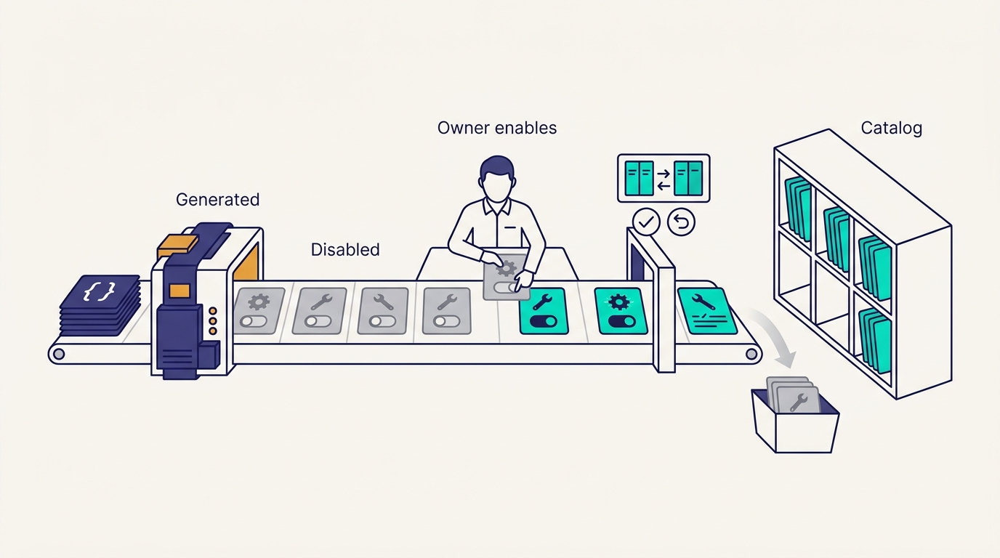
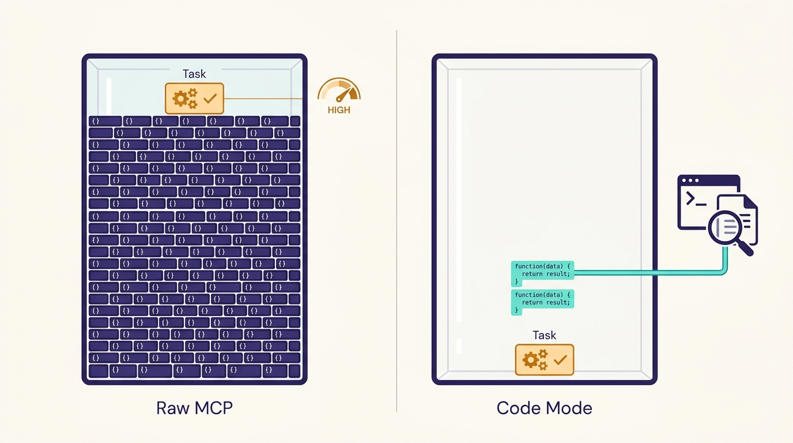
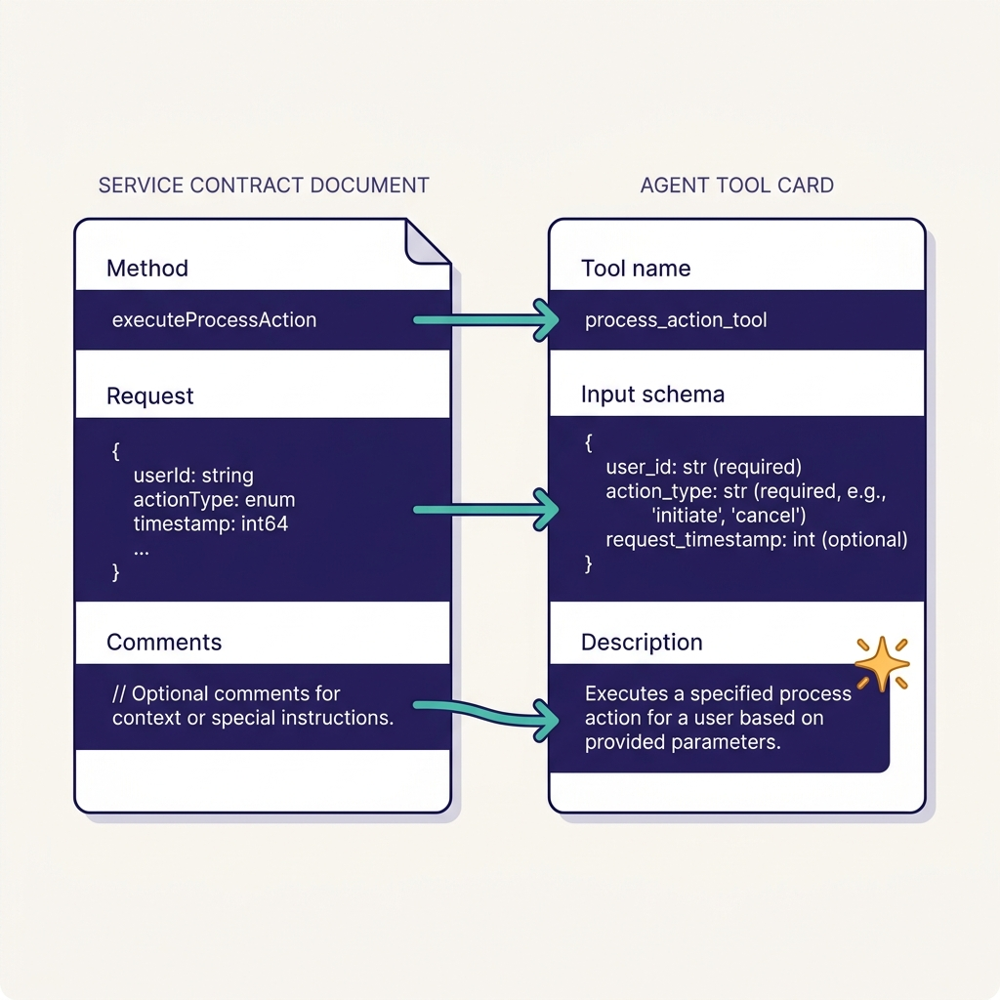

> **IN THIS CHAPTER, YOU WILL:** Follow how Uber's MCP Gateway turns an entry in the interface definition language (IDL) registry into an agent tool. The path runs through crawling, LLM-written descriptions and owner enablement, then a proxy that translates protocols and enforces permissions. You will also see why Uber now steers coding agents to a command-line projection of the same catalog instead of raw MCP tool lists.

> **WHY IT MATTERS:** Tool access decides what agents can do, and it is also the largest new security surface. A company that lets each team publish its own MCP server ends up with sprawl, inconsistent authorization and agents whose context windows are full of tool schemas. A company that centralizes tool access has to solve discovery, permissions and context cost in one place.

> **KEY POINTS:**
>
> * **The tools were generated from contracts that already existed.** Uber's services already published Thrift or Protobuf contracts to one IDL registry, so the MCP Gateway could crawl it and generate tools for any service, with schemas and LLM-written descriptions. Medisetty attributed the speed to that registry and to giving the work to the team that already ran Uber's API gateway.
> * **Generated does not mean exposed.** In Uber's October 2026 design, every discovered tool starts disabled until its owning team reviews and enables it. Changes to descriptions go through owner-approved diffs, and authorization is checked per tool against the caller's own identity. The gateway is where generation is made safe.
> * **At catalog scale, the bottleneck becomes the agent's context window.** Hundreds of servers and thousands of tools cost tens of thousands of tokens of schema before work starts. Uber added incremental discovery (Omni MCP), response projection and a command-line "Code Mode" (`aifx mcp`), which by October 2026 was the default for coding agents.

> **BUILT ON:** The Thrift and Protobuf IDL registry and Uber's standard service frameworks ([[contracts-and-context-propagation]]), the API and Edge Gateway team's protocol-translation experience, Uber's Access Control System and service mesh, Cadence for the crawler workflow, and [[aifx-harness-layer]] as the client-side distribution channel.

 
The **Model Context Protocol (MCP)** is an open protocol, introduced by Anthropic in November 2024, through which an agent's host application discovers and calls **tools** offered by servers, using JSON-RPC 2.0 messages. A coding agent that can call tools can query a service, file a ticket or read a design document instead of guessing. Early in 2025, as MCP support spread through agent clients, every company with internal services had to decide how its agents would reach them.

The default path is decentralized. Each team that wants its system available to agents writes an MCP server, publishes it somewhere, and engineers add it to their agent's configuration by hand. That path breaks at Uber's scale in three ways. Thousands of services would need thousands of hand-written servers. Each server would make its own authentication and authorization decisions. And each engineer's agent would load the schemas of every server they had installed, whether a task needed them or not.

Uber's answer is the **MCP Gateway**, described by Uday Kiran Medisetty, Uber Distinguished Engineer, in the October 2026 Pragmatic Engineer episode, and documented in detail in Uber's [October 2026 engineering post](https://www.uber.com/blog/designing-mcp-gateway/) by Alok Srivastava, Deepanshu Mehndiratta and Gaurav Gill. As of that post it hosted **more than 800 MCP servers and more than 5,000 tools**. Medisetty's summary of the result: "any vendor tool or any internal service is a CLI call away." This chapter explains how Uber got there, why it was fast, and which parts a company without Uber's IDL registry can still build.

## The Problem Uber Had: Thousands of Services, No Agent-Shaped Door

Medisetty dated the start to the arrival of Cursor and MCP in early 2025: Uber enabled Cursor, MCP had just been specified, and the team saw that exposing all internal tools to agents could greatly increase what AI could do. He put the start of the gateway work at "around April of 2025," and described it as the tool counterpart of the Model Gateway: one gateway for all tools. No written source gives the April date. Uber's [May 2026 agent identity post](https://www.uber.com/us/en/blog/solving-the-agent-identity-crisis/) says Uber built an internal agent platform in early 2025 and made its microservices MCP-ready, and the [March 2026 Pragmatic Engineer article](https://newsletter.pragmaticengineer.com/p/how-uber-uses-ai-for-development) says the MCP strategy and gateway were built by a temporary "tiger team". Both fit an early-2025 start.

The scale behind the problem is documented. The Agentic AI Foundation's [May 2026 write-up](https://aaif.io/blog/how-uber-runs-60000-ai-agent-tasks-per-week-with-mcp) of Uber's MCP Dev Summit talk counts more than 10,000 internal services and more than 10,000 Protobuf and Thrift IDLs. Medisetty's ambition went beyond coding, to all kinds of software engineering tasks. The consumers in the AAIF write-up include coding agents through AIFX, Uber's no-code Agent Builder and its YAML-configured Agent SDK for production agents.

The written record also names the problem Uber wanted to avoid. In the October 2026 post's lessons, the authors note that before the gateway, teams built separate integrations "with inconsistent tooling and security". **Centralization was a response to fragmentation that had already begun**, not a theoretical preference.

## What Uber Built: A Control Plane, a Data Plane and Three Context-Saving Mechanisms

The October 2026 post splits the gateway into a control plane, which decides what exists and who may use it, and a data plane, which executes calls.

### The Control Plane: Registry, Crawler and Owner Enablement

**The MCP Registry** is the "single source of truth" for discovery, ownership and enablement. It holds two kinds of entries: no-code tool definitions that wrap existing APIs, and native MCP servers that teams wrote themselves.

**AutoCrawler** is a discovery workflow built on Cadence, Uber's open-source durable workflow engine (see [[build-what-does-not-exist]]). On a fixed schedule it scans for new services, APIs and schema changes and creates or updates registry entries along two paths:

1. **IDL-backed services.** For each service or API group, AutoCrawler upserts a virtual MCP server, parses the Protobuf or Thrift definitions (method names, request and response schemas, doc comments), asks an LLM to write agent-friendly tool descriptions, converts the schemas to MCP's JSON-RPC 2.0 form and registers the tools. Medisetty described the same flow from the user's side: Uber auto-generates the request and response specs and the description, and later added LLM-optimized descriptions for APIs and fields, because some generated tools ran to 3,000–4,000 tokens.
2. **Native MCP servers.** Teams that need behavior beyond one API call build servers with **MCPFx**, Uber's framework for native MCP servers. Each emits a heartbeat metric; AutoCrawler detects it, calls the server's `listTools`, and creates a virtual proxy entry. In the episode, Medisetty described the same framework as the way teams create custom MCPs and proxy them through the gateway.

**Enablement is the step that makes generation safe.** The post is explicit: discovery does not imply exposure. **Every new server and tool is registered disabled** and must be reviewed and enabled by the owning team. Any change to a tool description produces a configuration diff the owners must approve, with deploy and rollback. The design keeps service teams in control without making them write the first version of anything. In the episode, Medisetty described the visible half: anyone in the company can open the MCP Gateway tool and browse every auto-generated server and its tools.

**Figure 1:** *Generated does not mean exposed: every discovered server and tool is registered disabled until its owning team reviews and enables it, and every description change is an owner-approved diff with rollback.*

### The Data Plane: One Proxy, Every Protocol

The **Proxy Gateway** executes calls. It refreshes its in-memory configuration on a fixed cadence, so enablement and description changes take effect without restarts. Each virtual server has its own endpoint (`/<service-name>/mcp`). For IDL-backed tools, a handler converts the agent's JSON arguments to Protobuf or Thrift, forwards the call over HTTP, gRPC or TChannel through **Muttley**, Uber's service-mesh sidecar, and converts the response back to MCP's JSON. Native servers are proxied transparently. **No downstream service changes**: the post lists "existing APIs are the fastest path to agent tools" as its first lesson.

That translation work is where Medisetty located the speed: "the same team that works on our API Gateway also worked on MCP Gateway. So they're already in the business of building API gateways. So they know how to do any kind of protocol transformations." The team that built Uber's Edge Gateway, which [[contracts-and-context-propagation]] describes, had spent years turning external REST and GraphQL calls into internal Thrift and Protobuf calls. The MCP Gateway is that translation with a new protocol on the outside.

---begin mermaid---
flowchart LR
    IDL["IDL registry with Thrift and Protobuf contracts"] -->|"scheduled crawl"| AC["AutoCrawler on Cadence"]
    NAT["Native MCP servers built with MCPFx"] -->|"heartbeat then listTools"| AC
    AC -->|"LLM-written descriptions and JSON schemas"| REG["MCP Registry"]
    OWN["Owning service team"] -->|"review, enable, approve description diffs"| REG
    REG -->|"config refresh"| PX["Proxy Gateway"]
    AG["Agent via MCP, Omni MCP or aifx CLI"] -->|"tool call with user token"| PX
    PX --> ACS["Access Control System check per tool"]
    ACS -->|"JSON to Thrift or Protobuf via Muttley"| SVC["Internal service"]
    ACS -->|"token exchange"| EXT["Third-party MCP such as Jira or Google"]
    SVC --> RED["PII redaction and response projection"]
    EXT --> RED
    RED -->|"MCP JSON result"| AG
---end mermaid---
**Figure 2:** *The MCP Gateway as Uber's October 2026 post describes it. The control plane (top left) turns contracts and native servers into registry entries that stay disabled until owners enable them. The data plane (right) checks each call against the caller's permissions, translates protocols and trims responses before they reach the agent.*

### Security: The Caller's Permissions, per Tool

The gateway carries the caller's identity instead of acting with its own. The episode does not discuss MCP Gateway permissions (Medisetty's remark about carrying forward user permissions concerns the context graph, see [[context-graph]]); the October post specifies the design:

- **Tool-level authorization through Uber's Access Control System.** Policies apply to humans, services and agents at the server level, with optional overrides per tool.
- **PII redaction in responses by default.**
- **Third-party MCP servers** (the post's examples are Jira and Google) receive the caller's user token relayed by the gateway, which enforces authorization, rate limits and redaction. A dedicated service then exchanges the internal token for the external provider's token.
- The AAIF write-up adds that authentication is on by default for sensitive data, outputs are scanned, guardrails **block writes to critical services**, and third-party MCPs are gated more strictly than internal ones.

The May 2026 agent identity post describes the identity mechanism underneath. Tokens carry an **actor chain** — for example `[user1, oncall-agent, investigation-agent]` — so a downstream service can see both the human and every agent acting on their behalf. Tokens are single-hop, audience-scoped and short-lived, issued by a token service with a reported 99th-percentile latency under 40 ms, using OAuth 2.0 Token Exchange (RFC 8693) and SPIFFE/SPIRE workload identities. The post calls the MCP Gateway a policy enforcement point for that chain.

This matters because the two best-known MCP attack classes are both trust failures. **Tool poisoning**, named by Invariant Labs in [April 2025](https://invariantlabs.ai/blog/mcp-security-notification), hides instructions in a tool description that the model reads and the user does not see; the same notice describes "rug pulls" (a server changing a tool after approval) and cross-server "shadowing". The **confused deputy** problem, which the [MCP specification's security best practices](https://modelcontextprotocol.io/specification/2025-11-25/basic/security_best_practices) cover at length alongside a ban on passing client tokens through to downstream APIs unchanged, is a server using its own authority on behalf of a caller who should not have it. Uber's design answers each with a mechanism:

| Risk | Uber's mitigation (as documented) |
| --- | --- |
| Poisoned tool descriptions | Descriptions generated centrally from contracts; every description change is an owner-approved diff with rollback |
| Rug pull after approval | Generated tools are defined in the registry, so their descriptions change only through approved diffs; whether native servers' runtime descriptions are also pinned is not stated |
| Malicious third-party servers | Third-party MCPs proxied through the gateway with stricter gating, rate limits and redaction |
| Confused deputy | Per-tool authorization against the caller's identity and actor chain, not the gateway's |
| Token passthrough | Internal tokens exchanged for provider tokens by a dedicated service, never forwarded raw |
| Data leakage in responses | PII redaction by default; output scanning |
| Destructive actions | Guardrails blocking writes to critical services; tools disabled until owners enable them |

### Vendor Tools Through the Same Door

Medisetty singled out vendor tools: Google, Slack and the rest are exposed through the MCP Gateway too, and he later listed Jira and Linear. The point he made was about configuration: because the gateway and AIFX handle both, internal and external tools install the same way. The October post confirms Jira and Google; Slack is named in the episode and in the AI Engineer 2026 talk summary. Once Google Workspace and Slack were behind the gateway, Medisetty said, people began automating workflows that cross all of them.

### The Context Problem and the CLI Projection

The October post's third lesson is "scale creates new problems": context bloat and cost appeared only at hundreds of servers. Uber's [August 2026 "Running a Software Factory Efficiently" post](https://www.uber.com/us/en/blog/efficient-software-factory/) gives the numbers. Loading standard MCP schemas for 100 or more tools cost **50,000–70,000 tokens** before the agent did anything. Its SaaS examples are a workspace suite with 49 tools (about 22,000 tokens), a messaging tool with 34 and a project-tracking tool with 46.

Uber built three mechanisms against that cost:

1. **Omni MCP.** One proxy server exposes the entire catalog through four tools: `discover_server`, `discover_tools`, `get_tool_schema` and `invoke_tool`. The agent loads schemas only for tools it decides to use.
2. **Response Projection.** The gateway adds a field to each request schema in which the model lists the nested field paths it needs, GraphQL-style; the gateway trims the response to those fields.
3. **Code Mode.** The `aifx` command-line interface routes MCP calls through the gateway without installing any MCP server locally: `aifx mcp list`, `aifx mcp search` and `aifx mcp call`. Agents can write results to files and search them with ordinary shell tools. The October post states that "Code Mode is now the company default for MCP tool use in coding agents."

Medisetty described Code Mode as the **CLI projection**: "In the last few months, we also projected all of these MCPs as CLIs. So you could execute any MCP as a CLI… If they want to use traditional MCP, they can use MCP." The August post says all of the more than 1,000 internal MCP tools are exposed as CLI commands, that Uber ships more than 25 pre-built code-mode skills, and that code mode cut tokens per SQL query by 55–71%. The AI Engineer 2026 talk, as summarized by Port, attributes more than 40% fleet-wide token savings to the MCP and context work combined. The episode's sequel is in [[skills-monorepo]]: a couple of engineers used AI to rewrite every skill in the repository to the CLI pattern, because two plugins could otherwise keep six MCP servers permanently in context.

**Figure 3:** *At catalog scale the bottleneck is the context window: standard schemas for 100 or more tools cost 50,000–70,000 tokens before work starts, while Code Mode lets the agent search, call one tool and keep only the lines it greps.*

---begin mermaid---
sequenceDiagram
    participant Agent as Coding agent
    participant CLI as aifx CLI
    participant GW as MCP Gateway
    participant Svc as Internal service
    Agent->>CLI: aifx mcp search payments refund
    CLI->>GW: discover servers and tools
    GW-->>CLI: matching tool names
    Agent->>CLI: aifx mcp call tool with arguments, output to file
    CLI->>GW: invoke tool with user token
    GW->>Svc: authorized, translated call
    Svc-->>GW: full response
    GW-->>CLI: redacted response
    CLI-->>Agent: result written to file
    Agent->>Agent: grep the file for the fields it needs
---end mermaid---
**Figure 4:** *Code Mode, the CLI projection. The agent never loads the catalog's schemas: it searches, calls one tool and filters the result with shell tools, so only what it greps enters its context. The command names are Uber's; the search and refund example is illustrative.*

### The Numbers, by Source

Uber's figures differ between sources taken months apart. Do not merge them.

| Figure | Value | Source |
| --- | --- | --- |
| Start of work | "around April of 2025" | Episode, October 2026 |
| Agent executions through MCP | ~60,000 a week; 1,500+ agents active monthly | AAIF write-up, May 2026 |
| Servers behind the gateway | 1,000+ | Uber blog, August 2026 |
| Internal tools reachable as CLI commands | 1,000+ | Uber blog, August 2026; AI Engineer 2026 talk |
| Servers and tools | 800+ servers, 5,000+ tools | Uber blog, October 2026 |
| Longest generated descriptions before optimization | 3,000–4,000 tokens | Episode |

## The Foundation Underneath: Why the Registry Made It Fast

The show notes' final takeaway names this chapter's system as an example of the book's thesis: "Uber's MCP Gateway was fast to build, thanks to existing Thrift and Protobuf registries." In the episode, Orosz suggested that adding MCP had been relatively easy because the foundation existed before AI. Medisetty agreed, and the written design shows why. Four pre-AI assets do almost all of the work.

**1. Typed contracts in one registry.** Uber services expose Thrift or Protobuf interfaces; Medisetty noted that new services in recent years are all Protobuf and that rewrites usually switch. Thrift has been Uber's IDL since at least 2016, when Uber's ["Tech Stack, Part I" post](https://www.uber.com/blog/tech-stack-part-one-foundation/) named it. **A contract is most of a tool definition already**: the method name is the tool name, the request message is the input schema, the doc comments are the first draft of the description. Because the contracts sit in one registry, a crawler can find all of them. [[contracts-and-context-propagation]] tells that history.

**Figure 5:** *A typed contract is most of a tool definition already, which is why a registry of Thrift and Protobuf contracts let Uber generate tools for any service instead of hand-writing MCP servers.*

**2. A team that already did protocol translation.** The API gateway lineage (RT-API, then Edge Gateway, described in a 2020 Uber post that Medisetty co-authored) is a decade of turning one protocol into another at the edge. The MCP Gateway reused the skill set, and plausibly some of the code, of translating JSON to Thrift and Protobuf.

**3. Authorization, mesh and workflow infrastructure.** Per-tool authorization uses Uber's existing Access Control System; calls travel through the Muttley mesh sidecar like any other service call; AutoCrawler runs on Cadence. None of these was built for agents.

**4. Ownership metadata.** "Disabled until the owner enables it" works only if every service has a known owner. Uber's ownership system, uOwn ([[build-what-does-not-exist]]), predates the gateway by years.

| Gateway step | Pre-AI foundation | What an organization without it must do first |
| --- | --- | --- |
| Generate tools for any service | Thrift and Protobuf contracts in one IDL registry | Write OpenAPI or Protobuf specs, or hand-write MCP servers per service |
| Translate MCP to service calls | API and Edge Gateway protocol-translation experience | Build translation for each protocol in use |
| Route owner approval | uOwn ownership records | Establish who owns each service |
| Enforce per-tool permissions | Access Control System policies for services | Define authorization for internal APIs, often missing for "internal only" services |
| Run crawls reliably | Cadence workflows | Use any scheduler; this is the easy part |
| Reach services | Muttley service mesh | Direct calls with per-service credentials |

The counterfactual is instructive. A company whose internal APIs are undocumented REST endpoints can still build an MCP gateway, but its first year goes into writing the contracts Uber already had. My reading: **on top of a registry, the gateway is a project of months; without one, the contracts are the project, and they take years.**

## Design Choices and Trade-offs

| Decision | Uber's choice (as documented) | Alternative | When the alternative is right |
| --- | --- | --- | --- |
| Where tools come from | Generated from IDLs, plus native MCPFx servers | Teams hand-write MCP servers for selected systems | Without a contract registry; or when only a dozen systems matter to agents |
| Exposure default | Disabled until the owner enables | Enabled on generation | Read-only, non-sensitive catalogs in a small organization |
| Descriptions | LLM-written, owner-approved diffs | Copy IDL doc comments verbatim | When contracts are already well documented and short |
| Topology | One central gateway for internal and vendor tools | Agents connect directly to each MCP server | Small teams with a handful of vendor MCPs and no internal ones |
| Agent interface | CLI projection (Code Mode) as default; MCP still available | MCP tool lists only | Agents without shell access (chat assistants, no-code agent builders) |
| Identity | User token and actor chain; per-tool authorization | Gateway service account with broad access | Never for write tools; tolerable for public read-only data |

**MCP or CLI?** This is the choice the industry argues about most, and Uber's answer is "both, with the CLI as default for coding agents." Thoughtworks put "[MCP by default](https://www.thoughtworks.com/radar/techniques/mcp-by-default)" under **Caution** in April 2026, arguing that each protocol layer loses fidelity and that a well-designed CLI with clear help text, JSON output and predictable errors often serves agents better. Anthropic's November 2025 post "[Code execution with MCP](https://www.anthropic.com/engineering/code-execution-with-mcp)" made the token argument: in its example, presenting tools as code instead of loading every definition reduced usage from 150,000 to 2,000 tokens. Uber's design keeps MCP as the registry and authorization model, and projects it as a CLI for agents that have a shell. **The protocol governs; the CLI is the interface.** Agents without a shell, such as Uber's no-code agents, still use MCP, increasingly through Omni MCP's incremental discovery.

The cost of centralization is the usual one: the gateway is a dependency for every agent's every tool call, and the team that runs it becomes the bottleneck for new protocol features. Uber's mitigations are visible (configuration refresh without restarts, native servers proxied transparently, MCPFx so teams can build what generation cannot), but the post does not discuss availability engineering.

## Elsewhere in the Industry

- **Stripe's Toolshed.** Stripe's [February 2026 post on its Minions](https://stripe.dev/blog/minions-stripes-one-shot-end-to-end-coding-agents) describes background agents using more than 400 tools through **Toolshed**, a central internal MCP server; the [second part](https://stripe.dev/blog/minions-stripes-one-shot-end-to-end-coding-agents-part-2) puts it at nearly 500. The shape is the same as Uber's (one internal door for tools), at a catalog roughly a tenth the size of Uber's October 2026 count. Stripe's posts do not describe generating tools from contracts.
- **Spotify's small toolset.** Spotify's [November 2025 Honk post](https://engineering.atspotify.com/2025/11/context-engineering-background-coding-agents-part-2) takes the opposite position for its migration agent: a deliberately small set of tools (a verify tool, restricted Git, allowlisted Bash), because each added tool makes behavior less predictable. This is not a contradiction of Uber's approach; it is the same context-budget concern answered by restriction rather than by on-demand discovery.
- **Commercial gateways.** [Kong AI Gateway](https://developer.konghq.com/ai-gateway/) can publish existing APIs as MCP tools that agents discover, in the same product as its model gateway — the convergence of [[model-gateway]] and tool gateway into one control point.
- **The protocol itself** has moved on: the MCP specification switched to date-based revisions, and the current revision is dated 2026-07-28. Its trust-and-safety principles (tools are arbitrary code execution; tool descriptions are untrusted unless they come from a trusted server; user consent is required) are what a central registry with owner-approved descriptions makes enforceable.

## If You Are Not Uber

The minimum viable MCP gateway is **a registry of approved tools, a proxy that calls them with the user's own permissions, and a CLI that agents can use instead of loading every schema.** Everything else is optimization.

**Prerequisites.** Machine-readable contracts for the services you want agents to reach (OpenAPI, Protobuf or Thrift), an owner for each, and an authorization model for internal APIs that does not assume "internal means trusted".

**Sequencing.**

1. **Start with vendor tools and three to five internal read-only services**, proxied through one gateway (open-source or commercial) so that every call is logged with the human caller's identity.
2. **Make "disabled until the owner enables" the rule** from the first day, even if enablement is a pull request to a configuration file.
3. **Generate tools from contracts** for the services where contracts exist; let an LLM draft descriptions, and require owner approval for every description change.
4. **Ship a CLI projection early** (`yourcli tools search`, `yourcli tools call`) so coding agents do not load the catalog's schemas.
5. **Add write tools last**, one at a time, with explicit owner approval, per-tool authorization and, for critical systems, a block or a human approval step.
6. **Add incremental discovery and response trimming** when the catalog passes a few dozen tools.

| Company size | What to run | What to skip |
| --- | --- | --- |
| ≈50 engineers | Vendor MCPs (issue tracker, docs, chat) behind one proxy or the harness's own MCP allowlist; a few internal read tools; a CLI for the rest | Generation from contracts; a registry service |
| ≈500 engineers | A gateway with a registry file in Git, owner approval, per-tool authorization with user tokens, a CLI projection; generated tools for services with OpenAPI or Protobuf contracts | Native-server frameworks; response projection |
| ≈5,000 engineers | The full pattern: crawler over the contract registry, LLM descriptions with owner diffs, disabled-by-default, actor-chain identity, third-party token exchange, incremental discovery, response projection, CLI default for coding agents | Exposing every generated tool to every agent at once |

**What not to copy.** Do not auto-generate and auto-enable; Uber does not. Do not expose write operations on critical systems to agents just because a contract exists for them. And do not build the gateway before the contracts: if your services lack machine-readable interfaces, writing them is the real project, and it pays off for humans as well.

## Failure Modes

- **The generated catalog nobody curates.** Thousands of auto-generated tools with poor descriptions make agents pick the wrong tool and burn tokens doing it. Generation without owner review moves the cost from authoring to every session.
- **Context collapse at scale.** Every enabled tool's schema loaded into every session. Uber's 50,000–70,000-token figure for 100 or more tools is the warning; the remedy is discovery on demand and a CLI.
- **Ambient authority.** A gateway that calls services with its own service account turns every agent into a superuser. If the downstream service cannot tell which human and which agent are acting, it cannot enforce anything.
- **Description drift and poisoning.** A tool's description changes, through a compromised server or a careless edit, and agents start using it differently. Owner-approved, versioned descriptions with rollback are the control.
- **Writes without brakes.** An agent with a write tool and a misunderstanding can change production data at machine speed. Uber's AAIF talk mentions guardrails that block writes to critical services; imitators often skip them.
- **Sprawl around the gateway.** Teams publish MCP servers directly to agents because the gateway's onboarding is slow. The gateway must be the fastest path for a team, not only the approved one.
- **The gateway as a hidden single point of failure** for every agent and every automated workflow that depends on tools.

## What the Record Does Not Say

- How Uber decides which tools agents may use for writes, beyond "guardrails block writes to critical services", and whether some writes require human approval at call time.
- What share of the 5,000+ tools are enabled, and how long owner review typically takes.
- How LLM-written descriptions are evaluated before an owner sees them, and whether tool selection accuracy is measured.
- How the gateway handles availability, rate limits per agent and per user, and the failure of a downstream service during a long agent task.
- How Omni MCP's discovery ranks servers and tools, and how often agents pick the wrong one.
- Whether the April 2025 start in the episode refers to the gateway itself or to the wider agent platform that written sources date to early 2025.
- How the three context mechanisms (Omni MCP, Response Projection, Code Mode) split the reported token savings.

## Questions to Ask

1. Which of our internal services have machine-readable contracts today, and where do those contracts live?
2. If an agent called one of our internal APIs with a user's token, would the service enforce that user's permissions, or does "internal" mean "allowed"?
3. Who must approve before a tool becomes available to agents, and who approves changes to its description?
4. How many tokens does our agents' tool configuration cost before a session starts?
5. Which tools can write, and which of those touch systems where a mistake is an incident?
6. Do our vendor tools (issue tracker, documents, chat) go through a control point we own, or straight from each engineer's agent to the vendor?
7. Do our coding agents have a CLI path to tools, or only MCP?
8. Could we answer, after an incident, which agent acting for which person called which tool with which arguments?

The MCP Gateway made every service and vendor tool reachable; the skills monorepo is where Uber packages what agents should *do* with those tools. [[skills-monorepo]] picks up the story with the mass rewrite of every skill to the CLI pattern this chapter described.

## Sources and Evidence

**The source episode**

- [Uber's AI infra, from the inside](https://newsletter.pragmaticengineer.com/p/ubers-ai-infra-from-the-inside), *The Pragmatic Engineer* podcast, Gergely Orosz with Uday Kiran Medisetty, 2026 (14 October) — the early-2025 origin and April 2025 start, generation from the IDL registry, LLM-optimized descriptions, custom MCP framework, vendor tools, CLI projection, the API Gateway team's role; the show notes' "fast to build, thanks to existing Thrift and Protobuf registries".

**Uber engineering sources**

- [Designing MCP Gateway: Uber's MCP Management Platform](https://www.uber.com/blog/designing-mcp-gateway/), Alok Srivastava, Deepanshu Mehndiratta and Gaurav Gill, Uber Blog, 2026 — registry, AutoCrawler, MCPFx, disabled by default, owner-approved description diffs, Proxy Gateway, Muttley, Access Control System, third-party token exchange, PII redaction, Omni MCP, Response Projection, Code Mode, 800+ servers and 5,000+ tools.
- [Running a Software Factory Efficiently at Uber Scale](https://www.uber.com/us/en/blog/efficient-software-factory/), Uday Kiran Medisetty, Uber Blog, 2026 — 50,000–70,000 tokens of schema for 100+ tools, SaaS schema sizes, 1,000+ servers, all internal tools as CLI commands, 55–71% fewer tokens per SQL query in code mode.
- [Solving the Identity Crisis for AI Agents](https://www.uber.com/us/en/blog/solving-the-agent-identity-crisis/), Matt Mathew, Prasad Borole and Meng Huang, Uber Blog, 2026 — early-2025 agent platform, actor-chain tokens, RFC 8693 token exchange, SPIRE, the gateway as policy enforcement point.
- [The Uber Engineering Tech Stack, Part I: The Foundation](https://www.uber.com/blog/tech-stack-part-one-foundation/), L. Lozinski, Uber Blog, 2016 — Thrift as Uber's IDL by 2016.
- [How Uber Runs 60,000 AI Agent Tasks Per Week With MCP](https://aaif.io/blog/how-uber-runs-60000-ai-agent-tasks-per-week-with-mcp), Agentic AI Foundation (talk by Meghana Somasundara and Rush Tehrani), 2026 — usage figures, 10,000+ services and IDLs, guardrails, consumers.
- [How Uber uses AI for development: inside look](https://newsletter.pragmaticengineer.com/p/how-uber-uses-ai-for-development), Gergely Orosz, The Pragmatic Engineer, 2026 — the tiger team behind the MCP strategy.
- [How Uber built an AI software factory for agentic coding](https://newsletter.port.io/p/how-uber-built-a-software-factory), Zohar Einy, Port newsletter, 2026 — vendor-published summary of the AI Engineer 2026 talk: 1,000+ tools, more than 40% fleet-wide token savings.

**Industry and research sources**

- [MCP Security Notification: Tool Poisoning Attacks](https://invariantlabs.ai/blog/mcp-security-notification), Invariant Labs, 2025 — tool poisoning, rug pulls and shadowing.
- [Security Best Practices](https://modelcontextprotocol.io/specification/2025-11-25/basic/security_best_practices), MCP specification, 2025 — confused deputy, token passthrough and scope minimization.
- [Code execution with MCP: Building more efficient agents](https://www.anthropic.com/engineering/code-execution-with-mcp), Adam Jones and Conor Kelly, Anthropic, 2025 — the token case for code-style tool access.
- [MCP by default](https://www.thoughtworks.com/radar/techniques/mcp-by-default), Thoughtworks Technology Radar, 2026 (Vol. 34) — the Caution-ring argument for CLIs over MCP as a default.
- [Minions: Stripe's one-shot, end-to-end coding agents](https://stripe.dev/blog/minions-stripes-one-shot-end-to-end-coding-agents) and [Part 2](https://stripe.dev/blog/minions-stripes-one-shot-end-to-end-coding-agents-part-2), Alistair Gray, Stripe, 2026 — Toolshed as a central internal MCP server.
- [Background Coding Agents: Context Engineering (Honk, Part 2)](https://engineering.atspotify.com/2025/11/context-engineering-background-coding-agents-part-2), Max Charas and Marc Bruggmann, Spotify, 2025 — a deliberately small toolset.
- [Kong AI Gateway documentation](https://developer.konghq.com/ai-gateway/), Kong, current as of 2026 — publishing APIs as MCP tools.
- [MCP Versioning](https://modelcontextprotocol.io/specification/versioning), MCP project, 2026 — date-based revisions; current revision 2026-07-28.

Statements about Uber's AI-era systems are Uber's own account unless another source is cited; recommendations and labeled inferences are the author's judgement.
