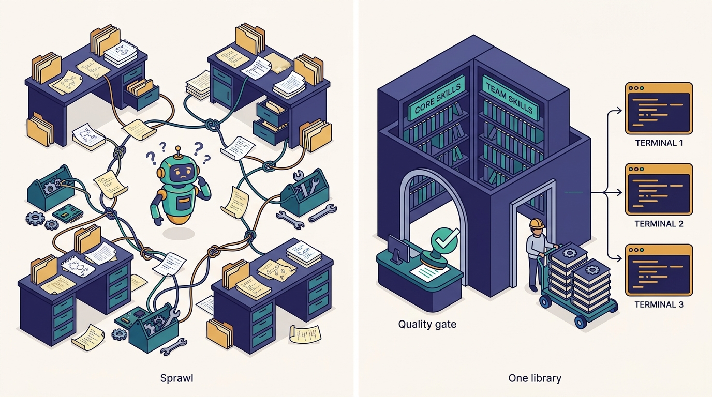
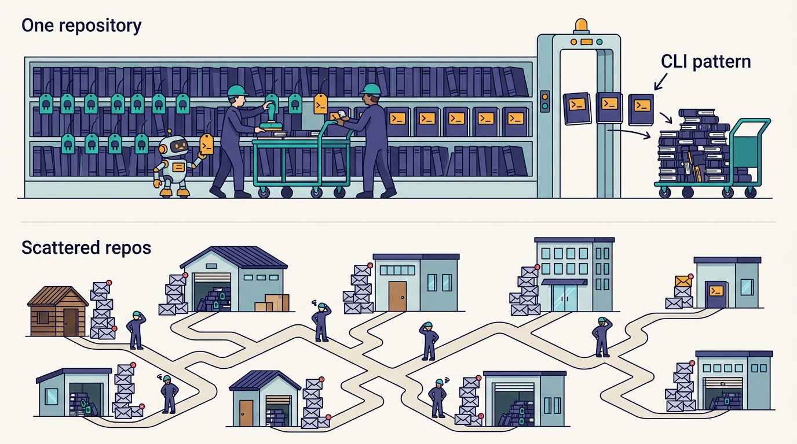

> **IN THIS CHAPTER, YOU WILL:** See how Uber organizes agent skills: core and team skills in one monorepo, one quality gate, portable across harnesses, auto-installed for everyone, and reaching tools through one gateway. Then follow the one mass rewrite that shows why the single repository matters, and the improvement loop Uber says it has not finished.

> **WHY IT MATTERS:** Skills are becoming the main way an organization passes its know-how to agents. Without an owner they turn into prompt sprawl: duplicated, stale, and expensive in tokens. An engineering leader has to decide who owns them, how they ship, and how anyone knows whether they work.

> **KEY POINTS:**
>
> * **A skill is easy to write and hard to make good.** Medisetty's own words: a V0 is "very easy", making it good "across all kinds of use cases" is "very hard". The work after the first draft is distribution, review, measurement and improvement, and that work needs a platform.
> * **One repository makes the whole skill set changeable at once.** When Uber projected every MCP tool as a CLI, a couple of engineers using AI rewrote all the skills in the repository to the CLI pattern. Skills scattered across team repos and laptops cannot be changed that way. The monorepo, the single quality gate, AIFX portability and the auto-installed marketplace are what make skills a product.
> * **The quality loop is the unsolved part, and Uber says so.** Uber reports about 30,000 skill executions a day (the episode; the August 2026 Uber blog says 30K+ a day across 3,600+ skills). A tool that gives tips on improving a skill exists; turning harness traces into improvement patches was still in flight in October 2026.

> **BUILT ON:** the per-language monorepos and their review and ownership habits ([[monorepos-and-one-build]]), the MCP Gateway and its CLI projection ([[mcp-gateway]]), AIFX as the distribution channel into every harness ([[aifx-harness-layer]]), DevPods with tools pre-installed ([[devpods]]), and Model Gateway session traces ([[model-gateway]]).

 
Every company that adopts coding agents grows skills, whether it plans to or not. An engineer writes down how to run the payments integration tests, a team writes a markdown file on how to roll out a config change, someone else copies it and edits it for their service. Six months later there are dozens of near-duplicates in personal folders and team repos, each naming its own tools, none reviewed, and nobody knows which ones agents actually load or whether they help.

Uber's answer, as Medisetty described it in the October 2026 Pragmatic Engineer episode, was to treat skills the way Uber treats code: **one monorepo, one quality gate, one distribution mechanism, one way to reach tools**. Orosz pushed back on the idea. A startup would think a skills repository is "just a repo" with "a bunch of skill folders and that's kind of it". Medisetty agreed that a first version is trivial, and argued that **the hard part is everything after the first version**.

This chapter covers what Uber built, why the single repository paid off in one concrete rewrite, and the **skill quality loop**: the cycle of gating, distributing, observing and improving skills that Uber has started and not finished. The term "skill" here means an agent skill in the sense of the Agent Skills format: a folder with a `SKILL.md` file of instructions, plus optional scripts and reference files, that a harness loads when a task matches the skill's description. A **harness** is the agent program the engineer runs, such as Claude Code, Codex or OpenCode ([[aifx-harness-layer]] owns the term).

## The Problem Uber Had: Skills Sprawl Faster Than Anyone Can Review Them

Medisetty said Uber "jumped onto" skills "earlier this year", which in an October 2026 conversation means early 2026. By then Uber already had its harness layer, AIFX, and its MCP Gateway (see [[aifx-harness-layer]] and [[mcp-gateway]]). Skills were the next layer: the place where know-how about Uber's systems lives, as opposed to the tools that act on them.

Four forces make skills messy in a company of Uber's size. None of them is specific to Uber.

| Force | What goes wrong without a platform |
| --- | --- |
| **Many authors** | Every team writes its own skills. Without a shared place, the same procedure ("how to deploy to staging", "how to query the trips tables") exists in several versions that drift apart. |
| **Several harnesses** | Uber supports Claude Code, Codex and OpenCode. A skill installed in one harness's folder is invisible in another, so engineers who switch lose their setup or keep copies. |
| **Tool references** | A skill that says "use MCP server X" pulls that server's tool definitions into the agent's context. Each skill choosing its own servers multiplies the context load. |
| **No feedback** | A skill that misleads the agent rarely fails loudly. The agent takes more turns, uses more tokens or produces a worse result, and nobody connects the cost to the skill. |

**Figure 1:** *Without an owner, skills become prompt sprawl, duplicated, unreviewed and expensive in tokens; Uber treats them like code, with one monorepo, one quality gate and one distribution path into every harness.*

The Thoughtworks Technology Radar named the first force as a pattern to avoid. Its April 2026 blip "[Curated shared instructions for software teams](https://www.thoughtworks.com/radar/techniques/curated-shared-instructions-for-software-teams)" (ring Adopt) calls it an emerging anti-pattern for each developer to write prompts from scratch, and recommends maintaining AI guidance as a curated, shared engineering resource. The same radar volume lists "agent instruction bloat" under Caution. Uber's skills monorepo is one large-scale answer to both.

## What Uber Built

Medisetty described the system in a few sentences; the account below stays close to them. Unless marked, everything in this section is Uber's own account from the episode.

- **One skills monorepo.** "Since we already have this notion of monorepos, we created a skill monorepo in some sense." It holds **core skills** built by central platform teams and **team-specific skills** that individual teams build.
- **Plugins and skills together.** Asked by Orosz whether these are the skill folders and plugins used in Claude Code, Medisetty said yes: plugins and skills usable across all the harnesses.
- **One quality gate** that runs across all skills. Uber has not said what the gate checks.
- **Portable across harnesses through AIFX.** Engineers install skills with the same AIFX tooling as everything else, and one `plugin add` updates every harness, including those not in use ([[aifx-harness-layer]]).
- **One way to reach tools.** All skills use tools from the MCP Gateway, so every skill reaches every tool through one standard mechanism.
- **An auto-installed marketplace.** Uber installs the skill marketplace for everyone. That removes a configuration step, makes discovery easy, and gave Uber one place to build evaluation and discoverability pipelines.
- **Personas with default skills**, distributed through AIFX ([[aifx-harness-layer]] covers personas).
- **Improvement tooling, partly in flight.** A tool where an engineer selects a skill and gets tips on improving it was being built. The next step, "in flight", is to collect traces from the harnesses and generate improvement patches for skills.
- **Not everything is in the monorepo.** Some teams still keep their own repositories, but the majority of skills go through it.

---begin mermaid---
flowchart LR
    A["Platform teams"] -->|"core skills"| R["Skills monorepo"]
    B["Product teams"] -->|"team skills"| R
    R --> G["One quality gate"]
    G --> M["Skill marketplace, auto-installed"]
    M -->|"AIFX plugin add"| H1["Claude Code"]
    M -->|"AIFX plugin add"| H2["Codex"]
    M -->|"AIFX plugin add"| H3["OpenCode"]
    H1 --> T["MCP Gateway tools, as MCP or CLI"]
    H2 --> T
    H3 --> T
    H1 -.->|"harness traces, in flight"| P["Improvement patches"]
    P -.-> R
---end mermaid---

**Figure 2:** *Uber's skills path as described in the episode: many authors, one repository, one gate, one marketplace installed into every harness, one tool layer. The dashed trace-to-patch loop was in flight as of October 2026.*

### The Numbers, by Source

Usage figures appear in three Uber sources. They are snapshots from different months, so they should be read as a trend, not reconciled into one number.

| Source | Skills | Executions | Notes |
| --- | --- | --- | --- |
| "Agentic SDLC at Uber" talk, AI Engineer World's Fair 2026 (Medisetty and Adam Huda) | 2,500 | 20,000+ per day | Describes a managed skills marketplace with core and domain skills, lint and automated review, persona-based defaults, feedback loops |
| "[Running a Software Factory Efficiently at Uber Scale](https://www.uber.com/us/en/blog/efficient-software-factory/)", Uber blog, 27 August 2026 | 3,600+ | 30K+ per day | Adds 25+ pre-built code-mode skills and "Continuous Skill Optimization" in progress |
| The October 2026 episode | not given | "around probably 30,000 skill executions per day" in "the last few weeks" | Uber's own account, spoken |

The written sources describe a **marketplace** or **registry**. The **monorepo** as the storage layout is in the episode only. A May 2026 MCP Dev Summit talk by Uber engineers, as written up by the [Agentic AI Foundation](https://aaif.io/blog/how-uber-runs-60000-ai-agent-tasks-per-week-with-mcp) (14 May 2026), listed a Skills Registry with output evaluation and A/B tests of skill versions on its roadmap.

Thirty thousand executions a day across several thousand engineers means skills are not an experiment at Uber. Each engineer who uses agents triggers several skills per working day. At that volume a skill that wastes 10,000 tokens per execution costs real money, which links this chapter to [[token-spend-governance]].

## A Worked Example: The CLI Rewrite

The clearest evidence for the monorepo is one event Medisetty described. In 2026 Uber **projected every MCP tool as a CLI**, so an agent can call any internal or vendor tool as a shell command instead of loading the tool's schema into its context ([[mcp-gateway]] owns the CLI projection). After that change, "just a couple of engineers using AI, they updated all of the skills in this repository to use the CLI pattern because it's more token efficient."

The reason was context load. In Medisetty's example, if every skill declares the MCP servers it needs, installing two plugins can put "six MCPs across these two always in my context". The Uber blog of August 2026 gives the scale of that cost:

- An agent with more than 100 MCP tools loaded carries roughly **50,000–70,000 tokens of tool schemas**, re-sent on every turn.
- One SaaS workspace suite alone ships **49 tools at about 22,000 tokens** of schema. Messaging and project-tracking servers ship 34 and 46 tools.
- With all 1,000+ internal MCP tools exposed as CLI commands, the schemas leave the context. Code mode cut tokens per SQL query by 55–71% in Uber's measurements.

A rough illustration (the arithmetic is mine; the inputs are Uber's published figures): an engineer whose two plugins pull in the workspace suite plus the messaging and project-tracking servers carries 129 tool schemas. If the other two are as dense as the workspace suite (about 450 tokens per tool), that is roughly 55,000–60,000 tokens before the engineer types anything. Prompt caching makes later turns cheaper, but the schemas still fill the context and are rebuilt at a premium every time the cache expires. Some harnesses now defer tool definitions until a tool is used, which softens this; the CLI pattern removes it.

The point for this chapter is not the token count. It is that **the change was possible as one coordinated edit**. Because the majority of skills lived in one repository with one gate, two engineers could find every skill that named an MCP server, rewrite it, run the gate and ship the result through the marketplace to every harness. In a world of skills spread across team repos and personal folders, the same change would have been a campaign of hundreds of requests to owners, and many skills would never have been updated.

**Figure 3:** *When every MCP tool became a CLI, a couple of engineers using AI rewrote all the skills in the repository to the CLI pattern; skills scattered across team repos and laptops would have needed a campaign instead.*

This is the same argument Uber made for its code monorepos in 2017–18: large-scale changes become tractable when the code is in one place with one build ([[monorepos-and-one-build]]). [[shepherd-and-fox]] covers how Uber runs such changes on its code; the skills rewrite was a small version of the same move applied to agent instructions.

## Why the Format Makes a Central Repository Matter

The Agent Skills format explains several of Uber's choices. Anthropic introduced skills in October 2025 ("[Equipping agents for the real world with Agent Skills](https://www.anthropic.com/engineering/equipping-agents-for-the-real-world-with-agent-skills)", 16 October 2025) and released the format as an open standard at [agentskills.io](https://agentskills.io/), which lists Claude Code, Codex, OpenCode, Cursor, Gemini CLI and GitHub Copilot among supporting agents. Three properties of the format matter here.

1. **Progressive disclosure.** At startup the agent sees only each skill's name and description (Anthropic's documentation puts this at roughly 100 tokens per skill). It loads the body, under about 5,000 tokens, only when a task matches, and bundled files and scripts only as needed. So a large catalog is affordable, but every installed skill still costs a little, every session.
2. **The description is the router.** Whether a skill activates depends on its description. Two skills with overlapping descriptions compete; a vague description never fires or fires on the wrong task. With thousands of skills from hundreds of authors, **activation quality becomes a catalog-level property**, not a property of any one skill. Someone has to look at the whole set.
3. **Portability is real but shallow.** The `SKILL.md` format travels across harnesses, but the install location, plugin manifests and settings differ per harness. That gap is what AIFX fills at Uber: one `plugin add` writes the right configuration into every harness.

These properties are why an auto-installed marketplace is a reasonable default at Uber's scale and a questionable one without a gate. If everyone gets every skill, the catalog's descriptions are everyone's context. A plausible reading, not a documented description, is that Uber's single quality gate exists partly to protect that shared surface.

> **INFERENCE, NOT DOCUMENTED:** Uber has not said what its quality gate checks. A gate for a shared, auto-installed catalog would plausibly check the format (valid `name` and `description`, size limits), forbid direct MCP server declarations once the CLI pattern became the standard, flag descriptions that overlap existing skills, and run any evals the skill ships with. The AI Engineer talk mentions "lint and automated review" for managed skills, which fits the first two.

## The Foundation Underneath

The book's thesis is that the harness is the easy part ([[the-harness-is-the-easy-part]]). For skills the dependency map is short and direct.

| Pre-existing piece | What the skills platform reuses | What it would cost without it |
| --- | --- | --- |
| **Monorepo practice** (2017–18, per language; [[monorepos-and-one-build]]) | The idea that shared code lives in one place, with owners, code review, CI and the ability to change everything at once | Skills scattered across repos, with no single place to gate, search or rewrite them |
| **Standard build and test contract** ([[monorepos-and-one-build]]) | Skills can say "build with X, test with Y" once for a whole language, because Uber has one way to build any module | Skills full of per-service exceptions that rot quickly |
| **MCP Gateway and CLI projection** ([[mcp-gateway]]) | One mechanism for every skill to reach every internal and vendor tool, with the user's permissions | Each skill bundling its own tool setup, credentials and servers |
| **AIFX** ([[aifx-harness-layer]]) | Distribution into Claude Code, Codex and OpenCode with one command; personas with default skills | Per-harness install instructions; engineers losing skills when they switch harness |
| **DevPods** ([[devpods]]) | AI tools pre-installed in cloud workspaces, so the marketplace is present wherever agents run, including background agents such as [[minion]] | Skills that work on one laptop and not in the agent's environment |
| **Model Gateway session traces** ([[model-gateway]]) | Every model request is logged with session traces, which is the raw material for trace-driven skill improvement | No way to see what a skill did across thousands of sessions |

The last row is the one most imitators miss. **Improving skills from traces requires that the traces exist and are attributable** to a user, a session and, ideally, the skills that were active. Uber routes every model request through one gateway that already records session traces ([[model-gateway]]). A company whose agents call vendors directly from laptops has no comparable data set, and its skill quality loop stops at "ask people if the skill helped".

## The Skill Quality Loop

The **skill quality loop** is this book's name for the cycle a skills platform has to run after a skill's first version: gate, distribute, observe, improve, evaluate, repeat. Medisetty framed the need plainly: "When you first build a skill, they might not be perfect and you need some mechanism to continuously improve that." He also said there is "a lot of discussion around the skill quality, skill evals".

---begin mermaid---
stateDiagram-v2
    state "Author writes V0" as Author
    state "Quality gate" as Gate
    state "Marketplace, all harnesses" as Ship
    state "Executions produce traces" as Observe
    state "Tips and improvement patches" as Improve
    state "Evals on new version" as Eval
    [*] --> Author
    Author --> Gate
    Gate --> Ship
    Ship --> Observe
    Observe --> Improve
    Improve --> Eval
    Eval --> Gate
---end mermaid---

**Figure 4:** *The skill quality loop. Uber describes the gate, the marketplace and a tips tool as built; trace-driven patches and evals as in flight. The ordering is this book's reading of the episode, not a documented pipeline.*

Each stage has a different evidence level.

| Stage | What Uber has said | Evidence |
| --- | --- | --- |
| **Gate** | "One single quality gate" across all skills | Episode; the AI Engineer talk mentions lint and automated review |
| **Distribute** | Auto-installed marketplace; AIFX `plugin add` updates every harness; personas with defaults | Episode; persona-based defaults also in the talk |
| **Observe** | Session traces exist in the Model Gateway; a session-analysis dashboard flags 16 cost anti-patterns | Episode; Uber blog, August 2026 |
| **Improve** | A tool that gives an engineer tips on improving a chosen skill; trace-driven improvement patches "in flight" | Episode; the August 2026 blog calls the effort "Continuous Skill Optimization": recording skill "papercuts" and generating updates from traces |
| **Evaluate** | "Eval pipelines" built around the marketplace; skill evals under discussion | Episode; A/B testing of skill versions on the May 2026 roadmap |

Read together, the sources describe a loop whose front half (author, gate, ship) is in production and whose back half (observe, improve, evaluate) was being built in 2026. That matches Medisetty's framing. It is also the honest state of the industry: as of October 2026, I know of no public, detailed account from any company of a skill evaluation pipeline running at this scale.

Why the back half is hard:

- **Attribution.** A session can activate several skills. If the session goes badly, which skill was at fault? Traces have to record which skills loaded and what the agent did after each one.
- **Ground truth.** A skill for "query the trips tables" can be judged against known-correct queries. A skill for "write a good design doc" has no single right answer, so its evals are rubric-based and noisier.
- **Ownership.** A patch generated from traces has to go to someone who can accept it. Core skills have platform owners; team skills have team owners who may not watch a queue of machine-written patches. That is the same problem Uber solves for code with owner routing ([[shepherd-and-fox]]).
- **Regression across harnesses.** A skill tuned on Claude Code traces may behave differently in Codex. Portability makes distribution easy and evaluation harder.

## Design Choices and Trade-offs

| Choice | Uber's choice (as described) | Alternative | When the alternative is right |
| --- | --- | --- | --- |
| **Where skills live** | One monorepo for most skills; some teams keep their own repos | Per-team repos aggregated by a registry | When teams already have strong repo ownership and you cannot staff a central gate; accept slower catalog-wide changes |
| **Who reviews** | One quality gate for all skills | Self-serve publishing with post-hoc review | Early, under a few hundred engineers, when speed of experimentation matters more than catalog hygiene |
| **Install default** | Auto-installed marketplace for everyone, plus persona defaults | Opt-in install per engineer | When the catalog is ungated or descriptions overlap; opt-in keeps context small and failures local |
| **Tool access from skills** | Through the MCP Gateway, now the CLI pattern | Each skill declares its own MCP servers | Only for a handful of tools with no CLI equivalent; otherwise schema load grows with every install |
| **Harness coupling** | Portable across harnesses via AIFX | Optimize for one harness | When the company has standardized on one harness and expects to stay; you gain harness-specific features, lose switching freedom |
| **Improvement** | Tips tool now, trace-driven patches in flight | Manual feedback (surveys, issues) | Small catalogs, where owners can read every complaint; it does not scale past a few hundred skills |

The design choice I would watch most closely is the **auto-installed marketplace**. It is what makes 30,000 executions a day possible: nobody has to find or install anything. It is also what turns every skill's description into shared context for every engineer. Uber pairs it with a gate and with persona defaults; an imitator who copies auto-install without the gate gets agent instruction bloat at company scale.

## Elsewhere in the Industry

**Anthropic's own guidance (October 2025 onward).** The [Agent Skills documentation](https://platform.claude.com/docs/en/agents-and-tools/agent-skills/overview) and the open standard at agentskills.io define the unit Uber's monorepo holds. The [Claude Code cost documentation](https://code.claude.com/docs/en/costs) (as fetched in October 2026) recommends moving specialized workflow instructions out of `CLAUDE.md` into skills so they load on demand, and keeping `CLAUDE.md` under about 200 lines. That is the per-repository version of the same idea: always-on context should be small, and the long tail should load only when needed.

**AGENTS.md and per-repository instructions.** [AGENTS.md](https://agents.md/), stewarded by the Agentic AI Foundation, is the per-repository instruction file that sits under a central skills catalog: the nearest file in the tree wins. Uber's standardized builds mean its top-level agent instruction files work out of the box ([[monorepos-and-one-build]]); skills carry what does not belong in any one repository.

**Thoughtworks Technology Radar, Vol. 34 (April 2026).** Besides "curated shared instructions" (Adopt) and "agent instruction bloat" (Caution), the radar places "Agent Skills" and "progressive context disclosure" in Trial. The radar's view matches Uber's: curate centrally, keep the default context small.

**Spotify's background agent (November 2025).** Spotify's Honk team wrote that a deliberately small toolset made its agent more predictable, because every added tool makes behavior less predictable ("[Background Coding Agents: Context Engineering](https://engineering.atspotify.com/2025/11/context-engineering-background-coding-agents-part-2)", 24 November 2025). That is a counterweight to auto-installing a large catalog: for a narrow, unattended agent, fewer skills may be better than more.

## If You Are Not Uber

The minimum viable version is small: **one shared repository of skills, a reviewer, and a way to install them into the harnesses your engineers use.** Everything else is earned by volume.

| Company size | What to build | What to skip for now |
| --- | --- | --- |
| **≈50 engineers** | One `skills/` directory in an existing repo (or a dedicated small repo) in the Agent Skills format. Code review like any other code. A one-line install script per harness. A short list of 10–20 skills for the workflows you run weekly: build, test, deploy, query the main database, open a PR in house style. | Marketplaces, personas, evals. Ask in a channel whether skills help. |
| **≈500 engineers** | A dedicated skills repository with CODEOWNERS for core and team skills. A CI gate: format lint, description length, no direct MCP server declarations if you have a CLI or gateway alternative, and a duplicate-description check. Opt-in install with a curated default bundle per role. Basic usage telemetry: which skills load, how often. | Trace-driven patch generation. Auto-install of the whole catalog. |
| **≈5,000 engineers** | Uber's shape: one repository for most skills, a single gate, a harness-agnostic installer, persona defaults, a marketplace, a central tool layer that skills reference, and session traces tied to skills. Staff a small team that owns the catalog as a product, with usage and cost dashboards per skill. Start the eval pipeline with the 20 most-executed skills. | Trying to evaluate every skill at once. Start where volume is. |

**Prerequisites**, in order of importance:

1. **A tool layer skills can point at.** If every skill has to explain how to authenticate to a service, skills become configuration documents. A gateway or a set of well-documented CLIs comes first ([[mcp-gateway]]).
2. **Standard build and test commands.** Skills that encode per-service exceptions do not survive. If your repositories cannot be built one way, fix that before writing many skills ([[monorepos-and-one-build]]).
3. **Traces you can attribute.** If you want to improve skills from evidence, route model traffic through something that logs sessions ([[model-gateway]]). Without it, stop at stage three of the loop.

**Buy, build or open source.** The format is open and the storage is a git repository, so there is nothing to buy for the first two size bands. Harness vendors increasingly ship plugin marketplaces and managed settings; use them if you have one harness. Build a harness-agnostic installer only if you deliberately support several harnesses, as Uber does ([[aifx-harness-layer]]).

**What not to copy.** Do not copy the auto-installed marketplace before you have a gate. Do not copy the monorepo for skills if your code is not in monorepos and your teams do not work that way; a registry that indexes skills in team repos gets most of the discoverability with less friction. And do not count executions as success. Thirty thousand executions a day says skills are used, not that they help.

## Failure Modes

- **Prompt sprawl with a nicer folder.** A shared repository without review becomes a place to dump personal prompts. Descriptions overlap, the wrong skill fires, and the catalog's always-on cost grows with every merge.
- **Context bloat from skills that declare tools.** The failure Uber fixed with the CLI rewrite. Each skill that names its own MCP servers adds schema tokens to every session where it is installed.
- **Stale skills that still activate.** A skill written for last year's deploy tool keeps matching deployment tasks. Without usage and outcome data, nobody notices until an agent follows it and fails.
- **Execution counts as the success metric.** High counts reward broad descriptions that fire often. The measure that matters is whether sessions that load the skill finish with fewer turns, fewer tokens and better outcomes than sessions that do not.
- **Central bottleneck.** A single gate staffed by two people becomes a queue. Teams route around it by keeping their own repositories; Uber already notes that some teams do. That is acceptable if those repositories are visible to the catalog, and a problem if they are not.
- **Harness-specific breakage.** A skill tested in one harness fails in another because of different tool-calling behavior or install paths. Portability without cross-harness evals moves the failure from install time to run time.
- **Machine-written patches nobody owns.** Trace-driven improvement generates patches; if owners do not review them, they either pile up or get merged unread. The second is worse.

## What the Record Does Not Say

- **What the quality gate checks**, who runs it, and how long a new skill takes to pass it.
- **How skills are organized in the monorepo**: by team, by domain, by persona; and how team skills differ from core skills in review.
- **How many skills are installed by default** for a typical engineer, and how Uber keeps the default set's description load in check.
- **Which skills account for most executions**, and whether Uber measures outcomes per skill rather than counts.
- **How the planned evals work**: offline test sets, LLM judges, A/B tests between skill versions (the May 2026 roadmap mentions A/B tests), or human ratings.
- **Whether trace-driven improvement patches have shipped**, and whether they go to owners for review.
- **How skill versions interact with harness versions**, and whether a skill can be pinned for a background agent such as [[minion]] while it changes for interactive use.

## Questions to Ask

1. Where do our agent skills live today, and could we find every skill that references a given tool in under an hour?
2. Who reviews a new skill before it reaches other engineers, and what does the review check?
3. How many tokens of skill descriptions and tool schemas does a fresh session in our default setup carry before the engineer types anything?
4. Do our skills reach tools through one layer, or does each skill bring its own server, credentials and setup?
5. If we switched harness tomorrow, which skills would still work, and who would move the rest?
6. Can we tell, from logs, which skills were active in a session that went badly?
7. Which ten skills run most often, and do we have any evidence they make sessions shorter, cheaper or more correct?
8. Who owns a skill after its author changes teams?
9. Are we measuring skill executions as if they were adoption, or outcomes as if they were value?

The skills monorepo answers how an agent learns Uber's procedures. It does not answer how an agent finds out which service, table, owner or design doc a question is about in the first place. Medisetty called the answer to that question his favorite system: the context graph, and the assistant built on it. [[context-graph]] covers both.

## Sources and Evidence

**The source episode**

- [Uber's AI infra, from the inside](https://newsletter.pragmaticengineer.com/p/ubers-ai-infra-from-the-inside), *The Pragmatic Engineer* podcast, Gergely Orosz with Uday Kiran Medisetty, 14 October 2026 — the skills monorepo, core and team skills, the single quality gate, AIFX portability, the auto-installed marketplace, the CLI rewrite, ~30,000 executions a day, the tips tool and trace-driven patches in flight; show notes for the AIFX framing.

**Uber engineering sources**

- [Running a Software Factory Efficiently at Uber Scale](https://www.uber.com/us/en/blog/efficient-software-factory/), Uber blog, Uday Kiran Medisetty, 27 August 2026 — 3,600+ skills, 30K+ executions a day, 25+ code-mode skills, Continuous Skill Optimization, MCP schema token costs, CLI exposure of 1,000+ tools, code-mode token savings.
- [Agentic SDLC at Uber: Building Blocks for Uber's Software Factory](https://ai.engineer/talks/17-YSUHo6Lk-agentic-sdlc-at-uber-building-blocks-ubers), AI Engineer World's Fair 2026 talk, Uday Kiran Medisetty and Adam Huda, 2026 — 2,500 skills and 20K+ executions a day (earlier snapshot), managed marketplace, lint and automated review, persona-based defaults.
- [How Uber Runs 60,000 AI Agent Tasks Per Week With MCP](https://aaif.io/blog/how-uber-runs-60000-ai-agent-tasks-per-week-with-mcp), Agentic AI Foundation write-up of an MCP Dev Summit talk by Uber engineers, 14 May 2026 — Skills Registry with evaluation and A/B tests on the roadmap.

**Industry and research sources**

- [Equipping agents for the real world with Agent Skills](https://www.anthropic.com/engineering/equipping-agents-for-the-real-world-with-agent-skills), Anthropic Engineering, 16 October 2025 — the skill format and progressive disclosure.
- [Agent Skills overview](https://platform.claude.com/docs/en/agents-and-tools/agent-skills/overview), Anthropic documentation, current as of October 2026 — metadata and body token budgets.
- [Agent Skills open standard](https://agentskills.io/), agentskills.io, current as of October 2026 — portability across harnesses.
- [Manage costs effectively](https://code.claude.com/docs/en/costs), Claude Code documentation, current as of October 2026 — moving workflow instructions from CLAUDE.md into on-demand skills; CLI tools as more context-efficient than MCP servers.
- [AGENTS.md](https://agents.md/), Agentic AI Foundation, current as of October 2026 — per-repository agent instructions.
- [Curated shared instructions for software teams](https://www.thoughtworks.com/radar/techniques/curated-shared-instructions-for-software-teams), Thoughtworks Technology Radar Vol. 34, April 2026 — the anti-pattern of per-developer prompts; curated shared guidance.
- [Background Coding Agents: Context Engineering (Honk, Part 2)](https://engineering.atspotify.com/2025/11/context-engineering-background-coding-agents-part-2), Spotify Engineering, 24 November 2025 — small toolsets for predictable agents.

Statements about Uber's AI-era systems are Uber's own account unless another source is cited; recommendations and labeled inferences are the author's judgement.
