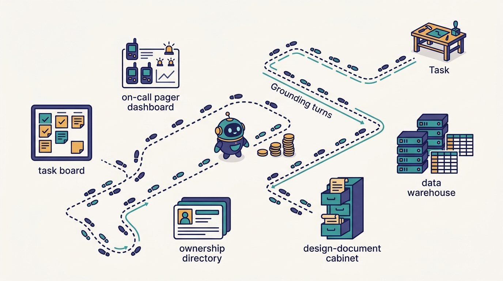
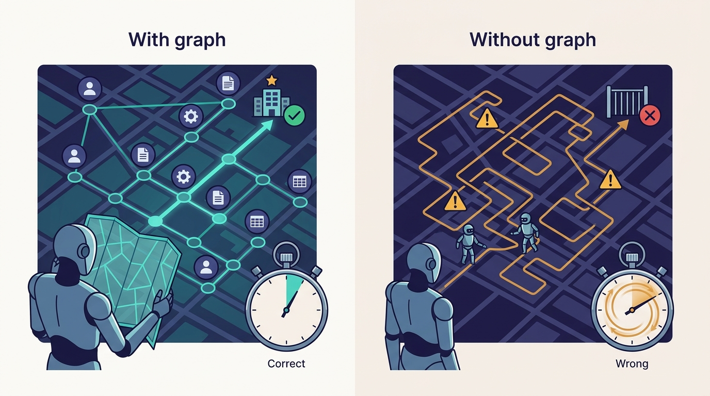

> **IN THIS CHAPTER, YOU WILL:** Follow the path from Cortana, an internal assistant one engineer built in December 2025, to the context graph Uber built after reading Cortana's traces. You will see what the graph holds, how agents navigate it, why it depends on metadata Uber has collected for a decade, and what a smaller company can build first.

> **WHY IT MATTERS:** Most of an agent's wasted turns are not spent writing code but finding out where things are and who owns them. A leader who reduces those **grounding turns** gets better answers and lower cost from every agent at once, without changing the model or the harness.

> **KEY POINTS:**
>
> * **Grounding is a measurable tax, and traces reveal it.** Uber saw in Cortana's traces that models spent many turns locating the right systems, because ownership, tasks, on-call, incidents and data lived in separate tools. The fix was not a better prompt; it was a different first step.
> * **The graph joins metadata Uber already had.** People, services, PRs, design docs, features, on-call events, config changes, incidents, tables and queries, linked live and queried by agents in Cypher much as they navigate a file system with bash. The episode cites 100+ node and 130+ edge types; Uber's August 2026 blog cites 86 node types, 117 edge types, 24M nodes and 80M edges from 30+ systems.
> * **The gain is real but early, and permissions are part of the design.** Uber's blog shows one grounded query answered correctly in 38 seconds against 20 minutes 9 seconds and a wrong answer without the graph. Medisetty says quality is up and cost and latency down "in a whole bunch of categories of questions", and that existing user permissions carry forward.

> **BUILT ON:** uOwn ownership metadata ([[build-what-does-not-exist]]), the IDL registry and Jaeger tracing ([[contracts-and-context-propagation]]), the design-doc hub ([[plans-as-source-of-truth]]), Uber's data-catalog tradition (Databook, 2016 onward), the production graph platform team, and the MCP Gateway for tool access ([[mcp-gateway]]).

 
Ask a coding agent at a large company a simple question, "how many mobility trips worldwide used cash last month?", and watch what it does. It searches the code for "cash". It opens a service that mentions payment types. It looks for a schema. It guesses a table, finds the guess is a staging copy, asks for permissions it does not have, and eventually returns an answer that may or may not use the table analysts actually trust. **Most of those turns are spent on grounding**: working out which systems, data and people the question is about before any real work starts.

Uber's account of this problem, given by Medisetty in the October 2026 Pragmatic Engineer episode, is specific. Uber read the traces of its internal assistant, saw the grounding turns, and built a **context graph**: a live graph of the company's engineering metadata that agents query first. Medisetty called it his favorite of the systems he showed.

This chapter defines two terms it owns. **Grounding turns** are the model turns an agent spends discovering which domain, services, data, documents and owners a task concerns, before it can act on the task. A **context graph**, in Uber's usage, is a graph of nodes (people, assets, artifacts, events) and typed edges between them, kept current from the systems of record, and exposed to agents as their default first step. The term has a slightly different meaning in the industry; the comparison section returns to that.

## The Problem Uber Had: Answers Scattered Across Siloed Systems

### Cortana, December 2025

The backstory, in Medisetty's telling: "back in December" (2025), one engineer built an AI assistant, **Cortana**, that anyone could reach on the web or in Slack and ask "any question from any code base". It searched across all of Uber's repositories and answered. The AI Engineer World's Fair 2026 talk by Medisetty and Adam Huda confirms Cortana as an internal assistant in Slack, CLI and web and gives a mid-2026 snapshot: 300 personas created in the prior month and more than 20,000 sessions a day.

People used it for much more than code questions. Medisetty listed research, "how to run this query", "what is the data source for this", "who owns this", "can you do RCA for this": a broad set of software engineering tasks. That variety was the useful signal. Most of those questions are not answered by code. They are answered by ownership records, task trackers, on-call dashboards, design docs and data catalogs.

### What the Traces Showed

"When we're looking at some of these traces, it was clearly obvious that we could optimize the number of turns it takes for the models to get grounding, because we have so many systems." Medisetty named the silos: the engineer "has to go into the task management platform", "to our on-call dashboard", to the ownership dashboard (uOwn, see [[build-what-does-not-exist]]). An agent with tools for each of those systems can reach them, but it has to discover which ones matter for this question, call each, and stitch the answers together. Each step is a turn, and each turn re-sends the growing context.

**Figure 1:** *Cortana's traces showed models spending many turns just locating the right systems, because ownership, tasks, on-call, incidents and data lived in separate tools; since agent cost scales with turns, every grounding turn is a tax.*

This is the core economic argument for the graph. Agent cost scales with turns: Uber's own August 2026 cost equation multiplies users, sessions, **turns per session**, requests per turn, tokens per request and price per token ([[token-spend-governance]] works through it). A change that removes five discovery turns from a common class of question reduces cost, latency and the chance of a wrong path at the same time.

## What Uber Built

### The Graph

Everything in this subsection is Uber's account from the episode unless another source is named.

- **Nodes for people and for everything they touch.** Every employee has a node. Every PR an engineer creates is a node, linked to its author. The schema visualization Medisetty showed linked a person to the assets they manage, design docs they wrote, product features they work on, on-call events they handled, configuration changes and incidents they managed.
- **Data assets too.** Tables, columns and queries are nodes, including who wrote which queries and which are the "blessed" ones.
- **Densely connected.** In Medisetty's words, any node has relationships to all other nodes (meaning, in practice, to other node types through typed edges).
- **Live.** Medisetty called the graph "live"; Uber has not described how it is kept current.
- **Built with the graph platform team.** The team that runs Uber's production graph, "with billions of nodes", helped build it. The context graph is "much smaller", so scale was "not a challenge for them anymore". Medisetty drew the parallel to the API Edge Gateway team building the MCP Gateway ([[mcp-gateway]]): an existing platform team with the right skills took on the AI-era version.
- **Fed by the planning tool.** Design documents, launch reviews, experiment reviews and production-readiness reviews "also go into the graph" ([[plans-as-source-of-truth]]).

The sizes differ by source, and the differences are worth keeping rather than averaging:

| Source | Types | Size | Systems |
| --- | --- | --- | --- |
| The October 2026 episode | "100 plus node types and 130 plus edge types" | not given | not given |
| [Running a Software Factory Efficiently at Uber Scale](https://www.uber.com/us/en/blog/efficient-software-factory/), Uber blog, 27 August 2026 | 86 node types, 117 edge types | 24 million nodes, 80 million edges | 30+ internal systems: services, teams, incident logs, PRs, design docs, deployments, datasets, historical table-usage queries |
| Agentic SDLC talk, AI Engineer World's Fair 2026 | 150 node and edge types combined | about 40 million entries | replacing lookups across 20–30 systems |

The written blog is the citable figure. The episode's larger type counts, spoken two months later, are consistent with a schema that is still growing; Uber has not said so. The talk's "150 types" plausibly counts both kinds together.

### How Agents Use It

The graph is Cortana's **default grounding**. "If you ask any question, it will first use this to navigate: what is this person asking about? Once you get grounded into, oh, this is about this domain, this set of services, then it can go deep and read other documents." The graph does not replace documents, code or dashboards. It tells the agent which ones to open.

Agents navigate the graph with **Cypher**, the graph query language that originated with Neo4j and strongly shaped the ISO GQL standard. Medisetty's observation is the most transferable idea in the chapter: "It's much harder for us to manually write all of these Cypher queries, but agents are really good at navigating the graph, like how they're really good at navigating a file system with bash." Agents are already good at exploratory navigation over a structure they can inspect: list, look, follow a link, list again. A graph with a readable schema gives them the same pattern over company metadata. The August 2026 blog adds that any agent can query the graph in natural language, which suggests a translation layer in front of Cypher; Uber has not described it.

Cortana itself "plugs" the graph together with tools and skills ([[skills-monorepo]]) and is available in Slack, web and CLI. Medisetty's examples of what that enables:

- **Self-service across org silos.** "Even someone in Ops in some country" can ask how something is built, where it lives, who works on it and what its history is, and Cortana draws on the graph and the company's documents. People can also "execute any skill anyone has built".
- **A 360° health report.** Asked about a service's health, it can look at dependencies and storage systems, run the queries and return a full health report for that asset.

---begin mermaid---
sequenceDiagram
    participant U as Engineer
    participant C as Cortana
    participant G as ContextGraph
    participant T as ToolsViaGateway
    U->>C: How many mobility trips used cash
    C->>G: Which tables and columns cover trips and payment type
    G-->>C: Candidate tables, owners, recent queries by analysts
    C->>G: Which queries are blessed and recent
    G-->>C: Blessed query and its author team
    C->>T: Run the adapted query with the user permissions
    T-->>C: Result rows
    C-->>U: Answer with tables and query cited
---end mermaid---

**Figure 2:** *The grounding-first pattern, using Medisetty's cash-trips example. The graph answers "where" and "who" in a few cheap queries; tools are called only once the agent knows what to call. The step boundaries are this book's reading of the example.*

### The Worked Example: Cash Trips

Medisetty's example is worth slowing down for, because it shows which edges do the work. The question: how many mobility trips around the world use the cash payment type?

1. **Find the tables.** The agent first needs to learn which tables and columns exist. Without the graph, that means searching a data catalog, or worse, code. With it, table and column nodes are linked to the domain.
2. **Find the people who already did this.** Have others written such queries, and are they from a science team, perhaps mobility science? This is the edge most catalogs do not have: **query nodes linked to their authors and to the tables they read**. It turns organizational knowledge, which team knows this data, into something an agent can traverse.
3. **Use recent work.** The agent can check which related queries ran in the last 30 days and which tables they used. Recency matters: a query from last month on the current table beats one from 2022 on a deprecated one.
4. **Converge on the blessed query.** From there it reaches the "blessed" queries Uber maintains. The answer comes from a query someone accountable has endorsed, not from the agent's first guess.

The August 2026 blog gives a measured case of the same shape. With the same prompt and model, the graph-grounded agent answered in **38 seconds and was correct**: it found a table used by more than 50 analysts through usage history. Without the graph it took **20 minutes 9 seconds and was wrong**: it read service code, spawned two subagents, hit three errors and concluded the dataset could not be queried. The blog's summary line is the best one-sentence case for the system: "An ungrounded agent fails slowly rather than cheaply."

**Figure 3:** *In Uber's August 2026 blog example, the graph-grounded agent answered in 38 seconds and was correct, while the same prompt and model without the graph took 20 minutes 9 seconds and was wrong; it is one chosen query, not a benchmark.*

That example is one query, chosen by Uber to illustrate the point. Medisetty's broader claim, that "in a whole bunch of categories of questions, the quality goes up, the cost goes down, the latency goes down", is Uber's own account with no published method or numbers behind it, and he added "we are still early".

### Permissions

The episode states one design rule: "We carry forward all of the existing user permissions, so then I'm only able to access the stuff that I had access to." Orosz connected it to Uber's older practice of **break glass**: requesting temporary access to a system you do not normally have, through an approval flow that goes through a manager or director.

Uber has not described how the graph enforces permissions. A related public mechanism is Uber's May 2026 post on agent identity, "[Solving the Identity Crisis for AI Agents](https://www.uber.com/us/en/blog/solving-the-agent-identity-crisis/)" (21 May 2026). It describes tokens that carry an **actor chain** (for example a user, then an on-call agent, then an investigation agent), are scoped to one audience and one hop, and are short-lived, based on OAuth 2.0 Token Exchange (RFC 8693). The MCP Gateway relays the user's token to downstream tools ([[mcp-gateway]]). Neither source says this is how the context graph or Cortana enforce access.

> **INFERENCE, NOT DOCUMENTED:** A graph that links every employee to their PRs, incidents and design docs has two permission problems, not one. The first is node-level: a user should not read a node they cannot read in the source system. The second is aggregation: edges can reveal things no single source exposes (who worked on which unannounced feature, who handled which security incident). A plausible design checks node visibility against the source system's access rules at query time, using the user's identity from the actor chain, and treats some edge types as sensitive in their own right. Uber has not said whether it does either.

## The Foundation Underneath

Medisetty did not present the graph as a data-collection project. He presented it as a join: the systems already existed, siloed, and the graph linked them. That is the book's thesis in its purest form ([[the-harness-is-the-easy-part]]). The show notes make the link directly: "Jaeger tracing made Slate routing and Context graph easier."

---begin mermaid---
flowchart LR
    A["uOwn: who owns each service and asset"] --> G["Context graph"]
    B["Code review and monorepos: PRs and authors"] --> G
    C["Design-doc hub: PRDs, ERDs, reviews"] --> G
    D["Incident and on-call tooling"] --> G
    E["Config change history"] --> G
    F["Data catalog and query history"] --> G
    H["IDL registry and Jaeger traces: service dependencies"] -.->|"inferred source"| G
    G --> I["Cortana in Slack, web, CLI"]
    G --> J["Coding and managed agents"]
---end mermaid---

**Figure 4:** *The context graph as a join over pre-AI systems of record. Sources follow the episode and the August 2026 blog's list; the dashed edge from the IDL registry and traces is an inference from the show notes' Jaeger remark, not a documented feed.*

| Pre-existing piece | What the graph gets from it | Evidence |
| --- | --- | --- |
| **uOwn** ownership ([[build-what-does-not-exist]]) | Person-to-asset and team-to-service edges, the backbone of "who owns this" | Episode (uOwn); blog lists services and teams as sources |
| **Monorepos and code review** ([[monorepos-and-one-build]]) | PR nodes with authors, reviewers and touched modules | Episode; blog lists PRs |
| **Design-doc hub** ([[plans-as-source-of-truth]]) | Design-doc, launch-review and readiness-review nodes, with owners and status | Episode; blog lists design docs |
| **Incident and on-call tooling** (in-house since the 2010s) | Incident and on-call event nodes linked to services and responders | Episode; blog lists incident logs |
| **Deployment and config systems** | Config-change and deployment nodes, which make "what changed before this incident" a traversal | Episode (config changes); blog lists deployments |
| **Data catalog and query logs** | Table, column and query nodes; usage history that identifies the blessed tables | Episode (tables, queries); blog lists datasets and historical table-usage queries |
| **IDL registry and Jaeger** ([[contracts-and-context-propagation]]) | Service-to-service dependency edges, plausibly from call graphs | Show notes' Jaeger remark; mechanism not described |
| **Graph platform team** | Operational experience running a graph with billions of nodes | Episode |

Uber's data-catalog history is a documented precedent for the data half of the graph. In "[Turning Metadata Into Insights with Databook](https://www.uber.com/blog/metadata-insights-databook/)" (Uber blog, 10 November 2020), Uber described Databook, first launched in 2016 and rebuilt around 2019, as a metadata platform for datasets, Hive tables, dashboards, metrics, pipelines and ML features. Its entities were linked in what the post called a knowledge graph, with lineage edges (which pipelines load which tables, which metrics come from which tables, which dashboards show them), team ownership, and collection by both crawlers (pull) and Kafka events (push). The post is six years old and the system may have changed. The episode does not name Databook as a source of the context graph, but the pattern, typed entities with owner and lineage edges collected from many systems, is the same one applied to a wider set of things.

The dependency runs in a clear direction. **A company that does not know who owns each service cannot build a graph that answers "who owns this"**, whatever graph database it buys. The graph's value is the quality of the joins, and the joins are only as good as the identifiers the source systems share: one ID per service, one ID per person, one ID per table, used consistently across the code-review tool, the incident tool and the ownership registry. Uber's decade of building those systems in-house, often because no vendor existed ([[build-what-does-not-exist]]), gave it consistent identifiers almost by accident.

## Design Choices and Trade-offs

Uber chose a graph queried by agents. The table compares it with the alternatives a reader is likely to consider.

| Approach | How grounding works | Strengths | Weaknesses | When it is right |
| --- | --- | --- | --- | --- |
| **Agentic search with tools** (no graph) | The agent calls each system's API or MCP tool and searches | Nothing to build beyond tools; always current | Many turns per question; the agent must know which systems exist; wrong paths are expensive | Small companies with few systems, or narrow agents with a known scope |
| **Vector retrieval over documents** (RAG) | Embed documents; retrieve similar chunks | Good for prose questions ("how do I…"); cheap per query | Weak on relationships ("who changed config for the service that had this incident"); stale embeddings | Policy and documentation questions; Uber's 2024 Genie on-call copilot used this |
| **Developer portal catalog** (e.g. Backstage) | Curated entities and relations, browsed by humans, exposable as a tool | Ownership and system boundaries in one place; mature open source | Usually services and teams only, not PRs, queries or incidents; updated by humans via YAML | The first step for most companies; the seed of a graph |
| **Context graph** (Uber's choice) | A live, typed graph across many systems, queried first | Few turns for relationship questions; recent work and blessed artifacts visible | Ingestion pipelines per source; freshness; permission and aggregation risk; schema governance | Many siloed systems, many agents, high question volume |
| **Federated query** over source systems | A query layer fans out to sources at question time, no stored graph | No copy of data; permissions stay at the source | Slow multi-source joins; each source's API limits | When copying metadata is not allowed or sources change too fast to sync |

Two further choices sit inside Uber's design:

- **Cypher versus fixed tools.** Uber lets agents write graph queries. The alternative is a fixed set of tools ("get owners of service X", "get recent incidents for X"). Fixed tools are safer and easier to permission; free queries are more flexible and, Medisetty argues, agents are good at writing them. A mixed approach, a query tool with schema documentation plus a handful of common, pre-built traversals, is a reasonable middle.
- **Default grounding versus on-demand.** Cortana consults the graph first on every question. That costs a few cheap queries on questions that did not need them, and saves many expensive turns on those that did. The August 2026 blog lists extending graph queries to more autonomous agents as future work, so for managed and background agents the default was still being rolled out.

## Elsewhere in the Industry

**Thoughtworks, "Context graph" (Assess, April 2026).** The [Technology Radar blip](https://www.thoughtworks.com/radar/techniques/context-graph) uses the same term with a narrower meaning: a graph of the **reasoning behind decisions** (rules, exceptions, prior cases, evidence, outcomes) that AI systems can query, with timestamped relationships so outdated facts are marked invalid rather than overwritten. Uber's graph is mostly about assets and artifacts, not decisions, though design docs and incidents carry some decision history. The timestamping idea is directly relevant to Uber's design: a graph that says who owned a service last year as well as who owns it now can answer "who changed this, and were they the owner at the time".

**Backstage Software Catalog (Spotify, open source).** The [Backstage catalog](https://backstage.io/docs/features/software-catalog/) is the most widely adopted public version of the backbone: "a centralized system that keeps track of ownership and metadata for all the software in your ecosystem", described by YAML files kept next to the code and updated through normal git review. It covers the uOwn half of Uber's graph. It does not, by default, hold PRs, incidents, config changes or query history; those are the edges that made Uber's cash-trips example work.

**Anthropic, context engineering (September 2025).** "[Effective context engineering for AI agents](https://www.anthropic.com/engineering/effective-context-engineering-for-ai-agents)" (29 September 2025) argues that an agent's attention budget is finite, that context should be small and high-signal, and recommends just-in-time retrieval through lightweight identifiers rather than loading everything up front. The context graph is an organization-wide implementation of that advice: the agent holds a few node IDs and traverses only what the question needs. [[the-engineer-as-context-builder]] covers the engineer's side of context engineering.

**Uber's own earlier RAG systems.** Uber's [Genie on-call copilot](https://www.uber.com/blog/genie-ubers-gen-ai-on-call-copilot/) (Uber blog, 10 October 2024) answered questions in Slack support channels by retrieval over Engwiki, internal Stack Overflow and requirement documents. Genie shows the earlier generation of the same goal: answer engineers' questions from company knowledge. The context graph adds the relationships that retrieval over text does not capture.

## If You Are Not Uber

You do not need 24 million nodes. You need to **measure grounding turns, then join the three or four systems that cause most of them.**

| Company size | What to build | What to skip for now |
| --- | --- | --- |
| **≈50 engineers** | A service catalog file per repository (owner, on-call, dependencies, data stores) and an `AGENTS.md` that points to it. An agent tool or CLI that answers "who owns X" and "what does X depend on" from those files. | A graph database. Grep over YAML is enough at this size. |
| **≈500 engineers** | A developer portal catalog (Backstage or a vendor) with ownership and dependencies, exposed to agents as a tool. Add two edge types from systems you already run: PR to service (from your code host) and incident to service (from your incident tool). Measure turns on 20 common questions before and after. | Free-form graph queries by agents. Offer fixed traversals first. |
| **≈5,000 engineers** | Uber's shape: a graph store run by a team with graph experience; ingestion from the systems of record with shared identifiers; data-catalog and query-history edges; permission checks at query time; a schema agents can read; grounding-first in your main assistant, then in managed agents. Track turns, latency, cost and correctness per question category. | Modeling everything at once. Start with the categories your traces show are expensive. |

**Prerequisites:**

1. **Consistent identifiers.** One ID per service, team, person and table, used by your code host, incident tool, ownership registry and data catalog. Without this, ingestion is entity resolution, and the graph is wrong in ways agents cannot detect.
2. **An ownership registry people trust.** If "who owns this service" is answered by asking around, fix that first; it is the most-traversed edge.
3. **Traces of your agents.** You need to see where turns are spent before you know which edges to build. Route traffic through a gateway that logs sessions ([[model-gateway]]).

**Buy, build or open source.** The catalog backbone is open source (Backstage) or bought (several developer-portal vendors). Graph stores are commodity: Neo4j and other property-graph databases speak Cypher or GQL, and some relational setups suffice for a few million edges. What you cannot buy is the ingestion from your own systems and the shared identifiers; that is where the work is.

**What not to copy.** Do not build the graph before you have measured grounding turns; you will model the wrong things. Do not let agents write arbitrary queries over people data before you have solved the aggregation question. And do not treat the graph as a replacement for fixing your documentation: the graph tells the agent which design doc to read, and a bad design doc is still bad.

## Failure Modes

- **Stale edges.** A service changed owner last month; the graph still says the old team. Agents route questions and patches to the wrong people, confidently. Freshness per source is the most important operational metric, and Uber has not published how it handles it.
- **Identifier mismatch.** The incident tool calls the service `payments-api`, the ownership registry calls it `payments_api_v2`. The graph shows no incidents for a service that has many.
- **Aggregation leaks.** Each source enforces its own access rules, but edges combine them. A person who cannot read an incident might still learn, from the graph, which team handled it and when.
- **The blessed-query trap.** Usage history identifies popular tables, and popularity is not correctness. A widely used table with a known bias becomes the agent's default answer.
- **Schema sprawl.** If the gap between the August blog's 86 node types and the episode's "100 plus" is growth, the schema gained a sixth more types in two months. Without governance, node types multiply, near-duplicates appear (an "asset" and a "service" for the same thing), and the schema becomes harder for agents to navigate, not easier.
- **Query cost and runaway traversals.** Agents writing graph queries can write expensive ones. A traversal from a person node through all PRs to all touched services to all incidents can explode.
- **Measuring with anecdotes.** One 38-second-versus-20-minute example is persuasive and is not an evaluation. Without a fixed question set per category, it is impossible to know whether the graph helped overall or only on the questions people remember.

## What the Record Does Not Say

- **How the graph is ingested and kept current**: batch, streaming, or both; per-source freshness; how deletions propagate.
- **Which store it runs on**, and whether it is the production graph platform's technology or a separate one.
- **How permissions are enforced** at node and edge level, and whether break-glass access applies to graph queries.
- **How natural-language questions become Cypher**, and whether agents see the raw schema.
- **How "blessed" queries are defined** and who maintains them.
- **How the quality, cost and latency gains were measured**, on which question categories, and by how much, beyond the single published example.
- **Whether Minion and other managed agents use the graph by default** as of October 2026; the August blog lists that as future work.
- **Why the type counts differ** between the blog (86 and 117) and the episode (100+ and 130+): growth, a different counting rule, or both.

## Questions to Ask

1. On our ten most common agent questions, how many turns does an agent spend before it touches the thing the question is actually about?
2. Can an agent answer "who owns this service and who is on call now" in one tool call?
3. Do our code host, incident tool, ownership registry and data catalog use the same identifier for the same service?
4. Which relationship would remove the most grounding turns if agents could traverse it: PR to service, incident to config change, query to table, design doc to feature?
5. How fresh is our ownership data, and how would we know if it were wrong?
6. What can a user learn from combined metadata that no single source system would show them?
7. Should agents write their own graph queries, or should we offer a fixed set of traversals first?
8. What question set will we use to show the graph made answers better, not only faster?

The context graph cuts the turns an agent needs; the skills and gateways of the previous chapters cut the tokens each turn carries. Both matter because every turn and every token is billed. [[token-spend-governance]] covers how Uber keeps that bill responsible without rationing the tools.

## Sources and Evidence

**The source episode**

- [Uber's AI infra, from the inside](https://newsletter.pragmaticengineer.com/p/ubers-ai-infra-from-the-inside), *The Pragmatic Engineer* podcast, Gergely Orosz with Uday Kiran Medisetty, 14 October 2026 — Cortana's origin, the trace finding, the graph's node and edge types, Cypher navigation, the cash-trips example, the graph platform team, permissions and break glass, the 360° health report; show notes for the Jaeger remark.

**Uber engineering sources**

- [Running a Software Factory Efficiently at Uber Scale](https://www.uber.com/us/en/blog/efficient-software-factory/), Uber blog, Uday Kiran Medisetty, 27 August 2026 — 24M nodes, 80M edges, 86 node and 117 edge types, 30+ source systems, the 38-second versus 20-minute example, natural-language access, the cost equation.
- [Agentic SDLC at Uber: Building Blocks for Uber's Software Factory](https://ai.engineer/talks/17-YSUHo6Lk-agentic-sdlc-at-uber-building-blocks-ubers), AI Engineer World's Fair 2026 talk, Uday Kiran Medisetty and Adam Huda, 2026 — about 40M entries and 150 node and edge types; Cortana in Slack, CLI and web with 20,000+ sessions a day.
- [Solving the Identity Crisis for AI Agents](https://www.uber.com/us/en/blog/solving-the-agent-identity-crisis/), Uber blog, Matt Mathew, Prasad Borole and Meng Huang, 21 May 2026 — actor-chain tokens and token exchange, the public mechanism closest to "carrying forward user permissions".
- [Turning Metadata Into Insights with Databook](https://www.uber.com/blog/metadata-insights-databook/), Uber blog, Sunheng Taing and Atul Gupte, 10 November 2020 — Uber's data-asset knowledge graph with ownership and lineage, a documented precedent.
- [Genie: Uber's Gen AI On-Call Copilot](https://www.uber.com/blog/genie-ubers-gen-ai-on-call-copilot/), Uber blog, 10 October 2024 — the earlier retrieval-based assistant for engineering questions.

**Industry and research sources**

- [Context graph](https://www.thoughtworks.com/radar/techniques/context-graph), Thoughtworks Technology Radar Vol. 34, April 2026 — the industry definition and timestamped relationships.
- [Backstage Software Catalog](https://backstage.io/docs/features/software-catalog/), Backstage documentation, current as of October 2026 — the open-source ownership-and-metadata catalog.
- [Effective context engineering for AI agents](https://www.anthropic.com/engineering/effective-context-engineering-for-ai-agents), Anthropic Engineering, 29 September 2025 — finite attention budget and just-in-time retrieval.

Statements about Uber's AI-era systems are Uber's own account unless another source is cited; recommendations and labeled inferences are the author's judgement.
