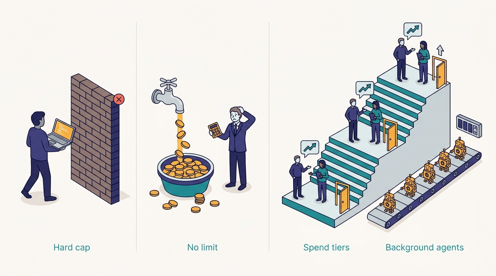
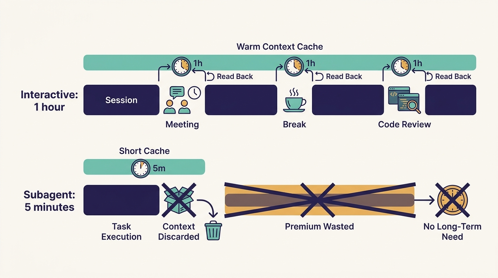

> **IN THIS CHAPTER, YOU WILL:** See how Uber governs token spend: spend tiers with manager approval, a separate tier for background agents, cost shown in every session, a CostCheck tool with personalized tips, and defaults that cut cost per session. You will also see the 2026 budget pressure behind the system and the published results.

> **WHY IT MATTERS:** Token costs are now an engineering budget line that grows with adoption, and the two obvious responses both fail. Hard caps ration the tool you are trying to adopt. No limits produce budget overruns that end in a blunt cap anyway. Leaders need a third option that keeps spend tied to value.

> **KEY POINTS:**
>
> * **Tiers with a conversation, not caps with a wall.** Engineers start in a default tier and move up with "a simple manager approval", a short conversation about ROI with minimal paperwork. Background coding agents have their own separate tier. The show notes put it this way: "for the right type of work, there is no spend limit."
> * **Most of the saving comes from making each session cheaper, not from refusing sessions.** Cost is visible in the status line and across harnesses. Slack nudges arrive at 50%, 80% and 100% of expected spend. CostCheck coaches on context hygiene and model sizing. Defaults cover compaction, reasoning effort, cache lifetime and cheaper subagent models, and the CLI projection removes tool schemas from context.
> * **The results are Uber's figures, and they came after a budget crisis.** Press reports in May 2026 said Uber had used up its 2026 AI-tools budget in about four months. Uber's August 2026 blog reports cost per session down 52% from the June peak, cost per 1,000 requests down about 34%, and total spend roughly stable since April while weekly agentic requests grew 9.4×. The show notes' "about 50%" reduction is a framing of these figures, not a separate measurement.

> **BUILT ON:** the Model Gateway, which sees and attributes every model request ([[model-gateway]]); AIFX and its status line in every harness ([[aifx-harness-layer]]); the MCP Gateway's CLI projection ([[mcp-gateway]]); the skills monorepo for coaching that ships as a skill ([[skills-monorepo]]); and ownership and reporting lines that make "ask your manager" a working approval path ([[build-what-does-not-exist]]).

 
Token spend at a company that has adopted coding agents behaves like cloud spend did in 2015: it grows with usage, it is billed by the unit, it varies by orders of magnitude between users, and nobody notices it until finance does. Unlike cloud spend, it is attached to individual engineers making many small choices an hour: which model, how long a session, whether to clear the context, how many subagents to start.

Uber went through the crisis version of this in 2026. In May, press reports said the company had used up its full-year AI coding-tools budget in about four months. By August, Uber's engineering blog reported spend roughly flat while usage kept growing several times over. In the October 2026 Pragmatic Engineer episode, Medisetty described the governance model in between: **spend tiers, manager approval to move up, separate tiers for background agents, visibility everywhere, and coaching**. "We don't want to restrict engineers," he said, but "we also want to make sure there's a responsible use."

**Figure 1:** *Hard caps ration the tool and no limits end in a blunt cap anyway; Uber's third option is tiers with a conversation, where a simple manager approval moves an engineer up and background agents draw on their own separate tier.*

This chapter owns two terms. A **spend tier** is a per-engineer spending allowance for a period, one of several levels, that the engineer can move up with a lightweight approval rather than a fixed cap. **CostCheck** is the episode's name for Uber's cost-coaching tool, which analyzes an engineer's sessions and gives personalized tips; Uber's August 2026 blog calls it a "cost check skill" and describes a related cost dashboard.

## The Problem Uber Had: Spend That Grows Faster Than Anyone Can Explain

### The 2026 Budget Pressure

The public record of Uber's 2026 AI spending comes from Uber and from the press, and the two should be kept apart.

- **The budget.** Fortune reported on 26 May 2026 ("[Uber's COO says it's getting harder to justify the company's AI spend](https://www.fortune.com/2026/05/26/uber-coo-ai-spending-tokens-claude-code/)") that, according to reports, Uber had exhausted its entire 2026 AI coding-tools budget in four months. The same article said Uber had encouraged adoption with an internal leaderboard ranking teams by total AI tool usage. COO Andrew Macdonald said the link between that usage and consumer-facing features was "not there yet" and that "that trade becomes harder to justify."
- **A cap.** Bloomberg reported on 2 June 2026 ("[Uber Caps Usage of AI Tools Like Claude Code to Manage Costs](https://news.bgov.com/artificial-intelligence/uber-caps-usage-of-ai-tools-like-claude-code-to-cut-costs-1)", Natalie Lung) that Uber had capped spending at **$1,500 per employee per month per agentic coding tool**, with spend on one tool not counting against another.
- **The growth.** Pragmatic Engineer's March 2026 inside look ("[How Uber uses AI for development](https://newsletter.pragmaticengineer.com/p/how-uber-uses-ai-for-development)", 10 March 2026) reported AI costs up six-fold since 2024, with Claude Code usage rising from 32% to 63% between December 2025 and February 2026 (the visible part of the article does not define the base).
- **The governance.** Uber's own blog, "[Running a Software Factory Efficiently at Uber Scale](https://www.uber.com/us/en/blog/efficient-software-factory/)" (27 August 2026, by Medisetty), describes **one shared tier across all interactive harnesses**, not per-tool budgets, plus separate tiers for managed agents.

The per-tool cap in June and the shared tier in August are different policies. A plausible reading is that Uber changed the policy between the two reports. No source says so, and the June report is secondhand. The episode, recorded later, matches the August blog.

---begin mermaid---
flowchart LR
    A["Dec 2025 to Feb 2026: Claude Code use 32 to 63 percent"] --> B["Mar 2026: AI costs reported 6x since 2024"]
    B --> C["Apr 2026: total spend levels off, per Uber"]
    C --> D["May 2026: press reports budget used in four months"]
    D --> E["Jun 2026: Bloomberg reports per-tool monthly cap; cost per session peaks"]
    E --> F["Aug 2026: Uber blog, shared tier, cost per session down 52 percent"]
    F --> G["Oct 2026: episode describes tiers, approvals, CostCheck"]
---end mermaid---

**Figure 2:** *Uber's 2026 spend story from public sources. Press reports and Uber's own figures are mixed here only to show the order of events; each is cited separately in the text.*

### Why the Cost Grows

The August 2026 blog gives the cost as a product of six factors:

**cost = users × sessions per user × turns per session × requests per turn × tokens per request × price per token**

Uber wants the first two factors to grow; that is adoption. Agentic work drives the middle three up on its own: longer sessions, more tool calls per turn, subagents that each send their own requests, and contexts that grow with every tool result. Between February and August 2026, Uber reports, weekly active users of agentic tools grew 7× and weekly agentic requests grew 9.4×. With price per token held constant, spend would have grown at least as fast as requests. It did not, and the rest of this chapter explains why.

## What Uber Built

Everything in this section is Uber's account. Where the episode and the August 2026 blog both describe something, both are cited; where only one does, the text says which.

### Spend Tiers and the Approval Path

- **Default tier.** Every engineer starts in a default tier, one of many levels.
- **Moving up.** Close to the limit, an engineer requests the next tier and needs "a simple manager approval": a conversation about the project's ROI and how the money is being spent, with the minimum paperwork Uber can manage. The blog adds that approvals have "quick propagation". The show notes describe the manager signing off on more spend "in that month", so the period is monthly.
- **No ceiling for the right work.** If the spend goes to the right project, Medisetty said, engineers should be able to spend whatever they need, because the aim is to maximize the gain. The show notes summarize: "for the right type of work, there is no spend limit."
- **Separate tiers for agent types.** Interactive harnesses share a spend tier; background coding agents have a separate, independent one. The blog says one shared tier covers all interactive harnesses, and managed agents get separate tiers. A Minion run ([[minion]]) does not draw down the engineer's interactive allowance.

---begin mermaid---
flowchart TB
    A["Engineer works in any harness"] --> B["Spend counted against one interactive tier"]
    B --> C{"Near the tier limit?"}
    C -->|"no"| A
    C -->|"yes"| D["Slack nudges at 50, 80 and 100 percent"]
    D --> E["Request next tier"]
    E --> F["Manager conversation about ROI"]
    F -->|"approved"| G["Next tier, propagated quickly"]
    G --> A
    F -->|"not now"| H["Coaching: CostCheck tips, model sizing, context hygiene"]
    H --> A
    I["Background agents such as Minion"] --> J["Separate managed-agent tier"]
---end mermaid---

**Figure 3:** *The tier path as described by Uber. The "not now" branch is this book's reading of what a manager conversation can end in; Uber describes approvals and coaching, not refusals.*

### Visibility Everywhere

- **In the session.** AIFX adds a status line to every harness that can "give tips" and track spend "across harnesses, within that harness, in that session" ([[aifx-harness-layer]]). The blog: "Running session cost is always visible in the terminal."
- **Across tools.** Engineers see, in any of the tools, what they spend within one harness and across all of them. This works because every model request passes through the Model Gateway, which attributes it to a user and a project ([[model-gateway]]).
- **Before the limit.** The blog describes Slack nudges at 50%, 80% and 100% of expected spend.

### CostCheck and the Session Dashboard

Medisetty described "a plugin called cost check that will run across all of your sessions and give you personalized tips based on your usage": how much you are spending on which project, and what to change. He credited it with "real-time coaching" on context hygiene and model sizing, and with creating "a good conversation between managers and engineers".

The August 2026 blog describes the same capability in more detail, as a cost-check skill for on-demand breakdowns and a session-analysis dashboard that needs no setup or opt-in. The dashboard analyzes session traces across local and cloud sandboxes and all harnesses and flags **16 anti-patterns**, each with its financial impact and a fix. The blog's examples:

| Anti-pattern (Uber blog, Aug 2026) | Why it costs money |
| --- | --- |
| Simple multi-turn sessions run on the most capable model when a cheaper one would do | Price per token several times higher for no gain |
| Large MCP payloads (e.g. 40 KB responses) that stay in context | Billed again on every later turn |
| Resuming after a long break | Prompt cache has expired; the whole prefix is rebuilt at full price |
| 100,000 tokens of instructions and tool definitions loaded before any input | A fixed tax on every session |

The blog's sample dashboard shows $4,162.07 of spend over 433 sessions (about $9.60 per session), a 95% cache hit rate, $1,097.82 of cache-miss cost and $1,213.87 of savings.

### Defaults That Change the Bill Without Asking Anyone

The blog lists defaults set centrally, which AIFX can push to every harness because settings are managed ([[aifx-harness-layer]]):

- **Compaction at 400,000 tokens**, even on models with a 1-million-token context.
- **Reasoning effort Medium** by default, because output tokens cost several times more than input tokens.
- **One-hour prompt-cache lifetime for interactive sessions**, up from five minutes; subagents stay at five minutes.
- **Subagents on a cheaper model by default**, with manual overrides. The blog calls this "the most impactful lever".
- **Model choice by benchmark.** Each managed agent gets a benchmark built from its real work, and Uber's internal SWE benchmark uses thousands of real PRs to compare frontier and open-weight models. Agents move to whichever model is Pareto-optimal on quality and cost.

## A Worked Example: Why the Cache Lifetime Differs for Humans and Subagents

The cache default shows how much engineering hides in one setting. The blog gives the pricing it works with: a cache read costs 0.1× the input price, a five-minute cache write 1.25×, a one-hour write 2×. The arithmetic below is mine; the multipliers are Uber's.

Take an interactive session whose context has grown to 200,000 tokens. Call the price of one input token *p*.

| Event | Five-minute cache | One-hour cache |
| --- | --- | --- |
| Engineer is in a 20-minute meeting, then resumes | Cache expired: the 200,000-token prefix is written again at 1.25×, **250,000 p** | Cache warm: the prefix is read at 0.1×, **20,000 p** |
| Cost of writing new context into the cache | 1.25× per new token | 2× per new token, a 0.75× premium |

One resume after a break saves 230,000 *p*. The premium on new content is 0.75 *p* per token, so the one-hour lifetime pays for itself as long as the engineer adds fewer than about 300,000 new tokens of context between breaks. Engineers take breaks constantly: meetings, reviews, lunch, switching to another session. For them the longer lifetime is a large saving.

A subagent never takes a meeting. It runs from start to finish in minutes, then its context is discarded. For it, the longer lifetime is only the premium, with nothing to recover. That is why Uber kept subagents at five minutes. **The same setting is right for one kind of session and wrong for the other**, and only a central team that sees both kinds of trace can set it correctly for everyone.

**Figure 4:** *The same setting is right for one kind of session and wrong for the other: interactive sessions pause and resume, so Uber gives them a one-hour cache, while subagents finish in minutes and stay at five.*

The same reasoning maps the other levers in the cost equation to systems in this book:

| Factor | Uber's lever | Owning chapter |
| --- | --- | --- |
| Turns per session | Grounding via the context graph cuts discovery turns | [[context-graph]] |
| Requests per turn | Subagents on cheaper models; code mode turns N tool calls into one script | [[mcp-gateway]] |
| Tokens per request | CLI projection removes 50,000–70,000 tokens of tool schemas; skills rewritten to the CLI pattern; compaction at 400K; CostCheck coaching on context hygiene | [[mcp-gateway]], [[skills-monorepo]] |
| Price per token | Model sizing by benchmark; Medium reasoning effort; cache lifetime | [[model-gateway]] |
| Users and sessions per user | Not a target: Uber wants adoption to grow | this chapter |

## The Results

The August 2026 blog reports, for February to August 2026:

- **Cost per 1,000 model requests down almost 34% from its peak**, February to July, with the model held constant.
- **Cost per session down 52% from its June peak** (the data starts at the end of May).
- **Total AI spend "relatively stable since April"**, while weekly active users grew 7× and weekly agentic requests grew 9.4×.

The October episode's show notes say Uber "has reduced token costs by about 50% the last few months, as we previously covered". No Uber source gives a single fleet-wide 50% figure; the closest is the 52% drop in cost per session. The AI Engineer World's Fair 2026 talk by Medisetty and Adam Huda cites more than 40% fleet-wide savings tied to the MCP and code-mode work. Read the "about 50%" as the episode's summary of these results, and quote the specific metric when precision matters.

Two caveats belong next to the numbers. First, **"cost per session" is a ratio Uber chose**, and it falls if sessions get shorter even when work does not get cheaper. Uber also reports cost per 1,000 requests, which is less sensitive to that, and it fell less (34%). Second, **flat total spend is the outcome the governance was meant to produce**, and it says nothing yet about value. The COO's May remark that the link to consumer features was "not there yet" is the question the measurement chapter takes up ([[feature-velocity]]).

## The Foundation Underneath

Spend governance looks like policy. At Uber it is mostly plumbing that existed for other reasons.

| Pre-existing piece | What spend governance needs from it | Without it |
| --- | --- | --- |
| **Model Gateway** (built from late 2023; [[model-gateway]]) | Every model request attributed to a user and a project, with audit logs, session traces, billing and cache-hit tracking. Spend limits per project and user were added in 2026, per the episode. | Each vendor's console shows its own slice; nobody sees one engineer's total across tools |
| **Michelangelo project IDs** ([[model-gateway]]) | Teams create a gateway client with a project ID, so spend can be charged to a project, not only a person | "Who is spending" without "on what" |
| **AIFX managed settings and status line** ([[aifx-harness-layer]]) | One place to set compaction, effort and cache defaults for every harness, and to show cost in every session | Defaults set per harness, per laptop, inconsistently |
| **MCP Gateway CLI projection** ([[mcp-gateway]]) | Removes tool schemas from context for every agent at once | Each team trims its own MCP setup, or does not |
| **Skills monorepo** ([[skills-monorepo]]) | CostCheck ships as a skill to everyone; skills rewritten to the cheaper CLI pattern in one change | Coaching as a wiki page nobody reads |
| **Ownership and reporting lines** ([[build-what-does-not-exist]]) | Every engineer has a known manager who can approve the next tier, and every project has an owner | Approvals routed to a central budget team that cannot judge ROI |

The first row carries most of the weight. **A company that cannot attribute every model request to a person and a project cannot run tiers**, because it cannot tell an engineer how close they are to one. Uber decided in 2023 that all model traffic would pass through one gateway, for model-agnosticism and safety; the attribution data for spend governance came with it.

## Design Choices and Trade-offs

| Approach | How it works | Strengths | Weaknesses | When it is right |
| --- | --- | --- | --- | --- |
| **No limit, central budget** | Everyone uses what they want; finance watches the total | Maximum adoption; no friction | Overruns; no signal of who spends or why; ends in an emergency cap | Short pilots with a fixed group |
| **Hard cap per user** | A ceiling; work stops at the limit | Predictable spend | Rations the tool; heaviest users are often the most productive; pushes people to cheaper, worse models | Contractors, or tools with low value per token |
| **Per-tool caps** (as Bloomberg reported for Uber in June 2026) | Separate ceiling per vendor tool | Easy to enforce with vendor consoles | Encourages tool-hopping to reset the limit; no total picture | When there is no gateway and each vendor bills separately |
| **Spend tiers with manager approval** (Uber, as described in Aug and Oct 2026) | Default allowance; move up through a short ROI conversation | Spend tied to a person who knows the work; little paperwork; no wall | Needs attribution across tools; managers need context to judge; can become a rubber stamp | Several hundred engineers or more, with a gateway |
| **Chargeback to teams** | Spend billed to each team's budget | Teams own the trade-off | Slow feedback; discourages experiments; engineers do not see cost per session | Mature FinOps practice; complements tiers |
| **Separate tiers for agent types** (Uber) | Interactive and background agents have independent allowances | A large background run does not lock an engineer out of interactive work | Two allowances to explain and monitor | Once background agents run at volume ([[minion]]) |

Two choices inside Uber's design deserve a second look.

**One shared tier across interactive harnesses.** Uber supports Claude Code, Codex and OpenCode. A per-tool budget would let an engineer switch harness to reset a limit, and would make the harness choice a budget question instead of a fit question. One shared tier matches the harness-agnostic principle ([[aifx-harness-layer]]): the tool is the engineer's choice, the spend is one number.

**Approval by the manager, not by a budget office.** The manager knows the project and can judge whether a week of heavy agent use on a migration is worth it. The cost is variance: managers judge differently, and Uber has not said how it calibrates them. The rule I would use: managers approve, a central team publishes the distribution of spend by role and project so that outliers in either direction are visible.

## Elsewhere in the Industry

**FinOps Foundation (February 2026).** The [FinOps for AI overview](https://www.finops.org/wg/finops-for-ai-overview/) (last updated 17 February 2026) notes that token billing makes AI costs harder to track because billed tokens can differ sharply from what the user typed, and proposes unit metrics such as cost per token and cost per call alongside value measures. Uber's cost-per-session and cost-per-1,000-requests metrics are such units. What FinOps adds is the discipline of pairing each unit cost with a value measure, which Uber's published results do not yet do.

**Vendor controls.** Anthropic's [Claude Code cost documentation](https://code.claude.com/docs/en/costs) (as fetched in October 2026) reports an average across enterprise deployments of about **$13 per developer per active day and $150–250 per developer per month**, with 90% of users below $30 per active day. It offers workspace spend limits, per-member limits on Teams and Enterprise plans, OpenTelemetry export of per-user cost, and LLM gateways such as LiteLLM for attribution on cloud providers. Set against that average, the $1,500 monthly per-tool cap reported by Bloomberg sits six to ten times above a typical developer's spend: a ceiling for the heaviest users, not a ration for everyone. The documentation's cost advice (clear between tasks, match the model to the job, prefer CLIs to MCP servers, move workflow instructions into skills, put subagents on smaller models) overlaps almost entirely with Uber's defaults and CostCheck tips.

**Gateways with budgets.** [LiteLLM](https://docs.litellm.ai/docs/simple_proxy) issues virtual keys with per-key budgets and records the cost of each request; [Kong AI Gateway](https://developer.konghq.com/ai-gateway/) calculates cost per request and enforces spend limits. These are the off-the-shelf form of the attribution layer Uber built into its Model Gateway.

## If You Are Not Uber

The minimum viable version is **attribution plus visibility**: know what each engineer spends across tools, and show it to them while they work. Tiers come after that, not before.

| Company size | What to build | What to skip for now |
| --- | --- | --- |
| **≈50 engineers** | One vendor plan or one gateway key per person. A monthly report of spend per person. Turn on the harness's cost display. Write down three habits: clear between tasks, use the smaller model by default, keep instruction files short. | Tiers and approvals. At this size, talk to the two heaviest users. |
| **≈500 engineers** | An LLM gateway (LiteLLM or a vendor) so spend is attributed across tools. A default allowance and one higher tier, approved by managers in a form that takes a minute. Status-line cost display pushed through managed settings. A separate allowance for any background agent. Central defaults: compaction threshold, default model, subagent model. | A full anti-pattern dashboard. Start with the top three causes your logs show. |
| **≈5,000 engineers** | Uber's shape: all model traffic through one gateway with user and project attribution; several tiers with manager approval; separate tiers per agent type; nudges before limits; a cost-coaching tool that reads session traces; centrally tuned defaults by session type; model choice by internal benchmark; a published distribution of spend by role. Pair cost metrics with a value measure. | Leaderboards of usage. They reward spend, not outcomes. |

**Prerequisites:**

1. **Attribution across tools.** A gateway or vendor reporting that gives one number per engineer per period ([[model-gateway]]).
2. **A place to set defaults.** Managed settings in your harnesses, or a wrapper like AIFX ([[aifx-harness-layer]]).
3. **Session traces.** Coaching needs to see what happened in a session; aggregates per user are not enough.

**What not to copy.** Do not copy the tiers without the visibility; an engineer who learns about a tier only when they hit it experiences it as a cap. Do not run adoption leaderboards: Fortune reported that Uber ranked teams by total AI usage before its budget ran out, and a leaderboard of spend is an incentive to spend. And do not report a falling cost per session as a win without checking that sessions still finish the work.

## Failure Modes

- **The leaderboard spiral.** Ranking teams by usage to drive adoption, then discovering the budget is gone. The incentive measured activity, so it produced activity.
- **Caps that push work to worse models.** An engineer near a hard limit switches to a cheaper model for a hard task, gets a worse result, and spends more turns fixing it.
- **Approval theater.** Tier requests approved by default, with no conversation. The tiers become paperwork without the ROI discussion that justified them.
- **Invisible background spend.** Background agents run on a shared service account, so their cost appears as one large line nobody owns. Uber's separate tier is attributed; an imitator's often is not.
- **Goodhart on cost per session.** Teams split sessions or clear context aggressively to improve the metric, losing continuity and redoing work.
- **One default for every session type.** A cache lifetime, compaction threshold or model chosen for interactive work applied to subagents, or the reverse. The worked example above shows how the same setting saves money in one place and wastes it in another.
- **Savings that hide quality loss.** Moving a managed agent to a cheaper model cuts cost; without the benchmark Uber uses, nobody sees the drop in correctness until review catches it ([[code-review-signals]]).

## What the Record Does Not Say

- **The tier amounts**, how many tiers exist, and what share of engineers sit above the default.
- **How often managers approve or decline** tier requests, and whether any guidance helps them judge ROI.
- **Whether the per-tool cap Bloomberg reported in June 2026 was replaced** by the shared tier the August blog describes, and when.
- **Total AI spend in dollars** and the 2026 budget figure.
- **How background-agent tiers are sized** and who owns them: the engineer who started the run, the team, or the platform.
- **Whether CostCheck tips change behavior**, measured as a before-and-after on the engineers who received them.
- **How cost is paired with value.** Uber publishes cost per session and per request; it has not published cost per merged feature or any similar value-linked unit, though [[feature-velocity]] describes the measure it is moving toward.

## Questions to Ask

1. Can we state, today, what one engineer spent on AI last month across every tool they use?
2. Where does an engineer see their spend while they work, and how early do they learn they are approaching a limit?
3. If an engineer needs five times the normal spend for a migration this month, how long does it take them to get approval, and who decides?
4. Are background agents' costs attributed to a person or project, or pooled where nobody owns them?
5. Which three anti-patterns cause most of our waste, and do we know from traces or from guesses?
6. Which defaults (model, reasoning effort, compaction, cache lifetime, subagent model) do we set centrally, and are they different for interactive and automated sessions?
7. Do we reward usage anywhere: dashboards, leaderboards, adoption targets?
8. What value measure will we put next to cost per session, so that falling cost cannot hide falling output?

This chapter closes Part II. The gateways, harness layer, skills, context graph and spend governance are the agnostic building blocks; none of them ships a feature. Part III follows a feature through its lifecycle on top of them, starting where the work starts: the plan. [[plans-as-source-of-truth]] covers the design-doc hub and why the spec becomes the hand-off to agents.

## Sources and Evidence

**The source episode**

- [Uber's AI infra, from the inside](https://newsletter.pragmaticengineer.com/p/ubers-ai-infra-from-the-inside), *The Pragmatic Engineer* podcast, Gergely Orosz with Uday Kiran Medisetty, 14 October 2026 — spend tiers, manager approval, minimal paperwork, separate tiers for background agents, spend visibility across harnesses, the CostCheck plugin; show notes for "no spend limit" for the right work, monthly sign-off and the "about 50%" framing.

**Uber engineering sources**

- [Running a Software Factory Efficiently at Uber Scale](https://www.uber.com/us/en/blog/efficient-software-factory/), Uber blog, Uday Kiran Medisetty, 27 August 2026 — the cost equation, one shared interactive tier, managed-agent tiers, manager sign-off, Slack nudges, status-line cost, the cost-check skill and dashboard with 16 anti-patterns, defaults (compaction, effort, cache lifetime and pricing, subagent models), benchmarks, and the results (−34%, −52%, flat spend, 7× users, 9.4× requests).
- [Agentic SDLC at Uber: Building Blocks for Uber's Software Factory](https://ai.engineer/talks/17-YSUHo6Lk-agentic-sdlc-at-uber-building-blocks-ubers), AI Engineer World's Fair 2026 talk, Uday Kiran Medisetty and Adam Huda, 2026 — more than 40% fleet-wide savings attributed to the MCP and code-mode work.
- [How Uber uses AI for development: inside look](https://newsletter.pragmaticengineer.com/p/how-uber-uses-ai-for-development), *The Pragmatic Engineer*, Gergely Orosz, 10 March 2026 — AI costs up 6× since 2024; Claude Code adoption figures.

**Industry and press sources**

- [Uber's COO says it's getting harder to justify the company's AI spend](https://www.fortune.com/2026/05/26/uber-coo-ai-spending-tokens-claude-code/), Fortune, Jake Angelo, 26 May 2026 — reports of the budget used in four months, the usage leaderboard, the COO's remarks.
- [Uber Caps Usage of AI Tools Like Claude Code to Manage Costs](https://news.bgov.com/artificial-intelligence/uber-caps-usage-of-ai-tools-like-claude-code-to-cut-costs-1), Bloomberg, Natalie Lung, 2 June 2026 — the reported $1,500 per employee per month per-tool cap.
- [FinOps for AI Overview](https://www.finops.org/wg/finops-for-ai-overview/), FinOps Foundation, updated 17 February 2026 — token-based unit economics.
- [Manage costs effectively](https://code.claude.com/docs/en/costs), Claude Code documentation, current as of October 2026 — average enterprise cost per developer, organization spend controls, cost-reduction practices.
- [LiteLLM AI Gateway](https://docs.litellm.ai/docs/simple_proxy), LiteLLM documentation, current as of October 2026 — virtual keys with budgets and per-request cost.
- [Kong AI Gateway](https://developer.konghq.com/ai-gateway/), Kong documentation, current as of October 2026 — per-request cost and spend limits.

Statements about Uber's AI-era systems are Uber's own account unless another source is cited; recommendations and labeled inferences are the author's judgement.
