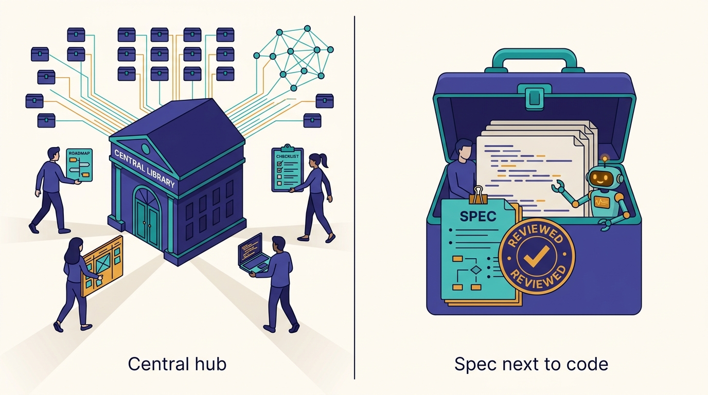
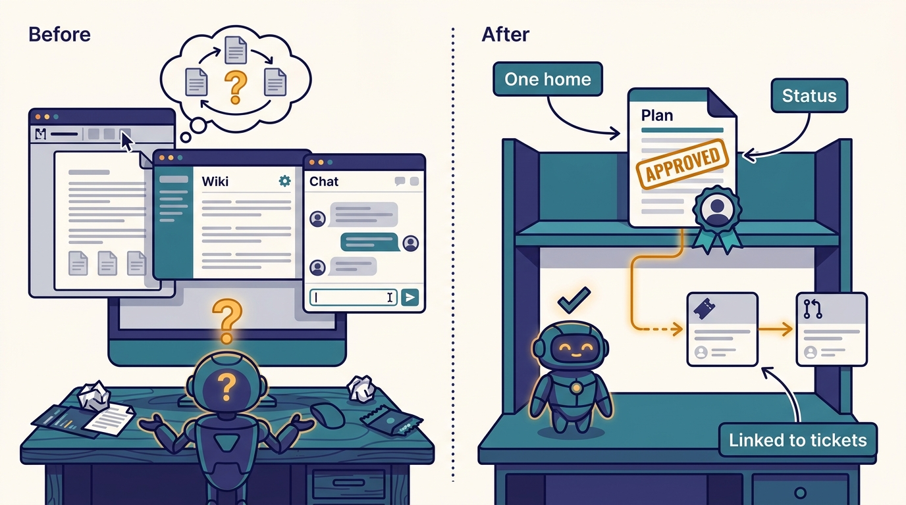

> **IN THIS CHAPTER, YOU WILL:** See how Uber keeps product requirements, engineering designs and launch, experiment and production-readiness reviews in one place, why Uber says planning matters more with agents, and how an approved plan becomes the hand-off to a background agent. Then decide what minimum version of a "plan of record" your own organization needs before agents start executing from prompts.

> **WHY IT MATTERS:** When code is cheap, the expensive mistakes move upstream: the wrong feature, the missed country rule, the corner case nobody wrote down. A leader who cannot say where the approved spec for a piece of agent work lives cannot audit what the agent was asked to do, or measure how long features take.

> **KEY POINTS:**
>
> * **The spec is the agent's real input, so it needs a home.** Medisetty described one place for product and engineering design docs and their reviews, with status, approvals, owners and Jira or Linear links, as "a source of truth system for both humans and agents to know the specs for every project."
> * **Heterogeneity is why planning got more important, not less.** Many products, many countries and a physical world mean the happy path is the easy part; Uber's stated reason for planning up front is that corner cases have to be thought through before anyone, human or agent, decomposes and executes.
> * **The hub is valuable because it is connected, not because it stores documents.** Approval status, ownership and ticket links flow into the context graph and later into feature-time measurement; a folder of design docs without that metadata gives an agent text, but no way to tell which version is authoritative.

> **BUILT ON:** Uber's in-house design-doc and review tooling from the hypergrowth years, the ownership metadata behind [[build-what-does-not-exist]], the experiment platform's review process, Jira and Linear links on every project, and the [[context-graph]] that turns all of it into agent context.

 
Most writing about coding agents starts at the prompt. Uber's lifecycle, as Medisetty walked through it in the October 2026 *Pragmatic Engineer* episode, starts one step earlier: with the product requirements or design document (PRD) and the engineering requirements or design document (ERD), and with the reviews that decide whether a feature may launch. Only after "we have the plan" does the conversation move to how work is decomposed and handed to [[minion]], Uber's background coding agent.

That ordering is the chapter's subject. **An agent executes whatever context it is given.** If the context is a one-line prompt, the agent fills the gaps with guesses; if it is an approved plan that names the cities, products, payment types and failure cases in scope, the guesses shrink. The question for an engineering leader is not whether to "do spec-driven development" as a methodology, but **where the plan of record lives, who approves it, and how both people and agents find the current version.**

Uber's answer, as far as the public record shows, is a single hub that existed before AI and has been rewired for it. The record on the hub is thin: one segment of the podcast and a demo in a 2026 conference talk. This chapter separates what Uber has described from what is inference, and spends most of its length on what a company that is not Uber should copy.

## The Problem Uber Had: A Feature Is Not One Prompt

Orosz framed the segment by defining the two documents for listeners: the PRD as "the product spec" and the ERD as the "engineering plan". Medisetty's answer explained why they still matter when agents write much of the code. Paraphrasing the transcript closely: Uber has a great deal of **product heterogeneity and country heterogeneity**, it operates in the physical world, and so its teams need to think through all kinds of corner cases, not just the happy path. That is why the right plan up front "becomes important", and why it makes it easier "for both the engineers or agents to take that plan and decompose and execute on that."

Three properties of Uber's business make this concrete.

- **One stack, many variants.** Medisetty said earlier in the episode that Uber still runs "one single global tech stack" across every country, with shared platforms serving all mobility and delivery verticals. A change to a shared platform is a change to every product that rides on it.
- **Cities are a primitive.** As [[build-what-does-not-exist]] explains, cities are first-class concepts in Uber's infrastructure, down to region pinning and city-sharded services. A plan that says "launch in North America" implies decisions per city, per regulation and per payment method.
- **The physical world does not roll back.** A pricing bug or a dispatch regression affects real trips, real drivers and real money. Medisetty gave this as the reason all PRs still need human review (see [[code-review-signals]]); it is equally a reason to think before generating code.

The combinatorial shape of this problem reappears later in the book: [[capri]] exists because no human can manually test every live combination of product, city and payment type. **Planning is the first, cheapest place to confront the same combinatorics**, before there is code to test.

There is a second, quieter problem. When producing a pull request (PR) took an engineer a day, the cost of writing code forced a minimum amount of thought. When an agent can produce a PR in minutes, nothing forces that thought except process. The 2026 public figures show how fast the volume grew: Uber reported that **11% of PRs were opened by agents** in March 2026 (*Pragmatic Engineer*, 10 March 2026), and Medisetty said **around 15%** of production PRs "go through Minion" in October; the two figures count different things, and [[minion]] reconciles Uber's published definitions. A planning step that was once implicit in the effort of coding now has to be explicit.

## What Uber Built: One Place for Specs, Reviews and Their Status

### The Hub as Described

During the episode Medisetty shared a screen and showed what this book calls the **design-doc hub**: Uber's tool that holds a project's planning documents and reviews together. The auto-generated transcript renders its name as "U-Plan"; the spelling is unconfirmed and no public Uber source names it, so this chapter does not rely on the name. According to Medisetty, the hub holds, in one place:

| Document or review | What it decides | Source of the description |
| --- | --- | --- |
| **Product design doc (PRD)** | What to build and why, for whom | Podcast, Oct 2026 |
| **Engineering design doc (ERD)** | How to build it; architecture and changes | Podcast, Oct 2026 |
| **Launch review** | Whether the feature may ship | Podcast, Oct 2026 |
| **XP review** | The experiment design and its readout (XP is Uber's experimentation platform) | Podcast, Oct 2026 |
| **Production-readiness review** | Whether the system is ready to operate | Podcast, Oct 2026 |

Around the documents, Medisetty described the metadata that makes the hub more than storage: **who is working on each project, its status, approval status, and a Jira or Linear link** on each item, so that "we can trace from this project, how was the execution translated." All of this data, Medisetty said, "also goes into the graph", meaning the [[context-graph]], so that there is a full history of which design docs are the source of truth, their approval status and who works on them. The summary sentence: the hub "gives like a source of truth system for both humans and agents to know the specs for every project."

Medisetty also said Uber has **"all kinds of agentic skills for working with any of your design documents"**. Skills, in this book's sense, are packaged instructions and scripts that an agent loads on demand; [[skills-monorepo]] owns the term. Medisetty did not list which design-doc skills exist. Medisetty was candid that this part of the lifecycle is uneven: "some we are more farther ahead, some we are early in the discussion."

---begin mermaid---
flowchart LR
    subgraph HUB["Design-doc hub"]
        PRD["PRD: product design doc"]
        ERD["ERD: engineering design doc"]
        REV["Launch, XP and production-readiness reviews"]
        META["Owners, status, approvals"]
    end
    PRD --> ERD
    ERD --> REV
    META --- PRD
    META --- ERD
    META --- REV
    HUB -->|"Jira or Linear link"| TASKS["Tasks and tickets"]
    HUB -->|"documents and metadata"| CG["Context graph"]
    SK["Design-doc skills"] -->|"draft and review"| HUB
    CG -->|"grounding"| AG["Engineers and agents"]
    TASKS -->|"execution"| AG
    AG -->|"spec as hand-off"| MIN["Minion"]
---end mermaid---
**Figure 1:** *The design-doc hub as Medisetty described it: product and engineering docs and their reviews in one place, with owners, status and approvals, linked to tickets and fed into the context graph. The PRD-to-ERD-to-review ordering is the conventional sequence, not a documented workflow engine.*

### The Pre-AI Origin

The hub is not an AI-era invention. Earlier in the same episode, listing what Uber built in-house during hypergrowth, Medisetty said that "as the engineering size grew, we also had to build like end to end, like our engineering design docs, product design docs, getting all of those into one single place," alongside incident-management tooling. Uber has not published a description of this tooling, its age or its data model. What matters for the thesis of this book (see [[the-harness-is-the-easy-part]]) is that **the hub was a pre-AI investment in making plans findable**, and the AI era inherited it with its owners, statuses and ticket links already in place.

### How the Plan Becomes the Hand-off

The second half of Medisetty's answer connects planning to execution. "Once we have the plan, then the next thing is how do you convert that into, decompose that and execute." For a task with a "really good spec", or where the engineer wants "minimal steering", the engineer hands it to Minion, which can run in **plan mode** or execute a prompt given once, working "across repositories based on the plan and spec that you have." [[minion]] owns the agent itself; the point here is the contract between the two systems: **the better the spec, the less steering the background agent needs.**

The AI Engineer World's Fair 2026 talk by Medisetty and Adam Huda, "Agentic SDLC at Uber" ([AI Engineer](https://ai.engineer/talks/17-YSUHo6Lk-agentic-sdlc-at-uber-building-blocks-ubers)), adds a public demonstration of the same path. According to the talk page's summary of the demo, Cortana, Uber's internal AI assistant (owned by [[context-graph]]), helps with the business research, such as finding past large-venue events and candidate stadiums. The planning steps then propose a North American rollout, create two Figma mock-up variants, plan an A/B experiment, and identify the reusable app screens and backend capabilities and the code changes needed. A slide shows an engineering-design panel with a **"Ready for Minion" status**, and Cortana hands the design to Minion, which in the demo stops at a draft PR. The same summary notes that the earlier process was a "weeks-long alignment process" and gives no measured new duration.

That "Ready for Minion" status is the most concrete public evidence of what this book calls the **spec as hand-off**: a plan reaches a state, explicitly marked, in which an agent may start executing it.

---begin mermaid---
stateDiagram-v2
    state "Draft: PRD and ERD written, often with skills" as Draft
    state "In review: launch, XP, readiness" as Review
    state "Approved plan of record" as Approved
    state "Ready for Minion" as Ready
    state "Executing: interactive or background" as Executing
    state "Shipped and traced to tickets" as Shipped
    [*] --> Draft
    Draft --> Review
    Review --> Draft: changes requested
    Review --> Approved
    Approved --> Ready
    Ready --> Executing
    Executing --> Draft: plan wrong or incomplete
    Executing --> Shipped
    Shipped --> [*]
---end mermaid---
**Figure 2:** *A plausible lifecycle of a plan, not a documented Uber workflow. Only the "Ready for Minion" status appears in a public Uber demo; the other states and transitions are inferred from the document and review types Medisetty listed. The loop back from execution to draft is the one most teams forget.*

> **INFERENCE, NOT DOCUMENTED:** Uber has not said whether the hub enforces a gate (no agent execution before approval), whether "Ready for Minion" is a status on the ERD or on individual tasks, or whether Minion reads the hub directly or receives the plan through Cortana, the context graph or a pasted link. The demo shows the hand-off happening; it does not show the mechanism.

### Slack Threads as Lightweight Specs

Not every plan is a document. Medisetty described a second path for small changes: an engineer iterates on a design in a Slack thread "with the EM, with the PM", gets alignment, and then writes "@Minion follow this thread… can you create a PR?" Minion "will take that Slack thread context and then create a PR." For on-call bugs reported in support channels, the thread is the bug report and the spec at once.

This matters for the design of any plan-of-record system. **Uber does not require a PRD for every change.** The hub serves projects; the thread serves tasks. A plan-of-record policy that ignores the thread path will be routed around, because the thread is where small decisions actually get made.

### Plans as the Basis for Measurement

The hub's links also serve measurement. In the measurement segment, Medisetty said that even with the planning tool in place, "sometimes you might not have the right tracing from this product design doc to this [engineering] design doc to this particular task." Uber now uses AI to cluster and tag the missing links, so that it can compute the median (P50) feature time by complexity for every half over the last two or three years, and ask whether "the bottleneck [is] in the PRD phase … in the launch phase … in the rollout phase." [[feature-velocity]] owns that method. The implication for this chapter: **a design-doc hub with weak links to tickets and PRs cannot answer "how long does a feature take?"**, and that becomes the central productivity question once PR counts stop meaning anything.

## The Foundation Underneath

The hub's AI-era value comes from properties it had before AI arrived. The table maps each to the system that supplies it.

| Property the agent era needs | What supplies it at Uber | Owning chapter |
| --- | --- | --- |
| One findable place for plans | In-house design-doc tooling, built during hypergrowth (podcast) | This chapter |
| Who owns the project and the systems it touches | Ownership metadata (uOwn) and per-project owners | [[build-what-does-not-exist]] |
| Which version is authoritative | Status and approval fields on each doc and review | This chapter |
| Plan-to-execution traceability | Jira or Linear links on each project | This chapter, [[feature-velocity]] |
| Experiment design as part of the plan | XP reviews on Uber's experimentation platform | [[build-what-does-not-exist]] |
| Agents can query plans alongside code, incidents and people | Hub data in the context graph | [[context-graph]] |
| Plans can say "in these cities, for these products" precisely | Cities and products as first-class primitives | [[build-what-does-not-exist]] |
| The executor can run anywhere in the code | Mega DevPod with all repositories | [[devpods]], [[minion]] |

Two of these deserve emphasis.

**Status and approvals are the part that makes a document a source of truth.** An agent that searches a wiki will find three versions of a design and no signal for which one was approved. Uber's context graph, according to its August 2026 blog post "Running a Software Factory Efficiently at Uber Scale" ([Uber](https://www.uber.com/us/en/blog/efficient-software-factory/), 27 August 2026), integrates data from more than 30 internal systems, including "architectural design docs", into a graph of 24 million nodes and 80 million edges. Medisetty's podcast description adds that what enters the graph is not only the text but the approval status and owners. **The graph inherits the hub's authority markers; without them it would inherit its ambiguity.**

**Experiment and readiness reviews encode Uber-specific risk.** A generic spec template asks for goals, non-goals and design. Uber's set of reviews asks how the experiment will be read out and whether the system is operable, which are the questions that matter for a marketplace that changes prices and dispatch logic. An agent that reads an approved XP review knows what the experiment is supposed to measure; one that reads only a ticket does not.

## Design Choices and Trade-offs

Every organization that hands work to agents makes the following choices, explicitly or by default.

| Choice | Option A | Option B | When A is right | When B is right |
| --- | --- | --- | --- | --- |
| Where the plan of record lives | Central hub (Uber's choice for projects) | Markdown next to the code, versioned in the repository | Many teams, cross-functional reviews, product and legal sign-off, need for portfolio-level queries | One team or one repository; engineers are the only authors; specs should change in the same PR as the code |
| Granularity | Project-level PRD and ERD | Task-level spec per PR | Features that span services, cities and teams | Maintenance, small fixes, migrations |
| Who drafts | Humans write, agents review | Agents draft a V0, humans edit and approve | The decision is contested or novel | The shape is routine and the context is in the graph |
| Gate before execution | Agent may start only on an approved plan | Agent may start any time; approval gates merge | High-risk domains: pricing, payments, safety, regulated markets | Low-risk, reversible changes where a draft PR is a cheap way to think |
| Lightweight path | Slack thread as spec (Uber has one) | Ticket description as spec | Alignment happens in conversation | Work is planned in a tracker |
| Living or frozen | Spec updated as implementation teaches | Spec frozen at approval; deviations recorded separately | Exploratory work where the plan will change | Audited or regulated changes where "what was approved" must be provable |

The central trade-off is **central hub versus repository-local specs**. A repository-local spec, such as a `spec.md` next to the code or the files generated by GitHub's Spec Kit, is easy for an agent to find and changes in the same review as the code. A central hub handles what a repository cannot: product managers, designers, legal and operations reviewers who never open a repository; reviews that span many repositories; and portfolio questions such as "which projects in Brazil are awaiting a launch review?" Uber, with project-level plans spanning a mega-DevPod's worth of repositories, chose the hub and made it queryable through the graph. A 30-engineer company with one product and one repository would usually be better served by specs in the repository.

**Figure 3:** *A central hub serves many roles, reviews and repositories; a spec next to the code is easier for an agent to find and changes in the same review, which suits one team and one repository.*

The second trade-off is **when the gate applies**. Gating agent execution on approval is safe but slow; letting an agent produce a draft PR from an unapproved idea is a fast way to explore, and Minion's draft PRs are cheap. The rule I would use: **gate merge on approval for every change, and gate execution on approval only where the plan itself carries risk** (pricing, payments, safety, regulatory scope). Exploration is cheap; shipping an unapproved decision is not.

## Elsewhere in the Industry

**Google's design docs.** In "Design Docs at Google" ([Industrial Empathy](https://www.industrialempathy.com/posts/design-docs-at-google/), 6 July 2020), Malte Ubl describes the informal document written before a coding project, with context and scope, goals and **non-goals**, the design, **alternatives considered** and cross-cutting concerns such as security and privacy. He describes a lifecycle of creation, review, implementation with updates, and later revisiting; and he advises skipping the doc when the solution is not ambiguous. The structure is close to what an agent needs: non-goals and alternatives are exactly the context that stops an agent from "helpfully" doing the out-of-scope thing. The difference is the reader. Google's design doc was written for humans; Uber's hub is explicitly for "both humans and agents".

**GitHub Spec Kit.** GitHub's open-source Spec Kit, introduced by Den Delimarsky in "Spec-driven development with AI" ([GitHub Blog](https://github.blog/ai-and-ml/generative-ai/spec-driven-development-with-ai-get-started-with-a-new-open-source-toolkit/), 2 September 2025), moves from "code is the source of truth" to "intent is the source of truth" through four phases: specify, plan, tasks, implement. The spec is "a contract for how your code should behave" and a living artifact. This is the repository-local form of Uber's idea: the same specify-plan-decompose-execute sequence Medisetty described, but held in files next to the code rather than in a company-wide hub with reviews and approvals.

**Thoughtworks' caution.** The Thoughtworks Technology Radar placed spec-driven development in **Assess** in November 2025 ([Thoughtworks](https://www.thoughtworks.com/radar/techniques/spec-driven-development)), citing Amazon's Kiro, Spec Kit and the Tessl Framework as different interpretations. Its cautions apply directly to any design-doc hub with agentic skills: the workflows "remain elaborate and opinionated", some tools generate lengthy spec files that are "hard to review", and it is sometimes unclear who the intended audience of generated PRDs is. Uber's approach answers the audience question (both humans and agents) but the public record does not show how it keeps agent-drafted documents short enough for humans to review.

**Stripe's Slack-thread start.** Stripe's background agents, also called Minions, are most often started from Slack: "engineers can kick off a minion directly from the thread discussing a change" ([Stripe](https://stripe.dev/blog/minions-stripes-one-shot-end-to-end-coding-agents), 9 February 2026). Like Uber's "@Minion follow this thread", it treats the discussion as the spec for small work. Neither company has published how it decides when a thread is enough and a design doc is required.

## If You Are Not Uber

Most organizations already have the raw material: PRDs in a document editor, design docs in a wiki, tickets in Jira or Linear. What they lack is the three properties that turn that material into agent input: **one authoritative location, an explicit status, and a link from plan to execution.** The minimum viable version is a convention and a few fields, not a new product.

**Figure 4:** *The minimum viable plan of record is three properties, not a new product: one authoritative location, an explicit status, and a link from plan to execution.*

**The minimum viable plan of record:**

1. **Pick one home per kind of plan.** Project-level PRDs and ERDs in one place (a document system, a wiki space or a repository folder); task-level specs in the ticket or the PR description. Not both, and not "wherever the author likes".
2. **Add four fields to every plan:** owner, status (draft, in review, approved, superseded), approval record, and a link to the epic or ticket. These four fields are what let an agent, or a new engineer, tell the current plan from an abandoned one.
3. **Write the agent-relevant sections explicitly:** scope by product and market, non-goals, known corner cases, acceptance checks. A design doc that says "support cash payments" without saying in which markets and with which exceptions is an invitation for the agent to guess.
4. **Make the plan reachable from where the agent runs.** If agents run in the repository, link or copy the approved spec into it; if they run with a search tool over documents, make sure the search returns the approved version first. A plan the agent cannot fetch is not its input.
5. **Mark the hand-off.** A "ready for agent" label on a ticket, or a status on the spec, makes explicit that the plan is complete enough to execute with minimal steering. It also gives you a population to measure: how often do agent runs on "ready" plans need major human rework?
6. **Allow the thread path, and capture it.** Let engineers start agents from a discussion thread for small changes, and have the agent paste the thread summary into the PR description. The thread becomes the spec of record for that change.

| Company size | What to build | What to buy or reuse | What to skip |
| --- | --- | --- | --- |
| **≈50 engineers** | A `docs/` or `specs/` folder per repository with a short template (scope, non-goals, corner cases, checks); a "ready for agent" label in the tracker | Repository-local spec tooling such as Spec Kit, or a plain template; the coding harness's plan mode | A central hub; formal launch and readiness reviews for every feature |
| **≈500 engineers** | One design-doc location with owner, status and approval fields; ticket links required for approved docs; two or three agent skills that draft and review against the template | A document system or wiki with structured properties; tracker integration | Building your own document editor; a knowledge graph before the metadata is clean |
| **≈5,000 engineers** | A hub that holds product, engineering, experiment, launch and readiness reviews with their statuses; a graph or index that exposes plan, owner and approval to agents; plan-to-PR tracing for feature-time measurement | Graph and search infrastructure you already run; vendor knowledge tools only if they preserve permissions | Mandatory PRDs for maintenance and small fixes (route those through tickets or threads) |

**Prerequisites before this pays off:** a tracker that engineers actually use, so the plan-to-ticket links mean something; ownership metadata for the systems a plan touches; and a culture where an approved plan is updated when reality diverges. Without the last one, the hub becomes an archive of good intentions and the agent faithfully executes an outdated plan.

**What not to copy:**

- **Do not copy the full review set.** Uber's launch, XP and production-readiness reviews reflect a marketplace with experiments on every change and incidents that cost a great deal. A company without an experimentation platform should not invent an XP review to look like Uber.
- **Do not let agents generate the PRD and then execute it unread.** Agent-drafted V0 documents are useful (Medisetty described the same pattern for customer-support policies; see [[the-engineer-as-context-builder]]). An agent-drafted plan approved without reading is a prompt with extra steps.
- **Do not build the hub before the habits.** If teams do not write design docs today, a new tool will not make them. Start with the template and the four fields in whatever system people already open.

## Failure Modes

- **The stale plan.** The ERD was approved in March; the implementation changed in May; the doc never did. An agent grounded in the hub follows the March plan with confidence. Living specs need an owner whose job includes updating them, and a status of "superseded" that agents respect.
- **The plan nobody approved.** An agent-drafted PRD sits in "draft" but is the only document that exists, so the agent and the next engineer both treat it as authoritative. Status fields only help if tools treat "draft" differently from "approved".
- **The happy-path spec.** The plan covers the main market and the main payment type, and the agent implements exactly that. In a heterogeneous business the corner cases are the plan; a spec template without a "markets and exceptions" section invites this failure.
- **Spec theater.** Every change, however small, requires a PRD, so engineers write one-line PRDs or route around the process through threads that are never captured. Proportionality, with a lightweight path, is what keeps the process honest.
- **Over-long generated specs.** Agentic drafting skills produce ten-page documents that reviewers skim. Thoughtworks' "hard to review" caution applies; length limits and required sections help more than more generation.
- **Permission leaks.** A hub fed into a graph that agents can query may expose unreleased product plans or confidential reviews to anyone whose agent can search. Uber says its graph and assistant respect existing user permissions; an imitator has to make the same guarantee before connecting plans to agents.
- **Untraceable features.** Plans without ticket links make feature-time measurement impossible later, which is exactly the gap Medisetty said Uber now fills with AI clustering. Requiring the link at approval time is cheaper than reconstructing it.

## What the Record Does Not Say

- The hub's name, age, data model and implementation; whether it is a custom application or built on a commercial document system.
- Which design-doc skills exist, what they check, and how often agent-drafted PRDs or ERDs are accepted.
- Whether approval is enforced before agent execution, or only before launch.
- How "Ready for Minion" is represented, who sets it, and how Minion consumes the plan.
- How the hub handles a plan that changes during implementation, and whether agents can propose updates to it.
- How permissions on confidential plans are carried into the context graph and into agent sessions.
- Whether the share of Minion work that starts from an approved plan, versus a prompt or a Slack thread, is measured.

## Questions to Ask

1. Where does the approved spec for a feature live today, and could a new engineer find the current version in under five minutes? Could an agent?
2. Which four or five fields would tell an agent whether a document is authoritative, and which of your plans have them?
3. What is your lightweight path for small changes, and is the decision captured anywhere an auditor or an agent could find later?
4. For your riskiest domains, does an agent need an approved plan before it starts, or only before its change merges?
5. Does your spec template force the corner cases specific to your business (markets, tenants, regulations, payment types), or only goals and design?
6. Who updates a plan when the implementation diverges, and how do agents learn that a plan is superseded?
7. Can you trace a shipped feature from its PRD to its PRs today? If not, how will you measure feature time when PR counts stop meaning anything?
8. If agents draft your PRDs and ERDs, who reads them, and how do you keep them short enough to be read?

The plan is the input; the next chapter is the executor. [[minion]] follows the hand-off into Uber's background coding agent: how it runs on the mega DevPod, how engineers steer it from the web and Slack, and why its share of production PRs depends less on the model than on the validation tools around it.

## Sources and Evidence

**The source episode**

- [Uber's AI infra, from the inside](https://newsletter.pragmaticengineer.com/p/ubers-ai-infra-from-the-inside), *The Pragmatic Engineer* podcast, Gergely Orosz with Uday Kiran Medisetty, 2026 (14 October); show notes and auto-generated transcript. Supports the design-doc hub's contents, metadata and graph feed, the planning rationale, the Minion hand-off, Slack-thread specs and the plan-tracing gap.

**Uber engineering sources**

- [Running a Software Factory Efficiently at Uber Scale](https://www.uber.com/us/en/blog/efficient-software-factory/), Uber Blog, Uday Kiran Medisetty, 2026 (27 August). Supports context-graph scale (30+ systems, 24M nodes, 80M edges) and design docs as a graph source.
- [Agentic SDLC at Uber: Building Blocks for Uber's Software Factory](https://ai.engineer/talks/17-YSUHo6Lk-agentic-sdlc-at-uber-building-blocks-ubers), AI Engineer World's Fair talk, Uday Kiran Medisetty and Adam Huda, 2026. Supports the planning demo, the "Ready for Minion" status and the draft-PR stop.
- [How Uber uses AI for development: inside look](https://newsletter.pragmaticengineer.com/p/how-uber-uses-ai-for-development), *The Pragmatic Engineer*, Gergely Orosz, 2026 (10 March). Supports the 11% of PRs opened by agents.

**Industry and research sources**

- [Design Docs at Google](https://www.industrialempathy.com/posts/design-docs-at-google/), Malte Ubl, 2020. Supports the design-doc structure, lifecycle and when to skip one.
- [Spec-driven development with AI: Get started with a new open source toolkit](https://github.blog/ai-and-ml/generative-ai/spec-driven-development-with-ai-get-started-with-a-new-open-source-toolkit/), GitHub Blog, Den Delimarsky, 2025. Supports the repository-local, four-phase spec workflow.
- [Spec-driven development](https://www.thoughtworks.com/radar/techniques/spec-driven-development), Thoughtworks Technology Radar, 2025 (November; Assess). Supports the cautions on elaborate workflows and hard-to-review generated specs.
- [Minions: Stripe's one-shot, end-to-end coding agents](https://stripe.dev/blog/minions-stripes-one-shot-end-to-end-coding-agents), Stripe Dev Blog, Alistair Gray, 2026. Supports Slack threads as the starting point for background agents.

Statements about Uber's AI-era systems are Uber's own account unless another source is cited; recommendations and labeled inferences are the author's judgement.
