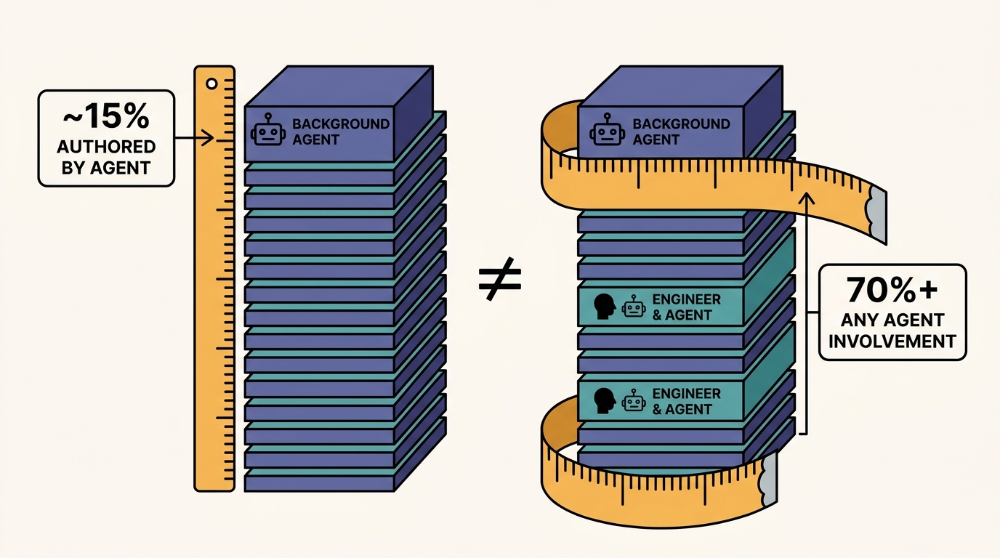
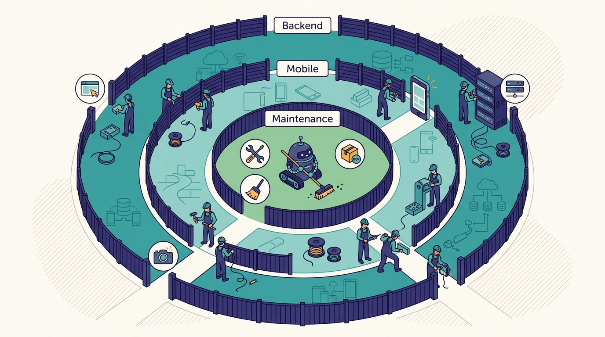

> **IN THIS CHAPTER, YOU WILL:** Follow a task from a Slack thread or a web form into Minion, Uber's background coding agent, through the mega DevPod it runs on and the validation it does before stopping at a draft PR. Reconcile the different public numbers for Minion's share of PRs, and decide what minimum version of a background agent your organization can run, and on what foundations.

> **WHY IT MATTERS:** A background agent turns engineer attention, not engineer typing, into the scarce resource. Whether it helps or floods review and CI depends on what it runs on, which tasks it is given, and how it proves its work, and those are platform decisions an engineering leader owns.

> **KEY POINTS:**
>
> * **Minion is mostly reused infrastructure.** It runs on a DevPod flavor that holds all repositories, starts in seconds from warm pools and pre-built images, builds any module with one Bazel command, and inherits the harness, tools and skills of the interactive setup; Orosz's verdict was that Uber "got to reuse almost all of this infra."
> * **The share of PRs is a definition, not a number.** "About 10%" (CEO, May 2026), "11% of merged PRs" (May 2026), "around 15% of production PRs" (podcast, October 2026) and "70%+ attributed to agents" (August 2026) measure different things; quote the definition with the figure.
> * **Validation tools, not model quality, set Minion's scope.** It began with maintenance and expands only "as we are adding more and more tools… where Minion can self-validate its work"; it stops at a draft PR with a table of the checks it ran, so trust is earned task class by task class.

> **BUILT ON:** [[devpods]] and the mega DevPod, the per-language monorepos and one Bazel build contract from [[monorepos-and-one-build]], Slack and web entry points, [[aifx-harness-layer]], [[mcp-gateway]] and [[skills-monorepo]] for tools, the separate background tier from [[token-spend-governance]], and [[slate]] for end-to-end checks.

 
Every coding agent can open a pull request (PR). The hard part of a **background agent** (one that runs unattended in a cloud workspace while the engineer does something else) is everything around the PR: where the agent's code and tools come from, how it learns to build and test a module it has never seen, what it checks before asking for a human's time, and who pays for the tokens. Uber's answer is **Minion**, built in 2025, now in its second major iteration, and, according to Medisetty in the October 2026 *Pragmatic Engineer* episode, the path for **"around 15% of all of the production PRs."**

The figure is striking, but the more useful lesson is in how Medisetty described Minion's growth: it started with maintenance tasks, and its scope grows as Uber adds tools that let it **self-validate** its work in web, mobile and backend code. **The agent's remit is bounded by the verification around it, not by what the model can write.**

This chapter covers what Minion is, as far as the public record shows; what it stands on; the numbers and their definitions; and what a company that is not Uber should build first. Planning, the input to Minion, is owned by [[plans-as-source-of-truth]]; the validation loop and CI economics it depends on are owned by [[inner-loop-and-self-healing-ci]].

## The Problem Uber Had: Toil That Interrupts Focus

Uber's public framing of Minion is about attention. Uber engineer Nikhil Ramakrishnan described Minion at the Background Agents Summit ([session page](https://background-agents.com/summit/sessions/nikhil-ramakrishnan/), 7 May 2026) as a platform "aimed at backgrounding toil tasks", such as validation-heavy fixes, cleanup work and other interruptions, with the goal to "protect engineering focus, not just generate more diffs."

Medisetty's podcast account names the same category. Some PRs engineers want to make interactively, steering an agent in their own session. For others, "the task that I have really good spec or I want to do minimal steering, I can hand off that to a Minion." Early on, "mostly maintenance kind of tasks used to be offloaded." Medisetty also described the on-call case: in a support channel, someone reports a bug, the on-call engineer asks Minion what the issue is, Minion comes back with a root cause, and if the fix is simple, it is fixed there, with "no … loop of like adding it to backlog."

The scale makes the problem specific. Uber runs six major monorepos in seven languages, and more than 4,500 engineers land changes through its merge queue ("Slashing CI Costs at Uber", [Uber Blog](https://www.uber.com/us/en/blog/slashing-ci-costs-at-uber/), 23 June 2025). A dependency bump, a noisy-log cleanup or a small bug fix is cheap for one service and enormous across thousands. **Toil at Uber is a fleet problem**, which is why the systems in this book that address it at fleet scale, [[shepherd-and-fox]], sit next to Minion rather than inside it.

## What Uber Built: Minion as Described

### Entry Points and Modes

According to Medisetty, Minion is used from the **web** and from **Slack**. In either, an engineer can run it in **plan mode** (the agent proposes a plan, the engineer reviews it, then the agent executes "behind the scenes") or give a prompt once and let it execute, "if it's like a simple simple prompt." In Slack, "@Minion" shows status and accepts steering in the thread, so "you don't need to go to the web." Medisetty's example of the Slack path: an engineer iterates on a design in a thread with the engineering manager and the product manager, gets alignment, and then writes "@Minion follow this thread. And can you create a PR?" Minion "will take that Slack thread context and then create a PR."

A third entry point is another agent. In the episode, Medisetty described **DebugAssist**, Uber's managed root-cause agent, handing off to Minion: once an engineer judges DebugAssist's root-cause analysis (RCA) to be right, they ask Minion to create the PR, and Minion attaches it to the Jira task that already holds the RCA. A September 2026 conference abstract describes a variant in which DebugAssist opens PRs itself. [[wisdom-and-debug-assist]] owns that loop; for Minion, the point is that a reviewed analysis can serve as the spec just as an approved plan or a Slack thread does.

Secondary summaries of Uber talks also list GitHub PR and code-review interfaces as entry points; no Uber-authored page states this, so this chapter does not rely on it. The *Pragmatic Engineer*'s March 2026 deep dive described Minion as "an internal background agent platform with monorepo access and optimized defaults" ([*Pragmatic Engineer*](https://newsletter.pragmaticengineer.com/p/how-uber-uses-ai-for-development), 10 March 2026), and reported the observation of Ty Smith, an Uber principal engineer, that engineers often start several background agents while waiting on a prompt: "Might as well kick off another background agent."

### Where It Runs: The Mega DevPod

Minion runs on the **mega DevPod**, the DevPod flavor that contains every repository (see [[devpods]], which owns the term). Medisetty said in the episode that "for Minion, there is a devpod flavor that has all of the repositories, and optimized for Minion usage," and that the mega DevPod lets "my agents create PRs across the repositories." With it, Minion "can work across repositories and generate one PR or multiple PRs across repositories based on the plan and spec."

The AI Engineer World's Fair 2026 talk by Medisetty and Adam Huda ([AI Engineer](https://ai.engineer/talks/17-YSUHo6Lk-agentic-sdlc-at-uber-building-blocks-ubers)) adds the mechanics of fast start: Uber keeps **pre-provisioned Kubernetes "balloon pods"** ready, with repository snapshots and search indexes already built, so agents "can begin working within seconds." The podcast describes the same thing from the interactive side: DevPods run on Kubernetes clusters across multiple clouds, "everything is warmed up," and a new pod is cloned from a pre-built image with repositories and build caches already present.

Inside the pod, the agent faces the same build contract as an engineer. "It's one single way to build any module," Medisetty said, and because builds and tests are standardized on Bazel across repositories, top-level `CLAUDE.md` and `AGENTS.md` files can tell any agent how to build and test any module, so "most teams will get like really good value out of the bat" without per-module setup. [[monorepos-and-one-build]] owns that contract.

---begin mermaid---
flowchart LR
    subgraph ENTRY["Entry points"]
        WEB["Minion web UI"]
        SL["Slack: @Minion follow this thread"]
        PLAN["Approved plan: Ready for Minion"]
    end
    subgraph POD["Mega DevPod from a warm pool"]
        REPO["All repositories, snapshots, search indexes"]
        BUILD["One Bazel build and test contract"]
        H["Harness via AIFX with skills"]
    end
    TOOLS["MCP Gateway tools and CLIs"]
    VAL["Self-validation: static checks, simulator, staging, Slate"]
    PR["Draft PR with table of checks and screenshots"]
    CI["Shared CI and SubmitQueue"]
    REV["Human review in Code Inbox"]
    WEB --> POD
    SL --> POD
    PLAN --> POD
    H --> TOOLS
    POD --> VAL
    VAL --> PR
    PR --> CI
    PR --> REV
---end mermaid---
**Figure 1:** *Minion as described in the podcast and the 2026 talk: entry points where work is already discussed, a mega DevPod that holds every repository and one build contract, shared tools and skills, self-validation, and a draft PR with evidence before shared CI and human review. How the harness inside the pod is wired to AIFX is an inference from the interactive setup.*

### What It Does Before Asking for a Human

The 2026 talk is the clearest public source on Minion's stopping point. In the demo, Minion **"stop[s] at just creating a draft PR"** and is "not gonna push it to CI yet." The reason given is CI cost: pushing straight to CI suits toil work, but end-to-end features need validation first, to limit extra CI load. Autonomous PRs carry **a table of the checks performed, including screenshots**; the talk page's summary notes that this makes the work inspectable but does not guarantee correctness.

The validation steps shown in the talk are static-analysis detection and repair, launching the app in a simulator with a skill and capturing a screenshot, comparing the screenshot "with the Figma specification", and starting the backend in staging to check frontend and backend integration. In the podcast, Medisetty described the same capability more generally: Uber hooked in "visual validation where I can spin up emulator and test it … spin up like a web and test it … spin up like a staging environment," and "now Minion or even my interactive harnesses, these agents … have the skills for this." [[inner-loop-and-self-healing-ci]] owns these checks and the `aifx validate` command; [[slate]] owns the personal staging environments.

---begin mermaid---
sequenceDiagram
    participant E as Engineer
    participant S as Slack thread
    participant M as Minion
    participant D as Mega DevPod
    participant V as Validation tools
    participant R as Code Inbox
    E->>S: Iterate on the design with EM and PM
    E->>S: @Minion follow this thread and create a PR
    S->>M: Thread context as the spec
    M->>D: Claim warm pod with all repositories
    M->>D: Edit code across one or more repositories
    M->>V: Static checks, build, simulator or staging
    V-->>M: Failures to fix and evidence to attach
    M->>R: Draft PR with checks table and screenshots
    M-->>S: Status and link in the thread
    E->>R: Review, steer or take over
---end mermaid---
**Figure 2:** *The Slack path Medisetty described: the discussion is the spec, the agent claims a warm mega DevPod, validates its own work, and returns a draft PR with evidence. The ordering of validation steps is taken from the 2026 talk's demo, not from a documented Minion workflow.*

### Spend: A Separate Tier

Medisetty said that interactive harnesses share a spend tier and that "for some of our background coding agents, we have a separate independent tier." Uber's August 2026 blog post, "Running a Software Factory Efficiently at Uber Scale" ([Uber Blog](https://www.uber.com/us/en/blog/efficient-software-factory/), 27 August 2026), describes "separate tiers for managed agents", tracked by outcome (cost per merged PR, cost per review, cost per cleanup) alongside quality signals such as revert rate. [[token-spend-governance]] owns the tier design; the point here is that **a background agent has a different cost profile from an interactive session**, because nobody is watching it spend.

### Iterations and Lineage

Medisetty said Uber did "multiple iterations" and calls the current one Minion v2; the details of v1 and v2 are not public. Ramakrishnan's summit session traces the lineage as an early **container prototype → DevPod → Minion**. Orosz, in the episode's closing, put the lineage plainly: Uber built DevPods in 2017 (the date as the episode gives it; Uber's own blog places the DevPod work after the 2017–2018 monorepo move) and "got to reuse almost all of this infra in building out their cloud agents called Minions."

### The Numbers, With Their Definitions

Uber's public figures for agent PRs differ because they count different things at different times. Read them as a series, not a contradiction.

| Figure | What it counts | Source and date |
| --- | --- | --- |
| "About 10%" | Committed code built by autonomous agents | Uber CEO Dara Khosrowshahi on an earnings call, as reported by Fortune, May 2026 |
| 11% | PRs opened by agents | *Pragmatic Engineer*, 10 March 2026 |
| 11% | Merged PRs, behind Minion | Background Agents Summit, Ramakrishnan, 7 May 2026 |
| ~1,800 a week; 95% of engineers | Code changes produced by Minion; share of engineers who use it | AAIF write-up of an Uber MCP Dev Summit talk ([AAIF](https://aaif.io/blog/how-uber-runs-60000-ai-agent-tasks-per-week-with-mcp), 14 May 2026) |
| "Around 15%" | Production PRs that "go through Minion" | Podcast, Medisetty, October 2026 |
| "70%+" | PRs attributed to local or cloud agents (any agent involvement) | Uber blog, 27 August 2026; AI Engineer talk |

The first three rows and the podcast figure count **authorship by an autonomous agent** (the AAIF row counts volume and adoption, not share); the last row counts **any agent involvement**, including an engineer's interactive session. Do not compare 15% with 70%. Even within the first group, no public source says how a Minion PR is counted once a human edits it, or whether "production PRs" excludes test and documentation changes. The trend, from about 10–11% in spring 2026 to around 15% in October, is consistent across Uber's own accounts; the exact level depends on a definition Uber has not published.

**Figure 3:** *The share of PRs is a definition, not a number: around 15% of production PRs go through Minion (podcast, October 2026), while 70%+ of PRs are attributed to any agent involvement (Uber blog, August 2026).*

## The Foundation Underneath

Minion is the clearest case in this book for the thesis of [[the-harness-is-the-easy-part]]. The agent loop itself is commodity: Uber's harnesses are Claude Code, Codex and OpenCode, wrapped by [[aifx-harness-layer]]. What Uber did not have to build in 2025 is the list below.

| What a background agent needs | What Uber already had | Built or documented | Without it |
| --- | --- | --- | --- |
| An isolated, disposable workspace per task | DevPods on Kubernetes, outside production | DevPod blog, Dec 2022; podcast | Agents on shared machines or laptops; no parallelism; credential sprawl |
| Start in seconds, not minutes | Warm pools, pre-built images, build caches, balloon pods | Podcast; 2026 talk | Every task pays a clone-and-build tax; agents get used only for big jobs |
| Every repository in one place | The mega DevPod over per-language monorepos | Monorepos 2017–18; mega DevPod in the AI era | Cross-repo changes become multi-agent coordination problems |
| One way to build and test any module | Bazel across repositories; top-level `AGENTS.md` and `CLAUDE.md` | Go monorepo on Bazel, 2020 blog; podcast | Each module needs its own agent instructions, which nobody writes |
| Tools to read the company | MCP Gateway generated from the IDL registry; skills monorepo | MCP Gateway blog, Oct 2026; podcast | Agents guess at service contracts and internal APIs |
| A way to test end to end | Slate and its trace-baggage routing | Slate blog, 2022 | Agents can change code but not prove it works |
| A queue that keeps main green | SubmitQueue | EuroSys 2019; 2025 CI blog | Agent PRs break main faster than humans can fix it |
| A place where humans review | Code Inbox | PE, Mar 2026; podcast | Agent PRs land in a list nobody triages |

Three of these foundations deserve a sentence each.

**The mega DevPod is a monorepo decision paying off twice.** Because Uber had already consolidated thousands of micro-repositories into a handful of per-language monorepos (see [[monorepos-and-one-build]]), "all repositories" is a set small enough to snapshot into one pod image. A company with three thousand repositories cannot give an agent "everything" this way.

**The build contract replaces per-repository agent instructions.** Medisetty's remark that top-level `CLAUDE.md` and `AGENTS.md` files work "out of the bat" because builds and tests are standardized is the least glamorous and most transferable lesson in the chapter. **An agent's competence in an unfamiliar module is roughly the competence of a new hire with the same instructions.**

**Isolation was solved for humans first.** DevPods already ran outside production on their own clusters, with their own images. An agent inherits that isolation boundary; it does not need a new one.

## Design Choices and Trade-offs

| Choice | Option A | Option B | When A is right | When B is right |
| --- | --- | --- | --- | --- |
| Hosting | Build on your own cloud workspaces (Uber) | Vendor-hosted agent: GitHub Copilot coding agent, Codex Cloud | You already run cloud dev environments, a monorepo and internal tools the vendor cannot reach | You live on GitHub or a similar platform, your build runs in its CI, and your tools are reachable from it |
| Workspace scope | Mega workspace with all repositories | Per-repository clone per task | Cross-repo changes are common and the repo set is small enough to snapshot | Many small repositories; most tasks touch one |
| Start time | Warm pools, pre-built images | Cold start per task | High task volume and short tasks | Low volume; long tasks amortize the start |
| Stopping point | Draft PR after local validation (Uber's demo) | Push to CI and iterate on CI results | CI is expensive or overloaded; validation can run in the workspace | CI is cheap, fast and the only place real tests can run |
| CI rounds | Capped (Stripe: at most two) | Unbounded self-healing | Shared CI is a constrained resource | CI is elastic and failures are mostly flaky tests |
| Entry point | Where work is discussed: Slack, web, plans | Ticket assignment only | Small fixes and on-call bugs that never become tickets | Planned work with clear tickets and auditing needs |
| Interaction | Plan mode, then execute | One-shot | The task needs decomposition or touches several repositories | The task is small and well specified |
| Spend | Separate tier for background agents | Shared tier with interactive use | Background usage scales without a human watching | Usage is low and attribution per person is enough |

The decision most organizations get wrong is the first. **A vendor-hosted background agent is the right default for most companies**, because it comes with an isolated workspace, a draft-PR flow and branch protections. GitHub's coding agent, for example, works in the background on GitHub Actions, commits to a draft PR, can push only to branches it creates, and needs human approval before CI/CD workflows run ([GitHub Blog](https://github.blog/news-insights/product-news/github-copilot-meet-the-new-coding-agent/), 19 May 2025). OpenAI's Codex Cloud runs delegated tasks in remote workspaces that keep going while the user's machine sleeps ([OpenAI](https://learn.chatgpt.com/docs/cloud)). Uber built its own because its workspaces, monorepos, internal tools and spend controls already existed and no vendor environment could reach all of them. That reasoning only transfers if the same is true for you.

## Elsewhere in the Industry

**Stripe's Minions.** The closest peer, with the same name. Stripe's one-shot agents run on a fork of Block's goose, start most often from a Slack thread, and run on devboxes that are "pre-warmed so one can be spun up in 10 seconds, with Stripe code and services pre-loaded" ([Stripe](https://stripe.dev/blog/minions-stripes-one-shot-end-to-end-coding-agents), 9 February 2026). Lints run locally on each push, in under five seconds, before CI; and "since CI runs cost tokens, compute, and time, we only have at most two rounds of CI." More than a thousand PRs merged each week are "completely minion-produced", all human-reviewed. Part 2 ([Stripe](https://stripe.dev/blog/minions-stripes-one-shot-end-to-end-coding-agents-part-2), 19 February 2026) describes "blueprints", code-defined state machines that mix deterministic steps such as linting with agent steps such as implementation. The similarities to Uber are the warm workspaces, Slack as the main entry point and CI as a constrained resource. The difference visible in the public record is that Stripe documents a hard cap on CI rounds, while Uber documents a stop at a draft PR before CI plus a self-healing CI capability.

**Spotify's Honk.** Spotify's background coding agent replaced hand-written migration scripts in its Fleet Management system with prompts, and had produced more than 1,500 merged PRs by November 2025, with 60–90% time savings on migrations ([Spotify Engineering](https://engineering.atspotify.com/2025/11/spotifys-background-coding-agent-part-1), 6 November 2025). Its third post describes deterministic verifiers (format, build, test) before a PR, then an LLM judge that compares the diff with the prompt to catch out-of-scope changes, with the agent tightly sandboxed ([Spotify Engineering](https://engineering.atspotify.com/2025/12/feedback-loops-background-coding-agents-part-3), 9 December 2025). Spotify started from fleet-wide migrations, the work Uber assigns to [[shepherd-and-fox]], rather than from ad hoc tasks.

**GitHub Copilot coding agent and Codex Cloud.** Both are the vendor-hosted form of the same idea, described above. Their guardrails (agent-only branches, draft PRs, human approval before workflows run) are a useful checklist for anyone building their own.

## If You Are Not Uber

**The minimum viable background agent** is a vendor-hosted or self-hosted agent that works in an isolated workspace, can build and test the code it changes with one documented command, opens a draft PR with evidence of what it ran, and draws on a budget that someone watches. Everything Uber has beyond that, the mega DevPod, balloon pods, Slack steering, plan mode, Slate, is an accelerator.

**Prerequisites, in order of importance:**

1. **A documented, one-command build and test** for every repository the agent will touch, written in an `AGENTS.md` or equivalent. If a new hire cannot build a module from its README in an hour, an agent will not either.
2. **An isolated workspace** that is not an engineer's laptop and cannot reach production credentials.
3. **A merge gate that protects main**: required CI, branch protection, and a merge queue if you have more than a few dozen engineers.
4. **A task class the agent can verify.** Start where tests already exist and are trusted: dependency bumps, lint debt, flaky-test fixes, small bugs with reproducing tests.
5. **A spend owner and a background budget**, separate from interactive use.

| Company size | Minimum version | Buy, build or open source | What to skip |
| --- | --- | --- | --- |
| **≈50 engineers** | A vendor-hosted agent (GitHub Copilot coding agent, Codex Cloud, Claude Code in CI or similar) assigned to issues labelled for it; draft PRs only; one budget | Buy | Self-hosted workspaces; Slack bots; plan mode as a separate product |
| **≈500 engineers** | The same agent triggered from issues and from a Slack integration; per-repository `AGENTS.md` with the build contract; a short list of approved task classes; a weekly review of agent-PR acceptance and revert rates | Buy the agent; build the Slack trigger and the task-class policy; reuse cloud dev environments if you have them | A mega workspace (unless you have a monorepo); custom harnesses |
| **≈5,000 engineers** | Self-hosted agents on your own cloud workspaces with warm pools; a workspace image with all monorepos; internal tools through a gateway; separate background tier; evidence table on every PR; per-task-class expansion as validation tools arrive | Build the platform on open harnesses (Uber uses Claude Code, Codex, OpenCode through a wrapper); buy models through a gateway | Expanding task classes ahead of the validation tools that make them checkable |

**Sequencing that works:** build contract → isolated workspace → draft-PR-only agent on one task class → evidence on every PR → measure acceptance and revert rate → add a validation tool → add the next task class. Uber's own sequence, maintenance first and expansion "as we are adding more and more tools", follows this shape.

**Figure 4:** *Validation tools, not model quality, set Minion's scope: it began with maintenance and grows as tools that let it check its own work arrive, one task class at a time.*

**What not to copy:**

- **Do not copy the 15%.** It is an outcome of Uber's foundations, not a target. A team that sets "X% of PRs from agents" as a goal will get PRs; it will not necessarily get value. [[feature-velocity]] explains why Uber itself moved away from PR counts.
- **Do not build the mega DevPod without the monorepos.** "All repositories in one pod" is a consequence of having consolidated repositories; with thousands of repositories, a per-task clone of the few the task needs is cheaper.
- **Do not let the agent push straight to shared CI at volume.** Uber's draft-PR stop and Stripe's two-round cap exist because CI is the first shared system background agents saturate. See [[inner-loop-and-self-healing-ci]].

## Failure Modes

- **The review flood.** A background agent's output rises faster than review capacity. Without triage, agent PRs wait, go stale and are closed, and the measured "share of PRs" rises while merged value does not. Uber's answer is [[code-review-signals]]; the imitator's minimum is a cap on open agent PRs per team.
- **CI saturation.** Each agent run that pushes to CI and retries consumes shared capacity. Uber declared an internal CI "code red" in 2026 after CI jobs "doubled or more than doubled" year over year, a rise Medisetty linked to the "influx of PRs".
- **Plausible but unverified PRs.** The agent produces a clean diff with a passing build that does the wrong thing, because nothing it could run checked behaviour. The evidence table helps reviewers only if the checks it lists actually exercise the change.
- **Cross-repo blast radius.** A workspace with every repository makes it easy for an agent to "fix" a caller in another team's code. Ownership routing and scope checks (Spotify's LLM judge is one example) keep cross-repo PRs from becoming unreviewed changes to other teams' systems.
- **Thread context as an unreviewed spec.** "Follow this thread" executes whatever the thread concluded, including the half-agreed parts. The PR should quote the decision it implemented, so the reviewer can check the agent read the thread the way the humans meant it.
- **Workspace drift.** Pre-built images and snapshots go stale; agents then spend their first minutes rebuilding, or work against old dependencies. Image freshness becomes an operational metric.
- **Unwatched spend.** A background agent stuck in a retry loop spends money with nobody watching. A separate tier with alerts, as Uber describes, is the cheap fix.
- **Counting the wrong thing.** Reporting "agent PRs" without a definition invites the 15% versus 70% confusion inside your own organization.

## What the Record Does Not Say

- Minion's architecture beyond the workspace: which harness or harnesses it runs, how plans are represented, how it decides between one PR and several.
- What changed between Minion v1 and v2, and what plan mode looks like in practice.
- The definition of "production PRs" behind the 15% figure, and how human edits to a Minion PR are counted.
- Acceptance, revert and incident rates for Minion PRs, by task class.
- Which task classes Minion is currently trusted with, and the criteria for adding one.
- Cost per merged Minion PR, although Uber says it tracks cost per outcome for managed agents.
- How Minion's access to repositories and tools is scoped, and whether its identity is the requesting engineer's or its own.

## Questions to Ask

1. Can an engineer who has never seen a given repository build and test it with one documented command? Would an agent find that command?
2. Where will background agents run, and what can that environment reach? What can it not reach?
3. How long does it take from "start a task" to "agent is editing code"? What would warm pools or pre-built images save at your volume?
4. Which single task class would you trust an agent with first, and what existing tests make that class verifiable?
5. Will the agent stop at a draft PR, push to CI, or both? How many CI rounds may it spend?
6. What evidence must every agent PR carry for a reviewer to trust it faster than a human's PR?
7. Who owns the background-agent budget, and what alert fires when one run spends too much?
8. How will you define and report "agent PRs", and what acceptance and revert rate would make you add the next task class?
9. Where is work already discussed in your organization, and could an agent be started from there?

Minion's draft PR is the beginning of a second problem: every agent PR is CI load, and the load arrives faster than CI capacity grows. [[inner-loop-and-self-healing-ci]] follows Uber's response, from moving simple checks into `aifx validate` to self-healing CI and the 2026 "code red".

## Sources and Evidence

**The source episode**

- [Uber's AI infra, from the inside](https://newsletter.pragmaticengineer.com/p/ubers-ai-infra-from-the-inside), *The Pragmatic Engineer* podcast, Gergely Orosz with Uday Kiran Medisetty, 2026 (14 October); show notes and auto-generated transcript. Supports Minion's entry points, modes, Slack steering, on-call use, the mega DevPod, the 15% figure, the maintenance-first scope, the separate spend tier and Orosz's reuse verdict.

**Uber engineering sources**

- [Agentic SDLC at Uber: Building Blocks for Uber's Software Factory](https://ai.engineer/talks/17-YSUHo6Lk-agentic-sdlc-at-uber-building-blocks-ubers), AI Engineer World's Fair talk, Uday Kiran Medisetty and Adam Huda, 2026. Supports balloon pods, the draft-PR stop and its CI rationale, the checks table and the validation steps.
- [Inside Uber's agent-ready platform behind 11% of merged PRs](https://background-agents.com/summit/sessions/nikhil-ramakrishnan/), Background Agents Summit, Nikhil Ramakrishnan, 2026 (7 May). Supports the 11% of merged PRs, the toil framing and the container-to-DevPod-to-Minion lineage.
- [Running a Software Factory Efficiently at Uber Scale](https://www.uber.com/us/en/blog/efficient-software-factory/), Uber Blog, Uday Kiran Medisetty, 2026 (27 August). Supports separate tiers and outcome-based costs for managed agents and the 70%+ agent-attribution figure.
- [How Uber uses AI for development: inside look](https://newsletter.pragmaticengineer.com/p/how-uber-uses-ai-for-development), *The Pragmatic Engineer*, Gergely Orosz, 2026 (10 March). Supports 11% of PRs opened by agents and Minion's description.
- [How Uber Runs 60,000 AI Agent Tasks Per Week With MCP](https://aaif.io/blog/how-uber-runs-60000-ai-agent-tasks-per-week-with-mcp), Agentic AI Foundation, 2026 (14 May). Supports ~1,800 Minion code changes a week and use by 95% of engineers.
- [Slashing CI Costs at Uber](https://www.uber.com/us/en/blog/slashing-ci-costs-at-uber/), Uber Blog, Zhongpeng Lin, Dhruva Juloori and Matthew Williams, 2025. Supports the six monorepos and 4,500+ engineers on SubmitQueue.
- [MCP-Powered Crash Investigation: How 11 MCP Servers Help an AI Agent Debug Production Issues at Uber](https://agntconmcpconjapan26.sched.com/2026-09-11/list/descriptions/type/MCPCon), MCPCon Japan talk abstract, Kriti Dangi, 2026 (11 September). Supports the DebugAssist variant that opens PRs itself.
- [Uber's COO says it's getting harder to justify AI spend](https://www.fortune.com/2026/05/26/uber-coo-ai-spending-tokens-claude-code/), Fortune, Jake Angelo, 2026 (26 May). Supports the CEO's "about 10%" figure as reported.

**Industry and research sources**

- [Minions: Stripe's one-shot, end-to-end coding agents](https://stripe.dev/blog/minions-stripes-one-shot-end-to-end-coding-agents) and [Part 2](https://stripe.dev/blog/minions-stripes-one-shot-end-to-end-coding-agents-part-2), Stripe Dev Blog, Alistair Gray, 2026. Support Slack starts, 10-second devboxes, local lints, the two-CI-round cap, blueprints and weekly volume.
- [1,500+ PRs Later: Spotify's Journey with Our Background Coding Agent](https://engineering.atspotify.com/2025/11/spotifys-background-coding-agent-part-1) and [Predictable Results Through Strong Feedback Loops](https://engineering.atspotify.com/2025/12/feedback-loops-background-coding-agents-part-3), Spotify Engineering, Max Charas and Marc Bruggmann, 2025. Support Honk's volume, verifiers and LLM judge.
- [GitHub Copilot: Meet the new coding agent](https://github.blog/news-insights/product-news/github-copilot-meet-the-new-coding-agent/), GitHub Blog, Thomas Dohmke, 2025. Supports the vendor-hosted draft-PR model and its guardrails.
- [Codex Cloud](https://learn.chatgpt.com/docs/cloud), OpenAI documentation, current as of October 2026. Supports remote delegated tasks as a vendor option.

Statements about Uber's AI-era systems are Uber's own account unless another source is cited; recommendations and labeled inferences are the author's judgement.
