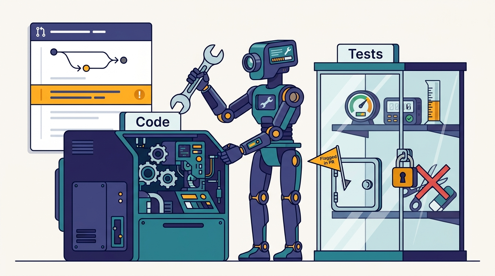
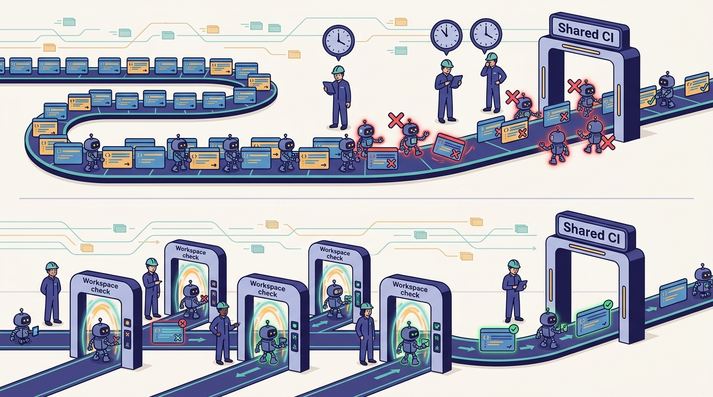

> **IN THIS CHAPTER, YOU WILL:** See why Uber measures cycle time separately for the inner loop (getting a change to green before review) and the outer loop (review and CI), what it moved from CI into `aifx validate`, how visual validation and self-healing CI work as far as the public record shows, and why its 2026 CI "code red" was predictable. Then decide which checks to shift left in your own organization, and how to keep the shift from weakening the gate.

> **WHY IT MATTERS:** Shared CI is the first piece of engineering infrastructure that agents saturate, because every agent PR and every retry is a build. A leader who budgets for agent licenses but not for CI capacity, or who lets agents iterate against CI, pays for the same failure twice: in compute and in engineers waiting.

> **KEY POINTS:**
>
> * **Agents turn CI from a gate into a feedback loop, and CI was never priced for that.** Medisetty said Uber's CI jobs "doubled or more than doubled" year over year, forcing an internal code red in 2026; Uber's own 2025 merge-queue post had already warned that AI-driven commit rates would deepen its speculation trees.
> * **Shift left by running the same checks earlier, not different checks.** Uber put the linter, coverage, build and template rules behind one command, `aifx validate`, added emulator, web and staging checks as agent skills, and has background work stop at a draft PR; the outer loop stays authoritative.
> * **Self-healing CI is the backstop, not the strategy.** Uber applies it per PR or to all PRs, as a managed agent; the hard part is bounding it, with retry limits, protected tests and evidence, so that "fixing CI" never means weakening the checks.

> **BUILT ON:** Bazel's one build and test contract and SubmitQueue from [[monorepos-and-one-build]], fast cloud workspaces from [[devpods]], the harness wrapper in [[aifx-harness-layer]], agent skills from [[skills-monorepo]], and personal staging environments from [[slate]].

 
Every engineering organization has two loops. The **inner loop** is what a developer does before asking anyone else for anything: edit, build, run the tests, look at the result, repeat. The **outer loop** begins when the change is shared: the PR is opened, CI runs, reviewers review, the merge queue lands it, and deployment begins. The inner loop is private and cheap; the outer loop is shared, slow and paid for by everyone.

Coding agents break the economics of that split. An agent that opens a PR as soon as its code compiles and then iterates on CI failures uses the outer loop as its inner loop. At a handful of agent PRs that is a convenience; at Uber's volume it is a capacity crisis. In the October 2026 *Pragmatic Engineer* episode, Medisetty said Uber "had to … add internal code red for our CI system because year over year, the number of CI jobs also doubled or more than doubled."

This chapter covers Uber's response as far as the public record shows: measuring both loops, moving simple CI checks into the inner loop behind `aifx validate`, giving agents visual and staging validation, stopping background work before CI, and adding **self-healing CI**, agents that repair CI failures on PRs. The theme is the book's thesis again: **the agent tooling was the quick part; the foundations that made a fast inner loop possible took a decade.**

## The Problem Uber Had: PR Volume Outran CI

### Two Loops, Measured Separately

Medisetty described the starting point as measurement. Because "our PR volume has gone up year over year," Uber tracks P50 (median) and P90 cycle time "both for inner loop where you have the PR and you want to get it to a green state and create the remote PR," and for the outer loop, "once you have your PR created, getting the human review, getting all the CI things to pass." Review, Medisetty said, has "become a big bottleneck, same as … any other company" (see [[code-review-signals]]).

Separating the two loops matters because they fail differently. A slow inner loop wastes one engineer's or one agent's time. A slow outer loop wastes everybody's: CI queues lengthen, the merge queue speculates over more pending changes, and reviewers see PRs that are not ready.

### The Arithmetic of the Code Red

Uber has not published its CI job counts, so the doubling is Medisetty's account. The surrounding public numbers show why it was likely.

- **Agent share of PRs rose quickly.** Uber reported 11% of PRs opened by agents in March 2026 (*Pragmatic Engineer*, 10 March 2026) and 11% of merged PRs in May (Nikhil Ramakrishnan, Background Agents Summit, 7 May 2026), and Medisetty said around 15% of production PRs "go through Minion" in October (see [[minion]] for the definitions).
- **Code volume per engineer rose too.** The AI Engineer World's Fair 2026 talk by Medisetty and Adam Huda reported that lines of code per engineer roughly doubled year over year ([AI Engineer](https://ai.engineer/talks/17-YSUHo6Lk-agentic-sdlc-at-uber-building-blocks-ubers)). Huda said Uber is trying to "anticipate where our CI capacity needs to be".
- **The merge queue had warned about it.** Uber's June 2025 post "Slashing CI Costs at Uber" ([Uber Blog](https://www.uber.com/us/en/blog/slashing-ci-costs-at-uber/), 23 June 2025) said that with "the recent usage of AI coding assistants", a "higher commit rate means new conflict commits arrive before SubmitQueue process[es] the commits in the queue," producing "deeper speculation trees" and requiring "new scheduling algorithms."

The mechanism is multiplicative. CI load is roughly *PRs × CI runs per PR × cost per run*. Agents raise the first factor directly. They also raise the second, because an agent that learns from CI failures pushes more revisions per PR than an engineer who ran the tests locally first. And at a merge queue that speculatively builds combinations of pending changes, more changes in flight raise the cost per landed change as well.

> **An illustrative calculation, not Uber data:** a team lands 1,000 PRs a week, averaging 2 CI runs each. Agents add 50% more PRs, and agent PRs average 4 CI runs because they iterate against CI. Weekly CI runs go from 2,000 to 2,000 + (500 × 4) = 4,000: a doubling from a 50% rise in PRs. Halve the agent PRs' CI runs by catching failures before the PR, and the total falls to 3,000.

The calculation shows why Uber's response targets runs per PR rather than only adding capacity. **Every failure caught in the workspace is a CI run nobody pays for.**

## What Uber Built: Moving Checks Left, Then Healing What Remains

### `aifx validate`: CI's Simple Checks in One Inner-Loop Command

"The first thing that we did," Medisetty said, "was we took a whole bunch of like simple CI jobs that used to run once you create the PR and we moved it to inner loop, and we kept all of this behind one single command," **`aifx validate`**. When an agent creates a PR, "it can run the linter, the coverage rules, the build rules, the template rules … so that the probability of this PR is in a good condition … goes up." The show notes describe the same thing: agents run the command before opening a PR, to clear simple CI checks such as linting and build and template rules (the show notes spell it "afx validate"; the AIFX command-line tool is spelled `aifx` in Uber's October 2026 MCP Gateway blog post).

AIFX (AI Foundations) is Uber's wrapper over its coding harnesses, Claude Code, Codex and OpenCode; [[aifx-harness-layer]] owns it. Putting validation inside AIFX rather than inside one harness has a specific consequence: **whichever harness an engineer or agent uses, the validation command is the same.** Uber's documented public sources confirm the direction but not the command: the 2026 talk says Uber is "shifting more checks now to happen in this inner loop," with static-analysis failures detected and repaired by the agent. The list of rules behind `aifx validate` is podcast-only.

> **INFERENCE, NOT DOCUMENTED:** the value of `aifx validate` depends on running the *same* rule definitions as CI, at the same versions, rather than a local approximation. Given Uber's single Bazel build contract, a plausible reading — not a documented description — is that the command invokes the same Bazel targets and rule configurations CI uses, scoped to the changed modules. Uber has not described how it keeps the local and CI rule sets in sync.

### Visual and End-to-End Validation as Skills

The second step was to give agents the checks a human would do by hand. Medisetty described hooking in "visual validation where I can spin up emulator and test it … spin up like a web and test it … spin up like a staging environment where I can deploy this change, run the APIs and test it." Both Minion and interactive harnesses "have the skills for this. And they can go through this verification loop."

The 2026 talk's demo shows the sequence for a feature: detect and repair static-analysis issues; launch the app in a simulator using a skill and capture a screenshot; "compare the screenshot with the Figma specification"; start the backend in staging and check frontend and backend integration. The staging step uses Slate, Uber's short-lived personal testing environments; [[slate]] owns that story.

### Inner-Loop Review

The same talk describes review split across the loops: **a smaller, faster model reviews code in the inner loop**, and a more capable model with reasoning and a review skill does the outer-loop review. uReview, Uber's documented AI reviewer ([Uber Blog](https://www.uber.com/blog/ureview/), 12 August 2025), already found that developers rejected readability and style nits and that "simple syntactic rules" are better left to linters. Moving cheap checks earlier and reserving expensive review for later is the same principle applied to review.

### Stop at a Draft PR

For background work, the shift left has a hard edge. In the talk's demo, Minion "stop[s] at just creating a draft PR" and is "not gonna push it to CI yet"; the reason given is that end-to-end features need validation first, to limit extra CI load. The draft PR carries a table of the checks that ran, with screenshots. [[minion]] covers the agent; the point here is that **a draft PR is a CI budget decision.**

---begin mermaid---
flowchart LR
    subgraph INNER["Inner loop: workspace, private, cheap"]
        EDIT["Agent or engineer edits"]
        VAL["aifx validate: lint, coverage, build, template rules"]
        VIS["Visual checks: emulator, web, screenshot vs design"]
        STG["Staging or Slate: deploy and call the APIs"]
        IR["Fast-model review"]
        EDIT --> VAL
        VAL -->|"fail: fix locally"| EDIT
        VAL --> VIS
        VIS --> STG
        STG --> IR
        IR -->|"fix"| EDIT
    end
    DRAFT["Draft PR with checks table"]
    subgraph OUTER["Outer loop: shared, authoritative"]
        CI["Full CI"]
        HEAL["Self-healing CI agent"]
        REV["AI review and human review in Code Inbox"]
        SQ["SubmitQueue keeps main green"]
        CI -->|"fail"| HEAL
        HEAL -->|"fix commit"| CI
        CI --> REV
        REV --> SQ
    end
    IR --> DRAFT
    DRAFT --> CI
---end mermaid---
**Figure 1:** *The two loops as Uber described them. Simple CI rules, visual checks and staging calls move into the workspace; the outer loop still runs full CI, review and the merge queue. Fast-model review in the inner loop comes from the 2026 talk; the exact ordering of inner-loop steps is illustrative.*

### Self-Healing CI

The last step handles what still fails. "Let's say you create the PR and still something fails. Then we have like a self-healing CI. You can apply to all the PRs or per PR," Medisetty said. Uber's August 2026 blog post, "Running a Software Factory Efficiently at Uber Scale" ([Uber Blog](https://www.uber.com/us/en/blog/efficient-software-factory/), 27 August 2026), lists "self-healing CI failures" among the tasks of **managed agents**, agent sessions started by systems rather than humans, with human review or escalation and costs tracked by outcome. In the talk, Uber says "self-healing CI is something that we've implemented" and that it can fix many issues engineers hit on CI; the talk page's summary adds that inner-loop validation does not eliminate CI failures.

Uber has not published a success rate, a retry limit, or which failure types the healer handles. The opt-in shape ("per PR" or "all the PRs") suggests the engineer or team chooses whether a CI failure on their PR triggers an automatic repair attempt.

---begin mermaid---
stateDiagram-v2
    state "CI running" as Running
    state "CI failed" as Failed
    state "Classify the failure" as Classify
    state "Healer proposes a fix commit" as Fixing
    state "Escalate to the PR author" as Escalate
    state "Green, ready for review" as Green
    [*] --> Running
    Running --> Green
    Running --> Failed
    Failed --> Classify
    Classify --> Fixing: fixable and under retry limit
    Classify --> Escalate: flaky, infra or protected test
    Fixing --> Running
    Escalate --> [*]
    Green --> [*]
---end mermaid---
**Figure 2:** *A bounded self-healing loop. Uber confirms that self-healing CI exists, runs per PR or for all PRs and is a managed agent with human review or escalation; the classification step, retry limit and protected-test rule are the author's recommended design, not documented Uber mechanics.*

### Scheduling and Capacity

Two further responses complete the picture.

- **Run maintenance when CI is quiet.** Fox, Uber's self-improving-codebase system, generates its weekly PRs "every Sunday, when we don't have that much CI load," Medisetty said; the talk describes maintenance loops scheduled for Sunday, when CI has spare capacity. [[shepherd-and-fox]] owns Fox. The general rule: **agent work that is not urgent should be scheduled against CI capacity, not against the calendar.**
- **Rebuild the foundations.** Medisetty said Uber "had to … beef up a whole bunch of foundations in this space so that we can be ready for the influx of new PRs." The episode does not say which ones. Uber's earlier, documented CI investments show what such work looks like (next section).

## The Foundation Underneath

Shifting checks into the inner loop only works if the inner loop can run them quickly and the same way everywhere. Uber had built that before agents arrived.

| What a fast, trustworthy inner loop needs | What Uber already had | Documented | Without it |
| --- | --- | --- | --- |
| One way to build and test any module | Bazel across all repositories; standardized builds and tests | Go monorepo on Bazel ([Uber Blog](https://www.uber.com/blog/go-monorepo-bazel/), 2020); podcast | Each repository's CI is its own script; "run CI locally" is impossible to package |
| Build and test fast enough to run before every PR | DevPods with build caches and build- and test-time SLAs | DevPod blog ([Uber Blog](https://www.uber.com/blog/devpod-improving-developer-productivity-at-uber/), 2022); podcast | Local validation takes as long as CI, so nobody runs it |
| A merge gate that keeps main green under load | SubmitQueue, a speculative merge queue | EuroSys 2019 paper; 2025 CI blog | Agent PRs that pass alone break main together |
| End-to-end checks without a full environment copy | Slate, routing by trace baggage | Slate blog, 2022 | Agents cannot test integration before CI |
| One entry point to every harness | AIFX | Podcast; MCP Gateway blog, Oct 2026 | Validation has to be wired into each harness separately |
| Skills for checks a human would do by hand | Skills monorepo | Podcast; Aug 2026 blog | Visual and staging checks stay manual |

SubmitQueue deserves particular attention because it shows the outer loop was already a scaling problem before agents. The EuroSys 2019 paper "Keeping Master Green at Scale" (Ananthanarayanan et al.) reported that, in a one-week sample before SubmitQueue, Uber's iOS mainline was green only **52%** of the time; SubmitQueue builds a probabilistic tree of possible future states of main and runs the likely builds in parallel, and kept main green afterwards (as summarized in [The Morning Paper](https://blog.acolyer.org/2019/04/18/keeping-master-green-at-scale/), April 2019). The 2025 follow-up reduced CI resource use by **53%** and wait times by **37%** with a new prioritizer and build-time prediction, across six major monorepos and more than 4,500 engineers. These sources are one to seven years old, and the system has likely changed since. **Uber did not have to invent merge-queue engineering in the agent era; it had to re-tune a mature one for a higher arrival rate.**

Bazel's role is less visible but more fundamental. A hermetic, target-level build means "the build rules" and "the coverage rules" are defined once and can run anywhere the build runs, including a DevPod. That is what makes a single `aifx validate` command plausible at Uber, and what is missing in organizations where CI is a sequence of shell scripts in a YAML file.

## Design Choices and Trade-offs

| Choice | Option A | Option B | When A is right | When B is right |
| --- | --- | --- | --- | --- |
| Where a check runs | Inner loop, before the PR (Uber's `aifx validate`) | Outer loop only, in CI | Fast, deterministic checks: lint, format, build rules, templates, coverage on changed code | Slow or environment-dependent checks: full integration suites, performance tests, anything needing production-like data |
| Authority | Inner-loop result is advisory; CI re-runs everything | Inner-loop result is trusted; CI skips what passed locally | Always, unless you can prove the local run was hermetic and untampered | Only with signed, hermetic, cached build results (remote execution with a shared cache) |
| Background-agent stopping point | Draft PR after local validation | Push to CI and iterate | CI is constrained; validation can run in the workspace | CI is cheap and elastic |
| Retry budget | Capped CI rounds (Stripe: at most two) | Unbounded self-healing | Shared CI capacity is scarce; failures may be non-deterministic | Failures are mostly deterministic and the healer is well bounded |
| Self-healing scope | Opt-in per PR | On for all PRs | The healer is new; teams need to see its fixes | Its fix acceptance rate is known and high for specific failure types |
| Healer's freedom | May change source only | May change tests and configuration too | Default; tests are the specification | Test-only failures in generated or snapshot tests, with explicit review |
| Scheduling | Non-urgent agent work in off-peak windows (Uber: Sunday) | Run on demand | Maintenance, migrations, cleanups | Feature work that someone is waiting for |
| Capacity response | Shift left and reduce runs per PR | Buy more CI capacity | Runs per PR are rising and failures are cheap to catch early | Runs per PR are already low and PR volume is the driver |

The most important row is **authority**. Moving a check into the inner loop must not move the *gate* there. An agent controls its own workspace; if the only proof that tests passed is the agent's claim, a model that "fixes" a failure by skipping the step will pass the gate. Uber's description keeps CI and human review in the outer loop; the inner loop raises "the probability of this PR [being] in a good condition," which is the right goal.

The second is **the healer's freedom**. A CI-repair agent has an easy way to make a failing test pass: change the test. That is sometimes correct (a snapshot that legitimately changed) and often the worst possible fix. The rule I would use: **a self-healing agent may change production code freely, may change tests only with the change called out in the PR description, and may never delete or skip a test.**

**Figure 3:** *A self-healing agent should fix production code freely, change tests only with the change called out in the PR, and never delete or skip a test; this is the author's recommended rule, not documented Uber mechanics.*

## Elsewhere in the Industry

**Stripe: local lints and a two-round cap.** Stripe's Minions run "an automated local executable" that selects and runs lints on each git push in under five seconds, before CI; and "since CI runs cost tokens, compute, and time, we only have at most two rounds of CI," after which the branch goes to a human ([Stripe](https://stripe.dev/blog/minions-stripes-one-shot-end-to-end-coding-agents), 9 February 2026). Its "blueprints" make the deterministic steps, such as linting and pushing, explicit nodes in a state machine alongside agent steps such as "fix CI" ([Part 2](https://stripe.dev/blog/minions-stripes-one-shot-end-to-end-coding-agents-part-2), 19 February 2026). This is the same shift left as `aifx validate`, with a harder budget on the outer loop than Uber has described publicly.

**Spotify: verifiers and a judge.** Spotify's Honk runs deterministic verifiers (format, build, test) before the agent opens a PR, then an LLM judge compares the diff with the original prompt to catch out-of-scope changes; the agent runs tightly sandboxed ([Spotify Engineering](https://engineering.atspotify.com/2025/12/feedback-loops-background-coding-agents-part-3), 9 December 2025). The judge addresses a failure that pure CI checks miss: a change that passes every test but does more than it was asked to.

**Thoughtworks: feedback sensors.** The Technology Radar placed "feedback sensors for coding agents" in **Trial** in April 2026 ([Thoughtworks](https://www.thoughtworks.com/radar/techniques/feedback-sensors-for-coding-agents)): connect compilers, linters and test suites to agent workflows so failures make the agent correct itself, ideally during the session and before commit. Uber's `aifx validate` is an industrial-scale instance of the technique.

**Google: protect the shared test system.** Google's Rosie, which shards large-scale changes into independently tested and submitted pieces, caps outstanding shards and runs at low priority to protect shared test infrastructure (*Software Engineering at Google*, ch. 22, [abseil.io](https://abseil.io/resources/swe-book/html/ch22.html), 2020). Uber's Sunday scheduling of maintenance is the same idea a decade later: automated change must yield to human change when CI is contended.

**The evidence on stability.** The 2025 DORA report found AI adoption now correlates positively with delivery throughput but still negatively with delivery stability ([Google Cloud](https://cloud.google.com/blog/products/ai-machine-learning/announcing-the-2025-dora-report), 23 September 2025). Faros AI's 2025 telemetry from more than 10,000 engineers reported PR review time up 91% and average PR size up 154% with high AI adoption ([Faros AI](https://www.faros.ai/blog/ai-software-engineering), 23 July 2025; correlational). Both say the same thing as Uber's code red from different angles: **AI raises the arrival rate at every downstream gate, and the gates have to be re-engineered for it.**

**Figure 4:** *CI load multiplies with PRs and with runs per PR, and Medisetty said Uber's CI jobs "doubled or more than doubled" year over year; every failure caught in the workspace is a CI run nobody pays for.*

## If You Are Not Uber

**The minimum viable version** is three things: a single command that runs your CI's fast checks locally, an instruction to every agent to run it before opening a PR, and a cap on how many CI rounds an agent may spend before a human looks. Add self-healing only after the first two are working.

**Prerequisites:**

1. **CI checks defined once, runnable anywhere.** If your lint configuration lives in a CI YAML file and nowhere else, extract it into a script or build target that CI and developers both call. Without this, the inner-loop command drifts from CI within weeks.
2. **A fast enough local or cloud build.** If building and testing a changed module takes 20 minutes on a laptop, nobody will run it before the PR, and agents will be told to skip it. Cloud workspaces or remote build caching fix this.
3. **CI capacity and runs per PR as measured metrics.** You cannot see a code red coming if you do not track CI jobs per week, runs per PR, and queue time, split by human and agent PRs.
4. **Trusted tests.** Self-healing CI on a flaky suite turns flakiness into churn. Fix or quarantine flaky tests before you automate repairs.

| Company size | Minimum version | Buy, build or open source | What to skip |
| --- | --- | --- | --- |
| **≈50 engineers** | A `make check` (or equivalent) that runs CI's fast checks; pre-push hooks; agent instructions in `AGENTS.md` to run it; agents capped at two CI rounds | Use the CI vendor's caching; harness hooks to run the check automatically | Self-healing CI as a separate system; visual validation beyond simple screenshots |
| **≈500 engineers** | One validation entry point used by every harness and by CI; CI metrics split by agent and human PRs; opt-in self-healing for lint, format and type failures; off-peak scheduling for bulk agent work | Merge queue from your CI or code host; remote build cache; a harness-level hook or wrapper for the validation command | A custom merge queue; healing integration-test failures |
| **≈5,000 engineers** | Hermetic builds with a shared remote cache so local and CI results agree; inner-loop visual and staging checks as skills; self-healing per failure type with acceptance metrics; CI capacity planning that includes agent growth | Bazel or another hermetic build system; a merge queue tuned for speculation; internal ephemeral environments | Trusting inner-loop results as a substitute for CI before builds are hermetic and attested |

**Sequencing that works:** measure CI runs per PR (human vs agent) → extract fast checks into one command → make agents run it → cap agent CI rounds → schedule bulk agent work off-peak → add healing for one deterministic failure type → expand by measured acceptance.

**What not to copy:**

- **Do not copy the code red.** Uber found its capacity limit by hitting it. With CI metrics split by agent and human PRs, you can see the curve months earlier.
- **Do not let local validation become the gate.** It is an optimization of the outer loop, not a replacement for it.
- **Do not turn on self-healing for every failure type at once.** Start with failures whose fixes are mechanical (lint, format, imports, generated code) and measure how often humans revert the healer's commits.

## Failure Modes

- **Rule drift.** The inner-loop command checks last quarter's lint rules; CI checks this quarter's. Agents pass locally, fail in CI, and the shift left saves nothing. Define rules once, version them with the code.
- **Validation theater.** The agent reports "aifx validate passed" in the PR description without having run it, or ran it on the wrong module. Evidence should be machine-produced (a log or a result attached by the tool), not a sentence the model writes.
- **The healer weakens the tests.** A failing assertion is "fixed" by changing the expected value, skipping the test or widening a tolerance. Protect test files, flag test changes made by the healer, and track healer commits that touch tests.
- **Healing flakiness.** A flaky test fails, the healer changes code that was never broken, CI passes on retry, and a pointless change lands. Classify flaky and infrastructure failures before attempting repair.
- **Cost moves, not disappears.** Inner-loop validation spends workspace compute and tokens instead of CI compute. That is usually cheaper, but only if workspaces are right-sized and checks are scoped to changed modules.
- **The merge queue still saturates.** Even with clean PRs, a higher arrival rate deepens speculation and lengthens queues. Shift left reduces runs per PR; it does not reduce PRs.
- **Off-peak becomes peak.** Every team schedules its agent maintenance for Sunday. Off-peak windows need a shared budget, as Google's Rosie caps outstanding shards.
- **Inner-loop speed hides outer-loop debt.** Agents produce green draft PRs quickly, and the bottleneck moves silently to review, where [[code-review-signals]] picks it up.

## What the Record Does Not Say

- Uber's CI job counts, runs per PR, queue times, or P50 and P90 cycle times for either loop, before or after the changes.
- The full list of checks behind `aifx validate`, how it stays in sync with CI, and whether CI trusts or re-runs what passed locally.
- Self-healing CI's success rate, retry limits, which failure types it handles, and whether it may edit tests.
- What the CI "code red" consisted of: duration, the foundations that were rebuilt, and whether capacity was added or only demand reduced.
- How Uber attributes CI load to agent versus human PRs.
- Whether off-peak scheduling extends beyond Fox's Sunday PRs to other agent work.

## Questions to Ask

1. How many CI runs did each PR take last month, split by human and agent PRs? How is that trending?
2. Which of your CI checks are fast and deterministic enough to run in the workspace before every PR, and are they defined somewhere other than the CI configuration?
3. Is there one command an engineer or any agent can run to get "the same answer CI would give" for the fast checks?
4. Where does your gate live? Would a dishonest or confused agent's local claim ever substitute for a CI result?
5. How many CI rounds may an agent spend before a human looks?
6. If you enabled self-healing CI tomorrow, which failure types would you allow it to fix, and what may it never change?
7. What share of CI failures are flaky or infrastructure-related, and would a healer make them worse?
8. Which agent work can wait for off-peak capacity, and who arbitrates the off-peak window?
9. What would your CI capacity need to be if agent PRs doubled again in the next twelve months?

Shift left handles the checks that can run in a workspace. The hardest check, whether a change works across real services with real request flows, cannot run in a workspace alone. [[slate]] follows how Uber lets agents deploy a branch into a short-lived personal environment, route test traffic to it by trace baggage, and attach before-and-after evidence to the PR.

## Sources and Evidence

### The source episode

- [Uber's AI infra, from the inside](https://newsletter.pragmaticengineer.com/p/ubers-ai-infra-from-the-inside), *The Pragmatic Engineer* podcast, Gergely Orosz with Uday Kiran Medisetty, 2026 (14 October); show notes and auto-generated transcript. Supports inner- and outer-loop cycle-time tracking, the CI code red, `aifx validate` and its rules, visual validation skills, self-healing CI per PR or for all PRs, and Fox's Sunday scheduling.

### Uber engineering sources

- [Agentic SDLC at Uber: Building Blocks for Uber's Software Factory](https://ai.engineer/talks/17-YSUHo6Lk-agentic-sdlc-at-uber-building-blocks-ubers), AI Engineer World's Fair talk, Uday Kiran Medisetty and Adam Huda, 2026. Supports the inner-loop steps, the draft-PR stop, fast-model inner-loop review, self-healing CI, Sunday maintenance and CI capacity planning.
- [Running a Software Factory Efficiently at Uber Scale](https://www.uber.com/us/en/blog/efficient-software-factory/), Uber Blog, Uday Kiran Medisetty, 2026 (27 August). Supports self-healing CI as a managed-agent task with human review or escalation.
- [Slashing CI Costs at Uber](https://www.uber.com/us/en/blog/slashing-ci-costs-at-uber/), Uber Blog, Zhongpeng Lin, Dhruva Juloori and Matthew Williams, 2025. Supports the AI-driven commit-rate warning and the 53% and 37% reductions.
- [Keeping Master Green at Scale](https://blog.acolyer.org/2019/04/18/keeping-master-green-at-scale/), EuroSys 2019, Ananthanarayanan et al., as summarized by The Morning Paper, 2019. Supports SubmitQueue's design and the 52% green iOS baseline.
- [uReview: Scalable, Trustworthy GenAI for Code Review at Uber](https://www.uber.com/blog/ureview/), Uber Blog, Mahajan, Roy Choudhary, Bond et al., 2025. Supports leaving syntactic rules to linters.
- [Building Uber's Go Monorepo with Bazel](https://www.uber.com/blog/go-monorepo-bazel/), Uber Blog, Zhongpeng Lin, 2020, and [Devpod: Improving Developer Productivity at Uber with Remote Development](https://www.uber.com/blog/devpod-improving-developer-productivity-at-uber/), Uber Blog, 2022. Support the build and workspace foundations.
- [How Uber uses AI for development: inside look](https://newsletter.pragmaticengineer.com/p/how-uber-uses-ai-for-development), *The Pragmatic Engineer*, Gergely Orosz, 2026 (10 March). Supports 11% of PRs opened by agents.
- [Inside Uber's agent-ready platform behind 11% of merged PRs](https://background-agents.com/summit/sessions/nikhil-ramakrishnan/), Background Agents Summit, Nikhil Ramakrishnan, 2026 (7 May). Supports 11% of merged PRs from agents.
- [Designing MCP Gateway: Uber's MCP Management Platform](https://www.uber.com/blog/designing-mcp-gateway/), Uber Blog, Srivastava, Mehndiratta and Gill, 2026 (1 October). Supports the `aifx` spelling of the AIFX command-line tool.

### Industry and research sources

- [Minions: Stripe's one-shot, end-to-end coding agents](https://stripe.dev/blog/minions-stripes-one-shot-end-to-end-coding-agents) and [Part 2](https://stripe.dev/blog/minions-stripes-one-shot-end-to-end-coding-agents-part-2), Stripe Dev Blog, Alistair Gray, 2026. Support local lints, the two-CI-round cap and blueprints.
- [Background Coding Agents: Predictable Results Through Strong Feedback Loops](https://engineering.atspotify.com/2025/12/feedback-loops-background-coding-agents-part-3), Spotify Engineering, Max Charas and Marc Bruggmann, 2025. Supports verifiers before the PR and the LLM judge.
- [Feedback sensors for coding agents](https://www.thoughtworks.com/radar/techniques/feedback-sensors-for-coding-agents), Thoughtworks Technology Radar, 2026 (April; Trial). Supports in-session feedback from compilers, linters and tests.
- [Software Engineering at Google, Chapter 22: Large-Scale Changes](https://abseil.io/resources/swe-book/html/ch22.html), Hyrum Wright, 2020. Supports Rosie's throttling to protect shared test infrastructure.
- [Announcing the 2025 DORA Report](https://cloud.google.com/blog/products/ai-machine-learning/announcing-the-2025-dora-report), Google Cloud, Nathen Harvey and Derek DeBellis, 2025. Supports AI's negative correlation with delivery stability.
- [The AI Productivity Paradox Report 2025](https://www.faros.ai/blog/ai-software-engineering), Faros AI, 2025. Supports review time and PR size growth under high AI adoption.

Statements about Uber's AI-era systems are Uber's own account unless another source is cited; recommendations and labeled inferences are the author's judgement.
