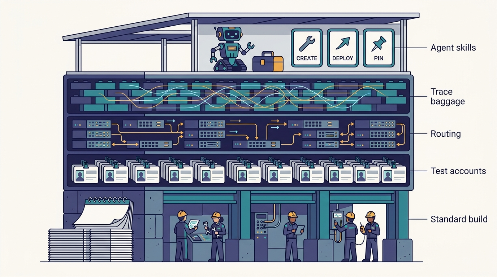
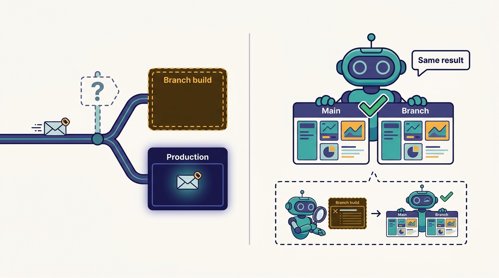

> **IN THIS CHAPTER, YOU WILL:** Follow one change from an agent's branch into a short-lived Slate environment, through the trace-baggage routing that makes it reachable only by pinned test accounts, and back into the pull request as a before/after report with screenshots and videos.

> **WHY IT MATTERS:** An agent that cannot run its change end to end produces code that a human must test by hand, so the review queue absorbs the cost of every PR the agent writes. Self-verification is what turns agent output into evidence, and at microservice scale it depends on infrastructure most companies have not built.

> **KEY POINTS:**
>
> * **Slate is request isolation, not environment cloning.** A Slate environment holds only the services under test. Everything else is the shared fleet, and only requests that carry the right tenancy in their trace baggage reach the branch build. That is why it scales to thousands of services when per-developer stacks do not.
> * **The hard part took years and was done for humans.** Uber's 2022 description of Slate rests on Jaeger baggage propagated by every service, an Edge Gateway that injects routing overrides, a per-host routing agent and a test-accounts service. Medisetty says the agent version was largely a matter of teaching agents to use it.
> * **For agents, the value is the comparison, not the deploy.** In the October 2026 episode, the agent deploys its branch, runs an agent browser against main and against the branch, and attaches a before/after report with screenshots and videos to the PR. The reviewer gets evidence instead of a claim.

> **BUILT ON:** Jaeger tracing and baggage propagation retrofitted across the fleet, the Edge Gateway and service-mesh routing ([[contracts-and-context-propagation]]), the test-accounts service, multitenancy design (2020) and BITS test sandboxes (2024), the per-language monorepos and Bazel builds ([[monorepos-and-one-build]]), and the MCP Gateway's CLI projection ([[mcp-gateway]]).

 
Picture a change that touches three of Uber's services: a pricing service, the trip-state service that consumes its output, and the presentation layer that renders the fare on the rider app. Unit tests pass in each repository module. The question every reviewer asks is the one unit tests cannot answer: **does the feature work when a real rider opens the app?** For a human engineer that question used to mean manual "sanity testing". For a background agent opening hundreds of PRs a week, it means either the agent can answer the question itself or a human has to answer it for every PR.

Uber's answer is **Slate**: a short-lived environment, created per developer or per agent task, that deploys a branch of one or more services and routes only that developer's pinned test accounts to it. Medisetty described it in the October 2026 Pragmatic Engineer episode as the tool engineers used for sanity testing before agents, which Uber then taught agents to use: *"now we can just give it to agents and they can actually test their own changes end to end in a safe way."*

This chapter explains what Slate is, as documented in Uber's 2022 engineering post and as described in the episode; why it could not have been built in a year; how the agent workflow on top of it works; and what a company without Uber's tracing estate can do instead. Slate is the first of two verification systems in Part III. The next chapter, [[capri]], covers the problem Slate cannot solve alone: testing against every live combination of product, city and payment type. The inner-loop checks that run before either of them, such as `aifx validate`, belong to [[inner-loop-and-self-healing-ci]].

## The Problem: End-to-End Testing Against Thousands of Services

Uber runs several thousand services, though the count depends on what is counted ([[monorepos-and-one-build]] tells the consolidation story). Most user-facing features cross several of them. Orosz made the point in the episode: with that many services, running even a one-service change end to end is difficult, which is why Slate took years to build.

There are three conventional answers, and Uber's public record explains why it rejected each.

| Approach | How it works | Why it breaks at Uber's scale |
| --- | --- | --- |
| **Shared staging** | One pre-production copy of the stack; changes deploy there in turn | Contention between teams; the staging copy drifts from production; one broken deploy blocks everyone |
| **Per-developer full stacks** | Each developer gets a copy of every dependency | Hardware cost grows with developers times services; startup is slow; the copies drift too |
| **Test in production with request isolation** | Deploy only the changed services next to production and route marked requests to them | Requires every service to propagate a routing marker and the platform to honor it; data isolation needs care |

Uber's 2020 multitenancy post, by Amit Gud, argued against **parallel staging stacks** on cost, drift, unreliable results and bad capacity estimates, and in favor of testing in production with test builds running alongside production ([Uber, 2020](https://www.uber.com/blog/multitenancy-microservice-architecture/)). Slate is the developer-facing product of that third approach.

Agents sharpen the problem in two ways. First, volume: Nikhil Ramakrishnan of Uber reported at the Background Agents Summit (7 May 2026) that about 11% of merged PRs came from autonomous agents, and Medisetty put Minion's share at about 15% of production PRs in October 2026 ([[minion]] reconciles the definitions). Each of those PRs either arrives with end-to-end evidence or adds manual testing to someone's queue. Second, cost of being wrong: Medisetty described Uber's posture on review as erring on the safe side, because an incident at Uber is expensive ([[code-review-signals]]). A verification step an agent can run on its own is how volume and caution coexist.

## What Uber Built: Slate as Documented and as Described

### The Documented System (2022)

Uber's engineering post "Simplifying Developer Testing Through SLATE", published 20 October 2022 by Ankit Srivastava, Alok Srivastava and Rohan Rathi, is the primary written source ([Uber, 2022](https://www.uber.com/blog/simplifying-developer-testing-through-slate)). It is four years old as of October 2026, so details may have changed. It describes:

- **SLATE** stands for **Short-Lived Application Testing Environment**: an on-demand, ephemeral environment *inside production*. Services deployed into it are **services under test (SUTs)**.
- A developer can hold several SLATE environments at once and deploy into them from git branches or refs. Each environment holds one version and one instance of a given service; a new deployment replaces the old.
- The **default time to live is two days**. On expiry, deployments are terminated and resources freed.
- **Tenancy travels as Jaeger baggage** under the key `request-tenancy`, with a value such as `uber/test/slate/SLATE1`. Requests have production tenancy by default.
- When a SUT is deployed, a mapping from tenancy to routing information is written to a configuration cache. The **Edge Gateway** looks up the mapping and injects a `routing-overrides` entry into the request baggage. A **host-routing-agent** on each host reads the override and sends the request to the SUT instead of the production instance. The post says services need no routing logic of their own.
- **Test users** come from a test-accounts service that creates test riders, drivers and profiles; trips and orders they create are test entities too. Developers *associate test users with an environment*, and only those users' requests reach the SUTs. This is the public form of what Medisetty calls pinning test-account UUIDs.
- SUTs call **production instances of their dependencies** by default. Services that need stronger isolation declare isolated resources in a `slate.yaml` file.

The post is also candid about limits, which matter for anyone copying the design. SUTs use production datastores, so "extra care is needed" to keep test riders from matching real drivers. Routing can break for **asynchronous flows**, because tenancy is not injected into events automatically; the mitigation is to carry baggage in the event payload. Production Kafka consumers that are not under test receive both production and test messages and must handle both. Cadence task lists had to be made configurable so a SUT would not pull production work. And if the routing mapping is missing, **requests fall back to production instances**.

Uber's 2024 post on BITS (Backend Integration Testing Strategy) calls SLATE "a sister project built on BITS primitives" for manual sanity testing, and adds the infrastructure-isolation pieces that sit underneath both: a Kafka consumer proxy that routes messages to sandboxes, sandbox-scoped Cadence workflows, tagged metrics and logs, and sandbox identities through SPIFFE/SPIRE. It also says routing overrides now ride **OpenTelemetry** baggage, which suggests a migration from Jaeger clients since 2022 ([Uber, 2024](https://www.uber.com/blog/shifting-e2e-testing-left)).

---begin mermaid---
flowchart LR
    A["Test rider in mobile app"] -->|"request with test tenancy"| B["Edge Gateway"]
    C["Slate environment created"] -->|"tenancy to routing mapping"| D["Config cache"]
    D -->|"lookup"| B
    B -->|"injects routing-overrides into baggage"| E["Service A, production"]
    E -->|"baggage propagated"| F["Host routing agent"]
    F -->|"override matches"| G["Service B under test, branch build"]
    F -->|"no override"| H["Service B, production"]
    G -->|"baggage propagated"| I["Service C, production"]
---end mermaid---
**Figure 1:** *Request-level routing as Uber's 2022 post describes it. Only the services under test are deployed; every other hop is the shared fleet. The test request finds the branch build because every service propagates the baggage that the Edge Gateway enriched.*

### The System as Described in the Episode (2026)

Medisetty's account in the episode matches the 2022 design and adds the agent layer:

- You create your own instance that deploys your branch and route your test account to it; "the rest of the upstream and downstream goes to the other staging setups." **The two sources disagree on the default dependencies:** the 2022 post says SUTs call *production* instances of their dependencies; the episode says *staging*. Uber has not said publicly whether the default changed, or whether "staging" here is loose speech for the shared fleet. This chapter says "the shared fleet" where the difference does not matter and names both where it does.
- Tests can span **two or three services under test** at once; the request reaches each SUT as it crosses the call graph.
- The Slate UI lists the environment's services and their git SHAs, lets you **pin test-account UUIDs** to the instance, and shows the time left before expiry (the episode's screen shows entries such as "2 days left" and "19 hours left", consistent with the documented two-day default).
- The agent drives Slate through the CLI pattern the MCP Gateway projects ([[mcp-gateway]]): the demo shows commands along the lines of `slate mcp create`, naming a new environment, then deploying a service to it.
- The agent then **A/B tests**: it ran an agent browser in the Slate environment against main and against the branch, and generated a report showing before and after, with no regressions. Screenshots and videos are attached to the PR.
- The same pattern exists for **iOS, Android, web and backend APIs**.

Two written 2026 sources sit beside this account. Uber's August 2026 post "Running a Software Factory Efficiently at Uber Scale", by Medisetty, mentions "completing E2E PRs with visual validation" among agent tasks but does not name Slate ([Uber, 2026](https://www.uber.com/us/en/blog/efficient-software-factory/)). The AI Engineer World's Fair 2026 talk by Medisetty and Adam Huda describes autonomous PRs carrying a table of every check run, plus screenshots ([AI Engineer, 2026](https://ai.engineer/talks/17-YSUHo6Lk-agentic-sdlc-at-uber-building-blocks-ubers)). The agent-facing Slate commands and the browser A/B are **Uber's own account in the episode**; no written Uber source describes them yet.

---begin mermaid---
sequenceDiagram
    participant Ag as Agent on DevPod
    participant Sl as Slate CLI
    participant Env as Slate environment
    participant Br as Agent browser
    participant PR as Pull request
    Ag->>Sl: create environment
    Ag->>Sl: deploy branch of service under test
    Sl->>Env: branch build running, test account pinned
    Ag->>Br: run scenario against main
    Br-->>Ag: baseline screenshots and responses
    Ag->>Br: run same scenario against branch
    Br-->>Ag: candidate screenshots and responses
    Ag->>Ag: compare, fix and redeploy if regression
    Ag->>PR: attach before and after report, screenshots, videos
---end mermaid---
**Figure 2:** *The agent self-verification loop as Medisetty described it. The comparison between main and branch is the step that turns a deploy into evidence; the redeploy loop on regression is implied by the episode rather than shown step by step.*

### Before Slate: Deputy and Cerberus

Medisetty named two older tools that Slate made unnecessary: **Deputy**, which routed a production request to a testing instance, and **Cerberus**, which routed from a local testing instance back to staging servers. Neither appears in any public Uber source. Orosz, who worked at Uber from 2016 to 2020, remembered them as tools for "some level of production data replay" that were hard to use. The guest describes them as routing tools and the host as replay tools; this book follows the guest's description, and notes that the replay side of that lineage continues in [[capri]].

## The Foundation Underneath

The episode's most quoted exchange about Slate is about what it stands on. Medisetty explained the routing: every service has Jaeger spans, a parent span where the call originates and a child span at each hop, and any baggage added to the trace propagates across the call stack. When you pin from the Slate web interface, the platform adds which services are under test and which account to route, and the service mesh reads that baggage as the request moves through it. Then the line that matters for the book's thesis: *"This thing took years to make sure that all existing services were retrofitted with this and all new services were built with this in mind."*

One correction to the episode's dating. Medisetty placed Jaeger's construction "back in maybe 2017–18". Uber's 2017 post by Yuri Shkuro dates the work to 2015–2016, with internal adoption in 2016, and Jaeger was open-sourced in April 2017 ([Uber, 2017](https://www.uber.com/blog/distributed-tracing/)). The 2017 post does not discuss baggage-based routing; that link appears in the 2020 multitenancy post and the 2022 Slate post. [[contracts-and-context-propagation]] owns the full history.

| Foundation | What Slate needs from it | Public evidence | What breaks without it |
| --- | --- | --- | --- |
| **Trace baggage propagated by every service** | The routing marker survives every hop | Jaeger (2016–17); multitenancy (2020); OTel baggage in BITS (2024) | The test request reaches the first service and is lost after the first hop that drops headers |
| **Edge Gateway** | One entry point that looks up and injects routing overrides | 2020 Edge Gateway post (co-authored by Medisetty); 2022 Slate post | Every client would need to know the routing map |
| **Mesh-level routing** (host-routing-agent) | Services stay unaware of test routing | 2022 Slate post | Each service team writes routing code, and some get it wrong |
| **Test-accounts service** | Isolation by identity: only test users reach SUTs | 2022 Slate post | Real users could land on a branch build |
| **Tenancy-aware Kafka, Cadence, metrics** | Asynchronous and observability paths respect test tenancy | BITS (2024) | Test events consumed by production; test metrics pollute dashboards |
| **Standard builds and deploys** | Any branch of any service deploys the same way | [[monorepos-and-one-build]] | Each service needs its own Slate integration |
| **MCP Gateway CLI projection** | Agents call Slate like any other tool | Oct 2026 MCP Gateway post; podcast | Agents need a bespoke integration per tool |

The pattern is the book's thesis in miniature ([[the-harness-is-the-easy-part]]). The agent-facing piece, teaching an agent to call create, deploy and pin through a CLI and to drive a browser, is a few skills on top of the MCP Gateway. The routing estate underneath is years of retrofitting, and a background agent like [[minion]] is useless at end-to-end verification without it. Medisetty said as much: "if we did not have a system like Slate, it would have been really hard for agents to self-validate."

**Figure 3:** *Teaching agents to use Slate was a few skills on top of the MCP Gateway; the routing estate underneath took years of retrofitting every service.*

> **INFERENCE, NOT DOCUMENTED:** The agent's Slate skill probably wraps a small number of operations the 2022 post already exposes to humans (create environment, deploy ref, associate test user, query status, extend or delete), plus a test-account creation call. If so, most of the agent-specific work lies in the browser automation, the comparison report and attaching evidence to the PR, not in Slate itself. Uber has not described the skill's contents.

## Self-Verification as a Design Problem

The interesting engineering in the agent version is not the deploy; it is what the agent compares and what it hands the reviewer. Three choices stand out.

**Compare against main, not against an expectation.** The agent runs the same scenario on main and on its branch. That separates regressions the change caused from behavior that was already broken or flaky. Uber's BITS post describes the same move at the CI level: **placebo runs** execute each test against a sandbox built from the latest main, giving a truth table of "production broke", "the test broke" or "a real defect", and tests that fall below a 90% placebo pass rate are quarantined ([Uber, 2024](https://www.uber.com/blog/shifting-e2e-testing-left)). An agent that only checks its branch would mistake pre-existing failures for its own and burn tokens fixing them.

**Hand the reviewer artifacts, not assertions.** A line saying "tested end to end, all good" is cheap for an agent to write and worthless to a reviewer. Screenshots and videos of the before and after states are expensive to fake and fast to check. This is what makes Slate a review-load tool as much as a testing tool: [[code-review-signals]] describes how Code Inbox puts the screenshots and videos next to the AI review and the risk score, so the reviewer decides from evidence.

**Keep the environment short-lived and per task.** A two-day default lifetime fits an agent task better than a human one. Agents create many environments in parallel; expiry is the garbage collector. The UI's "19 hours left" is also a cost control.

| Design choice | Uber's choice | Alternative | When the alternative is right |
| --- | --- | --- | --- |
| Where the branch build runs | Next to production, request-isolated | Shared staging with request isolation (Lyft) | When production data isolation is too risky, or regulation forbids test traffic in production |
| What isolates the test | Test accounts plus tenancy baggage | Separate datastore per environment | When writes cannot be confined by entity, as with shared ledgers |
| Dependencies of the SUT | Shared fleet by default (production in the 2022 post, "other staging setups" in the episode); opt-in isolation in `slate.yaml` | Mock every dependency | When dependencies are third-party, costly or non-idempotent |
| How the agent verifies | Browser A/B, main vs branch, with artifacts | Agent writes and runs new E2E tests | When the behavior must be guarded permanently in CI, not checked once |
| How the agent drives it | CLI projected from MCP, plus skills | Direct MCP tools | When the tool surface is tiny and context cost does not matter ([[mcp-gateway]]) |
| Lifetime | Short-lived, default two days | Long-lived personal environments | When startup is slow and environments are scarce, which is the problem to fix first |

One further trade-off is easy to miss. **A one-off browser A/B is verification, not regression protection.** It tells the reviewer this change did not break the scenario the agent chose to run. It does not add a test that guards the behavior next month, and it covers only the scenarios the agent thought of. That gap is exactly what Capri's live combination set is for.

## Elsewhere in the Industry

**Lyft staging overrides (2021).** Lyft's developer infrastructure team replaced per-developer "Onebox" environments with *offloaded deployments*: instances in shared staging that are not registered in service discovery, created from PRs by a GitHub bot. Override metadata is encoded in OpenTracing baggage and carried end to end, and a modified Envoy HTTP filter reroutes matching requests to the offloaded instance ([InfoQ, 2022](https://www.infoq.com/news/2022/03/scaling-testing-acceptance-lyft/), summarizing Lyft's post, which returned an error when fetched). The mechanism is nearly the same as Slate's. The difference is the substrate: **Lyft isolates within staging; Uber's 2022 design isolates within production**, with production dependencies by default (the episode's "other staging setups" may mean that has changed).

**Signadot (current).** Signadot sells the same pattern as a product. A sandbox forks only the changed services in a shared Kubernetes cluster; a routing key in the OpenTelemetry `baggage` and `tracestate` headers sends marked requests to them, and every service on the path must propagate the header ([Signadot docs](https://www.signadot.com/docs/concepts/sandbox)). Its legacy default header, `uberctx-sd-routing-key`, uses the Jaeger baggage prefix, a small sign of how far Uber's tracing conventions travelled.

**Spotify Honk (2025).** Spotify's background coding agent runs deterministic verifiers (format, build, test) before it opens a PR, then an LLM judge compares the diff against the original prompt to catch out-of-scope changes ([Spotify, 2025](https://engineering.atspotify.com/2025/12/feedback-loops-background-coding-agents-part-3)). Spotify's verification is about the diff; Uber's Slate step is about the running system. A mature setup needs both.

Browser automation for agents is now commodity. Microsoft's open-source Playwright MCP server, for example, lets an agent drive a browser through the page's accessibility tree rather than pixels ([GitHub](https://github.com/microsoft/playwright-mcp)). The scarce part is not the browser; it is a place to point it where the branch build is reachable with realistic data.

## If You Are Not Uber

Most companies do not have trace baggage propagated through every service, and building it is the long pole. The good news is that the pattern degrades gracefully: you can get value from request-level isolation long before every service propagates context.

**The minimum viable version** is a per-PR preview environment for the one or two services an agent changes most, plus a test-account convention and a header-based routing rule at your ingress or mesh. For a web front end, preview deployments per branch (a standard feature of most front-end hosting platforms) plus browser automation already give you the main-versus-branch comparison. For backends, start with the services on your most common change paths.

**Prerequisites, in order:**

1. **Context propagation on the paths you care about.** Adopt OpenTelemetry baggage and make propagation part of your standard service framework, so new services get it by default. Measure propagation coverage; a single service that drops headers silently sends test traffic to production.
2. **Test identities.** A way to create test users, merchants or accounts that the system treats as test entities end to end, including in analytics and billing.
3. **A routing point you control.** An API gateway, an Envoy or Istio mesh, or a sidecar that can read the header and pick a destination.
4. **One-command deploy of a branch.** If deploying a branch of a service takes a ticket, no agent will use it.
5. **An agent interface.** A CLI or MCP tool with create, deploy, pin, status and delete, plus a skill that tells the agent how to compare main against branch and what evidence to attach.

| Company size | What to build | Buy or open-source options | What not to copy yet |
| --- | --- | --- | --- |
| **≈50 engineers** | Per-PR preview environments for the web app and the one main API; a seeded test account; agent runs a browser script on preview vs production-like baseline and posts screenshots | Front-end host preview deployments; Docker Compose stacks for the backend; Playwright | Request-level routing inside production; you likely have few enough services to spin up a full stack |
| **≈500 engineers** | Header-based request isolation in staging (the Lyft pattern) for the 20–50 services on common change paths; OTel baggage in the standard framework; agent CLI with create, deploy, delete | Signadot or similar; Istio or Envoy routing rules; OpenTelemetry SDKs | Testing in production; first prove propagation coverage and asynchronous isolation in staging |
| **≈5,000 engineers** | Production request isolation with test tenancy, tenancy-aware queues and workflows, propagation coverage dashboards, per-task environments with expiry; agent A/B with artifacts attached to PRs | Build on OTel; buy where a vendor covers your mesh; expect to build the tenancy model yourself | Agent self-verification before propagation is near-universal on the paths agents touch |

**Sequencing.** Give humans the environment first and agents second. Uber's order was the same: Slate was a human sanity-testing tool for years before agents used it. A human-facing tool gets bug reports from people who know when it lies; an agent will happily report success against a request that silently fell back to production.

**What not to copy.** Do not copy testing in production unless you have Uber's data-isolation discipline: test entities everywhere, tenancy-aware queues and workflows, and a fallback policy that fails closed rather than to production. Do not let agents attach "tested" claims without artifacts. And do not treat the agent's one-off A/B as a substitute for a regression test that stays in CI.

## Failure Modes

- **Silent fallback to production.** Uber's 2022 post says that if the routing mapping is missing, requests fall back to production instances. For a human, that shows up as "my change does nothing". For an agent comparing main and branch, it shows up as **no difference, which looks like no regression**. The verification passes because it never ran. Fix it by making the agent confirm that the request actually reached the SUT, for example by checking the SUT's logs or a response header, before trusting the comparison.
- **Propagation gaps.** One service, queue or batch job that drops baggage breaks routing for everything downstream. Medisetty's mention of an agentic Shepherd campaign to fix context propagation across all services so that tracing works better ([[shepherd-and-fox]]) suggests that coverage is still being hardened even at Uber.
- **Test data leaking into the real world.** With production datastores, as in the 2022 design, a test rider can match a real driver unless the matching logic respects test entities. Agents raise the rate of test traffic and therefore the rate of such leaks.
- **Scenario selection bias.** The agent tests the path it thought of. A change that breaks a different product line or city passes the A/B. This is the combinatorial problem [[capri]] exists to solve.
- **Environment sprawl and cost.** Agents create environments in parallel and do not clean up after themselves unless forced. Expiry is mandatory; quotas per agent tier are sensible ([[token-spend-governance]] covers the spend side).
- **Evidence fatigue.** If every PR carries ten screenshots and two videos, reviewers stop looking. The report should lead with the difference, not the full gallery.
- **Flaky baselines.** If main is flaky, every comparison is noisy. Without something like BITS placebo runs, agents chase noise.

**Figure 4:** *If the routing mapping is missing, requests fall back to production; for an agent comparing main and branch, no difference looks like no regression, so it must first confirm the request reached the service under test.*

## What the Record Does Not Say

- How many Slate environments agents create per day, and what share of Minion PRs carry Slate evidence. Uber has published no figure.
- Whether Slate environments created by agents run under the agent's identity or the requesting engineer's, and what permissions they carry.
- Whether the default dependency mode is still production, as in the 2022 post, or staging, as Medisetty's wording in the episode suggests.
- How the agent decides which scenarios to run in the browser, and whether those scenarios come from the PR description, the spec ([[plans-as-source-of-truth]]) or a skill.
- How the agent detects silent fallback to production, if it does.
- How mobile verification works for agents in practice: emulators, device farms, or both. The episode says the same flow exists for iOS and Android without detail; [[inner-loop-and-self-healing-ci]] covers what is known about visual validation.
- How the migration from Jaeger clients to OpenTelemetry baggage was handled, and whether both formats are still honored.

## Questions to Ask

1. What share of our services propagate context headers end to end, and how would we know if one stopped?
2. If our agents opened a PR today, where would they run the change against real dependencies, and who would notice if the request never reached the new code?
3. Do we have test identities that every system, including billing and analytics, treats as test entities?
4. Does our routing fail closed (error) or open (production) when a test override cannot be resolved?
5. Which asynchronous paths (queues, workflows, scheduled jobs) lose test tenancy today?
6. What evidence must an agent attach before a PR enters human review, and does our review tool show it next to the diff?
7. Would we rather isolate in staging or in production, and what data-isolation work would production require?
8. Do agents compare against a baseline from main, or only check their own branch?
9. How long do agent environments live, and who pays for the ones nobody deletes?

Slate answers the question "does my change work for this test account in this scenario?" It cannot answer "does my change work for every combination of product, city and payment type that production is serving right now?" That is a different problem, and Uber's answer to it, capturing live traffic and replaying it by dimension, is the subject of [[capri]].

## Sources and Evidence

### The source episode

- [Uber's AI infra, from the inside](https://newsletter.pragmaticengineer.com/p/ubers-ai-infra-from-the-inside) — *The Pragmatic Engineer* podcast, Gergely Orosz with Uday Kiran Medisetty, 2026. Slate's agent workflow (CLI creation, test-account pinning, browser A/B, PR artifacts), Deputy and Cerberus, the Jaeger and mesh routing explanation, and the "took years" retrofit.

### Uber engineering sources

- [Simplifying Developer Testing Through SLATE](https://www.uber.com/blog/simplifying-developer-testing-through-slate) — Ankit Srivastava, Alok Srivastava, Rohan Rathi, Uber, 2022. The acronym, two-day default lifetime, `request-tenancy` baggage, Edge Gateway routing overrides, host-routing-agent, test users, `slate.yaml`, and the documented limitations.
- [Shifting E2E Testing Left at Uber](https://www.uber.com/blog/shifting-e2e-testing-left) — Uber, 2024. BITS sandboxes, OpenTelemetry baggage, tenancy-aware Kafka and Cadence, placebo runs, 1,000+ services, 71% fewer incidents per 1,000 diffs in 2023.
- [Why We Leverage Multi-tenancy in Uber's Microservice Architecture](https://www.uber.com/blog/multitenancy-microservice-architecture/) — Amit Gud, Uber, 2020. The case against parallel staging stacks and for testing in production with tenancy.
- [Evolving Distributed Tracing at Uber Engineering](https://www.uber.com/blog/distributed-tracing/) — Yuri Shkuro, Uber, 2017. Jaeger's 2015–16 origin and 2017 open-sourcing.
- [Designing Edge Gateway, Uber's API Lifecycle Management Platform](https://www.uber.com/blog/gatewayuberapi/) — Pavel Astakhov, Madan Thangavelu, Uday Kiran Medisetty, Uber, 2020. The single entry point that injects Slate's routing overrides.
- [Designing MCP Gateway: Uber's MCP Management Platform](https://www.uber.com/gb/en/blog/designing-mcp-gateway/) — Uber, 2026. The gateway and `aifx` CLI pattern through which agents call internal tools.
- [Running a Software Factory Efficiently at Uber Scale](https://www.uber.com/us/en/blog/efficient-software-factory/) — Uday Kiran Medisetty, Uber, 2026. "Completing E2E PRs with visual validation" as an agent task.
- [Inside Uber's agent-ready platform behind 11% of merged PRs](https://background-agents.com/summit/sessions/nikhil-ramakrishnan/) — Nikhil Ramakrishnan, Background Agents Summit, 2026. The spring 2026 share of merged PRs from autonomous agents.
- [Agentic SDLC at Uber: Building Blocks for Uber's Software Factory](https://ai.engineer/talks/17-YSUHo6Lk-agentic-sdlc-at-uber-building-blocks-ubers) — Uday Kiran Medisetty and Adam Huda, AI Engineer World's Fair, 2026. Autonomous PRs carrying a table of checks and screenshots.

### Industry and research sources

- [Scaling and Automating Microservice Testing at Lyft](https://www.infoq.com/news/2022/03/scaling-testing-acceptance-lyft/) — Vasco Veloso, InfoQ, 2022. Lyft's staging overrides with OpenTracing baggage and Envoy.
- [Sandboxes Concepts Guide](https://www.signadot.com/docs/concepts/sandbox) — Signadot documentation (current as of 2026). Commercial request-level sandboxes and the propagation requirement.
- [Background Coding Agents: Predictable Results Through Strong Feedback Loops](https://engineering.atspotify.com/2025/12/feedback-loops-background-coding-agents-part-3) — Max Charas and Marc Bruggmann, Spotify Engineering, 2025. Deterministic verifiers plus an LLM judge before a PR opens.
- [Playwright MCP](https://github.com/microsoft/playwright-mcp) — Microsoft, open source (current as of 2026). Browser automation for agents through the accessibility tree.

Statements about Uber's AI-era systems are Uber's own account unless another source is cited; recommendations and labeled inferences are the author's judgement.
