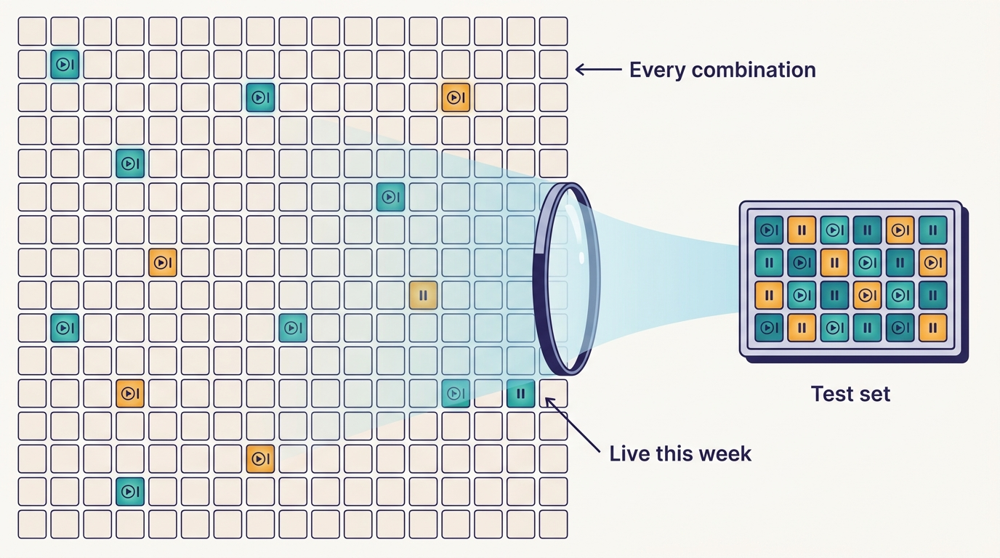
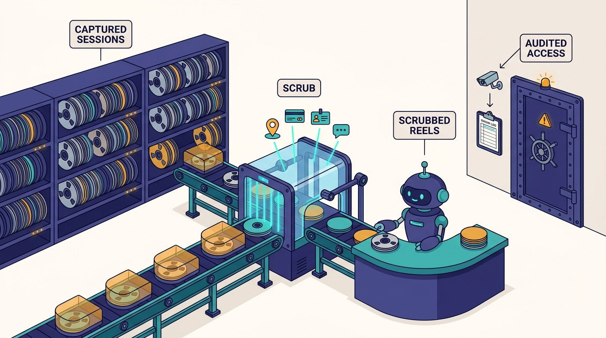

> **IN THIS CHAPTER, YOU WILL:** See how Uber, by Medisetty's account, turns captured production traffic into a test suite: one middleware records sessions and their downstream calls, rules tag each session by business dimension, MatchGuard replays the live combination set before deploy, and engineers and agents replay single sessions against a Slate environment until the delta is right.

> **WHY IT MATTERS:** For a multi-product, multi-country business, the set of behaviors production actually serves is larger than any team can enumerate in hand-written tests. Capturing that set instead of writing it is how a platform team gets regression coverage for "cash trips only in Brazil", and how an agent gets a feedback loop it can trust.

> **KEY POINTS:**
>
> * **Let production write the test matrix.** Hundreds of rider-app screens times business lines times cities times payment types cannot be covered by hand-maintained tests. Capri derives the combinations production is serving right now from tagged captures, and MatchGuard checks every deploy against them, before and after.
> * **One middleware only works because the frameworks are standard.** Medisetty attributes Capri's reach to Uber's standardized language frameworks: one hook captures inbound requests and every downstream request and response. Uber's earlier capture tools worked off the wire, partly because an in-process library made every service pay CPU and memory and made filtering hard.
> * **Replay gives agents a delta, not a verdict.** Replaying one captured session on a Slate environment shows exactly what changed. That makes "fix, replay, compare" a loop an agent can run unattended. It also makes captured production data a governance problem the public record does not address.

> **BUILT ON:** Standardized language frameworks and middleware ([[contracts-and-context-propagation]]), the Edge Gateway as the single entry point, Slate environments and test tenancy ([[slate]]), Uber's earlier traffic-capture tools Ballast and Shadower (2022), the multitenancy design (2020), and city and product line as first-class dimensions ([[build-what-does-not-exist]]).

 
A rider in São Paulo books a car and chooses to pay cash. A rider in San Francisco orders from a restaurant through Uber Eats with a corporate profile. A courier in Tokyo finishes a delivery that ends in an unusual terminal state. Each of these sessions crosses many of the same services, but each exercises a different path through them. **A change that is correct for the first two can still break the third**, and no reviewer, human or agent, will think to test it.

Uber's answer, as Medisetty described it in the October 2026 Pragmatic Engineer episode, is **Capri**, short for capture-replay. Capri records real production sessions on Uber's most complex platforms, including every downstream call they make. A rules pipeline tags each session with the business dimensions the platform team cares about. From the tagged captures Uber derives the full set of *live* combinations and runs it before deploy as **MatchGuard**. And any single captured session can be replayed against a Slate environment to show the delta a fix makes. Orosz singled it out in the episode's outro: with Capri, "it's far more trivial to capture sessions, then replay them, and this works really well to reproduce bugs and also to test that a fix worked."

Capri and MatchGuard appear in no Uber blog post, paper or talk abstract as of October 2026; everything specific about them in this chapter is **Uber's own account in the episode**. The pattern underneath, production capture replayed in isolation, is well documented at Uber through older tools, and the chapter uses those to explain what Capri must solve. The previous chapter, [[slate]], built the environment Capri replays into; the next, [[code-review-signals]], covers how the evidence these systems produce reaches the reviewer.

## The Problem: A Test Matrix Nobody Can Write

Medisetty framed the problem in terms of the core rider app. It has hundreds of screens, and its behavior varies by business, product line, city and a long list of other dimensions. Any new change raises the question of whether every combination still works, and covering all permutations with hand-written tests would mean maintaining thousands upon thousands of tests across the stack, which Medisetty called a hard problem in itself.

The arithmetic is easy to underestimate. Take a deliberately small slice of a pricing or fulfilment platform:

| Dimension | Example values | Count (illustrative) |
| --- | --- | --- |
| Marketplace / line of business | Rides, Eats, grocery, freight-adjacent | 4 |
| Product tier | Economy, premium, shared, reserved | 4 |
| Payment type | Card, cash, wallet, corporate profile | 4 |
| Country or city rule set | Distinct regulatory or pricing regimes | 30 |
| Terminal state | Completed, cancelled by rider, cancelled by driver, no-show, failed payment | 5 |

That is already 9,600 combinations, before app versions, experiments and feature flags. **Most of them never occur**: there is no cash in some countries, no shared product in others. The useful test set is not the Cartesian product; it is the subset production is actually serving this week, which nobody knows by heart and which changes as products and cities launch. This is the city-as-primitive problem from [[build-what-does-not-exist]] showing up in testing: when city, product and payment type are first-class, the behavior space is their product.

Hand-written tests answer a different question. They encode what an engineer believed should happen in the cases the engineer thought of. Uber's 2024 post on BITS (Backend Integration Testing Strategy) shows how far that approach goes at Uber: several thousand end-to-end tests gating 1,000+ backend services, with the largest service carrying 300 tests ([Uber, 2024](https://www.uber.com/blog/shifting-e2e-testing-left)). That is a large investment and still covers only scenarios someone chose to write. Agents make the gap wider. An agent fixing a bug in one market will test that market, because that is what the bug report describes.

## What Uber Built: Capri and MatchGuard, as Described

Medisetty described Capri in four steps, and demonstrated a UI for the third and fourth.

**1. Capture with one middleware.** "You can capture real production traffic with just one middleware because now we have standardized language frameworks across all the services." The middleware records inbound and outbound traffic at the service layer and also every downstream API call the service makes, request and response, so each session is captured in full.

**2. Tag by dimension.** Captured requests pass through a pipeline where simple rules map a field in the request to the value of a dimension. Each platform team defines the dimensions it cares about. In the demo, a captured session is tagged *marketplace type: eats*, *line of business: eats*, with a recorded terminal state, and lists its outbound calls with their requests and responses.

**3. Derive the live combination set and run MatchGuard.** From the tagged requests, Uber generates the full set of dimension combinations the platform is serving right now. **MatchGuard** runs that set before deploy in CI/CD: for all the PRs going into a deploy, it validates against the full combinatorial set and shows the data before and after. Medisetty's example of what it catches: "am I breaking maybe cash trips only in Brazil with this configuration, which would have been really hard for engineers to manually test, or agents also to manually test."

**4. Replay one session on a Slate environment.** The session UI has a field for a Slate workflow UID or environment name. Working on a bug that affects only San Francisco Uber Eats trips, an engineer creates a Slate environment with the fix, then replays that one captured request on it and looks at the delta. A replay can target one session, one dimension, or the MatchGuard set.

Two further points from the episode. Capri runs for some of Uber's most complex platforms, not everywhere, and it is the latest of several attempts: Medisetty said Uber had built many versions of this before, and called this one probably the best and the first that can scale to all teams. And the **Edge Gateway**, Uber's single entry point for external APIs, has its own capture-replay that uses Capri behind the scenes ([[contracts-and-context-propagation]] covers the gateway).

---begin mermaid---
flowchart LR
    A["Production request"] --> B["Service with Capri middleware"]
    B -->|"downstream calls recorded"| C["Downstream services"]
    B -->|"session: inbound, outbound, downstream pairs"| D["Capture store"]
    D --> E["Tagging pipeline"]
    F["Platform team rules"] -->|"field to dimension value"| E
    E --> G["Tagged sessions"]
    G --> H["Live combination set"]
    H -->|"pre-deploy in CI/CD"| I["MatchGuard before and after"]
    G -->|"one session or one dimension"| J["Replay on Slate environment"]
---end mermaid---
**Figure 1:** *Capri as Medisetty described it: one middleware captures sessions including downstream pairs, team-defined rules tag them by dimension, and the tagged set drives both pre-deploy validation (MatchGuard) and single-session replay. The capture store and pipeline boxes are generic; Uber has not described their implementation.*

### What "Before and After" Probably Means

The episode does not say exactly what MatchGuard compares. A plausible reading — not a documented description — is that MatchGuard replays each representative session through the build being deployed and through the current production build, and compares the outputs that matter for that platform: response fields, the decisions the service made, and the downstream calls it issued. "Show the data before and after" fits that reading. It also fits a simpler one, in which MatchGuard replays sessions on the new build and compares against the *recorded* responses. The two differ in a way that matters: comparing against recordings flags every intended change and every non-deterministic field as a diff, while comparing two live builds on the same input isolates what the change did.

> **INFERENCE, NOT DOCUMENTED:** Capturing downstream request/response pairs suggests that replay can **stub** downstream calls with the recorded responses, so that a replayed session sees the same world it saw in production. That would make replays deterministic and side-effect free, and would let MatchGuard run without touching production dependencies. The alternative, replaying against live dependencies on a Slate environment, gives realism at the cost of determinism. The episode is consistent with Uber supporting both: MatchGuard as stubbed replay in CI/CD, and single-session replay on Slate against whatever dependencies Slate routes to (the record is unsettled on whether those are staging or production instances; see [[slate]]). Uber has not said which.

## The Foundation Underneath

Capri's description has one load-bearing phrase: one middleware, because the language frameworks are standardized. Uber's own published history shows why that phrase matters.

In 2022 Uber published two posts on traffic capture for load testing. **Ballast** captures production traffic with BPF and pcap off the wire, reassembles request payloads for HTTP/1.1, HTTP/2 and TChannel, and replays them through a load generator called Shadower, with a controller that adjusts request rate against service-level targets; one listed use is replaying high-error-rate production traffic in staging to isolate failing code paths ([Uber, 2022](https://www.uber.com/blog/introducing-ballast-an-adaptive-load-test-framework/)). **Shadower** captures payloads from production hosts with eBPF and stores them in blob storage, and can mirror the same request to several hosts to compare builds ([Uber, 2022](https://www.uber.com/rs/en/blog/introducing-shadower-a-minimalistic-load-testing-tool/)). The Shadower post explains why Uber did *not* use a shared in-process shadowing library at the time: filtering in production is complex, and the service pays the CPU and memory cost.

Capri, per the episode, takes the in-process route those posts argued against. The difference is the foundation. Capture off the wire sees bytes; capture in the framework sees **parsed requests, the calling context and the downstream calls the service made on behalf of each request**. The second is what dimension tagging and downstream stubbing need. It is only practical when one framework hook reaches every service of a platform, which is what language standardization on Go and Java and shared service frameworks bought ([[monorepos-and-one-build]] covers the standardization; Uber's open-source Fx dependency-injection framework for Go is one public trace of it).

| Foundation | What Capri needs from it | Public evidence | What breaks without it |
| --- | --- | --- | --- |
| **Standardized language frameworks** | One middleware hook in every service of a platform | Podcast; Edge Gateway post (2020) on shared frameworks | Capture is per-team work and coverage is patchy |
| **Context propagation** | Downstream calls attributed to the session that caused them | Jaeger and baggage ([[contracts-and-context-propagation]]) | Downstream captures cannot be joined into sessions |
| **Tenancy for replayed traffic** | Replays do not write to production as if real | Multitenancy post (2020) names record/replay as a tenancy use case | Replayed bookings create real side effects |
| **Slate environments** | A place to replay one session against a branch | [[slate]] (2022 post; podcast) | Replay only against recordings, never against a running fix |
| **City, product and payment as explicit fields** | Rules can map request fields to dimensions | Cities as first-class ([[build-what-does-not-exist]]) | Dimensions must be inferred, and tags drift |
| **Prior capture tools** | Pipeline, storage and replay know-how | Ballast and Shadower (2022) | The first version is also the learning version |

Uber's 2020 multitenancy post anticipated the design. It names shadow traffic and record/replay as tenancy use cases: copy production traffic to an isolated area, **stub outbound calls from the instance under test**, and give replayed traffic its own tenancy ([Uber, 2020](https://www.uber.com/blog/multitenancy-microservice-architecture/)). Capri reads as the platform-scale delivery of that six-year-old design goal.

Orosz's emphasis in the episode is the thesis of this book: with thousands of services, every one has to support routing, production capture and replay before any of this works, and that was a great deal of work. The agent-facing step on top is small by comparison.

## Agents in the Loop: Fix, Replay, Compare

Medisetty described the next step as exposing Capri to agents the way Slate was exposed. An agent working on a fix fetches the captured sessions of the relevant type, composes a request of that type against its Slate instance, and checks whether the fix worked: "Let me go in a loop until I fix this." Orosz added the point that makes it work for agents: an agent cannot look at the app, but it can read the delta and tell whether anything changed.

---begin mermaid---
stateDiagram-v2
    state "Find captured sessions matching the bug dimensions" as Find
    state "Deploy candidate fix to Slate" as Deploy
    state "Replay sessions on Slate" as Replay
    state "Compare delta with expected change" as Compare
    state "Run MatchGuard set for the platform" as Guard
    state "Open PR with replay evidence" as Open
    [*] --> Find
    Find --> Deploy
    Deploy --> Replay
    Replay --> Compare
    Compare --> Deploy: delta wrong or missing
    Compare --> Guard: target delta correct
    Guard --> Deploy: regression elsewhere
    Guard --> Open: no unexpected delta
    Open --> [*]
---end mermaid---
**Figure 2:** *The fix-and-replay loop as an agent would run it. The first loop checks that the fix changes what it should; the second, through the live combination set, checks that it changes nothing else. The MatchGuard step inside the agent loop is the author's reading; the episode describes MatchGuard at deploy time and replay loops for agents.*

The loop has a property most agent feedback lacks: **the expected result is concrete**. A bug report says "observed X, expected Y" ([[wisdom-and-debug-assist]] shows how Uber produces exactly that). A replay produces the observed value; the agent's job is to make it Y without changing anything else. That is a tighter contract than "make the tests pass", which an agent can satisfy by weakening the tests.

| Design choice | Capri (as described) | Alternative | When the alternative is right |
| --- | --- | --- | --- |
| Source of test cases | Captured production sessions | Hand-written E2E scenarios | Low-traffic or new paths that production has not exercised yet |
| Capture point | In-process middleware in shared frameworks | Off-the-wire capture (Ballast, GoReplay) | No common framework; need zero code change; load testing rather than correctness |
| What is captured | Inbound plus every downstream request and response | Inbound only | Downstreams are cheap and deterministic to call live |
| Coverage selection | Live combinations by dimension | Random sample of traffic | Few dimensions; volume rather than diversity is the concern |
| Comparison | Before vs after on the same input | Assertions on expected outputs | Behavior is fully specified, as with protocol conformance |
| Where it runs | Pre-deploy in CI/CD, per deploy | Per PR | Small deploys; cheap replays |
| Scope | Most complex platforms only | Every service | When capture cost and privacy review are already solved |

## Elsewhere in the Industry

**Twitter's Diffy (2015).** Diffy sends each request to three instances: a candidate running the new code and two running identical known-good code. Differences between the two good instances are non-determinism, such as timestamps and random values, and Diffy ignores them when it compares the candidate ([InfoQ, 2015](https://www.infoq.com/news/2015/09/twitter-diffy)). It is the closest public analogue to MatchGuard's before/after delta, and its noise-cancelling trick answers a question the episode leaves open: how to tell a regression from a timestamp.

**Google (2020).** Chang Seo Park's paper "Automatic Prevention of Accidents in Production" describes a pre-production environment where sampled production requests are replayed, with inter-server traffic reconfigured dynamically, to cover corner cases without hand-written tests and to validate back-end rewrites ([Google Research, 2020](https://research.google/pubs/pub49455/)). Same idea as Capri, with the same unsolved-looking hard part: handling requests that mutate data.

**Open-source capture tools.** GoReplay listens to traffic on a host's network interfaces, in the manner of tcpdump, and replays it into a test environment ([GitHub](https://github.com/buger/goreplay)). It is the low-cost entry point for teams without shared frameworks, and it sits on the off-the-wire side of the trade-off: easy to install, blind to downstream calls and business context.

**Meta ServiceLab (2024)** gates performance regressions as small as 0.01% before production across a large fleet ([USENIX OSDI, 2024](https://www.usenix.org/conference/osdi24/presentation/chow)). It is a reminder that pre-production replay can also guard latency and cost, not only correctness, though its abstract does not describe functional record/replay.

## If You Are Not Uber

Capture-replay is one of the most transferable ideas in this book, because the payoff appears at modest scale: any product with several markets, payment methods or customer types has a live combination set larger than its test suite. What does not transfer is the "one middleware everywhere" part, unless you already have shared service frameworks.

**Figure 3:** *The useful test set is not the Cartesian product of dimensions but the subset production is serving this week; in the chapter's illustrative slice, 9,600 combinations shrink to the ones that actually occur.*

**The minimum viable version** is capture-replay for **one** high-risk service, usually the one that encodes the most business rules (pricing, eligibility, checkout, tax). Record inbound requests and the responses of its downstream calls at the service boundary; scrub them; tag each with three to five dimensions you already have as explicit fields; replay a stratified sample (a few sessions per live combination) against the old and new builds before each deploy, and show the diffs.

**Prerequisites:**

1. **A capture point you control**, ideally a shared middleware or an HTTP/gRPC client wrapper; otherwise a sidecar or off-the-wire tool.
2. **Explicit dimensions** in requests. If "country" or "payment type" can only be inferred, write the inference rule once and test it.
3. **A data policy before the first capture**: what fields are dropped or tokenized at capture time, where captures live, who can read them, how long they are kept.
4. **Deterministic replay**: clock and random-seed control, and downstream stubbing from captured responses.
5. **A noise model**: a Diffy-style second baseline, or a field ignore list, so diffs mean something.

| Company size | What to build | Buy or open-source options | What not to copy yet |
| --- | --- | --- | --- |
| **≈50 engineers** | Record a sample of requests to the core API in staging or with consented beta users; replay before release; diff responses with an ignore list | GoReplay; framework-level VCR-style fixtures in tests | Production capture of downstream calls; dimension pipelines |
| **≈500 engineers** | Middleware capture for the one or two rule-heavy services; dimension tags; stratified replay against old vs new build in CI; agent skill to fetch sessions by dimension and replay against a preview environment | Diffy forks; service-virtualization tools; your own middleware | Fleet-wide capture; the full combination set for every platform |
| **≈5,000 engineers** | Platform-owned capture in the shared frameworks, opt-in per platform; live combination sets per platform gating deploys; replay into request-isolated environments; privacy review and retention built in | Build; vendor tools rarely understand your dimensions | Capturing everything by default before the governance exists |

**Sequencing.** Do capture-replay after you have a place to replay into ([[slate]] or a preview environment) and after you have explicit dimensions. Give engineers the single-session replay first; it is the feature that wins trust ("replay the bug, see it fixed"). Gate deploys on the combination set only once the noise rate is low, or teams will learn to ignore it.

**What not to copy.** Do not build capture into every service at once; Uber says it runs Capri for its most complex platforms. Do not capture production data before you have decided what not to capture. And do not let an agent treat "no delta" as success unless it has confirmed the replay exercised the changed code.

## Data Privacy: The Question the Episode Does Not Answer

Captured production sessions contain what production contains: names, locations, trip histories, payment details, messages between riders and drivers. The episode says nothing about how Capri handles that, and no public Uber source describes it. This is not a criticism of the episode, which was about developer tools, but it is the first question any reader's security, privacy or legal team will ask.

> **INFERENCE, NOT DOCUMENTED:** A capture system at Uber's scale and regulatory exposure would plausibly need field-level redaction or tokenization at capture time, short retention, access control tied to the owning platform team, and controls on where captured payloads flow, especially now that agents read them. Uber's 2024 GenAI Gateway post documents redaction of personally identifiable information (PII) with placeholders for model traffic, which shows the company builds this kind of control; whether Capri uses anything similar is not public. Any imitator operating under GDPR or similar regimes should treat captured sessions as personal data unless proven otherwise.

Agents add a specific risk. An agent that can "get all of the sessions of this type" can also put those sessions in its context window, in its logs, and in the PR it writes. The model traffic goes through the Model Gateway and AI Guard ([[model-gateway]]), which inspect requests and responses, but the safest design is that **agents receive scrubbed sessions by default** and fetching raw ones is an exception with an audit trail.

**Figure 4:** *Captured sessions contain what production contains, so the safest design gives agents scrubbed sessions by default and makes raw access an exception with an audit trail; the episode does not say how Capri handles this.*

## Failure Modes

- **Coverage is only as good as recent traffic.** A path production has not exercised recently, such as an annual tax rule, a holiday surge or a newly launched city, is not in the live combination set. Capture-replay complements hand-written tests for rare and future cases; it does not replace them.
- **Tag drift.** Dimension rules map request fields to values. When a field is renamed or a product line is added, sessions get mis-tagged or untagged, and the combination set silently shrinks. Rules need tests and owners.
- **Non-determinism noise.** Timestamps, IDs, randomized ranking and model outputs differ on every replay. Without a noise model, MatchGuard either flags everything or teams add so many ignores that real regressions slip through.
- **Side effects on replay.** Replaying a session that charges a card or messages a driver is dangerous unless outbound calls are stubbed or tenancy-isolated. The multitenancy design names this risk; the episode does not say how Capri handles it.
- **Stale stubs.** If downstream responses are replayed from recordings, a change in a downstream contract is invisible until production. Capture needs a freshness window.
- **Privacy incidents.** Captures copied into tickets, agent contexts or PRs spread personal data far beyond the service that collected it.
- **Agent overfitting to one session.** An agent told to make one replay come out right can special-case that input. The second, combination-set check exists to catch this, but only if the agent runs it.
- **Capture overhead.** In-process capture costs CPU, memory and latency, the reason Uber's 2022 Shadower post avoided it. Sampling and off-path writes keep the cost bounded; unbounded capture on a hot path does not.

## What the Record Does Not Say

- When Capri was built, by which team, and how many platforms use it as of October 2026.
- What MatchGuard compares (two live builds, or a build against recordings), how it handles non-determinism, and whether it blocks deploys or advises.
- Whether replay stubs downstream calls with captured responses or calls live dependencies, and how side effects are prevented.
- How sessions are sampled, stored and retained; how personal data is handled; who can access captures.
- How large a live combination set is for a typical platform, and how long a MatchGuard run takes.
- Whether agents already run the fix-and-replay loop in production use, or whether that is in progress; Medisetty's "we can expose all of the Capri functionality to agents" is ambiguous on timing.
- How the Edge Gateway's capture-replay uses Capri.
- How Capri relates to the earlier "many versions" Medisetty mentioned, and to Ballast and Shadower.

## Questions to Ask

1. Which of our services encode the most business rules per line of code, and which dimensions (market, product, payment type, customer type) drive their behavior?
2. Can we list the combinations production served last week for that service? If not, how would we find out?
3. Do our requests carry those dimensions as explicit fields, or would we have to infer them?
4. Do we have one place, a shared middleware or client library, where capture could be added for a whole platform?
5. What would our privacy team require before any production request is stored for replay, and can we meet it at capture time rather than afterwards?
6. How would we stop a replayed session from causing real side effects?
7. What is our noise model: how would we tell a regression from a timestamp?
8. Where would an agent replay a captured session against its fix today?
9. Which bug classes in the last year would a live-combination check have caught before deploy?

Slate and Capri give an agent, and a human, evidence that a change works. The next question is what a reviewer does with that evidence when PR volume has doubled. [[code-review-signals]] follows the evidence into Code Inbox, where screenshots, replay results, AI review and a risk score sit next to the diff.

## Sources and Evidence

### The source episode

- [Uber's AI infra, from the inside](https://newsletter.pragmaticengineer.com/p/ubers-ai-infra-from-the-inside) — *The Pragmatic Engineer* podcast, Gergely Orosz with Uday Kiran Medisetty, 2026. Capri's capture middleware, dimension tagging, MatchGuard, single-session replay on Slate, the agent loop, Edge Gateway's use of Capri, and Orosz's closing remarks.

### Uber engineering sources

- [Introducing Ballast: An Adaptive Load Test Framework](https://www.uber.com/blog/introducing-ballast-an-adaptive-load-test-framework/) — Minglei Wang and Cristian Velazquez, Uber, 2022. Off-the-wire capture with BPF/pcap and replay, including debugging use.
- [Introducing Shadower: A Minimalistic Load Testing Tool](https://www.uber.com/rs/en/blog/introducing-shadower-a-minimalistic-load-testing-tool/) — Cristian Velazquez, Uber, 2022. eBPF capture, mirroring to compare builds, and the case against an in-process shadowing library.
- [Why We Leverage Multi-tenancy in Uber's Microservice Architecture](https://www.uber.com/blog/multitenancy-microservice-architecture/) — Amit Gud, Uber, 2020. Record/replay and shadow traffic as tenancy use cases, with stubbed outbound calls.
- [Shifting E2E Testing Left at Uber](https://www.uber.com/blog/shifting-e2e-testing-left) — Uber, 2024. The scale of hand-written E2E testing (BITS) that capture-replay complements.
- [Simplifying Developer Testing Through SLATE](https://www.uber.com/blog/simplifying-developer-testing-through-slate) — Srivastava, Srivastava and Rathi, Uber, 2022. The replay target.
- [Designing Edge Gateway, Uber's API Lifecycle Management Platform](https://www.uber.com/blog/gatewayuberapi/) — Pavel Astakhov, Madan Thangavelu, Uday Kiran Medisetty, Uber, 2020. The gateway and shared frameworks Capri's reach depends on.

### Industry and research sources

- [Twitter Diffy Spots Bugs in Services by Comparing the Responses](https://www.infoq.com/news/2015/09/twitter-diffy) — Abel Avram, InfoQ, 2015. Candidate versus two known-good instances, cancelling non-determinism.
- [Automatic Prevention of Accidents in Production](https://research.google/pubs/pub49455/) — Chang Seo Park, Google, AST 2020. Replaying sampled production requests in pre-production.
- [GoReplay](https://github.com/buger/goreplay) — open source (current as of 2026). Off-the-wire HTTP capture and replay.
- [ServiceLab: Preventing Tiny Performance Regressions at Hyperscale through Pre-Production Testing](https://www.usenix.org/conference/osdi24/presentation/chow) — Chow et al., Meta, OSDI 2024. Pre-production performance gating at fleet scale.

Statements about Uber's AI-era systems are Uber's own account unless another source is cited; recommendations and labeled inferences are the author's judgement.
