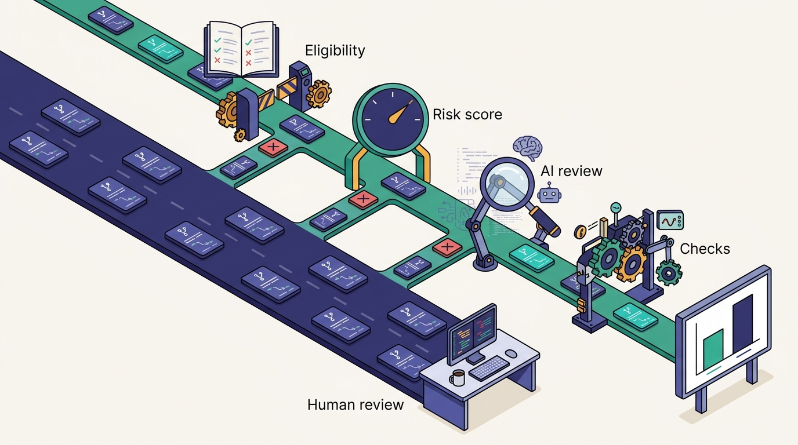
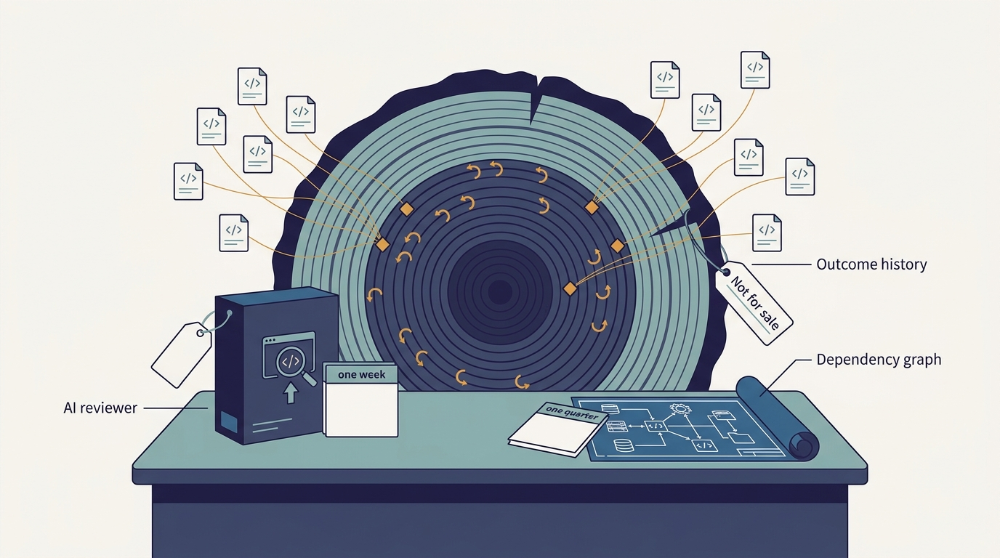
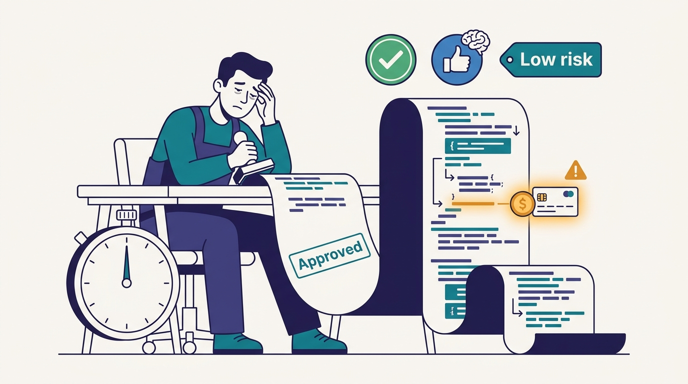

> **IN THIS CHAPTER, YOU WILL:** See how Uber's Code Inbox gathers the signals a reviewer needs (AI review, screenshots and videos, build checks, and a risk score and blast radius that were still being added), why Uber still puts a human on every PR, and what a backtested "green lane" for auto-landing would need before anyone should trust it.

> **WHY IT MATTERS:** When agents write more of the code, review becomes the scarcest resource. If reviewers spend the same attention on every PR, they become a queue. If they spend less, review turns into a rubber stamp. The real decision is where reviewer attention goes, and the signals that make that decision safe come mostly from infrastructure built years earlier.

> **KEY POINTS:**
>
> * **Uber kept the human gate and moved the work in front of it.** As of October 2026, every PR still needs an engineer's review because an incident at Uber is expensive. Code Inbox puts AI review, visual evidence, build status and (being added) a risk score and blast radius next to the PR, so the reviewer starts from evidence instead of from the diff.
> * **The risk score comes before auto-landing, on purpose.** Medisetty calls the "green lane" for low-risk PRs a P1 and getting the signals in place the P0. The order is correct: an auto-approval policy is only as safe as a risk model that has been backtested against years of real revert and incident outcomes, and that history is a foundation most companies have not kept.
> * **Every useful review signal is a by-product of an older platform.** Blast radius can be computed from the Bazel build graph and Uber's tiered deployment gates (Uber has not said how Code Inbox does it). Routing needs ownership metadata. Evidence comes from Slate and inner-loop validation. A green main comes from SubmitQueue. A company that buys an AI reviewer without those foundations gets more comments, not better review decisions.

> **BUILT ON:** the per-language monorepos, Bazel and SubmitQueue ([[monorepos-and-one-build]]), uOwn ownership metadata and incident tooling ([[build-what-does-not-exist]], [[contracts-and-context-propagation]]), Slate environments that generate visual evidence ([[slate]]), and inner-loop validation behind `aifx validate` ([[inner-loop-and-self-healing-ci]])

 
The previous chapters describe how Uber made code cheaper to produce and check: Minion opens pull requests (PRs) from a Slack thread ([[minion]]), `aifx validate` runs simple CI checks before the PR exists ([[inner-loop-and-self-healing-ci]]), and Slate and Capri produce before-and-after evidence ([[slate]], [[capri]]). None of them makes the human who must approve the PR any faster.

That is the point at which Uber's lifecycle meets a limit it cannot automate away by policy. In the October 2026 Pragmatic Engineer episode, Uday Kiran Medisetty, an Uber Distinguished Engineer, says it plainly: **"reviews become a big bottleneck, same as like any other company."** Uber's response has two parts. The first is a tool, **Code Inbox**, that changes what a reviewer sees. The second is a sequencing decision: get the signals right first, and only later, once the risk model has proven itself against history, let some PRs land without a human.

This chapter owns three terms: **Code Inbox** (Uber's review queue that brings the signals together), **risk score** (a per-PR estimate of how likely the change is to cause harm, shown to the reviewer) and **green lane** (Medisetty's name for a future auto-landing path for low-risk PR classes). It also covers **uReview**, the AI reviewer underneath, the one part of this story Uber has described in detail in writing.

## Why Review Became the Bottleneck

Review capacity has a hard ceiling: it is the attention of engineers who understand the code. AI tools raise the number of PRs that need that attention without raising the ceiling.

Uber's own figures show the pressure, though they count different things. The agent share of PRs is 11% of PRs opened by agents (*Pragmatic Engineer*, March 2026), 11% of merged PRs (Nikhil Ramakrishnan, May 2026) and about 15% of production PRs that "go through Minion" (the episode, October 2026), all counting autonomous authorship; Uber's August 2026 blog post attributes more than 70% of PRs to local or cloud agents, counting any agent involvement ([[minion]] reconciles the definitions). The AI Engineer World's Fair 2026 talk adds that lines of code per engineer roughly doubled year over year, and CI jobs "doubled or more than doubled" in twelve months, the trigger for an internal "code red" ([[inner-loop-and-self-healing-ci]]).

Every one of these figures points the same way: **the volume of code arriving at review is growing faster than the number of reviewers.** Medisetty says Uber tracks P50 and P90 cycle times for both the inner loop (getting a change to a green PR) and the outer loop (human review plus CI), and that "we see year over year the delta."

Industry telemetry shows the same effect. Faros AI's 2025 "AI Productivity Paradox" report, built from more than 10,000 engineers on 1,255 teams, found that with high AI adoption, **PR review time rose 91% and average PR size rose 154%** ([Faros AI, 2025](https://www.faros.ai/blog/ai-software-engineering)). The data is correlational, but the direction matches every account from large engineering organizations in 2025–2026. The DORA 2025 report found that AI use now correlates positively with delivery throughput but still negatively with delivery stability ([Google Cloud, 2025](https://cloud.google.com/blog/products/ai-machine-learning/announcing-the-2025-dora-report)). More code moves through the pipe, and more of it breaks.

Uber adds one constraint that rules out the easiest escape. When Orosz observes that engineers can no longer review every PR with the old rigor, Medisetty answers that Uber wants to "err always on the safer side because the cost of an incident for Uber is like really high," and that "right now we still require an engineer to review every PR that goes in." A bad deploy can strand riders, misprice trips or block payouts in thousands of cities. Removing review is not an option, so review has to get cheaper per PR without getting shallower.

Orosz, closing the episode, names the outcome the signals allow: engineers can decide which PRs deserve an in-depth look and which are "safe to approve with the simple LGTM" ("looks good to me"), possibly without reading the code. That is reasonable when the signals justify it. **The danger is an LGTM that the signals do not justify.**

## What Uber Built: Code Inbox and the Signals Around It

Code Inbox was one of four tools the episode's show notes name as daily tools for Uber engineers, alongside DevPods, Slate and Wisdom. In the episode Medisetty showed a mock version. As Medisetty described it, any engineer can open it and see "all the PRs that are waiting for them, all the PRs that they created," grouped into views such as needs-action and participating, with build checks, a video of the change where one exists, and the results of AI review that ran before any human looked. The mock is telling in another way: several of the PRs in it were opened by a "shepherd-bot" account and carry tags such as "self-healing", "code-review-workflows" and "dead-code-cleanup". Machine-generated maintenance PRs share the same queue as human work, which is why the queue needs signals to rank them.

The Pragmatic Engineer's March 2026 "inside look" at Uber's AI development already described a **"smart PR routing"** system ([Pragmatic Engineer, 2026](https://newsletter.pragmaticengineer.com/p/how-uber-uses-ai-for-development)). Secondary summaries of that article describe routing PRs to reviewers by expertise and availability, and say the tool was built because AI raised PR volume. Ramakrishnan's May 2026 summit talk also mentions "smarter review routing". The specific panels and signals come from the podcast and the show notes.

The show notes summarize the state as of October 2026: by the time an engineer reviews a change, "AI code review has run, screenshots and videos of the feature have been added (when applicable), and risk scores are assigned to the change." In the episode Medisetty is more careful about the last part: "we're also adding risk score, blast radius of this PR and so on." Read together, AI review and visual evidence are in place, and the risk score and blast radius were being rolled out when the episode was recorded.

---begin mermaid---
flowchart LR
    A["Engineer or Minion opens PR"] --> B["Inner loop: aifx validate"]
    B --> C["Slate env and agent browser"]
    C -->|"screenshots and videos"| D["PR with evidence"]
    D --> E["CI and SubmitQueue"]
    D --> F["uReview AI review"]
    D --> G["Risk score and blast radius - being added"]
    E --> H["Code Inbox"]
    F --> H
    G --> H
    H -->|"routed by ownership and expertise"| I["Human reviewer decides"]
    I -->|"approve"| J["Land via SubmitQueue"]
    I -->|"request changes"| A
---end mermaid---

**Figure 1:** *Code Inbox is the point where signals produced elsewhere meet one human decision. Every arrow into the inbox comes from a system with its own history; the inbox's job is to put them on one screen. The risk-score box was still being added as of October 2026.*

| Signal at review time | Produced by | Reviewer question it answers | Evidence status (Oct 2026) |
| --- | --- | --- | --- |
| Inner-loop checks passed (lint, coverage, build and template rules) | `aifx validate` before the PR is created ([[inner-loop-and-self-healing-ci]]) | "Do I need to look for mechanical problems?" | Podcast and show notes; the general move confirmed in the 2026 talk |
| Table of checks the agent ran | Minion's PR description | "What did the agent already verify?" | Confirmed in the AI Engineer talk demo |
| Screenshots and videos, main vs. branch | Agent browser on a Slate environment ([[slate]]) | "Does the change do what it claims, visibly?" | Podcast and show notes |
| Build and CI status | CI and SubmitQueue | "Is it green against current main?" | Documented (SubmitQueue papers and blog) |
| AI review comments | uReview | "What did an automated reviewer find?" | Documented (Uber blog, Aug 2025 and Aug 2026) |
| Risk score | Being added | "How much attention does this deserve?" | Show notes; mechanics undocumented |
| Blast radius | Being added | "How far can this break?" | Podcast only |
| Routing to a reviewer | Code Inbox routing | "Am I the right person?" | Pragmatic Engineer, Mar 2026 |

**Most of the signals are produced before the PR reaches the inbox, by the systems that created it.** The reviewer no longer reconstructs whether the change works. They judge whether the attached evidence is the right evidence and what it cannot show, which is faster, provided the evidence is honest.

**The two signals that would let a reviewer skip work, risk score and blast radius, are the ones still being built.** Everything else speeds up reading a PR. These two are the first to say which PRs need less reading, which is why the green lane depends on them.

### uReview: The Documented AI Reviewer

Uber has described its AI reviewer in writing more fully than any other part of the review pipeline. "uReview: Scalable, Trustworthy GenAI for Code Review at Uber" was published on Uber's engineering blog in August 2025 ([Uber, 2025](https://www.uber.com/blog/ureview/)). It describes the system more than a year before the episode, so details may have changed.

uReview is the **Commenter** half of a two-part system; the other half, **Fixer**, proposes code changes in response to comments, and the post does not describe it further. Commenter is a prompt chain whose stages can be changed independently: preprocessing filters out configuration, generated and experimental files and adds surrounding code as context; three assistants run in parallel, *Standard* (bugs and logic errors), *Best Practices* (Uber's conventions, from a style-rule registry) and *AppSec* (security); a second prompt grades each comment's confidence, a similarity filter merges duplicates and a classifier suppresses categories engineers do not value; comments are posted inline and rated "useful" or "not useful"; and uReview is re-run on the final commit to check whether its comments were addressed, alongside a curated precision-and-recall benchmark.

The 2025 numbers are Uber's own:

- uReview analyzed **over 90% of about 65,000 diffs**. The post says "weekly" in one place and "per month" in another, so the safe reading is tens of thousands of diffs.
- **75%** of its comments were rated useful.
- **Over 65%** of its posted comments were addressed, against **51%** for comments written by humans.
- The median review took **four minutes** in CI.
- The best configuration used Claude-4-Sonnet to generate comments and o4-mini-high to grade them.

The post's lessons matter more for an imitator than its numbers. Engineers rejected readability nits, minor logging tweaks, low-impact performance suggestions and stylistic comments. Correctness bugs, missing error handling and violations of documented best practices scored well. **Simple syntactic rules stayed with linters.** Uber learned to make its AI reviewer *say less*, because a reviewer who learns to ignore the bot's nits soon ignores its useful comments too.

The 2025 post also notes that Uber reviewed code in **Phabricator**, which "limits our ability to deploy many off-the-shelf AI code review solutions", one reason Uber built its own reviewer. The 2026 material says "PRs"; this book follows each source's term, and whether Uber changed review platforms in between is not stated.

Two 2026 sources show how uReview has developed. Medisetty's August 2026 post "Running a Software Factory Efficiently at Uber Scale" says uReview "handles AI code review for all pull requests." It also says Uber chooses review models with a benchmark built from real PRs with known bugs, graded easy to hard and scored on precision, recall, cost per review, latency, timeouts and noise ([Uber, 2026](https://www.uber.com/us/en/blog/efficient-software-factory/)). The AI Engineer World's Fair 2026 talk by Medisetty and Adam Huda, as summarized by Port, describes a **two-loop review**: a smaller, faster model reviews on the engineer's machine in the inner loop, and a larger reasoning model with a review skill does the deeper review in CI ([Port, 2026](https://newsletter.port.io/p/how-uber-built-a-software-factory)).

### Risk Score and Blast Radius: What Is Described and What Is Not

Medisetty names the two signals and their purpose. They tell engineers "is it good to land and which parts of the PR I should focus on." That is all the record says about Code Inbox's risk score. Uber has not described its inputs, its model, its calibration or how it is shown.

Uber has documented the **raw material for blast radius**. In "Controlling the Rollout of Large-Scale Monorepo Changes" (Uber blog, August 2025), Uber reported that across 500,000 commits to its Go monorepo, **1.4% touched more than 100 services and 0.3% touched more than 1,000** ([Uber, 2025](https://www.uber.com/blog/controlling-the-rollout-of-large-scale-monorepo-changes/)). It described a tiered (T0–T5) cross-service deployment gate that rolls such commits out tier by tier. Counting the services a commit affects and sorting them by criticality is a blast radius; it needs no model.

> **INFERENCE, NOT DOCUMENTED:** A plausible reading of Code Inbox's risk score, based on what Uber has built and what Meta has published, is a model combining (a) blast radius from the Bazel build graph and service tiers; (b) properties of the change itself, such as size, the files touched and whether it touches configuration, payments or authentication paths; (c) the author type, human or agent, and the agent's own check results; (d) ownership and the history of the touched code, including past reverts and incidents linked to diffs in those paths; and (e) uReview's findings. Uber has not confirmed any of these inputs.

The distinction matters because a blast radius is a **fact about the code graph** and a risk score is a **prediction about outcomes**. The first can be checked by reading the graph. The second is only as good as the history it was trained and tested on. That is what Medisetty means by backtesting.

## The Green Lane: Why Signals Are P0 and Auto-Landing Is P1

The most quoted passage in this part of the episode is about something Uber has *not* built. Asked whether some PRs will one day land without human review, Medisetty says that as confidence grows in the risk scoring, which Uber "can also backtest with years of data," and in its AI code reviews, then "maybe for some class of low risk PRs, we could enable, we call it green lane, like auto landing." Medisetty sets the priority explicitly: "that's kind of P1, P0 is first getting all the signals in the right place."

The **green lane**, as this book uses the term, is an auto-landing path for PR classes whose risk, measured by a backtested model, falls below a threshold. A PR in the green lane merges after automated checks without a human approval. As of October 2026 it is a stated direction, not a deployed system.

The order Uber chose is the right one, and the reasons apply well beyond Uber.

1. **The signals pay off even if the green lane never ships.** A risk score that says where to look saves time on every PR; auto-landing saves time only on the eligible fraction.
2. **Backtesting needs labeled outcomes, and labels take years.** A risk model is validated by replaying past PRs through it and comparing its scores with what happened: reverts, incidents, rollbacks, follow-up fixes. That needs every incident linked to the change that caused it. Uber has run in-house incident tooling for a decade ([[build-what-does-not-exist]]). Most companies have incident documents whose root-cause field names no change ID.
3. **Calibration is a policy choice, best made with data.** The threshold decides how many PRs skip review and how many bad ones slip through. Showing reviewers the score first reveals how often they disagree with it before it gets authority.
4. **AI review must be trusted before it stands in for a reviewer.** Medisetty ties the green lane to "the more confidence we have in our AI code reviews." Under auto-landing, uReview's findings become a gate, and its precision benchmark becomes a safety control.

---begin mermaid---
stateDiagram-v2
    [*] --> Opened
    Opened --> SignalsAttached : CI, uReview, evidence, risk score
    SignalsAttached --> HumanReview : all PRs, as of Oct 2026
    SignalsAttached --> GreenLane : future P1, low-risk class only
    HumanReview --> ChangesRequested
    ChangesRequested --> Opened
    HumanReview --> Approved
    GreenLane --> Approved : automated gates pass
    GreenLane --> HumanReview : any gate fails
    Approved --> Landed : SubmitQueue keeps main green
    Landed --> [*]
    Landed --> Reverted : outcome feeds backtesting
    Reverted --> [*]
---end mermaid---

**Figure 2:** *As of October 2026 every PR passes through human review. The green lane is a future path for low-risk classes, and any failed gate sends a PR back to a human. Reverts and incidents after landing are the labels that make the risk score testable; without them, the green lane cannot be validated.*

Meta has published the closest public precedent. Its **Diff Risk Score** (DRS), described on Meta's engineering blog in August 2025, uses a fine-tuned Llama model to predict the probability that a diff causes a production incident. Meta used it to replace blanket code freezes with risk-gated exceptions, letting more than 10,000 changes land during a 2024 freeze ([Meta, 2025](https://engineering.fb.com/2025/08/06/developer-tools/diff-risk-score-drs-ai-risk-aware-software-development-meta/)). Meta's 2026 paper on **RADAR**, its risk-aware automated review system, reports that RADAR had reviewed more than 535,000 diffs and landed more than 331,000 ([Adams et al., arXiv, 2026](https://arxiv.org/abs/2605.30208)). Moving the DRS threshold from the 25th to the 50th percentile raised the auto-approve rate to about 60%, and RADAR-reviewed diffs reverted at one-third the rate of other diffs and caused production incidents at one-fiftieth the rate. Eligibility gates by authorship and source type run before static heuristics, the risk score, LLM review and deterministic validation.

Meta's numbers do not show that auto-landing is safe in general: diffs are eligible *because* they look low-risk, so their low incident rate is partly selection, and the fair comparison is the same class under human review. What the paper shows is the shape of a careful green lane: **eligibility rules first, a calibrated score second, LLM review third, deterministic checks last, and outcomes measured against the diffs that did not take the lane.** Uber's stated sequencing is consistent with that shape. Whether its eventual design follows it is not in the record.

**Figure 3:** *A careful green lane applies eligibility rules first, a calibrated score second, LLM review third and deterministic checks last, and measures outcomes against the PRs that did not take the lane; as of October 2026 Uber's green lane is a stated direction, not a deployed system.*

## The Foundation Underneath

Code Inbox looks like a product decision, a better review screen, but almost every signal on it comes from an investment Uber made long before AI.

| Review signal | Pre-AI foundation it depends on | Chapter | Why it would be hard without it |
| --- | --- | --- | --- |
| Green build against current main | SubmitQueue (EuroSys 2019), Bazel across the monorepos | [[monorepos-and-one-build]] | Without a green main, a failing check could be the PR's fault or main's, and reviewers learn to ignore red |
| Blast radius | The Bazel build graph; per-service tiers and the T0–T5 rollout gate (2025) | [[monorepos-and-one-build]] | Without a dependency graph that covers the whole codebase, "what does this break" is a guess |
| Routing to the right reviewer | uOwn ownership metadata | [[build-what-does-not-exist]] | Without machine-readable ownership, routing falls back to whoever is on the CODEOWNERS file, or to nobody |
| Screenshots and videos of the behavior | Slate short-lived environments, test-account pinning, trace-baggage routing | [[slate]], [[contracts-and-context-propagation]] | Without a cheap way to run the branch against staging, there is nothing to record |
| Pre-checked mechanics | Standard build and test commands behind `aifx validate` | [[inner-loop-and-self-healing-ci]] | Without one way to build and test any module, each agent or team runs different checks |
| Production behavior on the changed paths | Capri capture and MatchGuard combination tests | [[capri]] | Without captured traffic, the reviewer must imagine how cities, products and payment types are affected |
| Risk model labels | A decade of in-house incident tooling and review history | [[build-what-does-not-exist]] | Without incidents linked to the diffs that caused them, there is nothing to backtest |
| AI review comments | uReview on Michelangelo and the Model Gateway | [[model-gateway]] | Without a gateway, every review call needs its own vendor contract, logging and data controls |

This is the book's thesis at small scale ([[the-harness-is-the-easy-part]]). The weakest link for most imitators is **outcome history**: an AI reviewer can be bought in a week and a dependency graph built in a quarter, but nobody can buy three years of reverts and incidents linked to the changes that caused them.

**Figure 4:** *An AI reviewer can be bought in a week and a dependency graph built in a quarter, but nobody can buy three years of reverts and incidents linked to the changes that caused them.*

## Design Choices and Trade-offs

| Choice | Option A | Option B | When A is right | When B is right |
| --- | --- | --- | --- | --- |
| Human gate | Human approval on every PR (Uber, Oct 2026) | Auto-land eligible low-risk classes (Meta RADAR; Uber's future green lane) | Incident cost is high; outcome history is thin; risk model unproven | Years of linked outcomes; calibrated score; narrow, deterministic change classes; fast rollback |
| AI review role | Advisory comments the human weighs (uReview today) | A blocking gate | Precision is not yet measured on your code; developers still calibrating trust | Precision measured against a benchmark of real bugs; the comment categories are narrow |
| Where evidence comes from | Generated by the agent and attached to the PR | Requested by the reviewer when needed | The agent has a cheap environment (Slate) and recording tools | No ephemeral environments; evidence would be staged or misleading |
| Risk score visibility | Shown to reviewers as advice | Used silently for routing and prioritization | You want human disagreement data to calibrate it | Early, when the score is noisy and might anchor reviewers |
| Review surface | A custom inbox across all PRs | The code host's native review UI with bots | Many repos, many signal sources, a custom review platform (Phabricator in 2025) | One code host; signals fit as checks and comments |
| Review loops | Two loops: fast model locally, deep model in CI (Uber, 2026 talk) | One review in CI | High PR volume; agents iterate many times before a PR | Lower volume; cost of local review not justified |

## Elsewhere in the Industry

**Google** has the best-studied review culture at scale. "Modern Code Review: A Case Study at Google" (Sadowski et al., ICSE-SEIP 2018) used 12 interviews, a survey and logs of 9 million reviewed changes to show that Google's review is about knowledge transfer and readability as much as defect finding ([Google Research, 2018](https://research.google/pubs/modern-code-review-a-case-study-at-google/)). A green lane removes that knowledge transfer along with the defect check. Google also shows where auto-approval starts: *Software Engineering at Google* (2020) describes "global approvers" who use pattern-based tooling to auto-approve the expected shards of a large-scale change and inspect only anomalies ([Wright, 2020](https://abseil.io/resources/swe-book/html/ch22.html)). Narrow, machine-generated change classes, the kind [[shepherd-and-fox]] produces, are the likely first candidates for Uber's green lane too.

**Meta**, described above, has given its risk score the authority Uber has not yet granted, and calibrates that authority against outcomes.

**Spotify** shows both sides of auto-merge in a different setting. Its Fleet Management system has merged more than 2.5 million automated maintenance PRs, most of them automatically after safety checks, InfoQ reported in October 2026 ([InfoQ, 2026](https://infoq.com/news/2026/10/spotify-ai-quality-controls)). One automated dependency upgrade passed every check and still failed in production; Spotify now schedules automated changes during the owning teams' working hours and expanded rollback capacity. The lesson for a green lane is that **"passed all checks" is a statement about the checks**, and the recovery path (rollback, an awake owner) is part of the safety design.

## If You Are Not Uber

Most organizations reading this have the same review bottleneck and few of Uber's signals. The minimum version of Code Inbox is not an inbox. It is three habits: **make the author or agent attach evidence, make AI review quiet, and link every incident to the change that caused it.**

| Company size | Minimum viable version | Buy, build or open source | Do not do yet |
| --- | --- | --- | --- |
| ≈50 engineers | The code host's native review with one AI review bot, tuned to correctness and security only. A PR template that requires evidence (test output, screenshot, video). Incident records that name the PR or commit. | Buy: the AI review in your code host or a third-party review bot. Build nothing. | Risk scores, custom inboxes, auto-landing |
| ≈500 engineers | Ownership metadata enforced in CI (CODEOWNERS or a service catalog) for routing. Agent PRs required to include a table of checks run. Simple blast-radius labels from the dependency graph (number of dependent services or packages). Measure AI-review precision on a sample each quarter. | Buy the reviewer; build the evidence requirement and blast-radius labeling into CI; use the build tool's query features (for example, Bazel reverse-dependency queries) for blast radius | A learned risk model: there is not yet enough linked outcome data |
| ≈5,000 engineers | A review queue that ranks PRs by signals. A risk score shown to reviewers, with their agreement recorded. A two-loop AI review (local fast model, CI deep model). A first green-lane pilot on one narrow, deterministic class (for example, generated dependency bumps with full test pass and a fast rollback). | Build the queue and the risk score on your own outcome data; buy or build the reviewer behind your model gateway ([[model-gateway]]) | Broad auto-landing across PR types; letting the score pick reviewers without showing it |

Sequencing matters more than tooling:

1. **Start the outcome record now.** Add a required "caused by" field (PR or commit) to incident reviews and to revert commits. This costs almost nothing and is the one input that cannot be backfilled later.
2. **Make evidence the author's job.** Whether the author is a human or Minion-style agent, the PR should arrive with proof it was run. Agents make this cheap; [[slate]] and [[inner-loop-and-self-healing-ci]] show how.
3. **Tune AI review to say less.** Apply uReview's lesson from day one. Suppress categories developers reject, measure the addressed rate, and leave syntax to linters.
4. **Add blast radius before risk.** Blast radius is computable from the dependency graph and needs no model. Risk needs history.
5. **Show the risk score before you obey it.** Record when reviewers disagree with it, and backtest it against the outcome record.
6. **Pilot a green lane on the narrowest class you have**, with automated rollback and an owner who is awake, and compare its revert rate with the same class under human review.

What *not* to copy: a custom AI reviewer, unless you share Uber's constraint of a review platform that off-the-shelf tools did not support; a custom inbox, before you have more signals than your code host can display; and a "green lane" on the roadmap before the outcome data exists.

## Failure Modes

- **The unread LGTM.** Reviewers approve on signals that do not justify it: a green build, a passing AI review and a "low risk" label on a change that touches payment logic. Volume makes this the default unless the signals are honest and the risk score is calibrated. A useful canary is approval time: approvals in seconds on large diffs.
- **Evidence theater.** The agent attaches screenshots of the wrong screen, or a video of the happy path while the change breaks an edge case. Evidence generated by the same agent that wrote the code is not independent. The reviewer must still ask what the evidence does not show.
- **AI review noise.** A reviewer bot that comments on style trains people to dismiss it. Uber's 2025 post documents exactly which categories developers rejected; an imitator who ignores that lesson will repeat the experiment.
- **A risk score that measures what is easy to measure.** If the score mostly reflects diff size and file count, it will rate a one-line change to a pricing constant as low risk. Blast radius by build graph misses runtime coupling such as configuration, feature flags and data contracts. Backtesting on incidents catches some of this, but only for failures that have already happened.
- **Goodhart on the green lane.** When eligibility for auto-landing is known, authors and agents learn to split or shape PRs to qualify. Eligibility rules need to be about the change class, not just the score.
- **Routing overload.** Expertise-based routing sends the hardest PRs to the same few experts, who then become the bottleneck. Routing needs to consider load as well as expertise; the March 2026 description mentions availability for this reason.
- **Losing the knowledge-transfer function.** Google's study shows review also spreads understanding. If agents write and the green lane approves, nobody on the owning team may have read the code. That cost shows up later, in incident response and in design reviews ([[the-engineer-as-context-builder]]).

**Figure 5:** *The danger is an LGTM that the signals do not justify; approvals in seconds on large diffs are a useful canary.*

## What the Record Does Not Say

- Uber has not described the inputs, model, calibration or presentation of Code Inbox's risk score, or how blast radius is computed for Code Inbox specifically. (The 2025 monorepo-rollout post shows the data exists.)
- The episode and the show notes disagree slightly on status: the notes say risk scores "are assigned", the episode says they are being added. The record does not say how many PRs carry a score.
- Uber has not said how Code Inbox routing works beyond "expertise and availability" in secondary summaries, or whether it uses uOwn directly.
- There is no public figure for Uber's review latency or how much Code Inbox has moved it; Medisetty says P50 and P90 outer-loop times are tracked but gives no numbers.
- The green lane has no published eligibility criteria, threshold, pilot class or date.
- Uber has not said whether agent-authored PRs are reviewed differently from human-authored ones, for example by a second reviewer or a stricter risk threshold.
- uReview's Fixer component, which proposes code changes in response to comments, is mentioned but not described.

## Questions to Ask

1. What share of our PRs are now written wholly or partly by agents, and how has median review latency moved over the same period?
2. When a PR reaches a reviewer, what evidence does it carry that it was actually run? Who or what produced that evidence?
3. What is our AI reviewer's addressed rate, and which comment categories do developers dismiss? Have we suppressed them?
4. Can we compute, for any PR, the set of services or packages it affects? Is that number shown to reviewers?
5. Does every incident review and every revert name the change that caused it? For how many years back?
6. If we built a risk score today, what labeled history would we backtest it on, and how many examples would that be?
7. Which single class of change is narrow and deterministic enough to be a green-lane pilot, and what is its rollback path?
8. How would we know if reviewers had started approving without reading? What metric would show it?
9. Who reads the code an agent wrote and the green lane approved, and when?

The narrow, deterministic change classes that make the best green-lane candidates are mostly generated by machines: library upgrades, migrations, dead-code removal. The next chapter, [[shepherd-and-fox]], follows those changes to their source: Shepherd, which turns a migration into a campaign of per-module PRs, and Fox, which turns maintenance into a weekly loop. Both produce the volume of low-risk PRs that Code Inbox has to handle.

## Sources and Evidence

### The source episode

- [Uber's AI infra, from the inside](https://newsletter.pragmaticengineer.com/p/ubers-ai-infra-from-the-inside), *The Pragmatic Engineer* podcast, Gergely Orosz with Uday Kiran Medisetty, 2026: Code Inbox views and signals, risk score and blast radius being added, human review of every PR, the green lane as P1, show-notes summary of review signals.

### Uber engineering sources

- [uReview: Scalable, Trustworthy GenAI for Code Review at Uber](https://www.uber.com/blog/ureview/), Uber Engineering (Mahajan, Roy Choudhary, Bond et al.), 2025: Commenter/Fixer architecture, pipeline stages, coverage, usefulness and addressed rates, latency, models, rejected comment categories, Phabricator constraint.
- [Running a Software Factory Efficiently at Uber Scale](https://www.uber.com/us/en/blog/efficient-software-factory/), Uber Engineering (Uday Kiran Medisetty), 2026: uReview on all pull requests; review-model benchmark from real PRs with known bugs; agent-attributed PR share.
- [Controlling the Rollout of Large-Scale Monorepo Changes](https://www.uber.com/blog/controlling-the-rollout-of-large-scale-monorepo-changes/), Uber Engineering (Lorincz, Alvarez, Vestergaard), 2025: share of commits touching more than 100 and 1,000 services; tiered deployment gates, the raw material for blast radius.
- [Agentic SDLC at Uber: Building Blocks for Uber's Software Factory](https://ai.engineer/talks/17-YSUHo6Lk-agentic-sdlc-at-uber-building-blocks-ubers), AI Engineer World's Fair talk (Medisetty, Huda), 2026: two-loop review, agent PRs with check tables, lines per engineer.
- [How Uber built an AI software factory](https://newsletter.port.io/p/how-uber-built-a-software-factory), Port (Zohar Einy), 2026: third-party summary of the talk, used for the two-loop review description.
- [How Uber uses AI for development: inside look](https://newsletter.pragmaticengineer.com/p/how-uber-uses-ai-for-development), *The Pragmatic Engineer* (Gergely Orosz), 2026: "smart PR routing", 11% of PRs opened by agents.
- [Inside Uber's agent-ready platform behind 11% of merged PRs](https://background-agents.com/summit/sessions/nikhil-ramakrishnan/), Background Agents Summit (Nikhil Ramakrishnan), 2026: share of merged PRs from agents, review routing.

### Industry and research sources

- [The AI Productivity Paradox Report 2025](https://www.faros.ai/blog/ai-software-engineering), Faros AI, 2025: review time and PR size growth under high AI adoption.
- [Announcing the 2025 DORA Report](https://cloud.google.com/blog/products/ai-machine-learning/announcing-the-2025-dora-report), Google Cloud (Harvey, DeBellis), 2025: AI correlates with throughput and still negatively with stability.
- [Diff Risk Score: AI-driven risk-aware software development](https://engineering.fb.com/2025/08/06/developer-tools/diff-risk-score-drs-ai-risk-aware-software-development-meta/), Engineering at Meta, 2025: a production risk score used to gate changes during freezes.
- [Automating Low-Risk Code Review at Meta: RADAR, Risk Calibration, and Review Efficiency](https://arxiv.org/abs/2605.30208), Adams et al., arXiv, 2026: auto-review of low-risk diffs, threshold calibration, revert and incident rates.
- [Modern Code Review: A Case Study at Google](https://research.google/pubs/modern-code-review-a-case-study-at-google/), Sadowski et al., ICSE-SEIP 2018: what review is for beyond defect finding.
- [Software Engineering at Google, Chapter 22: Large-Scale Changes](https://abseil.io/resources/swe-book/html/ch22.html), Hyrum Wright, O'Reilly, 2020: global approvers auto-approving expected change patterns.
- [Spotify's AI quality controls](https://infoq.com/news/2026/10/spotify-ai-quality-controls), InfoQ (Leela Kumili), 2026: 2.5 million automated maintenance PRs, auto-merge after checks, a production failure that passed all checks.

Statements about Uber's AI-era systems are Uber's own account unless another source is cited; recommendations and labeled inferences are the author's judgement.
