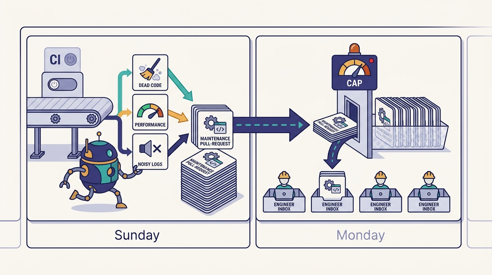
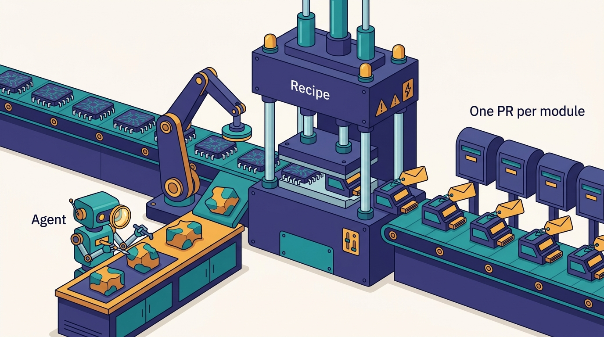

> **IN THIS CHAPTER, YOU WILL:** Follow how Uber runs migrations as campaigns on its Shepherd platform, using the documented JUnit 4 to JUnit 5 migration as the worked example, and how Fox reuses that platform to run maintenance skills as a weekly managed agentic loop that services opt into.

> **WHY IT MATTERS:** AI makes code cheaper to write, so codebases grow faster and decay faster. A company that cannot change code across thousands of modules owned by hundreds of teams will spend its AI gains on maintenance by hand. A change platform with ownership, per-module PRs and campaign tracking is what lets agents do that maintenance safely.

> **KEY POINTS:**
>
> * **A campaign is the unit of change, and the PR per module is its delivery.** Shepherd knows which team owns which module, generates one PR per module, sends each through normal CI and review, and gives a campaign owner a tracker. Uber's 2026 JUnit post reports 75,000+ test classes migrated in about four months through 5,000+ diffs.
> * **Deterministic first, agentic for the rest.** Uber's written account says bulk migration with generative AI was tried and failed. OpenRewrite recipes did the JUnit migration, and AI was kept for debugging failures. Agentic Shepherd campaigns exist for changes no recipe can express, such as fixing tracing context propagation across services.
> * **Fox turns one-off migrations into a standing loop.** As Medisetty described it, services enroll in skills such as dead code cleanup, performance analysis and noisy logs. Every Sunday, when CI load is low, Fox opens a PR. Maintenance PRs written by hand are mined to find the next skill. Uber's 2020 Piranha tool already ran a weekly stale-flag cleanup in the same pattern.

> **BUILT ON:** the per-language monorepos and Bazel build targets ([[monorepos-and-one-build]]), uOwn module ownership ([[build-what-does-not-exist]]), Piranha's weekly cleanup diffs (2017–2020), CI and SubmitQueue capacity ([[inner-loop-and-self-healing-ci]]), the skills monorepo ([[skills-monorepo]]) and the review signals in Code Inbox ([[code-review-signals]])

 
Medisetty explains Shepherd by retelling Uber's monorepo story. Uber moved from thousands of repositories to one monorepo per language "because upgrading libraries was very hard." The move solved one problem and exposed another. With every module in one repository, a library upgrade could be made in one place, "but then now someone has to go and upgrade this library usage across all of the modules in that repository." **A monorepo makes a fleet-wide change possible. It does not make anyone do it.**

That gap is where Uber built **Shepherd**, an internal platform for large-scale code changes, and later **Fox**, a feature on the same platform that runs maintenance continuously instead of once. Shepherd is confirmed by name in Uber's written record, most fully in the April 2026 post on the JUnit migration. Fox is named only in the October 2026 Pragmatic Engineer episode, though a public talk describes a Sunday maintenance loop that matches it closely.

This chapter owns four terms: **Shepherd** (Uber's large-scale change platform), **campaign** (one change run across the codebase, defined by a policy file and tracked by an owner), **Fox** (Shepherd's continuous-maintenance feature) and **managed agentic loop** (Medisetty's phrase for a recurring, centrally run agent task that opens PRs for enrolled services). Their PRs land in the review queue of [[code-review-signals]] and are the likeliest candidates for its green lane.

## The Problem: Changes Nobody Is Funded to Make

A large-scale change has a structural problem that is older than AI. The team that needs the change, such as a platform team retiring a library, a security team patching a vulnerability or a test-infrastructure team moving to a new framework, does not own the code that has to change. The teams that own the code did not ask for the change. *Software Engineering at Google* says it in four words: "nobody likes unfunded mandates" ([Wright, 2020](https://abseil.io/resources/swe-book/html/ch22.html)). The same chapter notes that as a codebase grows, "the largest atomic change possible counterintuitively decreases."

Uber's codebase shows this at the size where it hurts. The 2025 CI-cost post describes **six major monorepos and seven languages**, used by more than 4,500 engineers. The Java monorepo alone held **600,000+ JUnit 4 tests across about 15 million lines of code** when the JUnit migration began ([Uber, 2026](https://www.uber.com/blog/junit-migration/)). A migration at that size cannot be done by one team editing by hand, and asking hundreds of teams to each do their part turns into years of reminders.

AI adds a second problem. Agents write more code, and the code they write needs maintenance too. GitClear's analysis of 211 million changed lines found that copy-pasted lines rose from 8.3% to 12.3% between 2021 and 2024, while moved (refactored) lines fell from 25% to under 10% ([GitClear, 2025](https://www.gitclear.com/ai_assistant_code_quality_2025_research)); GitClear's causal reading is its own interpretation. Medisetty frames the goal as toil: "the more toil we reduce, the more amount of time engineers can spend on the true feature work." Uber's PR type tagging ([[feature-velocity]]) tracks this; Medisetty reports the feature share rising and the maintenance share falling.

## The Lineage: From Piranha to Fox

Shepherd and Fox have a documented history at Uber. Each step kept the same delivery pattern, a machine-generated change sent to an accountable owner, and changed the engine that produced the change.

| Period | System | Engine | Delivery | Evidence |
| --- | --- | --- | --- | --- |
| Late 2017 – 2020 | **Piranha** | AST rewriting of stale feature-flag code (Java, Swift, Objective-C) | Weekly; one diff per stale flag, assigned to the flag's author | Uber blog, 2020; ICSE-SEIP 2020 paper |
| By 2024 | **PolyglotPiranha** | A rule language for match-and-replace across languages | Several refactorings, nearly 5,000 PRs | PLDI 2024 paper; Sonar/Gitar post, 2024 |
| After the monorepo move | **Shepherd** (deterministic) | OpenRewrite recipes | One PR per module, routed to its owners, tracked as a campaign | Podcast; Uber JUnit blog, 2026 |
| AI era | **Shepherd** (agentic) | Prompts and skills run by an agent per module | Same as deterministic | Podcast only |
| 2026 ("a few months ago" as of Oct 2026) | **Fox** | Maintenance skills run on a schedule | One PR per enrolled service per week, on Sunday | Podcast; talk summary, 2026 |

**Piranha** is the clearest precedent. Uber's 2020 blog post "Introducing Piranha" describes a tool that finds feature flags untouched for a configurable period, for example eight weeks, deletes the code behind them and opens a diff assigned to the flag's author, on a weekly pipeline ([Uber, 2020](https://www.uber.com/blog/piranha/)). A diff took under three minutes to generate, and about 2,000 stale flags had been removed across Android and iOS. The companion ICSE-SEIP 2020 paper reports that from late 2017 to mid-2019 Piranha generated cleanup diffs for 1,381 flags, and **about two-thirds were merged unmodified** ([Ramanathan et al., 2020](https://2020.icse-conferences.org/details/icse-2020-Software-Engineering-in-Practice/16/Piranha-Reducing-Feature-Flag-Debt-at-Uber)). The other third, modified or not merged, is the important number: even a narrow deterministic tool needed a human on a third of its changes, and that human was always the flag's owner.

**PolyglotPiranha** (PLDI 2024, open source) generalized the idea into a rule language. Sonar and Gitar (Gitar was co-founded by former Uber engineers, so the source is close to Uber) reported in 2024 that Uber used it for three refactorings over six months, producing nearly 5,000 PRs and deleting more than 200,000 lines ([Sonar, 2024](https://www.sonarsource.com/blog/automated-refactoring-at-scale/)). Both systems are years old and may have changed.

The lineage matters for an imitator because it shows that **Fox is not a new idea. It is Piranha's weekly loop with skills instead of a single hard-coded rule.** Uber had been running machine-generated maintenance PRs, sent to owners on a schedule, for nearly a decade before agents arrived.

## What Uber Built: Shepherd Campaigns

As Medisetty described it in the episode, Shepherd works in four steps:

1. **A policy defines the change.** For a deterministic change, "if it's a simple signature change, you can write that in an OpenRewrite policy." OpenRewrite is an open-source refactoring engine that edits a lossless syntax tree through recipes and keeps the original formatting ([OpenRewrite docs](https://docs.openrewrite.org/)). For a change no recipe can express, an AI-based Shepherd campaign uses "a set of prompts and skills" that an agent runs across every module.
2. **Shepherd knows ownership.** It "knows what are the unique modules owned by different teams."
3. **It creates one PR per module.** Each PR goes to the module's owners.
4. **A campaign owner tracks it.** Each migration is a **campaign** with "a YAML file with the policy," a list of the PRs created for each module, and a status the campaign owner can follow.

Medisetty's agentic example is fixing context propagation for tracing "across all the services so that tracing works better." This is a revealing choice. Trace context propagation is the foundation that Slate's routing and much of Uber's debugging depend on ([[contracts-and-context-propagation]], [[slate]]). Where it breaks, the fix depends on how each service handles requests, threads and asynchronous calls, so no single syntactic rule can make it. An agent reading each service can.

---begin mermaid---
flowchart LR
    A["Campaign owner"] -->|"writes"| B["YAML campaign policy"]
    B --> C{"Change type"}
    C -->|"deterministic"| D["OpenRewrite recipe"]
    C -->|"non-deterministic"| E["Agent with prompts and skills"]
    D --> F["Apply per module or Bazel target"]
    E --> F
    F --> G{"Builds and tests pass"}
    G -->|"no"| H["Skip or revert target, log reason"]
    G -->|"yes"| I["One PR per module"]
    I -->|"routed by ownership"| J["Owning team reviews in Code Inbox"]
    J --> K["Lands via CI and SubmitQueue"]
    H --> L["Campaign tracker"]
    K --> L
    L --> A
---end mermaid---

**Figure 1:** *A Shepherd campaign as described in the episode and the 2026 JUnit post. The policy and the engine change from campaign to campaign; ownership routing, per-module PRs, the build-and-test gate and the tracker stay the same. The skip-and-revert branch comes from the JUnit post; whether agentic campaigns use the same gate is not documented.*

### The Worked Example: JUnit 4 to JUnit 5

Medisetty used JUnit 4 to JUnit 5 as the campaign example in the episode. Uber had already described that migration in detail, in "How Uber Executed a JUnit Migration at Massive Scale" (Uber blog, April 2026, by Anshuman Mishra and Kaushik Vejju) ([Uber, 2026](https://www.uber.com/blog/junit-migration/)). It is the best public account of Shepherd at work.

**The starting point.** JUnit 4 development stopped in 2021. Uber's Java monorepo had more than 600,000 JUnit 4 tests across about 15 million lines of code.

**The engine.** Uber used OpenRewrite's `JUnit4to5Migration` recipe plus custom recipes for Uber-specific test utilities. A deterministic migration needs the compilation classpath to resolve types, so Uber wrote a **custom Bazel aspect** to supply it. For each target, the aspect collects the source files and the full classpath, passes them to Uber's OpenRewrite integration and produces a patch file and CSV diagnostics. Bazel aspects add extra actions to existing build targets, and this one let a refactoring engine work inside the build system's view of the code.

**The precondition.** An OpenRewrite precondition filters files against a list of supported test runners, rules and base classes. A target using unsupported utilities is skipped instead of half-migrated. **This is the most transferable design decision in the post: a campaign should know what it cannot do, and skip it on purpose.**

**The per-target gate.** For each Bazel target, the script applies the patch, updates build dependencies from the diagnostics, builds the target and runs its tests. A build failure fails the migration for that target. The post states that the workflow "ensures migrations only proceed when all tests pass." During rollout, files whose tests failed reverted to JUnit 4.

**The delivery.** Shepherd "identifies successfully migrated targets and automatically generates diffs for each one," and each diff goes through Uber's CI, including integration tests, linters and coverage enforcement. The post does not say who reviewed the diffs or whether any were auto-approved.

**The result.** More than **75,000 test classes** and **1.25 million lines** were migrated in **about four months**, through **more than 5,000 diffs**. The initial rollout alone produced more than 2,000.

**The AI lesson.** Uber tried generative AI on the bulk migration, migrating multiple test files at once, and it failed. AI was kept for debugging test and build failures. In the post's words, "a deterministic approach proved more practical than an AI-driven migration."

This does not mean AI is useless for migrations. Uber runs agentic Shepherd campaigns, and the AI Engineer World's Fair 2026 talk by Medisetty and Adam Huda claims **more than 250 automated migrations** covering about 9 million lines. What it shows is a division of labor:

| Change type | Right engine | Why | Uber example |
| --- | --- | --- | --- |
| Mechanical, rule-expressible (API renames, signature changes, framework annotations) | Deterministic recipe | Same input, same output; reviewable as a pattern; cheap to run on 75,000 classes | JUnit 4 to 5 via OpenRewrite (documented, 2026) |
| Mechanical but with a long tail of exceptions | Recipe for the bulk, with a precondition that skips the rest; AI to debug or handle the skipped tail | Recipes fail loudly on edge cases; agents can read the failure | AI used to debug JUnit build and test failures (documented) |
| Semantic, context-dependent (behavior differs per service) | Agent with prompts and skills per module | No rule can express it; the agent reads each module | Fixing tracing context propagation (podcast) |
| Judgement calls (is this code dead? is this log noisy?) | Agent skill, with the owner deciding | Needs understanding of intent and usage | Fox skills (podcast) |

**Deterministic tools are the default for the bulk; agents are for what the tools cannot express.** A company that starts its migration program by pointing an agent at the whole codebase is repeating the experiment Uber reports as a failure.

## What Uber Built: Fox and the Managed Agentic Loop

Medisetty introduced Fox as a feature added to the Shepherd platform "a few months ago," because "we want to continuously improve the code base, not one-time migrations." The description has five parts.

1. **Enrollment.** "Any service at Uber, they can go here and enroll their service into different skills." The examples were dead code cleanup, performance analysis and noisy logs, out of "a whole bunch of these skills."
2. **A weekly PR.** For each enrolled service and skill, Fox generates a new PR every week. It runs on Sunday, "when we don't have that much CI load."
3. **Opt-in, moving to opt-out.** "We are still in the opt-in phase. Once we improve some of the skills, we'll move some of them to opt-out phase."
4. **A managed agentic loop.** Once a service enrolls, "every week, in some sense, you are getting a PR created, like a managed agentic loop."
5. **Mining maintenance PRs for new skills.** Uber looks at PRs tagged as maintenance, asking: "Do we need to create a new skill? Do we need to improve that skill so that that class of PRs can be onboarded to this automated managed loop?"

The name Fox appears only in the episode. A written account of the AI Engineer World's Fair 2026 talk, Port's August 2026 summary, describes a maintenance system that matches it ([Port, 2026](https://newsletter.port.io/p/how-uber-built-a-software-factory)). Engineers enroll a service in maintenance skills. One example is a skill that removes the losing variant of an A/B test once the experiment is decided. Loops run on Sunday, when CI has spare capacity. **A cap limits how many diffs can land on an engineer's Monday.** There is "one place you go to set a loop up," and when diffs are commented on, landed or dropped, that outcome becomes data for improving the skill. Once a month, Uber mines incident reviews for new maintenance skills to roll out across every service. This is the nearest public description of Fox, and this book treats it as the same system while noting that the name is podcast-only.

Medisetty's August 2026 blog post adds the economics. Managed agents handle "self-healing CI failures" and "a variety of code maintenance tasks with human reviews/escalations," and each managed agent gets an outcome-based cost metric, such as cost per cleanup, paired with a quality signal such as revert rate ([Uber, 2026](https://www.uber.com/us/en/blog/efficient-software-factory/)). A Fox skill is therefore measured as a small product: what each merged cleanup costs, and how often it is reverted.

---begin mermaid---
flowchart TB
    A["Service owner enrolls service in a skill"] --> B["Fox schedule: Sunday, low CI load"]
    B --> C["Agent runs skill on the service"]
    C --> D["One maintenance PR"]
    D -->|"capped per engineer"| E["Owner reviews Monday in Code Inbox"]
    E -->|"lands, comments or drops"| F["Outcome data per skill"]
    F --> G["Skill improved in skills monorepo"]
    G --> B
    H["Hand-written maintenance PRs, tagged by type"] --> I["Find recurring classes"]
    J["Monthly incident reviews"] --> I
    I -->|"new skill"| G
    G -->|"once proven"| K["Move skill from opt-in to opt-out"]
---end mermaid---

**Figure 2:** *Fox as a managed agentic loop, combining Medisetty's account with the 2026 talk summary. Two feedback paths keep it alive: outcomes from Fox's own PRs improve existing skills, and hand-written maintenance PRs and incident reviews suggest new ones. The Monday cap and the incident-review mining come from the talk summary, not from the episode.*

Three design choices in Fox are worth spelling out.

**Enrollment is per service, by the owner.** Orosz pointed out in the episode that this works "because a code base is owned by an engineer or team at Uber." Fox does not decide on its own that a service should be cleaned. The owner opts in, and the owner reviews the result. This is Piranha's rule: send the machine's diff to an accountable human.

**Sunday scheduling trades CI capacity for review timing.** Running Fox when CI is idle protects the weekday CI capacity that triggered Uber's 2026 CI code red ([[inner-loop-and-self-healing-ci]]). It also means the PRs wait for Monday. The Monday cap described in the talk is the necessary counterweight: without it, an engineer enrolled in ten skills across five services could start every week with fifty maintenance PRs.

**Figure 3:** *Fox runs when CI load is low on Sunday; the cap on how many diffs land on an engineer's Monday, described in the 2026 talk summary, keeps the weekly loop from becoming PR spam.*

**Opt-out is a trust milestone, not a default.** Under opt-out every service receives a skill's PRs unless the owner declines, so Uber plans to switch only skills it has improved. A plausible reading — not a documented description — is that a skill earns opt-out through its outcome data: merge rate, revert rate and drop rate.

## The Foundation Underneath

Take away the agent and almost everything that makes Shepherd and Fox work is still there, because it was built for humans first.

| What Shepherd and Fox need | Pre-AI foundation | Chapter | Why it would be hard without it |
| --- | --- | --- | --- |
| One place to change all code in a language | Per-language monorepos (2017–2018 onward) | [[monorepos-and-one-build]] | With thousands of repos, a campaign has to clone, build and open PRs in each, with different build tools |
| A unit of change and a way to build and test it | Bazel targets; the custom Bazel aspect for classpaths | [[monorepos-and-one-build]] | Without a uniform build graph, there is no per-target gate and no reliable classpath for recipes |
| Knowing who owns each module | uOwn and module ownership metadata | [[build-what-does-not-exist]] | Without ownership, per-module PRs have no reviewer and enrollment has no owner |
| A green main that can absorb thousands of PRs | SubmitQueue and CI capacity | [[monorepos-and-one-build]], [[inner-loop-and-self-healing-ci]] | 5,000 PRs on a red or overloaded main become 5,000 rebases |
| Reusable agent behavior | The skills monorepo and its quality gate | [[skills-monorepo]] | A Fox skill is a skill; without a shared repository and quality gate there is nothing to enroll in |
| An environment where an agent can run a skill on any service | DevPods and the mega DevPod | [[devpods]], [[minion]] | Agentic campaigns need the same warm, pre-built workspace Minion uses |
| A way to find the next skill | PR type tagging (feature, bugfix, maintenance) | [[feature-velocity]] | Without tagged maintenance PRs, recurring hand-written toil is invisible |
| Owners who can review quickly | Code Inbox signals | [[code-review-signals]] | Maintenance PRs compete with feature PRs for the same attention |

The first four rows carry the book's thesis for this chapter ([[the-harness-is-the-easy-part]]). The JUnit migration used no AI for its bulk. It succeeded because Uber had a monorepo, a programmable build graph, ownership data and a CI system that could take more than 5,000 diffs in four months. **A company without those foundations cannot buy its way into Shepherd by buying an agent**: it would have a patch and no way to apply, test, route or track it across the codebase.

## Design Choices and Trade-offs

| Choice | Option A | Option B | When A is right | When B is right |
| --- | --- | --- | --- | --- |
| Change engine | Deterministic recipe (OpenRewrite, Piranha) | Agent with prompts and skills | The change is expressible as a rule; volume is high; reviewers should see a pattern | The change depends on each module's behavior; volume per pattern is low |
| PR granularity | One PR per module or target (Shepherd, Google's Rosie) | One large PR or a few batched PRs | Many owners; independent testability; partial progress is useful | One owner; the change is only valid if applied everywhere at once |
| Who reviews | The owning team | A central approver for expected patterns (Google's global approvers) | Behavior can change; owners have context | The change is mechanical and verified by pattern; owners would only rubber-stamp |
| Enrollment | Opt-in by owners (Fox today) | Opt-out (Fox's plan for proven skills) | The skill is new or its merge rate is unproven | The skill has a high merge rate, a low revert rate and few drops |
| Schedule | Off-peak (Fox: Sunday) | During the owners' working hours (Spotify, 2026) | CI capacity is the binding constraint; PRs wait for human review anyway | Changes may auto-merge, so a human must be awake if something breaks |
| Where maintenance logic lives | Central skills, run as a managed loop (Fox) | Each team runs its own agent loop (the pattern Orosz described engineers doing with Claude Code or Codex nightly) | Many services need the same maintenance; quality and cost need central measurement | A team's maintenance needs are unique |

The schedule row has no universal answer. Fox can run on Sunday because its PRs wait for a human anyway. Spotify schedules automated changes in owners' working hours because many of them **auto-merge**, and whoever can roll back should be awake. The schedule follows from the review policy.

## Elsewhere in the Industry

**Google** wrote the reference design. The large-scale changes chapter of *Software Engineering at Google* (2020) describes **Rosie**, which splits a large change into shards along project and ownership boundaries, each with its own test, review and submit pipeline ([Wright, 2020](https://abseil.io/resources/swe-book/html/ch22.html)). An owners-detection service picks reviewers and adds others if an owner is unresponsive. Most shards go to **global approvers**, who auto-approve expected patterns with tooling and look by hand only at anomalies. Rosie caps outstanding shards and runs at low priority to protect the shared test infrastructure, Google's version of Fox's Sunday schedule. At its peak the `scoped_ptr` to `std::unique_ptr` migration committed more than 700 changes a day. Shepherd's per-target PRs follow the same pattern; the global-approver model is the main piece Uber's public record does not describe.

**Spotify** reached the same architecture from the other direction. Its **Fleet Management** system runs containerized source-to-source transformations that open PRs across thousands of repositories, and since mid-2024 about half of Spotify's PRs have come from it ([Spotify, 2025](https://engineering.atspotify.com/2025/11/spotifys-background-coding-agent-part-1)). Spotify then added **Honk**, a background coding agent, to replace hand-written transformation scripts. One Maven updater script had grown past 20,000 lines. Spotify reported more than 1,500 merged agent PRs and kept the targeting, PR, review and merge steps unchanged: the same move as Uber's agentic Shepherd, keep the delivery platform and swap the engine. InfoQ reported in October 2026 that Fleet Management had merged more than 2.5 million automated maintenance PRs, most automatically after safety checks, and that one automated dependency upgrade passed every check and failed in production; Spotify then moved automated changes into owners' working hours ([InfoQ, 2026](https://infoq.com/news/2026/10/spotify-ai-quality-controls)). Spotify auto-merges at a scale Uber has not described, and has published the failure that comes with it.

## If You Are Not Uber

A company of 200 engineers does not need Shepherd. It needs the three properties that make Shepherd work: **changes delivered per owned unit, a gate that builds and tests each unit, and a tracker that shows what is left.** Most of this can be assembled from open-source tools.

| Company size | Minimum viable version | Buy, build or open source | Do not do yet |
| --- | --- | --- | --- |
| ≈50 engineers | A dependency-update bot. One person runs each migration with OpenRewrite (JVM) or a codemod tool, opening one PR per repo or package. A spreadsheet or issue as the campaign tracker. A scheduled agent loop for one maintenance task, such as stale flags or dead code, reviewed by its owner. | Open source: OpenRewrite, Renovate or Dependabot, polyglot-piranha; a coding agent in CI on a schedule | A campaign platform; opt-out maintenance |
| ≈500 engineers | Ownership metadata that a script can read. A campaign runner: a policy file, apply per package, build and test, skip on failure, open PRs routed to owners, and a dashboard of open, merged and skipped. Two or three opt-in maintenance skills with merge-rate and revert-rate tracking. Tag PRs by type to find the next skill. | Build the runner as a thin layer over your build tool and code host; consider commercial large-scale-change platforms if most code is on the JVM | Agentic campaigns for the bulk of mechanical migrations; opt-out before the merge rate is known |
| ≈5,000 engineers | A Shepherd-like platform with campaign owners and policy files, a deterministic engine and an agentic engine side by side, CI throttling or off-peak scheduling, a per-engineer cap on maintenance PRs, a skills repository with a quality gate, and opt-out for proven skills. Mine incident reviews and maintenance PRs for new skills on a regular cadence. | Build the platform; buy or open-source the engines | Auto-merge for agentic changes without rollback capacity and an awake owner |

Sequencing:

1. **Fix ownership before automation.** If a script cannot answer "who owns this directory?", every generated PR becomes an orphan.
2. **Make the per-unit gate cheap.** A campaign needs to build and test one module in isolation. A monorepo with a graph-aware build tool makes this easy. A polyrepo needs a uniform CI entry point in every repo.
3. **Run one deterministic campaign end to end** before writing a platform, with a precondition step that skips and reports what the recipe cannot handle. Track open, merged, skipped and reverted.
4. **Add an agent for the skipped tail and for failure debugging**, not for the bulk.
5. **Turn one recurring maintenance task into an opt-in weekly loop**, measure its merge, revert and drop rates before adding a second, and cap how many automated PRs an engineer receives per week.

What *not* to copy: agentic bulk migration (Uber reports it failed), opt-out before a skill has earned it, and Sunday scheduling if your automated PRs auto-merge.

**Figure 4:** *Deterministic recipes do the bulk and agents take the long tail: Uber's JUnit migration moved 75,000+ test classes through 5,000+ diffs with OpenRewrite after a generative-AI bulk attempt failed.*

## Failure Modes

- **PR spam.** A campaign or loop that generates more PRs than owners can review becomes noise, and owners learn to close them unread. The Monday cap in the talk summary exists for this. Turning a skill to opt-out before its merge rate is known spreads the noise to every queue at once.
- **The unfunded tail.** The deterministic bulk lands in weeks, and the last 5% of modules, the ones with unusual test utilities or no active owner, stay unmigrated for years. Preconditions make the tail visible. They do not make it go away. A campaign needs an owner with a mandate to close it.
- **Passing tests, changed behavior.** A change that builds and passes every test can still break production, as Spotify reported in 2026. Per-target gates are only as strong as the tests behind each target. Agentic changes such as context-propagation fixes need runtime evidence (see [[slate]] and [[capri]]), not only a green build.
- **Agentic churn without value.** A "performance analysis" skill that proposes speculative micro-optimizations every week creates review load with no measurable effect. Uber's August 2026 framing, cost per cleanup paired with revert rate, is the right guard. A skill that cannot show value should be retired.
- **Skill rot.** A skill written against last year's framework keeps generating outdated PRs. Skills need owners and evals like any other code ([[skills-monorepo]]).
- **CI pressure moved, not removed.** Off-peak scheduling helps only if the off-peak window has enough capacity. A growing set of loops can fill Sunday, and their reruns spill into Monday. Rosie's caps on outstanding shards are the general answer.
- **Owners stop knowing their code.** If cleanup, upgrades and refactors are all generated and approved quickly, teams lose track of how their code changed. Reviewers of maintenance PRs should be the people who will be paged.

## What the Record Does Not Say

- No Uber post describes Shepherd's architecture: how campaigns are stored, how PRs are routed, how the tracker works, or how agentic campaigns are gated. The JUnit post covers one deterministic campaign.
- The name Fox, its list of skills, its enrollment numbers and its merge or revert rates are not public. Its match with the talk's Sunday maintenance loop is this book's reading, not Uber's statement.
- It is not public whether agentic Shepherd campaigns use the same build-and-test gate and skip-on-failure behavior as the JUnit campaign.
- The size of the Monday cap, and whether it applies per engineer, per team or per service, is not described.
- Uber has not said who reviewed the 5,000+ JUnit diffs: owning teams, a central team or a global-approver-style process.
- The basis of the talk's "250+ automated migrations" and "~9 million lines" (deterministic, agentic or both; over what period) is not stated.
- The criteria for moving a Fox skill from opt-in to opt-out are not described.

## Questions to Ask

1. For our last three cross-cutting changes, how long did the slowest 5% of modules take, and why?
2. Can a script determine the owner of every module, package or repository we have? What fraction has no owner?
3. Can we build and test one module in isolation with a single command that is the same everywhere?
4. Which of our planned migrations are rule-expressible, and which genuinely need an agent? Are we using an agent where a recipe would do?
5. Who is the named owner of each running migration, and where can anyone see its open, merged and skipped counts?
6. For each automated maintenance loop, what are its merge rate, revert rate and cost per merged PR?
7. How many automated PRs does one engineer receive per week, and what is the cap?
8. If an automated change merges and breaks production, who is awake, and how fast can it be rolled back?
9. What would a skill need to show before we turn it on for every service by default?

Shepherd and Fox keep the code healthy before anything breaks. The next chapter, [[wisdom-and-debug-assist]], picks up when something does: an employee reports a bug from a beta app, an agent finds the root cause, and Minion opens the fix, which flows back through the same review and maintenance machinery described in this chapter and the previous one.

## Sources and Evidence

**The source episode**

- [Uber's AI infra, from the inside](https://newsletter.pragmaticengineer.com/p/ubers-ai-infra-from-the-inside), *The Pragmatic Engineer* podcast, Gergely Orosz with Uday Kiran Medisetty, 2026: Shepherd's deterministic and agentic campaigns, YAML policies and campaign owners, the context-propagation example; Fox enrollment, Sunday PRs, opt-in to opt-out, the managed agentic loop, mining maintenance PRs for skills.

**Uber engineering sources**

- [How Uber Executed a JUnit Migration at Massive Scale](https://www.uber.com/blog/junit-migration/), Uber Engineering (Anshuman Mishra, Kaushik Vejju), 2026: Shepherd by name, OpenRewrite recipes, the Bazel aspect, preconditions, per-target gate, the counts of classes, lines and diffs, the failed generative-AI attempt.
- [Introducing Piranha: An Open Source Tool to Automatically Delete Stale Code](https://www.uber.com/blog/piranha/), Uber Engineering (Sridharan, Barik, Clapp), 2020: weekly stale-flag cleanup diffs assigned to flag authors, ~2,000 flags removed.
- [Piranha: Reducing Feature Flag Debt at Uber](https://2020.icse-conferences.org/details/icse-2020-Software-Engineering-in-Practice/16/Piranha-Reducing-Feature-Flag-Debt-at-Uber), Ramanathan, Clapp, Barik, Sridharan, ICSE-SEIP 2020: 1,381 flags, about two-thirds of diffs merged unmodified.
- [Automated Refactoring at Scale](https://www.sonarsource.com/blog/automated-refactoring-at-scale/), Sonar / Gitar, 2024: PolyglotPiranha use at Uber, nearly 5,000 PRs (a source close to Uber).
- [Running a Software Factory Efficiently at Uber Scale](https://www.uber.com/us/en/blog/efficient-software-factory/), Uber Engineering (Uday Kiran Medisetty), 2026: managed agents for maintenance and self-healing CI with human review; cost per cleanup paired with revert rate.
- [Agentic SDLC at Uber: Building Blocks for Uber's Software Factory](https://ai.engineer/talks/17-YSUHo6Lk-agentic-sdlc-at-uber-building-blocks-ubers), AI Engineer World's Fair talk (Medisetty, Huda), 2026: 250+ automated migrations; scheduled maintenance skills.
- [How Uber built an AI software factory](https://newsletter.port.io/p/how-uber-built-a-software-factory), Port (Zohar Einy), 2026: third-party summary of the talk; Sunday maintenance loop, Monday diff cap, one place to set up loops, monthly incident-review mining.
- [Slashing CI Costs at Uber](https://www.uber.com/us/en/blog/slashing-ci-costs-at-uber/), Uber Engineering (Lin, Juloori, Williams), 2025: six monorepos, seven languages, 4,500+ engineers on SubmitQueue.

**Industry and research sources**

- [Software Engineering at Google, Chapter 22: Large-Scale Changes](https://abseil.io/resources/swe-book/html/ch22.html), Hyrum Wright, O'Reilly, 2020: LSC definition, Rosie sharding by ownership, global approvers, throttling, `scoped_ptr` scale.
- [OpenRewrite documentation](https://docs.openrewrite.org/), Moderne (current): recipes over lossless semantic trees.
- [1,500+ PRs Later: Spotify's Journey with Our Background Coding Agent (Part 1)](https://engineering.atspotify.com/2025/11/spotifys-background-coding-agent-part-1), Spotify Engineering (Max Charas, Marc Bruggmann), 2025: Fleet Management share of PRs, Honk replacing transformation scripts.
- [Spotify's AI quality controls](https://infoq.com/news/2026/10/spotify-ai-quality-controls), InfoQ (Leela Kumili), 2026: 2.5 million automated maintenance PRs, auto-merge, a production failure and working-hours scheduling.
- [AI Copilot Code Quality: 2025 Look Back at 12 Months of Data](https://www.gitclear.com/ai_assistant_code_quality_2025_research), GitClear, 2025: rising duplication and falling refactoring in changed lines.

Statements about Uber's AI-era systems are Uber's own account unless another source is cited; recommendations and labeled inferences are the author's judgement.
