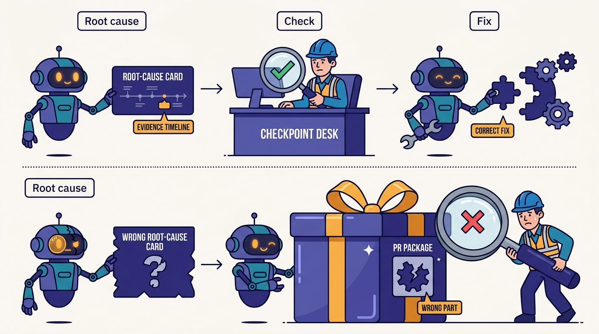
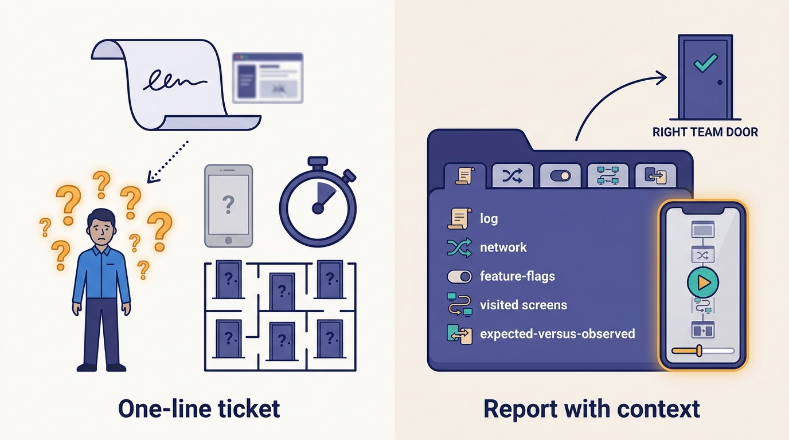

> **IN THIS CHAPTER, YOU WILL:** Trace an employee bug report through Uber's Wisdom tool and the DebugAssist agent to a Minion pull request, see which parts are documented and which are only described in the episode, and learn why the quality of the bug report, not the cleverness of the agent, decides how short the loop can get.

> **WHY IT MATTERS:** Debugging is where engineers spend the time no roadmap shows. A bug report that arrives with reproduction steps, telemetry and a candidate root cause turns days of triage into a review task, and the same evidence lets an agent write a fix a human can check.

> **KEY POINTS:**
>
> * **The report is the product.** Wisdom's value, as Medisetty described it, is that a dogfooding report from a beta app arrives routed to the owning team with logs, analytics, network requests, feature flags, the screens visited, and expected versus observed behavior. An agent with that context has little left to guess.
> * **Root cause and fix are separate steps with a human between them.** In the episode, DebugAssist proposes a root cause, impact and evidence timeline; once the engineer judges the root cause right, they hand it to Minion, which opens the PR and attaches it to the Jira task that holds the analysis. A September 2026 talk abstract by an Uber engineer describes a variant that opens PRs itself, with acceptance rising from 5% to 30%.
> * **Close the loop or it will not improve.** Network-response replay by bug ID lets an engineer reproduce and confirm the fix on a test device, and every corrected root cause or rewritten PR becomes data for improving DebugAssist and Minion. Without that feedback, an RCA agent stays at its launch quality.

> **BUILT ON:** Employee dogfooding of beta apps and the in-app bug reporter (documented in 2016), mobile network record/replay for tests, the city-and-country mocking that location-dependent features need, uOwn ownership data for routing ([[build-what-does-not-exist]]), Jaeger tracing and the logging and metrics stack ([[contracts-and-context-propagation]]), the MCP Gateway ([[mcp-gateway]]), and Minion on the mega DevPod ([[minion]]).

 
An Uber employee is testing a new feature that only exists in another country. To try it, they mock their phone's location in the beta rider app, and the mocking stops working. In the old world, they would file a ticket saying "Cannot mock location on my device anymore", someone would try to work out which team owns location mocking, and the owning engineer would spend a morning trying to reproduce a bug on a device that is not the reporter's, running an app build that is not the reporter's, with feature flags that are not the reporter's.

That example is the one shown on screen in the October 2026 Pragmatic Engineer episode, and Medisetty used it to describe **Wisdom**, Uber's tool for employee bug reports. In Medisetty's account, the report is routed to the right team by AI and arrives with the logs and telemetry from the reporter's session; the engineer sees reproduction steps reconstructed from the screens the reporter visited, and the expected versus observed behavior. A managed agent called **DebugAssist** reads all of it plus the codebase and proposes a root cause; when the engineer agrees with it, they hand it to [[minion]], which writes the PR. And the engineer can replay the reporter's network responses on a test device by bug ID to see the bug, and then see it fixed. **"It used to be a huge problem to reproduce,"** Medisetty said.

This chapter is the last in the lifecycle sequence. [[slate]] and [[capri]] verify changes before they ship; [[shepherd-and-fox]] keeps code healthy on a schedule. Wisdom and DebugAssist handle what gets through: bugs found by people using the product. The chapter separates what Uber has documented (dogfooding, the bug reporter, an RCA agent described in a public talk) from what only the episode describes (Wisdom's features, the hand-off to Minion, network replay by bug ID).

## The Problem: Most Debugging Time Is Spent Before the Debugging

Every engineer knows the shape of a bad bug report: one line, a screenshot, no app version, no account, no steps. The cost is not in fixing the bug; it is in the hours before the fix, spent on three questions.

| Question | Why it is slow without tooling | What Wisdom supplies, per the episode |
| --- | --- | --- |
| **Whose bug is it?** | The reporter sees a screen, not a service; tickets bounce between teams | AI routing to the team owning the feature |
| **Can I see it happen?** | Different device, build, flags, location and account | Reproduction steps from the screens visited; replay of the reporter's network responses by bug ID |
| **What actually happened?** | Logs are scattered across client analytics, network traces and backend logs | Logs, analytics, network requests and feature flags in one place; expected vs observed behavior |

Uber's products make all three harder than usual. Behavior depends on city, country, product line, app version and dozens of feature flags and experiments ([[build-what-does-not-exist]] explains why cities are a first-class concept). Medisetty's example is exactly that: to test a feature in another country, employees mock the location on their device. A bug that appears only for a mocked location in one market, under one flag configuration, is nearly impossible to reproduce from a one-line ticket.

Agents change the economics in both directions. A background agent can write a fix in minutes, so **reproduction and diagnosis become the bottleneck**. And an agent given a poor report will produce a plausible fix for the wrong problem, which costs a reviewer more than no fix at all.

## The Foundation: A Decade of Dogfooding

Wisdom is new; the practice it serves is not. Uber's 2016 engineering post "The Uber Engineering Tech Stack, Part I: The Foundation" described employees running a beta version of the apps and an **app feedback reporter** that turned any screenshot taken in the app into a prompt to file a bug task in Phabricator, Uber's code review and task tool at the time ([Uber, 2016](https://www.uber.com/us/en/blog/tech-stack-part-one-foundation/)). A ten-year-old post describes a system that has certainly changed, but the habit it documents, every employee as a tester with a one-tap bug path, is the raw input Wisdom needs.

Three other public pieces line up behind the episode's description:

- **Mobile network record/replay.** An At Scale conference abstract from September 2016 says Uber "implemented network record/replay and scenario-based testing for iOS/Android" so mobile tests would run reliably in CI ([At Scale, 2016](https://atscaleconference.com/?p=1028)). Serving a reporter's network responses to a test device by bug ID, as Medisetty described, is the same capability pointed at bug reproduction instead of test stability.
- **Location mocking in testing.** Uber's 2024 DragonCrawl post, on generative-AI mobile testing, describes fixing rider/driver matching problems by tuning fake GPS locations, and running the core trip flow in 85 of 89 top cities ([Uber, 2024](https://www.uber.com/blog/generative-ai-for-high-quality-mobile-testing/)). Location is a test input at Uber, not an afterthought.
- **Ownership and observability.** Routing a bug to a team requires knowing who owns the screen, feature or service; Uber's uOwn has answered that since before vendors offered it ([[build-what-does-not-exist]]). An agent investigating a bug needs traces, logs and flags reachable through tools; Jaeger, the logging stack and the MCP Gateway supply them ([[contracts-and-context-propagation]], [[mcp-gateway]]).

| Foundation | Era | What Wisdom or DebugAssist uses it for | Evidence |
| --- | --- | --- | --- |
| Employee beta apps and in-app bug reporter | 2016 or earlier | Volume of reports from people who know the product | Uber blog, 2016 |
| Mobile network record/replay | 2016 | Replaying a reporter's responses on a test device | At Scale abstract, 2016; podcast |
| Client telemetry, analytics and feature flags | Pre-AI | The context attached to each report | Podcast |
| uOwn ownership graph | 2015 onward | Routing to the owning team | Podcast; show notes |
| Jaeger tracing, logs, crash analytics | 2016 onward | Evidence for root cause | Uber blog 2017; MCPCon talk abstract, 2026 |
| MCP Gateway and skills | 2025–26 | DebugAssist's access to those systems | Uber blog, Oct 2026; [[skills-monorepo]] |
| Minion on the mega DevPod | 2025 | Writing the fix as a PR | [[minion]] |
| Jira (or Linear) as the task system | Pre-AI | Where RCA and PR are attached | Podcast; [[plans-as-source-of-truth]] |

The point for imitators is in the first two rows. **The AI layer can only be as good as the telemetry captured at the moment of the report**, and that capture is a client-engineering investment, made years before anyone needed it for an agent.

## What Uber Built: Wisdom, DebugAssist and the Hand-off

### Wisdom, as Described

Wisdom appears by name on the episode's show page as one of four day-to-day tools, alongside DevPods, Code Inbox and Slate, without a description. Everything below comes from Medisetty's account and the screens shown in the episode.

- **Reporting from the app.** Employees dogfood the rider and earner apps; when they see a bug they report it from inside the app.
- **Routing.** AI routes each report automatically to the team that owns the feature.
- **Telemetry.** Because reports come from employee beta builds, Uber captures logs and telemetry with each one: logs, analytics events, network requests and feature flags, viewable in one place.
- **Reproduction.** Wisdom knows the screens the reporter went through from the logs and gives the engineer reproduction steps, expected behavior and observed behavior.
- **Network replay by bug ID.** An engineer can give a test device the bug's ID and be served "the same network responses that we served to the person who filed", to experience the same issue, and then to confirm the fix.

The screen shown in the episode organizes a report into tabs labeled *Summary*, *Reproduce*, *Root Cause Analysis*, *Fix with an Agent* and *Log Explorer*. That layout is itself a description of the workflow: understand, reproduce, diagnose, fix, with raw evidence one tab away.

### DebugAssist, as Described in the Episode

With the report's context in place, Medisetty said, Uber built "a managed agent called DebugAssist" that "looks at the code base, and it will try to pinpoint what is the root cause and what is the impact, evidence timeline around that." A **managed agent**, in Uber's usage, is an agent that runs as a platform service on a trigger, here a bug report, rather than inside an engineer's interactive session; [[shepherd-and-fox]] covers the managed agentic loops for maintenance.

The hand-off is explicit and human-gated. Once the engineer judges the root cause right ("okay, this is the right root cause"), they hand it to Minion: "This root cause looks good. Why don't you create a PR for this?" Minion takes the context, creates the PR, and attaches it to the Jira task, which also carries the root-cause analysis, so anyone picking the task up sees both.

Then the feedback. When an engineer corrects the root cause in the ticket's comments, or replaces Minion's PR with a different one, Medisetty described that as data for improving both DebugAssist and Minion: a wrong RCA and a wrong PR from a right RCA are both signals.

---begin mermaid---
flowchart LR
    A["Employee on beta app"] -->|"in-app report"| B["Wisdom"]
    B -->|"AI routing"| C["Owning team"]
    B -->|"logs, analytics, network, flags, screens"| D["DebugAssist managed agent"]
    D -->|"root cause, impact, evidence timeline"| E["Engineer reviews RCA"]
    E -->|"accept and hand off"| F["Minion on mega DevPod"]
    F -->|"PR attached with RCA"| G["Jira task"]
    E -->|"replay by bug ID"| H["Test device"]
    H -->|"bug reproduced, then fix confirmed"| E
    G -->|"corrected RCA or PR"| I["Improvement data"]
    I --> D
    I --> F
---end mermaid---
**Figure 1:** *The closed loop as Medisetty described it. The engineer stands between root cause and fix; network replay lets them confirm both ends; corrections flow back to both agents. The improvement-data box summarizes Medisetty's description, not a documented component.*

### DebugAssist, as Described in a Public Talk

One written source goes further than the episode: the abstract of a September 2026 talk at MCPCon Japan by Kriti Dangi, a senior software engineer at Uber, titled "MCP-Powered Crash Investigation: How 11 MCP Servers Help an AI Agent Debug Production Issues at Uber", describes an investigation agent built on **LangGraph** with **11 MCP servers**, five plugins and parallel subagents, using tools including Sourcegraph, crash analytics, Jira, feature flags, Jaeger and logging ([MCPCon Japan, 2026](https://agntconmcpconjapan26.sched.com/2026-09-11/list/descriptions/type/MCPCon)). According to the abstract:

- It takes about **30 minutes from alert to reviewable PR**, against 15 days typical.
- It writes the fix, validates it in a loop and **opens the PR itself**.
- It caught a crash at 5% rollout and shipped the fix the same day, and traced a battery-drain report to a hot loop.
- Domain knowledge lives in markdown skill files in a plugin marketplace.
- It produces about **5,000 root-cause analyses a month across six languages**, and its acceptance rate rose **from 5% to 30%**.

The abstract names the agent "Debug Assist", and says it also handles user-reported bugs that arrive with little information, so this is the same system seen from its crash-investigation side. Two differences from the episode are worth stating plainly. The talk's agent opens PRs itself; the episode's DebugAssist hands off to Minion. These may be two paths (production crashes versus employee reports), or the architecture may have changed. And a secondary write-up of another talk by the same engineer gives about 9,000 issues a month rather than 5,000 RCAs; the abstract is the more authoritative figure. Uber's August 2026 blog post by Medisetty confirms only the general category: managed agents "debugging incoming bugs" and "triaging on-call alerts", with metrics such as alerts triaged and cost per alert ([Uber, 2026](https://www.uber.com/us/en/blog/efficient-software-factory/)).

**A 30% acceptance rate means seven in ten analyses are not accepted as is.** That fits the episode's design: a human checks the root cause before any code is written, and every rejection is captured as data.

---begin mermaid---
sequenceDiagram
    participant Rep as Reporter
    participant Wis as Wisdom
    participant DA as DebugAssist
    participant Eng as Owning engineer
    participant Min as Minion
    participant Dev as Test device
    Rep->>Wis: report bug from beta app
    Wis->>Eng: routed report with telemetry and repro steps
    Wis->>DA: report context
    DA->>DA: query logs, traces, flags, code via tools
    DA->>Eng: root cause, impact, evidence timeline
    Eng->>Dev: replay reporter responses by bug ID
    Dev-->>Eng: bug reproduced
    Eng->>Min: accept RCA, create PR
    Min->>Eng: PR linked to Jira task with RCA
    Eng->>Dev: replay again on fixed build
    Dev-->>Eng: fix confirmed
---end mermaid---
**Figure 2:** *One bug, end to end, in the order the episode implies. The two replays on the test device bracket the fix: the first proves the engineer is looking at the reporter's bug, the second proves the fix addresses it.*

## Design Choices and Trade-offs

| Choice | Uber (as described) | Alternative | When the alternative is right |
| --- | --- | --- | --- |
| Who finds the bugs | Employees dogfooding beta apps | External beta users; production crash reporting only | Small workforce relative to user base; products employees cannot use |
| What travels with the report | Logs, analytics, network requests, flags, screens | Screenshot plus free text | Privacy or regulation forbids capturing the session; very low report volume |
| Routing | AI routing to owning team | Manual triage rotation | Few teams; ownership metadata is poor (fix that first) |
| RCA to fix | Human accepts RCA, then Minion writes the PR | Agent writes and opens the PR directly (the talk's variant) | High-confidence bug classes such as crashes with clear stack traces; strong validation |
| Reproduction | Replay reporter's network responses on a test device | Engineer reproduces manually | Server-side bugs where client responses are not the cause |
| Improvement | Corrections on RCAs and PRs as training data | Static prompts and skills | Low volume, where curated examples beat mined data |

The central trade-off is the human gate between root cause and fix. Gating costs an engineer's attention per bug. Not gating costs a reviewer's attention per PR, because an agent that fixes the wrong root cause produces a PR that looks right and is wrong, and reviewing that is harder than reviewing an RCA. **Checking a diagnosis is cheaper than checking a diff written from a wrong diagnosis.** For crash classes with clear stack traces and good validation, skipping the gate is reasonable; the talk's numbers suggest Uber does so in that setting.

**Figure 3:** *Checking a diagnosis is cheaper than checking a diff written from a wrong diagnosis; with RCA acceptance reported rising from 5% to 30% (September 2026 talk abstract), most analyses still need a human.*

A second trade-off is between an agent that *investigates* and an agent that *answers*. Uber's earlier on-call assistant, **Genie** (2024), was a retrieval-based Slack bot that answered questions in on-call channels from internal documentation: 154 channels, 70,000+ questions answered, 48.9% helpfulness, about 13,000 engineering hours saved by Uber's estimate ([Uber, 2024](https://www.uber.com/blog/genie-ubers-gen-ai-on-call-copilot/)). Genie did not do root-cause analysis. DebugAssist does, which requires tools into live systems, not just documents, and that is the step the MCP Gateway made cheap.

## Elsewhere in the Industry

**Meta SapFix and Sapienz (2018).** Meta's 2018 post described Sapienz, an automated testing tool for its Android apps that produced hundreds of bug reports a month, about three quarters of which led to developer fixes, and SapFix, which generated candidate patches for crashes: reverts of the introducing change, templated fixes mined from past human fixes, or small mutations. Candidates were validated by build and tests and then went to a human reviewer; SapFix "is not designed to deploy fixes to production code on its own" ([Meta, 2018](https://engineering.fb.com/2018/09/13/developer-tools/finding-and-fixing-software-bugs-automatically-with-sapfix-and-sapienz/)). The structure is Uber's, eight years earlier and without LLMs: automated discovery, automated candidate fix, human acceptance.

**Google AI-powered patching (2024).** A 2024 Google report by Jan Keller and Jan Nowakowski described an LLM pipeline that generated fixes for sanitizer-detected bugs in C/C++, Java and Go, for human review; it fixed **15%** of the bugs it targeted, which amounted to hundreds of patches ([Google, 2024](https://research.google/pubs/pub52980/)). Uber's 5% to 30% acceptance for RCAs sits in a similar range: useful at volume, far from autonomous.

**Commercial session replay and crash reporting.** Mobile crash reporting and session replay products capture much of what Wisdom attaches to a report: breadcrumbs, network calls, device state. What they rarely have is the company-specific part: ownership routing, feature-flag state from an internal experimentation system, and a path into a background agent on a full-repository workspace.

## If You Are Not Uber

The good news is that the most valuable part of this chapter is the least AI-heavy. **A bug report that arrives with context** is achievable at any size, and it pays off for humans before any agent sees it.

**Figure 4:** *A bug report that arrives with context pays off for humans before any agent sees it: logs, network requests, flags, the screens visited and expected versus observed behavior leave little to guess.*

**Minimum viable version:**

1. An in-app "report a bug" action in internal or beta builds that attaches app version, device, account, feature-flag state, recent screens and the last N network requests (scrubbed).
2. Routing by ownership metadata: map screens or features to teams in a file and route automatically. Use an LLM only to fill gaps.
3. An RCA skill for your coding agent: given a ticket, pull logs and traces through tools, search the code, and write a root cause with evidence and confidence into the ticket. A human accepts or rejects it.
4. A "fix with agent" button that hands an accepted RCA to your background agent and links the PR to the ticket.
5. A feedback field: was the RCA right? Was the PR merged as is? Track the acceptance rate.

| Company size | What to build | Buy or open-source options | What not to copy yet |
| --- | --- | --- | --- |
| **≈50 engineers** | Internal-build bug reporter with context attached; ticket template with expected vs observed; agent RCA from the ticket in an interactive session | Crash reporting and session replay SDKs; your coding harness with log and tracker integrations | A managed RCA agent service; network replay by bug ID |
| **≈500 engineers** | Ownership-based auto-routing; managed RCA agent on new tickets for one or two apps; human-gated hand-off to a background agent; acceptance tracking | Vendor SDKs plus an MCP server for your log, trace and flag systems; agent frameworks such as LangGraph | Auto-opened fix PRs without RCA acceptance; mining corrections as training data before you have volume |
| **≈5,000 engineers** | Full loop: dogfooding at scale, network replay on test devices, managed RCA across languages, auto-PR for high-confidence crash classes, corrections fed into skill and prompt improvement | Build the integration layer; buy the SDKs | Expecting a high acceptance rate early; Uber's public figure started at 5% |

**Sequencing.** Fix the report before the agent. Then fix routing, because an RCA delivered to the wrong team is noise. Then add RCA with a human gate, and measure acceptance. Add auto-PR only for the bug classes where acceptance is consistently high and validation is strong.

**What not to copy.** Do not capture employee sessions without telling employees what is captured; dogfooding depends on trust. Do not let an RCA agent close tickets. And do not count "PRs opened by the debugging agent" as success; count bugs fixed with the agent's RCA accepted, and how long they took.

## Failure Modes

- **Confident wrong root causes.** An RCA agent writes fluent, plausible analyses. If engineers accept them without checking evidence, Minion will fix the wrong thing well. The evidence timeline exists so that the root cause can be checked, not merely read.
- **Fix the symptom, not the cause.** An agent asked to make a crash go away can add a null check that hides a deeper fault. A replay that shows "no crash" is not proof the behavior is right; the expected-versus-observed field is what the fix should be measured against.
- **Routing loops.** AI routing on poor ownership data bounces tickets between teams faster than humans did. Routing accuracy needs measuring like any classifier.
- **Telemetry as a privacy liability.** Network requests from an employee's session may contain the employee's real location, payment details and messages. Scrubbing at capture time and access control matter even for internal users.
- **Dogfooding bias.** Employees use the product in a few cities, on recent phones, with good networks and internal flags. Bugs that hit drivers on old Android devices in low-connectivity markets will be under-reported; production crash analytics must cover them.
- **Feedback that nobody records.** If engineers fix the RCA in their head and never update the ticket, the improvement loop sees only successes. The loop needs the correction captured where the work happens.
- **Two paths, two behaviors.** If one entry point opens PRs automatically and another requires an accepted RCA, teams will not know which rules apply to which bug. The difference between the episode and the talk suggests that is a live design question.

## What the Record Does Not Say

- How Wisdom's AI routing works, how accurate it is, and what it falls back to.
- What telemetry is captured with a report, how it is scrubbed, how long it is kept, and whether employees can see or control it.
- How network replay by bug ID handles server-side state, authentication and time-dependent responses.
- Why the episode's DebugAssist hands off to Minion while the September 2026 talk's opens PRs itself: two paths for two kinds of bug, or a change over time.
- What share of Wisdom reports reach a merged fix through DebugAssist and Minion, and how long that path takes for dogfooding bugs specifically.
- How corrections are turned into improvements: as evals, as skill edits, as fine-tuning data, or by people reading them.
- Whether the same loop serves production user reports and customer-support escalations, not only employee reports.

## Questions to Ask

1. When an internal user reports a bug today, what context arrives with it automatically, and what does the engineer have to chase?
2. Can we route a report to the owning team from ownership metadata, without a human triager?
3. Could an engineer replay the reporter's session, or at least their network responses, on a test device?
4. Where would an RCA agent get logs, traces, flags and code, and does it reach them through the same tools and permissions as an engineer?
5. Do we gate fixes on an accepted root cause, and for which bug classes would we stop gating?
6. What is our current mean time from report to merged fix, and which phase dominates it?
7. How would we measure RCA quality: acceptance rate, edits, reopened bugs?
8. Where do corrections to agent output get recorded, and who turns them into better skills or prompts?
9. What telemetry would our employees, and our privacy team, accept being captured with a bug report?

The lifecycle chapters end here: plans, code, inner-loop validation, Slate and Capri, review, maintenance and debugging. Each made a claim about speed. Part IV asks how Uber knows any of it is working, starting with [[feature-velocity]], where the unit of measurement moves from diffs to features.

## Sources and Evidence

### The source episode

- [Uber's AI infra, from the inside](https://newsletter.pragmaticengineer.com/p/ubers-ai-infra-from-the-inside) — *The Pragmatic Engineer* podcast, Gergely Orosz with Uday Kiran Medisetty, 2026. Wisdom's reporting, routing, telemetry and reproduction features; DebugAssist's RCA and hand-off to Minion; network replay by bug ID; corrections as improvement data. The show page names Wisdom as a day-to-day tool.

### Uber engineering sources

- [The Uber Engineering Tech Stack, Part I: The Foundation](https://www.uber.com/us/en/blog/tech-stack-part-one-foundation/) — Lucie Lozinski, Uber, 2016. Employee beta apps and the in-app feedback reporter.
- [MCP-Powered Crash Investigation: How 11 MCP Servers Help an AI Agent Debug Production Issues at Uber](https://agntconmcpconjapan26.sched.com/2026-09-11/list/descriptions/type/MCPCon) — Kriti Dangi, MCPCon Japan talk abstract, 2026. LangGraph agent, 11 MCP servers, 30 minutes to PR, 5,000 RCAs a month, acceptance 5% to 30%.
- [Running a Software Factory Efficiently at Uber Scale](https://www.uber.com/us/en/blog/efficient-software-factory/) — Uday Kiran Medisetty, Uber, 2026. Managed agents debugging incoming bugs and triaging alerts.
- [Genie: Uber's Gen AI On-Call Copilot](https://www.uber.com/blog/genie-ubers-gen-ai-on-call-copilot/) — Marcott, Sidorovics, Chothani et al., Uber, 2024. The earlier, retrieval-only on-call assistant.
- [DragonCrawl: Generative AI for High-Quality Mobile Testing](https://www.uber.com/blog/generative-ai-for-high-quality-mobile-testing/) — Ali Zamani, Anam Hira, Juan Marcano, Uber, 2024. Location as a test input; 85 of 89 cities.
- [Octopus takes on the Uber challenge](https://atscaleconference.com/?p=1028) — At Scale conference abstract, 2016. Mobile network record/replay for reliable CI tests.

### Industry and research sources

- [Finding and fixing software bugs automatically with SapFix and Sapienz](https://engineering.fb.com/2018/09/13/developer-tools/finding-and-fixing-software-bugs-automatically-with-sapfix-and-sapienz/) — Yue Jia, Ke Mao, Mark Harman, Meta, 2018. Automated bug discovery and candidate fixes with human acceptance.
- [AI-powered patching: the future of automated vulnerability fixes](https://research.google/pubs/pub52980/) — Jan Keller and Jan Nowakowski, Google, 2024. LLM fixes for 15% of targeted sanitizer bugs, human-reviewed.

Statements about Uber's AI-era systems are Uber's own account unless another source is cited; recommendations and labeled inferences are the author's judgement.
