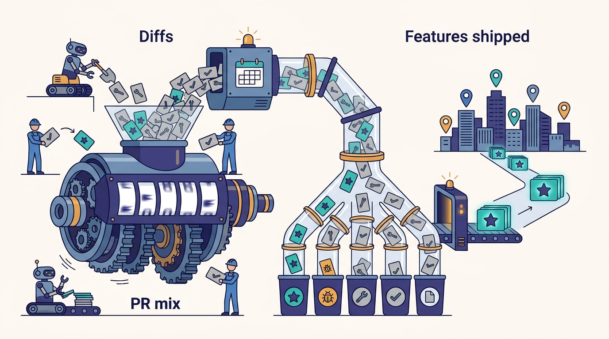
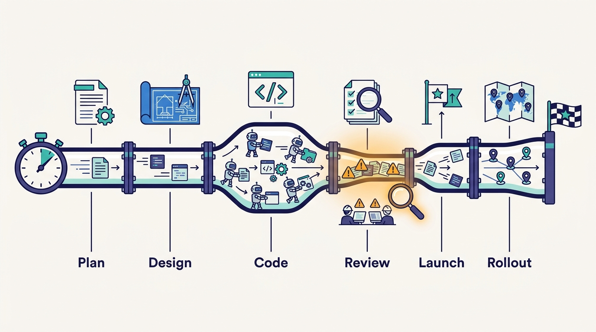

> **IN THIS CHAPTER, YOU WILL:** See why Uber's pre-AI productivity metrics stopped working once agents started writing code, and follow the replacement it described: PR tagging by type and complexity, a feature-level cycle time reconstructed from planning documents, and a search for the slowest phase of the feature path.

> **WHY IT MATTERS:** Every AI tooling budget eventually meets the question "what did we get for it?" A PR count answers that question badly, and at agent volumes it starts to measure the agents. An organization that cannot measure features cannot tell an AI investment that ships product from one that only produces diffs.

> **KEY POINTS:**
>
> * **Diff counts measure activity, and agents make activity cheap.** When a background agent can open a PR from a Slack thread and a weekly maintenance loop opens PRs on its own, diffs per engineer measure the agents, not the value delivered. Uber says it moved its North Star from diff velocity to **feature velocity**.
> * **The first instrument is a PR mix, the second is a feature clock.** Uber tags every PR by type (feature, bug fix, maintenance, testing, documentation) and complexity and watches the mix shift. It then reconstructs the link from product spec to engineering design to task to PR, filling missing links with AI clustering, to compute a **P50 feature time** per complexity class per half.
> * **The point of the feature clock is to find the next bottleneck, not to rank people.** A feature-level timeline shows whether time goes into the product document, the code, the review, the launch or the rollout. That is where the next platform investment should go, and it is useless as a performance score for individuals.

> **BUILT ON:** a decade of engineering-metrics practice (the 2017 Eng Metrics Dashboard, regular developer-experience surveys), the planning and design-doc hub that holds PRDs and ERDs with Jira and Linear links ([[plans-as-source-of-truth]]), the context graph that joins people, PRs and documents ([[context-graph]]), and the uniform PR flow through one review and CI path ([[monorepos-and-one-build]], [[code-review-signals]])

 
For most of the last decade the cheapest signal of engineering output was the diff. It was countable, it was attributable to a person and a team, and it correlated, loosely, with work getting done. Uber, like many companies, used it: an engineering-metrics dashboard showing diff counts existed from around 2017, and by 2020 leadership was looking at weekly diffs per engineer.

Agents broke that correlation. In the October 2026 Pragmatic Engineer episode, Uday Kiran Medisetty, an Uber Distinguished Engineer, said about 15% of Uber's production PRs now go through Minion, its background coding agent; an Uber blog post from August 2026 says more than 70% of PRs are "attributed to local or cloud agents". When a PR can come from a Slack mention, a Sunday maintenance loop or a migration campaign, **the diff stops being a unit of human effort**. It becomes a unit of machine output, and machine output is something you buy with tokens.

Medisetty's framing of the replacement was short: Uber is "internally talking about not necessarily just diff velocity, but feature velocity." This chapter takes that phrase apart. It covers what Uber measured before AI and why it broke, the two instruments Uber described (a PR mix and a feature clock), what they depend on, and what a company without Uber's planning data should do instead. It does not cover token cost per se, which [[token-spend-governance]] owns, or the changing shape of the engineer's day, which [[the-engineer-as-context-builder]] owns.

## The Problem Uber Had: Metrics Built for Expensive Diffs

### What Uber measured before AI

Medisetty listed the pre-AI set in the episode: code throughput (which he called the easy ones), developer-experience surveys every few months, net promoter score (NPS) and sentiment across dimensions, and code-quality measures such as incidents per diff and code coverage. That list is broader than diff counting, and the public record fills in its history.

| Instrument | What the record shows | Source |
| --- | --- | --- |
| **Eng Metrics Dashboard** | A first version around 2017 showed org-level diff counts to directors and above; by 2020 leadership looked at weekly diffs per engineer; one org encouraged 4–5 diffs per engineer per week; the CEO showed the dashboard (diff counts and focus time) at an all-hands in August 2022 | Pragmatic Engineer, 2022 |
| **Diffs per engineer as a manager signal** | Gergely Orosz, the host and a former Uber manager, recalled that managers looked at diffs per engineer until he left in 2020, mainly to notice someone who had not contributed for weeks or who did many reviews | Episode, host's recollection |
| **Developer surveys and NPS** | Uber's developer tooling NPS rose from −50 to +8 over the developer-experience program, per Gautam Korlam | Pragmatic Engineer, 2025 |
| **Quality per change** | Incidents per diff and coverage, alongside throughput | Episode |

These are reasonable metrics for a world where a diff costs an engineer hours. In that world, diff count is a noisy proxy for effort, effort is a noisy proxy for output, and surveys catch what the counts miss. The proxies hold because the cost of a diff is roughly constant and is paid by a person.

### Why the diff stopped meaning anything

Three changes broke the proxy chain at once, and Uber's own numbers show all three.

1. **Volume became cheap.** An Uber talk at AI Engineer World's Fair 2026 said lines of code per engineer roughly doubled year over year. Medisetty said PR volume rose year over year and CI jobs "doubled or more than doubled" in twelve months, enough to trigger an internal CI "code red" ([[inner-loop-and-self-healing-ci]]).
2. **Authorship blurred.** Uber's public figures for the agent share of work range from about 10% of committed code (the CEO on an earnings call, reported by Fortune in May 2026) through 11% of merged PRs (an Uber talk, May 2026) and about 15% of production PRs through Minion (episode, October 2026) to more than 70% "attributed to agents" (Uber blog, August 2026). These are not contradictions. They count different things: autonomous authorship versus any agent involvement. Either way, a per-engineer diff count now includes work the engineer delegated, steered or merely approved.
3. **The mix changed.** Background agents, the Shepherd migration platform and the Fox maintenance loop ([[minion]], [[shepherd-and-fox]]) produce large numbers of small, low-risk PRs. One Uber migration alone, JUnit 4 to JUnit 5, went through more than 5,000 diffs in about four months (Uber blog, April 2026). Those diffs are valuable maintenance, but they say nothing about how fast Uber ships features to riders, eaters and earners.

Medisetty put the consequence plainly: "You can create 100 diffs, but if they are not all feature diffs, then maybe it's not necessarily increasing the value that we can provide to the users."

**Figure 1:** *Diff counts measure activity, and agents make activity cheap; Uber's answer was to tag every PR by type and complexity and to make feature velocity, not diff velocity, the North Star.*

There is a fourth, organizational problem. Uber spent heavily on AI tooling in 2026: press reports in May said it used its whole 2026 AI-tools budget within about four months, and its chief operating officer, Andrew Macdonald, said of the link between AI spend and consumer features, "That link is not there yet" (Fortune, May 2026). **A spend line that grows faster than any output measure leadership trusts is a budget that gets cut.** Feature velocity is, among other things, Uber's attempt to give that link a number.

## What Uber Built: Two Instruments and a Search for Bottlenecks

The episode and a 2026 talk by two Uber engineers at DX Annual (Ty Smith and Abhishek Tibrewal, April 2026; recapped by DX in June 2026) together describe a measurement approach in layers. The DX talk confirms the direction and the vocabulary; the mechanics of the feature clock come only from the episode.

---begin mermaid---
flowchart LR
    A["Adoption: who uses AI tools"] --> B["Engagement: how they use them"]
    B --> C["Causal impact: did AI cause the change"]
    C --> D["Agentic value: features delivered"]
    D --> E["North Star: feature velocity"]
    E --> F["Supporting: flow efficiency, quality, capability expansion"]
    X["Tried and dropped: developer-years saved"] -.->|"replacement anxiety, constant recalibration"| C
---end mermaid---

**Figure 2:** *The phases of Uber's AI-impact measurement as described at DX Annual 2026: from adoption to feature velocity, with "developer-years saved" tried and dropped along the way.*

### The road there: adoption, causality and a metric that failed

The DX recap describes a sequence that most companies will recognize. Uber started with qualitative work (surveys, interviews, experience sampling) before telemetry existed, and found that **behavioral questions ("what did you do") were more useful than perception questions ("was AI helpful")**. It then measured adoption and engagement from behavior rather than demographics; role, tenure and organization offered little signal, while behavior revealed an early group of power users with outsized results. It then hit the classic confound: the most productive engineers adopt new tools first, so heavy AI use correlating with high output proves nothing, and Uber turned to causal methods.

The instructive failure is **developer-years saved**. The speakers said it "sounded compelling but failed as an ROI metric": it created anxiety about replacement, needed constant recalibration, and did not answer the business questions leadership was actually asking. Uber kept time saved as context, not as the outcome. The same logic underlies uReview's published claim of about 39 developer-years saved per year (Uber blog, 2025), which assumes ten minutes saved per commit: a defensible estimate, but an estimate built on an assumption, not a measured outcome.

The recap's summary line is the chapter's thesis in six words: **"PRs measure activity, features measure value."** The talk named feature velocity as the new North Star, supported by flow efficiency, quality and "capability expansion" (the new kinds of work AI makes possible). The recap does not say how those supporting metrics are computed.

### Instrument one: the PR mix

Medisetty described tagging "all of our PRs" in two dimensions: a **type** (feature, bug fix, maintenance, testing, documentation) and a **complexity level**. The DX talk independently confirms classification by type and complexity. The podcast adds the trend: the share of feature PRs is going up and the share of maintenance PRs is going down, which Medisetty read as a sign that Uber is moving in the right direction.

Uber has not described how the tags are assigned. At Uber's volume (uReview alone covered tens of thousands of diffs in 2025), hand-tagging is implausible.

> **INFERENCE, NOT DOCUMENTED:** The tags are most plausibly assigned by a model reading the PR title, description, diff and linked task, with deterministic overrides for known sources (a Shepherd campaign PR is maintenance by construction; a PR that only touches test files is testing). Complexity could come from diff size, number of modules and services touched, and the complexity field of the linked design document. Uber has not published the classifier, its accuracy or how disagreements are handled.

The PR mix is valuable because it is cheap, it works on every PR, and it does not depend on planning data. Its weakness is that it is a ratio. A rising feature share can mean more feature work, or the same feature work with maintenance moved elsewhere. Medisetty also said Fox analyzes maintenance-category PRs to decide which classes of work to automate next ([[shepherd-and-fox]]); as that automation succeeds, maintenance PRs either disappear (the debt is gone) or move to bot authors. **Whether bot-authored maintenance PRs count in the mix changes what the trend means**, and Uber has not said which way it counts them.

### Instrument two: the feature clock

The second instrument is the one that justifies the name. Medisetty described it in three steps.

1. **Trace each feature.** Uber's planning and design-doc tool holds product requirements documents (PRDs), engineering requirements or design documents (ERDs), launch reviews, experiment reviews and production-readiness reviews, each with status, owners, approvals and a Jira or Linear link ([[plans-as-source-of-truth]]). In principle that gives a chain: PRD → ERD → tasks → PRs → launch.
2. **Repair the trace with AI.** In practice, he said, the tracing from product design doc to engineering design doc to task is often incomplete. Uber uses AI to cluster these artifacts automatically and tag the missing links, so that a PR with no task link, or a task with no design doc, can still be assigned to a feature.
3. **Compute and slice.** With the chains rebuilt, Uber computes the **P50 feature time** for each complexity class for every half over the last two to three years, and breaks it down by phase to ask whether the bottleneck sits in the PRD phase, the launch phase or the rollout phase.

---begin mermaid---
flowchart LR
    PRD["PRD: product requirements"] --> ERD["ERD: engineering design"]
    ERD --> T["Jira or Linear tasks"]
    T --> PR["PRs tagged by type and complexity"]
    PR --> L["Launch and experiment review"]
    L --> R["Rollout across cities"]
    AI["AI clustering"] -.->|"fills missing links"| ERD
    AI -.->|"fills missing links"| T
    AI -.->|"assigns orphan PRs"| PR
    R --> M["P50 feature time per complexity class per half"]
    M --> B["Phase breakdown: where does the time go"]
---end mermaid---

**Figure 3:** *The feature clock as Medisetty described it: planning artifacts and PRs are joined into one chain per feature, AI clustering repairs missing links, and the result is a median feature time per complexity class that can be split by phase.*

The phase breakdown is what makes this more than a dashboard. Medisetty framed the whole AI program as a bottleneck hunt, constantly finding the next bottleneck and removing it, because "ultimately our goal is to maximize the number of features that we can ship." A diff count can only say that code is being written faster. A feature clock split by phase can say that code is no longer the slow part. If agents halve the time from ERD to merged PR while the time from PRD approval to ERD approval and from launch review to full rollout stays the same, the median feature time barely moves, and the clock tells you where to look next.

**Figure 4:** *A diff count can only say that code is written faster; a feature clock split by phase can show where the time now goes, which is where the next platform investment belongs, not a score for ranking individuals.*

That has a direct consequence for a company like Uber. Rollout is not a single deploy: features ship through experiments, per city and per country ([[build-what-does-not-exist]]), with multi-sided marketplace effects. Medisetty stressed elsewhere in the episode that product and country heterogeneity and operations in the physical world make planning matter more ([[plans-as-source-of-truth]]). It is plausible that in such a business the planning and rollout phases dominate feature time once coding speeds up. The feature clock is the instrument that would show it.

### Capability overhang: why the target keeps moving

Medisetty also used the term **capability overhang**: "there's so many things that we could leverage the latest models for, but we don't have the sufficient orchestrating capabilities or the harnesses or the tools around that." The term circulates in AI discussion for latent model ability that current tooling does not elicit. In measurement terms it means the bottleneck is often not the model but the system around it, and the next investment is a harness, a tool or a validation loop, not a model upgrade. That is the feature clock's job: to say which.

### Cost as a companion metric

Uber's August 2026 blog post, written by Medisetty, adds the cost side. For managed agents it tracks **outcome-based costs**, naming "cost per merged PR", "cost per review", "cost per alert" and "cost per cleanup", and pairs each with a quality signal (revert rate, F1 score for review, mean time to recovery) and a volume signal (diffs landed, reviews posted, alerts triaged). It does not give values. The structure matters more than the numbers: **every cost metric is paired with a quality metric and a volume metric**, so a cheaper agent that produces worse PRs shows up as a regression rather than a saving. Spend tiers and the cost dashboards belong to [[token-spend-governance]].

## The Foundation Underneath

The feature clock looks like an analytics project. It is really a data-quality project, and almost all of the data comes from pre-AI investments.

| Input the feature clock needs | Where it comes from at Uber | Why it would be hard without it |
| --- | --- | --- |
| A canonical record of each feature's plan | The planning and design-doc hub: PRDs, ERDs, launch, experiment and readiness reviews in one place, with status and approvals ([[plans-as-source-of-truth]]) | Without one home for plans, there is no "start" timestamp and no unit called a feature |
| Links from plans to execution | Jira and Linear links on each document | Tasks and PRs float free of the feature they serve |
| Joins across people, PRs, documents and launches | The context graph, which already holds PRs, design docs, features and config changes as nodes ([[context-graph]]) | Every join is a bespoke data pipeline |
| One PR path with comparable timestamps | Per-language monorepos, one build and one review flow ([[monorepos-and-one-build]]); Code Inbox ([[code-review-signals]]) | Cycle times from many repos and tools are not comparable |
| Rollout and experiment events | Plausibly the Morpheus experimentation platform and per-city rollout infrastructure; Uber has not said which rollout data the clock uses ([[build-what-does-not-exist]]) | "Done" means "merged", which is the wrong end point |
| A measurement culture | The Eng Metrics Dashboard from about 2017, regular developer surveys, developer NPS | No baseline to compare against, and no trust in the numbers |

Medisetty named the design-doc hub, its Jira and Linear links and the graph that receives its data; the other rows are a plausible reading of what such a clock needs, not a documented architecture. The last row is easy to underrate. Uber has been working with engineering metrics for most of a decade, including a 2022 all-hands at which the CEO showed diff counts, which *The Pragmatic Engineer* covered in detail at the time. That history is why it could say, as the DX talk did, that "teams should expect their metrics to break", and replace one without a crisis.

The context graph row is where the AI era loops back on itself. Uber built the graph so agents could ground themselves in the company's systems in fewer turns. The same graph, with PRs, design docs and features as nodes, is the substrate that makes a feature-level join feasible. **The infrastructure that makes agents effective is also the infrastructure that makes their effect measurable.**

## Design Choices and Trade-offs

| Choice | Alternative | When Uber's choice is right | When the alternative is right |
| --- | --- | --- | --- |
| **Feature velocity as North Star** | DORA delivery metrics (deployment frequency, lead time for changes, change failure rate, recovery time) | When the question is product value and features are traceable units | When features are not well defined (platform teams, infrastructure) or the immediate problem is delivery stability |
| **PR mix by type and complexity** | Raw PR or line counts | Always, once agents author a meaningful share of PRs | Never as the main metric; raw counts remain useful for capacity planning (CI, review load) |
| **AI-reconstructed traces** | Mandating links at creation time (every PR must cite a task, every task a design doc) | When historical data matters and enforcement would slow people down | When starting fresh: enforcing links is cheaper than repairing them, and more accurate |
| **Median (P50) per complexity class** | Mean, or P90 | P50 resists outliers and per-class comparison avoids mix effects | P90 when the problem is the long tail of stuck features |
| **Per half, two to three years back** | Weekly or monthly dashboards | Feature times are long; halves smooth noise and match planning cycles | Faster cadence only for leading indicators (review latency, CI wait) |
| **Outcome cost (cost per merged PR) paired with quality** | Token spend per engineer | For managed agents with a clear unit of output | Per-engineer spend for interactive tools where the output is diffuse |
| **Dropping developer-years saved** | Reporting time saved as ROI | Always as an outcome metric | As one input to a business case, labeled as an estimate |

Two of these deserve a comment. First, feature velocity is **not a replacement for DORA's delivery metrics**; it sits above them. DORA's 2025 report found AI adoption now correlates positively with throughput but still negatively with delivery stability. A company that measures only feature velocity can ship features faster while incidents rise. Uber's pairing of cost with revert rate and mean time to recovery is the right instinct: put a stability metric next to every speed metric.

Second, **trace repair by AI is a tool for history, not a substitute for discipline**. It lets Uber compute two to three years of feature times without asking anyone to relabel old work. Going forward, a system that requires the link when the PR is opened, with the agent filling it in from the session's context, produces better data than one that guesses afterward.

## Elsewhere in the Industry

**SPACE and DevEx: frameworks that already rejected single metrics.** The SPACE framework (Forsgren, Storey and colleagues, *ACM Queue*, 2021) argued that developer productivity cannot be captured by one metric and needs several dimensions; the commonly cited five are satisfaction, performance, activity, communication and efficiency. The DevEx framework (Noda, Storey, Forsgren and Greiler, 2023) centered developer experience on feedback loops, cognitive load and flow state. Uber's shift is consistent with both: the PR count is SPACE's "activity" dimension, and the papers warned against reading it alone. **What agents change is not the theory but the cost of ignoring it.** A pre-AI organization that over-weighted activity got distorted incentives; an AI-era one that does so gets a dashboard that rises with token spend.

**DX Core 4: the practical synthesis.** The DX Core 4 (Noda, Tacho, Storey and Greiler; DX, current page) groups metrics into speed, effectiveness, quality and business impact, and positions itself as a unification of DORA, SPACE and DevEx. Uber's set maps onto it closely: feature velocity is speed tied to business impact, flow efficiency is effectiveness, and revert rate and incidents per diff are quality. It is the nearest thing to an off-the-shelf version of what Uber built.

**METR: why self-reports and diff counts both mislead.** METR's randomized trial (July 2025) found that 16 experienced open-source developers, working on 246 real issues, took 19% longer when AI was allowed, while expecting a 24% speedup beforehand and still believing in a 20% one afterwards. Its February 2026 update reported that a larger follow-up (57 developers, 800+ tasks) was too compromised by selection effects to trust: developers increasingly refused to work without AI, withheld tasks they did not want to do by hand, and could not track time reliably while agents ran in parallel. The point estimates had moved toward speedups (18% less time for returning developers, 4% for new ones), with confidence intervals that included no effect; METR now marks the 2025 results as out of date. **The lesson for measurement is twofold: perceived speedup is not evidence, and controlled experiments get harder as AI becomes the default.** That pushes organizations toward outcome measures in their own data, which is where Uber went.

**Faros AI and Meta: what rising volume does downstream.** Faros AI's 2025 telemetry from more than 10,000 engineers found that with high AI adoption, PR review time rose 91% and average PR size rose 154% (correlational). Meta's RADAR paper (arXiv, 2026) reported lines per human-landed diff up about 106% year over year and per-developer diff volume up 51%, with agentic AI behind more than 80% of that growth. Both describe the same symptom as Uber's CI code red: output metrics rise and the cost lands in review and CI. Both make the case for measuring at the feature level, where review and CI time are part of the clock rather than invisible.

## If You Are Not Uber

You almost certainly do not have a decade of design docs in one tool, linked to tasks, linked to PRs, joined in a graph. You do not need all of it to get most of the value.

**The minimum viable version** is three things: a PR type tag, a feature identifier on PRs and a stability metric next to each speed metric.

1. **Tag PR type and complexity.** Use a small model in CI to classify each PR into four or five types and three complexity levels, with deterministic rules first (bot author, test-only change, docs-only change, dependency bump). Spot-check a sample each month. This is a week of work.
2. **Require a feature or epic key on every PR going forward**, and let agents fill it in from the task they were given. Do not try to repair history until the forward data works.
3. **Pick a start and an end for a feature** that your organization agrees on. "Spec approved" to "100% rolled out" is the useful span; "first commit" to "merged" is the misleading one.
4. **Report P50 feature time per complexity class per quarter**, with change failure rate and incidents next to it.

| Company size | Measure this | Data you need | Buy, build or skip |
| --- | --- | --- | --- |
| **≈50 engineers** | PR type mix monthly; a hand-maintained list of shipped features with start and end dates; incidents | Git host, issue tracker, a spreadsheet | Skip platforms; a quarterly review of 20 features by hand beats any dashboard |
| **≈500 engineers** | PR type and complexity tags; feature key on PRs; P50 feature time per class per quarter; DORA stability metrics; developer survey twice a year | Issue tracker epics as features; CI classifier; survey tool | Buy a developer-productivity platform (DX, LinearB, Faros, Jellyfish or similar) for the joins; build only the classifier |
| **≈5,000 engineers** | All of the above plus phase breakdown (plan, build, review, launch, rollout), outcome cost per managed agent, causal studies of tool rollouts | Design-doc system as the source of features; rollout and experiment events; a graph or warehouse joining them | Build the trace and phase model on your own warehouse or graph; buy survey and benchmarking |

**Prerequisites that matter more than the dashboard:**

- **A definition of "feature" that product and engineering share.** If planning documents do not exist for most features, the feature clock measures your documentation habits.
- **Rollout data.** If "done" means merged, you will discover that coding got faster and conclude that features did too.
- **An agreement on what the metric is for.** Uber framed it as a bottleneck hunt; that framing is what keeps it honest.

**What not to copy:**

- **Do not publish per-engineer feature counts.** Feature velocity is an organizational metric. Applied to individuals, it rewards splitting features, avoiding hard ones and gaming tags.
- **Do not use developer-years saved as ROI.** Uber tried it and dropped it, for reasons that apply everywhere.
- **Do not treat "feature share up, maintenance share down" as success on its own.** Check whether maintenance moved to bots, whether incident rates held, and whether the debt is actually shrinking.
- **Do not build AI trace repair before you have tried enforcement.** It solves Uber's history problem, which you may not have.

The rule I would use: **measure the feature path end to end before you buy the next agent.** If coding is already not the slowest phase, a faster coding agent will not move the number that matters.

## Failure Modes

- **Goodhart on the tags.** Once feature share is a target, PRs get labeled "feature". A classifier that relies on author-written descriptions is easy to steer. Use the diff and the linked spec, and audit samples.
- **The mix illusion.** Feature share rises because maintenance moved to a bot account excluded from the denominator, or because large features were split into many feature PRs. Report absolute counts next to ratios.
- **Measuring the documented minority.** If only well-run teams write PRDs and ERDs, the feature clock covers them and not the rest. AI clustering fills gaps, but its accuracy is unpublished; measure coverage (share of merged PRs assigned to a feature) and report it with the metric.
- **Complexity drift.** If the complexity classifier drifts, or teams learn that "high complexity" buys time, per-class medians become incomparable across halves. Freeze the rubric, version it and re-score history when it changes.
- **Speed without stability.** Feature time falls while change failure rate rises, as DORA 2025 found across the industry. Without a paired stability metric, the program looks successful until the incident review.
- **A bottleneck the metric cannot see.** Work that never becomes a feature (platform work, reliability, security) disappears from the North Star. Platform teams need their own outcome measures, or they will be starved.
- **Using the clock to rank teams.** Teams with physical-world launches, regulatory reviews or multi-country rollouts will always look slower. Compare a team with its own history, not with its neighbors.

## What the Record Does Not Say

- **How PRs are classified.** Uber has not described the classifier, the complexity rubric, its accuracy or who resolves disputes.
- **How bot-authored PRs are counted** in the type mix, and whether Minion PRs initiated by a human count as that human's.
- **Any feature-time numbers.** The episode describes P50 feature time per class per half but gives no values, no trend and no phase breakdown. The DX recap gives no numbers either.
- **The accuracy of AI trace repair**: what share of PRs it assigns to features, and how often a human would disagree.
- **How "flow efficiency", "quality" and "capability expansion" are computed**, beyond their names in the DX talk.
- **Whether feature velocity informs budgets or headcount**, or is used only to direct platform investment.
- **Which phase turned out to be the bottleneck.** Medisetty named PRD, launch and rollout as candidates; Uber has not said what it found.

## Questions to Ask

1. What share of our merged PRs today are authored or substantially written by agents, and do our productivity dashboards distinguish them?
2. If our PR count doubled next quarter, which of our current metrics would improve without anything getting better for users?
3. Do product and engineering agree on what a "feature" is and where it starts and ends? Is there a system of record for it?
4. What fraction of merged PRs could we assign to a feature today? What would it take to reach 90% going forward?
5. Which phase of our feature path is slowest: planning, building, review, launch or rollout? How do we know?
6. What stability metric sits next to each speed metric we report?
7. Are we reporting time saved or developer-years saved as ROI? What decision would change if that number were wrong by half?
8. Who is allowed to see per-person versions of these metrics, and what are they used for?
9. If maintenance PRs move to bots, how will we know whether technical debt is going down or just changing authors?

The feature clock tells an organization where the time goes. It does not say what the engineers in the middle of it now do all day. Medisetty's answer to that, that the job has become building the context, specs and verification that let agents produce reliable work, is the subject of [[the-engineer-as-context-builder]].

## Sources and Evidence

### The source episode

- [Uber's AI infra, from the inside](https://newsletter.pragmaticengineer.com/p/ubers-ai-infra-from-the-inside) — *The Pragmatic Engineer* podcast, Gergely Orosz with Uday Kiran Medisetty, 2026. Pre-AI metrics, diff to feature velocity, PR tagging by type and complexity, feature and maintenance share trends, AI trace repair, P50 feature time per half, bottleneck phases, capability overhang, ~15% of production PRs via Minion, CI jobs doubling; show notes summarize the PR tagging.

### Uber engineering sources

- [Running a Software Factory Efficiently at Uber Scale](https://www.uber.com/us/en/blog/efficient-software-factory/) — Uber blog, Uday Kiran Medisetty, 2026. More than 70% of PRs attributed to agents; outcome-based cost metrics paired with quality and volume signals.
- [Uber's Journey of Measuring AI Impact on Developer Productivity](https://getdx.com/dxannual/2026/sessions/measuring-ai-impact/) — DX Annual talk, Ty Smith and Abhishek Tibrewal (Uber), 2026; recap: [Uber's journey of measuring AI impact](https://newsletter.getdx.com/p/ubers-journey-of-measuring-ai-impact), DX, 2026. Measurement phases, developer-years saved dropped, feature velocity as North Star, PR classification by type and complexity.
- [Inside Uber's agent-ready platform behind 11% of merged PRs](https://background-agents.com/summit/sessions/nikhil-ramakrishnan/) — Background Agents Summit, Nikhil Ramakrishnan (Uber), 2026. 11% of merged PRs from agents.
- [Agentic SDLC at Uber: Building Blocks for Uber's Software Factory](https://ai.engineer/talks/17-YSUHo6Lk-agentic-sdlc-at-uber-building-blocks-ubers) — AI Engineer World's Fair talk, Medisetty and Adam Huda, 2026. Lines of code per engineer roughly doubled year over year.
- [How Uber Executed A JUnit Migration at Massive Scale](https://www.uber.com/blog/junit-migration/) — Uber blog, Anshuman Mishra and Kaushik Vejju, 2026. 5,000+ diffs in about four months as an example of maintenance volume.
- [uReview: Scalable, Trustworthy GenAI for Code Review at Uber](https://www.uber.com/blog/ureview/) — Uber blog, 2025. Time-saved estimate built on a per-commit assumption.
- [How Uber is Measuring Engineering Productivity](https://newsletter.pragmaticengineer.com/p/uber-eng-productivity) — *The Pragmatic Engineer*, Gergely Orosz, 2022. Eng Metrics Dashboard history and diff-count norms (system may have changed since).
- [Developer Experience at Uber with Gautam Korlam](https://newsletter.pragmaticengineer.com/p/developer-experience-at-uber) — *The Pragmatic Engineer*, 2025. Developer tooling NPS from −50 to +8.
- [Uber's COO says it's getting harder to justify AI spend](https://www.fortune.com/2026/05/26/uber-coo-ai-spending-tokens-claude-code/) — Fortune, Jake Angelo, 2026. AI-tools budget exhausted in about four months; "That link is not there yet."

### Industry and research sources

- [The SPACE of Developer Productivity](https://www.microsoft.com/en-us/research/publication/the-space-of-developer-productivity-theres-more-to-it-than-you-think/) — Forsgren, Storey, Maddila, Zimmermann, Houck and Butler, *ACM Queue*, 2021. Productivity needs several dimensions.
- [DevEx: What Actually Drives Productivity](https://getdx.com/research/devex-what-actually-drives-productivity/) — Noda, Storey, Forsgren and Greiler, 2023. Feedback loops, cognitive load and flow.
- [Measuring developer productivity with the DX Core 4](https://getdx.com/research/measuring-developer-productivity-with-the-dx-core-4/) — Noda, Tacho, Storey and Greiler, DX, 2026 (page date). Speed, effectiveness, quality and business impact.
- [Measuring the Impact of Early-2025 AI on Experienced Open-Source Developer Productivity](https://metr.org/blog/2025-07-10-early-2025-ai-experienced-os-dev-study/) — METR, 2025. 16 developers, 246 issues; 19% slower with AI, believed 20% faster (page now marked out of date).
- [We are Changing our Developer Productivity Experiment Design](https://metr.org/blog/2026-02-24-uplift-update/) — METR, 2026. 57 developers, 800+ tasks; point estimates −18% and −4% time with confidence intervals spanning zero; selection effects and unreliable time tracking with parallel agents.
- [Announcing the 2025 DORA Report](https://cloud.google.com/blog/products/ai-machine-learning/announcing-the-2025-dora-report) — Google Cloud, Nathen Harvey and Derek DeBellis, 2025. AI correlates with throughput and still negatively with stability.
- [The AI Productivity Paradox Report 2025](https://www.faros.ai/blog/ai-software-engineering) — Faros AI, 2025. Review time +91% and PR size +154% with high AI adoption.
- [Automating Low-Risk Code Review at Meta (RADAR)](https://arxiv.org/abs/2605.30208) — Adams et al., arXiv, 2026. Lines per human-landed diff and per-developer diff volume growth driven by agentic AI.

Statements about Uber's AI-era systems are Uber's own account unless another source is cited; recommendations and labeled inferences are the author's judgement.
