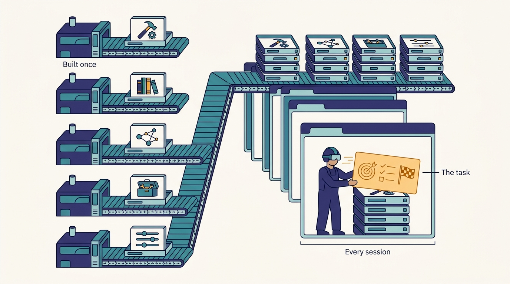
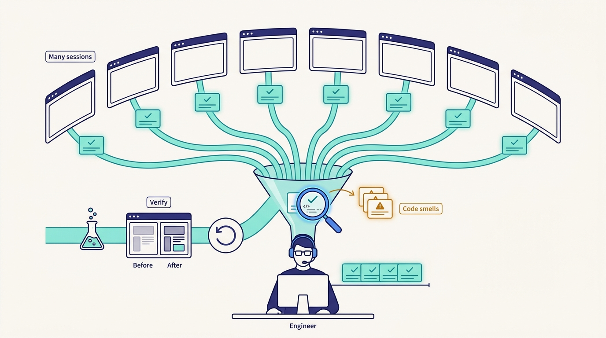

> **IN THIS CHAPTER, YOU WILL:** Take apart Medisetty's account of how an engineer's work at Uber changed in 2025–2026 into four skills (context engineering, specs and constraints, multitasking across sessions, verification), follow his customer-support policy example of the shift from doing work to building systems that do it, and weigh the risks of review fatigue and deskilling.

> **WHY IT MATTERS:** Tooling budgets assume engineers know how to use agents well. Most organizations hire, train, level and review engineers for a job that is changing underneath them. The platform can supply context and verification at scale, but only if leaders know which parts of the new job belong to the platform and which belong to the person.

> **KEY POINTS:**
>
> * **The job is now building the right context for agents.** Medisetty described engineering as working out "how do you build the right context for the agents to produce reliable output": what an agent needs to know, which environment it needs, and which specs and constraints bound the work. At Uber, much of that context is supplied by platforms (skills, the context graph, the design-doc hub), so the individual's share is the task-specific part.
> * **Parallelism moves the bottleneck from writing to scoping and verifying.** Engineers now run many sessions at once. The skills that matter are scoping work so an agent can finish it, tracking it, and verifying it fast enough to catch code smells before they ship. Verification capacity, not generation capacity, sets an engineer's real throughput.
> * **The meta-shift is from building software to building systems that build and verify it.** Uber's customer-support example turned a weeks-long manual conversion of runbooks into agent policies into an agent-drafted, synthetically evaluated pipeline with human checkpoints. The risk side is real: review fatigue, eroding skills and a growing gap between what the code does and what the team understands.

> **BUILT ON:** the per-language monorepos and one build command that let an AGENTS.md or CLAUDE.md work out of the box ([[monorepos-and-one-build]]), DevPods and the mega DevPod for parallel sessions ([[devpods]]), the skills monorepo and context graph as shared context ([[skills-monorepo]], [[context-graph]]), the design-doc hub as the home of specs ([[plans-as-source-of-truth]]), and Slate, Capri and Code Inbox as verification infrastructure ([[slate]], [[capri]], [[code-review-signals]])

 
Near the end of the October 2026 Pragmatic Engineer episode, Gergely Orosz asked Uday Kiran Medisetty whether software engineering was still the same job. Medisetty, an Uber Distinguished Engineer who joined in 2015, answered that in his whole tenure "there's never been this much change to how I work." Uber expects even Distinguished Engineers to be hands-on and to create PRs. He said his own definition of hands-on had changed year over year, that he was doing far more PRs than the year before, and that he could explore far more ideas than he could in the past.

The rest of his answer, whose central line the show notes quote, describes the job: the job of engineering is how to build the right context for agents to produce reliable output, plus specs and constraints, multitasking across sessions, and fast verification. **The passage reads like a list of soft skills. It is better read as a job description that the rest of Uber's AI infrastructure was built to support.**

This chapter does three things with it. It separates the four skills and shows which parts Uber's platforms do for the engineer and which parts remain the engineer's. It follows the one worked example Medisetty gave, from customer support, of the deeper shift underneath: from doing work to designing the system that does it. And it takes the risks seriously, because the same research that confirms the shift also shows what it costs. It does not re-measure productivity; [[feature-velocity]] owns that.

## The Problem Uber Had: A Job Description Written for Expensive Code

For most of software engineering's history, writing code was the slow, scarce part of an engineer's day. Everything around it (the design review, the code review, the test plan, the on-call runbook) was sized to that scarcity. An engineer worked on one change at a time because the change took hours or days, and the context for it lived in their head.

Three things at Uber changed that in 2025–2026, by Uber's own account.

- **Generation became cheap and parallel.** Engineers use interactive harnesses (Claude Code, Codex, OpenCode, wrapped by AIFX, [[aifx-harness-layer]]) on DevPods that start in seconds, and hand longer tasks to Minion, the background agent, which Medisetty said now handles about 15% of production PRs ([[minion]]). Starting a new piece of work costs a Slack message.
- **The bottleneck moved downstream.** Medisetty said review had become a big bottleneck, as at any other company, and CI jobs more than doubled in a year ([[inner-loop-and-self-healing-ci]], [[code-review-signals]]).
- **Context, not code, became the scarce input.** Uber's trace analysis of agent sessions found agents spent many turns just getting grounded across siloed systems, which is why it built Cortana and the context graph ([[context-graph]]). An agent with the wrong context produces plausible, wrong work faster than a person can read it.

The question for Uber, and for any company that follows, is what an engineer is for when the typing is cheap.

## What Uber Described: Four Skills of the New Job

Medisetty named the skills in one breath. Separated, they form a loop.

---begin mermaid---
flowchart LR
    C["Build context: what would the agent need to know"] --> S["Write spec and constraints"]
    S --> E["Set up the environment: DevPod, skills, tools"]
    E --> D["Dispatch: interactive session or Minion"]
    D --> P["Run many sessions in parallel"]
    P --> V["Verify: tests, Slate, screenshots, code smells"]
    V -->|"wrong or out of scope"| C
    V -->|"good"| R["Human review and merge"]
---end mermaid---

**Figure 1:** *The engineer's loop as Medisetty described it: context, spec, environment, dispatch, parallel sessions and verification, with failed verification sending the engineer back to fix the context rather than the code.*

### 1. Context engineering

The central sentence is this one: "The job of engineering is, in some sense, how do you build the right context for the agents to produce reliable output?" Medisetty contrasted it with how he used to work: before, he operated with the context for a task in his own head; now he is always thinking about what context an agent would need if he offloaded a piece of work to it, and how to set up the environment with that context.

In this book, **context engineering** means the deliberate selection, construction and delivery of everything an agent sees while it works: instructions, task description, relevant code and documents, tool access, examples and the environment it runs in. Anthropic's applied-AI team defined the term in a 2025 engineering post as the step beyond prompt engineering. Because a model's attention is finite and recall degrades as context grows, the post argues for small, high-signal context, token-efficient tools and just-in-time retrieval.

The important move at Uber is that **most of the context is not built by the individual engineer**. It is built once, by platform teams, and delivered to every session:

| Layer of context | Who builds it at Uber | How it reaches the agent |
| --- | --- | --- |
| How to build and test any module | The monorepo and build teams, years before AI | One Bazel command per module, written in a top-level AGENTS.md or CLAUDE.md ([[monorepos-and-one-build]]) |
| Company know-how (how to use Slate, how to write an ERD, how to clean dead code) | Platform and domain teams | Skills in the skills monorepo, ~30,000 executions a day per the episode ([[skills-monorepo]]) |
| Facts about the company (owners, PRs, incidents, configs, tables) | Built with help from the graph platform team, which runs Uber's production graph | The context graph, queried by the agent ([[context-graph]]) |
| Access to internal services and vendor tools | The API and Edge Gateway team | The MCP Gateway, increasingly projected as CLIs ([[mcp-gateway]]) |
| Defaults, plugins and settings | AI Foundations | AIFX personas and synced settings ([[aifx-harness-layer]]) |
| **The task itself: what to change, why, and what done looks like** | **The engineer** | The prompt, the spec, the Slack thread, the plan |

The last row is what is left for the person, and it is the hard row. Every other row is reusable across thousands of tasks. The task-specific context is not, and it is where an engineer's knowledge of the domain, the users and the system's history shows up.

**Figure 2:** *At Uber most of an agent's context is built once by platform teams and delivered to every session; what remains for the engineer is the hard, task-specific part: what to change, why, and what done looks like.*

### 2. Specs and constraints

Medisetty said engineers have to become very good at giving the right specs and constraints to agents, apart from building the context. The distinction matters. Context says what is true; a spec says what to do; **constraints say what not to do**: which files are out of scope, which interfaces must not change, which behavior must be preserved, when to stop and ask.

At Uber, specs for larger work live in the design-doc hub, which holds PRDs, ERDs and review records and feeds the context graph ([[plans-as-source-of-truth]]). Medisetty said that with Uber's product and country heterogeneity, and its operations in the physical world, planning corner cases up front matters more, and that a good plan makes it easy for engineers or agents to decompose and execute it. Minion's plan mode and its "follow this thread" hand-off from Slack are two ways a spec reaches an agent: one written for the agent, one assembled from a human conversation ([[minion]]).

Spotify's engineers reached the same conclusion independently. In the second post on Honk, their background coding agent (November 2025), they wrote that reliable, mergeable PRs depended on tailoring instructions to the agent, **saying when not to act**, giving concrete examples and defining verifiable goals.

### 3. Multitasking across sessions

The third skill is the one that changes the texture of the day. Medisetty said that before, creating a PR took so much time that an engineer stayed focused on that one change; now engineers switch constantly between many things, and have to get good at multitasking across all the sessions: how to scope the work, how to track it and how to verify it quickly.

Three sub-skills hide in that sentence.

- **Scoping.** A task sized for a person (a day of work, with judgment calls along the way) is often the wrong size for an agent. Agent-sized work is small enough to verify in one sitting and specified well enough to finish without steering.
- **Tracking.** With five or ten sessions running, the engineer needs a way to know which are waiting for input, which are done and which have gone off course. At Uber, Minion reports status in Slack and the web UI, and Code Inbox collects the PRs that need action ([[code-review-signals]]). The AIFX status line shows spend per session ([[token-spend-governance]]).
- **Infrastructure for parallelism.** Ten sessions need ten isolated workspaces. DevPods that start from warm pools in seconds, and the mega DevPod with all repositories, are what make parallel sessions cheap at Uber ([[devpods]]). On a laptop, parallel agents fight over one checkout, one build cache and one port range.

Parallelism has a measurement side effect worth noting. METR's February 2026 update on its developer-productivity study said time tracking had become unreliable for developers working on other tasks while agents ran. **The unit of work stopped being a person's contiguous hours**, which is one more reason [[feature-velocity]] measures features instead.

### 4. Verification and code smells

The fourth skill is the one Medisetty tied to production risk: "if you're not able to verify the work and pick any code smells from the agent, then … you're shipping some regressions into production." His summary was that context engineering, multitasking and the ability to review and verify outputs have all become much more important, because engineers can parallelize far more than before.

This is where the platform investment is heaviest, and where the book's thesis shows most clearly. Uber did not ask engineers to verify by reading harder. It built verification into the environment:

- `aifx validate` runs lint, coverage, build and template rules before a PR exists ([[inner-loop-and-self-healing-ci]]).
- Slate lets an agent deploy its branch to a short-lived environment and test it end to end, and agent-browser runs attach before-and-after screenshots and videos to the PR ([[slate]]).
- Capri replays captured production traffic against the change across the live combination set ([[capri]]).
- Code Inbox puts AI review, build checks and screenshots in front of the human reviewer, with a risk score and blast radius being added as of October 2026 ([[code-review-signals]]).

What is left for the person is judgment: whether the change does what was intended, whether it does it in a way the codebase can live with, and whether the agent quietly did something else as well. **Code smells are the human's part of verification**: duplicated logic, needless abstraction, error handling that swallows failures, a test that asserts what the code does rather than what it should do. Machines catch some of these; an experienced engineer catches the ones that matter for this codebase.

### The meta-shift: from building software to building systems that build it

Orosz summarized what he was hearing as a new primitive: engineers used to ask how to build and verify the software; now they ask how to set up an agent to build it and verify it. Medisetty agreed and gave the one extended example in this part of the episode, from customer support.

Uber is moving some customer-support policies from human agents to AI agents. The old conversion process, as he described it, was a chain of manual steps:

1. Start from a **runbook** that human support agents follow.
2. Convert it into a **policy** an AI agent can follow.
3. Work out the dynamic elements: **which APIs** to call for the data, **which attributes** to use.
4. **Configure** the system: change a set of configurations.
5. Run **manual evals** before launch.
6. Run **continuous evals** after launch.

That, he said, used to take weeks. In the last few months, the team captured the context and the principles for policy conversion and taught agents to do it: an agent drafts a good V0 policy, configuration and testing are automated, finding the right APIs and properties is automated, and instead of manual evals, the team uses past context to generate **synthetic evals** so the policy can be deployed and verified quickly. He said the right guardrails and human verification steps stay in between. He said the old process "used to take weeks"; the episode's auto-generated transcript breaks off before he gives the new duration, so this chapter states none.

---begin mermaid---
flowchart TB
    subgraph Before["Before: engineers do each step"]
        B1["Runbook for human agents"] --> B2["Hand-written AI policy"]
        B2 --> B3["Find APIs and attributes by hand"]
        B3 --> B4["Manual configuration"]
        B4 --> B5["Manual evals before launch"]
        B5 --> B6["Continuous evals after launch"]
    end
    subgraph After["After: engineers build the system that does the steps"]
        A1["Runbook plus captured principles"] --> A2["Agent drafts V0 policy"]
        A2 --> A3["Automated API, attribute and config setup"]
        A3 --> A4["Synthetic evals from past context"]
        A4 --> H["Human verification checkpoint"]
        H --> A5["Deploy and verify continuously"]
    end
    Before -->|"weeks of manual work"| After
---end mermaid---

**Figure 3:** *Medisetty's customer-support example: the engineer's work moves from performing each conversion step to capturing the principles, automating the steps and keeping human checkpoints, as described in the episode.*

The example is useful because it is not about coding. **The meta-shift applies to any repeatable expert workflow**: a migration, an incident triage, a policy conversion, a design review. The engineer's output stops being the artifact and becomes the pipeline: the captured principles, the tools, the evaluation and the checkpoints. Uber's other AI-era systems are the same move applied to engineering itself. Shepherd and Fox turn migrations and maintenance into campaigns and weekly loops ([[shepherd-and-fox]]); DebugAssist turns root-cause analysis into a managed agent ([[wisdom-and-debug-assist]]); the skills monorepo turns team know-how into reusable instructions ([[skills-monorepo]]).

Medisetty closed the episode on the same pattern from his personal life: he had been trying personal agents, and he follows the same process with them, giving the agent the context it needs, getting the inputs back, and keeping a human-in-the-loop verification step.

## The Foundation Underneath

The four skills sound like individual competencies. At Uber, each one leans on infrastructure that predates AI.

| Skill | What the engineer does | Pre-AI foundation that carries most of the load |
| --- | --- | --- |
| Context engineering | Supplies task-specific context | One build command per module (2017–18 monorepos, Bazel); ownership metadata (uOwn); typed IDLs in one registry; design docs in one hub ([[contracts-and-context-propagation]], [[monorepos-and-one-build]]) |
| Specs and constraints | Writes the plan and the boundaries | The design-doc and review culture: PRDs, ERDs, launch and readiness reviews ([[plans-as-source-of-truth]]) |
| Multitasking | Runs and tracks many sessions | DevPods, which grew out of the 2017–2018 monorepo move (the episode dates them to 2017), with warm pools and build caches ([[devpods]]) |
| Verification | Judges correctness and quality | Jaeger trace baggage and the service mesh behind Slate; standardized language frameworks behind Capri; SubmitQueue and a green main ([[slate]], [[capri]]) |

The pattern is the book's thesis in miniature ([[the-harness-is-the-easy-part]]). A company without one build command per module asks every engineer to explain the build to every agent session. A company without ephemeral environments asks engineers to verify by reading. **The skills Medisetty listed are achievable at Uber's scale because the platform does the generic part of each one**, leaving the engineer the part that requires knowing the task.

## Design Choices and Trade-offs

| Choice | Alternative | When the first is right | When the alternative is right |
| --- | --- | --- | --- |
| **Platform-supplied context** (skills, graph, AGENTS.md) | Each engineer curates their own prompts and notes | Once more than a few teams use agents; Thoughtworks rates curated shared instructions "Adopt" (2026) | Very small teams, or exploratory work where shared context does not exist yet |
| **Many parallel sessions** | One focused session at a time | Well-scoped, verifiable tasks (maintenance, small features, bug fixes) | Novel design work, unfamiliar code, anything where verification needs deep reading |
| **Hand-off to a background agent** (Minion) | Interactive harness with the engineer steering | Clear spec, minimal steering needed, self-validation tools available | The spec is unclear and will be discovered while working |
| **Machine verification first** (validate, Slate, Capri, AI review) | Human reads every line first | Always as the first gate: humans should review evidence, not raw output | Never as the only gate at Uber's incident cost; Uber still requires human review of every PR |
| **Building the workflow system** (the policy pipeline) | Doing the task by hand again | The task recurs, its principles can be written down, and evals can be generated | One-off work, or work whose correctness cannot be evaluated automatically |
| **Synthetic evals** | Manual evals by experts | Rich past data exists to generate realistic cases | High-stakes, low-data domains where synthetic cases miss the real failure modes |

The parallel-sessions row is the one most organizations get wrong. **Parallelism multiplies verification load, not just output.** An engineer who runs eight sessions has to verify eight results, and a verification that would take thirty minutes done carefully cannot be done eight times an hour. The right number of parallel sessions is set by how cheap verification is, which is set by the platform.

**Figure 4:** *Parallelism multiplies verification load, not just output: the right number of parallel sessions is set by how cheap verification is, and at Uber the platform's validate, preview and replay checks make it cheaper before the human looks for code smells.*

## Elsewhere in the Industry

**Anthropic: the paradox of supervision.** Anthropic's research team surveyed 132 of its engineers and researchers and interviewed 53 (published December 2025). Respondents reported using Claude in 59% of their work (the key findings round it to 60%), up from 28% a year earlier, and self-reported productivity gains of about 50%, mainly from greater output rather than faster tasks; 27% of Claude-assisted work would not have been done otherwise. Yet more than half said they could fully delegate only 0–20% of their work, because they supervise and validate the output. The authors named the tension the **"paradox of supervision"**: using AI well requires supervision, and supervision requires the very skills heavy AI use may erode. Some engineers reported practicing without AI to stay sharp; one said their work had become over 70% code review and revision. The data is self-reported from one AI company, but it matches Medisetty's account point for point: more output, more parallel work, verification as the core skill.

**Spotify: context engineering for background agents.** Spotify's Honk team (November and December 2025) moved complex migrations onto Claude Code and found that predictability came from context and feedback, not model choice: tailored instructions, explicit "do not act" cases, a deliberately small toolset (a verify tool, restricted Git, allowlisted Bash), deterministic verifiers before the PR and an LLM judge comparing the diff with the original prompt. That is the same split as Uber's: the engineer writes the task context, the platform supplies the verifiers.

**Thoughtworks: codebase cognitive debt.** The April 2026 Technology Radar placed "codebase cognitive debt" under Caution: the growing gap between how a system is built and what the team understands of its design, widened by AI-accelerated change. It is the organizational form of the deskilling risk. An engineer who verifies a change without understanding it adds to that debt with every merge.

## If You Are Not Uber

The four skills are learnable anywhere. The platform that makes them cheap is not. The minimum viable version is to give every engineer the generic context and verification for free, so their effort goes into the task-specific part.

**Sequence it like this:**

1. **Make the build and test path one command per repository**, and write it into AGENTS.md or CLAUDE.md. This single file is the highest-return piece of context engineering most companies can do.
2. **Curate shared instructions as an owned asset**: a small set of skills for the workflows every team repeats (writing a design doc, running the service locally, the review checklist). Give them an owner and a review path ([[skills-monorepo]]).
3. **Put specs where agents can read them.** A design doc in a wiki the agent cannot reach is not context.
4. **Give agents a way to verify before humans do**: a validate command, a preview environment, screenshots in the PR. Until this exists, cap parallel sessions; reviewers are the limit.
5. **Teach the four skills explicitly**, with examples from your own codebase: a good agent spec, a bad one, a verification checklist, a list of code smells your team has seen from agents.
6. **Pick one recurring expert workflow and turn it into a system**, the way Uber did with support policies. Choose one with past data for evals and a clear human checkpoint.

| Company size | Context | Parallel work | Verification | Role and skills |
| --- | --- | --- | --- | --- |
| **≈50 engineers** | One AGENTS.md per repo; a shared folder of prompts the tech leads curate | Two or three sessions per engineer, on git worktrees or a hosted agent | CI plus preview deploys; humans review every PR | Pair on agent specs in code review; no formal training |
| **≈500 engineers** | A small owned skills repository; design docs reachable by agents; an MCP or CLI layer for the top internal tools | Cloud workspaces or a hosted background agent; a cap on concurrent agent PRs per engineer | A validate command; ephemeral preview environments for the main services; AI review as first pass | A short internal course on specs and verification; agent-use examples in onboarding; expectations written into the career ladder |
| **≈5,000 engineers** | Platform-owned skills monorepo, context graph or catalog, tool gateway | Warm-pool workspaces, background agent platform, session tracking | Request-level test isolation, traffic replay, risk scoring in the review queue | Role definitions that name context engineering and verification; deliberate practice to preserve core skills; workflow-to-system programs |

**What not to copy:**

- **Do not measure engineers by sessions or PRs.** It rewards parallelism that outruns verification ([[feature-velocity]]).
- **Do not hand engineers parallel agents before you hand them verification.** You will move the bottleneck to review and call it a productivity gain.
- **Do not make context engineering every engineer's private craft.** If the same instruction is written in fifty personal prompt files, it belongs in a shared skill.
- **Do not drop the human checkpoints from workflow systems.** Uber's support example kept them, and Uber still reviews every PR.

The rule I would use: **an engineer should spend their attention on the context only they can supply and the judgment only they can make.** Everything else (how to build, how to test, where the docs are, whether the screens still render) is the platform's job, and every hour an engineer spends on it is an hour of platform debt.

## Failure Modes

- **Review fatigue.** Parallel sessions produce more PRs than a person can read carefully. Reviews degrade to skimming, and the code smells Medisetty warned about ship. The signal is a rising share of approvals with no comments, or approval times that fall while PR size rises.
- **Rubber-stamp verification.** The engineer checks that the tests pass, not that the tests test the right thing. Agent-written tests that assert current behavior make this worse.
- **Deskilling and the supervision paradox.** Engineers who stop writing code lose the fluency they need to judge agent code. Junior engineers who never wrote it do not develop it. Anthropic's study records the worry; Uber has not described how it addresses it.
- **Cognitive debt.** The codebase grows faster than the team's understanding of it. Incidents take longer to diagnose because nobody holds the design in their head.
- **Context rot.** Shared skills and AGENTS.md files go stale; agents follow outdated instructions confidently. Without an owner and a quality gate, shared context becomes shared misinformation.
- **Context hoarding.** The opposite failure: the best engineers' context lives in private prompt files, and the organization does not learn from it.
- **Systems that outlive their evals.** A workflow turned into a pipeline (the support-policy example) runs on synthetic evals generated from past data. When the world changes, the evals pass and the policy is wrong. Continuous evals after launch, which Uber kept, are the guard.
- **Switching cost hidden as productivity.** Constant context switching across sessions feels productive and erodes deep work. DevEx research names cognitive load and flow as core drivers of developer experience; parallel agents attack both.

## What the Record Does Not Say

- **How Uber trains engineers** in context engineering, specs or verification, if it does so formally.
- **Whether the career ladder or performance reviews changed** to reflect the new skills.
- **How junior engineers develop** the judgment that verification requires, or whether Uber has seen skill erosion.
- **How many parallel sessions** a typical Uber engineer runs, and whether any limit applies beyond spend tiers.
- **How long the customer-support conversion takes now** (the episode gives only the old figure, "weeks"), its eval coverage, or its error rate after launch.
- **How review fatigue is measured**, beyond the investment in Code Inbox signals.
- **Whether Medisetty's experience generalizes**: he is a Distinguished Engineer working on the AI platform itself, and his "more PRs than last year" is a personal account, not a company statistic.

## Questions to Ask

1. Which parts of the context an agent needs in our codebase could a platform team supply once for everyone? Who owns that today?
2. Can an agent build and test any module in our repositories with one documented command?
3. Where do our specs live, and can an agent read them?
4. How many parallel sessions can an engineer here verify well? What would make verification cheaper?
5. What evidence does a reviewer see before reading the diff, and what would they need to approve a low-risk change with confidence?
6. Which code smells do our agents produce most often, and are they written down anywhere a reviewer or agent can use?
7. How will engineers who started their careers with agents learn to judge code they did not write?
8. Which recurring expert workflow in our organization could be turned into an agent-run system with human checkpoints, and does it have the past data for evals?
9. Do our career ladder and performance reviews reward context building and verification, or still reward visible code output?

The four skills, and the platform under them, are the last piece of the case study. What remains is to turn the whole book into an order of operations for a company that has to build the foundations and the AI layer at the same time: [[the-retrofit-playbook]].

## Sources and Evidence

### The source episode

- [Uber's AI infra, from the inside](https://newsletter.pragmaticengineer.com/p/ubers-ai-infra-from-the-inside) — *The Pragmatic Engineer* podcast, Gergely Orosz with Uday Kiran Medisetty, 2026. The changing role (more PRs, context engineering, specs and constraints, multitasking, verification and code smells), the customer-support policy example, Orosz's "meta" framing, personal agents with human-in-the-loop; show notes quote the role passage.

### Uber engineering sources

- [Running a Software Factory Efficiently at Uber Scale](https://www.uber.com/us/en/blog/efficient-software-factory/) — Uber blog, Uday Kiran Medisetty, 2026. Skills and agent adoption context; managed agents with human reviews in the loop.
- [Agentic SDLC at Uber: Building Blocks for Uber's Software Factory](https://ai.engineer/talks/17-YSUHo6Lk-agentic-sdlc-at-uber-building-blocks-ubers) — AI Engineer World's Fair talk, Medisetty and Adam Huda, 2026. Mega DevPod, inner-loop validation and evidence attached to agent PRs.
- [How Uber uses AI for development: inside look](https://newsletter.pragmaticengineer.com/p/how-uber-uses-ai-for-development) — *The Pragmatic Engineer*, Gergely Orosz, 2026. Agent adoption among Uber developers.

### Industry and research sources

- [Effective context engineering for AI agents](https://www.anthropic.com/engineering/effective-context-engineering-for-ai-agents) — Anthropic Engineering, Rajasekaran, Dixon, Ryan and Hadfield, 2025. Definition of context engineering; small, high-signal context.
- [How AI is transforming work at Anthropic](https://www.anthropic.com/research/how-ai-is-transforming-work-at-anthropic) — Anthropic Research, Huang, Seethor, Durmus, Handa, McCain, Stern and Ganguli, 2025. Usage share, delegation limits, paradox of supervision, skill erosion.
- [Background Coding Agents: Context Engineering (Honk, Part 2)](https://engineering.atspotify.com/2025/11/context-engineering-background-coding-agents-part-2) — Spotify Engineering, Charas and Bruggmann, 2025. Instructions, "when not to act", small toolsets.
- [Background Coding Agents: Predictable Results Through Strong Feedback Loops (Honk, Part 3)](https://engineering.atspotify.com/2025/12/feedback-loops-background-coding-agents-part-3) — Spotify Engineering, Charas and Bruggmann, 2025. Deterministic verifiers and an LLM judge before the PR.
- [Curated shared instructions for software teams](https://www.thoughtworks.com/radar/techniques/curated-shared-instructions-for-software-teams) — Thoughtworks Technology Radar, 2026. Shared instructions as an owned asset (Adopt).
- [Codebase cognitive debt](https://www.thoughtworks.com/radar/techniques/codebase-cognitive-debt) — Thoughtworks Technology Radar, 2026. The gap between the system and the team's understanding (Caution).
- [We are Changing our Developer Productivity Experiment Design](https://metr.org/blog/2026-02-24-uplift-update/) — METR, 2026. Time tracking unreliable while agents run in parallel.
- [DevEx: What Actually Drives Productivity](https://getdx.com/research/devex-what-actually-drives-productivity/) — Noda, Storey, Forsgren and Greiler, 2023. Cognitive load and flow as drivers of developer experience.

Statements about Uber's AI-era systems are Uber's own account unless another source is cited; recommendations and labeled inferences are the author's judgement.
