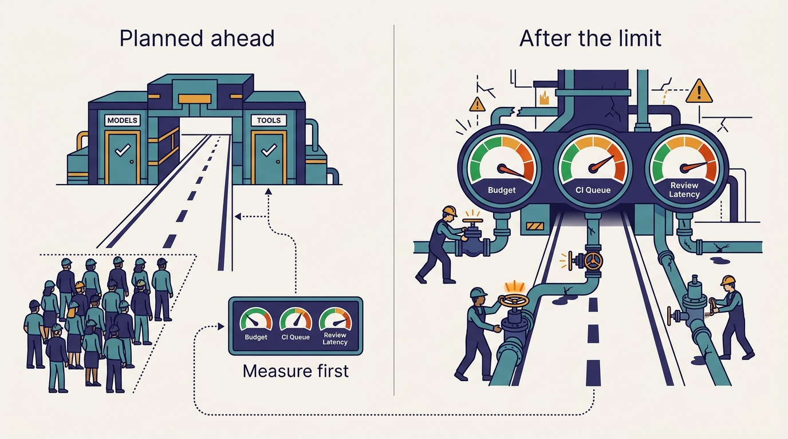

> **IN THIS CHAPTER, YOU WILL:** Turn the whole book into an order of operations: a readiness assessment you can score in a week, an autonomy ladder that says how much work to hand to agents at each score, a sequence by company size, a 12-month roadmap with exit criteria, the anti-patterns, and the cases where copying Uber is the wrong move.

> **WHY IT MATTERS:** Uber's record is an inventory of close to two dozen systems built over a decade. A company starting now has to build the foundations and the AI layer at the same time, with a fraction of Uber's platform staff. The order in which it builds them matters more than the list.

> **KEY POINTS:**
>
> * **Uber learned much of its order the expensive way; you can plan yours.** Uber planned its gateways ahead, under a 2023 rule that every AI building block be model- and harness-agnostic. Most of its other controls came after a limit was hit: spend tiers after the 2026 AI-tools budget ran out in about four months, `aifx validate` after a CI "code red", review signals after review became "a big bottleneck". Each of those limits can be measured before agents arrive.
> * **Your autonomy ceiling is set by your weakest required score, not by your average.** Score seven foundation properties and five AI-layer controls from 0 to 3, then give agents only the level of autonomy whose prerequisites you meet: interactive help, draft PRs on maintenance, feature work with evidence, fleet campaigns, and last of all auto-landing. As of October 2026, Uber itself had not opened the last level.
> * **Copy the properties and the order, not the inventory.** Buy the commodity layers, build only where your own metadata is unique, and leave a harness wrapper, a context-graph database, fleet-wide capture-replay and auto-landing out of year one. Uber built in-house because nothing could be bought at its scale; in 2026 most of it can be.

> **BUILT ON:** The whole book: the seven properties of AI-ready developer infrastructure in [[the-harness-is-the-easy-part]], the Part I foundations ([[build-what-does-not-exist]], [[monorepos-and-one-build]], [[devpods]], [[contracts-and-context-propagation]]), the Part II gateways, the Part III loops and the measurement model of [[feature-velocity]].

 
Every chapter of this book has a section called "If you are not Uber" that gives the minimum viable version of one system for companies of about 50, 500 and 5,000 engineers. Read one at a time, they are useful. Read together, they leave open the question a CTO actually has to answer: **which of these comes first, and what has to be true before the next one is worth building?**

Uber did not face that question in this form. It built its foundations for human engineers between 2014 and 2022 and its AI layer on top of them from late 2023 onward, the "decade and a year" of [[the-harness-is-the-easy-part]]. A company starting in 2026 does not have the decade. It has to build the missing foundations and the AI layer at the same time, while its engineers already use coding agents and its CI, review queue and budget already absorb the load.

This chapter assumes the system chapters' minimum viable versions and adds what none of them gives alone: **a readiness assessment, an autonomy ladder tied to it, a sequence by company size, a 12-month roadmap with exit criteria, the anti-patterns, and the conditions under which copying Uber is a mistake.** The recommendations are mine; where they rest on Uber's account, the chapter says which part.

## The Problem: An Inventory Without an Order

The October 2026 episode presents Uber's systems roughly in the order of a feature's life: plan, code, validate, verify, review, maintain, debug. That is the right order for explaining them and the wrong order for building them. The build order is set by dependencies and by which limit breaks first.

The table lists Uber's AI-era systems and controls in the order its sources date them, and classifies each as **planned ahead** (built on a rule decided before the problem arrived) or **reactive** (built after a constraint was hit). The classification is my reading of the public record, not Uber's.

| When (source) | System or control | Planned or reactive | What it responded to |
| --- | --- | --- | --- |
| 2014–2022 (DOC) | Monorepos and Bazel, DevPods, Jaeger, the IDL registry, uOwn, Slate, Shepherd | Planned, for humans | Hypergrowth and service sprawl, not agents |
| Late 2023 (POD, SN) | Model Gateway and AI Guard; the model- and harness-agnostic rule | **Planned ahead** | Expected model churn after the ChatGPT and GPT launches |
| Around April 2025 (POD) | MCP Gateway generated from the IDL registry | Planned, on a foundation | Cursor adoption and the new MCP specification |
| 2025 (SN) | Minion on the mega DevPod | Planned, on a foundation | Maintenance toil |
| December 2025 → (POD) | Cortana, then the context graph | Partly reactive | Traces showing turns spent on grounding |
| Early 2026 (POD) | Skills monorepo; later the rewrite of every skill to the CLI pattern | Reactive, for the rewrite | Two plugins could load six MCP servers into context |
| 2026 (PRESS, DOC) | Spend tiers, CostCheck, cost defaults | **Reactive** | *Fortune* reported the 2026 AI-tools budget used in about four months |
| 2026 (POD, SN) | `aifx validate`, self-healing CI | **Reactive** | CI jobs "doubled or more than doubled" in 12 months; a "code red" |
| 2026 (POD) | Code Inbox signals: AI review, evidence, risk score, blast radius | **Reactive** | Review became "a big bottleneck, same as like any other company" |
| Not yet, as of October 2026 (POD) | Green lane for auto-landing low-risk PRs | A P1 | Waiting for a risk score backtested "with years of data" |

Two lessons follow. **The gateways were the part Uber got right by planning, and they get harder to retrofit with every month**, because every engineer who calls a vendor directly or installs tools alone is a caller who must later be moved. And **each reactive control answered a limit that could have been measured in advance**: spend per person, CI jobs per PR, review latency, context tokens per session. Uber hit each limit at a scale where hitting it was survivable. A smaller company has less slack, but it can read Uber's record and measure first.

**Figure 1:** *Uber planned its gateways ahead but added spend, CI and review controls after each limit was hit; each of those limits can be measured before agents arrive.*

The record also shows what did not work. Uber's April 2026 post on its JUnit 4 to JUnit 5 migration says bulk migration with generative AI was tried and failed; deterministic OpenRewrite recipes did the work, and AI was kept for debugging failures ([Uber, 2026](https://www.uber.com/blog/junit-migration/)). "Deterministic first" is Uber's written result, not a preference.

## Seven Sequencing Principles

1. **Start where humans already feel the pain.** Every foundation in the book's dependency map was justified by human productivity first. A foundation built only "for agents" is hard to fund and easy to abandon when the harness changes.
2. **Doors before tools.** Put one company-owned endpoint in front of models and one in front of tools before usage spreads, and enforce no-bypass from the start ([[model-gateway]], [[mcp-gateway]]). Attribution, security, spend control and harness portability all depend on it.
3. **Contracts before context.** One build command, an owner for every deployable and machine-readable interfaces come before skills, graphs and assistants ([[monorepos-and-one-build]], [[contracts-and-context-propagation]]). A skill that must explain special build flags, or a graph whose identifiers do not join, does not survive.
4. **Verification before autonomy.** An agent may do alone only what it can check alone. Medisetty said Minion "started with maintenance kind of tasks" and expands "as we are adding more and more tools" for self-validation ([[minion]], [[slate]]).
5. **Capacity before volume.** Measure CI runs per PR, review latency and spend per person, split by human and agent work, before agents multiply them ([[inner-loop-and-self-healing-ci]], [[token-spend-governance]]).
6. **Deterministic before agentic.** Recipes and codemods for what rules can express; agents for the tail ([[shepherd-and-fox]]).
7. **Signals before automation.** Show a risk score to reviewers, record their disagreements and backtest it before any change lands without a human. Medisetty's ordering, "P0 is first getting all the signals in the right place" with auto-landing as a P1, is the template ([[code-review-signals]]).

Principles 4, 5 and 7 are the ones most often skipped, because each delays the visible part of a program. Their absence is what produced Uber's reactive controls.

## The Readiness Assessment

The **readiness assessment** scores an organization on twelve properties from 0 to 3. Properties 1–7 are the foundation properties defined in [[the-harness-is-the-easy-part]]; 8–12 are the AI-layer controls of Part II and of the measurement chapter. The levels are the same for every property: **0** absent, or only in people's heads; **1** partial, for some teams, maintained by hand; **2** standard for most of the codebase and enforced by a check; **3** measured, close to universal and queryable by agents through a tool.

| # | Property | Level 2 looks like | Level 3 adds | Test to run this week |
| --- | --- | --- | --- | --- |
| 1 | **Standard builds** | Every repository answers the same build, test and check commands; CI fails those that do not | Hermetic, cached builds; instruction files checked against the build | Give an agent an unfamiliar module and only the top-level AGENTS.md. Does it build and test it? |
| 2 | **Ownership metadata** | An owner and on-call for every deployable, in a file or catalog checked in CI | Ownership of services, data and assets as a graph with an accuracy metric | Can a script name the owner and current on-call of 20 random services? How many are wrong? |
| 3 | **Typed contracts** | OpenAPI, Protobuf or Thrift for most internal APIs, in one registry | Contracts crawled by tools; doc comments good enough to be tool descriptions | Could you generate tool descriptions for your ten most-called APIs from files you have today? |
| 4 | **Propagated context** | Trace context and baggage carried by the shared service framework | Coverage measured with marker requests, including queues and jobs | Does a marker baggage key reach every hop of your main flow? |
| 5 | **Ephemeral environments** | Workspaces and per-change previews on request, without a ticket | Per-task environments with expiry and request-level isolation, driven by agents through a CLI | How long from "start a task" to a running copy of the branch, for an agent? |
| 6 | **Captured traffic** | Scrubbed, recorded fixtures for the riskiest flows | Live capture for rule-heavy platforms, tagged by your domain dimensions | Can you replay last week's requests for one market and one product against a branch? |
| 7 | **Change campaigns** | A codemod tool, per-owner PRs and a tracker | A campaign platform with deterministic and agentic engines, caps and scheduling | How long did the slowest 5% of modules take in your last fleet-wide upgrade? |
| 8 | **One model door** | All model traffic through a gateway with attribution per application and person; direct keys revoked | Identity from the catalog or ML platform; guard models under a latency budget | Does any path from your code to a model vendor bypass an endpoint you own? |
| 9 | **One tool door** | Tools behind one proxy that calls with the user's permissions; disabled until the owner enables them | Tools generated from contracts; owner-approved descriptions; CLI projection; per-call audit | After an incident, could you say which agent, acting for whom, called which tool? |
| 10 | **Shared, owned context** | Instruction files in every repository; a reviewed skills repository in portable formats | Skills with owners and outcome data; grounding tools for owners, docs and data | Could you find every skill that references a given tool in under an hour? |
| 11 | **Spend visibility** | Spend per person across tools, visible in the harness during work | Tiers with approval, separate background budgets, coaching from session traces | What did one engineer spend on AI last month, across every tool? |
| 12 | **Outcome record** | Every PR tagged by type; every incident and revert names its causing change | Feature keys on PRs, feature time per class, years of linked history | What fraction of last quarter's incidents name the PR that caused them? |

Next to the scores, keep a **headroom check** of three numbers: CI runs per PR with queue time, median review latency, and AI spend per person per month, each split by human and agent work, each with an owner and a threshold that triggers action. The scores decide what agents may do; the headroom decides how fast that may grow.

A property scores 2 only if its test passes for most of the codebase, not for the team that ran it. Ownership and propagation are the most likely to be scored too high: one wrong owner or one service that drops baggage is invisible to its neighbors and decisive for an agent's routing or test.

## The Autonomy Ladder

The scores should change one decision: **how much work agents do without a human doing it step by step.** The ladder has six levels, each with minimum scores, and the rule is strict: **the ceiling is the lowest required score, not the average.**

| Level | What agents do | Minimum scores (property: score) | Uber as of October 2026 |
| --- | --- | --- | --- |
| **A0 — Assisted** | Interactive harnesses; the engineer runs and checks everything | 8: 1, 11: 1 | Long past |
| **A1 — Interactive agents** | Agents in a session change code and run builds and tests | 1: 2, 8: 2, 10: 1 | Yes; top-level AGENTS.md and CLAUDE.md work "out of the box", per Medisetty |
| **A2 — Background agents on maintenance** | Agents work alone in isolated workspaces and stop at a draft PR with the checks they ran | A1, plus 2: 2, 5: 1, 11: 2 and the headroom check | Yes; Minion began with maintenance |
| **A3 — Feature work with evidence** | Agents deploy and test against real dependencies and attach before/after evidence | A2, plus 3: 2, 4: 2 on the paths touched, 5: 2, 9: 2, 12: 1 | Partly; agents use Slate, browser comparisons and Capri replay, and scope grows by task class |
| **A4 — Campaigns and standing loops** | Recipes and agents change many modules per campaign; weekly maintenance PRs | A3, plus 2: 3, 7: 2, 12: 2 | Yes; Shepherd campaigns and the opt-in Fox loop |
| **A5 — Green lane** | Some low-risk change classes land without human review | A4, plus 12: 3 (a backtested risk score), 6: 2 for that class, automated rollback | **No**; a P1 after the signals |

---begin mermaid---
flowchart LR
    A0["A0 Assisted"] -->|"one build command, shared instructions"| A1["A1 Interactive agents"]
    A1 -->|"owners, isolated workspace, spend visible, headroom measured"| A2["A2 Background agents on maintenance"]
    A2 -->|"contracts, propagated context, per-change environments, tool door"| A3["A3 Feature work with evidence"]
    A3 -->|"accurate ownership, campaign tooling, PR type tags"| A4["A4 Campaigns and standing loops"]
    A4 -->|"backtested risk score, replay for the class, rollback"| A5["A5 Green lane"]
---end mermaid---
**Figure 2:** *The autonomy ladder. Each gate is a set of readiness scores, not a judgment about model quality. The ladder is my synthesis of the book's chapters; Uber's progression, as described in October 2026, reaches A4 and has not yet opened A5.*

Three choices in the ladder are deliberate. **It is gated by verification, not by model quality.** Better models make agents more useful at every level but do not move an organization up one: an agent that cannot observe its change produces a plausible PR, and the verification moves into review. Faros AI's telemetry, which found PR review time up 91% under high AI adoption, is consistent with that being common ([Faros AI, 2025](https://www.faros.ai/blog/ai-software-engineering)). **It is per task class, not per company.** A web front end with preview deployments may be at A3 while a payment backend that cannot isolate test traffic is at A2; Minion's scope at Uber grows the same way. **Levels can be skipped only on paper.** A vendor's background agent turned on before property 1 reaches 2 still produces PRs. They fail CI, retry and reach review unverified.

## The Sequence by Company Size

Most readers will ask how a company of 200 or 2,000 engineers should build this. The table gives six stages at four sizes. Stages overlap in time; the order says which must meet its exit criteria before the next is scaled.

| Stage | ≈50 engineers | ≈200 engineers | ≈2,000 engineers | ≈5,000+ engineers |
| --- | --- | --- | --- | --- |
| **0. Assess** | Score in an afternoon; note spend per person and CI minutes | Score with tech leads; baseline CI runs per PR, review latency, PR mix | Score per platform; publish the headroom check monthly | Tie scores to platform-team objectives |
| **1. Doors** | Vendor admin console, one key per app, harness managed settings | A managed or open-source gateway; direct keys revoked; MCP allowlist in managed settings | Gateway identity from the catalog; one tool proxy with user tokens and a CLI | Uber's shape: guard models, a tool registry generated from contracts |
| **2. Contract hygiene** | `build`, `test`, `check`, AGENTS.md and CODEOWNERS everywhere | A CI check for the build contract; a service catalog with owners | Catalog completeness metric; one contract registry; OpenTelemetry in the framework | Coverage dashboards; agentic campaigns to repair gaps |
| **3. Shared context** | 10–20 reviewed skills in a folder | A skills repository with a gate; the catalog exposed as a tool | Persona bundles, skill telemetry, grounding tools | A context graph, if traces show grounding is a large cost |
| **4. Verification** | Preview deploys and browser scripts; agents run `check` | One validation command for CI and agents; previews and test accounts for main services | Request isolation in staging on common change paths; evidence tables on agent PRs | Request isolation in production; capture-replay for rule-heavy platforms |
| **5. Autonomy and loops** | A vendor-hosted background agent on labeled issues, draft PRs only | Vendor agent on two or three task classes; Renovate and OpenRewrite campaigns | Background agents on cloud workspaces; a campaign runner; one maintenance loop; review signals | Background tier, campaign platform, maintenance loops, risk score, green-lane pilot |
| **6. Measurement** | PR type mix; a hand-kept list of shipped features | Type and complexity tags; feature key on PRs; one spend tier | Feature time per class; tiers with approval; a background budget | Phase breakdown of feature time; outcome cost per managed agent |

**At ≈50 engineers, buy almost everything and invest in conventions.** The foundations that matter cost days; the risk is copying platform shapes that need a platform team to run.

**At ≈200 engineers, the doors and the build contract are the whole game.** This is the size at which harness use spreads faster than anyone tracks it, direct vendor keys multiply and repositories drift apart, and the last size at which centralizing them is cheap. A 200-engineer company that ends this stage with all model traffic through one gateway, every repository honoring three commands and a measured headroom check is ahead of many companies ten times its size.

**At ≈2,000 engineers, verification is the long pole.** Doors and conventions take two or three quarters. Request isolation, test identities and propagation coverage take longer, because every team's services must cooperate. This is where Uber's decade shows most: Slate depended on Jaeger baggage carried by nearly every service, an Edge Gateway that sets routing overrides and a per-host routing agent ([Uber, 2022](https://www.uber.com/blog/simplifying-developer-testing-through-slate)). Start propagation work in the first quarter even though it pays off in the third.

## Minimum Viable Versions in One Table

The system chapters give each minimum viable version in detail. This table puts them in one place; product names are examples as of October 2026, not recommendations.

| Uber system | Minimum viable version | Buy or open source | Build only when | Chapter |
| --- | --- | --- | --- | --- |
| Monorepos, Bazel | Same build, test and check commands in every repository | Task runners; hosted merge queues | Full builds are too slow for every change | [[monorepos-and-one-build]] |
| DevPods | A dev container per repository, for people and agents | Hosted cloud workspaces; agent sandboxes | Workspaces must reach internal networks and caches | [[devpods]] |
| IDL registry, uOwn, Jaeger | One contract registry, an owner per deployable, OpenTelemetry | Backstage or a commercial catalog; OpenTelemetry | The integration across them is the value | [[contracts-and-context-propagation]] |
| Model Gateway, AI Guard | One endpoint, one identity per app, one log, no direct keys | LiteLLM; Kong or Cloudflare AI Gateway | Identity must come from your ML platform or catalog | [[model-gateway]] |
| AIFX | One configuration repository rendered into each harness | The harnesses' managed settings | Several harnesses are in wide use | [[aifx-harness-layer]] |
| MCP Gateway | Approved-tool registry, user-permission proxy, CLI | MCP gateway products; the harness allowlist | Tools must be generated from your contracts | [[mcp-gateway]] |
| Skills monorepo | One reviewed repository in the Agent Skills format | Git; harness plugin marketplaces | You need one installer for several harnesses | [[skills-monorepo]] |
| Context graph, Cortana | A catalog with owners and dependencies, as a tool | Backstage; graph databases | Traces show grounding across many systems is costly | [[context-graph]] |
| Spend tiers, CostCheck | Spend per person, shown during work | Gateway budgets; vendor usage reports | Thousands of engineers need tiers and coaching | [[token-spend-governance]] |
| Design-doc hub | One home per plan type with owner, status, approval, ticket link | Document tools with properties; Spec Kit | Plans must feed a graph and feature timing | [[plans-as-source-of-truth]] |
| Minion | A hosted background agent that stops at a draft PR | GitHub Copilot coding agent; Codex Cloud; Claude Code in CI | You already run workspaces, monorepos and a tool door | [[minion]] |
| `aifx validate`, self-healing CI | One local command for CI's fast checks; a CI-round cap | CI caching; harness hooks | Hermetic builds make local and CI agree | [[inner-loop-and-self-healing-ci]] |
| Slate | Per-PR previews, test accounts, header routing | Preview deployments; Signadot; Istio or Envoy | Thousands of services rule out per-developer stacks | [[slate]] |
| Capri, MatchGuard | Capture-replay for one rule-heavy service, three to five dimensions | GoReplay; Diffy forks | Your dimensions drive behavior across platforms | [[capri]] |
| Code Inbox | Evidence in PRs, quiet AI review, incidents linked to changes | The code host's review and an AI reviewer | You have more signals than the code host can show | [[code-review-signals]] |
| Shepherd, Fox | Codemods with per-owner PRs and a tracker; one scheduled maintenance task | OpenRewrite; Renovate; polyglot Piranha | Campaigns span thousands of modules | [[shepherd-and-fox]] |
| Wisdom, DebugAssist | A bug reporter that attaches context; a root-cause skill with a human gate | Crash and session-replay SDKs | Dogfooding volume justifies a managed agent | [[wisdom-and-debug-assist]] |
| Feature velocity | PR type tags, a feature key, a stability metric per speed metric | DX, LinearB, Faros, Jellyfish or similar | Your design-doc trail joins to PRs and rollouts | [[feature-velocity]] |

The last column shows a pattern: **the reasons to build are about metadata the company owns** (contracts, catalog, domain dimensions, design-doc trail), not about the AI layer's mechanics. That is the argument of [[build-what-does-not-exist]]: the systems were the means; the metadata is the legacy.

## A 12-Month Roadmap

This roadmap is for a company of roughly 200 to 2,000 engineers scoring mostly 1s with a few 2s, which is where I would expect many companies of that size to start in 2026. Foundation work may start early and usually must; autonomy is scaled only after the previous quarter's exit criteria are met.

---begin mermaid---
flowchart LR
    subgraph Q1["Months 1 to 3: see and control"]
        Q1A["Readiness score and headroom baseline"]
        Q1B["Model gateway, direct keys revoked"]
        Q1C["Build contract and AGENTS.md everywhere"]
        Q1D["Incidents name the causing change"]
    end
    subgraph Q2["Months 4 to 6: verify locally, delegate narrowly"]
        Q2A["One check command for CI and agents"]
        Q2B["Reviewed skills repository"]
        Q2C["Tool proxy with user permissions and a CLI"]
        Q2D["Background agent on one task class"]
    end
    subgraph Q3["Months 7 to 9: verify end to end"]
        Q3A["Previews and test accounts for main services"]
        Q3B["Propagation coverage measured"]
        Q3C["Evidence required on agent PRs"]
        Q3D["First deterministic campaign"]
    end
    subgraph Q4["Months 10 to 12: expand by evidence"]
        Q4A["More task classes where evidence exists"]
        Q4B["One opt-in maintenance loop"]
        Q4C["Feature time baseline and spend tiers"]
        Q4D["Year-two decisions"]
    end
    Q1 --> Q2
    Q2 --> Q3
    Q3 --> Q4
---end mermaid---
**Figure 3:** *A 12-month retrofit roadmap. Each quarter raises the scores that gate the next rung of the autonomy ladder. It is my recommendation, not a description of Uber's sequence.*

| Quarter | Moves | Exit criteria |
| --- | --- | --- |
| **Q1: see and control** | Score the twelve properties and publish the headroom check. Route all model traffic through one gateway with attribution; revoke direct vendor keys, with a short time-boxed exception. Configure supported harnesses through managed settings. Add `build`, `test` and `check` and an AGENTS.md to every repository, and an owner to every deployable. Add a required "caused by" field to incident reviews and reverts. Start tagging PRs by type. | All model traffic through the gateway. An agent builds and tests at least 80% of repositories from AGENTS.md alone. Every manager sees spend per person and CI runs per PR, split by human and agent. |
| **Q2: verify locally, delegate narrowly** | Put CI's fast checks behind one command that CI and every agent run. Start a reviewed skills repository with 10–20 skills for weekly workflows. Put vendor tools and three to five internal read-only services behind one proxy that calls with the user's permissions, has a CLI and enables nothing without its owner. Run one background agent (vendor-hosted, unless you already run cloud workspaces) on one task class such as dependency bumps or lint debt: draft PRs with a checks table, two CI rounds at most, its own budget. | Acceptance and revert rates for that class measured weekly. CI runs per agent PR at or below the human rate. No tool reaches agents without owner approval. |
| **Q3: verify end to end** | Give the most-changed services per-PR previews and test accounts that every system treats as test entities. Put trace context and baggage in the shared framework and measure coverage with marker requests. Require machine-produced evidence on agent PRs. Tune AI review to correctness and security. Label PRs with blast radius from the dependency graph. Run one deterministic campaign end to end with per-owner PRs and a tracker. | Propagation coverage known for the main flows. Most agent PRs carry machine-produced evidence. The campaign's tail is visible and owned. |
| **Q4: expand by evidence** | Add task classes only where Q3's verification covers them. Turn one recurring maintenance task into an opt-in weekly loop with a cap on PRs per engineer. Require a feature key on PRs and report P50 feature time per complexity class with change failure rate beside it. Add one spend tier above the default, approved by managers in a minute, and a separate background budget. | A feature-time baseline. Merge rate, revert rate and cost per merged PR for every agent loop. A year-two memo on the deferred items below. |

**Deliberately left out of year one**, with what would bring each in:

- **A harness wrapper like AIFX**, until two or more harnesses each have wide use ([[aifx-harness-layer]]).
- **A context-graph database**, until traces show grounding across several systems is a large share of agent cost ([[context-graph]]).
- **Fleet-wide capture-replay**, beyond the one rule-heavy service where combination bugs have caused incidents ([[capri]]).
- **Auto-landing**, until the outcome record holds a year or more of linked incidents and reverts to backtest against ([[code-review-signals]]).
- **A self-built workspace platform or background agent**, unless workspaces must reach networks and caches vendors cannot ([[devpods]], [[minion]]).

The sequence matters more than the dates: strong foundations may compress Q1 and Q2 into one quarter, and weak ones may stretch Q1 to Q3 over the whole year.

## Anti-Patterns

The chapters' failure modes cluster into ten anti-patterns.

| Anti-pattern | What it looks like | Evidence | Instead | Chapter |
| --- | --- | --- | --- | --- |
| **Harness lock-in** | Instructions, skills and tool configuration in one harness's format | Uber moved from enabling Cursor in early 2025 to supporting Claude Code, Codex and OpenCode in 2026 | Portable formats; models and tools only through company endpoints | [[aifx-harness-layer]] |
| **MCP sprawl** | Servers published straight to agents; every session loads every schema | Medisetty described tool descriptions of 3,000–4,000 tokens and plugins that each loaded several servers | One tool door, disabled by default, a CLI projection | [[mcp-gateway]] |
| **Unmeasured spend** | Spend found on the invoice; usage leaderboards | *Fortune*, May 2026: a team usage leaderboard, then the budget used in about four months | Attribution and in-session visibility, then tiers | [[token-spend-governance]] |
| **Review by volume** | PR counts as targets; approvals to clear the queue | Medisetty called review "a big bottleneck"; Uber moved from diff to feature velocity | Evidence, review signals, PR mix, feature time | [[code-review-signals]] |
| **Agents without verification** | Background PRs no environment has tested | "If we did not have systems like Slate, it would have been really hard for agents to self-validate" (Medisetty) | The autonomy ladder | [[slate]] |
| **Capacity surprise** | CI queues and review latency grow for months unowned | CI jobs "doubled or more than doubled" in 12 months; a code red | The headroom check from month one | [[inner-loop-and-self-healing-ci]] |
| **Agentic bulk migration** | An agent asked to apply a mechanical change to thousands of files | Uber's April 2026 JUnit post: the generative-AI bulk attempt failed | Recipes for the bulk, agents for the tail | [[shepherd-and-fox]] |
| **Foundations for agents only** | Hand-written MCP servers without contracts underneath | Uber generates tools from contracts teams already maintain | Build the human-useful foundation; generate the agent interface | [[contracts-and-context-propagation]] |
| **Autonomy targets** | "30% of PRs from agents by Q4" | Uber's own figures run from about 10% to over 70% by definition | Report share with its definition; target outcomes | [[minion]], [[feature-velocity]] |
| **Copying the inventory** | A skills monorepo and a context graph over inconsistent builds | Every Uber AI system stands on an older property | Score the properties; climb the ladder | [[the-harness-is-the-easy-part]] |

The first six show up within a quarter or two, as a bill, a queue or a failed PR. The last four show up later and, in my judgment, cost more, because each looks like progress while it is happening.

## When Not to Copy Uber

Uber's choices fit thousands of engineers and services, a physical-world marketplace in which incidents are expensive, a business varied by city, product and payment type, and a decade of in-house platforms. Where the constraints differ, the opposite choice may be right.

| Uber's choice | Why it fits Uber | When the opposite is right |
| --- | --- | --- |
| Build developer platforms in-house | In 2015–2022 no vendor met its scale and shape | In 2026 most layers can be bought; build where your metadata is unique |
| Three harnesses through a wrapper | Thousands of engineers, fast harness churn | Below a few hundred engineers, standardize on one harness |
| Every PR human-reviewed | Incidents are expensive in the physical world | With cheap rollback and small blast radius, narrow deterministic classes can auto-merge earlier; Spotify reported in October 2026 that most of its 2.5 million+ automated maintenance PRs merge automatically after safety checks ([InfoQ, 2026](https://infoq.com/news/2026/10/spotify-ai-quality-controls)) |
| Maintenance PRs on Sunday, when CI is quiet | Every PR is human-reviewed | If automated changes merge unreviewed, run them in owners' working hours, as Spotify now does after an upgrade passed every check and failed in production |
| A mega DevPod with every repository | A handful of per-language monorepos | With thousands of repositories, clone what each task needs |
| Request isolation in the production fleet | Thousands of services rule out per-developer stacks | With tens of services, full per-PR stacks in staging; with regulated data, keep tests out of production |
| A context graph from 30+ systems | Siloed metadata at large scale | A catalog and a few edges answer most grounding questions |
| Capture-replay across a combination set | Cities × products × payment types | With little domain variety, contract tests and fixtures suffice |
| A full set of design reviews | An experimentation platform and costly incidents | Without an experimentation platform, skip the experiment review |

There is also a case for not copying the program yet. **If coding is not the slowest phase of your feature path, a faster coding agent will not move the number that matters.** Uber reconstructs a P50 feature time per complexity class to find whether time goes into the product document, the code, the review, the launch or the rollout ([[feature-velocity]]). A company whose features wait months for product, legal or sales decisions should measure that path first. DORA's 2025 finding that AI amplifies an organization's existing strengths and dysfunctions applies directly ([DORA, 2025](https://research.google/pubs/dora-2025-state-of-ai-assisted-software-development-report/)).

## Elsewhere in the Industry

The two other companies that have described their background agents in most detail followed the same order. **Spotify** built Fleet Management first; since mid-2024 about half of its PRs have come from those deterministic changes, and its agent Honk was added later for migrations scripts could not express ([Spotify, 2025](https://engineering.atspotify.com/2025/11/spotifys-background-coding-agent-part-1)). **Stripe** gave its Minions pre-warmed devboxes ready in about 10 seconds, a central internal MCP server (Toolshed) and a cap of two CI rounds before a human takes over ([Stripe, 2026](https://stripe.dev/blog/minions-stripes-one-shot-end-to-end-coding-agents)): doors and capacity limits built in from the start. The April 2026 Thoughtworks Technology Radar points the same way, with "curated shared instructions for software teams" in Adopt and "MCP by default" in Caution ([Thoughtworks, 2026](https://www.thoughtworks.com/radar/techniques/curated-shared-instructions-for-software-teams)).

## Failure Modes of the Playbook Itself

- **Foundations forever.** A year of builds, catalogs and propagation with nothing delegated, while engineers adopt agents on their own, outside the doors. Run A0 and A1 from the first month; the ladder gates autonomy, not use.
- **Assessment theater.** Every property self-scored 2 by its owner. Run each test from the agent's side.
- **The roadmap as a procurement list.** Twelve products in twelve months, none owned or integrated. A bought layer still needs an owner and an exit criterion.
- **Ignoring the people.** Output per engineer rises while review load, career ladders and skill development stay as they were; review fatigue and deskilling ([[the-engineer-as-context-builder]]) appear a year later as quality problems.
- **Copying the dates.** Q4 declared done because the calendar says so. The exit criteria are the schedule.

## What the Record Does Not Say

- **What Uber would do differently.** No source describes Uber's own hindsight on sequencing; the planned-or-reactive classification above is my reading.
- **What the foundations cost.** Uber has not published team sizes, budgets or time to coverage for DevPods, propagation, Slate or the gateways, so this roadmap's durations are my estimates for other companies.
- **How agent work fails.** Uber publishes adoption, PR share and cost per session, but almost no acceptance, revert or incident rates by task class, which are the numbers that would place the ladder's gates.
- **Whether the order was planned.** Apart from the 2023 agnostic rule, nothing suggests Uber sequenced its AI layer against a plan.
- **Whether the green lane will open, and for which classes.**

## Questions to Ask

1. What are our twelve readiness scores, measured by running each test from the agent's side, and who owns each property?
2. Which rung of the autonomy ladder is each major part of our codebase on, and which single score holds it there?
3. Does any path from our code or our harnesses reach a model vendor or a tool without passing an endpoint we own?
4. What are our CI runs per PR, review latency and spend per person, split by human and agent work, and what value of each triggers action?
5. Which planned agent uses are mechanical enough for a recipe or codemod?
6. Which three foundations would we fund for human productivity alone, and are they first in our plan?
7. What evidence will an agent PR carry when it reaches review six months from now, and what will produce it?
8. Which of Uber's systems solve a problem we have, and which solve one created by Uber's scale or domain?
9. Is coding actually the slowest phase of our feature path, and how do we know?
10. What are this quarter's exit criteria, and what result would make us slow down?

This chapter closes Part IV and the case study. The Reference section follows: [[system-catalog]] lists every Uber system in the book with its era, evidence label, foundation and chapter; [[glossary]] defines the terms each chapter owns; and [[bibliography]] collects every source.

## Sources and Evidence

**The source episode**

- [Uber's AI infra, from the inside](https://newsletter.pragmaticengineer.com/p/ubers-ai-infra-from-the-inside), *The Pragmatic Engineer* podcast, Gergely Orosz with Uday Kiran Medisetty, 2026 (14 October). Supports the dates and descriptions of the AI-era systems, Minion's maintenance-first scope, the CI code red, review as a bottleneck, the P0/P1 order of signals and auto-landing, and (in the show notes) the 2023 model- and harness-agnostic rule.

**Uber engineering sources**

- [How Uber Executed a JUnit Migration at Massive Scale](https://www.uber.com/blog/junit-migration/), Uber Blog, 2026 (7 April). Supports the failed generative-AI bulk migration and the deterministic-first order.
- [Running a Software Factory Efficiently at Uber Scale](https://www.uber.com/us/en/blog/efficient-software-factory/), Uber Blog, Uday Kiran Medisetty, 2026 (27 August). Supports spend tiers, cost defaults and the tracking of managed agents by outcome cost.
- [Designing MCP Gateway: Uber's MCP Management Platform](https://www.uber.com/blog/designing-mcp-gateway/), Uber Blog, 2026 (1 October). Supports tools generated from contracts and disabled by default.
- [Simplifying Developer Testing Through SLATE](https://www.uber.com/blog/simplifying-developer-testing-through-slate), Uber Blog, 2022. Supports the propagation, edge and routing foundations behind request isolation; the system may have changed since.
- [Uber's COO says it's getting harder to justify AI spend](https://www.fortune.com/2026/05/26/uber-coo-ai-spending-tokens-claude-code/), *Fortune*, 2026 (26 May). Supports the budget overrun and the usage leaderboard, as reported.

**Industry and research sources**

- [1,500+ PRs Later: Spotify's Journey with Our Background Coding Agent](https://engineering.atspotify.com/2025/11/spotifys-background-coding-agent-part-1), Spotify Engineering, Max Charas and Marc Bruggmann, 2025. Supports Fleet Management before Honk.
- [InfoQ report on Spotify's quality controls for automated changes](https://infoq.com/news/2026/10/spotify-ai-quality-controls), InfoQ, 2026 (12 October). Supports auto-merged maintenance PRs and the move to owners' working hours.
- [Minions: Stripe's one-shot, end-to-end coding agents](https://stripe.dev/blog/minions-stripes-one-shot-end-to-end-coding-agents), Stripe Dev Blog, Alistair Gray, 2026. Supports devboxes, Toolshed and the two-CI-round cap.
- [DORA 2025 State of AI-assisted Software Development Report](https://research.google/pubs/dora-2025-state-of-ai-assisted-software-development-report/), DORA / Google, 2025. Supports AI as an amplifier of existing strengths and dysfunctions.
- [The AI Productivity Paradox Report 2025](https://www.faros.ai/blog/ai-software-engineering), Faros AI, 2025. Supports review time up 91% under high AI adoption (correlational).
- [Curated shared instructions for software teams](https://www.thoughtworks.com/radar/techniques/curated-shared-instructions-for-software-teams) and [MCP by default](https://www.thoughtworks.com/radar/techniques/mcp-by-default), Thoughtworks Technology Radar, 2026 (April). Support shared context in Adopt and MCP by default in Caution.

Statements about Uber's AI-era systems are Uber's own account unless another source is cited; recommendations and labeled inferences are the author's judgement.
