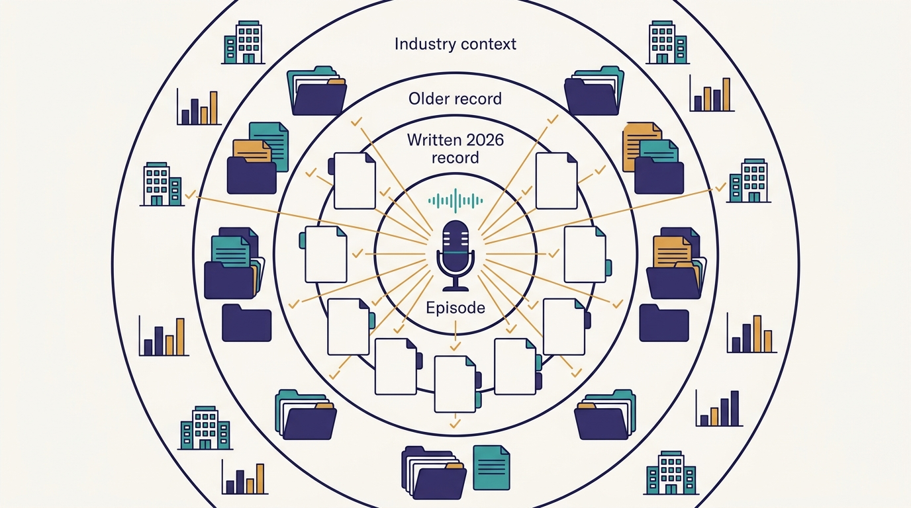
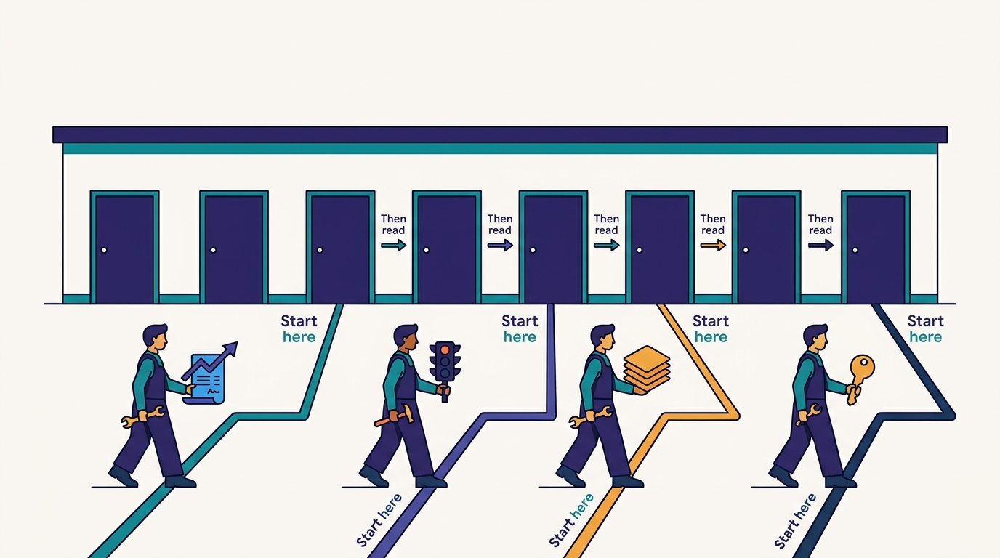

> **IN THIS BOOK, YOU WILL:** Follow one company's AI developer infrastructure from the pre-AI platforms it stands on to the agents, review loops and metrics built on top of them. For each system you will see how it works as far as the public record shows, what it depends on, and what a company that is not Uber should copy, in what form and in what order.

> **WHY IT MATTERS:** Most advice on AI-assisted engineering is about choosing tools. Uber's record suggests that the outcome depends more on builds, contracts, ownership data, test environments and change tooling than on the coding harness, and few companies have described that whole stack in public.

> **KEY POINTS:**
>
> * **One episode, widened and checked.** The book starts from the October 2026 *Pragmatic Engineer* episode with Uber Distinguished Engineer Uday Kiran Medisetty. It cross-checks that account against Uber's written 2026 sources, its older engineering record and dated industry evidence, and it says where the sources disagree.
> * **Start with the decision in front of you, not with page one.** Every chapter owns one system and one decision, follows the same structure, and ends with sized guidance for organizations of about 50, 500 and 5,000 engineers. The routing table below sends you to the right chapter first.
> * **Every statement shows what kind of claim it is.** Uber's own account, documented fact, industry comparison, labeled inference and the author's recommendation read differently on purpose. Numbers come with their source, date and definition. The author has no inside knowledge of Uber.

 
On 14 October 2026, *The Pragmatic Engineer* published "Uber's AI infra, from the inside", a conversation between Gergely Orosz and Uday Kiran Medisetty, a Distinguished Engineer at Uber who leads much of its work on agentic AI. Over about an hour and a half, Medisetty showed close to two dozen internal systems: the Model Gateway every model request passes through, a wrapper that makes coding harnesses swappable, an MCP Gateway generated from service contracts, a skills monorepo, a context graph, a background coding agent called Minion that, by Medisetty's account, handles about 15% of production pull requests, personal staging environments that agents use to test their own changes, a capture-and-replay system, a review inbox, migration and maintenance loops, and a bug-to-fix pipeline.

Orosz framed the episode in two sentences before it began: "The harness is the easy part. What's hard is all the things around them." This book takes that framing seriously. **Almost every AI system in the tour turns out to be a thin layer over something Uber built years earlier for human engineers**, and the useful lessons for other companies are mostly in that lower layer.

A single episode is a tour, not a manual. It names systems quickly, gives numbers from memory, and leaves the mechanisms between them implicit. This book slows the tour down. It gives each system a chapter, places it in Uber's documented engineering history, checks its numbers against written sources, labels what is inference, and translates it into guidance for companies that are smaller, younger or differently shaped than Uber.

## Why a Case Study of One Company

Books on AI-assisted engineering usually generalize across many companies, which makes them broad and shallow. A single company's record is narrower but shows how the pieces depend on each other: which gateway the agent calls, which environment it runs in, how its change is tested, who reviews it and how the result is measured. **Dependencies are the part that generalizes.** A reader at a 300-engineer company will not build a mega DevPod, but needs to know that Uber's background agent works because something like it exists.

Uber is an unusually good subject for three reasons. It has published about its developer platform for more than a decade, so the pre-AI foundations can be dated and checked: Jaeger tracing, the per-language monorepos, SubmitQueue, Slate, Piranha, Michelangelo and the GenAI Gateway all have engineering posts or papers behind them. It built most of that platform in-house, because, as Medisetty put it, there was "not much off-the-shelf software" at its scale and rate of change, so the reasoning behind each piece is visible rather than hidden inside a vendor product. And in 2026 it described its AI layer in several written sources besides the episode, so the episode can be cross-checked.

Uber is also a risky subject, and the book is written with that in mind. Its scale, budget and engineering organization are not those of most readers. Most facts about its AI-era systems come from one senior engineer who leads the work. A success story told in retrospect connects the dots that mattered and leaves out the ones that did not. [[the-harness-is-the-easy-part]] states these objections in full and adjusts the book's thesis to survive them.

### Why "records"

The subtitle of this page says the book reads Uber's AI infrastructure as records. Each chapter is written as a **durable record of one system**: a stable address (its permalink), a fixed opening that states the chapter's key points, a body in the same order as every other chapter, an explicit list of what the public record does not say, and a section of sources with years. The format serves two kinds of reader. A person can jump into any chapter and know where the trade-offs, the sized advice and the failure modes are. An AI tool given the book as context can find the same things in the same places. The book is a living journal: chapters are revised as Uber publishes more, and each chapter's spec records what it set out to do.

## The Source Episode and How the Book Extends It

The episode is the starting point and the main source for Uber's AI-era systems. It runs from Medisetty's early days on Uber's real-time API team in 2015, through the pre-AI developer platform (from about minute 9), to the AI-era systems from about minute 19: the MCP Gateway, the skills repository, the context graph and Cortana, the planning tool, Minion, testing and review with Bazel, Slate and Capri, then the Edge Gateway, Shepherd and Wisdom. It closes with the engineer's changing role and how Uber measures productivity. Orosz's show notes add eleven takeaways and links to earlier *Pragmatic Engineer* coverage of Uber.

The book adds four layers to the episode.

| Layer | What it contributes | Examples |
| --- | --- | --- |
| **The episode** | The systems, their purpose, the links between them, Uber's own numbers | Minion's ~15% of production PRs; ~30,000 skill executions a day; the CI "code red" |
| **Uber's written 2026 record** | Mechanisms and figures in writing, sometimes different from the episode's | The August 2026 "Running a Software Factory Efficiently at Uber Scale" post; the October 2026 "Designing MCP Gateway" post; the April 2026 JUnit migration post; the AI Engineer World's Fair 2026 talk |
| **Uber's older engineering record** | Dated descriptions of the foundations | Slate (2022), the GenAI Gateway (2024), SubmitQueue (2019 paper), Piranha (2020), uReview (2025) |
| **Industry and research context** | Comparisons, counter-evidence and buyable equivalents | Stripe's and Spotify's background agents; DORA 2025; METR's 2025 study; Thoughtworks Technology Radar entries |

**Figure 1:** *The book starts from one episode and checks it against three further layers of evidence: Uber's written 2026 record, its older engineering record and dated industry sources.*

Where the episode and a written Uber source disagree, the book cites the written source for the number and gives the episode's figure as the episode's framing, with both dates. Two examples show why this matters. Medisetty described the context graph as having 100+ node types and 130+ edge types; Uber's August 2026 post gives 86 node types and 117 edge types. The graph probably grew between the two, but the book does not pick one silently. The share of pull requests from agents appears as about 10%, 11%, about 15% and more than 70% in different 2026 sources, because the sources measure different things. [[minion]] puts the four figures side by side with their definitions.

The episode transcript is auto-generated, and it garbles many names: it renders Claude Code as "Cloud Code", AIFX as "AI effects" and Shepherd as "Shepard". The book uses the corrected names throughout, and quotes from the episode are short, lightly corrected for transcription errors, and never reconstructed beyond what was said.

## Who This Book Is For

The reader is assumed to know what a monorepo, an API gateway, CI, Kubernetes and a coding agent are. The book defines Uber's own system names and the newer AI-tooling terms (MCP, skills, harness, background agent) on first use in each chapter, and links to the chapter that owns each term.

| Reader | What they are deciding | What the book gives them | Where to start |
| --- | --- | --- | --- |
| **CTO or VP of Engineering** | How much to invest in AI developer tooling, in what order, and how to tell whether it works | The thesis, the sequencing, the measurement model and the spending story | [[the-harness-is-the-easy-part]], then [[the-retrofit-playbook]] and [[feature-velocity]] |
| **Platform or developer-experience lead** | Which systems to build, buy or skip | A chapter per system with mechanisms, trade-off tables, minimum viable versions and failure modes | Part II, from [[model-gateway]] |
| **Staff or principal engineer** | How to make repositories, services and tests usable by agents | The foundations of Part I and the verification chapters of Part III | [[monorepos-and-one-build]], [[contracts-and-context-propagation]], [[slate]] |
| **Engineering manager** | How review, measurement and the engineer's job change | Review signals, PR tagging, feature time and the context-builder role | [[code-review-signals]], [[the-engineer-as-context-builder]] |
| **Security or FinOps lead** | How to control what agents can reach and what they cost | The gateways, permission-preserving tools and spend tiers | [[model-gateway]], [[mcp-gateway]], [[token-spend-governance]] |

## The Four Parts as a Path

The book is organized as a path from foundations to practice. Each part answers one question, and each depends on the one before it.

---begin mermaid---
flowchart LR
    P["Preface: the thesis and the dates"] --> F["Part I FOUNDATIONS: the decade before AI"]
    F --> G["Part II GATEWAYS: agnostic building blocks"]
    G --> L["Part III LIFECYCLE: the feature path, rewired"]
    L --> R["Part IV PRACTICE: measuring and leading"]
    R --> REF["Reference: catalog, glossary, bibliography"]
    F -.->|"contracts, workspaces, ownership"| G
    F -.->|"tracing, frameworks, campaigns"| L
    G -.->|"models, tools, skills, context, spend"| L
---end mermaid---
**Figure 2:** *The book's path. Solid arrows are the reading order; dashed arrows show what each part supplies to the later ones. Part III depends on both earlier parts, which is the thesis in one picture: the agent lifecycle stands on the gateways and on the decade of foundations under them.*

| Part | The question it answers | Chapters |
| --- | --- | --- |
| **Preface** | Why does the AI layer look fast to build, and when was each piece built? | [[introduction]] · [[the-harness-is-the-easy-part]] · [[timeline]] |
| **Part I — FOUNDATIONS: The Decade Before AI** | What did Uber build for human engineers that agents now depend on? | [[build-what-does-not-exist]] · [[monorepos-and-one-build]] · [[devpods]] · [[contracts-and-context-propagation]] |
| **Part II — GATEWAYS: Agnostic Building Blocks** | How did Uber make models, harnesses, tools, skills, context and spend into shared building blocks that survive vendor churn? | [[model-gateway]] · [[aifx-harness-layer]] · [[mcp-gateway]] · [[skills-monorepo]] · [[context-graph]] · [[token-spend-governance]] |
| **Part III — LIFECYCLE: The Feature Path, Rewired** | What changes at each step from plan to production when agents do much of the work? | [[plans-as-source-of-truth]] · [[minion]] · [[inner-loop-and-self-healing-ci]] · [[slate]] · [[capri]] · [[code-review-signals]] · [[shepherd-and-fox]] · [[wisdom-and-debug-assist]] |
| **Part IV — PRACTICE: Measuring and Leading** | How do you measure productivity when PRs are cheap, what does the engineer now do, and in what order should others build this? | [[feature-velocity]] · [[the-engineer-as-context-builder]] · [[the-retrofit-playbook]] |
| **Reference** | Where is a system, a term or a source described? | [[system-catalog]] · [[glossary]] · [[bibliography]] |

Part I is the part most readers are tempted to skip, and the one the thesis rests on. Its four chapters cover why Uber built so much in-house and what metadata that left behind, how Uber reached one build command across its code, the cloud workspaces that became the agents' runtime, and the typed contracts, ownership records and trace baggage that later became tool definitions, routing data and test isolation. Part II covers the AI foundations that Uber built from late 2023 onward with one design rule: every building block must work with any model and any harness. Part III follows a feature from its plan to its fix in production, one step per chapter. Part IV turns from systems to practice: measurement, the engineer's job, and the playbook.

## Start With the Decision in Front of You

Few readers will read the book from front to back, and they should not need to. The table below starts from the decision a reader is likely to face and names the chapter that owns it, then the chapter to read next. Every chapter is self-contained: it summarizes in a sentence what other chapters own and links to them.

| If the decision in front of you is… | Start with | Then read |
| --- | --- | --- |
| We are choosing a coding harness, or switching to a new one | [[aifx-harness-layer]] | [[model-gateway]], [[skills-monorepo]] |
| Engineers call model vendors directly, each with their own keys | [[model-gateway]] | [[token-spend-governance]] |
| Our AI bill is growing faster than anyone can explain | [[token-spend-governance]] | [[model-gateway]], [[feature-velocity]] |
| Agents need to reach our internal APIs and vendor tools | [[mcp-gateway]] | [[contracts-and-context-propagation]] |
| Everyone keeps their own prompt files; nothing is shared | [[skills-monorepo]] | [[the-engineer-as-context-builder]] |
| Agents spend many turns finding owners, documents and tables | [[context-graph]] | [[build-what-does-not-exist]] |
| Agents cannot build or test our repositories reliably | [[monorepos-and-one-build]] | [[devpods]] |
| We want cloud workspaces for engineers or agents | [[devpods]] | [[minion]] |
| We want a background coding agent | [[minion]] | [[devpods]], [[inner-loop-and-self-healing-ci]] |
| We do not know where the spec for agent work should live | [[plans-as-source-of-truth]] | [[minion]] |
| CI is saturating since agents arrived | [[inner-loop-and-self-healing-ci]] | [[monorepos-and-one-build]] |
| Agents cannot test their changes end to end | [[slate]] | [[contracts-and-context-propagation]] |
| Our tests cannot cover every market, product and payment combination | [[capri]] | [[slate]] |
| Review is our bottleneck | [[code-review-signals]] | [[inner-loop-and-self-healing-ci]], [[slate]] |
| Migrations take years and maintenance work never ends | [[shepherd-and-fox]] | [[monorepos-and-one-build]] |
| Bug reports arrive without context, and fixes are slow | [[wisdom-and-debug-assist]] | [[minion]] |
| Leadership asks whether AI is working, and we count PRs | [[feature-velocity]] | [[code-review-signals]] |
| We need to redefine what we expect from engineers | [[the-engineer-as-context-builder]] | [[feature-velocity]] |
| Should we build any of this ourselves, or buy it? | [[build-what-does-not-exist]] | [[the-retrofit-playbook]] |
| We need a plan and an order for the next twelve months | [[the-retrofit-playbook]] | [[the-harness-is-the-easy-part]] |
| When was a system built, and which date is right? | [[timeline]] | [[system-catalog]] |

**Figure 3:** *Most readers should enter the book through the chapter that owns their current decision, then follow its link to the next one.*

Two pages are worth reading whatever the decision. [[the-harness-is-the-easy-part]] maps each AI-era system to the pre-AI foundation it stands on and defines seven properties of AI-ready developer infrastructure that the rest of the book refers to. [[the-retrofit-playbook]] turns the whole book into an order of operations, a readiness assessment and a 12-month roadmap.

## How Each Chapter Is Built

Chapters in Parts I to IV share one structure, so a reader who knows where to look in one chapter knows where to look in all of them.

| Section | What it does |
| --- | --- |
| **Opening blocks** | What the chapter covers, why it matters to an engineering leader, three key points, and a **BUILT ON** line naming the pre-AI foundations the system depends on |
| **The problem Uber had** | What made the system necessary, in Uber's terms: scale, cities, PR volume, review load |
| **What Uber built** | The system as described, with its components, entry points and attributed numbers, and at least one diagram |
| **The foundation underneath** | The older systems it reuses and why it would be hard to build without them |
| **Design choices and trade-offs** | A table of alternatives and when each is right |
| **Elsewhere in the industry** | One to three dated comparisons with other companies or with vendor practice |
| **If you are not Uber** | The minimum viable version, its prerequisites, buy, build or open-source options, sequencing, a table by company size, and what not to copy |
| **Failure modes** | Concrete ways the system goes wrong, for Uber or for an imitator |
| **What the record does not say** | Open questions the public record leaves unanswered |
| **Questions to ask** | Questions to take into a planning session or design review |
| **Sources and evidence** | Every source, with its year and what it supports |

The "If you are not Uber" sections use three reference sizes: about 50, 500 and 5,000 engineers. They are reference points, not bands with sharp edges. A 200-engineer company with a monorepo and a strong platform team may read the 500 column; a 2,000-engineer company with hundreds of repositories and no shared service framework may read the 500 column too.

## How to Read the Evidence Labels

The book's most important reading convention is that **every statement shows what kind of claim it is**. Five kinds appear, and the wording tells them apart.

| Kind | What it means | How it reads | Example |
| --- | --- | --- | --- |
| **Uber's own account** | Stated by Medisetty in the October 2026 episode, usually the only public source for an AI-era system | "Medisetty described…", "According to Medisetty…", "in the October 2026 episode" | According to Medisetty, about 15% of Uber's production PRs go through Minion. |
| **Documented fact** | Stated in a dated Uber blog post, paper, talk or open-source repository, or in other published work | The year of publication in the sentence, with a link | In a 2022 engineering post, Uber described how Slate routes test traffic by a key in trace baggage. |
| **Industry practice** | What other companies or vendors do, with dates, or what is common | Company name and year; "commonly", "a typical pattern" | Stripe described its own background agents, also called Minions, in February 2026. |
| **Labeled inference** | How something at Uber plausibly works when the record is silent | A callout marked **INFERENCE, NOT DOCUMENTED**, or "a plausible reading — not a documented description —" | How Capri scrubs personal data from captured sessions is not described; any account of it is inference. |
| **Recommendation** | The author's view for the reader's organization, with its reasoning and limits | First person, used sparingly: "The rule I would use…" | Measure grounding turns before building a graph. |

The labels guard against the most common failure of writing about one company: **turning one person's account into a fact about the industry.** When a chapter says "Uber says", it means Uber's people said it in public; it does not mean anyone else has checked it. When a system is described only in the episode, as AIFX's multi-harness wrapper, Capri, MatchGuard, Fox and the review "green lane" were as of October 2026, the chapter says so.

---begin mermaid---
flowchart TB
    Q["A statement about an Uber system"] --> W{"Is there a dated written source?"}
    W -->|"yes"| D["Documented fact: cite the source and year"]
    W -->|"no"| E{"Did Uber say it in the episode?"}
    E -->|"yes"| A["Uber's own account: attribute it to Medisetty or the show notes"]
    E -->|"no"| I{"Would an inference help the reader?"}
    I -->|"yes"| L["Labeled inference: mark it as not documented"]
    I -->|"no"| G["Honest gap: Uber has not described it"]
    D --> C{"Do the episode and the written source disagree?"}
    C -->|"yes"| B["Give both, with dates; use the written figure"]
---end mermaid---
**Figure 4:** *How the book decides what kind of claim a statement about Uber is. Industry comparisons and the author's recommendations are labeled separately; this flow covers only claims about Uber itself.*

Three further conventions apply to numbers.

- **Every number has a source, a date and, where it matters, a definition.** "Agent PRs" without a definition is not a number. Uber's own figures range from about 10% to more than 70% depending on whether they count autonomous authorship or any agent involvement.
- **Podcast numbers are attributed, never stated as independent fact.** The ~30,000 skill executions a day, the 100+ node types and the ~50% token-cost reduction are Uber's figures as given in the episode or its show notes. Where a written source gives a more precise figure, as the August 2026 post does for cost per session, the chapter uses it.
- **State-of-the-world claims are dated "as of October 2026".** This field changes monthly. A harness that leads today may not lead next year, and that churn is one of the design assumptions the book describes.

Older sources get a warning. When a chapter cites an Uber post more than about three years old, it says that the system may have changed since. The [[timeline]] reconciles the dates where the episode's recollection and the written record differ, for example Jaeger, which was built in 2015–16 and open-sourced in April 2017 rather than built in "2017–18".

## What This Book Will Not Do

| The book does | The book does **not** |
| --- | --- |
| Describe Uber's systems as far as Uber has described them in public | Report leaked documents, private conversations or inside knowledge. The author has none and implies none. |
| Label inferences about how a system plausibly works | Invent internal service names, schemas, volumes, team sizes or budgets |
| Name vendors and open-source tools as examples of what can be bought | Rank vendors or recommend a specific product. Product examples are illustrations, current as of October 2026. |
| Report Uber's productivity and cost figures with their definitions | Promise that copying Uber produces Uber's numbers, or treat the numbers as targets |
| Translate each system into a minimum viable version for smaller companies | Tell a 50-engineer company to build what a 5,000-engineer company built |
| Quote the episode briefly and accurately | Reproduce long passages of the transcript or speak for Uber |

The book is also not a history of Uber's business, a critique of its strategy, or an argument about whether AI will replace engineers. It is about one question, asked twenty-odd times: **what did this system need underneath it, and what should a company without that foundation do?**

## A Note on Names, People and Time

Uday Kiran Medisetty joined Uber in May 2015 on the real-time API team. He later worked on the fulfillment platform, Uber for Business, earner onboarding and marketplace pricing, and by his account spent the year before the episode on agentic AI for engineers, for the rest of the company and for users, including customer support. He is "Medisetty" after first mention. Gergely Orosz, who hosts *The Pragmatic Engineer* and worked at Uber from 2016 to 2020, is "Orosz". The book uses they/them or the surname for both.

Uber's internal names are kept as Uber uses them: DevPods, Minion, Slate, Capri, MatchGuard, Code Inbox, Shepherd, Fox, Wisdom, DebugAssist, Cortana, AIFX (AI Foundations). Where the episode names a tool whose spelling cannot be confirmed, as with the planning tool the transcript renders as "U-Plan", the book describes it ("Uber's design-doc hub") rather than guessing. The [[system-catalog]] lists every named system with its era, evidence label and chapter, and the [[glossary]] defines the terms each chapter owns.

Medisetty ended the episode with a caution worth keeping in mind for the whole book: "I feel like we are still pretty early in this." Many of the systems described here are months old, several are still being built, and the numbers will move. The book records the state of Uber's AI developer infrastructure as of October 2026, with its history, and will be revised as that record grows.

## Questions to Take Into the Book

1. Which decision are we facing right now, and which chapter owns it?
2. Which of our current AI-tooling plans assume a foundation we do not have: one build command, owned services, typed contracts, propagated context, ephemeral environments, captured traffic, change campaigns?
3. What would we need to see to believe a number about another company's AI productivity, and do we hold our own numbers to the same standard?
4. Which of Uber's systems solve problems we actually have, and which solve problems created by Uber's scale?
5. Where in our organization would the first bottleneck appear if agents doubled our PR volume: CI, review, budget or measurement?
6. Who in our organization owns the developer platform today, and would they be the right owners for the AI layer on top of it?

The next page, [[the-harness-is-the-easy-part]], makes the book's thesis concrete: a map from each of Uber's AI-era systems to the foundation it stands on, the strongest objections to that reading, and seven properties that define AI-ready developer infrastructure.

## Sources and Evidence

**The source episode**

- [Uber's AI infra, from the inside](https://newsletter.pragmaticengineer.com/p/ubers-ai-infra-from-the-inside), *The Pragmatic Engineer* podcast, Gergely Orosz with Uday Kiran Medisetty, 2026 (14 October); [video](https://www.youtube.com/watch?v=MDUYSMJmi8A). Show notes with eleven takeaways and timestamps; auto-generated transcript. Supports the tour of systems, Medisetty's background, the quotes and the framing of the book.

**Uber engineering sources**

- [Running a Software Factory Efficiently at Uber Scale](https://www.uber.com/us/en/blog/efficient-software-factory/), Uber Blog, Uday Kiran Medisetty, 2026 (27 August). Supports the written figures for the context graph, spend and agent attribution used to cross-check the episode.
- [Designing MCP Gateway: Uber's MCP Management Platform](https://www.uber.com/blog/designing-mcp-gateway/), Uber Blog, 2026 (1 October). Supports the written description of the MCP Gateway.
- [How Uber Executed a JUnit Migration at Massive Scale](https://www.uber.com/blog/junit-migration/), Uber Blog, 2026 (7 April). Supports the written account of Shepherd.
- [Agentic SDLC at Uber: Building Blocks for Uber's Software Factory](https://ai.engineer/talks/17-YSUHo6Lk-agentic-sdlc-at-uber-building-blocks-ubers), AI Engineer World's Fair talk, Uday Kiran Medisetty and Adam Huda, 2026. Supports the written and spoken cross-checks of the AI layer.
- [Simplifying Developer Testing Through SLATE](https://www.uber.com/blog/simplifying-developer-testing-through-slate), Uber Blog, 2022. An example of the older, dated record of the foundations.
- [How Uber uses AI for development: inside look](https://newsletter.pragmaticengineer.com/p/how-uber-uses-ai-for-development), *The Pragmatic Engineer*, Gergely Orosz, 2026 (10 March). Supports the earlier public description of Uber's AI tooling and the 11% agent-PR figure.

**Industry and research sources**

- [Minions: Stripe's one-shot, end-to-end coding agents](https://stripe.dev/blog/minions-stripes-one-shot-end-to-end-coding-agents), Stripe Dev Blog, Alistair Gray, 2026. An example of the dated industry comparisons used throughout.
- [DORA 2025 State of AI-assisted Software Development Report](https://research.google/pubs/dora-2025-state-of-ai-assisted-software-development-report/), DORA / Google, 2025. Supports the industry evidence that AI amplifies existing engineering systems.

Statements about Uber's AI-era systems are Uber's own account unless another source is cited; recommendations and labeled inferences are the author's judgement.
