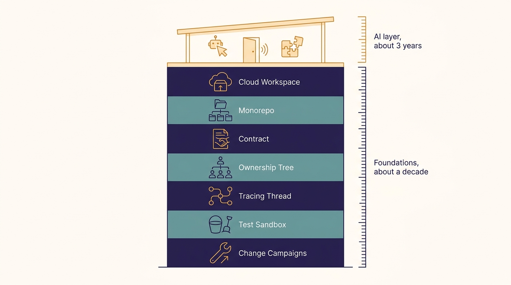
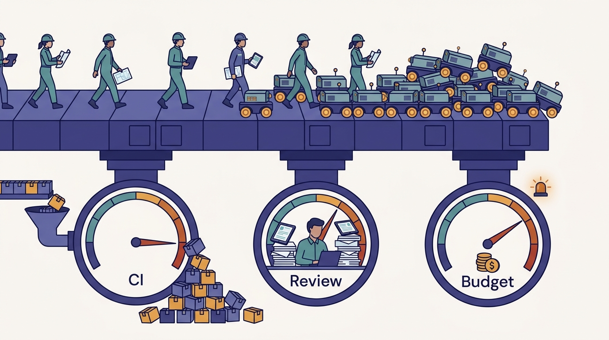
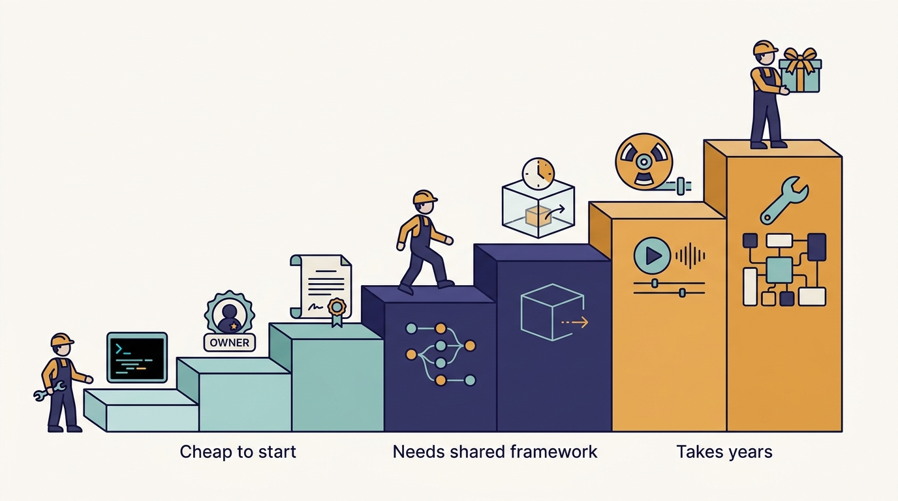

> **IN THIS CHAPTER, YOU WILL:** See the book's thesis as a concrete dependency map: each of Uber's AI-era developer systems, the pre-AI foundation it reuses, and the evidence for the link. You will also get the counter-arguments, and a checklist of seven properties that make developer infrastructure ready for agents.

> **WHY IT MATTERS:** Most AI-tooling decisions are framed as choices between harnesses, models and vendors. Uber's record suggests that the harness is the cheap, replaceable part, and that the outcome depends mostly on builds, contracts, ownership data, test environments and change tooling you either already have or must build anyway.

> **KEY POINTS:**
>
> * **Nearly every Uber AI system is a thin layer over an older platform.** Minion runs on DevPods, the MCP Gateway is generated from the Thrift/Protobuf IDL registry, Slate routes on Jaeger trace baggage, Capri hooks into standardized language frameworks, and Shepherd campaigns run across the monorepos. The AI layer took about three years. The layer underneath took about a decade.
> * **Foundations matter more to agents than to humans, and agents load them harder.** An engineer can ask a colleague who owns a service; an agent spends turns and tokens finding out, or guesses. The same agents that benefit from the foundations double CI jobs, flood review queues and burn through budgets, so the foundations become the limit on throughput.
> * **"AI-ready" is a set of properties you can audit, not a product you buy.** Standard builds, ownership metadata, typed contracts, propagated context, ephemeral environments, captured traffic and change campaigns are the seven properties to check. A company without them should build the minimum version of each, and can now buy much of it, before it scales agents.

> **BUILT ON:** The whole of Part I: in-house platforms and city-aware metadata ([[build-what-does-not-exist]]), per-language monorepos and Bazel ([[monorepos-and-one-build]]), DevPods ([[devpods]]), and the IDL registry, uOwn, Jaeger baggage and standardized language frameworks ([[contracts-and-context-propagation]]).

 
In his introduction to the October 2026 episode of *The Pragmatic Engineer*, Gergely Orosz summarized the tour that followed in two sentences: "The harness is the easy part. What's hard is all the things around them." The episode, a conversation with Uber Distinguished Engineer Uday Kiran Medisetty, walks through close to two dozen internal systems. Most of the AI-era ones are recent. Medisetty dated the Model Gateway to late 2023 and the MCP Gateway to around April 2025. The show notes date Minion to 2025. He said the skills monorepo started early in 2026 and that the Fox maintenance loop is "a few months old". Read that way, **Uber's AI tooling looks as if it was built in a year or two.**

It was not, and the point of this chapter is to show why in enough detail to be useful. Almost every one of those systems is a **thin layer over a platform Uber built between 2014 and 2022 for human engineers**: cloud workspaces, monorepos with one build command, a registry of typed service contracts, an ownership graph, distributed tracing whose context reaches every service, personal test environments inside production, and a platform for code changes across the whole codebase. Medisetty's own summary is the book's motto: "All the things that we built to make life easier for engineers, it makes it easier for our agents as well."

**Figure 1:** *The AI layer took about three years to build because it rests on foundations that took about a decade.*

"Have good foundations" is not a plan, so this chapter turns the claim into three tools: a **foundation→AI dependency map** with the evidence for each link, the **counter-reading** that says why Uber's experience may not transfer, and a definition of **AI-ready developer infrastructure** as seven properties a company can audit in itself. Parts I to III explain each system in depth; this chapter shows how they fit together.

## The Claim, Stated Precisely

"The harness is the easy part" can be heard as a slogan against harnesses. That is not what the record supports. A **harness** here means the agent runtime an engineer drives: Claude Code, Codex or OpenCode, the three Medisetty named as supported, wrapped at Uber by AIFX (see [[aifx-harness-layer]]). The thesis is about where the effort and the leverage sit, not about whether harnesses matter.

| The thesis says | The thesis does **not** say |
| --- | --- |
| The AI-era systems were fast to build because they reused pre-AI platforms. | That the AI systems were trivial. The MCP Gateway still needed generated descriptions, permissions and context-efficiency work. |
| Choosing a harness is a reversible decision; Uber designs for churn. | That harness choice has no effect on output quality or cost. |
| The pre-AI investments were made for engineers and turned out to serve agents. | That Uber planned them for agents. None of them was. |
| Foundations decide whether agents can verify their own work safely. | That foundations alone produce value; Uber still had to build the AI layer and rewire the lifecycle. |
| A company without the foundations should expect to build them while it adopts agents. | That a company must replicate Uber's decade. Much of the foundation can now be bought. |

The time claim needs the same care. The show notes say Uber's AI tooling "was seemingly built in a year: in reality, it was built on top of a decade worth of dev tooling investment." The documented record supports the decade: the program/platform reorganization that created a dedicated developer-platform group dates to spring 2014 ([Pragmatic Engineer, 2021](https://newsletter.pragmaticengineer.com/p/program-platform-split-uber)), and the last large foundation in this book, Slate, was described publicly in 2022 ([Uber, 2022](https://www.uber.com/blog/simplifying-developer-testing-through-slate)). The "year" is closer to three: the Model Gateway's lineage begins in 2023, and most agent-facing systems arrived in 2025 and 2026. The full dated record, with disputed dates reconciled, is in [[timeline]].

## The Dependency Map

The table below is the core of the book. Each row names an AI-era system, the pre-AI foundation it reuses, what the foundation contributes, and the evidence for the dependency itself (not just for the two systems). "POD" means Medisetty stated the link in the October 2026 episode; "SN" means Orosz's show notes; "DOC" means a dated written source describes the mechanism. Where a link is my reading, the row says so.

| AI-era system (year) | Foundation it stands on (year) | What the foundation supplies | Evidence for the link | Chapter |
| --- | --- | --- | --- | --- |
| **Minion**, background coding agent (2025) | DevPods (grew out of the 2017–2018 monorepo move); the **mega DevPod** with all repositories | A warm, pre-built cloud workspace that starts in seconds, has every repository and tool, and supports cross-repo PRs | POD and SN; the AI Engineer World's Fair 2026 talk describes agents claiming pre-provisioned "balloon pods" from a warm pool | [[minion]], [[devpods]] |
| Top-level **AGENTS.md / CLAUDE.md** that work "out of the box" | Per-language monorepos (2017–2018) and Bazel across all repositories | One way to build and test any module, so a single instruction file at the top is correct everywhere | POD | [[monorepos-and-one-build]] |
| **Model Gateway** and AI Guard (late 2023) | Michelangelo, the ML platform (public since 2017) | Projects, identity, serving and attribution; the gateway was created as a "GenAI product" on Michelangelo | POD; the 2024 GenAI Gateway post places the gateway inside Michelangelo's GenAI layer | [[model-gateway]] |
| **Spend tiers** and CostCheck (2026) | Model Gateway attribution per project and per user | Every request already carries a project and a caller, so spend can be shown and tiered per person | POD; Uber blog, Aug 2026 | [[token-spend-governance]] |
| **MCP Gateway** (work started around April 2025) | The Thrift/Protobuf **IDL registry**; the API/Edge Gateway team; Cadence; the service mesh | Machine-readable contracts for thousands of services; a team that already did protocol translation; a workflow engine to crawl the registry | POD and SN; the Oct 2026 MCP Gateway post describes AutoCrawler, a Cadence workflow that parses the IDLs, and proxied calls through the Muttley sidecar | [[mcp-gateway]], [[contracts-and-context-propagation]] |
| **Skills monorepo** (early 2026) | The monorepo habit and the MCP Gateway | One quality gate, one install path and one tool-access mechanism for every skill | POD | [[skills-monorepo]] |
| **Context graph** and Cortana (Dec 2025 →) | uOwn ownership data, the design-doc hub, incident tooling, data catalogs; the production graph platform team | The nodes and edges already existed in separate systems; a team that already ran a graph of billions of nodes | POD; the Aug 2026 Uber blog gives the graph's size and sources | [[context-graph]] |
| **Slate for agents** (agents deploy and test their branch) | Jaeger tracing (built 2015–16) and baggage; multitenancy (2020); Slate itself (2022) | Request-level routing of test traffic to a branch deployment, inside production, with no routing code in services | POD and SN; the 2022 Slate post documents the baggage key and routing agent | [[slate]] |
| **Capri** and MatchGuard (capture, replay, combination testing) | Standardized language frameworks; city and product dimensions; Slate | One middleware captures every service's traffic and downstream calls; dimensions say what a session represents | POD only; precedents Ballast and Shadower (2022) are documented | [[capri]] |
| **AI-based Shepherd** campaigns | Shepherd, OpenRewrite and module ownership in the monorepos | Per-module PRs routed to owners; campaign tracking | POD; Uber's Apr 2026 JUnit migration post | [[shepherd-and-fox]] |
| **Fox** (weekly self-improvement PRs, 2026) | Shepherd plus the skills monorepo; Piranha (2020) as precedent | Enrollment by service, PR generation per module, Sunday CI capacity | POD; a Sunday maintenance loop is described in talk summaries | [[shepherd-and-fox]] |
| **`aifx validate`** and self-healing CI | Bazel build rules, SubmitQueue (2019), CI policy jobs | Checks that can run locally because the build is hermetic and standard | POD and SN; the talk confirms validation moved into the agent's inner loop | [[inner-loop-and-self-healing-ci]] |
| **Code Inbox** risk score and the planned green lane | Years of diff, review and incident history; uReview (2025) | The data on which a risk model can be backtested | POD ("we can also backtest it with years of data") | [[code-review-signals]] |
| **Wisdom** and DebugAssist | The 2016 in-app bug reporter, app telemetry, feature-flag state, Minion | Bug reports that already carry logs, network calls and flags; a coding agent to hand the fix to | POD; the 2016 reporter is in Uber's Tech Stack post | [[wisdom-and-debug-assist]] |
| **Feature velocity** metrics | The design-doc hub linking PRDs, ERDs and tickets | The trail from product intent to PRs, so cycle time can be computed per feature | POD; the DX Annual 2026 talk confirms the move to feature velocity | [[feature-velocity]] |

Three patterns stand out once the rows are side by side.

**The AI system is usually a new interface to an old capability.** The MCP Gateway does not know anything the IDL registry did not already know; it presents that knowledge in a protocol agents speak. Slate for agents is the same Slate engineers used, plus a CLI and skills. Minion is a DevPod flavor plus an agent loop. The Uber blog post on the MCP Gateway (October 2026) makes the generation explicit: a cron-triggered Cadence workflow watches the registry, parses method names, schemas and doc comments, asks a model to write agent-friendly descriptions, and registers every generated tool as **disabled until its owner enables it** ([Uber, 2026](https://www.uber.com/blog/designing-mcp-gateway/)). The new work is description, permission and context efficiency, not integration.

**The teams carried over, not only the code.** Medisetty pointed out twice that the people who built the older platform built the new one: the API/Edge Gateway team built the MCP Gateway, and the graph platform team that runs Uber's production graph helped build the context graph. A foundation includes the team that knows how to operate it.

**Some foundations are data, not systems.** uOwn's ownership records, a decade of incident history, the design-doc trail and the city, product and payment dimensions that Capri tags are what make the context graph, risk scoring and feature-velocity metrics possible. [[build-what-does-not-exist]] argues that Uber's proprietary metadata is the asset that later becomes agent context; the table shows where.

---begin mermaid---
flowchart LR
    subgraph PRE["Pre-AI foundations, 2014 to 2022"]
        DP["DevPods and the mega DevPod"]
        MR["Monorepos and Bazel"]
        IDL["Thrift and Protobuf IDL registry"]
        OWN["uOwn, design docs, incidents"]
        JG["Jaeger baggage and multitenancy"]
        FW["Standardized language frameworks"]
        SH["Shepherd and OpenRewrite"]
        MA["Michelangelo"]
    end
    subgraph AIL["AI-era systems, 2023 to 2026"]
        MIN["Minion"]
        AG["AGENTS.md and aifx validate"]
        MCP["MCP Gateway"]
        CG["Context graph and Cortana"]
        SL["Slate for agents"]
        CA["Capri and MatchGuard"]
        FX["Fox and AI Shepherd campaigns"]
        MG["Model Gateway and spend tiers"]
    end
    DP --> MIN
    MR --> AG
    MR --> SH
    IDL --> MCP
    OWN --> CG
    MCP --> CG
    JG --> SL
    FW --> CA
    SL --> CA
    SH --> FX
    MA --> MG
    SL --> MIN
    MCP --> MIN
---end mermaid---
**Figure 2:** *The foundation→AI dependency map in one picture. Every AI-era system on the right has at least one pre-AI parent on the left, and the AI systems then depend on each other: Minion uses Slate and the MCP Gateway to verify and act, and the context graph is reached through the MCP Gateway's tools.*

## The Eleven Takeaways as One Argument

Orosz's show notes list "11 interesting learnings" from the episode. As a list they read like a tour. Reordered, they make a four-step argument, and each step has a part of this book.

| Step in the argument | Show-note takeaways | What it establishes | Where the book develops it |
| --- | --- | --- | --- |
| **1. Uber had to build what did not exist** | 1 (service count), 2 (uOwn, M3DB, Cadence, Morpheus built in-house), 3 (cities as a first-class concept) | A decade of in-house platforms left behind standard builds, contracts, ownership data and city-aware metadata | Part I: [[build-what-does-not-exist]], [[monorepos-and-one-build]], [[devpods]], [[contracts-and-context-propagation]] |
| **2. The AI layer was built to survive churn** | 4 (one model gateway, model- and harness-agnostic since 2023), 5 (AIFX), 6 (spend tiers, CostCheck) | Gateways and wrappers make models and harnesses replaceable and make spend visible | Part II: [[model-gateway]] to [[token-spend-governance]] |
| **3. Agents moved the bottleneck** | 7 (review is the bottleneck; signals in Code Inbox), 8 (CI code red, `aifx validate`), 9 (PRs tagged by type) | More output exposes review, CI and measurement as the limits | Part III and [[feature-velocity]] |
| **4. The work changed, and the foundations explain the speed** | 10 (the engineer builds context), 11 (built in a year on a decade of investment) | The job shifts to specifying, verifying and building systems that build software | [[the-engineer-as-context-builder]], [[the-retrofit-playbook]] |

Step 3 is the one most readers skip. The thesis is usually told as a story about enablement: old platforms made new tools easy. The episode also shows the reverse. **The same agents that benefit from the foundations load them harder than humans ever did.** Medisetty said the number of CI jobs "doubled or more than doubled" year over year, which led Uber to declare an internal "code red" for CI in 2026 (see [[inner-loop-and-self-healing-ci]]). He described code review as "a big bottleneck, same as like any other company." And the spending record is public: *Fortune* reported in May 2026 that Uber had used its 2026 AI-tools budget within about four months ([Fortune, 2026](https://www.fortune.com/2026/05/26/uber-coo-ai-spending-tokens-claude-code/)), and Uber's own August 2026 post describes the tiering, alerts and defaults it then introduced ([Uber, 2026](https://www.uber.com/us/en/blog/efficient-software-factory/)). A foundation that was sized for several thousand engineers is now serving them and their agents.

**Figure 3:** *The agents that benefit from the foundations also load them harder: CI jobs doubled, review became a bottleneck and the budget ran out early.*

## Why Foundations Matter More to Agents Than to Humans

A human engineer works around missing infrastructure: they ask in a channel who owns a service, ask a colleague which build is current, and test carefully in staging. An agent has none of that tacit knowledge, and a missing foundation shows up in four ways.

1. **Discovery costs turns.** Every fact an agent must find by exploration (which build tool, who owns this, which table holds cash trips) is a tool call, a model turn and tokens. Medisetty described the context graph as a response to traces showing Cortana spending turns getting "grounding" across siloed systems. Uber's August 2026 post gives a worked example: a graph-grounded query took 38 seconds and was correct; without the graph it took 20 minutes 9 seconds and was wrong ([Uber, 2026](https://www.uber.com/us/en/blog/efficient-software-factory/)). That is one example chosen by Uber, not a benchmark, but it shows the mechanism.
2. **Ambiguity becomes error.** A human who meets two build systems asks which one is current. An agent picks one. A standard build contract (see [[monorepos-and-one-build]]) removes the choice, which is why Medisetty said one top-level instruction file gives most teams "really good value" without per-module setup.
3. **Unverified work cannot be delegated.** An agent that cannot test its change end to end hands an unverified PR to a human, which moves the work into review. Medisetty was direct about this: "If we did not have systems like Slate, it would have been really hard for agents to self-validate." Self-verification needs environments, test accounts, routing and captured traffic, which are exactly the foundations that take years (see [[slate]] and [[capri]]).
4. **Scale needs a change platform.** Agents make it cheap to propose a change in every module. Without per-module ownership, PR generation and campaign tracking (see [[shepherd-and-fox]]), that cheapness produces an unreviewable pile of PRs.

There is also a security reason. An agent acting for a person should see only what that person may see. Medisetty said the context graph and Cortana "carry forward all of the existing user permissions". Uber's May 2026 post on agent identity describes the mechanism behind such claims: tokens that carry an actor chain (user, then agent, then sub-agent) and are exchanged per hop ([Uber, 2026](https://www.uber.com/us/en/blog/solving-the-agent-identity-crisis/)). That only works because Uber already had service identity and an access-control system. **Permission-preserving agents are a foundation property, not an agent feature.**

The industry evidence points the same way. Google's DORA 2025 report found that AI is an amplifier: it magnifies the strengths of high-performing organizations and the dysfunctions of struggling ones, and adoption still correlates with lower delivery stability ([DORA, 2025](https://research.google/pubs/dora-2025-state-of-ai-assisted-software-development-report/)). DORA's platform-engineering capability page states that the effect of AI adoption on organizational performance is strong and positive when platform quality is high and negligible when it is low ([DORA](https://dora.dev/capabilities/platform-engineering/)). Faros AI's telemetry from more than 10,000 engineers found PR review time up 91% under high AI adoption ([Faros AI, 2025](https://www.faros.ai/blog/ai-software-engineering)). That data is correlational, but it matches what Medisetty described at Uber.

---begin mermaid---
flowchart LR
    A["Spec in the design-doc hub"] --> B["Agent on a DevPod"]
    B --> C["Ground in the context graph"]
    C --> D["Change code with one build command"]
    D --> E["aifx validate in the inner loop"]
    E --> F["Deploy branch to Slate"]
    F --> G["Replay captured sessions with Capri"]
    G --> H["PR with evidence in Code Inbox"]
    H --> I["Human review and SubmitQueue"]
    E -.->|"fails"| D
    G -.->|"delta wrong"| D
---end mermaid---
**Figure 4:** *The agent's path from spec to merged PR at Uber, as described in the episode. Every box except the agent loop itself is either a pre-AI system or an AI-era interface to one; the two dashed loops are the self-verification that only safe test infrastructure makes possible.*

## The Counter-Reading

A thesis that explains everything deserves suspicion. Five objections are strong enough that a reader should weigh them before acting on the map.

**Uber's scale and budget are not yours.** Uber has several thousand engineers across 12 tech sites (estimates range from about 3,000 in the tech function to about 5,000 engineers, depending on the source and what is counted), thousands of services and a dedicated developer-platform organization since 2014. Some foundations exist because of that scale: a mega DevPod with every repository, or a context graph with tens of millions of nodes, solves problems a 50-person company does not have. **The properties transfer; the implementations often do not.**

**The account is single-source and retrospective.** Most facts about the AI-era systems come from one conversation with one senior engineer who leads the work, and the show notes' "built in a year" framing is the host's. Written Uber sources from 2026 confirm much of it (the MCP Gateway, spend tiers, skills counts, the context graph's existence, Shepherd's use) but not all: AIFX as a multi-harness wrapper, Capri, MatchGuard, Fox and the green lane are podcast-only as of October 2026. A retrospective tour naturally connects the dots that turned out to matter and leaves out the foundations that did not pay off.

**Survivorship.** We hear about Uber because its foundations worked well enough to talk about. Companies with comparable investments whose AI programs stalled do not record podcasts. Uber's own record contains one useful corrective: its April 2026 JUnit migration post says that bulk migration with generative AI was tried and failed, and deterministic OpenRewrite recipes did the work ([Uber, 2026](https://www.uber.com/us/en/blog/junit-migration/)). Foundations are not sufficient, and not every AI application on top of them succeeds.

**The numbers are elastic.** Uber's share of agent-produced PRs is about 10% of committed code (the CEO on a May 2026 earnings call), 11% in March to May 2026, about 15% via Minion in the October episode, and "more than 70%" attributed to local or cloud agents in the August 2026 material. These measure different things: autonomous authorship versus any agent involvement. None of them alone shows that foundations caused the outcome. The book always states which figure it uses.

**Foundations are now partly for sale.** Uber built its workspaces, gateways and test routing because, as Medisetty said of the early years, there was "not much off-the-shelf software" at its scale. In 2026 a company can buy cloud workspaces, an LLM gateway such as LiteLLM (in the Thoughtworks Technology Radar's Trial ring since October 2024) ([Thoughtworks, 2026](https://www.thoughtworks.com/en-us/radar/languages-and-frameworks/litellm)), request-level sandboxes on Kubernetes (Signadot routes on a key carried in trace baggage, and its legacy header used Jaeger's `uberctx-` prefix, per [its docs](https://signadot.com/docs/guides/set-up-context-propagation)), and OpenRewrite for change campaigns. **The decade is not a price every company must pay again**, which strengthens the practical advice of this book while weakening the claim that Uber's head start is impossible to match.

Taken together, the objections change the thesis from "copy Uber's foundations" to "audit your own against the properties Uber's foundations provide, and close the gaps that block agents from verifying their work." That is the version the rest of the book uses.

## AI-Ready Developer Infrastructure: Seven Properties

**AI-ready developer infrastructure** is developer infrastructure in which an agent can find what it needs, build and test any change in a standard way, verify the change safely against realistic behavior, and propose it to an accountable owner, without relying on tacit human knowledge. The definition is mine; the properties below are derived from the dependency map. Each one is something Uber built for humans first.

| # | Property | What it means | Uber's instance | Test question for your organization | Minimum viable version |
| --- | --- | --- | --- | --- | --- |
| 1 | **Standard builds** | One command builds and tests any module; the same for humans, CI and agents | Per-language monorepos, Bazel across all repositories | Can an agent build and test a module it has never seen, using only the top-level AGENTS.md? | One documented build and test entry point per repository, enforced in CI |
| 2 | **Ownership metadata** | Every service, table and asset has an owner and an on-call that software can query | uOwn | Can a script, not a person, answer "who owns this and who is on call"? | An ownership file per service plus a catalog such as Backstage |
| 3 | **Typed contracts** | Service interfaces are machine-readable and registered in one place | Thrift and Protobuf IDLs in one registry | Could you generate a tool description for every internal API from files you already have? | OpenAPI or Protobuf for every service, in one discoverable registry |
| 4 | **Propagated context** | Request context (trace IDs, tenancy, test flags) reaches every hop | Jaeger baggage, later OpenTelemetry baggage; standardized frameworks | If you add a header at the edge, does it arrive at the deepest service in the call graph? | OpenTelemetry in the shared service framework, with propagation tests |
| 5 | **Ephemeral environments** | Workspaces and test environments can be created in seconds or minutes, per person or per agent, and expire | DevPods, the mega DevPod, Slate (two-day default lifetime) | Can an agent get a workspace and a running copy of its branch without filing a ticket? | Cloud workspaces plus per-PR preview or sandbox environments |
| 6 | **Captured traffic** | Realistic production behavior can be replayed safely against a change | Capri, MatchGuard; earlier Ballast and Shadower | Can you replay last week's requests for one product and one region against a branch? | Recorded request fixtures for the riskiest flows, scrubbed of personal data |
| 7 | **Change campaigns** | A change across many modules is split per owner, tracked and landed in waves | Shepherd with OpenRewrite; Fox for recurring maintenance | Can you upgrade a library across every repository and see which owners have not merged? | OpenRewrite or codemods plus a tracking dashboard and per-owner PRs |

Two further properties belong to the AI layer itself rather than to the pre-AI foundation, so they are not in the seven: **one entry point for models and tools** (the gateways of Part II) and **historical outcome data** (years of diffs, reviews and incidents for backtesting risk). Both depend on the seven: the MCP Gateway is only as good as the contracts it is generated from, and a risk score is only as good as the ownership and incident data it learns from.

The properties also have an order. Properties 1 to 3 pay off for human engineers immediately and are cheap to start. Properties 4 and 5 take longer and depend on a shared service framework. Properties 6 and 7 are where Uber spent years, and they are what lets agents move from maintenance PRs to feature work, which is exactly the progression Medisetty described for Minion: it "started with maintenance kind of tasks" and its scope grows "as we are adding more and more tools" for self-validation.

**Figure 5:** *The seven properties have an order: standard builds, ownership and contracts pay off first, while captured traffic and change campaigns take years and let agents move beyond maintenance.*

## Elsewhere in the Industry

**Stripe** runs its background agents, also called Minions, on pre-warmed devboxes ready in about 10 seconds, with a central internal MCP server, Toolshed, and a cap of two CI rounds before a human takes over ([Stripe, 2026](https://stripe.dev/blog/minions-stripes-one-shot-end-to-end-coding-agents)). **Spotify** built its background agent Honk on Fleet Management, which since mid-2024 has produced about half of Spotify's PRs through deterministic transformations ([Spotify, 2025](https://engineering.atspotify.com/2025/11/spotifys-background-coding-agent-part-1)). Both follow the same shape: workspace, tool gateway or change platform first, agent loop on top. The difference is breadth. Stripe and Spotify each describe one or two AI systems on their foundations; Uber's episode describes an AI layer on almost every foundation at once, which makes its record useful as a map and hard to copy in one step.

## If You Are Not Uber

The practical version of the thesis is a sequence: **audit the seven properties, fix the ones that block verification, and only then scale autonomous agents.** Interactive harnesses can be adopted at any point; they are the easy part and they are reversible.

| Company size | Foundations to have first | AI layer that fits | Buy, build or open source | What not to copy |
| --- | --- | --- | --- | --- |
| **≈50 engineers** | One build command per repository; AGENTS.md in every repository; owners in a file; preview environments from the CI provider | Interactive harnesses with shared instructions and a handful of skills; a vendor's hosted background agent on low-risk tasks | Buy almost everything: hosted CI, cloud workspaces, an LLM gateway proxy or the vendor's own controls | A gateway platform, a context graph, a custom background agent |
| **≈500 engineers** | A software catalog with owners; OpenAPI or Protobuf contracts in one registry; OpenTelemetry in the shared framework; cloud workspaces | One model gateway with per-user attribution; a curated skills repository; MCP servers generated from the contract registry; a background agent that stops at a draft PR | Open source and buy: LiteLLM or a cloud AI gateway, Backstage, OpenRewrite, a sandbox product for request routing | Building your own workspace platform or tracing system; auto-landing PRs |
| **≈5,000 engineers** | All seven properties, with a developer-platform organization that owns them | Uber's full set becomes relevant: harness wrapper, tool gateway, context graph, spend tiers, self-verification, campaign agents | Build where your metadata is unique (ownership, domain dimensions, risk data); buy the commodity layers | Copying Uber's tool names and shapes instead of its properties; a mega workspace if your repository layout does not need it |

Three pieces of advice hold at every size.

- **Start where humans already feel the pain.** Every foundation in the map was justified by human productivity first. A foundation built "for agents" with no human benefit is hard to fund and easy to abandon when the harness changes.
- **Treat verification as the gating property.** The amount of work you can safely give agents is bounded by what they can verify. Invest in ephemeral environments and realistic test data before you invest in more autonomy.
- **Budget for the load.** Plan CI capacity, review capacity and token spend before agents multiply PRs. Uber's code red and budget overrun are the predictable result of skipping this step.

The sequenced playbook, with a 12-month roadmap and a readiness assessment, is in [[the-retrofit-playbook]].

## Failure Modes

- **Buying the harness and calling it a strategy.** A company rolls out a coding harness to every engineer, sees early enthusiasm, and then finds that agents cannot build half the repositories, cannot find owners and cannot test changes. Output rises; merged value does not.
- **Foundations built for agents only.** A team builds an MCP server per service by hand, without a contract registry underneath. The servers drift from the APIs, descriptions go stale, and nobody owns them. Uber's generated, disabled-by-default approach avoids this because it rests on contracts that teams already maintain.
- **Autonomy ahead of verification.** Background agents open PRs that no environment has tested. Review becomes the verification step, review time rises, and reviewers start approving PRs they have not read.
- **The foundation becomes the throttle.** CI, review or the token budget saturates. Uber's response (move checks into the inner loop, add review signals, introduce spend tiers) works only if someone owns each constraint before it breaks.
- **Treating Uber's numbers as targets.** "15% of PRs from a background agent" becomes a goal and is met with trivial PRs; [[feature-velocity]] explains why Uber itself moved away from counting PRs.
- **Copying shapes instead of properties.** A smaller company builds a skills monorepo and a context graph while its builds are still inconsistent. The order matters more than the inventory.

## What the Record Does Not Say

- **How much the foundations cost, and what share of the AI layer's cost they saved.** Uber has not published team sizes or budgets for DevPods, Slate, Capri or the gateways. The thesis is qualitative.
- **Which foundations did not help.** The episode names the ones that paid off. Whether Uber has pre-AI systems that turned out to be irrelevant or obstructive for agents is not described.
- **How complete the foundations are.** Medisetty mentioned an AI-based Shepherd campaign to "fix context propagation across all the services", which suggests that propagation coverage, a property this chapter treats as present, is still being hardened.
- **How the AI-era systems fail.** The record has success metrics (adoption, PR share, cost per session) but almost no published failure rates for agent PRs, self-healing CI or Slate-based verification.
- **Whether the order was planned.** Nothing suggests Uber sequenced its foundations with agents in mind. The map is a retrospective reading, mine and Medisetty's, not a plan Uber executed.

## Questions to Ask

1. Which of the seven properties do we have, partly have, or lack? Who owns each one?
2. Can an agent build and test a module in our largest repository using only the instructions at its top level? What happens when it tries?
3. Where would an agent spend its first ten turns on a typical task, and how many of those turns are discovery that a registry or graph could answer?
4. What is the most realistic environment in which an agent can verify a change today, and who has to approve its creation?
5. Which of our internal APIs have machine-readable contracts, and could we generate tool descriptions from them this quarter?
6. What will break first if PR volume doubles: CI capacity, review time or the token budget? What is our plan for it?
7. Which of our proprietary metadata (ownership, domain dimensions, incident history) would make agents more accurate if it were queryable?
8. Which foundations should we buy rather than build, given our size, and which encode something unique to our business?
9. Are we measuring agent output by PR count, or by features and outcomes?

The next page, [[timeline]], puts dates on every system in the map and reconciles the places where the episode and the written record disagree. After it, Part I begins with [[build-what-does-not-exist]], the story of why Uber built so much in-house and what that left behind.

## Sources and Evidence

### The source episode

- [Uber's AI infra, from the inside](https://newsletter.pragmaticengineer.com/p/ubers-ai-infra-from-the-inside) — *The Pragmatic Engineer* podcast, Gergely Orosz with Uday Kiran Medisetty, 2026; the systems, the dependency links, the quotes and the show notes' eleven takeaways.

### Uber engineering sources

- [Designing MCP Gateway: Uber's MCP Management Platform](https://www.uber.com/blog/designing-mcp-gateway/) — Alok Srivastava, Deepanshu Mehndiratta, Gaurav Gill, Uber blog, 2026; AutoCrawler over the IDL registry, generated descriptions, disabled-by-default tools.
- [Running a Software Factory Efficiently at Uber Scale](https://www.uber.com/us/en/blog/efficient-software-factory/) — Uday Kiran Medisetty, Uber blog, 2026; context-graph size and the 38-second example, spend tiers, cost results.
- [Solving the Identity Crisis for AI Agents](https://www.uber.com/us/en/blog/solving-the-agent-identity-crisis/) — Matt Mathew, Prasad Borole, Meng Huang, Uber blog, 2026; actor-chain tokens behind permission-preserving agents.
- [How Uber Executed A JUnit Migration at Massive Scale](https://www.uber.com/us/en/blog/junit-migration/) — Anshuman Mishra, Kaushik Vejju, Uber blog, 2026; Shepherd's per-target diffs and the failed generative-AI bulk migration.
- [Simplifying Developer Testing Through SLATE](https://www.uber.com/blog/simplifying-developer-testing-through-slate) — Ankit Srivastava, Alok Srivastava, Rohan Rathi, Uber blog, 2022; baggage-based routing of test traffic.
- [Navigating the LLM Landscape: Uber's Innovation with GenAI Gateway](https://www.uber.com/blog/genai-gateway/) — Tse-Chi Wang, Roopansh Bansal, Uber blog, 2024; the gateway's documented predecessor on Michelangelo.
- [Agentic SDLC at Uber: Building Blocks for Uber's Software Factory](https://ai.engineer/talks/17-YSUHo6Lk-agentic-sdlc-at-uber-building-blocks-ubers) — Uday Kiran Medisetty, Adam Huda, AI Engineer World's Fair, 2026; mega DevPod warm pools and inner-loop validation.
- [The Platform and Program Split at Uber](https://newsletter.pragmaticengineer.com/p/program-platform-split-uber) — Gergely Orosz, *The Pragmatic Engineer*, 2021; the 2014 reorganization that created the developer-platform group.
- [How Uber uses AI for development: inside look](https://newsletter.pragmaticengineer.com/p/how-uber-uses-ai-for-development) — Gergely Orosz, *The Pragmatic Engineer*, 2026; 11% of PRs opened by agents and the earlier tool inventory.
- [Uber's COO says it's getting harder to justify AI spend](https://www.fortune.com/2026/05/26/uber-coo-ai-spending-tokens-claude-code/) — *Fortune*, 2026; the 2026 AI-tools budget used within about four months.

### Industry and research sources

- [DORA 2025 State of AI-assisted Software Development Report](https://research.google/pubs/dora-2025-state-of-ai-assisted-software-development-report/) — DORA / Google, 2025; AI as an amplifier of existing strengths and dysfunctions.
- [DORA capabilities: Platform engineering](https://dora.dev/capabilities/platform-engineering/) — DORA, current; platform quality moderates the effect of AI adoption.
- [The AI Productivity Paradox Report 2025](https://www.faros.ai/blog/ai-software-engineering) — Faros AI, 2025; review time up 91% under high AI adoption.
- [Minions: Stripe's one-shot, end-to-end coding agents](https://stripe.dev/blog/minions-stripes-one-shot-end-to-end-coding-agents) — Alistair Gray, Stripe, 2026; devboxes, Toolshed and the two-CI-round cap.
- [1,500+ PRs Later: Spotify's Journey with Our Background Coding Agent](https://engineering.atspotify.com/2025/11/spotifys-background-coding-agent-part-1) — Max Charas, Marc Bruggmann, Spotify, 2025; Honk on top of Fleet Management.
- [LiteLLM (Technology Radar)](https://www.thoughtworks.com/en-us/radar/languages-and-frameworks/litellm) — Thoughtworks, 2026; the gateway pattern as buyable infrastructure.

Statements about Uber's AI-era systems are Uber's own account unless another source is cited; recommendations and labeled inferences are the author's judgement.
