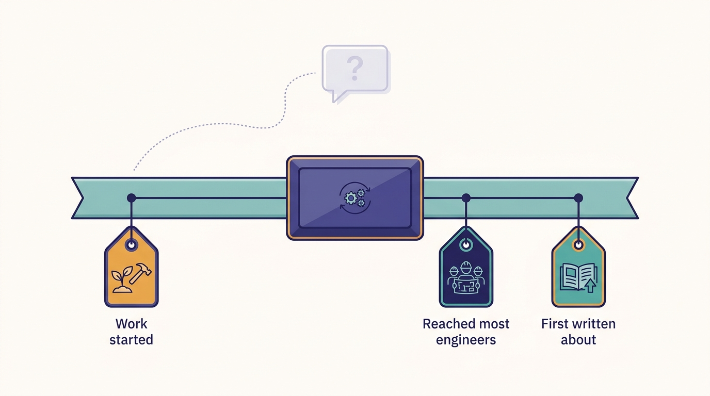
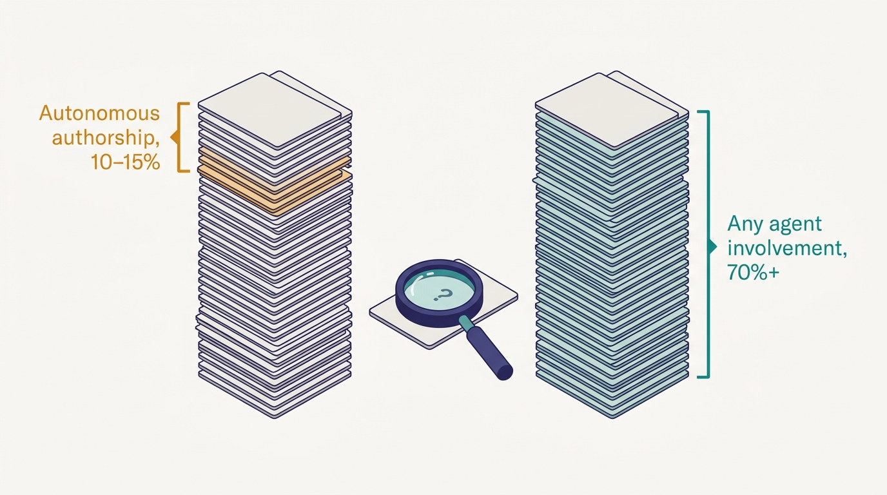

> **IN THIS PAGE, YOU WILL:** Get a dated, sourced record of Uber's developer platform in six eras, from the two-service architecture of 2014 to the agent-heavy "software factory" of 2026. Every entry carries its source and an evidence label, and a reconciliation table settles the disputed dates and counts that the rest of the book relies on.

> **WHY IT MATTERS:** The book's thesis is a claim about time: the AI layer took about three years because the foundations took about a decade. That claim is only as good as its dates, and several dates in the source episode are recollections that the written record corrects.

> **KEY POINTS:**
>
> * **The foundations came first, by four to ten years.** Jaeger (built 2015–16), the IDL registry (Thrift by 2016), the monorepos (2017–18), Michelangelo (2015–) and Slate (described in 2022) all predate the AI systems that reuse them: the Model Gateway (late 2023), the MCP Gateway (2025), Minion (2025) and agent use of Slate (2026).
> * **Episode dates are recollections; this book uses documented dates where they exist.** Jaeger was built in 2015–16 and open-sourced in April 2017, not built in "2017–18". DevPods grew out of the 2017–2018 monorepo move, while the episode dates them to 2017. Uber's service count depends on what is counted.
> * **Every number is a snapshot with a definition.** The share of PRs from agents is about 10%, 11%, about 15% or more than 70% depending on the date and whether it counts autonomous authorship or any agent involvement. Read each figure with its date and source.

 
Uber's AI developer tooling is easy to date: almost all of it appeared between late 2023 and October 2026, and much of it was first described in public in 2026. The platform under it is harder to date, because it grew over a decade, was described in blog posts written years after the work began, and is now remembered in interviews by people who built it. **The same system can carry three dates**: when the work started, when it reached most engineers, and when Uber first wrote about it.

**Figure 1:** *The same system can carry three dates, so this page states which one each entry uses and how we know it.*

This page is the book's canonical record of those dates. It is organized in six eras, each with a table of events. Each entry says what happened, when, and how we know. The first figure shows the eras at a glance; the last section, "Disputed Dates and Counts", reconciles the conflicts. Chapters cite this page rather than repeating the reasoning. The thesis that the dates support is argued in [[the-harness-is-the-easy-part]].

## How to Read the Entries

Each entry carries one evidence label.

| Label | Meaning | How much weight to give it |
| --- | --- | --- |
| **POD** | Stated by Uday Kiran Medisetty in the October 2026 *Pragmatic Engineer* episode | Uber's own account, single source, often from memory |
| **SN** | Stated in Gergely Orosz's show notes for the episode | The host's summary of the episode |
| **HOST** | Said by Orosz in the episode, from his own time at Uber (2016–2020) | Recollection by a former Uber manager |
| **DOC yyyy** | Stated in a dated Uber blog post, paper, talk or Pragmatic Engineer article | Documented; the year is the publication year, which may be later than the event |
| **IND yyyy** | An industry event outside Uber, for context | Documented |
| **PRESS yyyy** | Reported by the press about Uber | Secondary; Uber has not confirmed it in writing |

A month is given when the source gives one. "c." marks an approximate date. A DOC entry dated earlier than its publication year relies on the source's own dating of the event.

---begin mermaid---
flowchart LR
    E1["2014 to 2016: Hypergrowth and the first platforms"] --> E2["2017 to 2019: Monorepos, open source, standard languages"]
    E2 --> E3["2020 to 2022: Consolidation, testing in production, portability"]
    E3 --> E4["2023 to 2024: Cloud deals and the GenAI layer"]
    E4 --> E5["2025: Tools and workspaces for agents"]
    E5 --> E6["2026: The software factory and its bill"]
---end mermaid---
**Figure 2:** *Six eras of Uber's developer platform. The first three built the foundations for human engineers; the last three built the AI layer on top of them, in about a third of the time.*

## Era 1, 2014–2016: Hypergrowth and the First Platforms

Uber was adding cities, products and engineers faster than any vendor's tooling could follow. Most of the platforms that later matter for agents (tracing, metrics, ownership, experimentation, the mobile gateway) start here, and so does the organizational decision to fund them.

| When | Event | Label | Source |
| --- | --- | --- | --- |
| 2014 | Two-service architecture: `dispatch` handles rider and driver traffic, `api` handles post-trip work; the first gateway routes by a `messageType` field with about 15 commands | DOC 2020 | [Edge Gateway](https://www.uber.com/blog/gatewayuberapi/) |
| Spring 2014 | "Programs & Platforms" reorganization: 16 program teams and 11 platform teams at once; Developer Platform owns CI/CD and developer experience | DOC 2021 | [Platform and Program Split](https://newsletter.pragmaticengineer.com/p/program-platform-split-uber) |
| 2014 | First own data center (SJC), then DCA | DOC 2023 | [Move to the Cloud, Part 1](https://newsletter.pragmaticengineer.com/p/uber-move-to-cloud) |
| Late 2014 | Metrics on Graphite with no replication; M3 replaces it in 2015, first on Cassandra | DOC 2018 | [M3](https://www.uber.com/blog/m3/) |
| Jan 2015 | A new mobile gateway is bootstrapped; it becomes RTAPI, a large Node.js service (800K requests a second at peak, later) | DOC 2020 | [Edge Gateway](https://www.uber.com/blog/gatewayuberapi/) |
| Early 2015 | TChannel RPC protocol carries trace fields; the NYC Observability group starts, with a two-engineer tracing team | DOC 2017 | [Evolving Distributed Tracing](https://www.uber.com/blog/distributed-tracing/) |
| Apr 2015 | 300 operational cities | DOC 2016 | [Tech Stack, Part I](https://www.uber.com/blog/tech-stack-part-one-foundation/) |
| May 2015 | Medisetty joins the real-time API team; he recalls "two services" (Dispatch in Node.js, API in Python) and about 600 engineers | POD | The episode |
| c. 2015 | Morpheus, for feature flags and A/B tests, is built (dated "7+ years ago" in 2022) | DOC 2022 | [Supercharging A/B Testing](https://www.uber.com/blog/supercharging-a-b-testing-at-uber/) |
| Fall 2015 | About 500 microservices | DOC 2017 | [Evolving Distributed Tracing](https://www.uber.com/blog/distributed-tracing/) |
| 2015–2016 | Jaeger built; adopted internally in 2016, in hundreds of services | DOC 2017 | [Evolving Distributed Tracing](https://www.uber.com/blog/distributed-tracing/) |
| 2015–2016 | About 500 million metrics a second, beyond any vendor; M3DB follows | POD; DOC 2018 | The episode; [M3](https://www.uber.com/blog/m3/) |
| Mid 2015–2016 | Michelangelo development begins in mid-2015, because there was "no established path to deploying a model into production"; Michelangelo 1.0 era is 2016–2019 | DOC 2017, 2024 | [Meet Michelangelo](https://www.uber.com/blog/michelangelo-machine-learning-platform/); [From Predictive to Generative](https://www.uber.com/blog/from-predictive-to-generative-ai/) |
| By Jul 2016 | Python, Node.js, Go and Java are the service languages; Thrift is the interface definition language (IDL); employees run beta apps with an in-app feedback reporter that files bug tasks | DOC 2016 | [Tech Stack, Part I](https://www.uber.com/blog/tech-stack-part-one-foundation/) |
| 2015 (as heard) | uOwn, the ownership registry, built because "no such vendor existed" | SN | The show notes |

## Era 2, 2017–2019: Monorepos, Open Source and Standard Languages

Service sprawl turned into a tooling problem: thousands of repositories, many build systems, and no way for a central team to upgrade a library everywhere. Uber's answer, per-language monorepos with one build system, is the foundation that later lets one instruction file serve every agent (see [[monorepos-and-one-build]]).

| When | Event | Label | Source |
| --- | --- | --- | --- |
| Early 2017 | More than 2,000 microservices | DOC 2017 | [Evolving Distributed Tracing](https://www.uber.com/blog/distributed-tracing/) |
| 2017 | The "before" state: thousands of repositories, 10+ languages, 4,000+ services, 9+ build tools | DOC 2022 | [Devpod](https://www.uber.com/blog/devpod-improving-developer-productivity-at-uber/) |
| 2017 | Cadence, the durable workflow engine, is open source "since 2017", per its repository; by 2023 Uber reports 12 billion executions a month | DOC 2023 | [Cadence repository](https://github.com/cadence-workflow/cadence); [Announcing Cadence 1.0](https://www.uber.com/blog/announcing-cadence/) |
| Apr 2017 | Jaeger open-sourced; CNCF incubation Sep 2017; graduated Oct 2019 | DOC 2017 | [Evolving Distributed Tracing](https://www.uber.com/blog/distributed-tracing/) |
| Sep 2017 | Michelangelo described publicly for the first time | DOC 2017 | [Meet Michelangelo](https://www.uber.com/blog/michelangelo-machine-learning-platform/) |
| 2017–2018 | Move from micro-repos to one monorepo per language (Go, Java, iOS, Android); iOS first, then Android | POD; DOC 2022 | The episode; [Devpod](https://www.uber.com/blog/devpod-improving-developer-productivity-at-uber/) |
| 2017 (as dated by the host) | DevPods, cloud developer workspaces, "being developed" | HOST; SN | The episode; see "Disputed Dates" |
| c. 2017 | Multi-zone and multi-region push begins: "two regions and around 10 zones" | DOC 2023 | [Move to the Cloud, Part 1](https://newsletter.pragmaticengineer.com/p/uber-move-to-cloud) |
| Late 2017–mid 2019 | Piranha generates cleanup diffs for 1,381 stale feature flags; about two-thirds merged unmodified | DOC 2020 | [Piranha, ICSE-SEIP](https://2020.icse-conferences.org/details/icse-2020-Software-Engineering-in-Practice/16/Piranha-Reducing-Feature-Flag-Debt-at-Uber) |
| Early 2018 | Go monorepo launched on Bazel | DOC 2020 | [Go Monorepo with Bazel](https://www.uber.com/blog/go-monorepo-bazel/) |
| 2018 | Up (portable microservices) and Crane (infrastructure stack) start | DOC 2022, 2023 | [Crane](https://www.uber.com/blog/crane-ubers-next-gen-infrastructure-stack/); [Up](https://www.uber.com/blog/up-portable-microservices-ready-for-the-cloud/) |
| Aug 2018 | M3 open-sourced as a metrics platform: 500 million metrics a second aggregated | DOC 2018 | [M3](https://www.uber.com/blog/m3/) |
| 2018–2019 | Go and Java chosen as primary languages | POD | The episode (no written policy found) |
| 2019 | SubmitQueue paper: speculative merge queue; iOS mainline had been green only 52% of the time before it | DOC 2019 | [Keeping Master Green at Scale](https://blog.acolyer.org/2019/04/18/keeping-master-green-at-scale/) |
| 2019 | More than 2,200 microservices | DOC 2020 | [Edge Gateway](https://www.uber.com/blog/gatewayuberapi/) |
| c. 2019 | PHX data center built to replace SJC | DOC 2023 | [Move to the Cloud, Part 1](https://newsletter.pragmaticengineer.com/p/uber-move-to-cloud) |
| 2019–2020 | Engineering expands across sites; 12 global tech sites by 2026 | POD | The episode |

## Era 3, 2020–2022: Consolidation, Testing in Production and Portability

Uber organized its services into domains, rebuilt the mobile gateway, made services portable across zones and clouds, and turned trace context into a way to route test traffic inside production. This era produces the self-verification foundation that agents later depend on most (see [[contracts-and-context-propagation]] and [[slate]]).

| When | Event | Label | Source |
| --- | --- | --- | --- |
| Mar 2020 | Multitenancy design: tenancy attached at the edge and propagated through Jaeger context; test builds run alongside production instead of a parallel staging stack | DOC 2020 | [Multi-tenancy](https://www.uber.com/blog/multitenancy-microservice-architecture/) |
| Mar 2020 | Piranha open-sourced; about 2,000 stale flags removed | DOC 2020 | [Introducing Piranha](https://www.uber.com/blog/piranha/) |
| May 2020 | Go monorepo: 70,000+ files, about 900 monthly active developers | DOC 2020 | [Go Monorepo with Bazel](https://www.uber.com/blog/go-monorepo-bazel/) |
| Jul 2020 | Domain-Oriented Microservice Architecture (DOMA): about 2,200 critical microservices in 70 domains | DOC 2020 | [DOMA](https://www.uber.com/blog/microservice-architecture/) |
| Aug 2020 | Edge Gateway, the Go successor to RTAPI, described (Medisetty is a co-author) | DOC 2020 | [Edge Gateway](https://www.uber.com/blog/gatewayuberapi/) |
| Mid 2020 | Up reaches general availability | DOC 2023 | [Up](https://www.uber.com/blog/up-portable-microservices-ready-for-the-cloud/) |
| 2020 | Leadership looks at weekly diffs per engineer, the "diff velocity" baseline | DOC 2022; HOST | [Measuring Engineering Productivity](https://newsletter.pragmaticengineer.com/p/uber-eng-productivity) |
| Apr 2021 | Flipr configuration: 350K+ properties, override rules by city ID, city-by-city rollouts | DOC 2021 | [Flipr](https://www.uber.com/blog/flipr/) |
| May 2021 | API gateway architecture: APIs as YAML plus Thrift IDL, code generated | DOC 2021 | [Architecture of Uber's API gateway](https://www.uber.com/blog/architecture-api-gateway/) |
| 2022 | Up migration of 4,000+ services and about 2M cores completed | DOC 2023 | [Up](https://www.uber.com/blog/up-portable-microservices-ready-for-the-cloud/) |
| Mar and Jun 2022 | Ballast and Shadower: production traffic captured with BPF and eBPF and replayed for load and regression testing | DOC 2022 | [Ballast](https://www.uber.com/blog/introducing-ballast-an-adaptive-load-test-framework/); [Shadower](https://www.uber.com/rs/en/blog/introducing-shadower-a-minimalistic-load-testing-tool/) |
| Jul 2022 | New experimentation platform built on Flipr; 50,000+ stale Morpheus experiments retired | DOC 2022 | [Supercharging A/B Testing](https://www.uber.com/blog/supercharging-a-b-testing-at-uber/) |
| Sep 2022 | Crane: zone turn-up from months to a record of 3 days | DOC 2022 | [Crane](https://www.uber.com/blog/crane-ubers-next-gen-infrastructure-stack/) |
| Oct 2022 | Slate (Short-Lived Application Testing Environment): branch deployments in production, two-day default lifetime, routing by a tenancy key in Jaeger baggage | DOC 2022 | [Simplifying Developer Testing Through SLATE](https://www.uber.com/blog/simplifying-developer-testing-through-slate) |
| Nov–Dec 2022 | Devpod used by more than 60% of engineers; Kubernetes-based, up to 48 cores | DOC 2022 | [Devpod](https://www.uber.com/blog/devpod-improving-developer-productivity-at-uber/) |
| 30 Nov 2022 | OpenAI releases ChatGPT | IND 2022 | Industry record |

## Era 4, 2023–2024: Cloud Deals and the GenAI Layer

Two shifts overlap. Uber commits to public cloud and finishes moving compute to Kubernetes. In parallel it decides that everything built with AI must be model- and harness-agnostic, and builds its first GenAI systems on Michelangelo (see [[model-gateway]]).

| When | Event | Label | Source |
| --- | --- | --- | --- |
| 13 Feb 2023 | Seven-year agreements with Oracle Cloud Infrastructure and Google Cloud | DOC 2023 | [Up](https://www.uber.com/blog/up-portable-microservices-ready-for-the-cloud/) |
| May 2023 | QueryGPT, natural language to SQL, starts at an internal hackathon | DOC 2024 | [QueryGPT](https://www.uber.com/blog/query-gpt/) |
| Jun 2023 | Cadence 1.0 announced | DOC 2023 | [Announcing Cadence 1.0](https://www.uber.com/blog/announcing-cadence/) |
| Sep 2023 | About 4,500 stateless microservices | DOC 2023 | [Up](https://www.uber.com/blog/up-portable-microservices-ready-for-the-cloud/) |
| Sep 2023 | Genie, the on-call Slack copilot, launches; its traffic is logged through "Michelangelo Gateway" | DOC 2024 | [Genie](https://www.uber.com/blog/genie-ubers-gen-ai-on-call-copilot/) |
| Late 2023 | Model Gateway built on Michelangelo; decision that everything built with AI must be model- and harness-agnostic | POD; SN | The episode |
| c. Oct 2023 | DragonCrawl, an LLM-driven mobile test agent, runs in CI | DOC 2024 | [DragonCrawl](https://www.uber.com/blog/generative-ai-for-high-quality-mobile-testing/) |
| 2023 | BITS, backend integration testing in sandboxes: incidents per 1,000 code changes down 71% | DOC 2024 | [Shifting E2E Testing Left](https://www.uber.com/blog/shifting-e2e-testing-left) |
| May 2024 | Michelangelo's GenAI layer described: gateway, model catalog, evaluation, prompt toolkit | DOC 2024 | [From Predictive to Generative](https://www.uber.com/blog/from-predictive-to-generative-ai/) |
| Jul 2024 | GenAI Gateway described: OpenAI-compatible API, PII redaction, 60+ use cases, about 16M queries a month | DOC 2024 | [GenAI Gateway](https://www.uber.com/blog/genai-gateway/) |
| 2024 | Compute migration from Mesos to Kubernetes completed (shared stateless services by Jul 2024) | DOC 2025 | [Migrating to Kubernetes](https://www.uber.com/blog/migrating-ubers-compute-platform-to-kubernetes-a-technical-journey/) |
| 2024 | New SubmitQueue prioritization: CI resource use down 53%, wait times down 37% | DOC 2025 | [Slashing CI Costs](https://www.uber.com/blog/slashing-ci-costs-at-uber/) |
| 25 Nov 2024 | Anthropic introduces the Model Context Protocol (MCP) | IND 2024 | [Introducing the Model Context Protocol](https://www.anthropic.com/news/model-context-protocol) |

## Era 5, 2025: Tools and Workspaces for Agents

Uber exposes its services to agents and puts agents in cloud workspaces. The MCP Gateway is generated from the IDL registry, and Minion runs on DevPods (see [[mcp-gateway]] and [[minion]]). Earlier GenAI tools reach review and maintenance.

| When | Event | Label | Source |
| --- | --- | --- | --- |
| Early 2025 | Cursor enabled internally; an internal agent platform is built and microservices are made "MCP-ready"; MCP strategy set by a temporary tiger team | POD; DOC 2026 | The episode; [Agent identity](https://www.uber.com/us/en/blog/solving-the-agent-identity-crisis/); [Inside look](https://newsletter.pragmaticengineer.com/p/how-uber-uses-ai-for-development) |
| c. Apr 2025 | Work on the MCP Gateway starts, by the API/Edge Gateway team | POD | The episode |
| Apr 2025 | About 4,000 services on about 3M cores, in 50+ Kubernetes clusters across on-premises, Oracle Cloud and Google Cloud | DOC 2025 | [Migrating to Kubernetes](https://www.uber.com/blog/migrating-ubers-compute-platform-to-kubernetes-a-technical-journey/) |
| May 2025 | FixrLeak (GenAI fixes for Java resource leaks) and Enhanced Agentic RAG described | DOC 2025 | [FixrLeak](https://www.uber.com/blog/fixrleak-fixing-java-resource-leaks-with-genai/); [Enhanced Agentic RAG](https://www.uber.com/blog/enhanced-agentic-rag/) |
| 2025 | Minion, the background coding agent, built on DevPods; lineage container prototype → DevPod → Minion | SN; DOC 2026 | The show notes; [Background Agents Summit](https://background-agents.com/summit/sessions/nikhil-ramakrishnan/) |
| Jun 2025 | SubmitQueue used by 4,500+ engineers across six monorepos and seven languages | DOC 2025 | [Slashing CI Costs](https://www.uber.com/blog/slashing-ci-costs-at-uber/) |
| Aug 2025 | uReview, AI code review, covers more than 90% of tens of thousands of diffs; 75% of comments rated useful | DOC 2025 | [uReview](https://www.uber.com/blog/ureview/) |
| Aug 2025 | Tiered rollout of large monorepo changes: 1.4% of Go commits touch 100+ services | DOC 2025 | [Controlling the Rollout](https://www.uber.com/blog/controlling-the-rollout-of-large-scale-monorepo-changes/) |
| Sep 2025 | DORA 2025: AI amplifies existing strengths and dysfunctions | IND 2025 | [DORA 2025](https://research.google/pubs/dora-2025-state-of-ai-assisted-software-development-report/) |
| Oct 2025 | Cadence joins the Cloud Native Computing Foundation | DOC 2025 | [Cadence joins the CNCF](https://www.uber.com/blog/cadence-workflow-joins-the-cloud-native-computing-foundation/) |
| Oct 2025 | Anthropic introduces Agent Skills | IND 2025 | [Equipping agents with Agent Skills](https://www.anthropic.com/engineering/equipping-agents-for-the-real-world-with-agent-skills) |
| Dec 2025 | Cortana, an AI assistant over all repositories, built by one engineer (web, Slack, later CLI) | POD | The episode |
| Dec 2025 | Claude Code used by 32% of Uber developers | DOC 2026 | [Inside look](https://newsletter.pragmaticengineer.com/p/how-uber-uses-ai-for-development) |

## Era 6, 2026: The Software Factory and Its Bill

The AI layer reaches most engineers, and the load arrives with it: CI jobs double, review becomes the bottleneck, and the AI budget is spent early. Uber's written record of the AI systems also starts in this year (see [[token-spend-governance]] and [[inner-loop-and-self-healing-ci]]).

| When | Event | Label | Source |
| --- | --- | --- | --- |
| Early 2026 | Agent Skills monorepo started: core platform skills plus team skills, one quality gate | POD | The episode |
| Early 2026 | Internal "code red" for CI after CI jobs more than double in 12 months; simple checks moved to `aifx validate` | POD; SN | The episode |
| Feb 2026 | Claude Code used by 63% of developers | DOC 2026 | [Inside look](https://newsletter.pragmaticengineer.com/p/how-uber-uses-ai-for-development) |
| Mar 2026 | 84% of developers are agentic coding users; 11% of PRs opened by agents; AI costs up 6x since 2024 | DOC 2026 | [Inside look](https://newsletter.pragmaticengineer.com/p/how-uber-uses-ai-for-development) |
| Early Apr 2026 | JUnit 4 to 5 migration via Shepherd: 75,000+ test classes in about 4 months; generative AI bulk migration tried and failed | DOC 2026 | [JUnit Migration](https://www.uber.com/us/en/blog/junit-migration/) |
| Apr 2026 | AutoCover test generation (ICSE-SEIP): about 11% of new tests | DOC 2026 | [AutoCover](https://conf.researchr.org/details/icse-2026/icse-2026-software-engineering-in-practice/58/Automated-Software-Test-Generation-at-Industry-Scale-Using-a-Multi-Agent-Architecture) |
| Apr 2026 | Measurement shifts to feature velocity; PRs classified by type and complexity | DOC 2026 | [DX Annual session](https://getdx.com/dxannual/2026/sessions/measuring-ai-impact/) |
| 7 May 2026 | 11% of merged PRs from agents | DOC 2026 | [Background Agents Summit](https://background-agents.com/summit/sessions/nikhil-ramakrishnan/) |
| 14 May 2026 | About 60,000 agent executions a week through MCP; 1,500+ agents active monthly | DOC 2026 | [AAIF write-up](https://aaif.io/blog/how-uber-runs-60000-ai-agent-tasks-per-week-with-mcp) |
| 20 May 2026 | Michelangelo open-sourced (Apache-2.0, beta) | DOC 2026 | [Michelangelo is Now Open Source](https://michelangelo-ai.org/blog/open-source-launch/) |
| 21 May 2026 | Agent identity: actor-chain tokens, agents registered through Michelangelo | DOC 2026 | [Agent identity](https://www.uber.com/us/en/blog/solving-the-agent-identity-crisis/) |
| 26 May 2026 | 2026 AI-tools budget reported used within about four months | PRESS 2026 | [Fortune](https://www.fortune.com/2026/05/26/uber-coo-ai-spending-tokens-claude-code/) |
| 2 Jun 2026 | Reported cap of $1,500 per employee per month per agentic coding tool | PRESS 2026 | [Bloomberg Government](https://news.bgov.com/artificial-intelligence/uber-caps-usage-of-ai-tools-like-claude-code-to-cut-costs-1) |
| 2026 | Failover architecture paper (NSDI '26): each city's traffic in exactly one region; over 6,000 microservices | DOC 2026 | [Uber's Failover Architecture](https://www.cs.ubc.ca/~bestchai/papers/nsdi26-ufa2.pdf) |
| Mid 2026 | AI Engineer World's Fair talk: mega DevPod from a warm pool, 2,500 skills, more than 70% of PRs attributed to agents | DOC 2026 | [Agentic SDLC at Uber](https://ai.engineer/talks/17-YSUHo6Lk-agentic-sdlc-at-uber-building-blocks-ubers) |
| c. mid 2026 | Fox, weekly self-improvement PRs for enrolled services, launched "a few months" before the episode | POD | The episode |
| Jun–Aug 2026 | Cost per session down 52% from the June peak; total spend roughly stable since April | DOC 2026 | [Running a Software Factory Efficiently](https://www.uber.com/us/en/blog/efficient-software-factory/) |
| 27 Aug 2026 | Spend tiers with manager sign-off; context graph of 24M nodes and 80M edges; 3,600+ skills and 30K+ executions a day | DOC 2026 | [Running a Software Factory Efficiently](https://www.uber.com/us/en/blog/efficient-software-factory/) |
| 11 Sep 2026 | DebugAssist-style crash investigation agent: 11 MCP servers, about 5,000 root-cause analyses a month | DOC 2026 | [MCPCon Japan abstract](https://agntconmcpconjapan26.sched.com/2026-09-11/list/descriptions/type/MCPCon) |
| 1 Oct 2026 | MCP Gateway described: 800+ servers, 5,000+ tools, generated from the IDL registry, disabled by default | DOC 2026 | [Designing MCP Gateway](https://www.uber.com/blog/designing-mcp-gateway/) |
| 14 Oct 2026 | The episode: about 15% of production PRs via Minion; about 30,000 skill executions a day; Minion v2 | POD | [Uber's AI infra, from the inside](https://newsletter.pragmaticengineer.com/p/ubers-ai-infra-from-the-inside) |

## From Foundation to AI Interface: The Lag

The thesis chapter maps each AI system to its foundation. The dates make the gap between them concrete.

| Foundation | Foundation date | AI-era interface | AI date | Lag |
| --- | --- | --- | --- | --- |
| Jaeger context propagation | Built 2015–16 | Agents deploy and test on Slate | 2026 (as described in the episode) | About 10 years |
| Thrift IDLs in one registry | By 2016 | MCP Gateway generated from the registry | Started c. Apr 2025 | About 9 years |
| Michelangelo | Started mid-2015 | Model Gateway | Late 2023 | About 8 years |
| Monorepos and Bazel | 2017–2018 | Top-level AGENTS.md; Minion on the mega DevPod | 2025 | About 7–8 years |
| In-app bug reporter for beta apps | By 2016 | Wisdom and DebugAssist | 2026 | About 10 years |
| Piranha automated cleanup | 2017–2020 | Fox maintenance loop | 2026 | About 6–9 years |
| Slate | Described 2022 | Slate for agents | 2026 | About 4 years |

---begin mermaid---
flowchart LR
    J["Jaeger built 2015 to 2016"] --> S["Slate described 2022"]
    S --> SA["Agents use Slate 2026"]
    I["Thrift IDL registry by 2016"] --> M["MCP Gateway from 2025"]
    MA["Michelangelo from 2015"] --> MG["Model Gateway late 2023"]
    MR["Monorepos 2017 to 2018"] --> DP["DevPods mainstream by 2022"]
    DP --> MIN["Minion 2025"]
    P["Piranha 2017 to 2020"] --> SH["Shepherd JUnit campaign 2025 to 2026"]
    SH --> FOX["Fox 2026"]
    M --> MIN
    SA --> MIN
---end mermaid---
**Figure 3:** *Foundation to AI interface, with dates. The left column is mostly 2015–2018 work for human engineers; the right column is 2023–2026. The longest lags belong to the foundations that took the longest to retrofit across every service, such as context propagation.*

## Disputed Dates and Counts

Where the episode and the written record disagree, this book follows the rule in its fact ledger: cite the written source for the number and mention the episode's figure as the episode's framing, or give both with dates.

| Topic | The episode says | The written record says | How this book writes it |
| --- | --- | --- | --- |
| **Jaeger** | Built "back in maybe 2017–18" (POD) | Built 2015–16, adopted internally in 2016, open-sourced April 2017 (DOC 2017) | Use the documented dates. The episode's date is wrong. |
| **DevPods** | "Being developed in 2017" (HOST); "created in 2017" (SN) | The 2022 Devpod post uses 2017 as the *problem baseline* and implies Devpod followed the monorepo move that began in 2018; >60% of engineers by late 2022 | "DevPods, which grew out of the 2017–2018 monorepo move (the episode dates them to 2017)." |
| **"Two services" in 2015** | Two services when Medisetty joined in May 2015 (POD) | Two-service architecture in 2014; about 500 microservices by fall 2015 (DOC 2017, 2020) | His recollection of the core Dispatch and API pair that still carried most traffic, not a service count. |
| **Service counts** | Same ballpark as 2019 while the business is about 10x larger (POD, SN); about 5,000 services ten years ago and 4,500–5,000 today (HOST) | 2 (2014) → ~500 (fall 2015) → 2,000+ (early 2017) → 2,200+ (2019) / ~2,200 critical (2020) → ~4,500 stateless (2023) → ~4,000 on Kubernetes (2025) → over 6,000 (NSDI '26) | Counts depend on what is counted. The documented trend is consolidation into well-sized services while the business grew about 10x. Do not claim the count fell. |
| **Model Gateway start** | Late 2023 (the transcript's "late 2013, early 2014" is a slip; Medisetty ties the start to ChatGPT's introduction) | Genie logged usage through "Michelangelo Gateway" from Sep 2023; first dedicated write-up Jul 2024 | Late 2023, as Medisetty said; the 2024 GenAI Gateway post is the documented predecessor. |
| **MCP Gateway start** | Around April 2025 (POD) | "Early 2025" agent platform and a tiger team (DOC 2026) | "Around April 2025, according to Medisetty." |
| **Cadence start** | Not dated | Temporal's account says 2015; a co-creator has said about 2017; open source since 2017 | Open source since 2017; the start date is disputed. |
| **Agent share of PRs** | About 15% of production PRs via Minion (POD, Oct 2026) | About 10% of committed code (earnings call, May 2026, PRESS); 11% of PRs opened (Mar) and merged (May 2026); more than 70% attributed to agents (Aug 2026) | Always state the definition: autonomous authorship (10–15%) versus any agent involvement (70%+). |
| **Context graph size** | 100+ node types, 130+ edge types (POD) | 86 node types, 117 edge types, 24M nodes, 80M edges (Aug 2026); "150 node and edge types, ~40M entries" (talk) | Cite the August 2026 blog; note the podcast figure as later growth or a different count. |
| **MCP Gateway size** | Not given | 1,000+ servers (Aug 2026 blog); 800+ servers and 5,000+ tools (Oct 2026 blog); 1,000+ tools (talk) | Give each figure with its source; do not merge them. |
| **Skill executions** | About 30,000 a day (POD) | 30K+ a day and 3,600+ skills (Aug 2026); 20K+ a day and 2,500 skills (earlier talk) | Consistent; cite with dates. |
| **Token-cost reduction** | About 50% over the last few months (SN) | Cost per session down 52% Jun→Aug; cost per 1,000 requests down about 34%; ">40% fleetwide savings" (talk) | The ~50% is the episode's framing; cite the blog's 52% cost-per-session figure. |
| **Spend policy** | Spend tiers with manager approval (POD) | Per-tool $1,500 monthly cap (PRESS, Jun 2026); one shared tier across interactive tools (DOC, Aug 2026) | Probably a policy change between June and August; no source says so. |
| **Michelangelo's start** | "Built from like 2015, 2016" (HOST) | Development began mid-2015 (DOC 2017); Michelangelo 1.0 dated 2016–2019 (DOC 2024); first public post Sep 2017 | Started mid-2015, public in 2017; consistent with the host. |
| **Deputy and Cerberus** | Routing tools: production to a test instance, and local to staging (POD) | Not documented; the host recalls them as replay tools used 2016–2020 | Present Medisetty's description and note the host's. |

Three habits keep the rest of the book consistent with this table. **Give the year of the source in the sentence**, because a 2017 post describes a 2016 system. **Name the definition with any share or count.** And when a fact is only in the episode, **say so**, as the chapters do with "according to Medisetty".

**Figure 4:** *Uber's agent share of PRs reads 10–15% for autonomous authorship and more than 70% for any agent involvement, so every share needs its definition and date.*

## What the Record Does Not Date

- **uOwn.** The show notes place it in 2015, but no Uber post, talk or paper describes it.
- **The design-doc hub.** The episode describes PRDs, ERDs and reviews "in one place" and the transcript's "U-Plan" name; the build date and the exact name are unconfirmed.
- **The standardized language frameworks** that Capri hooks into. The Go frameworks Glue and Fx appear in the 2020 Edge Gateway post, but when every service adopted a common middleware layer is not documented.
- **AIFX, Capri, MatchGuard, Code Inbox's risk score and the green lane.** Their start dates are not given in any source, and some of them are described only in the episode.
- **When "PRs" replaced "diffs".** The 2025 uReview post says Uber reviews in Phabricator; the 2026 material says PRs. When, or whether, the review platform changed is not stated.

## Questions to Ask

1. For each foundation your AI plans depend on, when was it built, and when did it reach every service rather than most?
2. Which of your platform's dates come only from people's memory, and which are written down?
3. Which retrofits (context propagation, ownership data, contract coverage) are still incomplete, and how long did the last comparable retrofit take?
4. Is your AI adoption arriving faster than your CI, review and budget capacity can absorb, as it did at Uber in 2026?
5. When you quote an AI-adoption figure, is the definition written next to it?
6. Which foundations you lack can be bought this year instead of built over several?

The thesis chapter [[the-harness-is-the-easy-part]] uses these dates to make its argument; Part I starts the detailed history with [[build-what-does-not-exist]], on the systems Uber had to build because no vendor sold them. For every named system on this page in one table, see [[system-catalog]].

## Sources and Evidence

### The source episode

- [Uber's AI infra, from the inside](https://newsletter.pragmaticengineer.com/p/ubers-ai-infra-from-the-inside) — *The Pragmatic Engineer* podcast, Gergely Orosz with Uday Kiran Medisetty, 2026; every POD, SN and HOST entry.

### Uber engineering sources

- [The Uber Engineering Tech Stack, Part I](https://www.uber.com/blog/tech-stack-part-one-foundation/) — Lucie Lozinski, Uber blog, 2016; languages, Thrift, cities, the in-app bug reporter.
- [Evolving Distributed Tracing at Uber Engineering](https://www.uber.com/blog/distributed-tracing/) — Yuri Shkuro, Uber blog, 2017; Jaeger dates and early service counts.
- [Meet Michelangelo](https://www.uber.com/blog/michelangelo-machine-learning-platform/) — Mike Del Balso, Jeremy Hermann, Uber blog, 2017; the ML platform's public debut.
- [M3: Uber's Open Source, Large-scale Metrics Platform for Prometheus](https://www.uber.com/blog/m3/) — Rob Skillington, Uber blog, 2018; metrics history and volume.
- [Keeping Master Green at Scale](https://blog.acolyer.org/2019/04/18/keeping-master-green-at-scale/) — summary by Adrian Colyer of the EuroSys paper by Ananthanarayanan et al., 2019; SubmitQueue.
- [Why We Leverage Multi-tenancy in Uber's Microservice Architecture](https://www.uber.com/blog/multitenancy-microservice-architecture/) — Amit Gud, Uber blog, 2020; tenancy and testing in production.
- [Introducing Piranha](https://www.uber.com/blog/piranha/) — Manu Sridharan, Rajkishore Barik, Lazaro Clapp, Uber blog, 2020; and the [ICSE-SEIP paper](https://2020.icse-conferences.org/details/icse-2020-Software-Engineering-in-Practice/16/Piranha-Reducing-Feature-Flag-Debt-at-Uber), 2020.
- [Building Uber's Go Monorepo with Bazel](https://www.uber.com/blog/go-monorepo-bazel/) — Zhongpeng Lin, Uber blog, 2020; the Go monorepo dates.
- [Introducing Domain-Oriented Microservice Architecture](https://www.uber.com/blog/microservice-architecture/) — Adam Gluck, Uber blog, 2020; DOMA and the 2020 count.
- [Designing Edge Gateway](https://www.uber.com/blog/gatewayuberapi/) — Pavel Astakhov, Madan Thangavelu, Uday Kiran Medisetty, Uber blog, 2020; gateway generations and the 2014 architecture.
- [The Architecture of Uber's API gateway](https://www.uber.com/blog/architecture-api-gateway/) — Madan Thangavelu, Abhishek Parwal, Rohit Patali, Uber blog, 2021; IDL-defined APIs.
- [Flipr](https://www.uber.com/blog/flipr/) — Andy Maule, Uber blog, 2021; configuration by city.
- [Supercharging A/B Testing at Uber](https://www.uber.com/blog/supercharging-a-b-testing-at-uber/) — Puttaswamy, Duncan, Arun Babu, Uber blog, 2022; Morpheus and the new platform.
- [Introducing Ballast](https://www.uber.com/blog/introducing-ballast-an-adaptive-load-test-framework/) and [Introducing Shadower](https://www.uber.com/rs/en/blog/introducing-shadower-a-minimalistic-load-testing-tool/) — Uber blog, 2022; capture and replay precedents.
- [Crane](https://www.uber.com/blog/crane-ubers-next-gen-infrastructure-stack/) — Nusbaum, Miller, Siravara, Uber blog, 2022; infrastructure stack.
- [Simplifying Developer Testing Through SLATE](https://www.uber.com/blog/simplifying-developer-testing-through-slate) — Srivastava, Srivastava, Rathi, Uber blog, 2022; Slate.
- [Devpod](https://www.uber.com/blog/devpod-improving-developer-productivity-at-uber/) — Strukčinskas, Badem, Jokubauskas, Uber blog, 2022; DevPods and the 2017 baseline.
- [Announcing Cadence 1.0](https://www.uber.com/blog/announcing-cadence/) — Ender Demirkaya, Uber blog, 2023; and [Cadence joins the CNCF](https://www.uber.com/blog/cadence-workflow-joins-the-cloud-native-computing-foundation/), Uber blog, 2025.
- [Up: Portable Microservices Ready for the Cloud](https://www.uber.com/blog/up-portable-microservices-ready-for-the-cloud/) — Schwarz, Neverov, Uber blog, 2023; Up, the cloud deals, the 2023 count.
- [From Predictive to Generative](https://www.uber.com/blog/from-predictive-to-generative-ai/) — Kai Wang, Joseph Wang, Min Cai, Uber blog, 2024; Michelangelo eras.
- [Navigating the LLM Landscape: GenAI Gateway](https://www.uber.com/blog/genai-gateway/), [Genie](https://www.uber.com/blog/genie-ubers-gen-ai-on-call-copilot/), [QueryGPT](https://www.uber.com/blog/query-gpt/), [DragonCrawl](https://www.uber.com/blog/generative-ai-for-high-quality-mobile-testing/), [Shifting E2E Testing Left](https://www.uber.com/blog/shifting-e2e-testing-left) — Uber blog, 2024; the first GenAI systems and BITS.
- [Migrating Uber's Compute Platform to Kubernetes](https://www.uber.com/blog/migrating-ubers-compute-platform-to-kubernetes-a-technical-journey/), [Slashing CI Costs](https://www.uber.com/blog/slashing-ci-costs-at-uber/), [uReview](https://www.uber.com/blog/ureview/), [Controlling the Rollout of Large-Scale Monorepo Changes](https://www.uber.com/blog/controlling-the-rollout-of-large-scale-monorepo-changes/), [FixrLeak](https://www.uber.com/blog/fixrleak-fixing-java-resource-leaks-with-genai/), [Enhanced Agentic RAG](https://www.uber.com/blog/enhanced-agentic-rag/) — Uber blog, 2025.
- [How Uber Executed A JUnit Migration at Massive Scale](https://www.uber.com/us/en/blog/junit-migration/), [Solving the Identity Crisis for AI Agents](https://www.uber.com/us/en/blog/solving-the-agent-identity-crisis/), [Running a Software Factory Efficiently at Uber Scale](https://www.uber.com/us/en/blog/efficient-software-factory/), [Designing MCP Gateway](https://www.uber.com/blog/designing-mcp-gateway/) — Uber blog, 2026.
- [Uber's Failover Architecture](https://www.cs.ubc.ca/~bestchai/papers/nsdi26-ufa2.pdf) — Bansal et al., incl. Medisetty, NSDI '26, 2026; city pinning and the largest service count.
- [Michelangelo is Now Open Source](https://michelangelo-ai.org/blog/open-source-launch/) — the Michelangelo team, 2026.
- Talks, 2026: [Agentic SDLC at Uber](https://ai.engineer/talks/17-YSUHo6Lk-agentic-sdlc-at-uber-building-blocks-ubers) (Medisetty, Huda); [Background Agents Summit](https://background-agents.com/summit/sessions/nikhil-ramakrishnan/) (Nikhil Ramakrishnan); [DX Annual](https://getdx.com/dxannual/2026/sessions/measuring-ai-impact/) (Ty Smith, Abhishek Tibrewal); [AAIF write-up of the MCP Dev Summit talk](https://aaif.io/blog/how-uber-runs-60000-ai-agent-tasks-per-week-with-mcp); [MCPCon Japan abstract](https://agntconmcpconjapan26.sched.com/2026-09-11/list/descriptions/type/MCPCon) (Kriti Dangi).
- *The Pragmatic Engineer*: [The Platform and Program Split at Uber](https://newsletter.pragmaticengineer.com/p/program-platform-split-uber) (2021), [How Uber is Measuring Engineering Productivity](https://newsletter.pragmaticengineer.com/p/uber-eng-productivity) (2022), [Inside Uber's move to the Cloud, Part 1](https://newsletter.pragmaticengineer.com/p/uber-move-to-cloud) (2023), [How Uber uses AI for development: inside look](https://newsletter.pragmaticengineer.com/p/how-uber-uses-ai-for-development) (2026).

### Industry and research sources

- [Introducing the Model Context Protocol](https://www.anthropic.com/news/model-context-protocol) — Anthropic, 2024; the MCP release date.
- [Equipping agents for the real world with Agent Skills](https://www.anthropic.com/engineering/equipping-agents-for-the-real-world-with-agent-skills) — Anthropic, 2025; the Agent Skills release.
- [DORA 2025 State of AI-assisted Software Development Report](https://research.google/pubs/dora-2025-state-of-ai-assisted-software-development-report/) — DORA / Google, 2025.
- Press: [Fortune](https://www.fortune.com/2026/05/26/uber-coo-ai-spending-tokens-claude-code/), 2026, on the AI budget; [Bloomberg Government](https://news.bgov.com/artificial-intelligence/uber-caps-usage-of-ai-tools-like-claude-code-to-cut-costs-1), 2026, on the per-tool cap.

Statements about Uber's AI-era systems are Uber's own account unless another source is cited; recommendations and labeled inferences are the author's judgement.
