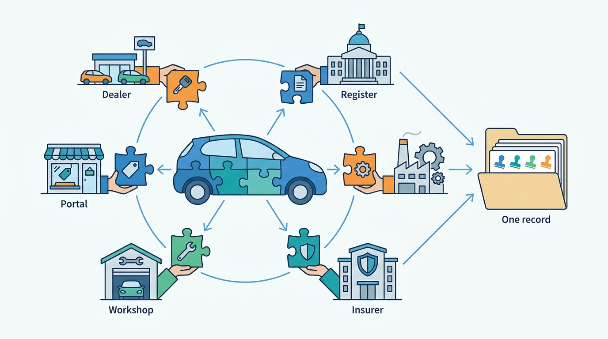
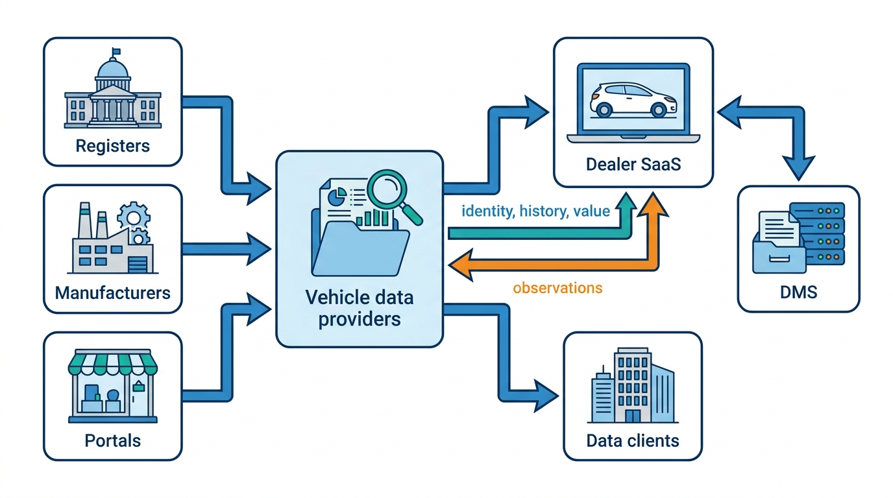
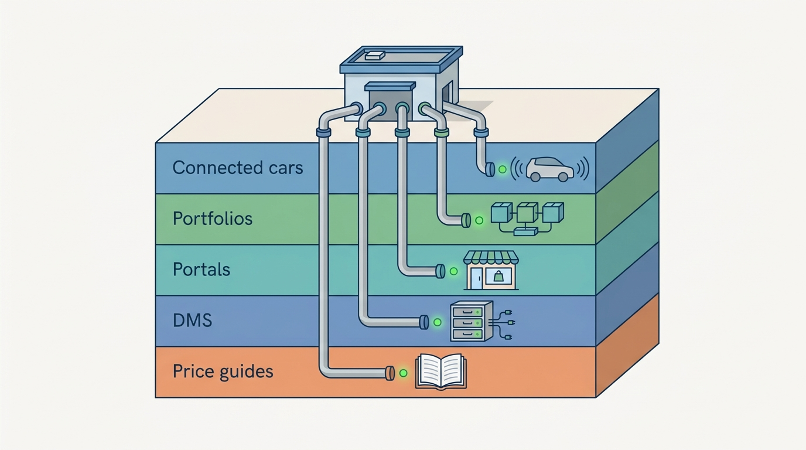
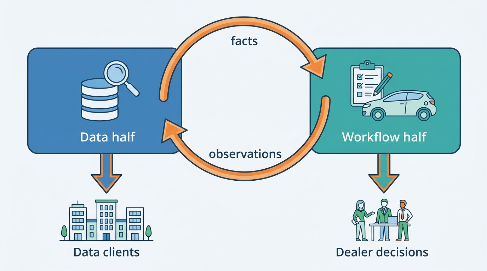
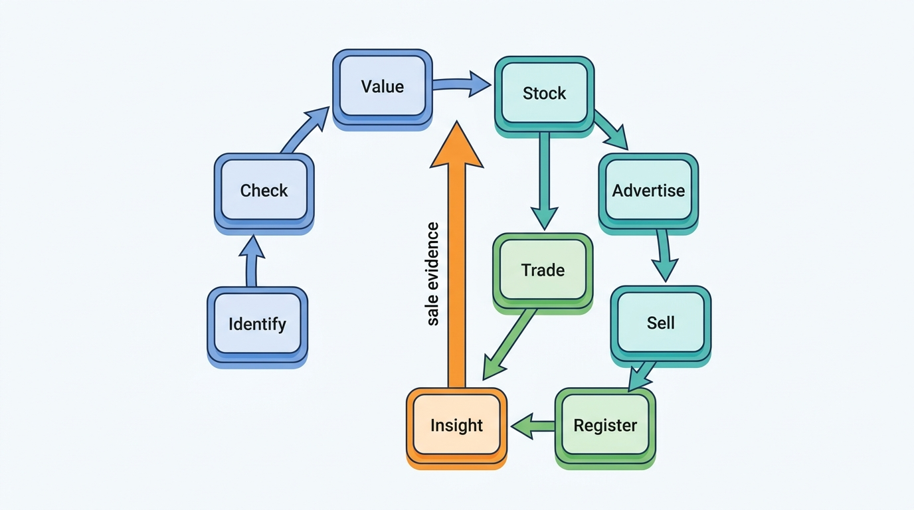

> **IN THIS CHAPTER, YOU WILL:** Meet the participants of the vehicle data and dealer software ecosystem, see how it grew from printed price guides and dealer accounting forms into registers, portals, DMS platforms and data APIs, and learn the value chain (Identify → Check → Value → Stock → Advertise → Sell → Register → Trade → Insight) that the rest of the book uses as its map.

> **WHY THE BUSINESS CARES:** Every product a vehicle data and dealer software group sells depends on facts it does not own and on channels it does not control. A CEO who cannot say who supplies which fact, on what terms, and who would be hurt if one supplier, register or DMS went away, cannot price, defend or sell the business.

> **WHY ARCHITECTS SHOULD CARE:** The ecosystem decides the platform's boundaries before any architect draws them. Who owns each fact sets the sources of truth. Each market's register and dominant players set what must be an adapter. Each partner's terms set what may be cached, combined and resold.

> **KEY POINTS:**
>
> * **Nobody sees the whole car.** A register knows its legal status, a manufacturer what was built, an insurer what was damaged, a workshop what the odometer said, a portal what was asked, an auction what was paid and a dealer what it cost. Each holds its part under its own terms. A vehicle data provider's product is the assembly: one record per car, with each fact's source, date and license.
> * **Data and workflow need each other.** Data is what makes dealer software worth paying for. Dealer software is how data reaches the people who decide, and it produces new data with every appraisal, advert and sale. Auto Trader UK bundles valuations into retailer packages, Carfax counts 92,000 dealers and service shops as data sources, and Cox Automotive estimates US retail sales from vAuto stock observations. The two halves share facts, accounts and meters. They do not share release cadence or external contracts.
> * **Each market's ecosystem has a different shape, set by its register and its dominant players.** The Netherlands has an open, plate-keyed register and register-connected data vendors that also sell dealer software. The United Kingdom has one dominant portal that also sells data and tools. Germany has a closed register, two incumbent valuation and specification houses, and manufacturer-shaped DMS markets. The United States has no national register, so history is built by contributory networks, and its DMS market is concentrated. A platform that crosses markets keeps one core and writes a market adapter for each source and channel.

> **[FAILURE PATTERNS THIS CHAPTER ADDRESSES](where-vehicle-platforms-go-wrong.html):**
>
> * **License Blindness** — facts arrive from dozens of participants on different terms, and a group that has not mapped who supplied what cannot prove what it may cache, combine or resell.
> * **Borrowed Uptime** — the platform sits between registers, suppliers, portals and DMS vendors, so its availability is theirs unless the map of dependencies drives the design.
> * **The Acquisition Archipelago** — the industry was assembled by acquisition, and so are most of its platforms, Axleby included. Each acquired product arrives with its own view of the ecosystem.

 
This book is about one physical car and the decisions people make about it: what it is, what happened to it, what it is worth, what to pay, what to ask, where to advertise it and who owns it now. This first chapter steps back from the decisions and asks **who knows what about the car**, who sells that knowledge, and how a whole industry of dealer software grew up around it.

**Facts about a car are scattered across organizations that never planned to cooperate.** A register, a manufacturer, a workshop chain, an insurer, three portals and the dealer each hold a piece. Some give it away, some sell it, some guard it by law, and some learn it only because the car passed through their software. Vehicle data providers and dealer software vendors exist because somebody has to put the pieces together and put them to work.

**Figure 1:** *No participant sees the whole car: each holds one part on its own terms, and a vehicle data provider's product is the assembly, one record per car that keeps each fact's source, date and license.*

This chapter names the participants, gives their dated history, explains why the two halves need each other, and introduces the value chain, the customer segments and the market differences that later chapters use. It defines **vehicle data provider**, **dealer SaaS**, **dealer management system (DMS)**, **dealer group**, **rooftop** and **the value chain**, and routes you to the chapters that own everything else.

## Setting the Scene at Axleby: The Map Nobody Had

Axleby, the fictional vehicle data and dealer software group this book follows (see [[meet-axleby]]), learned in January 2027 that a small lead-generation API client had resold history-report data to a consumer website against its license. The License Breach was found through a customer complaint, not by monitoring. At the incident review, the CEO, Anouk Willems, asked a question that sounded simple: *who supplies us with what, who do we supply, and on what terms?*

Nobody could answer it in one place. Ines Marchetti, the Group Chief Architect, who had joined in 2026, took the question as her first group-wide piece of work. With Hendrik Maes, who heads partner integrations in Ghent, and Femke de Boer, the Data Protection Officer, she spent three weeks building what the team came to call **the ecosystem map**: every organization that sends facts into Axleby, every organization that receives facts or actions from it, and the contract behind each arrow. The inventory below is an Axleby illustration.

| Direction | Counterparties (January 2027) | Where the terms lived |
| --- | --- | --- |
| **Official sources** | The Dutch register's information and transaction channels; the Belgian register through a partner; DVLA and DVSA interfaces in the UK | Turnstile team, Axleby Trade legal file |
| **Commercial data suppliers** | 21 contracts: one commercial build-data provider, Kilometra and two other odometer and service-record suppliers, insurer damage pools, recall and theft feeds, valuation inputs bought by Wertlauf, foreign history partners for imports | Four places: Axleby Data procurement, Wertlauf in Munich, Lotwise in Ghent and a shared drive |
| **Market observations** | Adverts harvested or received from portals and dealer stock, about 2.3 million a day in four markets; register sale events | Pulse team; partly undocumented |
| **Outbound channels** | 61 advertising channels through Relay; lead intake from the same portals; DMS adapters to DriveDesk, two German DMS products and several franchise-brand systems | Relay and integrations teams, per adapter |
| **Commercial partners** | Merelstad Auto Finance for financing referral; auction partners that receive Tradefloor hand-offs; payment service providers for Odolo | Product teams |
| **Data clients** | 640 API client organizations (210 still on Connect XML only); insight and enrichment customers | Axleby Data sales; license clauses in contract PDFs |
| **Dealer customers** | 7,200 Lotwise and 1,350 Showroomly rooftops; 410 dealer groups | Lotwise Classic, Showroomly, billing |

Three findings came out of the map. First, **Axleby owned almost none of the facts it sold.** It owned the register mirror it built from public data, the identity graph, its valuations and its market observations. Everything else was licensed. Second, for six of the 21 supplier contracts, nobody could find the clause that said how long fetched data could be cached. The client that caused the breach had a license that forbade resale, but no system checked it. Third, the map showed that Axleby sees **asking prices and register sale events, but not auction hammer prices**, because it owns no auctions and Tradefloor, its business-to-business (B2B) trade exchange, hands deals to auction partners. The other chapters return to each finding: license terms in [[data-licensing-and-governance]], supplier dependency in [[reliability-and-dependencies]], and the hammer-price gap in [[case-cox-automotive]].

The map was the first input to the capability map the board saw in March 2027 ([[vehicle-capability-map]]). The rest of this chapter is the general version of that map.

## Who Knows What: The Participants

A participant in this ecosystem is any organization that **creates, holds, sells or acts on facts about a specific vehicle**. The list is long because a used car passes through many hands and every hand records something. The table groups participants by what they know. The last column says how their facts usually reach a platform like Axleby's.

| Participant | What it knows or creates | How its facts reach a platform | Examples (with market) |
| --- | --- | --- | --- |
| **Registers** | Legal identity and status: registrations, keeper changes, inspections, odometer judgements (some markets), export, theft | Open data, paid lookups, provider channels for transactions, or nothing for private parties | RDW (NL), DIV (BE), KBA (DE), DVLA and DVSA (UK), state DMVs and NMVTIS (US) |
| **Manufacturers and importers** | What was built: version, factory options, build date; recalls; increasingly, readings from connected cars | Through build-data providers, manufacturer portals, recall services; connected data under the EU Data Act | Every manufacturer; national importers in NL and BE |
| **Insurers** | Damage claims, total losses, theft | Damage pools and claim registers, usually licensed for narrow purposes | Insurer-run registers; NMVTIS total-loss reports (US) |
| **Workshops and inspection bodies** | Service records, repairs, odometer readings, inspection results | Workshop software exports, inspection databases, aggregators | DVSA MOT history (UK); Car-Pass (BE); workshop chains |
| **Auctions and remarketing** | Wholesale prices, condition reports, buyer demand | Results data, often only to their own group | Manheim (Cox), BCA, OPENLANE, Autorola |
| **Portals** | Asking prices, price changes, time on market, buyer interest | Data agreements, harvesting within legal limits, their own APIs | Auto Trader UK, mobile.de, AutoScout24, Marktplaats, Cars.com, CarGurus |
| **Vehicle data providers** | Assembled facts: identity, specification, history, valuations, market data | They *are* the platform layer; they buy from everyone above | Carfax, HPI, DAT, Autovista, VWE, Autotelex |
| **Valuation guides** | Reference values for trade, retail and residual | Licensed tables and APIs | Kelley Blue Book, Black Book, DAT, Schwacke, Autotelex, Cap HPI |
| **DMS vendors** | The dealer's books: stock ledger, deals, accounting, service, parts, customers | Certified partner interfaces, file extracts, sometimes nothing | CDK Global, Reynolds and Reynolds, Tekion, Keyloop, Pinewood, incadea, CROSS |
| **Customer relationship management (CRM), inventory and website vendors** | Leads, stock workflow, adverts, website behavior | APIs, feeds, ADF/XML lead e-mail | VinSolutions, vAuto, Dealer.com, Lotwise-type products |
| **Dealers and dealer groups** | Purchase price, reconditioning cost, asking price, appraisal readings, sale | They type it into dealer software | Independents, franchised dealers, groups |
| **Lessors and fleets** | Fleet lists, contract ends, return condition, residual values | Fleet files, APIs, returns platforms | Ayvens, Hertz, national lessors |
| **Traders and exporters** | Cross-border purchases, import documents, registration tax | Trade platforms, import paperwork | B2B traders in NL, BE and DE |
| **Lenders** | Finance applications, liens, contracts | Lender integrations, lien registers | Captive banks, consumer lenders |
| **Consumers** | The plate they type, the car they own, the questions they ask | Free checks, paid reports, leads | Buyers, sellers, motorists |

Some definitions used in every later chapter:

- A **register** is an official vehicle register, never a commercial provider: the Dutch RDW (*Rijksdienst voor het Wegverkeer*), the Belgian DIV (*Directie Inschrijvingen Voertuigen*), the German KBA (*Kraftfahrt-Bundesamt*), the UK's DVLA (Driver and Vehicle Licensing Agency) and DVSA (Driver and Vehicle Standards Agency, which holds the results of the MOT, the annual roadworthiness test), and the US state departments of motor vehicles (DMVs), linked by NMVTIS (National Motor Vehicle Title Information System). [[registers-and-official-data]] owns the term.
- A **vehicle data provider** sells facts and derived judgements about specific vehicles (identity, specification, history, condition, valuation, market data) by the call, the report, the file or the subscription. Its hard problems are identity, provenance, licensing, freshness and accuracy. This book calls that business **vehicle data services**, or **the data half**.
- **Dealer SaaS** is software that dealers use to buy, stock, price, advertise, sell and register cars, sold as a subscription. Its hard problems are workflow fit, tenancy, integration and distribution. This book calls it **the workflow half**.
- A **dealer management system (DMS)** is the dealer's enterprise resource planning system. In the US Seventh Circuit's 2017 words, dealers use it "to keep track of such vital business matters as accounting, payroll, inventory, sales, parts, service, finance, and insurance" ([*Authenticom v. CDK Global*, 2017](https://www.courtlistener.com/opinion/4440779/authenticom-incorporated-v-reynolds-and-reynolds-company/)). For a franchised dealer it is also the channel to the manufacturer for orders, warranty and reporting. [[dms-integration]] owns the term in depth.
- A **rooftop** is one physical dealership location. It is the usual unit of pricing, tenancy and integration. A **dealer group** is a company that owns two or more rooftops, often under several legal entities and brands. [[tenancy-and-dealer-groups]] owns the deep model.
- An **independent** dealer sells used cars without a manufacturer franchise. A **franchised** dealer holds one or more manufacturer franchises and sells used cars alongside new ones.

Two things matter more than any single row. **The same organization often plays several roles**: a portal is a channel, a market-data source and, in the UK, a valuation and software vendor; a dealer is a customer and a data source; a data provider such as VWE supplies software vendors and competes with them through its own dealer platform ([VWE API documentation, read October 2026](https://vwe.nl/api-documentatie/)). The productscape model behind this book calls this the **B2B2B channel conflict**. And **the terms differ more than the formats**: a register fact may be public domain, a build-data record paid per request with limited caching, a damage record licensed for one purpose, and a portal's asking prices protected by the EU database right. The architecture has to carry those terms with the facts ([[provenance-and-data-quality]], [[data-licensing-and-governance]]).

**Figure 2:** *Facts flow from many owners into vehicle data providers, out to dealer software and data clients, and back again: dealer software is both a customer of the data half and a source for it.*

## How the Ecosystem Grew

The ecosystem was not designed. It grew in layers, and **each layer is still running**: a valuation guide from the 1920s still names the values in a contract, a DMS whose roots lie in 1960s accounting still owns the dealer's books, and a portal from the 1990s still decides which equipment codes an advert may carry. Knowing the order of the layers explains why integration is hard and why certain participants hold power.

| Period | What happened (dated) | The layer it left |
| --- | --- | --- |
| **1920s–1960s: printed guides and dealer forms** | Kelley published its first Blue Book in **1926** ([Kelley Blue Book, Wikipedia, 2026](https://en.wikipedia.org/wiki/Kelley_Blue_Book)). Reynolds and Reynolds, a business-forms printer founded in **1866**, won the contract for all Chevrolet dealership forms in **1927** and introduced its first electronic accounting service in **1963** ([Reynolds and Reynolds, Wikipedia, 2026](https://en.wikipedia.org/wiki/Reynolds_and_Reynolds)). Germany's manufacturers' and trade associations founded DAT on **28 February 1931** as an appraisal organization ([Deutsche Automobil Treuhand, Wikipedia (German), 2026](https://de.wikipedia.org/wiki/Deutsche_Automobil_Treuhand)). HPI was founded in the UK in **1938** ([HPI, Wikipedia, 2026](https://en.wikipedia.org/wiki/HPI_Check)). Hanns W. Schwacke began a German valuation service in the **1950s** and expanded it across Europe as **Eurotax** in the **1960s** ([Eurotax, Wikipedia, 2026](https://en.wikipedia.org/wiki/Eurotax)). Cox Enterprises bought the Manheim auctions in **1968** ([Cox Automotive fact sheet, 2018](https://www.coxautoinc.com/wp-content/uploads/2018/08/Cox-Automotive-Corporate-Fact-Sheet-April-2018.pdf)). | **Reference values** and their names (trade, retail, dealer purchase value), accepted in contracts, insurance and tax |
| **1970s–1990s: dealer computing and vehicle identity** | ADP's dealer services division, the origin of CDK Global, dates from **1973** ([CDK Global, Wikipedia, 2026](https://en.wikipedia.org/wiki/CDK_Global)). Reynolds put computer systems in dealerships from **1978**. The 17-character VIN became mandatory for vehicles sold in the US in **1981** ([VIN, Wikipedia, 2026](https://en.wikipedia.org/wiki/Vehicle_identification_number)). Carfax was founded in **1984** and sent early dealer reports by fax from **1986** ([Carfax, Wikipedia, 2026](https://en.wikipedia.org/wiki/Carfax,_Inc.)). Auto Trader began as a regional print magazine in **1977** ([Auto Trader Group, Wikipedia, 2026](https://en.wikipedia.org/wiki/Auto_Trader_Group)). The US title system's pointer index, NMVTIS, has been operated by the American Association of Motor Vehicle Administrators (AAMVA) since **1992** and went live in **1996** ([NMVTIS system overview, 2025](https://vehiclehistory.bja.ojp.gov/nmvtis-annual-reports-and-financial-audits/system-overview)). | **The DMS as the dealer's system of record**; the **VIN** as the physical key; **history reports** as a product |
| **1996–2010: portals and the first standards** | Autotrader.co.uk launched in **1996**, mobile.de existed from **1996** (eBay bought it in April **2004**), AutoScout24 started in **1998** as MasterCar.de, and AutoTrader.com launched in **1999** ([Auto Trader Group, Wikipedia](https://en.wikipedia.org/wiki/Auto_Trader_Group); [mobile.de, Wikipedia (German)](https://de.wikipedia.org/wiki/Mobile.de); [AutoScout24, Wikipedia](https://en.wikipedia.org/wiki/AutoScout24); [Cox fact sheet, 2018](https://www.coxautoinc.com/wp-content/uploads/2018/08/Cox-Automotive-Corporate-Fact-Sheet-April-2018.pdf); all read 2026). The Auto-Lead Data Format, ADF 1.0, was finalized on **3 May 2000** ([ADF specification, 2000](https://adfxml.info/adf_spec.pdf)). Directive 1999/37/EC harmonized EU registration certificates ([CELEX 31999L0037](http://publications.europa.eu/resource/celex/31999L0037)). Polk fully acquired Carfax in **1999**. Reynolds launched its certified interface program in **2003**. ADP bought the UK DMS maker Kerridge in **2005**. The Dutch plate register became the government's base register for vehicles on **1 July 2008** ([RDW, n.d.](https://www.rdw.nl/over-rdw/organisatie/kerntaken/kentekenregister-is-basisregistratie-voertuigen)). | **Syndication and leads**: dozens of channels, each with its own format, and an XML lead standard that is still the working default |
| **2010–2022: consolidation and platforms** | AutoTrader.com bought Kelley Blue Book, vAuto and HomeNet in **2010**; Cox Automotive was formed on **21 August 2014** from more than 20 brands, and bought Dealertrack for about $4 billion in **2015** ([Cox Automotive, 2014](https://www.coxautoinc.com/press-releases/cox-enterprises-announces-formation-cox-automotive/)). CDK was spun off from ADP in **2014**, closed its DMS to independent data integrators in **2015**, launched the Fortellis API platform in **2018**, sold its international business (now **Keyloop**) in **2021**, and was taken private by Brookfield in **2022** ([CDK Global 10-K FY2021](https://www.sec.gov/Archives/edgar/data/1609702/000160970221000058/cdk-20210630.htm); [CDK Global, Wikipedia, 2026](https://en.wikipedia.org/wiki/CDK_Global)). The RDW published its main vehicle dataset as open data in **September 2015** ([RDW open data metadata, read 2026-10-22](https://opendata.rdw.nl/api/views/m9d7-ebf2.json)). Cox sold the European DMS incadea to Volaris in **December 2018** ([Volaris, 2022](https://www.volarisgroup.com/home/customer-focus-takes-the-driver-s-seat)). | **Portfolios built by acquisition**, **certified-access programs** around the DMS, and **free register data** that commoditizes basic plate facts |
| **2023 onward: the car as a source, and new owners** | J.D. Power completed its purchase of Autovista Group (Autovista, Eurotax, Glass's, Schwacke) on **1 March 2024**. A ransomware attack stopped CDK Global's DMS at thousands of US dealers from **19 June 2024**. AutoScout24 took over the Dutch portals AutoTrack and Gaspedaal.nl in **November 2025** ([AutoRAI, 2025](https://autorai.nl/autoscout24-neemt-autotrack-en-gaspedaal-over/)). The EU Data Act has applied since **12 September 2025**, giving users of connected cars rights to their car's data ([Regulation (EU) 2023/2854](http://publications.europa.eu/resource/celex/32023R2854)). Carfax's parent, Mobility Global, was spun off from S&P Global on **1 July 2026** ([Mobility Global 8-K, 2026](https://www.sec.gov/Archives/edgar/data/0002090312/000110465926080006/tm2619098d1_ex99-1.htm)). | **Data from the car itself**, under consent rules; **concentration risk** made visible; ownership change as a recurring force |

Each layer changed what a platform has to integrate with. **Value names come from the guide era**: "trade-in value", *Händlereinkaufswert* (dealer purchase value) and the Dutch *koerslijst* (price list) are a guide's products that contracts, insurers and tax authorities refer to. Dutch courts have treated the AutotelexPro *koerslijst* as accepted evidence for the registration tax (*BPM*) on imported used cars (widely reported), so a valuation must say which value type it is and which reference it compares to ([[valuation-engine]]). **The DMS era made one system the owner of the dealer's books**: it started as accounting, and the stock ledger, deal file and manufacturer link grew around it ([[dms-integration]]). **The portal era multiplied channels and formats**, and its one lasting standard, ADF/XML, carries leads, not adverts ([[listing-syndication]]). **The consolidation era produced portfolios, not platforms.** Cox's public account of integration covers infrastructure in 2018, identity in 2020–21 and a federated API layer in 2024 ([[case-cox-automotive]]); CDK instead narrowed to the DMS and built certified access around it, and the dispute reached the US federal courts ([[case-cdk-global]]). Free register data arrived in the same era: the RDW dataset has 16,870,710 rows under a public-domain (CC0) license (read 22 October 2026), which put a floor under the price of basic plate facts. **The current era adds the car as a source**, under the user's consent and a stated purpose ([[connected-vehicle-data]]), and made concentration visible: one vendor's outage stopped thousands of dealers, and AutoNation reported in its filings a material effect of the outage on its 2024 earnings per share ([AutoNation 10-K for 2025](https://www.sec.gov/Archives/edgar/data/350698/000162828026007800/an-20251231.htm)).

**Figure 3:** *The ecosystem grew in layers, from printed guides through the DMS, portals and consolidation to the connected car, and every layer is still running, so a platform has to integrate with all of them at once.*

Ownership is the other constant. Carfax has had four owners since 1999 and is part of Mobility Global as of 2026; Keyloop was CDK International until 2021; VWE sold its auction subsidiary ATC to Autorola in February 2026 and announced a new majority owner in September 2026 ([[case-vwe]]). **A supplier, channel or competitor can change hands within a contract term.**

## The Two Halves and Why They Need Each Other

The book's running argument is that a group selling both vehicle data and dealer software must decide what the two halves share and what they keep apart. The case for keeping them together comes from the ecosystem itself: **data is the feature that makes dealer software worth paying for, and dealer software is the channel that carries data to the people who make decisions, and creates new data while it does.**

The public record shows the two directions.

**Data as the feature.** Auto Trader UK has added data modules to its per-forecourt retailer packages since April 2022 (valuations from April 2023), and reported average revenue per retailer of £2,995 a month across 13,942 forecourts in FY2026 ([Auto Trader FY26 results, 2026](https://plc.autotrader.co.uk/media/usjleen0/full-year-press-release-fy26.pdf)). VWE in the Netherlands sells the reverse bundle: a dealer platform whose modules sell plate data, history reports and register transactions, with licensed DAT, Autotelex and JATO data visible in its public API schemas ([[case-vwe]]).

**Workflow as the channel and the sensor.** Carfax says its data comes from "more than 177,000" sources, including "more than 92,000 dealers and service shops", which are also its customers ([Mobility Global information statement, 2026](https://www.sec.gov/Archives/edgar/data/2090312/000110465926066592/tm2528763d9_ex99-1.htm)). Cox Automotive states that its monthly US retail used-sales estimates "are based on observed unit changes tracked by vAuto", its dealer inventory tool ([Cox Automotive, January 2026](https://www.coxautoinc.com/insights/used-retail-vehicle-sales-december-2025/)). Auto Trader's partner APIs carried 155 million calls a month from more than 220 technology partners in FY2026. In each case dealer software is part of how the data business works, not one more customer.

The two halves still pull in different directions. The table is the contrast this book returns to, especially in [[vehicle-bounded-contexts]] and [[one-platform-from-many-products]].

| | Vehicle data services (the data half) | Dealer SaaS (the workflow half) |
| --- | --- | --- |
| **Customer** | Lessors, insurers, software vendors, portals, importers, consumers, and the group's own products | Independent dealers, franchised dealers, dealer groups, traders, lessors' remarketing desks |
| **Unit of sale** | The call, the report, the file, the annual license | The rooftop per month, plus usage |
| **What a mistake costs** | One wrong fact sold thousands of times, to clients who cached it | One dealer's lost lead, wrong invoice or car left on a portal |
| **Hard problems** | Identity, provenance, licensing, freshness, accuracy | Workflow fit, tenancy, integration with DMS and portals, distribution |
| **Release cadence** | Slow: API contracts that external clients code against for years | Fast: screens and workflows that change weekly |
| **External contract** | API schemas, SLAs, license terms passed to clients | User experience, configuration, channel and DMS adapters |
| **Owns facts?** | Rarely; mostly assembles licensed and public facts | Creates facts: purchase price, cost, appraisal reading, sale |

**My rule as Chief Architect is to share the car, the customer and the meter, and to keep the contracts separate.** Both halves must resolve the same vehicle to the same key, see the same customer, and record billable events the same way, or the group sells contradictory facts and cannot explain an invoice. But an external data client's API contract must not change because the dealer product shipped a new screen, and the dealer product must not wait for the data half's deprecation cycle. Later chapters make this concrete: one vehicle key in [[vehicle-identity]], one account in [[identity-access-and-entitlements]], one meter in [[billing-and-metering]], and separate API products in [[vehicle-data-apis]].

The rule has a limit: it holds when both halves serve the same markets and cars. A group whose data business serves US insurers and whose dealer software serves Dutch independents has little to share beyond accounts and billing.

**Figure 4:** *The two halves feed each other: data makes the workflow valuable, and the workflow distributes data and produces new observations, which is why they should share the vehicle, the customer and the meter.*

## The Value Chain: Identify to Insight

The book follows one car through nine steps. The productscape model behind the book names them; this chapter fixes them as **the value chain**, the sequence of decisions a platform supports about one car, from the first plate lookup to the market insight its sale produces.

| Step | The decision | The facts it needs | Who owns those facts outside the platform | Owning chapter |
| --- | --- | --- | --- | --- |
| **Identify** | Which car is this? | VIN, plate as of a date, registration episodes | Registers, manufacturers | [[vehicle-identity]], [[registers-and-official-data]] |
| **Check** | What is it, and what happened to it? | Specification and options; damage, odometer, title, service, recalls | Build-data houses, insurers, workshops, registers | [[specification-and-equipment]], [[vehicle-history]] |
| **Value** | What is it worth, and what may I pay? | Market evidence, condition, battery health, valuation | Portals, auctions, guides, inspectors | [[market-data]], [[valuation-engine]], [[condition-and-damage]], [[ev-battery-health]] |
| **Stock** | Do I buy it, and what does it cost me? | Purchase price, reconditioning, VAT regime, location | The dealer; the DMS where one exists | [[vehicle-acquisition]], [[inventory-and-vehicle-dossier]] |
| **Advertise** | At what price, where and how? | Price position, advert content, channel rules | Portals | [[used-car-pricing]], [[merchandising]], [[listing-syndication]] |
| **Sell** | Who wants it, and on what terms? | Leads, quotes, contracts, financing, invoices | Portals, CRMs, DMS, lenders | [[leads-and-crm]], [[deals-and-sales-documents]] |
| **Register** | Who owns it now, legally? | Register transactions, authority, tax | Registers, tax authorities | [[registration-and-trade-services]] |
| **Trade** | If not retail, which trade channel? | Trade listings, auction hand-offs, returns | Auctions, traders, lessors | [[b2b-trade-and-remarketing]] |
| **Insight** | What does the market tell us? | Sale events, stand-time, segment statistics | Registers, portals | [[market-data]], [[data-products-and-insights]] |

Three properties of the chain matter for architecture.

**It is a loop, not a line.** A sale at the Sell step becomes an ownership change at the Register step, a sale event in market data at the Insight step, and evidence for the next valuation at the Value step. A correction travels the loop in reverse: a wrong odometer reading found at Check has to reach the valuations, reports and adverts that used it ([[journey-data-correction]]).

**The data half sits at the front, the workflow half in the middle, and both meet at the end.** Identify, Check and Value are data services the workflow consumes; Stock, Advertise and Sell are workflow; Register and Trade are transactions with outside parties; Insight sells the chain's by-products back to data clients.

**Each step has different requirements for latency, freshness, consistency and availability.** The table gives illustrative targets of the kind later chapters derive. They are assumptions for orientation, except where an Axleby ledger target is named.

| Step and interaction | Latency | Freshness | Consistency | Availability when a dependency fails |
| --- | --- | --- | --- | --- |
| Identify: plate to vehicle during an appraisal | Under 1 s *(assumption)* | Register state as of today for purchase; a mirror is enough for a first look | The vehicle key must agree across products | Serve from the mirror with its age shown; ask the register live before purchase |
| Check: history report | Seconds *(assumption)* | Each source's own cadence, shown in the report | A report is a dated snapshot | Partial report, stating which sources were not reached |
| Value: maximum purchase price in the auction lane | Under 2 s *(assumption)* | Market evidence up to a day old *(assumption)* | Recorded with model version and inputs | Fall back to a labeled previous valuation, never a silent one |
| Advertise: sold car withdrawn from portals | Axleby target: 99% within 10 minutes | Desired state per channel | Eventually consistent, reconciled against what the portal shows | Queue withdrawals and reconcile; never drop a delete |
| Sell: portal lead delivered to the dealer | Minutes *(assumption)* | Real time | Exactly one lead per enquiry, with redeliveries recognized | Fall back to the platform inbox if the CRM is down |
| Register: registration in a new name | Minutes; legal effect | Register is the source of truth | Exactly once | Ordered queue with honest status; no completion during an outage |

[[dealer-and-data-economics]] shows how these numbers follow from dealer gross and data-provider margins, and [[reliability-and-dependencies]] turns them into journey service-level objectives.

**Figure 5:** *The value chain is a loop: every sale and trade becomes market evidence for the next valuation, and every correction has to travel the loop backwards.*

## Customer Segments and Personas

The value chain is the same for every customer, but each customer enters it at a different step, pays for different parts and suffers different failures. The productscape model behind this book defines seven personas. They are a research map built from one Dutch company's public material, so the table below generalizes them and does not present them as any company's customer data.

| Segment | Typical shape | Enters the chain at | What failure costs them | At Axleby (fictional) |
| --- | --- | --- | --- | --- |
| **Independent used-car dealer** | One to three sites, 30–150 cars, does register paperwork in-house | Identify and Check, on the driveway | A hidden damage or rolled-back odometer wipes out the gross on a car | Lotwise (62% of rooftops); Autobedrijf Brandsma, 55 cars |
| **Dealer group used-car director** | 5–50 rooftops, several brands and legal entities, central pricing desk, a DMS per franchise | Stock and Advertise, across rooftops | Capital stuck across sites; rooftops undercutting each other; DMS out of step | Lotwise groups (58% of rooftops); Velto Mobility Group, 46 rooftops |
| **Trader and importer-exporter** | Cross-border buying, B2B selling | Value and Register (import, registration tax) | A tax assessment turns a deal into a loss | Axleby Trade, Tradefloor |
| **Lessor and fleet remarketing manager** | Thousands of returns a year, bulk register actions | Check (return condition), Trade | Selling below residual value; late indemnification fines | Fleetmoor Lease, about 14,000 returns a year |
| **Software vendor (data client)** | Garage, DMS or fleet software embedding plate data and transactions | Identify and Check, through an API | An outage or schema change makes their product look broken | 640 API clients; Connect XML and JSON API |
| **Importer or insurer data analyst** | Buys reports, dashboards, enrichment files | Insight, Check | Numbers that later prove wrong; unlawful use of owner data | Axleby Insight; Rijnstaal Verzekeringen |
| **Consumer** | One car, one decision | Identify and Check, by plate | Paying too much for a car with a hidden past | Odolo |

The segments differ in what they treat as the record. For an independent without a DMS, the platform's dossier is the stock book; for a franchised group, the DMS owns the books and the platform must keep in step with it ([[inventory-and-vehicle-dossier]]). For a software vendor, Axleby's schema is part of its own product ([[vehicle-data-apis]]); for a consumer, the report is the only artifact, and its wording carries legal risk ([[consumer-vehicle-checks]]). One API client may also serve hundreds of garages, so Axleby's data reaches some dealers through a vendor that competes with Lotwise.

## How the Ecosystem's Shape Differs by Market

Part I chapters do not carry the formal market comparison that later parts use, but the ecosystem's shape is where market differences start. The same participants exist in every market. **What differs is which participant holds which fact, and how open it is.** The table compares the five markets this book covers.

| | Netherlands | Belgium | Germany | United Kingdom | United States |
| --- | --- | --- | --- | --- | --- |
| **Register and private access** | RDW: one national register; main dataset open (CC0), plate-keyed, no VIN; recognized companies transact through providers | DIV registers vehicles, typically through insurers; no open per-vehicle dataset found | KBA central register; private access limited to legal claims (§39 StVG); about 400 local registration offices *(analyst estimate)* | DVLA register; vehicle status by API, closed to new sign-ups (October 2026); keeper data guarded | No national register: 50-plus state title systems joined by NMVTIS; personal data restricted by the Driver's Privacy Protection Act (DPPA) |
| **Odometer and history evidence** | RDW odometer judgement on readings registered since 2014; insurer damage data | Car-Pass: 345.5 million readings received in 2025; document required at sale | No public odometer register; workshops, inspection reports and commercial providers | DVSA MOT history with odometer, weekly bulk and daily deltas | Title brands and odometer disclosures via NMVTIS; contributory history networks (Carfax, AutoCheck) |
| **What the plate identifies** | The vehicle | The owner (plate moves to the owner's next car) | Mostly the keeper and district | The vehicle, but private plates move | Varies by state |
| **Valuation references** | Autotelex *koerslijst* (also tax evidence for BPM), VWE, Indicata | Pan-European providers *(assumption)* | DAT and Schwacke (J.D. Power since 2024) | Auto Trader, Cap HPI | Kelley Blue Book, Black Book, J.D. Power, Manheim Market Report |
| **Dominant portals** | Marktplaats; AutoScout24 (with AutoTrack and Gaspedaal since 2025) | 2dehands/2ememain, AutoScout24 | mobile.de, AutoScout24 | Auto Trader UK, far ahead on time spent | Cars.com, CarGurus, Autotrader (Cox) |
| **DMS landscape** | Brand-approved DMS for franchised dealers; local software for independents (Autoflex claims 2,400+ Dutch businesses) | Importer-influenced; not verified | Most OEM-shaped: CROSS held over 75% of German and Austrian VW dealers in 2019; Loco-Soft 3,400+ users | Independent vendors: Keyloop, Pinewood | Concentrated: in 2017 CDK held over 40% and Reynolds around 30% |
| **Who integrates the ecosystem** | Register-connected data vendors that also sell dealer software (VWE, Autotelex) | Pan-Benelux and pan-European vendors | Data houses (DAT, Schwacke) plus portals; registration-service companies for transactions | The dominant portal sells data and retailer software | Full-stack groups (Cox) and DMS platforms (CDK, Reynolds) |

Sources for the table: [RDW open data](https://www.rdw.nl/over-rdw/dienstverlening/open-data/algemene-informatie) and dataset metadata (read 2026-10-22); [Car-Pass](https://www.car-pass.be/en) (2025 figures); [KBA ZFZR](https://www.kba.de/DE/Themen/ZentraleRegister/ZFZR/zfzr_node.html) and [§39 StVG](https://www.gesetze-im-internet.de/stvg/__39.html); [DVLA Vehicle Enquiry Service](https://developer-portal.driver-vehicle-licensing.api.gov.uk/apis/vehicle-enquiry-service/vehicle-enquiry-service-description.html) and [DVSA MOT history API](https://documentation.history.mot.api.gov.uk/mot-history-api/download-vehicle-mot-history-data/) (read October 2026); [NMVTIS](https://vehiclehistory.bja.ojp.gov/nmvtis_understandingvhr) and [18 U.S.C. § 2721](https://www.law.cornell.edu/uscode/text/18/2721); [Autoflex](https://www.autoflex.nl/) and [Loco-Soft](https://www.loco-soft.de/) (read 2026); [Journal de l'Automobile, 2019](https://journalauto.com/services/porsche-informatik-simplante-en-france-et-deploie-son-dms-cross/) (CROSS; evidence seven years old); the Seventh Circuit opinion cited above (2017 shares; Tekion has since taken share). Plate rules come from the identity research brief and are widely reported rather than verified against each registry.

The table reduces to four archetypes. Each puts a different participant at the center.

1. **Strong open register (Netherlands).** Most vehicle facts are free and trade transactions run through providers, so basic plate data cannot be sold on its own. Value moves to history, valuation, workflow and transactions, and the holders of the transaction connection become dealer-software vendors; VWE calls itself the largest officially recognized RDW provider (read October 2026). This is the Axleby pattern.
2. **Dominant portal (United Kingdom).** The marketplace builds valuations from its own adverts and sells data and software inside the advertising package; independent vendors integrate with its API, as Showroomly does for its dealers ([[case-auto-trader-uk]]).
3. **Closed register, strong data houses (Germany).** Specification, valuation and history come from long-established data houses, manufacturers and inspection bodies; manufacturers shape the DMS market; registration runs through local offices, registration-service companies or the KBA's large-customer interface (GKS).
4. **No national register (United States).** History is assembled in contributory networks from title brands, insurers, police reports, auctions and dealers; the DMS market is concentrated enough that access terms became an antitrust matter; full-stack groups span portal, valuation, auction, software and finance.

**Belgium is the warning against copying the Dutch design.** It sits next to the Netherlands and shares portals with it (Marktplaats and 2dehands share one API), but its plates follow the owner, its register is not open, and its odometer history lives in a separate, VIN-keyed, legally mandated document. A platform that keys Belgian vehicles by plate, the way it would in the Netherlands, builds The Cloned Identity into its foundations ([[vehicle-identity]]).

The judgement runs through the whole book. **The core can be common: the VIN-keyed identity graph, the history event model, the valuation ledger, the dossier, accounts, entitlements, metering and licensing.** Everything that touches a participant is a **market adapter**: register access, odometer sources, plate semantics, valuation references, portals, DMS products, registration transactions and taxes. The cost is real: Axleby runs 61 channel adapters and several DMS adapters, and in 2027 it has no German register adapter at all.

## What Breaks Between Participants

Most failures this book analyzes start at a boundary between participants, where one organization's fact or system becomes another's dependency. The table lists the ecosystem-level failure modes, a documented or Axleby example of each, and where the book handles them.

| Failure mode | Example | How you detect it | Architectural response | Chapter |
| --- | --- | --- | --- | --- |
| **The same car arrives as many records** | One car advertised on several portals, relisted, imported, re-plated; Axleby's Pulse matched only 61% of 2026 adverts to a VIN-keyed vehicle | Match rates per source and market | VIN-keyed identity graph; plates as time-bounded aliases; stored match decisions | [[vehicle-identity]], [[ingestion-and-entity-resolution]] |
| **Two participants disagree** | A dealer's appraisal reading conflicts with an official one; two specification sources resolve to different editions | Conflict rules that flag rather than overwrite | Keep every source's fact with provenance; survivorship rules versioned | [[provenance-and-data-quality]] |
| **A source is incomplete** | RDW open data has no VIN and withholds theft status; NHTSA's VIN decoder warns that a missing value does not mean "not equipped" | Explicit "unknown" and "not covered" states | Never turn absence into a fact; ask live for withheld facts | [[registers-and-official-data]], [[vehicle-history]] |
| **A supplier sends wrong data** | Kilometra's May 2027 batch recorded miles as kilometers for 2,870 UK-imported cars | Distribution checks per source segment at ingestion | Quarantine; correction propagated to every derived product | [[journey-data-correction]] |
| **A dependency goes down** | CDK Global's DMS, June 2024; the Dutch register's transaction channel unavailable to Axleby for 5 hours 40 minutes on 31 March 2027 | Synthetic checks and journey monitors | Degraded modes: labeled cached reads, honest queues for writes, reconciliation afterwards | [[reliability-and-dependencies]] |
| **A participant changes access terms** | CDK closed its DMS to independent integrators in 2015; DVLA's Vehicle Enquiry Service is closed to new registrations (October 2026) | Contract and terms inventory with owners and review dates | Sanctioned interfaces only; adapters that can be replaced; a fallback source per critical fact | [[dms-integration]], [[build-buy-or-partner]] |
| **A participant changes owner or merges** | AutoScout24 took over AutoTrack and Gaspedaal (2025); Carfax spun off with Mobility Global (2026); ATC sold to Autorola (2026) | Watch list of suppliers, channels and competitors | Adapters behind stable internal contracts; no single channel or source whose loss stops a product | [[evolving-the-vehicle-platform]] |
| **Facts leak beyond their terms** | Axleby's License Breach, January 2027 | Purpose checks and access audit, not complaints | License and purpose register in the request path | [[data-licensing-and-governance]] |

Two rules follow. **Retries across organizations are dangerous where actions have legal effect**: Axleby's 214 double register submissions on 31 March 2027 came from blind resubmission after ambiguous timeouts ([[registration-and-trade-services]]). And **partial failure is the normal state of an ecosystem**, so monitoring per hop shows green while a dealer loses leads; the book measures flows end to end ([[observability-and-data-operations]]).

## Trade-offs: Where to Sit in the Ecosystem

Every company in this book chose a position in the ecosystem, and each position commits its architecture. The table compares the positions documented in Part X with the one Axleby holds.

| Position | Documented example | What it gains | What it risks | What the architecture must be good at |
| --- | --- | --- | --- | --- |
| **Pure data provider** | Carfax (history, contributory network) | Neutral supplier to every software vendor and portal | Distribution depends on others' software | Ingestion at scale, provenance, licensing, API products |
| **Portal that sells data and software** | Auto Trader UK | Audience plus its own market data; bundling | Retailer pushback when bundled features change their workflow (Deal Builder, November 2025) | Taxonomy, stock sync, valuations from adverts, partner API |
| **DMS-centered platform** | CDK Global | System of record; certified access fees | Access disputes and litigation; concentration risk | Partner programs, API contracts, resilience |
| **Full-stack portfolio** | Cox Automotive | Data on both sides of the transaction | Years of integration across acquired products | Shared identity, vehicle key, data layer, federated APIs |
| **Register-connected data vendor with dealer software** | VWE (NL); Axleby (fictional) | Register access as a moat; data pulled through workflow | One register as the main dependency; legacy XML APIs | Register gateway, dossier, metering, license control |

There is no best position in general. **The right one depends on which fact is scarce in the market**: the transaction connection where the register is open, the audience where one portal dominates, the contributory network where there is no register, and sanctioned access where one DMS holds the books. I would name the scarce fact in each target market and not export one market's position to another. Axleby entered Germany through Wertlauf as a valuation and data business, not a register-transaction business, for that reason. Axleby sits between the full-stack group, which has the most to share and the longest integration road, and the pure data provider, which shares little beyond its APIs: enough overlap for a shared vehicle core, account and meter, enough difference for separate release trains and API contracts ([[one-platform-from-many-products]]).

## The Chief Architect's View

At group scale, the ecosystem is not background. It is the first architecture artifact. These are the decisions I would make, and who should make them.

- **Keep an ecosystem map as a governed asset.** Every source, channel, partner and client class, with the facts exchanged, the contract owner, the license terms that matter (cache, combine, resell, purpose), the interface, the review date and the fallback. The Group Chief Architect owns the map. Legal, partner integrations and data governance own the entries. At Axleby it became Charter's license register and Turnstile's dependency list.
- **Name the source of truth for each fact class, and name the participant behind it.** "Vehicle legal status: the register, through Turnstile; odometer: official readings over commercial ones, by rule version." This decision belongs in [[vehicle-bounded-contexts]], and it should be made before teams draw service boundaries.
- **Separate the common core from market adapters by design review, not by accident.** A new market should arrive as a set of adapters and rule packs. If entering Belgium needs changes in the identity graph, the core was Dutch, not common.
- **Treat every participant as a possible competitor, acquirer or casualty.** Portals buy each other, data houses change owners, DMS vendors change terms, registers close channels. For each critical dependency, ask: what happens if this one is bought by a competitor, or closes its interface, next year? [[evolving-the-vehicle-platform]] turns that question into stressor analysis.
- **Decide the channel conflict explicitly.** If the data half sells to software vendors who compete with the workflow half, the API contract, pricing and data access must be the same for the group's own products and for external clients, or the group will be accused of preferential treatment. The CDK record shows how that accusation ends ([[case-cdk-global]]).

What to watch, by signal: supplier concentration (share of revenue depending on one source), the match rate between market observations and vehicles, the number of sources without documented cache terms, the number of channels and DMS adapters without a named owner, and ownership changes among the top twenty counterparties.

## Questions to Ask

1. Which facts do we sell that we own, which do we derive, and which do we license, and in what share of revenue?
2. For each licensed fact, can we show where its cache, combine, resale and purpose terms are enforced in code?
3. Which single participant (register, supplier, portal, DMS vendor) would stop a dealer workflow if it disappeared tomorrow, and what is the degraded mode?
4. Do our data half and workflow half resolve the same car to the same vehicle key, and the same customer to the same account?
5. Which of our external data clients compete with our own dealer software, and are their API terms and data access the same as our own products'?
6. In each market we serve, what is the scarce fact, and does our position match it?
7. If we entered a new market next year, which components would need changes beyond new adapters and rule packs?
8. Which counterparties changed owner or terms in the last two years, and did we notice through monitoring or through an incident?
9. Where in the value chain do we hand a decision to a participant we do not control, and how do we confirm the outcome rather than the hand-off?

The participants, the value chain and the segments set the stage. What decides how the platform has to behave is money: a dealer's gross per car and the cost of each day it stands, a data provider's cost per call, and a software vendor's revenue per rooftop. [[dealer-and-data-economics]] turns those numbers into requirements.

## Sources and Evidence

### Company, product and investor sources

- [Full year results FY26](https://plc.autotrader.co.uk/media/usjleen0/full-year-press-release-fy26.pdf), Auto Trader Group plc, 2026 — average revenue per retailer, forecourts, data modules, partner API calls, Deal Builder reaction.
- [Information Statement of Mobility Global](https://www.sec.gov/Archives/edgar/data/2090312/000110465926066592/tm2528763d9_ex99-1.htm), Mobility Global / SEC, 2026 — Carfax data sources, including 92,000 dealers and service shops.
- [Mobility Global separation 8-K exhibit](https://www.sec.gov/Archives/edgar/data/0002090312/000110465926080006/tm2619098d1_ex99-1.htm), Mobility Global / SEC, 2026 — spin-off from S&P Global on 1 July 2026.
- [Used retail vehicle sales, December 2025](https://www.coxautoinc.com/insights/used-retail-vehicle-sales-december-2025/), Cox Automotive, 2026 — retail sales estimates based on vAuto observations.
- [Cox Automotive corporate fact sheet](https://www.coxautoinc.com/wp-content/uploads/2018/08/Cox-Automotive-Corporate-Fact-Sheet-April-2018.pdf), Cox Automotive, 2018 — dated acquisition history (Manheim 1968 to Dealertrack 2015); evidence more than three years old.
- [Cox Enterprises announces formation of Cox Automotive](https://www.coxautoinc.com/press-releases/cox-enterprises-announces-formation-cox-automotive/), Cox Automotive, 2014 — formation on 21 August 2014.
- [CDK Global Form 10-K for fiscal 2021](https://www.sec.gov/Archives/edgar/data/1609702/000160970221000058/cdk-20210630.htm), CDK Global / SEC, 2021 — spin-off, sale of the international business, DMS scope; historical anchor.
- [AutoNation Form 10-K for 2025](https://www.sec.gov/Archives/edgar/data/350698/000162828026007800/an-20251231.htm), AutoNation / SEC, 2026 — effect of the June 2024 CDK outage.
- [VWE API documentation](https://vwe.nl/api-documentatie/), VWE Automotive, n.d., accessed 2026-10 — XML interfaces with licensed DAT, Autotelex and JATO schemas.
- [VWE: over VWE](https://vwe.nl/over-vwe/), VWE Automotive, n.d., accessed 2026-10 — "largest officially recognized RDW provider".
- [Customer focus takes the driver's seat](https://www.volarisgroup.com/home/customer-focus-takes-the-driver-s-seat), Volaris Group, 2022 — incadea carved out from Cox Automotive in December 2018.
- [Porsche Informatik s'implante en France](https://journalauto.com/services/porsche-informatik-simplante-en-france-et-deploie-son-dms-cross/), Journal de l'Automobile, 2019 — CROSS share of German and Austrian VW dealers; evidence seven years old.
- [Autoflex](https://www.autoflex.nl/) and [Loco-Soft](https://www.loco-soft.de/), vendor sites, n.d., accessed 2026-10 — Dutch and German DMS scale claims.
- [AutoScout24 neemt AutoTrack en Gaspedaal over](https://autorai.nl/autoscout24-neemt-autotrack-en-gaspedaal-over/), AutoRAI, 2025 — Dutch portal consolidation.

### Standards, regulation and official documentation

- [RDW open data: general information](https://www.rdw.nl/over-rdw/dienstverlening/open-data/algemene-informatie) and [registered vehicles dataset metadata](https://opendata.rdw.nl/api/views/m9d7-ebf2.json), RDW, n.d., queried 2026-10-22 — open, plate-keyed, CC0 dataset created September 2015; 16,870,710 rows.
- [Kentekenregister is basisregistratie voertuigen](https://www.rdw.nl/over-rdw/organisatie/kerntaken/kentekenregister-is-basisregistratie-voertuigen), RDW, n.d., accessed 2026-10 — base register since 1 July 2008.
- [Car-Pass](https://www.car-pass.be/en), Car-Pass vzw, n.d. (2025 figures), accessed 2026-10 — Belgian odometer history volumes.
- [Zentrales Fahrzeugregister](https://www.kba.de/DE/Themen/ZentraleRegister/ZFZR/zfzr_node.html), Kraftfahrt-Bundesamt, n.d., and [§39 StVG](https://www.gesetze-im-internet.de/stvg/__39.html), n.d., both accessed 2026-10 — German register content and narrow private access.
- [Vehicle Enquiry Service API](https://developer-portal.driver-vehicle-licensing.api.gov.uk/apis/vehicle-enquiry-service/vehicle-enquiry-service-description.html), DVLA, n.d., accessed 2026-10 — vehicle status by API; registration closed.
- [MOT history API: bulk and delta downloads](https://documentation.history.mot.api.gov.uk/mot-history-api/download-vehicle-mot-history-data/), DVSA, n.d., accessed 2026-10 — weekly bulk and daily deltas.
- [Understanding the NMVTIS vehicle history report](https://vehiclehistory.bja.ojp.gov/nmvtis_understandingvhr) and [NMVTIS system overview](https://vehiclehistory.bja.ojp.gov/nmvtis-annual-reports-and-financial-audits/system-overview), US Department of Justice, n.d. and 2025 — title brands; operated by AAMVA since 1992.
- [18 U.S.C. § 2721 (Driver's Privacy Protection Act)](https://www.law.cornell.edu/uscode/text/18/2721), Cornell LII, n.d., accessed 2026-10 — permitted uses of DMV personal data.
- [Directive 1999/37/EC on registration documents for vehicles](http://publications.europa.eu/resource/celex/31999L0037), EU Publications Office, 1999 — harmonized registration certificate.
- [Regulation (EU) 2023/2854 (Data Act)](http://publications.europa.eu/resource/celex/32023R2854), EU Publications Office, 2023 — application from 12 September 2025.
- [Auto-Lead Data Format specification 1.0](https://adfxml.info/adf_spec.pdf), ADF working group, 2000 — lead standard dated 3 May 2000.
- [*Authenticom v. CDK Global and Reynolds and Reynolds*](https://www.courtlistener.com/opinion/4440779/authenticom-incorporated-v-reynolds-and-reynolds-company/), US Court of Appeals for the Seventh Circuit, 2017 — DMS definition and 2017 market shares.

### Research and practitioner sources

- [Kelley Blue Book](https://en.wikipedia.org/wiki/Kelley_Blue_Book), [Reynolds and Reynolds](https://en.wikipedia.org/wiki/Reynolds_and_Reynolds), [HPI](https://en.wikipedia.org/wiki/HPI_Check), [Eurotax](https://en.wikipedia.org/wiki/Eurotax), [Carfax](https://en.wikipedia.org/wiki/Carfax,_Inc.), [CDK Global](https://en.wikipedia.org/wiki/CDK_Global), [Auto Trader Group](https://en.wikipedia.org/wiki/Auto_Trader_Group), [AutoScout24](https://en.wikipedia.org/wiki/AutoScout24), [Vehicle identification number](https://en.wikipedia.org/wiki/Vehicle_identification_number), Wikipedia, accessed 2026-10 — founding dates and early history (encyclopedic, widely reported).
- [Deutsche Automobil Treuhand](https://de.wikipedia.org/wiki/Deutsche_Automobil_Treuhand) and [mobile.de](https://de.wikipedia.org/wiki/Mobile.de), Wikipedia (German), accessed 2026-10 — DAT founded 28 February 1931; mobile.de since 1996, eBay 2004.
- Productscape domain model for a vehicle data and dealer SaaS platform (author's sibling repository, digest in this book's research notes) — personas, value chain and the B2B2B channel conflict, used as a research map only.

Axleby is fictional; architectural recommendations, labeled inferences and labeled assumptions are the author's judgement.
