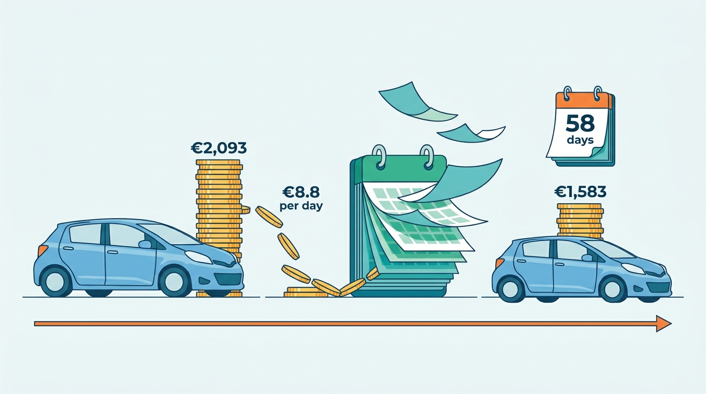
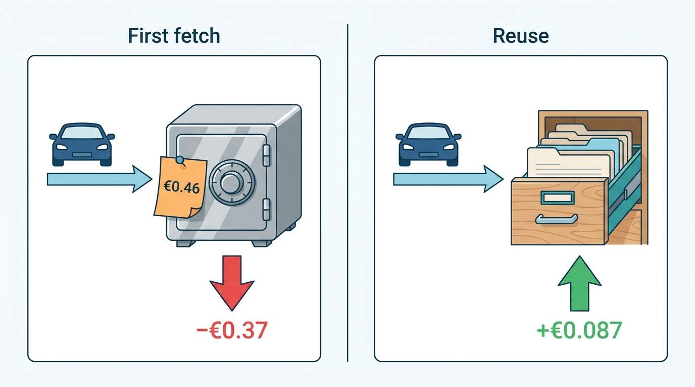
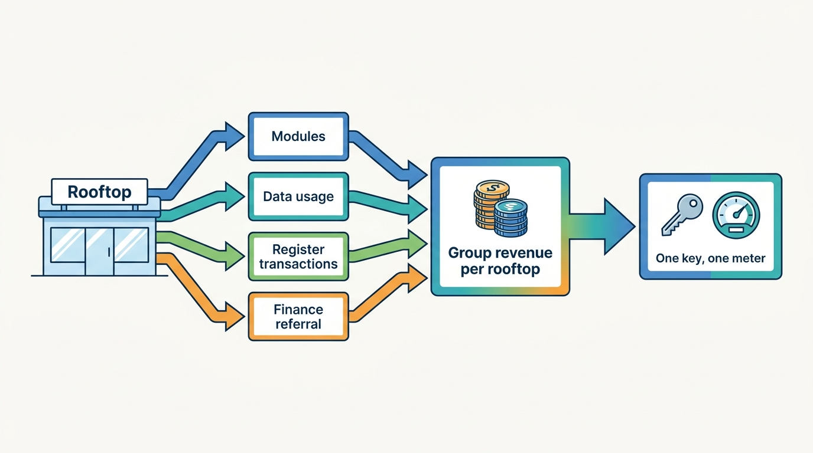
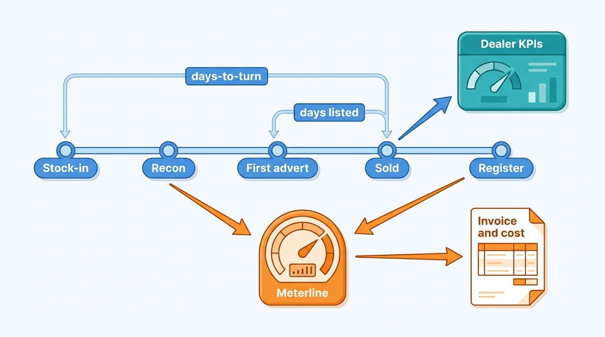
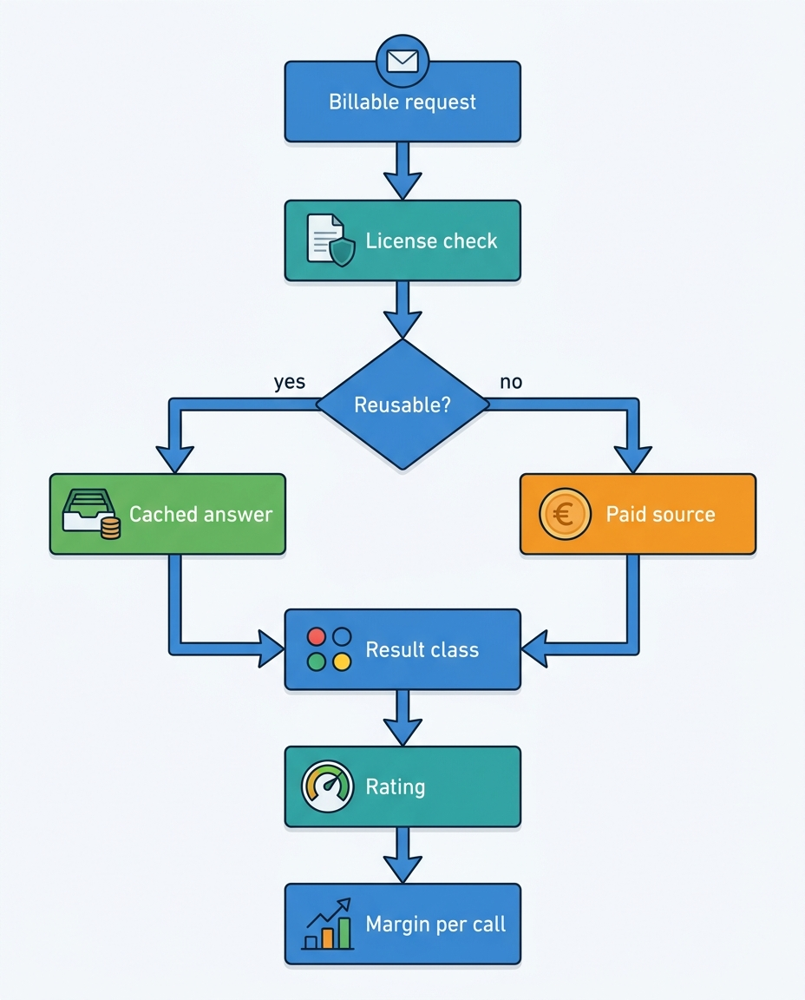

> **IN THIS CHAPTER, YOU WILL:** Work through the unit economics of a used-car dealer, a vehicle-data provider and a dealer-software vendor, and turn each economic number (gross per unit, days-to-turn, cost per lookup, revenue per rooftop, retention) into a requirement the platform has to meet and measure.

> **WHY THE BUSINESS CARES:** A dealer's whole profit on a car is a few thousand euros, and every day in stock eats part of it. A data business can lose money on a call it sells for nine cents. A SaaS business whose small customers churn every year has to win them back at full cost. The CFO's questions about margin, invoices and churn all come down to whether the platform records the right events.

> **WHY ARCHITECTS SHOULD CARE:** Most of the requirements that shape this platform come from these economics: how fast a plate lookup must answer, how stale a valuation may be, how quickly a sold car must leave the portals, and which attributes every billable call must carry. An architecture that does not capture cost, outcome and tenant at the source cannot explain an invoice, a margin or a churn number later.

> **KEY POINTS:**
>
> * **The dealer's money is made in gross per unit and lost by the day.** An illustrative independent dealer makes about €2,100 front-end gross on a typical car and pays roughly €9 a day to hold it. Publish delay, pricing latency and valuation error therefore all translate into euros, and the workflow half's requirements should be stated in days-to-turn and gross per unit, not in screens and features.
> * **Data is sold by the call, but owned data and rented data have different costs.** Owned and derived data (register mirrors, valuations) costs almost nothing per extra call. Licensed data has a fee on every request, and that fee can be higher than the price of the call. Every billable call must record its source, upstream cost, result class and license, or no-hit-no-fee and per-call margins cannot be computed.
> * **Dealer SaaS bills per rooftop per month, but it grows through pull-through and retention.** Module subscriptions are only about half of what a Lotwise rooftop pays. The rest comes from data usage beyond allowances, group add-ons, integration fees and finance referrals, and the rooftop also buys register transactions from another brand, so one meter, one tenant model and per-rooftop cost to serve are commercial requirements, not back-office hygiene.

> **[FAILURE PATTERNS THIS CHAPTER ADDRESSES](where-vehicle-platforms-go-wrong.html):**
>
> * **The Unmetered Call** — upstream cost and result class are not recorded on each call, so nobody can say which product, client or call type loses money, and no-hit-no-fee is applied two different ways.
> * **The Confident Valuation** — a valuation error of a few percent consumes a quarter of a dealer's gross on the car, and an uncaught drift can consume all of it.
> * **The Zombie Listing** — a sold car left live on portals turns the economics of days into wasted leads and test drives, and nobody owns the cost.

 
Every page in this book is about one physical car and the decisions people make about it. This page is about **the money behind those decisions**. A dealer buys a car hoping to sell it for more than it cost, before the wait eats the difference. A data provider sells facts about the car by the call, and some of those facts it must buy from someone else first. A software vendor charges the dealer by the rooftop and the month and hopes the dealer stays. These three businesses rely on each other, and their unit economics decide most of the platform's non-functional requirements.

Architects usually meet these numbers as targets someone else set: "lookups under two seconds", "publish within fifteen minutes". This chapter derives them. It defines **gross per unit**, **days-to-turn**, **cost per lookup**, **no-hit-no-fee** and **rooftop pricing** precisely enough to compute, and shows where each must be captured, because **a number the platform does not record as an event cannot be managed, billed or explained.**

This chapter builds on the participants and the value chain in [[vehicle-data-ecosystem]]. It hands the capabilities these economics require to [[vehicle-capability-map]] and the deep design of metering and rating to [[billing-and-metering]].

## Setting the Scene at Axleby: Two P&Ls on One Page

Axleby, the fictional vehicle data and dealer software group this book follows (see [[meet-axleby]]), spent February 2027 preparing the business case for the One Dossier program. Harrowgate Capital's operating partner asked the CEO, Anouk Willems, a simple question: *what is one Lotwise rooftop worth to the group, and what does one API call earn?* The board would approve €38 million of platform work in March, and it wanted to know which half that money would serve.

Anouk gave the question to Ines Marchetti, the Group Chief Architect, and Lena Vos, who leads billing and finance systems. They expected an afternoon of spreadsheet work. It took three weeks.

**Revenue per rooftop was knowable; cost per rooftop was not.** Lotwise's €96 million in 2026 is about **€1,110 per rooftop per month** across 7,200 rooftops, but only about half of it is module subscriptions. Data usage beyond module allowances, group add-ons, integration fees and finance-referral commissions were each computed in a different system, and the register transactions Lotwise dealers ordered were invoiced by Axleby Trade. With three login systems and two vehicle keys, no system could list one rooftop's total spend across brands.

**Revenue per call was knowable; margin per call was not.** Connect XML, which carries 38% of the 2.6 million daily lookups, logged client and product but not which upstream source answered or what it charged. Specbook recorded its licensed build-data fetches, at about **€0.46 each**, but not which client call triggered them. Lena could compute an average cost per call for the business, not for one client or call type. The same weakness had cost **€186,000** in the No-Hit Credit of 2026.

**The core dealer metric had two definitions.** Lotwise reported average **days-to-turn of 58**, from stock-in to sold; dealer dashboards counted from the first live advert and showed **51**. Both were correct, and the gap hid the most useful fact in the data: a car spent a week in stock, on average, before any buyer could see it online.

Ines's summary for the board was one sentence: *"We can tell you what we charge; we cannot yet tell you what anything costs or what our customers actually get from us per car."*

## The Dealer's Unit Economics

A **used-car dealer** makes money on the difference between what a car costs to make ready and what a buyer pays, minus what it costs to wait.

### Gross per unit

**Gross per unit** (often *gross profit per unit*, GPU) is the profit on one retailed car before overheads. It has two parts:

- **Front-end gross** = retail price − (acquisition cost + reconditioning + transport + fees). Reconditioning (*recon*) is the mechanical, body, cleaning and preparation work that makes a car ready for retail.
- **Back-end gross** = income from finance and insurance products sold with the car (F&I): lender commission, warranties, service contracts, gap insurance.

US public groups report these numbers in audited filings. For 2025, AutoNation's used retail gross profit per vehicle was **$1,555** on 269,558 units, according to its [Form 10-K for 2025](https://www.sec.gov/Archives/edgar/data/350698/000162828026007800/an-20251231.htm) (published February 2026). CarMax reported **$2,253** per used unit in its [fiscal 2026 10-K](https://www.sec.gov/Archives/edgar/data/1170010/000117001026000021/kmx-20260228.htm) (April 2026). Carvana reported **$3,315** retail vehicle gross per unit and **$7,026** in total including finance and other products in its [2025 10-K](https://www.sec.gov/Archives/edgar/data/1690820/000169082026000009/cvna-20251231.htm) (February 2026). The gap between Carvana's two numbers shows how much profit can sit in the back end. European dealer groups rarely publish gross per unit; the lessor Ayvens's €1,075 net used-car-sales result per unit for 2025 ([Ayvens, February 2026](https://www.ayvens.com/en-cp/news/newsroom/press-releases-2026/q4-and-fy0-2025-strong-financial-results/)) is a residual-value gain, not a dealer's front-end gross.

CarMax's 10-K also describes how a gross target becomes a pricing rule. It "target[s] a dollar range of gross profit per used unit", set per vehicle by "its probability of sale and its mileage relative to its age" and "not primarily based on the vehicle's selling price". This matters for architecture: **the gross target belongs to the individual vehicle, not to a global markup**, so the stock record has to carry it ([[used-car-pricing]]).

### Days-to-turn and holding cost

**Days-to-turn** is the number of days from stock-in (the moment a car enters the dealer's stock) to sale. It is related to, but not the same as, three other measures that appear in public data:

| Measure | Definition | Public example |
| --- | --- | --- |
| **Days-to-turn** (age at sale) | Sale date − stock-in date, averaged over sold cars | Axleby's 58 days for Lotwise stock (fictional) |
| **Days listed** | Sale date − first advert date | AutoScout24: cars sold in Germany in Q4 2025 had been listed for an average of **59 days** ([AutoScout24 market report](https://www.autoscout24.de/unternehmen/daten/marktreport-q42025-gebrauchtwagenmarkt-schliesst-2025-stabil-ab-steigender-druck-zum-jahresstart/), February 2026) |
| **Days' supply** | Stock ÷ daily sales over a stated window | Cox Automotive: **49 days** of US retail used supply in December 2025 ([Cox, January 2026](https://www.coxautoinc.com/insights/used-retail-vehicle-sales-december-2025/)); AutoNation: **38 days** on trailing calendar-month sales (10-K, 2026) |
| **Time to line** | Acquisition → retail-ready ("frontline") | Trade-press estimates of 10–18 days, mostly vendor-sourced and from 2016–2023 |

The measures are not interchangeable, and a product that reports "days in stock" without naming its clock produces the disagreement Axleby found.

**Holding cost** is what each day in stock costs: depreciation, the cost of the money tied up, and smaller costs for space and insurance. US dealers mostly finance stock through *floorplan* lines. OPENLANE's [2025 10-K](https://www.sec.gov/Archives/edgar/data/1395942/000139594226000006/opln-20251231.htm) (February 2026) describes its AFC unit's "short-term inventory-secured financing, known as floorplan financing" with "origination, floorplan, curtailment and other related program fees". A *curtailment* is a required principal repayment at a fixed age, so a floorplanned car's age is a contractual deadline. European dealers more often fund stock from bank lines or manufacturer and captive finance. Fewer days also mean a higher price: Carvana's 10-K says lower days to sale leads to "fewer vehicle price reductions, and therefore higher average selling prices".

The doctrine around days has changed, though many dealer tools still embed the old rule. Dale Pollak's "velocity" approach, popularized through vAuto, maximized turn "even at the expense of gross profit per vehicle". In December 2023 he told [Canadian Auto Dealer](https://canadianautodealer.ca/?p=63771): "In retrospect, I was wrong. There was a race to the bottom." His "variable management" instead tiers each car by expected potential (cost to market, market days' supply, local retail volume). **Velocity pricing is a documented historical practice, not current doctrine**; the lasting lesson is CarMax's: targets belong to the individual vehicle.

### A worked car at Autobedrijf Brandsma

Sietse Brandsma runs **Autobedrijf Brandsma**, a one-rooftop independent dealer in Leeuwarden with about 55 cars in stock, a Lotwise customer since 2014 (fictional). The figures are an **illustration with labeled assumptions**, not a benchmark; they show the arithmetic behind every pricing, publishing and valuation requirement in this book.

| Line | Amount | Basis |
| --- | --- | --- |
| Retail price (consumer, VAT margin scheme) | €16,900 | *(assumption)* a typical 6-year-old compact car |
| Acquisition cost (trade-in from a consumer) | €13,400 | *(assumption)* |
| Margin for VAT purposes (price − purchase price) | €3,500 | VAT Directive Art. 315 |
| VAT on the margin (21/121 of €3,500) | −€607 | Dutch standard rate 21%, margin scheme |
| Reconditioning | −€650 | *(assumption)* |
| Transport, register and admin fees | −€150 | *(assumption)* |
| **Front-end gross** | **≈ €2,093** | |
| Depreciation while in stock, 1.5% of cost per month | −€6.6 per day | *(assumption: within the common 1–2% a month heuristic)* |
| Funding at 6% a year on €13,400 | −€2.2 per day | *(assumption)* |
| **Holding cost** | **≈ €8.8 per day** | |
| Holding cost over 58 days | ≈ −€510 | Axleby average days-to-turn |
| **Gross after holding cost** | **≈ €1,583** | before staff, premises, marketing and software |

Two rules shape this table. First, under the EU **margin scheme** (Articles 311–343 of the [VAT Directive 2006/112/EC](http://publications.europa.eu/resource/celex/32006L0112)), a dealer who buys a car from a consumer pays VAT only on the margin and "may not enter separately on the invoices which he issues the VAT" (Article 325). Whether the scheme applies depends on whom the car was bought from, so **the VAT regime is a property of the stock item, fixed at purchase** ([[deals-and-sales-documents]]). Second, recon is outside the VAT margin but inside the dealer's gross, so an unrecorded recon cost inflates reported gross; vAuto's own material cites an average **$600** gap between recon estimates and actual cost (vendor content, undated).

Now multiply by stock. At about €8.8 per car-day, **one day of Brandsma's 55 cars costs him about €484, roughly what he pays Lotwise for a month of modules (€566).** A nightly batch, a manual photo step or a publish queue stuck behind failed updates that adds a day has a clear cost.

**Figure 1:** *On Brandsma's illustrative car, about €2,093 of front-end gross shrinks by about €8.8 for every day in stock, leaving about €1,583 after 58 days, which is why a day of platform delay has a price.*

### Dealer-group economics

A **dealer group** (a company owning two or more rooftops) adds three levers to the same unit economics.

- **Central pricing and appraisal.** AutoNation describes "our One Price used vehicle centralized pricing and appraisal strategy" in its 2025 10-K.
- **Moving stock between rooftops and channels.** An aging car may sell in another town or go to the wholesale (trade) channel before it loses more value. CarMax sends cars that miss its retail standards to its own wholesale auctions (10-K, 2026); the retail-or-wholesale decision is a recorded economic choice ([[b2b-trade-and-remarketing]]).
- **Mix over volume.** In 2025 Penske retailed 11.3% fewer used units while its used gross per unit rose 13.7%, which it attributed "primarily" to "a change in inventory management strategy internationally" ([Penske 10-K](https://www.sec.gov/Archives/edgar/data/1019849/000162828026012830/pag-20251231.htm), February 2026). A group can choose margin over turn, provided it can see both.

Mirjam Kuipers, who runs used cars for **Velto Mobility Group** (46 rooftops in the Netherlands and Belgium, fictional), asks group-level questions: what share of stock is older than 75 days, which rooftop prices above the group's market band, which aged cars should go to Tradefloor this week. None can be answered unless rooftops roll up into a group in the tenant model, stock items record cost layers and clocks, and price changes carry author and reason ([[tenancy-and-dealer-groups]], [[inventory-and-vehicle-dossier]]).

## The Data Provider's Unit Economics

A **vehicle data provider** sells facts and judgements about a car by the call, the report, the file or the license. Its economics depend on where each fact comes from: some it owns (observed, derived, or taken from open sources that permit reuse); others it rents from a supplier who charges per request.

### Owned data and rented data

| Cost structure | Examples | Marginal cost per call | What drives margin |
| --- | --- | --- | --- |
| **Owned, open or derived** | Dutch register mirror built from open data; Axleby's identity graph; valuations, condition grades and odometer judgements computed from several sources | Near zero: compute and storage | Volume, because fixed costs (ingestion, model training, data quality) are spread across calls |
| **Rented per request** | Licensed build data per VIN; international damage records; a supplier's odometer readings | A fee on every upstream request, often whether or not it finds anything | Cache reuse permitted by the license, hit rate, and price relative to fee |
| **Rented per license** | An annual license to a specification catalog or a register data channel | Zero per call within the license; step costs at license renewal | Volume within the licensed scope and purpose |

The register mirror shows how one category can shift. In the Netherlands, the RDW's main vehicle dataset of **16,870,710 records** is published as **public domain** open data ([RDW open data](https://opendata.rdw.nl/api/views/m9d7-ebf2.json), queried October 2026). Anyone can build a plate lookup on it at almost no cost, so **a data business that prices raw register fields is pricing a commodity**; value moves to history, valuation, workflow and transactions.

Rented data can push the margin below zero. VWE, a Dutch vehicle-data and dealer-software company, lists factory-option information from the licensed SilverDAT source at **€1.74 per lookup** ([Occasion Manager](https://vwe.nl/occasion-manager/), undated, accessed October 2026), a public example of licensed data passed on per request. Axleby's internal equivalent is "the €46 per hundred" problem: Specbook pays about **€0.46** per licensed build-data request, while a plate-to-specification call is listed at **€0.09**.

### Cost per lookup

**Cost per lookup** is the fully loaded cost of answering one billable call:

> cost per lookup = compute and storage + upstream fee(s) actually incurred + amortized license cost + support and operations share

The FinOps Foundation's [unit economics capability](https://www.finops.org/framework/capabilities/unit-economics/) (undated, accessed October 2026) calls this a business unit metric ("cost per tenant, cost per transaction, cost to serve") and says fully loaded costs should shape "build vs buy, architecture … and pricing decisions". For a vehicle-data platform, **the dominant marginal cost is often the upstream fee, not compute**.

Prices below are Axleby list prices; costs are **illustrative assumptions**.

| Call | Price | Upstream cost | Compute and support *(assumption)* | Margin per call |
| --- | --- | --- | --- | --- |
| Plate-to-specification, answered from register mirror and Specbook catalog | €0.09 | ≈ €0 | €0.003 | ≈ +€0.087 |
| Plate-to-specification needing licensed build data, first fetch for this VIN | €0.09 | €0.46 | €0.003 | ≈ **−€0.37** |
| Same VIN, later call, served from a cache the license permits | €0.09 | €0 | €0.003 | ≈ +€0.087 |
| Valuation API call at the lowest volume tier | €0.06 | €0 | €0.008 *(includes amortized model and market-data cost)* | ≈ +€0.05 |
| Business history report | €4.95 | €1.10 *(assumption: damage, odometer and register sources)* | €0.06 | ≈ +€3.79 |
| History lookup with no record (no-hit-no-fee) | €0 | ≈ €0.08 including processing | — | ≈ **−€0.08** |

Two things follow. First, **whether a call makes money often depends on whether the license allows the answer to be reused**: the same call loses on the first fetch and earns on every reuse, so the license is a direct input to cache design ([[data-licensing-and-governance]], [[specification-and-equipment]]). Second, the price list does not describe the business. Axleby Data's €38 million of API and license revenue over about 950 million billable lookups in 2026 is about **€0.04 per lookup**, because about 70% of billable lookups come from Axleby's own products, rated at internal transfer prices or covered by module bundles; external API clients pay about **€0.13** on average after volume tiers. Inside a bundle a call earns no marginal revenue, but a rented answer still costs its upstream fee. Measured the other way, [[scale-and-cost]] puts Axleby's fully loaded average cost at about **€0.031 per lookup** in 2027, two-thirds of it upstream data; build-data cache misses are 3% of lookups but about 45% of the cost. Until 2027 the build-data license allowed only 30 days of retention, so 41% of build-data fetches repurchased data Axleby had already bought. One client batch in May 2027, 1.1 million plate-to-specification calls from the insurer Rijnstaal Verzekeringen in 41 minutes, earned €96,525 and cost €105,490.

**Figure 2:** *The same €0.09 call loses about €0.37 when it has to buy €0.46 of licensed build data and earns about €0.087 on every later reuse the license permits, so the license is a direct input to cache design.*

### No-hit-no-fee

**No-hit-no-fee** is a pricing rule: a lookup that finds no record is not billed. Public versions exist. Belgium's Car-Pass, the statutory odometer certificate, costs €11.10 but "is free if fewer than four readings appear" ([Car-Pass FAQ](https://www.car-pass.be/en/faq), undated, accessed October 2026). VWE says there is no charge for its international damage report if no damage is found ([Schadeverleden](https://vwe.nl/schadeverleden), undated, accessed October 2026).

The rule has two costs. First, **the provider pays for empty answers**: when the upstream supplier charges for the search, each no-hit is a loss, and the hit rate becomes a margin driver. At Axleby, no-hits are about 4.5% of lookups and cost about €0.08 each in upstream and processing cost, earning nothing. Second, **"no hit" has to be defined**. Is a partial answer a hit? Is a timeout from the register a no-hit, or a failure that should not be billed either way? Is a plate that resolves to a car with no history a no-hit for a damage check, but a hit for an identity check? Axleby's No-Hit Credit happened because Connect XML and JSON API v1 answered these questions differently. The rule depends on a **result class** (hit, partial, no hit, failed) recorded on every call by the service that knows the answer, never reconstructed from logs. [[billing-and-metering]] owns the rating design.

## The Dealer-Software Vendor's Unit Economics

A **dealer-software (SaaS) vendor** has the economics of any business-to-business SaaS company, plus two market-specific features: the billing unit is the rooftop, and the workflow distributes other products.

### Rooftop pricing

**Rooftop pricing** charges a monthly subscription per physical dealership location (a *rooftop*), usually per module, regardless of the number of users. It is common across the industry:

- Microsoft's architecture guidance on [SaaS pricing models](https://learn.microsoft.com/en-us/azure/architecture/guide/multitenant/considerations/pricing-models) (November 2024) describes per-unit pricing: "in a solution sold to brick-and-mortar retailers, a per-store pricing model might be appropriate regardless of how many users are in each store". It also advises: "implement only one or two models, with a few tiers".
- Auto Trader UK reports **average revenue per retailer (ARPR)** of **£2,995 a month** across **13,942** average retailer forecourts for the year to March 2026, and explains its growth with three levers: price (+£117, from its annual 1 April pricing and product event), stock (−£48) and product (+£72) ([FY2026 results](https://plc.autotrader.co.uk/media/usjleen0/full-year-press-release-fy26.pdf), May 2026).
- Carfax's segment revenue "is primarily driven by the number of dealer locations enrolled in dealer subscription products … the average monthly price per location", according to Mobility Global's [10-Q for the quarter to June 2026](https://www.sec.gov/Archives/edgar/data/2090312/000209031226000014/mbgl-20260630.htm) (August 2026). Carfax had more than 40,000 dealer customers at the end of 2025. (Carfax is part of Mobility Global Inc., spun off from S&P Global on 1 July 2026.)
- CDK Global's last public 10-K ([fiscal 2021](https://www.sec.gov/Archives/edgar/data/1609702/000160970221000058/cdk-20210630.htm), August 2021) reported 15,025 North American DMS (dealer management system) sites and an "average revenue per DMS customer site" including "DMS monthly fees, layered applications and data integration fees". Its $1,313.9 million subscription revenue is about **$7,300 per site per month** (my arithmetic; five-year-old evidence that includes some non-DMS subscriptions).

Seat pricing fits poorly: dealers share logins when seats cost money ([[identity-access-and-entitlements]]), and staff turnover is high. Per-vehicle pricing charges the dealer more for holding more stock, the thing the dealer is trying to reduce; Auto Trader's stock lever turned negative when retailers cut advertised stock after the November 2025 Deal Builder dispute.

### Revenue per rooftop, pull-through and the real unit

Lotwise list prices run from €59 to €189 per module per rooftop per month (fictional; see [[meet-axleby]]). A rooftop on all five modules pays €625 a month. The average Lotwise rooftop pays about **€1,110 a month**, which is possible only because module subscriptions are **about half** of Lotwise's revenue:

| Lotwise 2026 revenue line (fictional) | Per rooftop per month | ≈ € million a year | What drives it |
| --- | --- | --- | --- |
| Module subscriptions | €540 | 47 | Most rooftops take three or four modules; groups get discounts |
| Data usage beyond module allowances | €180 | 16 | History reports and lookups beyond bundles, billed on the Lotwise invoice |
| Group enterprise add-ons and extra seats | €190 | 16 | Group dashboards, central pricing desks, additional users |
| Financing-referral commissions | €120 | 10 | About 58,000 paid-out contracts with Merelstad Auto Finance at about €180 each |
| Implementation and DMS-integration fees | €80 | 7 | Onboarding, migrations, DMS connectors |
| **Total** | **€1,110** | **96** | |

Lotwise rooftops also generate revenue for another brand: register transactions are billed by Axleby Trade. The **real unit of the workflow half is the rooftop's total spend across the group**. Here is Brandsma's month, as an illustration with labeled assumptions:

| Brandsma, one month in 2026 | Revenue to Axleby | Basis |
| --- | --- | --- |
| Modules: Stock & Pricing, Syndication, Website & Leads, Appraise | €566 | List prices; in 2026 he did not take Sales Admin (he added it in January 2027) |
| 25 history reports beyond the Appraise bundle | €124 | €4.95 each *(assumption: about 50 appraisals a month)* |
| 30 register transactions through Axleby Trade | €195 | €6.50 each, plus the register's own fee *(assumption on count)* |
| 1 paid-out finance referral | €180 | Paid by the lender, not the dealer *(assumption on count)* |
| **Total to the group** | **€1,065** | of which Brandsma pays €885 |

**Figure 3:** *A rooftop's value to the group is the sum of revenue lines that arrive through two brands' invoices and a lender's commission; the workflow is the channel that sells the data and the transactions, and seeing the total requires one customer key and one meter.*

For Brandsma, software and data cost about **€32 per car sold** (€885 over about 28 sales a month), roughly 1.5% of his front-end gross: worth paying if it saves days, lifts the price position or prevents a bad purchase.

This is why the two halves need each other: the data makes the workflow worth paying for, and the workflow is the channel that sells the data. Cox Automotive shows a further effect: it says its monthly US retail used-sales estimates "are based on observed unit changes tracked by vAuto", its dealer inventory tool ([Cox, January 2026](https://www.coxautoinc.com/insights/used-retail-vehicle-sales-december-2025/)). **A dealer tool used across the market doubles as a measurement instrument for that market**, which feeds the data half ([[market-data]], [[data-products-and-insights]]).

### Retention, churn and cost to serve

Three SaaS metrics decide whether the rooftop model works:

- **Gross revenue retention (GRR)**: this year's revenue from last year's customers, excluding expansion, divided by their revenue last year; it measures what leaks away.
- **Net revenue retention (NRR)**: the same including expansion (modules, rooftops, price increases); above 100%, the base grows without new customers.
- **Cost to serve**: the fully loaded cost of running one customer, including hosting, support, onboarding, channel and integration operations, and upstream data consumed.

Lotwise's 2026 figures (fictional): **GRR 92%**, **NRR 105%**, and annual logo churn of **12%** among single-rooftop independents against **3%** among group rooftops. Small dealers close, change owners or are bought by groups, and every replacement costs a full onboarding, assumed here at about **€1,500** for an independent *(assumption)*. At about €300 a month of contribution, payback takes five months, which is why [[onboarding-and-configuration]] treats time to first advert as a commercial metric.

Microsoft's guidance on [measuring consumption](https://learn.microsoft.com/en-us/azure/architecture/guide/multitenant/considerations/measure-consumption) (November 2024) gives two reasons to measure per-tenant use, "the actual cost to serve each tenant" and "the amount to charge the tenant", and says estimates are reasonable for tenants using less than about 2% of a deployment. So **cost to serve can be estimated for small dealers but must be measured for large groups**, whose bulk feeds and DMS syncs are noisy neighbors ([[scale-and-cost]]). Because monitoring tools sample, billing needs "a data store that gives you a high level of accuracy": usage for billing and telemetry for observability are separate pipelines.

## How Economics Become Requirements

Each economic quantity implies a requirement, and each requirement an event the platform must record. Targets marked *(assumption)* are illustrative starting points, not industry standards.

| Interaction | Economic driver | Latency | Freshness | Consistency | Availability |
| --- | --- | --- | --- | --- | --- |
| Plate lookup with identity, specification, history summary and valuation at an appraisal or auction lane | A wrong bid loses gross; a slow answer loses the car | p95 ≤ 2 s end to end *(assumption)* | Register status ≤ 24 h; valuation model ≤ 1 week old (Vantage retrains weekly) | Single answer per request; result class and sources recorded | Degrade to cached, flagged answer when a supplier is slow ([[reliability-and-dependencies]]) |
| Stock-in or price change → live on portals | ≈ €8.8 per car-day of holding cost; price position | 95% within 15 min (Axleby's target from June 2027) | Price and status current at publish | Desired state per channel, reconciled | Queue survives a portal outage; no channel blocks another |
| Sold or withdrawn → removed from portals | Leads and test drives on a car that no longer exists | 99% within 10 min (Axleby's target) | — | Delete wins over pending updates | Reconciliation detects stragglers within hours |
| Lead → dealer inbox, CRM or DMS | Conversion falls as response slows | ≤ 60 s to delivery *(assumption)* | — | At-least-once delivery with dedupe | Acknowledged by the receiver, not assumed |
| Register transaction at delivery | The car cannot be handed over without it | Minutes, at 4× month-end peaks | — | Exactly-once effect at the register | Ordered retry queue when the channel is down |
| Billable call → usage event → invoice | Invoice trust; disputes; margin per call | Visible to client within 24 h *(assumption)* | — | Exactly-once effect; idempotent on a business key | Lossless, separate from telemetry |
| Upstream fee → cost per lookup | Margin per client, product and call type | Daily | — | Joined to the billable call that caused it | Supplier invoices reconciled monthly |

Three derivations show how the numbers come out of the economics.

**Publish delay.** At about €8.8 per car-day, one extra day between stock-in and first advert across Lotwise's 1.9 million stock-ins a year is about **€17 million** of dealer holding cost (illustrative). Minutes in a publish queue barely matter against that; days do. The seven-day gap Ines found is mostly reconditioning and photography, so the biggest lever is a workflow that lets a dealer advertise before the car is retail-ready, with an availability status on the advert ([[inventory-and-vehicle-dossier]], [[merchandising]]). The latency target exists so that the platform never adds a day.

**Valuation accuracy.** A 3% error on Brandsma's €16,900 car is about €507, nearly a quarter of his front-end gross. In the EV Overvaluation of 2026, Vantage overvalued used battery-electric vehicles (BEVs) by **9.5%** for **14 weeks**; on a BEV appraised at €24,000 *(assumption)* that is about €2,280, more than a dealer's whole gross on a typical car. **Error must be small relative to the gross the dealer is protecting**, so a valuation needs a confidence band, comparables and drift monitoring ([[valuation-engine]]).

**Delisting.** In the Zombie Golf (February 2027), a sold car at Velto's Breda rooftop stayed live on 4 portals for 4 days and drew **37** leads and **9** booked test drives. Nobody's ledger records the cost of wasted sales time and lost buyers, so deletes get treated as fire-and-forget; [[listing-syndication]] makes delisting a reconciled desired state.

## Architecture: Capturing Economic Events at the Source

The response is to treat the economics as events, recorded by the service that knows them when they happen and tagged by vehicle, rooftop, tenant, product and source. This is not a new system but a set of obligations on systems described in later chapters.

**Figure 4:** *The same lifecycle events produce the dealer's economics (gross per unit, days-to-turn, days listed) and the platform's economics (usage, revenue, cost); if either set is reconstructed later instead of recorded at the source, the two disagree.*

**On the dealer side** ([[inventory-and-vehicle-dossier]], [[used-car-pricing]]):

- **Cost layers on the stock item**: acquisition, each recon line, transport and fees, each with a timestamp and source, plus the VAT regime fixed at purchase. Gross per unit is computed from them, never typed in.
- **Several clocks**: stock-in, retail-ready, first advert live and sold, plus, where it applies, a funding or curtailment date. Each drives a different alert, and each metric names its clock.
- **Per-vehicle targets**: a gross or return target per car, or a potential tier, with the market snapshot that justified it.
- **Price changes as events** with author (person or rule), reason and the market data used, so that the effect of a price drop on days and gross can be measured afterwards.
- **A disposition decision** (retail or wholesale) recorded with its reasons, and the outcome fed back to appraisal.

**On the platform side** ([[billing-and-metering]], [[data-licensing-and-governance]], [[scale-and-cost]]):

- **A usage event for every billable act**, created at the business moment (the report request, the transaction submission), carrying an idempotency key, tenant, rooftop, product, business key (VIN, stock number) and result class.
- **Upstream cost joined to the call that caused it**: the supplier, the supplier's request id and the fee, so cost per lookup can be computed per client and product.
- **The license and purpose under which the answer may be stored or shown**, so cache reuse, which decides margin on rented data, is enforced in one place.
- **Tenant and rooftop on every event and span**, set from the verified token, so revenue, cost to serve and noisy-neighbor load can be attributed ([[tenancy-and-dealer-groups]]).
- **A governed metric catalog**: one definition each for days-to-turn, days listed, gross per unit, cost per lookup, GRR and NRR, with an owner and a version. Both dealer dashboards and board packs read from it.

The diagram below shows the path of one data call through these obligations.

**Figure 5:** *A call's margin is decided before rating: by whether the license permits reuse and by the result class; both must be recorded on the call itself so that rating, credits and cost per lookup use the same facts.*

## Failure Handling: When the Economic Record Is Wrong

Economic records fail like other data, but the errors surface on invoices and in board packs.

**Duplicates.**
- A retried report request generates two usage events. *Detect* by keying usage on an id created at the business moment and deduplicating in the platform's own store. Vendor windows are finite: [Metronome](https://docs.metronome.com/guides/events/send-usage-events) treats a repeated `transaction_id` as a duplicate for 34 days, and [Stripe's](https://docs.stripe.com/api/idempotent_requests) API v1 idempotency keys may be pruned after 24 hours (both undated documentation, accessed October 2026).
- A dealer reopening a report bought for the same vehicle should not pay twice; Axleby makes a re-open within 30 days free. That is a **rating rule** keyed on billing account, VIN, product and window, visible on the invoice, not a deduplication rule.
- The same car entered twice in stock doubles stock counts and distorts days-to-turn. *Detect* through the vehicle key ([[vehicle-identity]]).

**Conflicting updates.**
- The DMS and Lotwise hold different acquisition costs. *Resolve* by naming one source of truth per cost layer (typically the DMS for accounting cost, the stock system for recon lines), keeping the other as an observation and flagging differences ([[vehicle-bounded-contexts]], [[dms-integration]]).
- A central pricing rule and a local manager change the same price in the same minute. *Resolve* with versioned price events and an explicit precedence rule, recorded with the author.

**Incomplete records.**
- A sold car with no recon lines or no acquisition cost is excluded from gross-per-unit metrics until completed, instead of averaging in zeros.
- A call whose upstream cost is not yet known (a supplier that invoices in bulk) carries an estimated, flagged cost, replaced when the supplier invoice is reconciled.

**Retries and partial failures.**
- A report is generated but delivery fails. Billability depends on the contract, so the result class distinguishes *answered* from *delivered*.
- A supplier times out after charging. *Detect* by reconciling supplier request ids against supplier invoices; ambiguous timeouts are costs to investigate, not silent losses.

**External outages.**
- During the Month-End Register Outage of 31 March 2027, the Dutch register's transaction channel was unavailable to Axleby for 5 hours 40 minutes. Every register call that failed that afternoon must be classed as **failed**, not as a no-hit and not as a success: otherwise no-hit-no-fee disguises an outage as free answers, and per-transaction pricing bills dealers for registrations that never happened. Axleby Trade bills a transaction only on register confirmation ([[billing-and-metering]]).
- When DriveDesk was offline for 12 days in November 2027, DMS cost data stopped arriving, and gross-per-unit dashboards for 1,900 rooftops had to show "cost incomplete", not stale or zero margins ([[reliability-and-dependencies]]).

**Definition drift.** A metric changes meaning when someone changes its clock or window. *Prevent* it with a versioned metric catalog and by publishing the definition next to every number.

## Trade-offs: How to Price, and What That Commits the Architecture To

Every pricing model is also a metering and architecture commitment. The table compares the common models for both halves.

| Model | Fits | Rewards | Architecture it requires | Main risk |
| --- | --- | --- | --- | --- |
| **Per rooftop per module per month** | Dealer SaaS core (Lotwise, Auto Trader, Carfax) | Adoption across rooftops; predictable revenue | Rooftop as a first-class tenant node; entitlements per rooftop and module; proration | Underprices heavy users; little link to value delivered |
| **Per vehicle in stock or advertised** | Syndication, advertising | Growth in the dealer's volume | Daily stock counts per rooftop; disputes about what counted | Penalizes stock the dealer wants to sell; revenue falls when dealers cut stock (Auto Trader's stock lever) |
| **Per call or per report** | Data APIs, history reports, register transactions | Usage; low entry price | Usage events with result class and upstream cost; no-hit-no-fee rules | Bill shock; disputes per VIN; margin depends on hit rate and cache reuse |
| **Bundle with included volume** | Appraise with 25 reports; packages | Habit; simple invoices | Allowance tracking per rooftop and period; overage rating | Unused allowance hides low value; heavy users subsidized |
| **Annual license with volume tiers** | Insurers, lessors, portals | Commitment; low cost of sale | Volume tracking against tiers; purpose and license enforcement | Zero marginal revenue on calls with real marginal cost |
| **Success fee or revenue share** | Finance referral, trade exchange, auction hand-off | Outcomes | Attribution of the outcome to the platform; partner reconciliation | Cyclical revenue; regulated (credit intermediation); attribution disputes |

My judgement for a group like Axleby is **at most two models per customer type**, as Microsoft advises: rooftop modules plus metered usage for dealers, tiered license plus metered overage for data clients. The constraint matters more than the choice: **every model must be computable from the same usage events, with the same result classes, in the same meter**; otherwise each new model adds a way for invoices to disagree, which is how the No-Hit Credit happened. The recommendation does not hold for a data business with a handful of very large clients, where a contract register matters more than a meter, or for a marketplace where advertising is the product.

Two further tensions deserve an explicit decision.

- **Bundling data into the workflow** (as Auto Trader does in its packages) raises adoption and simplifies invoices, but hides upstream cost from the customer, so the platform must cap and alert on cost per rooftop internally.
- **Finance-referral revenue** (about €10 million at Lotwise) rides on the dealer's sales volume and on regulation. The EU's second Consumer Credit Directive, [(EU) 2023/2225](http://publications.europa.eu/resource/celex/32023L2225), applies from 20 November 2026 to intermediaries that "for remuneration, present or offer credit agreements to consumers". The UK Financial Conduct Authority's motor finance redress scheme (PS26/3, March 2026) estimates about £9.1 billion of redress and costs, and firms rebutting its presumptions "will have to consider carefully their ability to retrieve such evidence" ([Slaughter and May](https://www.slaughterandmay.com/insights/new-insights/fca-publishes-motor-finance-redress-scheme-policy-statement/), April 2026). Per-deal commission data with immutable history is a retention requirement ([[deals-and-sales-documents]]).

## Where the Economics Differ by Market

Part I does not carry the full "Across Markets" comparison of later parts, but the economics differ enough by country to change requirements.

| Factor | Netherlands / Belgium | Germany | United Kingdom | United States |
| --- | --- | --- | --- | --- |
| Used-car ownership changes, 2025 | NL **2,124,229**, of which 739,433 private-to-private (BOVAG/RDC via Autoreview, January 2026); BE **734,165** re-registrations (Traxio via BX1, January 2026) | **6,512,427** passenger-car transfers (KBA via AUTOHAUS, January 2026) | **7,807,872** used transactions (Society of Motor Manufacturers and Traders, SMMT, as reported by AM Online, 2026) | about **20.4 million** dealer retail used sales (implied by Cox's 2026 forecast, as published by NIADA, January 2026) |
| Who sells | Dealers on at least one side of about 65% of NL changes | Independents **38%**, franchised 36%, private 26% of purchases (DAT-Report 2026 via AUTOHAUS, February 2026) | Franchised and large independent groups; consolidation advanced | 9.8 million used sales by independents (NIADA, March 2026); 16,990 franchised dealerships (NADA) |
| Stock funding | Bank lines, manufacturer finance, lessor buy-backs *(industry practice)* | Similar, plus manufacturer banks | Similar; stocking plans | Floorplan with curtailments (OPENLANE 10-K, 2026) |
| Tax on the sale | EU margin scheme: VAT on margin only | EU margin scheme | UK margin scheme: VAT is 1/6 of the margin; no global accounting for cars (HMRC, 2021) | State sales tax, usually on the full price *(industry practice)* |
| Where dealer software spend goes | Modular data and software vendors with register connections | Often manufacturer-mandated DMS; DAT and Schwacke data; mobile.de and AutoScout24 | One portal: Auto Trader ARPR £2,995 a month (May 2026) | The DMS: about $7,300 per site per month in CDK's 2021 subscription revenue (my arithmetic) |

**What stays common** is the unit model: cost layers, tax regime on the stock item, multiple clocks, per-vehicle targets, usage events with result classes and tenant-attributed cost. **What varies by market** is a rule set, not a fork: margin-scheme rules, register fees passed through, finance-commission retention, metric defaults, and e-invoicing of the platform's own invoices, mandatory for business-to-business sales in Belgium since 1 January 2026 ([FPS Finance](https://einvoice.belgium.be/en), accessed October 2026) and being phased in for German issuers from 2027 ([[billing-and-metering]]).

The biggest difference is where the dealer's software budget goes: in the UK mostly to one portal, in the US mostly to the DMS. A Benelux vendor such as Lotwise competes for a smaller, modular budget, which makes pull-through relatively more important to its economics, and the shared meter more important to its architecture.

## The Chief Architect's View

The economics let the Chief Architect rank platform work by money, not opinion. Five decisions follow.

1. **Make economic events a platform contract.** Usage events, cost joins, result classes and metric definitions are owned by the platform, not each product. *Who decides:* the Group Chief Architect with the CFO. *At Axleby:* this made Meterline a Year 1 One Dossier deliverable, ahead of the event backbone.
2. **Require a unit-economics line for every new data product**: expected upstream cost, hit rate, reuse permitted by license, and price. If first-fetch margin is negative, the design must show how reuse or bundling recovers it. *Who decides:* the product director, with sign-off from architecture and data governance ([[data-licensing-and-governance]]).
3. **Put the customer key before the customer view.** A rooftop's total value can be computed only when Lotwise, Axleby Data and Axleby Trade share one account and tenant key, which is why One Dossier delivers Axleby ID in Year 1 ([[one-platform-from-many-products]]).
4. **Treat price changes as releases.** Microsoft advises to "calculate or simulate each tenant's bill before and after the change". The dealer reaction to Deal Builder in November 2025 shows that dealers respond commercially, by cutting stock or canceling, so bill simulation and per-rooftop rollout control are platform features.
5. **Govern the metric catalog.** Days-to-turn, gross per unit, cost per lookup, GRR and NRR each get one owner, one versioned definition and one computation.

**What to watch:** the share of calls with negative first-fetch margin and their reuse rate; no-hit rate per source; the spread between list price and realized revenue per call; GRR among independents; measured cost to serve for the 20 largest groups; and the gap between days-to-turn and days listed, which measures how much of a car's life stays invisible to buyers.

## Questions to Ask

1. For each billable product, what is the cost per lookup, including upstream fees, and can you compute it per client and per call type, not only on average?
2. Which calls lose money on first fetch, and does the license permit the reuse that would recover it?
3. Where is the result class (hit, partial, no hit, failed) recorded, and do all API stacks and products classify the same response the same way?
4. Which clock does each "days" metric use, and is the definition published next to the number?
5. Does the stock record hold cost layers, the VAT regime and per-vehicle targets as recorded facts, or are gross and margin typed in or reconstructed?
6. Can you list one rooftop's total spend across every brand and product in the group, and its cost to serve?
7. What does one day of delay between stock-in and first advert cost your dealers in aggregate, and which part of that delay does the platform cause?
8. Is valuation accuracy stated relative to dealer gross per unit, and what happens to the confidence band when the market moves?
9. Before the next price change, can you simulate every tenant's bill before and after?
10. Are usage events stored separately from telemetry, losslessly and idempotently, for the full dispute and retention period?

The next question is which business capabilities the platform needs to produce these numbers and act on them, and which the two halves should share. [[vehicle-capability-map]] draws that map, starting from Axleby's One Dossier capability map of March 2027.

## Sources and Evidence

### Company, product and investor sources

- [AutoNation Form 10-K for 2025](https://www.sec.gov/Archives/edgar/data/350698/000162828026007800/an-20251231.htm), AutoNation / SEC, 2026 — used gross per vehicle, days' supply, One Price centralized pricing and appraisal.
- [CarMax Form 10-K, fiscal year ended 28 February 2026](https://www.sec.gov/Archives/edgar/data/1170010/000117001026000021/kmx-20260228.htm), CarMax / SEC, 2026 — gross per unit, per-vehicle gross targets, retail-or-wholesale disposition.
- [Carvana Form 10-K for 2025](https://www.sec.gov/Archives/edgar/data/1690820/000169082026000009/cvna-20251231.htm), Carvana / SEC, 2026 — retail and total gross per unit; days to sale and price reductions.
- [Penske Automotive Group Form 10-K for 2025](https://www.sec.gov/Archives/edgar/data/1019849/000162828026012830/pag-20251231.htm), Penske / SEC, 2026 — fewer units at higher gross per unit.
- [OPENLANE Form 10-K for 2025](https://www.sec.gov/Archives/edgar/data/1395942/000139594226000006/opln-20251231.htm), OPENLANE / SEC, 2026 — floorplan financing, curtailment fees.
- [Full year results FY26](https://plc.autotrader.co.uk/media/usjleen0/full-year-press-release-fy26.pdf), Auto Trader Group plc, 2026 — ARPR, forecourts, price, stock and product levers, Deal Builder reaction.
- [Mobility Global Form 10-Q, quarter ended 30 June 2026](https://www.sec.gov/Archives/edgar/data/2090312/000209031226000014/mbgl-20260630.htm), Mobility Global Inc. / SEC, 2026 — Carfax revenue driven by dealer locations and price per location.
- [CDK Global Form 10-K for fiscal 2021](https://www.sec.gov/Archives/edgar/data/1609702/000160970221000058/cdk-20210630.htm), CDK Global / SEC, 2021 — DMS sites, subscription revenue, average revenue per DMS site; historical anchor.
- [Used retail vehicle sales, December 2025](https://www.coxautoinc.com/insights/used-retail-vehicle-sales-december-2025/), Cox Automotive, 2026 — days' supply; estimates based on vAuto observations.
- [MarktReport Q4/2025](https://www.autoscout24.de/unternehmen/daten/marktreport-q42025-gebrauchtwagenmarkt-schliesst-2025-stabil-ab-steigender-druck-zum-jahresstart/), AutoScout24, 2026 — 59 days listed before sale in Germany.
- [Occasion Manager](https://vwe.nl/occasion-manager/) and [Schadeverleden](https://vwe.nl/schadeverleden), VWE Automotive, n.d., accessed 2026-10 — modules plus per-lookup licensed data; no charge if no damage is found.
- [Q4 and FY 2025 results](https://www.ayvens.com/en-cp/news/newsroom/press-releases-2026/q4-and-fy0-2025-strong-financial-results/), Ayvens, 2026 — net used-car-sales result per unit.
- [Car-Pass FAQ](https://www.car-pass.be/en/faq), Car-Pass, n.d., accessed 2026-10 — €11.10 certificate, free with fewer than four readings.
- [How recon estimates hurt your appraisal success](https://www.vauto.com/resources/how-recon-estimates-hurt-your-appraisal-success/), vAuto, n.d. — $600 average recon variance (vendor content).

### Standards, regulation and official documentation

- [Council Directive 2006/112/EC (VAT Directive)](http://publications.europa.eu/resource/celex/32006L0112), EU Publications Office, 2006 — margin scheme, Articles 311–343.
- [Using the VAT margin scheme for second-hand vehicles](https://www.gov.uk/guidance/using-the-vat-margin-scheme-for-second-hand-vehicles), HMRC, 2021 — UK margin VAT and stock book.
- [Belgian e-invoicing](https://einvoice.belgium.be/en), FPS Finance, n.d., accessed 2026-10 — structured B2B e-invoices mandatory from 1 January 2026.
- [Directive (EU) 2023/2225 on credit agreements for consumers](http://publications.europa.eu/resource/celex/32023L2225), EU Publications Office, 2023 — CCD2 scope and application date.
- [RDW open data: registered vehicles dataset](https://opendata.rdw.nl/api/views/m9d7-ebf2.json), RDW, n.d., queried 2026-10 — record count and public-domain licence.

### Research and practitioner sources

- [Dale Pollak shifts gears on used car selling tactics](https://canadianautodealer.ca/?p=63771), Canadian Auto Dealer, 2023 — from velocity pricing to variable management.
- [Umbruch auf dem Gebrauchtwagenmarkt](https://www.autohaus.de/nachrichten/gw-trends/umbruch-auf-dem-gebrauchtwagenmarkt-freie-handelsgruppen-auf-dem-vormarsch-3771080), AUTOHAUS, 2026 — DAT-Report 2026 dealer shares.
- [Gebrauchtwagenmarkt 2025: Mehr als 6,5 Millionen Halterwechsel](https://www.autohaus.de/nachrichten/gw-trends/gebrauchtwagenmarkt-2025-mehr-als-6-5-millionen-halterwechsel-3753711), AUTOHAUS, 2026 — KBA transfers.
- [Verkoopcijfers 2025](https://www.autoreview.nl/nieuws/id/37104/verkoopcijfers-2025-occasionkoper-moet-geen-ev), Autoreview, 2026 — BOVAG/RDC Dutch ownership changes.
- [Traxio 2025 used-car registrations](https://bx1.be/?p=792173), BX1, 2026 — Belgian re-registrations.
- [Used EV sales surge as UK used car market grows again](https://www.am-online.com/news/used-ev-sales-surge-as-uk-used-car-market-grows-again), AM Online, 2026 — SMMT UK used transactions (secondary report).
- [Used vehicle sales expected to dip in 2026](https://niada.com/dashboard/used-vehicle-sales-expected-to-dip-in-2026/), NIADA, 2026 — Cox Automotive's 2026 forecast and implied 2025 retail used sales.
- [NIADA's UCIR shows independent used sales top 9.8 million in 2025](https://niada.com/dashboard/niadas-ucir-shows-independent-used-sales-top-9-8-million-in-2025/), NIADA, 2026 — US independent dealer volumes.
- [NADA Data 2025](https://www.nada.org/media/4695/download), NADA, 2026 — franchised dealership count.
- [FCA publishes motor finance redress scheme policy statement](https://www.slaughterandmay.com/insights/new-insights/fca-publishes-motor-finance-redress-scheme-policy-statement/), Slaughter and May, 2026 — PS26/3 scope and evidence burden.
- [Pricing models for a multitenant solution](https://learn.microsoft.com/en-us/azure/architecture/guide/multitenant/considerations/pricing-models), Microsoft Learn, 2024 — per-unit pricing; few models; bill simulation.
- [Measure the consumption of each tenant](https://learn.microsoft.com/en-us/azure/architecture/guide/multitenant/considerations/measure-consumption), Microsoft Learn, 2024 — cost to serve; estimates versus measurement; sampling.
- [Unit Economics](https://www.finops.org/framework/capabilities/unit-economics/), FinOps Foundation, n.d., accessed 2026-10 — business unit metrics and fully loaded cost.
- [Send usage events](https://docs.metronome.com/guides/events/send-usage-events), Metronome, n.d., accessed 2026-10 — 34-day deduplication window on transaction ids.
- [Idempotent requests](https://docs.stripe.com/api/idempotent_requests), Stripe, n.d., accessed 2026-10 — idempotency keys and their pruning.

Axleby is fictional; architectural recommendations, labeled inferences and labeled assumptions are the author's judgement.
