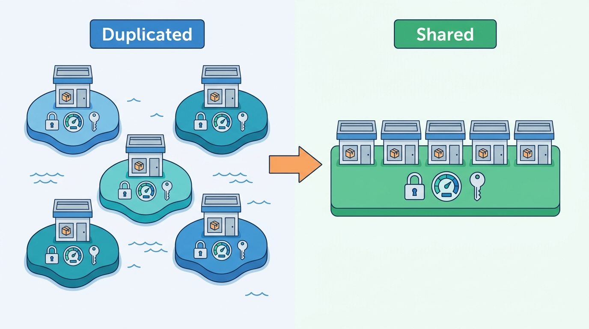
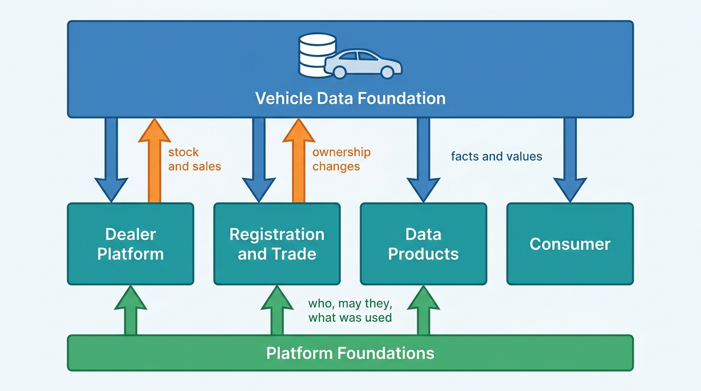
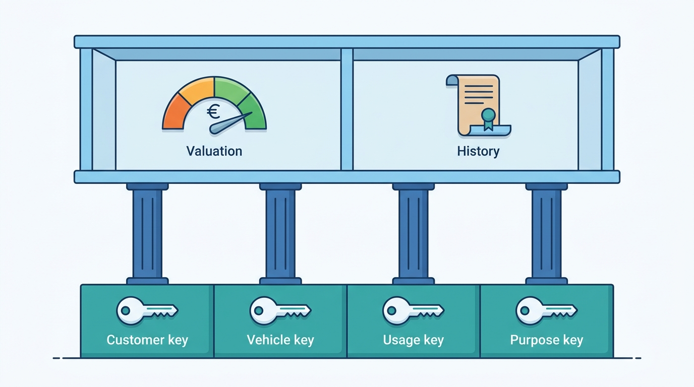
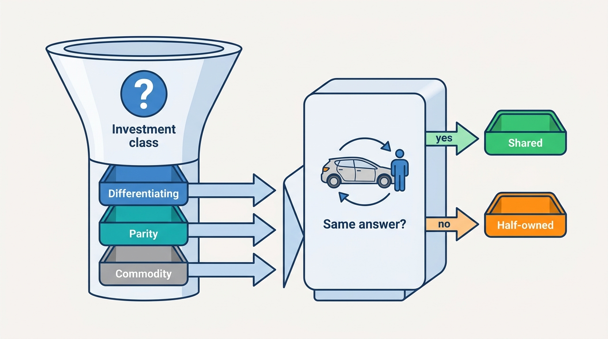

> **IN THIS CHAPTER, YOU WILL:** Build a business capability map for a group that sells vehicle data and dealer software, from a reference model of 28 capability blocks plus the eight capabilities that model lacks, and turn it into a heat map that decides where to invest, what to share and what to buy.

> **WHY THE BUSINESS CARES:** A group assembled by acquisition pays several times for the same capability (three logins, three billing paths, two API stacks) while underinvesting in the few that decide whether a dealer or data client chooses it. The capability map is how the CEO and CFO see that spending in one picture.

> **WHY ARCHITECTS SHOULD CARE:** The map is the first artifact in which "share the vehicle key" and "do not share release cadence" become checkable claims. It feeds bounded contexts, sourcing decisions, team design and the integration sequence of the whole portfolio.

> **KEY POINTS:**
>
> * **Map what the business must be able to do, not what its systems are called.** A capability map that copies the product list or the org chart hides duplication. Axleby's v1 map has 6 domains and 39 capabilities, and nine of them were implemented two or three times by acquired products.
> * **Classify twice: by investment class and by scope.** Differentiating, parity and commodity decide how much to invest and whether to build; shared, data-half, workflow-half and market-specific decide where a capability lives. The two classifications answer different questions, and conflating them is how "identity is not strategic" becomes three login systems.
> * **Share the parity capabilities that carry keys first.** Eight of Axleby's 18 shared capabilities are parity, not differentiating: accounts, entitlements, metering, licensing, ingestion, specification, onboarding and events. They carry the keys that every differentiating capability, from valuation to history, needs. Sharing them first is cheaper and less contested than merging the capabilities that make each brand distinct.

> **[FAILURE PATTERNS THIS CHAPTER ADDRESSES](where-vehicle-platforms-go-wrong.html):**
>
> * **The Acquisition Archipelago** — a map drawn product by product shows five healthy products; a map drawn capability by capability shows nine capabilities built more than once and a customer nobody can see whole.
> * **The Unmetered Call** — when metering is a feature of each product rather than a shared capability, each product counts a "no hit" its own way.
> * **License Blindness** — the reference model checks licenses at only 3 of its 28 blocks; drawn as a capability, governance has to cover every interface that releases data.

 
A vehicle data and dealer SaaS group sells many things: a plate lookup, a history report, a valuation, a stock module, an advert on sixty portals, a registration in a new owner's name, a market dashboard. Its product list says what it charges for. It does not say **what the business must be able to do** to deliver them, which of those abilities each product reinvents, and which ones decide whether a dealer or data client chooses this group over another.

A **business capability** is what the business must be able to do to deliver value, described independently of the people, processes and systems that currently do it. "Value a used car" is a capability; Vantage is a system that implements it; Wertlauf is the team that built it; the appraisal screen in Lotwise is one place it is used. A **capability map** arranges capabilities in levels, usually two or three, and a **heat map** colors each one by a judgement: how much it differentiates, how well it works, who owns it. A **shared capability** is one that both halves of the platform, the data half and the workflow half, consume and that has one implementation and one owner.

This chapter owns those three terms. It builds on the participants and value chain in [[vehicle-data-ecosystem]] and the economics in [[dealer-and-data-economics]], and hands the next step, turning capabilities into bounded contexts with sources of truth, to [[vehicle-bounded-contexts]]. Sourcing decisions continue in [[build-buy-or-partner]], and the December 2027 revision of the map in [[one-platform-from-many-products]].

## Setting the Scene at Axleby: Five Products, One Board Question

Axleby is the fictional vehicle data and dealer software group this book follows ([[meet-axleby]]). In February 2027 its CEO, Anouk Willems, asked Ines Marchetti, the Group Chief Architect, a question that sounded simple. Axleby's board, on which Harrowgate Capital holds the majority, would meet on **16 March 2027** to decide on the **One Dossier** program, a €38 million, three-year proposal from Ines and the CTO Ruben Dekker. Anouk wanted one page that showed "what we do, what we do twice, and what we do better than anyone."

The product view did not answer it. Each of Axleby's five brands (Axleby Data, Lotwise, Showroomly, Axleby Trade and Odolo) had its own roadmap and could show a healthy product. Tomás Ferreira, Product Director of Lotwise, wanted dealer-visible features every quarter. Priya Raman, VP Data and Valuation, wanted investment in valuation drift monitoring after the **EV Overvaluation** of 2026, when Vantage overvalued used battery-electric vehicles (BEVs) by 9.5% for 14 weeks. Lena Vos, Billing and Finance Systems Lead, wanted the three billing paths merged after the **No-Hit Credit** (€186,000 to 41 API clients). Each request was sound. Together they were a list without a priority.

Ines ran a two-day workshop in Utrecht on **22–23 February 2027** with the brand directors, Hendrik Maes (Partner Integrations), Marta Nowak (Platform and SRE), Femke de Boer (Data Governance) and Lena. She brought two things: a reference capability model of the domain, built from public sources, and a rule. **Every system Axleby runs had to be placed under a capability, and every capability had to name its consumers.** Systems that landed under the same capability were duplicates; capabilities with no system were gaps; capabilities used by more than one brand were candidates for sharing.

Three findings came out of the first afternoon.

- **Nine capabilities were implemented two or three times.** Accounts and login had three implementations, billing three paths, vehicle data APIs two stacks, and vehicle identity was keyed three ways (Lotwise's stock id plus plate, Connect XML's plate and Anchor's Axleby Vehicle Key, AVK). Register data was held in Turnstile's mirror and in Connect XML's own tables. Syndication, dealer websites and lead inboxes existed in both Lotwise and Showroomly, and every product kept its own entitlements.
- **Eight capabilities the group needed had no clear home in the reference model.** DMS (dealer management system) integration, events and webhooks, onboarding and configuration, observability and data operations, ingestion and entity resolution, provenance and data quality, connected-vehicle data and vehicle identity resolution as a capability of its own.
- **The incidents clustered.** The EV Overvaluation (2026), the No-Hit Credit (2026), the **License Breach** (January 2027) and the **Zombie Golf** (February 2027, a sold Golf live on 4 portals for 4 days, drawing 37 leads) each sat in a capability that was either duplicated, unowned or missing from the model.

**Figure 1:** *Drawn product by product, Axleby showed five healthy brands; drawn capability by capability, it showed nine capabilities, from logins and billing to vehicle keys, implemented two or three times.*

The workshop started from the ecosystem map Ines, Hendrik and Femke had drawn in January and February: every source, channel, partner and client class with its contract, including 21 commercial data-supplier contracts ([[vehicle-data-ecosystem]]). The page Ines took to the board on 16 March was **capability map v1**. The rest of this chapter explains how it was built, what it says and what it decided.

## Concepts: Capabilities, Levels and Heat

Capability mapping is established enterprise-architecture practice: Ulrich Homann's 2006 Microsoft paper treated capabilities as the stable "what" of a business, and The Open Group's TOGAF series has a guide to capability maps. Eric Evans's domain-driven design (2003) separates the **core domain**, why customers choose you, from **supporting** and **generic** subdomains; Simon Wardley's maps add evolution from novel to custom-built to product to commodity. This chapter uses those ideas in a deliberately small form.

| Term | Definition used in this book | Not to be confused with |
| --- | --- | --- |
| **Capability** | A stable ability the business needs to deliver value, named as a noun phrase about the business ("vehicle valuation", "register transactions") | A system (Vantage), a team (Wertlauf), a product (Lotwise Appraise) or a process step ("enter the mileage") |
| **Level 1 (domain)** | A group of capabilities that serve one part of the value chain or one shared purpose; six in Axleby's v1 map | A business unit or brand |
| **Level 2 (capability)** | The unit of ownership, investment and sharing decisions; 39 in v1 | A microservice; one capability may need several services |
| **Level 3** | A sub-capability drawn only where a sharing or sourcing decision needs it | Detail for completeness; v1 drew none |
| **Investment class** | Differentiating, parity or commodity (defined below) | The capability's current health |
| **Condition** | How well the capability works today: green, amber, red or grey | Its importance |
| **Scope** | Who consumes it: shared (both halves), data half, workflow half | Who happens to build it today |
| **Market flag** | Whether the capability's rules, sources or partners differ by country | Whether it is sold in several countries |

Three investment classes do most of the work.

- **Differentiating:** decides whether a dealer or data client chooses the group; earns the best engineers, build as the default and its own accuracy metrics. At Axleby: valuation, history, identity resolution.
- **Parity:** must match competitors to stay in the deal, but doing it better wins little; deserves exactly one good implementation, often on bought components. At Axleby: syndication, accounts, metering.
- **Commodity:** standardized; buy, rent or delegate to a partner. At Axleby: observability tooling, file enrichment, financing referral.

**Parity is not a polite word for unimportant.** The Zombie Golf happened in syndication, a parity capability; the No-Hit Credit in metering, another. A parity capability that fails costs as much as a differentiating one. What differs is the investment logic: a parity capability should be built once and well, and nobody should compete on it inside the group.

## The Reference Model: 28 Blocks in Five Groups

The book's research began with a reference domain model of a vehicle data and dealer SaaS platform that the author built from the public product pages of one Dutch vehicle-data company (the public record of that company is the subject of [[case-vwe]]). Its capability blocks, data stores and dependencies were **inferred from public product behavior, not taken from any company's architecture documentation**, so the model is used here as a generic reference, with neutral names, and never as a description of that company. [[domain-coverage]] maps every block to the chapters that cover it.

The model has **28 capability blocks** in five groups, with 140 modules and 55 dependencies between blocks.

| Reference group | Blocks (neutral names) | What the group does |
| --- | --- | --- |
| **Vehicle data foundation** (8) | Register connector and mirror; vehicle identity and specification; vehicle history; EV battery health; damage calculation; market and transaction data; valuation; registration-tax calculation | Who and what the vehicle is, what happened to it, what it is worth |
| **Dealer operations** (7) | Vehicle dossier and workflow hub; stock and pricing; trade-in appraisal; advert syndication; dealer website and lead capture; sales administration; financing referral | The dealer's car from purchase to delivery |
| **Registration, trade and remarketing** (4) | Register transactions; plates and materials webshop; import and export documents; B2B trade exchange | Official paperwork and trader-to-trader sales |
| **Data products and channels** (6) | Vehicle data API gateway; file enrichment; market insight dashboards; change-of-ownership scoring; consumer plate check; consumer travel documents | Data sold to enterprises, developers and consumers |
| **Platform and commerce** (3) | Accounts, identity and entitlements; subscription and transaction billing; data licensing and governance | The shared commercial and compliance backbone |

The model's dependency graph states the book's central claim in miniature. The register connector has the most incoming dependencies (10), followed by identity and specification (8), valuation (6) and billing (5). **One register connection, one specification resolver and one valuation engine feed every product; the workflow blocks are thin over them.**

The model is also instructive where it is inconsistent. Its data-licensing block is called from only **3 of 28 blocks**, although its own target architecture enforces licenses "at every data interface", and only **5 blocks** record billable usage, although at least ten produce something a customer pays for. Those gaps become License Blindness and the Unmetered Call. **Drawn as capabilities, licensing and metering are obviously shared**; drawn as blocks with edges, they look like features of whichever block remembered to call them.

## What the Reference Model Lacks, and Why It Belongs

A model built from one company's public product pages describes what that company sells, not everything a platform must be able to do. Comparing it with the research for this book (registers in five markets, DMS ecosystems, syndication standards, SaaS tenancy, connected-vehicle regulation) found eight capabilities a real platform needs that the model lacks or buries inside another block.

| Added capability | Why the platform needs it | Evidence it is real | Owning chapter |
| --- | --- | --- | --- |
| **Vehicle identity resolution** | Plates move on import, re-registration and personalization; an identity graph keyed by vehicle identification number (VIN) is a capability, not a lookup | Every market studied keys registers by plate and history by VIN | [[vehicle-identity]] |
| **Ingestion and entity resolution** | Registers, suppliers, portals and dealers send overlapping, late and wrong data; validation, quarantine and survivorship need one implementation | Register snapshots, supplier files and harvested adverts arrive in different shapes and rhythms | [[ingestion-and-entity-resolution]] |
| **Provenance and data quality** | A fact without source, date, license and confidence cannot be shown, corrected or defended | Corrections must reach every copy; reports carry liability | [[provenance-and-data-quality]] |
| **Connected-vehicle data** | The EU Data Act applies from 12 September 2025 and gives users and their chosen third parties access to vehicle-generated data | Regulation (EU) 2023/2854 | [[connected-vehicle-data]] |
| **DMS integration** | Franchised dealers keep accounting, deals and often stock in a DMS the platform does not control | CDK's 2024 outage and the Authenticom litigation show the stakes | [[dms-integration]] |
| **Events and webhooks** | Stock, price, sold and corrected-fact changes must reach portals, DMS, clients and the warehouse in order | The model lists events on data assets but no capability publishes them | [[events-webhooks-and-sync]] |
| **Onboarding and configuration** | Dealer groups arrive with hundreds of users, a DMS and channel accounts; configuration must replace code forks | Group onboarding is an integration project, not a sign-up | [[onboarding-and-configuration]] |
| **Observability and data operations** | Health per tenant, per channel and per data source, and a support view across products | The model names availability KPIs but no capability measures them | [[observability-and-data-operations]] |

Three other gaps were left out of the map deliberately, and the reason is part of the method. **Lease contract administration** is a different business (fleet management software) that Axleby does not sell; **marketplace payments and escrow** stay with auction partners because Tradefloor hands deals off; **fraud prevention** is treated as a cross-cutting concern of security, not a capability a customer buys ([[vehicle-platform-security]]). A capability map should contain what the business must do, and saying "we do not do this" is a decision worth recording.

## Capability Map v1 (March 2027)

Map v1 has **6 level-1 domains and 39 level-2 capabilities**. Thirty-one come from the 28 reference blocks: three blocks split in two (the advert editor became merchandising, separate from syndication; website and lead capture became dealer websites and lead management; accounts became accounts and tenancy, separate from authorization and entitlements), and the buying app inside stock and pricing folded into appraisal. Eight are the additions above. The reference model's data-products group was split so that consumer products form their own domain, because consumers are a different customer with different law ([[consumer-vehicle-checks]]).

**Figure 2:** *Capability map v1 at level 1: the vehicle data foundation feeds every domain and learns from the dealer platform and registration domains, while platform foundations answer the same three questions (who, may they, what was used) for every product.*

The feedback arrows matter as much as the forward ones. Dealer stock and sales are the best ground truth the market data and valuation capabilities have, and register transactions are the moment a sale becomes a fact ([[market-data]], [[valuation-engine]]). A map that draws data flowing only from the data half to the workflow half misses why the two halves belong in one group.

### The 39 capabilities and their heat

The heat map uses four attributes per capability. **Class:** D differentiating, P parity, C commodity. **Condition** in March 2027: **Green** = one implementation that meets its consumers' needs; **Amber** = works, but implemented more than once or on a known fragile path; **Red** = an incident in the previous 12 months whose fix is not yet in place, or a blocker for One Dossier's year-1 goals; **Grey** = needed but owned by nobody, or a reference capability Axleby does not offer. **Scope:** Shared, Data (data half), Workflow (workflow half). **Mkt:** ● where sources, rules or partners differ by country.

| # | Capability | Axleby system(s), March 2027 | Class | Condition | Scope | Mkt |
| --- | --- | --- | --- | --- | --- | --- |
| **A** | **Vehicle Data Foundation** | | | | | |
| A1 | Register access and mirror | Turnstile; Connect XML's own register tables | D | Amber | Shared | ● |
| A2 | Vehicle identity resolution *(added)* | Anchor (AVK); Lotwise stock id plus plate; Connect XML plate | D | Amber | Shared | |
| A3 | Specification and equipment | Specbook with licensed build data | P | Amber | Shared | ● |
| A4 | Vehicle history | Tracewell | D | Amber | Shared | ● |
| A5 | Ingestion and entity resolution *(added)* | Per-source loaders in Tracewell, Pulse and Connect XML | P | Amber | Shared | |
| A6 | Provenance and data quality *(added)* | None as a capability | D | Grey | Shared | |
| A7 | Market data | Pulse | D | Amber | Shared | ● |
| A8 | Vehicle valuation | Vantage | D | Red | Shared | ● |
| A9 | Condition and damage estimation | Licensed estimation partner through Lotwise | P | Amber | Workflow | |
| A10 | EV battery health | None (PDF attachments) | D | Grey | Shared | |
| A11 | Connected-vehicle data *(added)* | None | D | Grey | Data | ● |
| A12 | Registration-tax calculation | Axleby Trade calculators | P | Green | Workflow | ● |
| **B** | **Dealer Platform** | | | | | |
| B1 | Appraisal and acquisition | Lotwise Appraise | D | Amber | Workflow | |
| B2 | Inventory and vehicle dossier | Lotwise Classic | D | Red | Shared | |
| B3 | Pricing and stock signals | Lotwise Stock & Pricing | D | Amber | Workflow | |
| B4 | Merchandising and media | Lotwise advert editor | P | Amber | Workflow | ● |
| B5 | Listing syndication | Relay; Showroomly feeds | P | Red | Workflow | ● |
| B6 | Dealer websites | Lotwise Website & Leads; Showroomly | P | Amber | Workflow | |
| B7 | Lead management and routing | Switchboard; Lotwise and Showroomly inboxes | P | Amber | Workflow | |
| B8 | Sales administration and documents | Lotwise Sales Admin | P | Green | Workflow | ● |
| B9 | Financing referral | Lender partner through Lotwise | C | Green | Workflow | ● |
| B10 | DMS integration *(added)* | DriveDesk and file adapters in Lotwise | P | Red | Workflow | ● |
| **C** | **Registration and Trade** | | | | | |
| C1 | Register transactions | Axleby Trade back office and retry queue | D | Amber | Shared | ● |
| C2 | Import and export documents | Axleby Trade | P | Green | Workflow | ● |
| C3 | Plates and trade materials | Axleby Trade webshop | C | Green | Workflow | ● |
| C4 | Business-to-business (B2B) trade exchange and remarketing | Tradefloor | P | Amber | Workflow | |
| **D** | **Data Products and Distribution** | | | | | |
| D1 | Vehicle data APIs | Connect XML; JSON API v1 | P | Red | Data | |
| D2 | File enrichment | Axleby Data batch jobs | C | Green | Data | |
| D3 | Market insight and dashboards | Axleby Insight; Rooftop Benchmark | D | Amber | Data | ● |
| D4 | Change-of-ownership prediction | Horizon (NL; data protection impact assessment under way) | P | Amber | Data | ● |
| D5 | Events and webhooks *(added)* | None external; RabbitMQ and MSK internally | P | Grey | Shared | |
| **E** | **Consumer** | | | | | |
| E1 | Consumer vehicle checks | Odolo | P | Amber | Data | ● |
| E2 | Consumer travel documents | Not offered (Odolo refers to partners) | C | Grey | — | |
| **F** | **Platform Foundations** | | | | | |
| F1 | Accounts, organizations and tenancy | Axleby Portal accounts; Lotwise users; Showroomly users | P | Red | Shared | |
| F2 | Authorization and entitlements | Per product | P | Amber | Shared | |
| F3 | Onboarding and configuration *(added)* | Manual, per product | P | Amber | Shared | |
| F4 | Usage metering and billing | Connect XML invoice run; Lotwise billing; Showroomly billing tool | P | Red | Shared | |
| F5 | Data licensing and purpose governance | Being built after the License Breach (Charter) | P | Red | Shared | |
| F6 | Observability and data operations *(added)* | Datadog; Grafana and Prometheus | C | Amber | Shared | |

The counts are the board's summary, and they are canonical for this book.

| Attribute | v1 count (of 39) |
| --- | --- |
| Investment class | **13 differentiating, 21 parity, 5 commodity** |
| Condition | **6 green, 20 amber, 8 red, 5 grey** (4 missing, 1 not offered) |
| Scope | **18 shared, 6 data half, 14 workflow half**, 1 not offered |
| Market-specific | **18**, of which 4 exist only in the Netherlands (registration tax, register transactions, import and export documents, plates) |
| Implemented more than once | **9** (register data, identity keys, syndication, dealer websites, lead inboxes, data APIs, accounts, entitlements, billing) |
| Added beyond the reference model | **8** |

### Where the classes fall

The most useful cut of the table is class by scope.

| | Shared | Data half | Workflow half |
| --- | --- | --- | --- |
| **Differentiating** | **9:** register access, identity resolution, history, provenance, market data, valuation, battery health, vehicle dossier, register transactions | **2:** connected-vehicle data, market insight | **2:** appraisal, pricing |
| **Parity** | **8:** specification, ingestion, events, accounts, entitlements, onboarding, metering, licensing | **3:** data APIs, ownership prediction, consumer checks | **10:** damage, registration tax, merchandising, syndication, websites, leads, sales documents, DMS integration, import and export documents, trade exchange |
| **Commodity** | **1:** observability | **1:** file enrichment | **2:** financing referral, plates and materials |

Not offered: consumer travel documents (commodity). Two observations shaped the board discussion.

**Most differentiating capabilities are shared.** Nine of the 13 sit in the shared column. Valuation, history and identity are what both halves sell: Axleby Data sells them by the call, and Lotwise sells them inside appraisal and pricing. This is the economic argument of [[dealer-and-data-economics]] in map form: **data is the feature that makes the workflow worth paying for, and the workflow is the channel that sells the data.**

**Eight of the 18 shared capabilities are parity, and they carry the keys.** Accounts carry the customer key, identity resolution the vehicle key, metering the usage key, licensing the purpose key. A differentiating capability cannot be shared well until those keys are: Vantage cannot charge an appraisal correctly without Meterline, cannot show a history-adjusted value without the AVK, and cannot serve an insurer without a license check. This is why One Dossier's year 1 is mostly parity work.

**Figure 3:** *Eight of the 18 shared capabilities are parity, but they carry the customer, vehicle, usage and purpose keys that every differentiating capability rests on, which is why One Dossier's year 1 is mostly parity work.*

## Architecture: From Map to Platform Decisions

A capability map is not an architecture diagram, but it decides several architecture questions directly. The first is which capabilities become shared platform services with one owner, one contract and many consumers.

**Figure 4:** *Two questions, asked separately: the investment class decides how much to spend and whether to build; the "same answer about the same car or customer" test decides whether the capability is shared. A parity capability can be shared, and a differentiating one can stay with one half.*

The sharing test is narrow on purpose. It asks whether both halves need **the same answer about the same car or the same customer**, not whether they need similar functionality. Lotwise and Showroomly both need dealer websites, but no Lotwise screen needs to know what a Showroomly website shows; the websites are a candidate for consolidation, not a shared capability. Lotwise and the JSON API both need to know which car a plate denotes today, and if they disagree, a dealer's stock and an insurer's report describe different cars. That is a shared capability.

### What each shared capability must promise

A shared capability serves consumers with different needs: a lane-side appraisal wants an answer in seconds, a nightly revaluation of 350,000 stock items wants throughput, an insurer's batch wants a contract that does not change. The v1 map recorded, for each shared capability on the critical path, the promise its consumers depend on. Owning chapters set the final targets; values marked *(assumption)* are illustrative.

| Shared capability (system) | Consumers in March 2027 | Latency | Freshness | Consistency | Availability |
| --- | --- | --- | --- | --- | --- |
| Register access (Turnstile) | All five products | Mirror read p95 ≤ 100 ms *(assumption)*; live status calls in seconds | Mirror at least daily; theft and inspection status asked live | Mirror is a labeled copy; transactions only against the register | Mirror serves when the register is down; transactions queue ([[registers-and-official-data]]) |
| Identity resolution (Anchor) | All five products | p95 under 80 ms *(assumption)* | Plate assignments time-bounded; resolved as of a date | One AVK per car; merges and splits published as events | Degrade to last resolution with confidence tier ([[vehicle-identity]]) |
| Vehicle history (Tracewell) | Lotwise, Axleby Data, Odolo | Report assembly in seconds *(assumption)* | Per source; coverage stated in the report | Every report a stored snapshot | Partial reports labeled, never "clean" by default ([[vehicle-history]]) |
| Valuation (Vantage) | Lotwise, Axleby Data, Odolo, Tradefloor | Within a lane lookup of p95 ≤ 2 s end to end *(assumption)* | Model retrained weekly | Every issued valuation in the valuation ledger with model version | Cached last value with age, never a silent default ([[valuation-engine]]) |
| Accounts and entitlements | All five products (three logins in 2027) | Token check in-process | Entitlement change effective within minutes *(assumption)* | One account and tenant key per customer | Fail closed for writes and register transactions ([[identity-access-and-entitlements]]) |
| Metering | All five products (three billing paths in 2027) | Off the request path | Visible to the client within 24 h *(assumption)* | Exactly-once effect, idempotent on a business key | Lossless; separate from telemetry ([[billing-and-metering]]) |
| Licensing check | Data APIs, enrichment, reports, insight | p99 under 2 ms, evaluated in process in the request path *(assumption)* | License changes effective before the next call | One decision recorded per release of data | Fail closed for licensed sources ([[data-licensing-and-governance]]) |

The table is where "shared" stops being a slogan. Consumers with incompatible promises, such as a lane answer in seconds and an auditable batch revaluation, need two serving paths over one model and one ledger, not two valuation engines.

### What the map says must not be shared

The two halves share **the vehicle, the dossier, the account, the entitlements, the meter, the license check and the events**, and do not share **release cadence, customer-facing workflow and external API contracts** ([[vehicle-bounded-contexts]]). On the map, the 14 workflow-half capabilities ship on Lotwise's monthly rhythm, while the 6 data-half capabilities change on a versioned, announced schedule that 640 API clients can plan for. Shared capabilities must serve both rhythms, so their contracts are versioned and their owner is a platform team, not either half ([[organizing-engineering]]).

## In Practice: How Real Portfolios Show Their Capabilities

No vehicle-data or dealer-software company publishes its internal capability map. What the public record shows is how portfolios were grouped, which capabilities they made shared and in which order. Three documented examples are useful; each says something different about the map.

**Cox Automotive grouped brands by business line, then shared capabilities later.** When Cox Enterprises announced the formation of Cox Automotive on 21 August 2014, it grouped more than 20 brands into five areas: auctions and wholesale, financial services, media, software and international. That is a portfolio view by business line, not a capability map. Cox's later public record shows shared capabilities being added across those lines: Bridge ID, a single sign-on whose undated page (read October 2026) describes a rollout to all users at the end of 2020 and the beginning of 2021, and which works by linking each product's existing account; and, in a 2024 PlatformCon talk, a move "from API silos to a unified API strategy" because Cox "grew through acquisitions" while customers expect the brands to work together. Apollo's undated customer story (read October 2026) says Cox's VIN decoder sat outside the federated API graph until it was connected without a rewrite, so teams could decode a VIN and join valuations in one query. [[case-cox-automotive]] tells this history in full.

> **INFERENCE, NOT DOCUMENTED:** In capability-map terms, Cox's public record reads as identity first, then vehicle identification and data access as shared capabilities, layered over product-owned systems. Cox has not published a capability map, and nothing here describes its internal classification.

**Auto Trader UK built a capability ladder in dependency order.** Auto Trader's results releases date its retailer modules. In April 2022 it launched Retail Essentials, "the first module of our Auto Trader Connect platform", using its "proprietary taxonomy data" to describe vehicles and real-time stock management (FY2023 results, June 2023). Specification-adjusted valuations followed in April 2023, trended valuations in April 2024, the Co-Driver generative-AI tools in its 2025 financial year, and Deal Builder, which lets buyers value a part-exchange, apply for finance and reserve a car (FY2025 results, May 2025). **My reading** is that the order follows the capability dependencies: specification before valuation, valuation before trended valuation, specification and features before AI descriptions, all of them before transactions. [[case-auto-trader-uk]] develops this reading. On Axleby's map the same chain runs A3 → A8 → B3 → B4 → B8.

**CDK Global's portfolio has the opposite shape.** Its fiscal 2021 annual report described a dealer management system with "layered applications" around it for nearly 15,000 North American retail locations. A DMS-centered map has one dominant capability, the dealer's system of record, and its strategic question is who controls access to it ([[case-cdk-global]]). Axleby owns no DMS, so DMS integration (B10) is a parity capability whose risk is dependence, not control ([[dms-integration]]).

The lesson is about **time and order**: Cox's documented steps took years each. A capability map makes the order visible early; it does not make the work faster.

## The Axleby Worked Example: Reading the Map for One Car

The board did not need 39 rows; it needed to see what the map meant for one customer. Ines used **Autobedrijf Brandsma**, an independent dealer in Leeuwarden with about 55 cars in stock, on Lotwise since 2014, and one trade-in.

Sietse Brandsma appraises a trade-in on his forecourt. The appraisal (B1) needs the register (A1), identity (A2), specification (A3), history (A4), damage (A9) and valuation (A8). It needs his account and modules (F1, F2), a metered history report (F4) inside his Appraise bundle of 25 reports a month, and a license check if the history includes a partner's data (F5). If he buys the car, it becomes a stock item (B2), gets a price (B3), an advert (B4) on several channels (B5) and leads (B7). When he sells it, he registers it in the buyer's name (C1) from the dossier, and that ownership change returns to market data (A7).

In March 2027, the map showed four places where this one car crossed a duplicate or a gap.

| Step | Capability | What happened in March 2027 | Cost or risk (Axleby figures) |
| --- | --- | --- | --- |
| Identify | A2 identity | Lotwise keyed the car by stock id plus plate; reports were ordered by plate | Plate re-typed across screens; reports linked to stock by heuristics ([[inventory-and-vehicle-dossier]]) |
| Specify | A3 specification | Each trigger could buy build data again | About €0.46 per build-data request ([[specification-and-equipment]]) |
| Bill | F4 metering | History report counted by the Lotwise bundle; an API client's identical call counted by Connect XML or JSON API v1 under different no-hit rules | The No-Hit Credit: €186,000 to 41 clients in 2026 ([[billing-and-metering]]) |
| Sell | B5 syndication | Deletes queued behind failed updates | The Zombie Golf: 4 portals, 4 days, 37 leads, 9 test drives ([[listing-syndication]]) |

The point was not the incidents. It was that **every troubled step was a shared or parity capability**, while the steps where Brandsma finds Axleby better than a competitor (the appraisal, the pricing signal, the register transaction from the dossier) depended on them. "What we do better than anyone" had an answer, 13 differentiating capabilities, but it could not be delivered consistently until the parity foundations under it were one.

The map also showed how widely each shared capability is used. Counting the five products that consume each one:

| Shared capability | Consumed by | Products consuming |
| --- | --- | --- |
| Register access (A1) | Lotwise, Showroomly (UK lookups), Axleby Data, Axleby Trade, Odolo | 5 |
| Identity resolution (A2) | All five | 5 |
| Accounts (F1) | All five, in three login systems plus Odolo's consumer accounts | 5 |
| Metering and billing (F4) | All five, in three billing paths | 5 |
| Valuation (A8) | Lotwise, Axleby Data, Odolo, Axleby Trade (Tradefloor) | 4 |
| Vehicle history (A4) | Lotwise, Axleby Data, Odolo | 3 |

A capability consumed by five products and implemented three times is the clearest case for consolidation on any map. This table, more than the heat colors, is what moved the board.

## How Capability Maps Fail, and How to Recover

A capability map fails quietly: it looks finished, gets presented once and stops being true. Six failure modes recur, each with a detection signal and a recovery.

| Failure | How it shows | Detection | Recovery |
| --- | --- | --- | --- |
| **The org chart in disguise** | Capabilities named after brands or teams ("Lotwise features", "Wertlauf models") | A capability with exactly one team and one product and no consumers outside it | Rename as a business ability; list consumers; merge where two names hide one ability |
| **Duplicates under two names** | "Lead inbox" and "enquiry management" on the same map | Two capabilities with the same inputs, outputs and consumers | Merge; record the merge in the map's changelog |
| **Conflicting owners** | Two directors claim valuation, or nobody claims provenance | The ownership column has two names or none | One accountable owner per capability, decided by the Chief Architect with the CTO; consumers are not owners |
| **Incomplete map** | DMS integration, events or onboarding missing because the reference model lacked them | Systems or incidents that cannot be placed under any capability | Add the capability, mark it "added", state why it belongs |
| **Everything is differentiating** | Every director classifies their own area as D | More than about a third of capabilities rated D *(assumption: a rule of thumb, not a standard)* | Ask "would a customer leave if this were merely as good as a competitor's?"; require a named competitor comparison for every D |
| **The stale map** | A map from last year guides this year's sourcing | The map's date is older than the last major incident or acquisition | Revise on a fixed calendar and after every acquisition, incident review or market entry |

The "everything is differentiating" failure deserves its own note, because the heat map is political. A director whose capability is classed parity hears "your team is less important". Ines handled it at the workshop by separating the class from the condition and from the budget: **parity capabilities with red condition got more year-1 money than differentiating ones with amber condition.** Metering (parity, red) was funded ahead of market insight (differentiating, amber). The class says how to invest; the condition says where to invest first.

One duplicate was contested: Showroomly's team argued that UK syndication deserved its own capability. The workshop kept one (B5) with a market flag, on the rule that **a market difference is a rule set or an adapter, not a separate capability**, unless the business itself differs.

## Trade-offs: How to Draw and Use the Map

Several approaches compete for the same purpose. Each answers a slightly different question.

| Approach | What it shows | Strength | Weakness | When it fits |
| --- | --- | --- | --- | --- |
| **Product portfolio map** (brands and modules) | What the group sells | Matches revenue lines and P&L ownership | Hides duplication across brands; no sharing signal | Commercial planning; investor reporting |
| **Capability map with heat** (this chapter) | What the business must be able to do, how well, and how much it differentiates | Stable over reorganizations; exposes duplicates and gaps | Political; easy to let go stale; says nothing about runtime | Investment and sharing decisions; acquisition integration |
| **Wardley map** | Components on a value chain by evolution stage | Shows drift toward commodity; good for sourcing timing | Harder to read for boards; needs a user need anchor | Strategy and sourcing over several years ([[build-buy-or-partner]]) |
| **Bounded-context map** | Models, languages and sources of truth, with their relationships | Directly drives service and team boundaries | Too detailed for business prioritization | Design of contexts, contracts and anti-corruption layers ([[vehicle-bounded-contexts]]) |
| **System landscape diagram** | What runs where and calls what | Operationally accurate | Encodes today's accidents; no business classification | Operations, migration and dependency analysis |

I would use the first three together and in that order of audience: the portfolio map for the board's revenue view, the capability map for investment and sharing, a Wardley-style evolution view for sourcing timing. The capability map is the one that should outlive reorganizations, so it is the one to keep under version control.

A second trade-off is **how fine to draw it**. Ten capabilities turn every sharing decision into an argument about sub-parts; two hundred cannot be held in anyone's head or kept current. The rule I use: **draw a capability where one owner can be accountable for it and sharing or sourcing is a single decision**. That gave Axleby 39. Level 3 is drawn only when a capability contains parts with different classes or scopes, such as valuation's differentiating model and commodity serving layer. v1 drew none; [[one-platform-from-many-products]] shows where v2 needed it.

A third trade-off is **classifying by today's market or tomorrow's**. Register access is differentiating for Axleby because its contractual data-supply and transaction relationship with the Dutch register dates from 1999. But the RDW (the Dutch vehicle authority) publishes basic plate data as open data, and free plate apps compete on it. The map records register access as differentiating with a **watch note**: plate lookups drift toward commodity, while transactions and validated mirrors stay differentiating. Wardley's evolution axis tracks that drift; the heat map records only the current judgement.

## Market-Specific Capabilities

Part I chapters do not carry an "Across Markets" section, but the map has to show which capabilities change by country, because every market flag implies an adapter, a rule set or a separate product. Eighteen of the 39 capabilities carry the flag.

| Form of market variation | Capabilities | What varies | Design response |
| --- | --- | --- | --- |
| **Different registers and sources** | A1 register access, A3 specification, A4 history, A7 market data, E1 consumer checks | Register access regimes (RDW, DIV, KBA, DVLA and DVSA, US state registers), type codes, history sources, portal landscape | One capability, per-market adapters behind one contract ([[registers-and-official-data]]) |
| **Different models and rules** | A8 valuation, D3 market insight, D4 ownership prediction | Price levels, segment definitions, disclosure and privacy limits | One engine, per-market models and rule sets |
| **Different law** | A11 connected-vehicle data, B4 merchandising, B8 sales documents, B9 financing referral | EU Data Act (not UK), advert disclosures, VAT margin scheme, consumer-credit rules | Versioned market packs of rules and templates ([[onboarding-and-configuration]]) |
| **Different partners** | B5 syndication, B10 DMS integration | Portals and DMS products per country | One capability, adapters per partner ([[listing-syndication]], [[dms-integration]]) |
| **Netherlands only** | A12 registration tax, C1 register transactions, C2 import and export documents, C3 plates and materials | Dutch registration tax (*BPM*, *belasting van personenauto's en motorrijwielen*), the Dutch register's transaction channel | Market-specific capabilities; no generic version until a second market is entered ([[registration-and-trade-services]]) |

The judgement the map encodes is that **most market variation belongs inside a capability, not beside it**. Only the four Netherlands-only capabilities are market-specific products, and the map marks them so that nobody generalizes them prematurely: a "pan-European register transaction capability" would be designed for one market's rules and three markets' hopes.

## The Chief Architect's View

The map is a governance instrument as much as an analysis. Five decisions follow from it.

1. **Own the map in architecture, decide the classes with the business.** The Group Chief Architect owns the map, its definitions and its changelog. Investment classes are agreed with the brand directors and the CFO; disputed classes go to the CTO. *At Axleby:* Ines owns it; Anouk and the CFO signed off the v1 classes before the board meeting.
2. **Fund by condition within class.** The class decides the investment logic (build and differentiate, build once, or buy); the condition decides the order. *At Axleby:* year-1 money went first to the red shared parity capabilities: accounts (Axleby ID), metering (Meterline) and licensing (Charter), plus identity resolution (the AVK as the only vehicle key) and the dossier.
3. **Make every shared capability a product with a contract.** One owner, a versioned interface, the promise table above, a consumer list and a deprecation policy. A shared capability without a contract becomes a shared database.
4. **Record what is not offered.** Consumer travel documents are on the map as grey, with the reason: Odolo refers consumers to sticker and insurance partners instead. The record stops the same idea from being re-proposed every quarter without its history, and makes a later decision to enter visible.
5. **Revise on a calendar and on events.** v1 was dated March 2027 and set for revision by the end of the year; [[one-platform-from-many-products]] presents v2 of December 2027. Every acquisition, market entry, major incident review and supplier change triggers an out-of-cycle review of the affected rows.

**What to watch:** the number of capabilities implemented more than once (9 in v1); the share of differentiating capabilities with red or amber condition; the number of capabilities with no owner; the number of products consuming each shared capability through its contract rather than a private copy; and capabilities drifting from differentiating to parity as competitors and open data catch up.

## Questions to Ask

1. Does your capability map name abilities of the business, or products and teams under another name?
2. For each capability, how many systems implement it, and who are its consumers?
3. Which capabilities are differentiating, and can you name the competitor you are better than for each one?
4. Which shared capabilities carry a key (vehicle, customer, usage, license), and are they shared already?
5. Which incidents of the last twelve months fall under capabilities that are duplicated, unowned or missing from the map?
6. What does each shared capability promise its consumers in latency, freshness, consistency and availability, and is that promise written down?
7. Which capabilities differ by market, and is each difference an adapter, a rule set or a genuinely separate product?
8. What has the business decided not to do, and is that decision on the map?
9. When was the map last revised, and was it after your last acquisition and your last major incident?

Map v1 says what Axleby must be able to do and which capabilities the two halves should share. It does not yet say where the lines between models fall, which context is the source of truth for a vehicle, a stock item or a lead, or how those contexts translate at their borders. [[vehicle-bounded-contexts]] draws those lines.

## Sources and Evidence

### Company, product and investor sources

- [Cox Enterprises announces formation of Cox Automotive](https://www.coxautoinc.com/press-releases/cox-enterprises-announces-formation-cox-automotive/), Cox Automotive, 2014 — five business areas grouping more than 20 brands.
- [Bridge ID](https://www.coxautoinc.com/bridgeid/), Cox Automotive, n.d., accessed 2026-10 — single sign-on across Cox products, per-product account linking, 2020–2021 rollout.
- [Cox Automotive's journey from API silos to a unified API strategy](https://2024.platformcon.com/talks/cox-automotives-journey-from-api-silos-to-a-unified-api-strategy), PlatformCon, 2024 — integration of APIs across acquired brands.
- [Cox Automotive customer story](https://apollographql.com/customers/cox-automotive), Apollo GraphQL, n.d., accessed 2026-10 — VIN decoder joined to the federated graph (vendor case study).
- [Full year results, year ended 31 March 2023](https://plc.autotrader.co.uk/media/3dbbyupi/fy-press-release-fy23-final_no_pw-0106.pdf), Auto Trader Group plc, 2023 — Retail Essentials (April 2022) and Valuations (April 2023) as Connect modules.
- [Full year results, year ended 31 March 2025](https://plc.autotrader.co.uk/media/umddcnxx/full-year-press-release-fy25.pdf), Auto Trader Group plc, 2025 — trended valuations, Co-Driver, Deal Builder.
- [CDK Global Form 10-K for fiscal 2021](https://www.sec.gov/Archives/edgar/data/1609702/000160970221000058/cdk-20210630.htm), CDK Global / SEC, 2021 — DMS with layered applications for nearly 15,000 retail locations; historical anchor.

### Standards, regulation and official documentation

- [Regulation (EU) 2023/2854 (Data Act)](http://publications.europa.eu/resource/celex/32023R2854), EU Publications Office, 2023 — access to connected-product data, applicable from 12 September 2025.
- [TOGAF Series Guide: Business Capabilities](https://pubs.opengroup.org/togaf-standard/business-architecture/business-capabilities.html), The Open Group, n.d., accessed 2026-10 (registration required) — capability maps as a business-architecture viewpoint.
- [Open Data RDW: registered vehicles](https://opendata.rdw.nl/d/m9d7-ebf2), RDW, n.d., accessed 2026-10 — plate-level register data published as open data.

### Research and practitioner sources

- Ulrich Homann, *A Business-Oriented Foundation for Service Orientation*, Microsoft MSDN, 2006 — business capabilities as the stable "what" of a business (cited from secondary references; the original page is archived).
- Eric Evans, *Domain-Driven Design: Tackling Complexity in the Heart of Software*, Addison-Wesley, 2003 — core, supporting and generic subdomains.
- [Wardley Maps](https://medium.com/wardleymaps), Simon Wardley, 2016–2018 (open book, CC BY-SA) — evolution from genesis through custom-built and product to commodity.
- [Evolution](https://docs.onlinewardleymaps.com/docs/map-features/evolution), Online Wardley Maps documentation, n.d., accessed 2026-10 — summary of the four evolution stages.
- The author's Productscape reference model of a vehicle data and dealer SaaS platform (2026), built from public product pages; block structure, counts and dependencies are the author's inference ([[domain-coverage]]).

Axleby is fictional; architectural recommendations, labeled inferences and labeled assumptions are the author's judgement.
