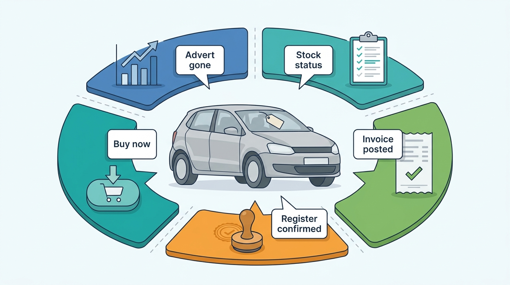
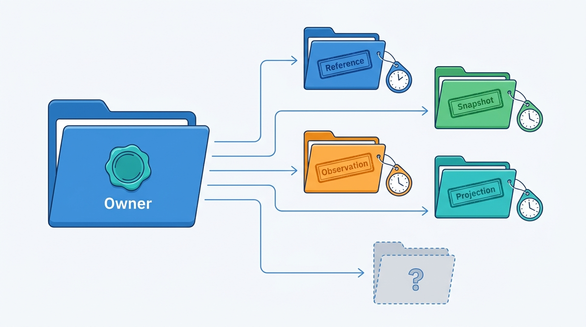

> **IN THIS CHAPTER, YOU WILL:** Draw the bounded contexts of a platform that sells vehicle data and dealer software, and build the two artifacts later chapters rely on: the entity–owner table (entities, identifiers, sources of truth, allowed copies, lifecycles) and the context map, with anti-corruption layers toward registers, suppliers, portals and dealer management systems (DMS).

> **WHY THE BUSINESS CARES:** When nobody owns "the car's mileage", "the customer" or "sold", dealers re-type plates, sold cars stay on portals, corrections never reach the reports already sold, and invoices cannot be explained. Clear ownership lets a group sell one dossier instead of five products that disagree.

> **WHY ARCHITECTS SHOULD CARE:** Boundaries outlive technologies. A wrong one turns every feature into a distributed transaction and every acquisition into another copy of the vehicle and the customer; a right one lets teams ship separately while facts stay consistent where the business needs it.

> **KEY POINTS:**
>
> * **Draw boundaries where words change meaning, not where products or nouns are.** "Sold" means five different things to market data, the stock book, the DMS, the register and the trade exchange. Each meaning gets its own context and its own event name; translation happens at the boundary, not in a shared column.
> * **One owner per entity, one opaque key, and every copy labeled.** Each principal entity has exactly one context that may change it and an identifier that encodes nothing. Every other context holds a reference, a decision snapshot, an observation or a rebuildable projection, and says which, with its age.
> * **Conform inside, translate outside.** Every internal context conforms to one vehicle identity (the AVK) and one tenant hierarchy, because those are the two keys the business joins on. Every external system (register, supplier, portal, DMS) sits behind an anti-corruption layer, because its model is not yours and its terms change.

> **[FAILURE PATTERNS THIS CHAPTER ADDRESSES](where-vehicle-platforms-go-wrong.html):**
>
> * **The Acquisition Archipelago** — five products with five vehicle and customer records exist because each acquisition kept its own boundary, and nobody decided which context owns the shared entities.
> * **The Sticky Error** — copies without a declared kind, owner or age cannot be found when the source fact is corrected.
> * **The Cloned Identity** — contexts that key vehicles by plate or by their own stock id cannot agree which car a fact belongs to.

 
Every architecture conversation about a vehicle platform eventually reaches one question: **who is allowed to say this is true?** Is the mileage the dealer's typed reading, the register's inspection reading or the supplier's workshop reading? Is the car sold when the salesperson clicks, when the DMS posts the invoice or when the register records a new keeper?

Domain-driven design (DDD) answers with the **bounded context**: a part of the system inside which every term has one meaning and one model, owned by one team. Martin Fowler's 2014 summary: "Different contexts may have completely different models of common concepts", and large models stay workable by "being explicit about their interrelationships" ([Fowler, 2014](https://martinfowler.com/bliki/BoundedContext.html)). This chapter makes that explicit for a platform that sells **decisions about one physical car**, through two artifacts: the **entity–owner table** and the **context map**.

The capability map in [[vehicle-capability-map]] says what the business must be able to do. This chapter says where the lines go, which part owns which fact and how facts cross the lines; the inside of each context belongs to the chapter that owns it.

## Setting the Scene at Axleby: Five Meanings of "Sold"

Axleby, the fictional vehicle data and dealer software group this book follows (see [[meet-axleby]]), approved its One Dossier program in March 2027: one dossier in Lotwise, its dealer software for the Netherlands, Belgium and Germany, and one account across products. On **22 April 2027**, Ines Marchetti, Group Chief Architect, opened the program's first architecture forum with one word: **sold**. She had asked five teams to define it in one sentence.

| Team | System | "Sold" meant | What happened in early 2027 |
| --- | --- | --- | --- |
| Market data (Munich) | Pulse, the market data lake | The advert disappeared | An April 2027 audit found only **68%** of Dutch de-listings were sales ([[market-data]]) |
| Lotwise (Ghent) | Lotwise Classic, the dealer monolith | Stock status set to sold | Set by hand, by a DMS file or not at all; the Zombie Golf stayed live on **4** portals for **4** days ([[listing-syndication]]) |
| DMS integrations (Ghent) | DriveDesk, Velto's dealer management system | The deal was posted with an invoice | DriveDesk's sold row matched no Lotwise stock item after a rooftop transfer ([[dms-integration]]) |
| Axleby Trade (Utrecht) | Trade back office | The register confirmed the car in the buyer's name (*tenaamstellen*) | On 31 March, **214** transactions were submitted twice after ambiguous timeouts ([[registration-and-trade-services]]) |
| Tradefloor (Utrecht) | B2B trade exchange | A buyer clicked "buy now" | A binding contract, sometimes before the seller's stock book knew |

Each answer was correct **inside its own context**. Failures came where one context consumed another's word as its own: Pulse read a de-listing as a sale, Lotwise read a missing DMS signal as "still for sale", and Vantage, the valuation engine, could not tell a sale price from a last asking price.

**Figure 1:** *"Sold" meant five different things to five Axleby teams, and each meaning was correct inside its own context; failures came when one context read another's word as its own.*

Ines then showed a census her architects had run *(Axleby illustration)*: every entity that two or more products stored. They found **29** principal entities. For **11** of them, two or more systems accepted writes. For **4**, nobody could name an owner: current mileage, reconditioning cost at DMS-connected rooftops, "the customer" at Velto Mobility Group (a 46-rooftop dealer group), and whether a channel listing was live. Vehicles were keyed three ways: Lotwise stock id plus plate, plate in Connect XML (the 2006 SOAP platform), and the Axleby Vehicle Key (AVK) in Anchor, the 2024 identity graph keyed by vehicle identification number (VIN).

Her question: **for each of the 29 entities, which context may change it, what is its key, which copies may exist, and who moves it through its lifecycle?** The architecture board approved version 1 of the answer, the **entity–owner table**, on **3 June 2027**. This chapter reconstructs it, with the decisions the board made where teams disagreed.

## Concepts: Contexts, Subdomains and Sources of Truth

### Bounded context and ubiquitous language

A **bounded context** is an explicit boundary within which a model and its language (the **ubiquitous language**, in Eric Evans's term) are consistent. In practice it is a unit of ownership: one team, one model, one store it alone writes, and published interfaces for everyone else. It is not a microservice: Lotwise Classic holds several contexts in one MySQL database, and One Dossier separates them over three years.

The test for a boundary is **polysemy**: one word, several meanings. Fowler's example is "meter" at a utility ([Fowler, 2014](https://martinfowler.com/bliki/BoundedContext.html)). A vehicle platform has its own:

| Word | Meanings in different contexts |
| --- | --- |
| **Sold** | De-listed (market data); stock transition (dossier); deal posted (DMS); keeper changed (register); binding trade acceptance (business-to-business, B2B, trade) |
| **Mileage** | Dealer-typed reading (appraisal); official reading (register inspection); supplier reading (history); surviving current value (golden record); valuation input (ledger) |
| **Customer** | Paying organization (billing); tenant (tenancy); enquirer (leads); buyer on a contract (sales); DMS customer number (DMS) |
| **Vehicle** | Physical car (identity); stock stay (dossier); advert (channel); market-vehicle cluster of adverts (market data) |

Each context keeps its own meaning and names its events precisely: `stockitem.state_changed` to Sold is not `registration.completed`, and neither is Pulse's `SoldProbable`. Translation between them is explicit code at a boundary.

### Core, supporting and generic subdomains

A **subdomain** is a part of the business problem; a bounded context is a part of the solution. Evans's DDD Reference (2015) gives the investment rule. For the **core domain**: "Make the core small. Apply top talent to the core domain." For **generic subdomains**: "Factor out generic models of these subdomains and place them in separate modules", and give them "lower priority than the core domain" ([Evans, 2015](https://www.domainlanguage.com/wp-content/uploads/2016/05/DDD_Reference_2015-03.pdf)). **Supporting subdomains** are specific to the business but not where it wins.

For a group that sells decisions about one car, the core is narrow: **knowing which car it is, what it is, what happened to it and what it is worth, and holding the dealer's record of the car while it is in stock.** Billing, login and observability are generic: adopt standard products. Registers, portals, DMS adapters, leads and documents are supporting: they must work and carry market rules, but they are not where the group wins. The heat map in [[vehicle-capability-map]] classifies investment; the subdomain type classifies modeling effort. Where the two disagree, discuss it.

### Entity, identifier and owner

An **entity** is a business object with identity and a lifecycle. Each principal entity has:

- an opaque, never-reused **identifier** (it encodes no plate, rooftop or country, because those change);
- a **source of truth**, the one context whose committed state is the answer and which alone may change it;
- a **lifecycle owner**, the context that moves it through its states (normally the same);
- a list of the **copies** other contexts may hold, each with a declared kind.

I use **source of truth** for the context that owns the answer and **system of record** for the store where it keeps it. The difference matters in migration: in 2027 the stock item's source of truth is the dossier context, while its system of record is still a MySQL table in Lotwise Classic.

An outside source can be authoritative without being the source of truth inside the platform. The Dutch register, kept by the RDW (*Rijksdienst voor het Wegverkeer*, the national vehicle authority), has been the national base register for vehicles since 1 July 2008: government bodies must use it and may not keep their own copies ([RDW, n.d.](https://www.rdw.nl/over-rdw/organisatie/kerntaken/kentekenregister-is-basisregistratie-voertuigen)). That is a source-of-truth rule written into law. A private platform cannot avoid copies, so one context owns its view of the register and records which answer it received and when ([[registers-and-official-data]]).

### Four kinds of copy

"Never copy" is not a rule anyone can follow; "copy only in a declared way" is. Every copy of another context's data at Axleby has one of four kinds, and the kind sets its update rule.

| Kind | What it is | Example | Update rule |
| --- | --- | --- | --- |
| **Reference** | The owner's key, plus what the user typed | A stock item holds the AVK | Resolved through the owner; redirected on merge |
| **Decision snapshot** | Id and version of a fact used for a decision | The appraisal used history report version 3 | Never updated; a correction adds "true now" beside "known then" |
| **Observation** | Another party's claim, kept as evidence | DriveDesk's model text; a dealer's "service book complete" | Stored with source and time; may feed the owner's ingestion |
| **Projection** | A read model rebuilt from the owner's events | Group stock list; register mirror replica | Rebuildable; lag measured and shown |

A cache is a projection with a time limit; a copy that fits no kind is an accidental second source of truth. The worst the census found was a Lotwise Classic cache of Dutch register data with a median entry age of **11 days**. On **14 April 2027** Autobedrijf Brandsma, a one-rooftop independent in Leeuwarden, agreed a €9,800 trade-in because a 19-day-old entry said the transfer was possible, and the register refused the stock-in (the Three Copies review, [[registers-and-official-data]]). The cache was retired by September 2027.

**Figure 2:** *Every copy of another context's data declares its kind (reference, decision snapshot, observation or projection) and its age; a copy that fits no kind is an accidental second source of truth.*

## Axleby's Contexts

The board grouped Axleby's contexts into five families (all names are Axleby's):

| Family | Context | Type | 2027 home → target | Owning hub |
| --- | --- | --- | --- | --- |
| **Vehicle facts** | Vehicle identity | Core | Anchor | Utrecht |
| | Register access | Supporting | Turnstile (gateway and mirror) | Utrecht |
| | Specification | Core | Specbook | Utrecht |
| | Vehicle history | Core | Tracewell, fed by the Inlet ingestion pipeline | Utrecht |
| | Condition and battery | Supporting | Gauge; the battery-health service | Utrecht |
| | Connected data | Supporting | Mandate (consent) and Signalyard (telemetry) | Utrecht |
| **Value** | Market data | Supporting | Pulse | Munich |
| | Valuation | Core | Vantage and its valuation ledger | Munich |
| **Dealer workflow** | Stock and dossier | Core | Lotwise Classic → Dossier service | Ghent |
| | Pricing | Supporting | Rules in Lotwise → pricing service (2028) | Ghent |
| | Syndication | Supporting | Relay → Relay 2 (2028) | Ghent |
| | Leads | Supporting | Switchboard | Ghent |
| | Sales and documents | Supporting | Lotwise Sales Admin | Ghent |
| | Register transactions | Supporting | Axleby Trade back office | Utrecht |
| | B2B trade | Supporting | Tradefloor | Utrecht |
| | DMS integration | Supporting | Hitch (anti-corruption layer) | Ghent |
| **Commercial control plane** | Tenancy | Supporting | Tenant directory | Kraków |
| | Identity and access | Generic | Axleby ID (Keycloak), Gatekeeper (OpenFGA), entitlement service | Kraków |
| | Configuration | Supporting | Baseline and Runway | Kraków |
| | Metering and billing | Generic, with supporting metering rules | Meterline, rating engine, invoice run (Connect XML until cut-over) | Utrecht |
| **Governance** | Licensing | Supporting | Charter | Utrecht |

Showroomly (Leeds) keeps its own stock, leads and users in 2027 and moves onto the shared contexts in 2028–29. Odolo, the consumer app, owns only consumer orders. Two systems are deliberately not contexts. **Inlet**, the shared ingestion pipeline ([[ingestion-and-entity-resolution]]), owns landing, validation and match decisions, not facts. **Connect XML** owns nothing new after 2027; it is a legacy channel, sunset on 31 December 2029.

**Pricing** is supporting because Axleby's pricing advantage comes from valuation and market data; the rules are copyable configuration. **Licensing** is supporting, but no fact context ships without Charter in the request path ([[data-licensing-and-governance]]).

## The Entity–Owner Table

This is the chapter's central artifact, split into three tables. "Allowed copies" uses the four kinds above; owning chapters define each entity in depth.

### Vehicle facts and value

| Entity | Identifier | Source of truth | Allowed copies | Lifecycle |
| --- | --- | --- | --- | --- |
| **Vehicle** | AVK (opaque, 26 characters, never reused); VIN as evidence | Vehicle identity (Anchor) | References everywhere; the plate and VIN "as typed" beside them | Provisional → Confirmed ↔ Suspect → Merged (tombstone) or Split ([[vehicle-identity]]) |
| **Plate assignment** | (country, plate, valid from, valid to) | Vehicle identity, fed by register access | Projections in search; never a foreign key | Opened and closed by register or document evidence |
| **Register record** | The register's key (Dutch plate, UK registration mark) | The register; inside the platform, register access (Turnstile) | Mirror projection; theft and awaiting-inspection status asked live, never mirrored | Follows the register's snapshot or change feed |
| **Specification** | AVK plus specification version | Specification (Specbook) | Decision snapshots (valuation, advert, deal); rendered advert text as a projection | Resolution states from identified to disputed ([[specification-and-equipment]]) |
| **History event and odometer judgement** | Event id; AVK plus the source's key; judgement rule version | Vehicle history (Tracewell) | References in reports; judgements as decision snapshots | Events append-only, corrections supersede; judgements recomputed ([[vehicle-history]]) |
| **History report** | Report id plus version | Vehicle history (snapshot store) | Reference in the dossier and in usage events | Issued → superseded by a new version |
| **Current vehicle facts (golden record)** | AVK plus attribute | Each attribute's owning context; computed by Inlet survivorship rules | It *is* a projection, materialized beside Anchor for read speed | Recomputed from source records, never written |
| **Condition report, battery observation** | Report id; observation id | Condition and battery (Gauge; battery-health service) | Decision snapshots in appraisal, trade listing, valuation | Superseded, never edited ([[condition-and-damage]], [[ev-battery-health]]) |
| **Consent grant** | Grant id; one per vehicle and purpose | Connected data (Mandate) | References in telemetry and promoted readings | Requested → pending → active → revoking → ended ([[connected-vehicle-data]]) |
| **Market observation and listing lifecycle** | Observation id; market-vehicle cluster id | Market data (Pulse) | Aggregates only outside the context | Live → Gone, Relisted, LiveElsewhere, Transferred, SoldProbable, SoldConfirmed ([[market-data]]) |
| **Valuation** | Valuation id | Valuation (Vantage ledger) | Decision snapshots in dossier, deal, trade listing; outcome links appended in the ledger | Issued; superseded, never edited ([[valuation-engine]]) |

### Dealer workflow

| Entity | Identifier | Source of truth | Allowed copies | Lifecycle |
| --- | --- | --- | --- | --- |
| **Stock item and dossier** | Stock item id; one open per tenant and AVK per stay; dealer stock number as a label | Stock and dossier; field ownership per rooftop with the DMS | Projections (stock lists, websites); references in leads, deals, listings | Nine commercial states, Appraised to Delivered or Written off ([[inventory-and-vehicle-dossier]]) |
| **Asking price** | Stock item id plus price event | Stock and dossier (pricing proposes) | Projections in channels and websites | Each change with author, reason and rule version ([[used-car-pricing]]) |
| **Channel listing** | (stock item, channel); portal listing id; creation key | Syndication (desired state); the portal (actual state) | Observations of portal state; the dossier's advertising track | Desired present or absent, observed state reconciled ([[listing-syndication]]) |
| **Trade listing, sale-right lease, trade deal** | Listing id; lease id with fencing token; trade deal id | B2B trade (Tradefloor) | The buyer receives a copy of agreed dossier facts at sale | Unoffered → Leased → Accepted → Released ([[b2b-trade-and-remarketing]]) |
| **Lead and interaction** | Lead id; source ids as references | Leads (Switchboard) | Delivered copies in an external customer relationship management (CRM) system, with receipts | New → routed → worked → won or lost ([[leads-and-crm]]) |
| **Prospect** | Per dealer legal entity | Leads | None across legal entities or tenants | Linked, never merged across entities |
| **Deal and issued documents** | Deal id; invoice number per series | Sales and documents; the DMS for DMS-connected franchised rooftops | References from the dossier; accounting export | Draft → Quoted → Signed → Invoiced → Delivered → Closed, or Canceled ([[deals-and-sales-documents]]) |
| **Buyer (customer master)** | Per legal entity: DMS customer id or Sales Admin customer id | The dealer's system of record: DMS if connected, else Sales Admin | Snapshot on the deal | The dealer is controller; the platform processes |
| **Register transaction** | Transaction id; idempotency key from the dealer's click | Register transactions (Axleby Trade ledger) | Dossier register track; proof by reference | Queued → Submitted → Confirmed, Rejected or Ambiguous, then probe ([[registration-and-trade-services]]) |
| **Register authority** | Legal entity plus recognition | Register transactions (authority register) | Read by the access decision path as a gate | Granted, expired, withdrawn |
| **DMS cross-reference** | (DMS, rooftop, external id) with validity interval | DMS integration (Hitch) | None | Edge opened and closed on transfer, restock, buy-back ([[dms-integration]]) |

### Accounts, commerce and governance

| Entity | Identifier | Source of truth | Allowed copies | Lifecycle |
| --- | --- | --- | --- | --- |
| **Tenant, legal entity, region, rooftop** | Opaque ids; rooftop ids global | Tenancy (tenant directory) | Projections in every context, refreshed by lifecycle events | Versioned, effective-dated; `rooftop.closed` with successor, `rooftop.transferred` ([[tenancy-and-dealer-groups]]) |
| **User, API client, membership, relationship** | Subject id; client id; Gatekeeper tuple | Identity and access (Axleby ID, Gatekeeper) | Subject id in audit records; short-lived decision caches | Invited → active → disabled; provisioned by SCIM (System for Cross-domain Identity Management) where federated ([[identity-access-and-entitlements]]) |
| **Entitlement** | (tenant, rooftop, product, feature, effective dates) | Identity and access (entitlement service), derived from subscriptions | Local caches filled by `entitlement.changed` | Effective-dated; derived, never edited |
| **Configuration** | Setting key plus version at a hierarchy node | Configuration (Baseline) | Effective-config caches | Versioned, inherited, lockable ([[onboarding-and-configuration]]) |
| **Usage event, invoice** | Usage id derived from client request reference, stock-keeping unit (SKU) and billing account; invoice number | Metering and billing (Meterline, rating, invoice run) | Rated usage references events; usage views are projections | Immutable; corrections are reversal events or credit notes ([[billing-and-metering]]) |
| **Source license, client grant, access decision** | License class; grant id; decision id | Licensing (Charter) | Decision ids on responses and usage events | Rules effective-dated; audit append-only ([[data-licensing-and-governance]]) |

Three rules sit under every row. **Exactly one context writes each entity**; an unavoidable second writer (a DMS posting the sale) goes through the owner's command interface. **The owner mints opaque identifiers**; stock numbers, plates and invoice numbers are labels or legal numbers, not join keys. **The owner publishes its changes** on the One Dossier event backbone ([[events-webhooks-and-sync]]), so every copy can be correct.

## The Contested Rows

Six rows were contested. Earlier team design notes reflect one side or the other; these are the decisions the board recorded.

**1. When is a stock item Sold?** Sold on a signed contract, or on the invoice? The decision: **signing the contract reserves the stock item, and it becomes Sold when the deal's conditions are met and the invoice is issued** (or at delivery, where the dealer configures it), as [[deals-and-sales-documents]] defines. Reserved already withdraws every advert in the same transaction, so nothing is lost by waiting; and the Sold moment then coincides with the tax document, which every downstream consumer (pricing, market statistics, the valuation ledger's sale price) can rely on. A signed deal that falls through returns the car to Ready without a credit note. At DMS-connected rooftops a sale posted in the DMS counts as a Sold signal from whichever side sees it first ([[inventory-and-vehicle-dossier]]).

**2. Who owns a franchised dealer's stock?** The DMS team's default was "the DMS owns stock existence and status"; the dossier team's was "the dossier owns the stock item". Both were right about different entities. The DMS owns the **accounting stock unit** (its number, purchase cost, posting status); the dossier owns the **stock item**, the platform's record of the stay that every module references. Hitch's cross-reference links them, the DMS stock-in usually creates the stock item, and field ownership per rooftop decides who writes cost, status and price.

**3. Is the tenant the legal entity or the organization?** The July 2027 tenancy decision made the tenant the **contracting organization**, with legal entities as versioned children. A stock item therefore belongs to a tenant and is **owned by one legal entity** within it: the entity decides invoices, value-added tax (VAT) and register authority; the tenant decides isolation.

**4. Who owns "current mileage"?** Inlet materializes a golden record beside Anchor; the history team claimed the odometer. The decision: **each attribute belongs to the context that owns its evidence** (odometer to vehicle history, registration status to register access, edition to specification). The golden record is a **projection** computed by Inlet's versioned survivorship rules and stored beside Anchor for read speed; nobody writes it directly.

**5. Who owns register authority?** The identity team listed the authority register among its access gates; the Trade team built it in its transaction service. The **register transactions context owns it**, because recognitions, certificates and customer mandates are legal evidence about register acts and change with register rules. The access path reads it as a gate.

**6. Who owns "the customer"?** Three entities, three owners: the **prospect** (an enquirer, per dealer legal entity, owned by leads), the **buyer** (a party to a contract, owned by the DMS when connected, Sales Admin otherwise) and the **tenant** (Axleby's paying customer, owned by tenancy). A prospect becomes a buyer by reference when a deal is signed; people are never merged across legal entities, because the dealer is the controller of each entity's customer data.

## The Context Map

A **context map** shows the contexts and, for each pair that integrates, who is upstream, who is downstream and which pattern governs the seam. Four of the DDD Reference's patterns matter here.

- **Conformist**: the downstream adopts the upstream model as is. Evans describes it as eliminating "the complexity of translation between bounded contexts by slavishly adhering to the model of the upstream team" ([Evans, 2015](https://www.domainlanguage.com/wp-content/uploads/2016/05/DDD_Reference_2015-03.pdf)). Usually a compromise; here, a deliberate choice for two models.
- **Anti-corruption layer (ACL)**: "an isolating layer to provide your system with functionality of the upstream system in terms of your own domain model", translating "in one or both directions" ([Evans, 2015](https://www.domainlanguage.com/wp-content/uploads/2016/05/DDD_Reference_2015-03.pdf)).
- **Open host service and published language**: a documented, versioned protocol many downstreams use.
- **Customer–supplier**: the downstream's needs shape the upstream's plan.

**Figure 3:** *Axleby's context map, simplified. Every external system sits behind an anti-corruption layer; every internal context conforms to two shared models, the vehicle identity and the tenant hierarchy; data clients get a published language that Axleby versions on its own schedule.*

The map makes three choices I would make again.

**Conform to vehicle identity and tenancy on purpose.** Every context stores the AVK and honors Anchor's confidence tiers (Confirmed, Corroborated, Asserted, Suspect), and carries the tenant context from the control plane. These are the two keys the business joins on: which car, whose data. Letting each context translate its own vehicle key is how the census found three. It is not a **shared kernel** (a schema both teams edit): only Anchor writes the graph.

**Translate at every external edge.** Registers, suppliers, portals and DMS products have their own models, change them on their own schedules and impose contract terms. Turnstile, Inlet's adapters, Relay's 61 channel adapters and Hitch each translate one external family. When DriveDesk calls a car a "Golf 1.5 eTSI Style", that text is an observation for specification, not a fact ([[dms-integration]]).

**Publish one language outward, separately from the internal one.** Data clients consume JSON API v2 and webhooks ([[vehicle-data-apis]]), translated from internal events by a gateway that filters by tenant, entitlement and license, so internal events can change without breaking a lessor's integration. Here the two halves deliberately do *not* share: dealer features ship monthly, external contracts change on an announced schedule.

The absent arrows are decisions too: nothing runs from syndication to the DMS or from billing into any product's database. **Contexts that have no reason to talk should not be able to.**

## How a Car Moves Through the Contexts

Dealers describe a car's path in six words: in stock, advertised, reserved, sold, delivered, registered. That path is several state machines, owned by different contexts and joined by events.

**Figure 4:** *One sale across seven contexts. The only synchronous, conditional write is the transition the deal requests on the stock item; everything else follows from events keyed by the stock item or the transaction, and the fee is metered only when the register confirms.*

| Transition | Owner | Trigger | Coupled effect, same transaction | Downstream reactions (events) |
| --- | --- | --- | --- | --- |
| Purchased | Stock and dossier | Accepted offer or DMS stock-in | Stock item with AVK and VAT regime | Register stock-in (NL), pricing |
| Advertised | Syndication | Desired state "present" | — | `listing.published` per channel |
| Reserved | Stock and dossier | Signed contract, deposit or hold | Advertising set to withdrawn | Withdrawals; trade lease refused |
| Sold | Stock and dossier | Deal conditions met and invoice issued, or DMS sale signal | Advertising withdrawn if not already | Registration created (Sales Admin rooftops), Hitch command, valuation ledger outcome link |
| Delivered | Stock and dossier | Handover, payment confirmed, the market's register step done | — | Document retention clock starts |
| Registered | Register transactions | Register confirmation | Proof stored | `registration.completed`; fee metered |
| Market sale | Market data | Register ownership change, or 14 days' absence | — | SoldConfirmed or SoldProbable |

**The dossier does not command the portals, and the deal does not command the register.** The dossier changes what should be true; syndication makes it true. The sold event creates the registration at Sales Admin rooftops (a dealer click for DMS-originated sales in 2027); register transactions decide when to submit and report back. The one synchronous cross-context write, deal to stock item, exists because double-selling a car is the failure no event can repair afterwards.

### Requirements across the seams

| Interaction across a boundary | Consistency | Latency *(assumption)* | Freshness | Availability when the owner is down |
| --- | --- | --- | --- | --- |
| Resolve plate or VIN to AVK | Read from owner; plate resolved as of a date | p95 under 80 ms | Assignment age shown; re-checked per market rule | Cached resolution, tier lowered to Asserted; no paid history on Asserted |
| Deal signs, stock item reserves or sells | Strong, conditional on stock item version | p95 under 300 ms | Current | Must work without DMS, portals or registers |
| Stock transition reaches syndication, leads, DMS | At least once, versioned, keyed by stock item | Seconds; withdrawal on portals within the publish-lag targets | Lag measured per consumer | Events wait in the outbox |
| Vehicle fact corrected reaches valuations, reports, adverts | At least once; consumers query their decision snapshots | Internal consumers within an hour | Correction age tracked | Corrections queue; nothing silently overwritten |
| Usage event reaches metering | At least once, deduplicated by derived id | Minutes | 48-hour late-event cut-off | Outboxes hold 72 hours of peak usage |
| License check on a data response | Synchronous, in the request path | p99 under 2 ms, in process | Rules effective-dated | Fail closed for restricted classes |

The first row is the most often under-specified. Without Anchor, a dealer should still be able to appraise a car, but nobody should sell a history report on an unconfirmed identity: degradation follows the tier contract, not a timeout setting.

## Teams, Conway and the Acquired Products

Melvin Conway's 1968 thesis was that "organizations which design systems … are constrained to produce designs which are copies of the communication structures of these organizations" ([Conway, 1968](https://www.melconway.com/Home/Committees_Paper.html)). Axleby illustrates it: five products, three of them acquired, produced three vehicle keys, three logins and three billing paths, each mirroring the company it came from. The response is to **give each context one owning team and change the map and the org chart together**, what Matthew Skelton and Manuel Pais's *Team Topologies* (IT Revolution, 2019) discusses as the "inverse Conway maneuver". At Axleby that meant three moves *(Axleby illustrations)*:

- **Vehicle facts went to one group in Utrecht**, with Munich keeping valuation and market data; Lotwise's own plate lookups and Connect XML's register tables ended with the Three Copies review.
- **Dealer workflow stayed in Ghent, one team per context**, with Hendrik Maes's partner-integrations group owning the external adapters (channels, DMS, supplier connectors) as products.
- **The control plane went to Marta Nowak's platform organization in Kraków**: tenancy, identity, configuration and the tagging standards that put tenant and rooftop on every flow.

A context owned by two teams is owned by none: the census's four ownerless entities each sat between two hubs.

## In Practice

### What public sources show

No vehicle-data or dealer-software company publishes its context map, but the public record shows the forces that shape one.

**The DMS as the dealer's system of record.** In 2017 the US Court of Appeals for the Seventh Circuit wrote that dealers use a DMS to track "accounting, payroll, inventory, sales, parts, service, finance, and insurance" ([Authenticom v. CDK Global, 2017](https://www.courtlistener.com/opinion/4440779/authenticom-incorporated-v-reynolds-and-reynolds-company/)); the Ninth Circuit in 2021 called its core "a database containing information about a dealer's customers, vehicles, accounting, parts, and services" ([CDK Global v. Brnovich, 2021](https://storage.courtlistener.com/pdf/2021/10/25/cdk_global_llc_v._mark_brnovich.pdf)). A dealer product that claims those entities competes with the DMS; one that ignores them breaks when the DMS changes. Field-level ownership is the practical answer.

**Portals already model three identities for one advert.** mobile.de's Seller API offers a seller key, `internalNumber`, unique per seller; AutoScout24 offers `offerReferenceId`; Auto Trader UK's Connect API offers `externalStockId` ([mobile.de Seller API, n.d.](https://services.mobile.de/manual/seller-api.html); [AutoScout24 Listing Creation API, n.d.](https://listing-creation.api.autoscout24.com/docs); [Autotrader Connect, n.d.](https://developers.autotrader.co.uk/documentation), all accessed 2026-10). The portal owns its listing id, the platform owns its key, and the external-id field is the published seam; the channel listing carries both.

**A published language for the dealer side exists in the US.** STAR (Standards for Technology in Automotive Retail) said in 2019 that it had developed "over 200 XML message formats covering over 35 business areas" ([STAR, 2019](https://www.starstandard.org/?p=811)). Its nouns (StockUnit, Deal, SalesLead, RepairOrder) make a good canonical vocabulary for the DMS integration context even in Europe, where no pan-European standard was found.

**Registers publish keyed snapshots, not identity.** The Dutch register's main open dataset held **16,870,710** rows on 22 October 2026, keyed by plate, with about 100 columns and no VIN column ([RDW open data, queried 2026-10-22](https://opendata.rdw.nl/api/views/m9d7-ebf2.json)). Identity cannot adopt the register's key; it must bridge plates to VINs with evidence, which is why register access and vehicle identity are separate contexts.

**An acquired portfolio joins at the vehicle key.** At PlatformCon 2024, Cox Automotive's Brendan McNichols described a move "from API silos to a unified API strategy" in a company that "grew through acquisitions" ([PlatformCon, 2024](https://2024.platformcon.com/talks/cox-automotives-journey-from-api-silos-to-a-unified-api-strategy)). Apollo's undated customer story says Cox's VIN decoder was brought into a federated GraphQL graph so that, in the vendor's account, teams can decode a VIN, get a vehicle id and join valuations in one query ([Apollo, n.d., accessed 2026-10](https://apollographql.com/customers/cox-automotive)).

> **INFERENCE, NOT DOCUMENTED:** The Cox evidence suggests the vehicle identifier is the join that makes an acquired portfolio composable, the role the AVK plays at Axleby. Neither source describes Cox's internal boundaries or ownership rules; federation joins services at query time but does not decide which service owns a fact ([[case-cox-automotive]]).

### Axleby: following the Octavia through the table

The Lotwise Dossier was designed against one car: a 2020 Škoda Octavia Combi traded in at Velto's Tilburg rooftop on **8 March 2027** for **€14,200** and moved to Breda two days later. In April 2027 it existed as six records in four systems, joined only by a plate ([[inventory-and-vehicle-dossier]]). Under version 1 of the table it looks like this *(Axleby illustration, early 2028)*:

| Fact about the Octavia | Owning context | What other contexts hold |
| --- | --- | --- |
| Which car it is | Vehicle identity: one AVK, Confirmed by the register | The AVK, and the plate as typed at trade-in |
| Odometer history and one 2023 damage event | Vehicle history | The appraisal holds history report version 3 as a decision snapshot |
| Trade value on 8 March | Valuation ledger | The dossier holds the valuation id; the ledger appends outcome links |
| The stay at Velto | Stock and dossier: one stock item; rooftop moved Tilburg → Breda, same legal entity | DriveDesk's accounting stock unit, linked by Hitch's cross-reference |
| Capitalized cost **€15,513** | DriveDesk for cost lines (DMS-owned fields at this rooftop) | The dossier shows them read-only with source and age |
| Asking price **€17,950** | Stock and dossier, proposed by pricing | Channel listings on five channels hold the price as a projection |
| Seller released from liability (*vrijwaren*) | Register transactions, with proof | The dossier's register track shows it by reference |

In a 2,000-car sample from the first quarter of 2027, **38%** of history reports and **44%** of register transactions could be linked to a stock item only by plate-and-date heuristics. The AVK backfill then linked **97.2%** of Lotwise stock items automatically, **2.1%** after a VIN prompt and **0.7%** by manual review; since **December 2027** no stock item exists without an AVK. The link is a key, not a guess.

The table also changed what a correction costs. When a Kilometra batch recorded miles as kilometers for **2,870** UK-imported vehicles in May 2027 (the Odometer Correction), **6,140** valuations, **412** history reports and **1,180** live adverts carried wrong mileage for 11 days. The ledger and report store hold decision snapshots with reading ids, so finding those was a query; the adverts held an undeclared copy, so finding them was not. Advert mileage is now a projection of vehicle history, rebuilt on `vehicle.fact.corrected` ([[journey-data-correction]]).

## Failure Handling: When Boundaries Leak

Boundaries fail in a few recognizable ways, and each needs detection, not only a rule.

**A second writer appears.** An import, a support script or an adapter writes a field another context owns. In the Margin-Scheme Error, a Tradefloor-to-Lotwise stock import defaulted the VAT regime to the margin scheme, and **1,240** ex-lease cars were invoiced under the margin scheme at **186** rooftops ([[deals-and-sales-documents]]). Detection: every write path declares the context it acts for; the owner records non-owner writes as observations; a nightly **writer audit** lists every source that wrote each field. A second writer is a ticket for the board, not a quiet merge.

**Copies drift from the owner.** Every copy carries its kind, the owner's version and its age; reconciliation jobs compare projections with owners where drift costs money (channel listings, DMS stock, register mirror). Copies that cannot state their age are retired.

**The owner corrects, merges or splits.** Every consumer must act on `vehicle.merged`, `vehicle.split` and `vehicle.fact.corrected` ([[vehicle-identity]]) and report, per event, how many records it re-pointed or recomputed. A consumer that reports nothing for a correction that touched its records is out of contract.

**A record arrives incomplete.** The rule in every context: **hold, do not key by the wrong thing.** Hitch quarantines VIN-less DMS rows; Lotwise allows an Asserted identity for workflow but not for paid history; Pulse keeps unmatched adverts as observations.

**The same act arrives twice across a boundary.** Every cross-context command carries an idempotency key derived from the business act (the dealer's click, the client's request reference, the DMS source version), and every consumer keeps an inbox of processed event ids. Where the external side is not idempotent, the owner adds an **Ambiguous** state and probes before retrying; the 214 double submissions of 31 March 2027 came from treating a timeout as a failure.

**The owner is down.** Each row needs a degraded rule decided in advance: identity down → cached resolutions at a lower tier; Gatekeeper down → cached view decisions for 30 seconds, writes fail closed; DMS down → the dossier runs a DMS-absent mode and reconciles before releasing queued commands, as during the **12-day** DriveDesk Outage of November 2027 ([[dms-integration]]); register down → queue, never fake a confirmation.

**A boundary moves during migration.** When a context leaves Lotwise Classic, two systems briefly hold the same entity: run both with comparison, keep one declared writer at every moment, and state the cut-over criterion in numbers (Meterline's is two clean months of shadow rating, [[billing-and-metering]]). The strangler plan in [[modernizing-the-platform]] depends on it.

## Trade-offs

### How to draw the boundaries

| Approach | What it looks like | Strengths | Where it fails | When it is right |
| --- | --- | --- | --- | --- |
| **Product-shaped** | Each product or acquisition is a context with its own vehicle, customer and billing | Fast for each team; no coordination | Five records per car; the Acquisition Archipelago; every cross-product feature is an integration project | The first year after an acquisition, while the map is being drawn |
| **Entity services** | One service per noun: vehicle service, customer service, stock service | Simple to explain; matches the database | Business rules span several services; transitions become distributed transactions; every change touches many teams | Rarely; only for true reference data with no lifecycle rules |
| **Shared database, modules in code** | One schema, contexts as packages | Transactions across everything; no events to build | Any team can write any table; ownership is a convention nobody enforces; one migration blocks all | Small teams, one product, one release train |
| **Capability-aligned contexts, shared identity and control plane** | Contexts around meanings and lifecycles; conform to AVK and tenancy; ACL at external edges | One join for the car and the customer; teams ship separately; external changes contained | Needs an event backbone, a governed map and a board willing to decide contested rows | A group with several products, two halves and external dependencies: Axleby's case |

The recommendation rests on three requirements Axleby wrote down: (1) every fact about one car must be joinable without heuristics across products; (2) a register, portal or DMS change must be absorbed in one adapter; (3) the dealer and data halves must release independently. For one product, one market and twenty engineers, the third requirement vanishes and a modular monolith with enforced table ownership is the better choice.

For vehicle identity, this rules out a **shared kernel** and **per-context key translation** (three keys in 2027); **conformity to a published identity service** adds a critical-path dependency, contained by cached resolution and tier-based degradation.

## Where Boundaries Differ by Market

The context map is the same in every market; what changes is the external edge. These are the differences that move a boundary.

| Boundary question | Netherlands / Belgium | Germany | United Kingdom | United States |
| --- | --- | --- | --- | --- |
| **What the plate identifies** | NL: the vehicle for its Dutch life; BE: the owner, who moves it to the next car | The keeper's registration; usually deregistered on sale | The vehicle, except private plates moved or retained | Varies by state |
| **Register context's edge** | NL: open snapshot plus a provider channel; BE: through a partner | No open register; offices and services | MOT (roadworthiness test) history API with change feed | State Departments of Motor Vehicles (DMVs) plus NMVTIS (the national title information system), VIN-keyed |
| **Who completes "registered"** | NL: the dealer's recognized entity, synchronously | Office or service, asynchronously | Keeper or motor trader online | Dealer or service provider at the DMV |
| **DMS position at the dealer edge** | Long tail of local vendors; many independents without a DMS | Manufacturer-shaped DMS products per brand | Few vendors for groups, plus a tail | Concentrated; certified integration programs with fees |
| **Registration tax context** | NL: registration tax (BPM); BE: regional tax on putting into use (BIV) | None at registration; annual vehicle tax *(general practice)* | Vehicle Excise Duty (VED) | State sales and title fees |

Sources: the country sections of [[vehicle-identity]], [[registers-and-official-data]], [[registration-and-trade-services]], and [[dms-integration]], which carry the primary citations.

**What is common** is every internal context and every entity in the table. **What is market-specific** lives at the edge: a register adapter and rule set per market, a plate-assignment rule inside vehicle identity, a tax rule set, and adapter sets for DMS products and portals. Belgium tests the model: if plates were keys, a Belgian owner's second car would inherit the first car's history; with time-bounded plate assignments it is a market rule. A US expansion would add content (title brands, titles and liens) but no new context.

## The Chief Architect's View

**What to decide.** In order: the **two shared models** every context conforms to (the vehicle key with its tiers, the tenant hierarchy with its context); the **entity–owner table**, with a team and a degraded rule per row; and the **contested rows**, written down with reasons, because the next acquisition will reopen them.

**Who decides.** The architecture board, chaired by the Group Chief Architect, owns the table; each team is accountable for its rows. A row change is a decision record naming the affected consumers and a migration plan for copies, and it updates the event catalog, because an entity's owner owns its events ([[events-webhooks-and-sync]]).

**What to watch.** Four signals:

- **Writers per field**, from the writer audit: a second writer is an incident in slow motion.
- **Undeclared copies**: the census runs every quarter, not once.
- **Heuristic joins** by plate and date or by name and postcode: each is a missing reference.
- **Correction reach**: the share of consumers confirming recomputation within target per correction, the Sticky Error made measurable.

**Long term.** Revisit boundaries when the business changes shape, not the technology: a market adds adapters, an acquisition adds a context to absorb, a product line adds entities. One Dossier's later years move stock state out of Lotwise Classic and Showroomly onto shared contexts; each step moves a system of record without moving a source of truth, which is why the table distinguishes them. Capability map v2 (December 2027, [[one-platform-from-many-products]]) builds on this table.

## Questions to Ask

1. For each of your principal entities, which one context may change it, and can every team name it without looking it up?
2. How many vehicle keys exist across your products today, and how many queries join on plate, stock number or date?
3. Which words in your platform have more than one meaning ("sold", "mileage", "customer"), and does each meaning have its own event name?
4. For every copy of another context's data, is it a reference, a decision snapshot, an observation or a projection, and does it show its age?
5. When an upstream fact is corrected, which consumers recompute, and how do you know each one did?
6. Which external systems (registers, suppliers, portals, DMS) reach your internal model without an anti-corruption layer?
7. What is the degraded behavior of each entity when its owner is unavailable, and who decided it?
8. Where your stock book meets a dealer's DMS, is ownership decided per field and per rooftop, or not at all?

The lines are drawn; the next part of the book follows the most important of them inward. [[part-2]] opens the vehicle facts family, and [[vehicle-identity]] begins with the decision every other context conforms to: how a platform knows which physical car it is talking about.

## Sources and Evidence

### Company, product and investor sources

- [Cox Automotive's journey from API silos to a unified API strategy](https://2024.platformcon.com/talks/cox-automotives-journey-from-api-silos-to-a-unified-api-strategy) — PlatformCon, Brendan McNichols, 2024. Supports Cox's acquisition-driven API landscape and its move to a composable API platform.
- [Cox Automotive customer story](https://apollographql.com/customers/cox-automotive) — Apollo GraphQL, n.d., accessed 2026-10. Vendor account of bringing the VIN decoder into a federated graph; vendor claims.
- [mobile.de Seller API](https://services.mobile.de/manual/seller-api.html) — mobile.de, n.d., accessed 2026-10. Supports the seller-key field `internalNumber`.
- [AutoScout24 Listing Creation API](https://listing-creation.api.autoscout24.com/docs) — AutoScout24, n.d., accessed 2026-10. Supports the `offerReferenceId` external reference.
- [Autotrader Connect documentation](https://developers.autotrader.co.uk/documentation) — Auto Trader UK, n.d., accessed 2026-10. Supports `externalStockId` as the partner's own stock key.
- [STAR press release on XML standards](https://www.starstandard.org/?p=811) — STAR, 2019. Supports the scale of STAR's message formats as a published dealer-side language.

### Standards, regulation and official documentation

- [Kentekenregister is basisregistratie voertuigen](https://www.rdw.nl/over-rdw/organisatie/kerntaken/kentekenregister-is-basisregistratie-voertuigen) — RDW, n.d., accessed 2026-10. Supports the base-register rule that government bodies use the register and keep no copies.
- [Gekentekende voertuigen dataset metadata](https://opendata.rdw.nl/api/views/m9d7-ebf2.json) — RDW open data, queried 2026-10-22. Supports the plate-keyed snapshot without a VIN column.
- [Authenticom v. CDK Global](https://www.courtlistener.com/opinion/4440779/authenticom-incorporated-v-reynolds-and-reynolds-company/) — US Court of Appeals, Seventh Circuit, 2017. Supports the DMS's scope as the dealer's system of record.
- [CDK Global v. Brnovich](https://storage.courtlistener.com/pdf/2021/10/25/cdk_global_llc_v._mark_brnovich.pdf) — US Court of Appeals, Ninth Circuit, 2021. Supports the description of the DMS core database.

### Research and practitioner sources

- [Domain-Driven Design Reference](https://www.domainlanguage.com/wp-content/uploads/2016/05/DDD_Reference_2015-03.pdf) — Eric Evans, Domain Language, 2015 (summaries of the 2003 book). Supports the definitions of core domain, generic subdomains, conformist and anti-corruption layer.
- [BoundedContext](https://martinfowler.com/bliki/BoundedContext.html) — Martin Fowler, 2014. Supports the definition of bounded contexts, polysemy and context maps.
- [How Do Committees Invent?](https://www.melconway.com/Home/Committees_Paper.html) — Melvin E. Conway, *Datamation*, 1968. Supports Conway's law.
- *Team Topologies: Organizing Business and Technology Teams for Fast Flow* — Matthew Skelton and Manuel Pais, IT Revolution, 2019. Supports the inverse Conway maneuver and team ownership of contexts.
- [Effective Aggregate Design](https://www.dddcommunity.org/library/vernon_2011/) — Vaughn Vernon, DDD Community, 2011. Supports drawing consistency boundaries along true business invariants.

Axleby is fictional; architectural recommendations, labeled inferences and labeled assumptions are the author's judgement.
