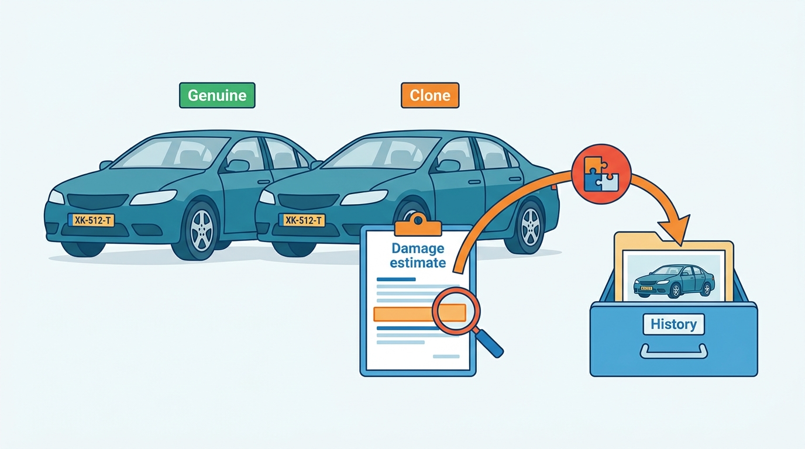
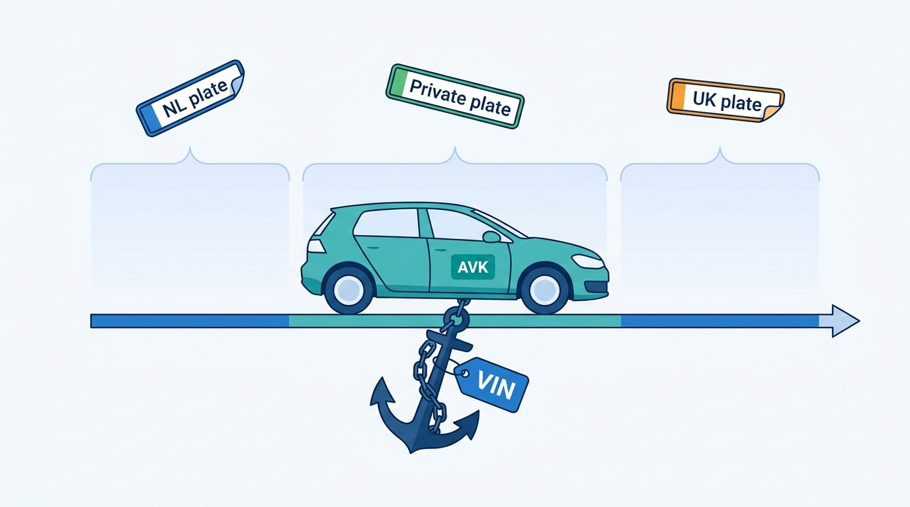
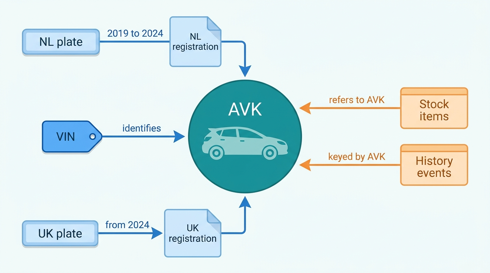
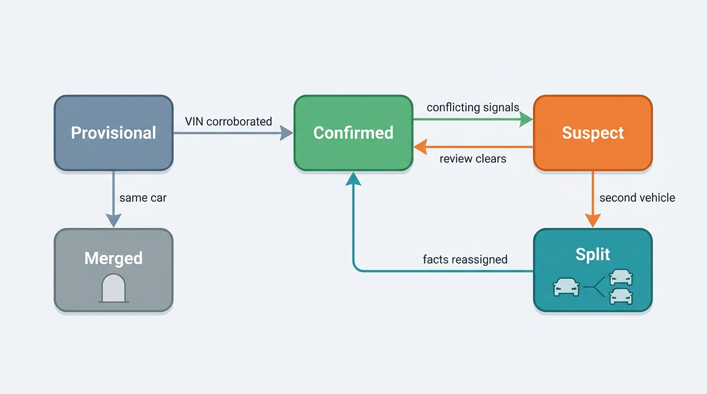
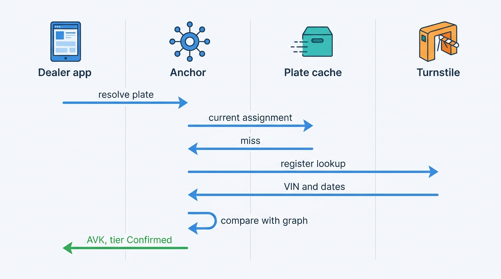

> **IN THIS CHAPTER, YOU WILL:** Learn what a VIN and a plate actually identify in each market, how to model one physical car as a node in an identity graph with VINs, plate assignments and registrations as dated edges, and how to resolve, match, merge and split vehicles so that every product and every client refers to the same car.

> **WHY THE BUSINESS CARES:** A history report, a valuation or an advert about the wrong car is worse than none: it misleads a buyer, exposes the seller and puts the data provider's name on the mistake. Identity is also where a group of acquired products either becomes one platform or keeps asking dealers to re-type the plate.

> **WHY ARCHITECTS SHOULD CARE:** Every fact the platform sells is joined to a car through an identifier. The choice of key, the way plate-to-VIN mappings are dated and cached, and the rules for merging and splitting records decide whether facts land on the right vehicle and whether a mistake can be undone everywhere it spread.

> **KEY POINTS:**
>
> * **A plate identifies a registration, not a car; key the car by a surrogate anchored to the VIN.** Plates move between cars, are reissued, transferred, retained and copied, differently in every market. The VIN is the best natural key there is, but it is mistyped, re-stamped and occasionally cloned. Give each physical vehicle an internal key, attach VINs and plates to it as sourced, dated observations, and let VIN evidence win over plate evidence.
> * **Resolve every plate as of a date, and re-key every plate-keyed fact to the vehicle at ingestion.** A plate lookup answers "which car carried this plate on this day", not "which car is this plate". Store plate assignments as time-bounded edges with their source, resolve each incoming fact by `(country, plate, date)`, and keep the plate and date it arrived with, so it can be moved when the mapping changes.
> * **Make confidence, merge and split first-class operations.** Every resolution carries a confidence tier that products obey: a paid history report needs a confirmed VIN, an advert draft does not. Merges and splits are audited events with tombstones and redirects, published to every consumer, because an identity correction that stops at the identity service is the start of a sticky error.

> **[FAILURE PATTERNS THIS CHAPTER ADDRESSES](where-vehicle-platforms-go-wrong.html):**
>
> * **The Cloned Identity** — a plate-keyed history store mixed a cloned car's damage into the genuine car's report, although the damage records carried the clone's own VIN.
> * **The Acquisition Archipelago** — Lotwise Classic, Connect XML and Anchor key the same car three ways, so the group cannot say whether two records are one vehicle.
> * **The Sticky Error** — a merge or split that is not published as an event leaves reports, valuations and adverts attached to the wrong car long after the identity record is fixed.

 
Every product in this book starts with the same question: **which car is this?** A dealer at an auction lane types a plate and expects the specification, the history and a price within seconds. An insurer sends a VIN with a claim. A portal sends an advert with a plate, a make and a mileage. A register reports that a plate has a new keeper. Each of these arrives with a different identifier, from a source with its own idea of what that identifier means. The platform has to put each fact on the right physical car, and say how sure it is.

It sounds like a lookup table. It is not one, because **the identifiers people use for cars do not identify cars**. A plate identifies a registration in one country, for a period of time; in some countries it follows the car, in others the owner. A VIN identifies a vehicle as built, but it can be mistyped, stamped again after a repair or copied onto a stolen car. A dealer's stock number identifies a stock item, which is one car's stay at one dealer.

This chapter owns five terms: the **vehicle identification number (VIN)**, the **world manufacturer identifier (WMI)**, the **plate assignment**, the **identity graph** and the **vehicle key**. It builds on [[vehicle-bounded-contexts]], which makes vehicle identity its own bounded context and source of truth. It hands register access to [[registers-and-official-data]], decoding a VIN into a specification to [[specification-and-equipment]], and general entity-resolution machinery (probabilistic matching, survivorship, golden records) to [[ingestion-and-entity-resolution]].

## Setting the Scene at Axleby: Two Audis, One Plate

Axleby, the fictional vehicle data and dealer software group this book follows (see [[meet-axleby]]), learned the cost of a plate key from a consumer. In 2026 a buyer in the Netherlands ordered an Odolo full report on a used Audi A4 before a private purchase. The report showed two damage events and a workshop visit the seller said had never happened. The seller had invoices, photographs and a clean register record. The buyer walked away; the seller complained to Odolo.

Priya Raman (VP Data and Valuation) had the case traced. Two Audi A4s had carried the same Dutch plate: the seller's genuine car and a clone of the same model and color wearing copies of its plates. **Tracewell**, the history event store, keyed events by plate. Damage estimates and a workshop visit for the clone arrived under the genuine plate and were filed under the genuine car. The most uncomfortable finding came last. **Both damage estimates carried the clone's own VIN**, recorded by the assessor from the car. Tracewell stored it in a free-text field and joined on the plate.

The fix had three parts, all now in the ledger: **VIN wins over plate** in Anchor, the identity graph Axleby built in 2024; **plate assignments are time-bounded edges**, not attributes of a car; and **reports show the VIN**, so a buyer can compare it with the car in front of them. Tracewell was re-keyed to the Axleby Vehicle Key (AVK), Anchor's internal surrogate.

**Figure 1:** *Two cars, one plate: joined on the plate, the clone's damage estimates landed in the genuine car's history, although each estimate carried the clone's own VIN.*

In March 2027 the board approved One Dossier, and its first-year promise was harder than the fix: **Anchor as the only vehicle key across products**. Anchor already held **41 million** VIN-keyed vehicles and **58 million** plate assignments across the Netherlands, Belgium, Germany and the United Kingdom. But Lotwise Classic still keyed its **352,000** live stock items by its own stock id plus plate, Connect XML still answered **38%** of **2.6 million** daily billable lookups by plate, and every resolution in those two systems ignored dates.

Ines Marchetti, the Group Chief Architect, put the question to the architecture forum in April 2027. Not "should we use the VIN" (everyone agreed) but **what exactly does Anchor promise when it says two records are the same car, how sure must it be before each product acts on that, and what happens to everything downstream when it changes its mind?**

## What Identifies a Car

### The VIN

The **vehicle identification number (VIN)** is a 17-character code that the manufacturer assigns to one vehicle and stamps into its structure. **ISO 3779** defines its content and structure, **ISO 3780** the world manufacturer identifier, and ISO 4030 its location and attachment. The United States and the European Union implement the standard differently, and the difference matters to software.

| Positions | United States ([49 CFR 565.15](https://www.law.cornell.edu/cfr/text/49/565.15)) | European Union ([Regulation (EU) No 19/2011](http://publications.europa.eu/resource/celex/32011R0019), Annex II) |
| --- | --- | --- |
| 1–3 | World manufacturer identifier (WMI) | WMI, assigned by the competent authority of the manufacturer's home country with the ISO 3780 agency |
| 4–8 | Vehicle descriptor section (VDS), attributes decipherable from data the manufacturer files | VDS runs over positions 4–9; content is the manufacturer's choice |
| 9 | **Check digit, mandatory** | Part of the VDS; **no check digit required** |
| 10 | Model year | Part of the vehicle indicator section (VIS); no mandated meaning |
| 11 | Plant of manufacture | Part of the VIS |
| 12–17 | Sequential production number | VIS; the last four characters must be digits |
| Small makers | "9" in position 3; positions 12–14 complete the maker's identity | Fewer than **500** vehicles a year: position 3 is "9" |
| Forbidden letters | I, O, Q | I, O, Q |
| Uniqueness | No two VINs alike within **60 years** from model year 1980 ([49 CFR 565.13](https://www.law.cornell.edu/cfr/text/49/565.13)) | Manufacturer ensures traceability by VIN for **30 years** |

The **world manufacturer identifier (WMI)** is the first three characters: a code for a manufacturer or one of its divisions, issued through a national body under ISO 3780. In the United States, the National Highway Traffic Safety Administration (NHTSA) has SAE International assign them, and manufacturers must file the information needed to decode their VINs 60 days before the first sale ([49 CFR 565.16](https://www.law.cornell.edu/cfr/text/49/565.16)). That filing duty is why NHTSA can run a free public decoder, vPIC. Europe has no such duty, so European VIN decoding depends on manufacturer data and commercial catalogs ([[specification-and-equipment]]).

**The North American check digit** catches most transcription errors at the edge. Letters are converted to numbers, each position is multiplied by a fixed weight (8, 7, 6, 5, 4, 3, 2, 10, 0, 9, 8, 7, 6, 5, 4, 3, 2), and the sum is taken modulo 11; a remainder of 10 is written "X". For the sample VIN `1HGCM82633A004352` the weighted sum is 311, and 311 mod 11 is 3, which is the ninth character. A Volkswagen-style European VIN such as `WVWZZZ1KZAW000001` gives 0 against a "Z" in position 9: not an error, because Europe does not use the check digit. NHTSA's vPIC decoder, given this synthetic VIN in October 2026, returned error code 1, "Check Digit (9th position) does not calculate properly". **A US-style validator rejects valid European VINs.**

Three more traps follow from the standard. **The model-year code in position 10 repeats every 30 years**: codes used for 1980–2009 were reused from 2010, and for North American cars and light trucks whether position 7 is a letter or a digit tells you which cycle applies ([Wikipedia, 2026](https://en.wikipedia.org/wiki/Vehicle_identification_number)). **Older vehicles are not standard**: the 17-character format became mandatory in the United States only for 1981 models, and earlier "VINs" range from 13-character codes to bare serial numbers. And **some imports never had one**: Japanese domestic-market cars commonly carry a shorter chassis number (industry practice; no primary source was read for this chapter).

The VIN does *not* say which options were fitted; that is the job of build data and the specification resolver ([[specification-and-equipment]]). For identity, the VIN is a key, not a record.

### The plate and the plate assignment

A **registration plate** (registration mark, *kenteken*, *Kennzeichen*, license plate) is issued by a register to a **registration**: the legal record that a vehicle may use public roads in one jurisdiction, with a keeper responsible for insurance, tax and inspection. What the plate identifies depends on the country.

- In the **Netherlands** the plate identifies the vehicle and does not change with the owner; numbers are issued in time order ([Wikipedia, 2026](https://en.wikipedia.org/wiki/Vehicle_registration_plates_of_the_Netherlands)). When a car is exported, the Dutch vehicle authority (RDW) requires the exporting dealer to cut the Dutch plates in half and to keep the pieces from the last ten export notifications ([RDW information pack, January 2026](https://www.rdw.nl/-/media/rdwnl/documenten/bedrijf-met-rdw-erkenning/toezichtbeleid/tbb-en-informatiemap-2026/informatiemap.pdf)). An imported car gets a new Dutch plate.
- In **Belgium** plates follow the owner: they "are transferred to a new vehicle from the owner's previous one" ([Wikipedia, 2026](https://en.wikipedia.org/wiki/Vehicle_registration_plates_of_Belgium)).
- In **Germany** the plate belongs to a registration of a keeper in a district. Keepers commonly deregister a car when they sell it, and may move a plate from an old car to a new one in the same visit to the registration office; since 2015 keepers have no longer had to change plates when they move to another district ([Wikipedia, 2026](https://en.wikipedia.org/wiki/Vehicle_registration_plates_of_Germany)).
- In the **United Kingdom** the plate normally stays with the vehicle, but a private registration can be moved to another vehicle or taken off and held on a **V778** retention document, renewed every 10 years ([GOV.UK, n.d.](https://www.gov.uk/personalised-vehicle-registration-numbers)). When a vehicle's age or identity is in doubt, the Driver and Vehicle Licensing Agency (DVLA) issues a **"Q" registration number**, and the original number becomes invalid ([GOV.UK, n.d.](https://www.gov.uk/vehicle-registration/q-registration-numbers)).
- In the **United States** plates are issued by states. "When a vehicle is sold, the disposition of the license plates depends on state law": in some states plates go with the vehicle, in others they stay with the seller, and some issue a new plate on every sale ([Wikipedia, 2026](https://en.wikipedia.org/wiki/Vehicle_registration_plates_of_the_United_States)). A plate is unique only within its state.

A **plate assignment** is this book's name for the fact that a given plate was attached to a given vehicle in a given jurisdiction for a given period: `(country, plate, vehicle, valid_from, valid_to, source, evidence)`. It is a **time-bounded edge**, not an attribute of the car. The UK's own keeper-data service for local authorities and parking companies is named after the question every plate lookup really asks: **Keeper At Date Of Event**.

Axleby's ledger gives the ratio: **58 million** plate assignments for **41 million** vehicles, about 1.4 per car. Every one of those extra assignments is an import, an export, a private-plate transfer, a Belgian owner moving a plate to a new car or a German re-registration. A system keyed by plate breaks on each of them. After the Odometer Correction of May 2027, a replay found that plate-only matching had attached **118** readings for UK imports to a different car that carried a retained plate ([[ingestion-and-entity-resolution]]).

**Figure 2:** *Plates come and go over a car's life (58 million assignments for 41 million vehicles at Axleby), so the vehicle key is anchored to the VIN, and each plate is a dated edge.*

### Identifiers that are not the car

The other identifiers a platform sees are just as easy to confuse with the car itself.

| Identifier | What it identifies | Stable for the car's life? | Useful for |
| --- | --- | --- | --- |
| **VIN** | One vehicle as built | Yes, except errors, re-stamping and cloning | The natural key for the vehicle |
| **Plate** | A registration in one jurisdiction, for a period | No | Input at the counter and the lane; join to register data as of a date |
| **Dutch *meldcode*** | The last four digits of the VIN, used by insurers ([RDW, 2026](https://www.rdw.nl/-/media/rdwnl/documenten/bedrijf-met-rdw-erkenning/toezichtbeleid/tbb-en-informatiemap-2026/informatiemap.pdf)) | Yes | A cheap partial check of a VIN against a plate |
| **Registration document numbers** (Dutch registration code, UK V5C serial, German registration certificate Part II number) | One issued document | No; replaced on every transfer | Proof of authority in a transaction, never identity |
| **Type keys** (EU type-approval number with variant and version; German HSN/TSN manufacturer and type key numbers) | A type of vehicle, not one vehicle | Yes | Specification and insurance classes ([[specification-and-equipment]]) |
| **Stock id** | One car's stay at one dealer | No; a car traded twice has two | The dealer workflow ([[inventory-and-vehicle-dossier]]) |
| **Advert or listing id** | One advert on one channel | No | Syndication and market data ([[market-data]]) |
| **Vehicle key** (Axleby: AVK) | The platform's record of one physical vehicle | Yes, by design; redirected after a merge | The key every product and event uses |

The **vehicle key** is an internal surrogate identifier that the platform assigns to one physical vehicle when it first sees it, and that it never reuses. At Axleby it is the **AVK**, an opaque 26-character identifier issued by Anchor. The VIN is the strongest evidence attached to it, but not the key itself, for three reasons this chapter returns to: a VIN can be wrong, a vehicle may arrive before anyone knows its VIN, and two records with different VINs can turn out to be one car (a typo), while one VIN can turn out to be two cars (a clone).

## Clones, Re-Stamps and Typos: How Identity Lies

Most identity errors are typos, missing data and timing. The few that are fraud do the most damage, because they are designed to look right.

**Plate cloning** is putting copies of another car's legitimate plates on a vehicle, usually the same make, model and color, to avoid fines and tolls or to hide a stolen car. In data, the clone's life arrives under the genuine plate: camera hits, parking fines, sightings, sometimes workshop and damage records. As reported by BBC News, the RAC, a British motoring organization, obtained DVLA figures showing **10,460** reports in 2024 from keepers who had received fines or penalties for vehicles they did not recognize, up from **7,377** in 2020; the figures include some misreads by automatic number plate recognition (ANPR) cameras ([BBC News, October 2025](https://www.bbc.co.uk/news/articles/cp3743p5q72o)). No comparable public figures were found for the Netherlands, Belgium or Germany.

**VIN cloning** goes further: a stolen or salvaged car gets the VIN plates of a legitimately registered car of the same model, often from another state or country. The best-known documented case is old: in 2009 the Federal Bureau of Investigation (FBI) described a Tampa ring that sold more than 1,000 cloned cars in twenty states and several countries, with estimated losses above $27 million, and the practice is one reason national title databases such as the US National Motor Vehicle Title Information System (NMVTIS) exist (as summarized by [Wikipedia, 2026](https://en.wikipedia.org/wiki/Car_cloning); the FBI's 2009 page was not reachable in October 2026). A VIN clone defeats a VIN key by design. What betrays it is **two vehicles living one life**: two registrations at once in different jurisdictions, odometer readings that go down and up again, a car inspected in two places on one day.

**Legitimate re-identification** looks similar in the data and must not be treated as fraud. The UK requires every vehicle to carry a unique stamped VIN; when a VIN is lost through repair or restoration, or a vehicle's identity is in question, DVLA assesses the vehicle and may authorize a new stamped identity number ([GOV.UK, n.d.](https://www.gov.uk/vehicle-registration/vehicle-identification-number)). The Dutch register can reverse a wrong owner transfer or import registration when a vehicle "does not have the identity" stated (RDW, January 2026, article 51a of the Road Traffic Act).

**Data errors** are the bulk: O and I typed for 0 and 1 (both letters are banned from VINs), missing or swapped characters, the dealer's trade plate recorded instead of the car's, an advert carrying the plate of another car in the same stock.

| Symptom in the data | Likely cause | Signal that exposes it |
| --- | --- | --- |
| A plate-keyed event's make, model, color or fuel disagrees with the register | Clone, typo or misread plate | Attribute check against the register as of the event date |
| An event carries a VIN that differs from the VIN on the plate assignment | Clone, VIN typo or wrong plate | VIN comparison at ingestion (the Cloned Plate signal) |
| Two registrations of one VIN at the same time in different countries | VIN clone, or an export not yet recorded | Overlapping assignment intervals across countries |
| Odometer readings down, then up again | Two cars on one identity, a unit error, or rollback | Reading sequence per vehicle ([[vehicle-history]]) |
| Two VINs differing by one character, same plate and attributes | Typo | Edit distance and check digit (North America only) |
| A VIN failing the check digit | Typo, or a non-North-American VIN | Market of manufacture from the WMI |

The design lesson is the Cloned Plate's: **the evidence is usually already in the data**. The platform must compare what it receives with what it believes, instead of joining on the first identifier it finds.

## Architecture: The Identity Graph

### The model

An **identity graph** is the data structure that records which identifiers, registrations and records belong to which physical vehicle, over time, with the evidence for each link. Axleby's Anchor is one. Its shape is small.

**Figure 3:** *The identity graph keeps one node per physical vehicle; VINs, plates and registrations attach to it as sourced, dated edges, and every product record refers to the node, not to an identifier.*

The elements are:

- **Vehicle node.** One per physical vehicle, keyed by the AVK. It holds almost nothing itself: a status, a creation time and a pointer to the node it was merged into, if any.
- **VIN observation.** A VIN exactly as received, plus a normalized form (upper case, trimmed, O, I and Q flagged, not silently replaced), with source, time, capture method (register, document scan, typing, feed) and validation result. A vehicle normally has one VIN and many observations of it.
- **Registration episode.** One registration in one jurisdiction: country, register, first-registration date, end date and end reason (export, scrapping, deregistration, transfer to a private plate).
- **Plate assignment.** The time-bounded edge from a plate to a registration episode, with its source and evidence. In the Netherlands one plate maps to one episode for the car's Dutch life; in Belgium a plate can map to episodes of several cars over time; in the UK a private plate moves and a Q plate replaces a doubtful one.
- **Identity events.** Every creation, attachment, merge, split and status change, appended to a log. The graph's current state is a projection of that log, so it can be rebuilt and audited.

Two rules carry the design. **VIN evidence beats plate evidence**: when a fact arrives with both and they disagree with the graph, the fact goes to the vehicle its VIN identifies, and the disagreement is recorded as a signal. A VIN clone defeats this rule, which is why conflicting signals move a vehicle to Suspect instead of being resolved silently. And **plates are resolved as of a date**: the question is never "which car is XK-512-T" but "which car carried XK-512-T in the Netherlands on 14 March 2026".

### The resolution service

Every product talks to the graph through one small interface, and only Anchor writes to it.

| Operation | Input | Output |
| --- | --- | --- |
| `resolve_vin` | VIN, optional plate and attributes | AVK, confidence tier, validation result, current registrations |
| `resolve_plate` | Country, plate, as-of date | AVK and VIN for that date, confidence tier, assignment interval, evidence age |
| `observe` | An identifier pair or a fact's keys, with source and date | AVK; may create a provisional vehicle or raise a conflict |
| `merge` / `split` | AVKs, reason, evidence, actor | Identity event; tombstone or new AVK |
| `history` | AVK | All identifiers and episodes with intervals and sources |

The rule I use is that **no product stores a plate or a VIN as a foreign key**. Products store the AVK, and store the plate and VIN they were given as *what the user typed*, with a timestamp. That way a merge redirects them and a plate change does not orphan them.

### Confidence tiers and what products may do with them

Matching rules produce a link between an identifier and a vehicle, and a link is only as good as its evidence. Anchor grades every resolution into four tiers. The names are Axleby's; the principle is general.

| Tier | Evidence | Examples | Products may |
| --- | --- | --- | --- |
| **Confirmed** | VIN and plate assignment from a register or an official document checked against one | Axleby's licensed Dutch register data; a captured registration certificate field (E) matching the register | Sell paid history reports and valuations; submit register transactions |
| **Corroborated** | VIN from a non-official source agrees with an independent second source | Dealer-typed VIN whose last four digits match the Dutch *meldcode*; a dealer-typed VIN for which the UK MOT (annual roadworthiness test) history service returns the same registration | Same as Confirmed, with the source shown |
| **Asserted** | One non-official source | A VIN typed at appraisal; a plate in a portal advert | Run dealer workflow (stock, adverts, pricing); not sell history as fact |
| **Suspect** | Conflicting signals | Attribute mismatch, overlapping registrations, a VIN arriving under another car's plate | Hold: quarantine new facts, show "identity under review" |

The tiers matter more than the matching algorithm. **They are a contract between the identity context and every product**: Tracewell will not assemble a paid report on an Asserted identity, Vantage marks such valuations provisional, and Lotwise lets a dealer advertise on one because the dealer answers for the advert. The client API exposes the tier, so a lessor's system can apply its own rules.

Matching vehicles is mostly deterministic, unlike matching people: a VIN matches or it does not, and the hard cases are typos and conflicts. The probabilistic machinery of [[ingestion-and-entity-resolution]] (and LISTED's [[entity-resolution]]) earns its place at the edges, for adverts without plate or VIN ([[market-data]]); it should not decide on its own whether two registered cars are one.

### Merge and split

A **merge** declares that two vehicle nodes are one car: the classic case is a dealer typing a VIN with one wrong character, creating a provisional vehicle that later turns out to be a known one. A **split** declares that one node is two cars: the Cloned Plate is the classic case.

Both are **events, not updates**. A merge keeps the surviving AVK, turns the other into a tombstone that points to it, and moves the edges. A split creates a new AVK and moves the edges and facts that belong to the second car, by evidence: events whose captured VIN is the clone's, events at times or places the genuine car could not have been. Neither operation deletes anything. Both are published on the event backbone as `vehicle.merged` and `vehicle.split`, with the AVKs involved, the moved identifiers and intervals, the reason and the actor.

**Figure 4:** *The life of a vehicle node: provisional nodes are confirmed or merged away, conflicts move a node to Suspect, and a split ends with each car's facts on its own node; merged nodes become tombstones that redirect.*

Consumers must act on these events, and this is where most platforms fail. A report already sold, a stored valuation, an advert on six portals, a data client's cached response: all were computed from facts that now belong to another car. Who recomputes what, and what is said to whom, is the subject of [[journey-data-correction]]. The identity context's duty is narrower and non-negotiable: **publish every merge and split, with enough detail for each consumer to find what it must redo**.

### Requirements per interaction

| Interaction | Consistency | Latency | Freshness | Availability |
| --- | --- | --- | --- | --- |
| Plate lookup at appraisal or the auction lane (Lotwise Appraise, Odolo free check) | Read the current assignment; may be one register change behind | p95 under 80 ms for resolution inside a 400 ms lookup *(assumption)* | Dutch assignments within 24 hours of a register change *(assumption)* | Highest: serve the last known assignment with its age when the register is unreachable |
| Re-keying an incoming fact at ingestion | Resolve as of the fact's date; deterministic and repeatable | Seconds to minutes; batch is fine | As of the event date, not today | Can queue; must not guess |
| Paid history report or valuation | Confirmed or Corroborated tier required | Inside the report budget | Assignment checked at order time | Fail closed: no report on a Suspect identity |
| Register transaction ([[registration-and-trade-services]]) | Strong: identity confirmed by the register itself | Register-bound | Live | Fail closed: never assume |
| Merge or split propagation | At-least-once events, idempotent consumers | All consumers within an hour *(assumption)* | n/a | Durable; replayable |
| Client API lookups ([[vehicle-data-apis]]) | Stable AVK with redirects; tier exposed | As the API's SLA | As per data class | Degrade to the last known assignment, labeled |

### Caching plate-to-VIN

Almost every one of Axleby's **2.6 million** daily billable lookups (weekday peak about **310 a second**) starts with a plate, and none of them should wait on a register: a Dutch assignment changes essentially only at import and export. The resolution path has three layers:

1. **Anchor's own graph.** For the Netherlands, Axleby's register mirror (about **16 million** plates, maintained by Turnstile, [[registers-and-official-data]]) feeds assignments into Anchor as register changes are observed. Most lookups are answered here without any external call.
2. **A read-through cache** in front of Anchor, keyed by `(country, normalized plate)`, holding the *current* assignment with the time it was last confirmed. It is invalidated by Anchor's own `plate.assigned` and `plate.released` events, not by a short time-to-live.
3. **A live register or supplier call** only when the plate is unknown, the cached assignment is older than the market's freshness budget, or the transaction demands it.

Three cache rules prevent the subtle failures. **Never cache an as-of resolution as current**: a lookup for an event in 2023 and a lookup for today are different keys. **Never cache "unavailable" as "not found"**: when a register or supplier cannot answer, return the last known assignment marked with its age, and do not store the failure as a fact (the Driver and Vehicle Standards Agency's (DVSA) MOT history API makes the distinction explicit with an `Unavailable` value for its recall flag). And **set freshness budgets per market**: a Dutch assignment is stable for years, a Belgian plate can move to another car the day its owner buys one, and a UK private plate can be transferred at any time.

**Figure 5:** *Resolving a plate at appraisal: the cache answers most lookups; a miss or an expired budget goes to the register through Turnstile, and the answer is compared with the graph before it is returned with its tier and evidence age.*

## In Practice

### What public sources show about identifiers

The registers and agencies this book follows expose identity very differently.

- **The Dutch register's open data is plate-keyed and has no VIN.** The RDW dataset *Gekentekende voertuigen* (registered vehicles) held about **16.87 million** rows on 22 October 2026, keyed by plate, with about a hundred columns and no VIN column ([RDW open data, n.d., accessed 2026-10-22](https://opendata.rdw.nl/api/views/m9d7-ebf2.json)). VINs for Dutch plates need another bridge: a licensed register channel, the VIN captured from the car or its certificate, or at least the *meldcode* check.
- **The UK separates the register from the inspection record, and neither register API returns a VIN for a plate.** DVLA's Vehicle Enquiry Service (VES) returns make, color, fuel and tax and MOT status, but no VIN and no keeper; its page read "Registration closed" in October 2026 ([DVLA, n.d.](https://developer-portal.driver-vehicle-licensing.api.gov.uk/apis/vehicle-enquiry-service/vehicle-enquiry-service-description.html)). DVSA's MOT history API can be queried by registration or by VIN, echoes the identifier used in the request, and records **`registrationAtTimeOfTest` on every test** ([DVSA OpenAPI specification, n.d.](https://documentation.history.mot.api.gov.uk/mot-history-api/api-specification/mot_history_open_api_specification.yml)). That field is a ready-made, dated plate-assignment observation: a private-plate transfer shows up as two registrations across one vehicle's test history.
- **The US is VIN-keyed throughout.** States must report each VIN's brands, titled owner and odometer disclosures to NMVTIS at least every 24 hours ([28 CFR 25.54](https://www.law.cornell.edu/cfr/text/28/25.54)), and NHTSA's vPIC decodes any VIN pattern for free, with error codes ([NHTSA vPIC, n.d.](https://vpic.nhtsa.dot.gov/api/)). Plates are a state matter and play almost no role in national data.
- **The EU registration certificate carries the VIN in a harmonized field.** Directive 1999/37/EC defines field (A) for the registration number, (B) the date of first registration and **(E) the VIN**, so a cross-border appraisal reads the same fields off any member state's certificate ([Council Directive 1999/37/EC, 1999](http://publications.europa.eu/resource/celex/31999L0037)). Its proposed replacement, COM(2025) 179 of April 2025, would make digital registration certificates the norm; it had not been adopted as of October 2026 ([EPRS briefing, January 2026](https://www.europarl.europa.eu/RegData/etudes/BRIE/2026/782608/EPRS_BRI(2026)782608_EN.pdf)).

No public source describes how any commercial data provider structures its internal vehicle identity; the architecture here is a recommendation, not a description of any company.

### Axleby: making Anchor the only key

The One Dossier team, led on the identity side by Priya Raman with Tomás Ferreira (Product Director, Lotwise), began re-keying Lotwise Classic's **352,000** live stock items to AVKs in May 2027, with the target that no stock item exists without an AVK from December 2027. Each stock item had a stock id, a plate and, for most, a VIN typed or copied at stock-in. The backfill ran every item through `resolve_vin` and `resolve_plate` as of its stock-in date and compared the answers. All figures are Axleby illustrations.

| Outcome | Stock items | Share | What happened |
| --- | --- | --- | --- |
| VIN and plate resolve to the same AVK, register-confirmed | 325,952 | 92.6% | Linked automatically; tier Confirmed |
| Plate resolves as of stock-in date; VIN missing | 16,192 | 4.6% | Linked automatically by plate; VIN filled from the register; tier Confirmed |
| VIN and plate disagree, mostly by one character | 7,392 | 2.1% | Linked provisionally; the dealer is asked to confirm the VIN at the next touch of the car |
| No usable plate or conflicting evidence | 2,464 | 0.7% | Manual review: imports still in transit without a Dutch plate, stock-ins under a trade plate or a sister car's plate, a handful of suspected clones |

**Automatic resolution covered 97.2%**, and the remaining 2.8% split into a cheap case (ask the dealer) and an expensive one (ask the identity team). The backfill also exposed a workflow bug rather than an identity one: AVKs with two open stock items, mostly rooftop transfers inside a dealer group that Lotwise had modeled as sales ([[inventory-and-vehicle-dossier]] measures it). **A stock item is not a vehicle**, and the same car may legitimately be stock twice; but an unclosed stock item can keep an advert live, which is why identity work keeps surfacing workflow bugs and is worth doing early.

Tracewell's earlier re-keying gave the other number Ines Marchetti asked for: how often does a plate-keyed fact land on the wrong car? Re-resolving Tracewell's 2026 events found **18,400** whose captured VIN disagreed with the VIN Anchor held for the plate on the event date. About **15,600** were VIN typos at the source and about **2,470** were timing errors around imports and re-plating. The remaining **330** events sat on **31** plates classified as suspected clones; they were split off onto provisional vehicles and kept out of reports. Thirty-one plates out of 16 million is small, but each is a history report that would have been wrong in exactly the way that ends in a consumer complaint.

## Failure Handling

| Situation | Detection | Response | Recovery |
| --- | --- | --- | --- |
| **Duplicate vehicles**: one car under two AVKs after a VIN typo | VIN edit distance of one with matching plate and attributes; scheduled duplicate scan | Propose a merge; auto-merge only when the plate assignment is Confirmed for both | Tombstone and redirect; publish `vehicle.merged`; consumers re-key |
| **Conflicting updates**: two sources assign the same plate to different VINs for overlapping periods | Overlap check on every new assignment | Keep both observations; mark the vehicle Suspect; the register's assignment wins for the current interval | Review; split if a second car is real; record the losing source's error rate |
| **Incomplete records**: plate only, or a partial VIN | Missing VIN on observation | Create a Provisional node; allow workflow use, not paid reports | Fill the VIN from the register or the next document capture; confirm or merge |
| **Retries**: the same observation delivered twice | Idempotency key on `(source, source record id, version)` | Ignore the duplicate | None needed |
| **Partial failures**: a merge applied in Anchor but not by all consumers | Consumer acknowledgements and a lag dashboard per consumer | Re-deliver from the event log | Nightly reconciliation of AVKs referenced by each consumer against tombstones |
| **External outage**: register or supplier cannot answer a plate lookup | Turnstile health and timeouts | Return the last known assignment with its age and tier; block register transactions and Confirmed-only products if no assignment exists | Refresh assignments touched during the outage when the source returns |
| **Fraud signal**: VIN arrives under another car's plate | VIN comparison at ingestion | Quarantine the fact; mark Suspect; never merge on plate alone | Split or clear after review; feed the security and fraud team ([[vehicle-platform-security]]) |

Two rules deserve emphasis. **A confident auto-merge is worse than a duplicate**: two AVKs for one car confuse a dealer; one AVK for two cars puts one car's damage into another's report. Axleby auto-merges only on Confirmed evidence. And **a register outage must not change identity**: Anchor serves what it last knew, labeled, and never creates or ends an assignment because a lookup failed.

## Trade-offs

| Option | How it works | When it is right | What it costs |
| --- | --- | --- | --- |
| **Plate as the key** | Every record keyed by country and plate | A single-market tool in the Netherlands or UK that never sells history | Breaks on imports, exports, private plates and every Belgian and German sale; makes clones invisible |
| **VIN as the key** | Records keyed by normalized VIN | US-only platforms where the VIN is mandatory, checked and on every record | Cannot hold a car before its VIN is known; typos create duplicates; a clone and its victim become one record; changing a wrong VIN means re-keying everything |
| **Surrogate key anchored to the VIN** (recommended) | An internal key per vehicle; VINs and plates as dated, sourced edges | Multi-market platforms selling history and valuation; any acquired portfolio | An identity service to run; every product must resolve through it; merges and splits must be propagated |
| **Per-product keys with a mapping table** | Each product keeps its own key; a cross-reference joins them | A short transition while products are migrated | Every new consumer joins through the table; drift between products is never fixed |

A second decision is **what identifiers to expose to clients**. Exposing only VIN and plate keeps clients independent of Axleby's internals but makes every client re-solve identity, badly. Exposing the AVK gives clients a stable key and lets the API return redirects after a merge, but it couples them to Axleby's lifecycle. My recommendation is to **expose the AVK alongside the VIN, with documented redirect semantics** (a merged AVK returns the survivor with a "moved" signal) and with the confidence tier on every response. Clients that only want VINs can ignore it. The VIN in a response is itself personal data in many readings of European data protection law; what may be shown to whom is owned by [[privacy-and-retention]].

## Across Markets: What Changes by Country

| | Netherlands | Belgium | Germany | United Kingdom | United States |
| --- | --- | --- | --- | --- | --- |
| **The plate follows** | The vehicle, for its Dutch life | The owner, to their next car | The keeper's registration; usually deregistered on sale | The vehicle, except private plates moved or retained on a V778 | Varies by state: vehicle, seller, or a new plate on sale |
| **Plate unique within** | The country, for one car | The country, but reused across cars over time | The country, over time | The country; Q plates replace doubtful identities | One state only |
| **VIN in public vehicle data** | No: open data is plate-keyed; *meldcode* gives the last four digits | VIN-keyed odometer history at Car-Pass; register data not public | No public register; access under §39 of the Road Traffic Act (StVG) needs a legal claim | No VIN from DVLA VES; MOT API answers by VIN or plate | Yes: NMVTIS and vPIC are VIN-keyed |
| **Best plate-to-VIN bridge** | Licensed register channel; registration certificate | Registration certificate; insurer or Car-Pass data | Registration certificate Part I field (E); dealer capture | Captured VIN checked against MOT history by VIN, which returns the registration; V5C; licensed data | Title and NMVTIS records; plate data per state |
| **VIN validation** | Length, characters, known WMI | Same | Same | Same, plus DVLA-issued replacement VINs | Check digit mandatory; position 10 gives model year |
| **Typical identity transitions** | Import gets a new plate; export ends the plate | Owner moves plate to next car | Deregistration and re-registration on sale | Private plate transfers; Q plates; re-stamped VINs | Re-titling across states; title washing |

Sources: country sections above; Belgium's register, the Directorate for Vehicle Registration (DIV), could not be read from a primary source for this book, so the Belgian column rests on secondary sources and Car-Pass's own site ([Car-Pass, n.d.](https://www.car-pass.be/en)).

**What stays common** is the model: one vehicle node, VIN observations, registration episodes, time-bounded plate assignments, confidence tiers, merge and split events. None of it changes by country. **What is market-specific** is a set of adapters and rules: how a plate is normalized (Belgian dashes, UK spacing, German district prefixes), how long an assignment may be cached before it is re-checked, which source confirms a VIN, and which transitions to expect. I would build each market as an **assignment adapter plus a freshness rule plus a validation rule**, and keep the graph itself identical. Adding a fifth country should mean writing those three things, not changing the schema.

The US differs mainly in validation: its mandatory check digit rejects most typos at the edge. State-scoped plates fit the same graph with the plate's jurisdiction set to the state.

## The Chief Architect's View

**Decide who owns identity, and let that team say no.** Identity is a small context with a large blast radius. At Axleby, Anchor's team in Priya Raman's organization has a veto on any product that wants to store a plate or VIN as a key; without it, every new feature reintroduces a plate join "for now".

**Treat confidence tiers as a product contract.** The tiers decide which products may sell what. Version them, show them in the API, and have product owners sign off on the tier each product requires. Revisit them when a new official source arrives; it can promote thousands of vehicles to Confirmed overnight.

**Fund the propagation, not just the graph.** Anchor is cheap to run. The expensive part is that every consumer (Tracewell, Vantage, Lotwise, Relay, the APIs, Odolo) must handle `vehicle.merged` and `vehicle.split`. Put that into each team's definition of done for One Dossier, and measure it: **identity correction propagation time** (from a merge or split to the last consumer acknowledging it) belongs among the platform's fitness functions ([[evolving-the-vehicle-platform]]).

**Watch the inputs that change.** The EU registration-document reform would make a verifiable digital certificate a new Confirmed source. Connected-vehicle data arrives VIN-keyed from manufacturers ([[connected-vehicle-data]]). And UK register API access has narrowed (VES registrations were closed in October 2026), which makes MOT history and licensed data the UK bridges.

**Measure identity quality as numbers.** Duplicate rate (AVKs later merged), split rate, share of lookups answered at each tier, share of incoming facts whose VIN disagreed with the plate's VIN, and review-queue age. When the disagreement rate of one source jumps, that source has a problem; when it jumps everywhere, someone is cloning.

## Questions to Ask

1. What key do our products store for a vehicle, and how many products store a plate or VIN as a foreign key?
2. When a plate-keyed fact arrives, do we resolve it as of the fact's date or as of today?
3. Which sources may confirm a VIN in each market, and which only assert one?
4. Which tier does each product require before it sells, shows or transacts on an identity, and who signed that off?
5. When a fact arrives with both a plate and a VIN that disagree, what happens to it?
6. How do merges and splits reach every consumer, and how long does the slowest one take?
7. What does a plate lookup return when the register is down, and do we ever cache that failure as an answer?
8. Do our validators reject valid European VINs because of the North American check digit?
9. What identifiers and redirect semantics do we promise external clients, and what happens to their stored keys after a merge?
10. How would we detect a cloned plate today, and how many suspected clones did we find last quarter?

Identity tells the platform which car it is talking about. The richest source of facts about that car, and the one with the strongest legal standing, is the official register. [[registers-and-official-data]] describes how a platform connects to the registers of five markets, what it may take from them and what it owes them in return.

## Sources and Evidence

**Company, product and investor sources**

- [Car-Pass](https://www.car-pass.be/en), Car-Pass vzw, n.d. (2025 annual figures), accessed 2026-10: Belgian VIN-keyed odometer history.
- [Vehicle Enquiry Service API description](https://developer-portal.driver-vehicle-licensing.api.gov.uk/apis/vehicle-enquiry-service/vehicle-enquiry-service-description.html), DVLA, n.d., accessed 2026-10: VES fields without VIN or keeper; registration closed.
- [MOT history API OpenAPI specification](https://documentation.history.mot.api.gov.uk/mot-history-api/api-specification/mot_history_open_api_specification.yml), DVSA, n.d., accessed 2026-10: lookups by registration or VIN, `registrationAtTimeOfTest`, `Unavailable` recall value.
- [Open data: Gekentekende voertuigen, dataset metadata](https://opendata.rdw.nl/api/views/m9d7-ebf2.json), RDW, 2015–2026, accessed 2026-10-22: plate-keyed open data, row count, no VIN column.
- [vPIC API](https://vpic.nhtsa.dot.gov/api/), NHTSA, n.d., accessed 2026-10: public VIN decoding and error codes.

**Standards, regulation and official documentation**

- [49 CFR 565.13, 565.15, 565.16](https://www.law.cornell.edu/cfr/text/49/565.13), US Code of Federal Regulations via Cornell LII, n.d., accessed 2026-10: US VIN structure, check digit, 60-year uniqueness, WMI assignment and decoding filings.
- [Commission Regulation (EU) No 19/2011](http://publications.europa.eu/resource/celex/32011R0019), European Commission, 2011: EU VIN composition, no check digit, 500-vehicle small-maker rule, 30-year traceability. The regulation was made under a framework since replaced (Regulation (EU) 2019/2144); the successor implementing text was not read.
- [Council Directive 1999/37/EC on registration documents](http://publications.europa.eu/resource/celex/31999L0037), Council of the EU, 1999: harmonized certificate fields, including (E) VIN.
- [The roadworthiness package (COM(2025) 179 and 180)](https://www.europarl.europa.eu/RegData/etudes/BRIE/2026/782608/EPRS_BRI(2026)782608_EN.pdf), European Parliamentary Research Service, 2026: proposed digital registration certificates and register data sharing.
- [Informatiemap voor de voertuigbranche 2026](https://www.rdw.nl/-/media/rdwnl/documenten/bedrijf-met-rdw-erkenning/toezichtbeleid/tbb-en-informatiemap-2026/informatiemap.pdf), RDW, 2026: plate cutting on export, *meldcode*, reversal of registrations with a wrong identity.
- [Personalised vehicle registration numbers](https://www.gov.uk/personalised-vehicle-registration-numbers), [Vehicle identification number](https://www.gov.uk/vehicle-registration/vehicle-identification-number) and ['Q' registration numbers](https://www.gov.uk/vehicle-registration/q-registration-numbers), GOV.UK, n.d., accessed 2026-10: private plates and V778 retention, DVLA-authorized replacement VINs, Q plates.
- [28 CFR 25.54](https://www.law.cornell.edu/cfr/text/28/25.54), US Code of Federal Regulations via Cornell LII, n.d., accessed 2026-10: state reporting of VIN-keyed title data to NMVTIS.

**Research and practitioner sources**

- ['Car cloning is a menace of modern day motoring'](https://www.bbc.co.uk/news/articles/cp3743p5q72o), BBC News, 2025: DVLA figures obtained by the RAC on reports of fines for unrecognized vehicles (10,460 in 2024; 7,377 in 2020).
- [Car cloning](https://en.wikipedia.org/wiki/Car_cloning), Wikipedia, 2026: VIN cloning definition and the 2009 FBI Tampa case (secondary; the FBI page was unreachable).
- [Vehicle identification number](https://en.wikipedia.org/wiki/Vehicle_identification_number), Wikipedia, 2026: check-digit algorithm, model-year cycle, pre-1981 identifiers.
- Vehicle registration plates of [the Netherlands](https://en.wikipedia.org/wiki/Vehicle_registration_plates_of_the_Netherlands), [Belgium](https://en.wikipedia.org/wiki/Vehicle_registration_plates_of_Belgium), [Germany](https://en.wikipedia.org/wiki/Vehicle_registration_plates_of_Germany) and [the United States](https://en.wikipedia.org/wiki/Vehicle_registration_plates_of_the_United_States), Wikipedia, 2026: what plates follow in each market.

Axleby is fictional; architectural recommendations, labeled inferences and labeled assumptions are the author's judgement.
