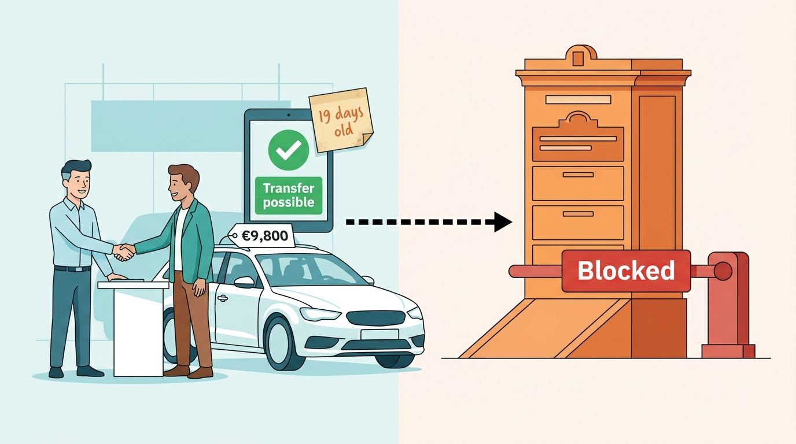
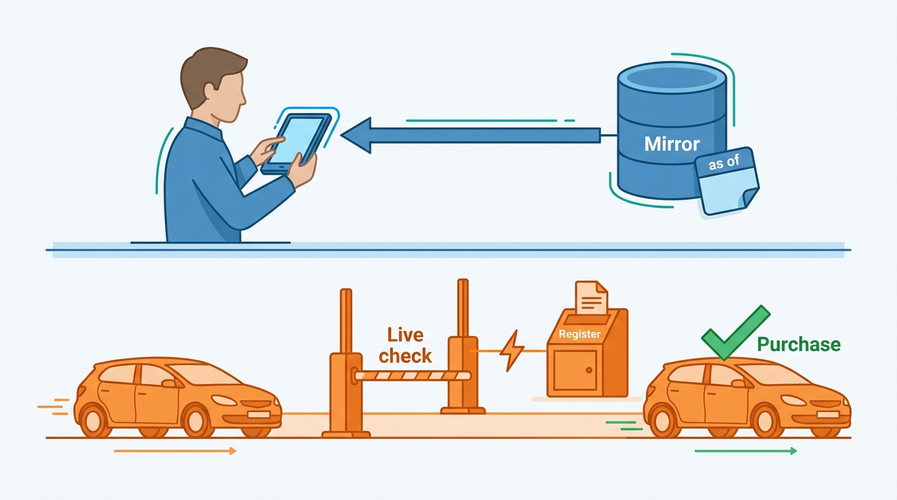
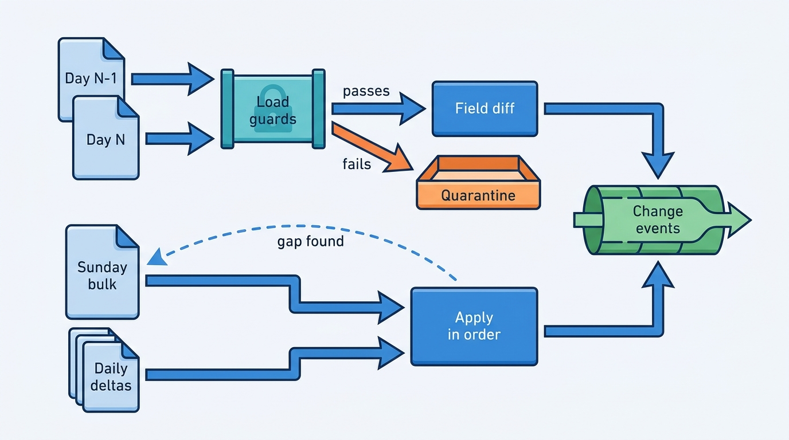
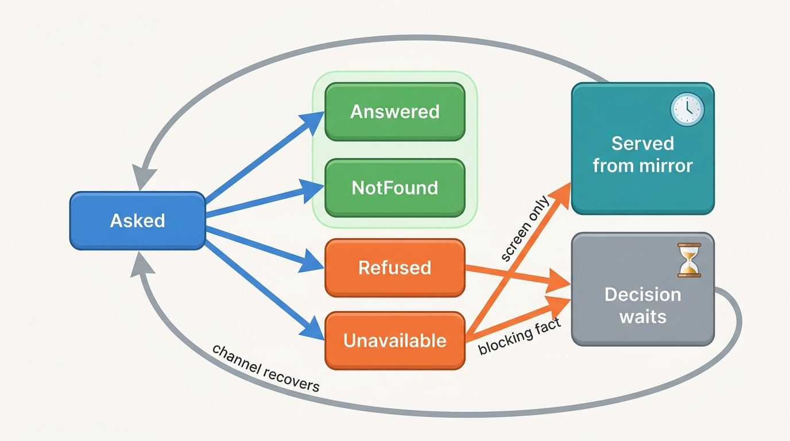

> **IN THIS CHAPTER, YOU WILL:** Learn what official vehicle registers hold and who may read them in the Netherlands, Belgium, Germany, the United Kingdom and the United States, and design a register gateway: a mirror of what may be copied, a mutation feed derived from it, live calls for what must be current, and the credential, quota, purpose and audit controls the registers expect in return.

> **WHY THE BUSINESS CARES:** In a strong-register market like the Netherlands, every plate lookup, history report and official transaction starts at the register. A dealer who buys a car the register will not let them take into stock loses margin and a customer's trust, and a register outage at month-end stops deliveries across the whole customer base at once.

> **WHY ARCHITECTS SHOULD CARE:** Register data looks like reference data and is not. Its access is set by law and contract per country, its freshness is set by the register's publishing rhythm, and its availability is outside your control. These three properties decide what you may store, how stale each fact may be, and what your products do when the register cannot answer.

> **KEY POINTS:**
>
> * **A register is an authority, not a supplier.** What it records has legal effect, and its access regime (open data, paid per-vehicle access, provider access for transactions, purpose-bound access to personal data) is set by law and contract in each country. That regime, not the API, decides what the platform may hold, show and resell. Design the connection around it.
> * **Mirror what may be mirrored, and ask live what the decision needs.** Bulk open data becomes a local mirror with an observation date on every fact, and a mutation feed derived by diffing snapshots. Theft status, transaction blocks and purpose-bound data stay live calls at the moment of decision. "Could not ask" is always kept separate from "no".
> * **One register gateway is a group-level control point.** Credentials, certificates, sessions, quotas, purpose tags and the audit of every read and write belong in one place. The provider's obligations are encoded rules, and an outage produces an honest "pending at the register" state, never a faked success.

> **[FAILURE PATTERNS THIS CHAPTER ADDRESSES](where-vehicle-platforms-go-wrong.html):**
>
> * **Borrowed Uptime** — when appraisal, stock-in, reports and transactions call the register synchronously, one register outage stops every product at once.
> * **Provenance Amnesia** — copies of register data without an observation date look equally true, so a 19-day-old cache entry beats yesterday's register state.
> * **License Blindness** — register data obtained under one regime (open data, a per-plate business lookup, a purpose-bound keeper request) leaks into products that regime does not allow.

 
Most vehicle data sources sell you facts. A register **records** them, and the record has consequences. In the Netherlands the plate register determines "who is liable for which vehicle" for insurance, inspection and road tax ([RDW, January 2026](https://www.rdw.nl/-/media/rdwnl/documenten/bedrijf-met-rdw-erkenning/toezichtbeleid/tbb-en-informatiemap-2026/informatiemap.pdf)). In the United States a salvage brand on a title follows the car across states because the states report it to a national index. A dealer cannot complete a registration in the Netherlands while the register is not answering, and no software can make that happen.

That makes registers different from every other source in this book. Their content is authoritative, their access rules are written in statutes and provider agreements rather than in price lists, and their channels change every few years. The UK's dealer registration channel was replaced in 2019, Germany opened a machine-to-machine registration interface in 2023, and the UK's vehicle enquiry API had closed to new registrations by October 2026. **The platform's job is to be a disciplined client of an authority it does not control**: copy only what it may, keep the copy honest about its age, ask live when the decision needs it, and prove afterwards who asked what, for whom and why.

This chapter owns four terms: the **authorized information provider**, the **register gateway**, the **register mirror** and the **mutation feed**. It builds on [[vehicle-identity]], which decides which car a register record belongs to, and hands the official transactions themselves (registration in a new name, indemnification, stock-register actions, their retry queue and taxes) to [[registration-and-trade-services]]. License enforcement across all sources belongs to [[data-licensing-and-governance]], and journey-level availability targets to [[reliability-and-dependencies]].

## Setting the Scene at Axleby: Three Copies of One Register

Axleby, the fictional vehicle data and dealer software group this book follows (see [[meet-axleby]]), has had a contractual relationship with the Dutch register since **1999**: it supplies register data to the trade and carries register transactions for dealers. **Turnstile**, its register gateway, holds the adapters to the Dutch register's information and transaction channels, to the Belgian register through a partner, and to the APIs of the UK's Driver and Vehicle Licensing Agency (DVLA) and Driver and Vehicle Standards Agency (DVSA). The Dutch register mirror behind it holds about **16 million** plates, current and historical.

On **31 March 2027**, the last working day of the quarter, the Dutch register's transaction channel was unavailable to Axleby for **5 hours 40 minutes**. **3,100** transactions queued, and **214** were submitted twice after ambiguous timeouts (the **Month-End Register Outage**; [[registration-and-trade-services]] owns the transaction story). In the review that followed, Ruben Dekker, the CTO, asked a broader question: if the transaction channel had stayed up and the information channel had failed, what would have stopped?

Ines Marchetti, the Group Chief Architect, asked Marta Nowak's platform team for an inventory of every system that read Dutch register data. It took two weeks. The answer was not one register copy but three.

| Copy | Built from | Refresh | Main readers | Status fields carried |
| --- | --- | --- | --- | --- |
| **Turnstile mirror** | Daily open-data snapshot, plus live lookups on the information channel | Daily | JSON API v1, Odolo, Specbook, Tracewell | Owner-change date, inspection expiry, export flag, recall flag, transfer-possible flag |
| **Connect XML register tables** (SQL Server, Utrecht) | Own nightly loader, written in 2008, reading the same open data | Nightly; failed silently on 6 of 90 nights *(Axleby illustration)* | Connect XML clients (38% of API calls), the invoice run | Same fields, older column names |
| **Lotwise Classic plate cache** (MySQL) | Filled on a dealer's first lookup of a plate | Only when a user reopened the dossier; median entry age **11 days** | Lotwise Appraise, the stock book, the advert editor | Whatever was true at the first lookup |

The third copy had just cost a dealer money. On **14 April 2027**, Sietse Brandsma, who runs Autobedrijf Brandsma in Leeuwarden, appraised a seven-year-old Škoda Octavia offered as a trade-in. Lotwise Appraise showed the plate data from the Lotwise cache, filled **19 days** earlier when a colleague had first looked the car up. It said transfer was possible. Sietse agreed a trade-in value of **€9,800** with the customer. When he tried to take the car into trade stock, the register refused the transaction: in the meantime the register had set a block on the vehicle that made transfer impossible. Turnstile's mirror had shown the change within three days of it happening. The deal had to be unwound in front of the customer.

**Figure 1:** *On 14 April 2027 a 19-day-old cache said transfer was possible, so a €9,800 trade-in was agreed; the register had already blocked the car, and the deal had to be unwound.*

Nobody had done anything exotic. Each team had built the copy its product needed, at the time it needed it, and none of the copies said how old its facts were. **The register did its job; Axleby had three answers to the same question and no rule for which one to trust.** Ines framed the question for the architecture board: *what should Axleby hold about each register, how fresh must each fact be, under which terms, and who answers when the register cannot?*

## What a Register Holds and Who May Read It

### Six kinds of register fact

A **vehicle register** is an official record, kept by a public body or under a statutory mandate, of the vehicles admitted to the roads of a jurisdiction and the people responsible for them. The Dutch register (RDW, *Rijksdienst voor het Wegverkeer*), the Belgian register (DIV, *Directie Inschrijvingen van Voertuigen*), the German central register (ZFZR, *Zentrales Fahrzeugregister*, at the KBA, *Kraftfahrt-Bundesamt*), the UK's DVLA register and the US state DMVs (departments of motor vehicles) differ in structure, but they record six kinds of fact.

| Kind of fact | Examples | Legal effect | Typical change rate |
| --- | --- | --- | --- |
| **Registration** | Plate, first admission date, first registration in this country, document numbers | Defines the official identity and the documents needed to transfer | Once, then on re-registration |
| **Technical** | Make, trade name, type-approval number, variant and version, mass, fuel, emissions, list price | Basis for tax, road access and type-approval checks | Rarely: conversions, corrections |
| **Inspection** | Periodic roadworthiness test expiry (*APK* in the Netherlands, *Algemene Periodieke Keuring*; the MOT test in the UK) and results | Decides whether the car may be driven | Yearly or every two years |
| **Status** | Exported, scrapped, stolen, awaiting inspection after serious damage, insured, transfer possible, open recall | Blocks or permits transactions and road use | Unpredictable; minutes matter for theft |
| **Odometer judgement** | The register's verdict on the series of recorded readings (Dutch *tellerstandoordeel*), or readings at each test | Evidence in sales and fraud cases | With every reading |
| **Ownership change** | Date of the last change of registered owner or keeper; keeper identity | Transfers liability for tax, insurance and fines | With every sale |

The legal effect is the part architects underestimate. In the Netherlands the plate register has been the national base register for vehicles (*basisregistratie voertuigen*) since 1 July 2008. Government bodies must obtain vehicle data from it, may not keep their own copies of the same data, and must report suspected errors; the RDW does not process error reports from non-government bodies ([RDW, n.d.](https://www.rdw.nl/over-rdw/organisatie/kerntaken/kentekenregister-is-basisregistratie-voertuigen)). In the UK, "the keeper of the vehicle is not necessarily the owner or the driver", and the Department for Transport's notes estimate that about 89% of register records have every variable correct and about 4% have errors that make the keeper untraceable ([DfT, September 2026](https://www.gov.uk/government/publications/vehicles-statistics-information/vehicle-licensing-statistics-notes-and-definitions)). **A register is authoritative, not infallible.** The platform must treat its answer as the official state and still record which answer it received and when.

### Four access regimes

Who may read what is not a technical matter. Each country has a mix of four regimes, and the regime decides what a platform may store and resell.

| Regime | What you get | Conditions | Documented examples | What it means for the platform |
| --- | --- | --- | --- | --- |
| **Open data** | Bulk vehicle facts without personal data | None beyond the license terms; no availability guarantee | RDW open data, CC0 license; NHTSA's vPIC decoder | May be mirrored and resold; never the only source for time-critical status |
| **Paid business access** | Per-vehicle non-sensitive data, sometimes with status the open data omits | Registered business, credential, per-lookup fee; often "per plate, not in bulk" | RDW's paid business lookup; DVLA's Vehicle Enquiry Service | A live call at the moment of decision; caching limited by terms |
| **Provider and transaction access** | The right to send official transactions and receive their outcomes | Recognition of the legal actor, a certificate, contractual terms, audits | Dutch providers; Germany's large-customer interface; US electronic title programs | An operational dependency with legal identity attached to every message |
| **Purpose-bound personal-data access** | Keeper name and address | A statutory purpose, shown per request; logs kept for years | German §39 of the Road Traffic Act (StVG); DVLA "reasonable cause"; permissible uses under the US Driver's Privacy Protection Act (DPPA) | Kept out of products by default; isolated, logged and purpose-tagged when used |

The Dutch case shows all four side by side. **Open data** is "free and without restriction" for every user and excludes data that is privacy-, fraud- or competition-sensitive; stolen and missing status is not released ([RDW, n.d.](https://www.rdw.nl/over-rdw/dienstverlening/open-data/algemene-informatie)). The license is CC0, the RDW gives "no guarantees on availability, currency and continuity", may withdraw a dataset without justification, and leaves the risk of business damage with the user. Under the same terms, reusers may not state that the data come from the RDW or use its logo (RDW open-data leaflet, n.d., translated). **Paid business access** gives businesses registered with the Chamber of Commerce the open part of the register for currently registered vehicles, "per plate, not in bulk", including whether a vehicle is stolen or has been exported in the last two years. It costs €0.18 per lookup on the web, or €580 once plus €0.07 per lookup over XML, and it requires an RDW certificate ([RDW, n.d.](https://www.rdw.nl/over-rdw/dienstverlening/betaald-toegang-tot-ongevoelige-kentekengegevens)). **Personal data** goes only to the holder and to parties named in law: "Market parties such as garage businesses never receive personal data from the RDW for commercial purposes" ([RDW privacy statement, n.d.](https://www.rdw.nl/over-rdw/privacy-en-security/privacyverklaring/gegevens-die-de-rdw-registreert), translated).

The Netherlands is therefore the cleanest pattern in the book: **bulk vehicle data for everyone, paid per-vehicle status for businesses, personal data never for commerce, and transactions through recognized intermediaries.** Other countries close one or more of these doors, as the market comparison below shows.

### The authorized information provider

This book uses **authorized information provider** for an organization that holds a contractual relationship with a register to carry register information and transactions to the trade. The phrase is a book term, not an official title. The RDW's own term is **provider**: "For most recognitions you need an online connection with the RDW. For this connection you need a provider", which is "as it were the gateway to the digital connection". The RDW lists eight providers, among them RDC InMotiv, VWE and DealerConnections, and says that "through providers you pay a lower price for the RDW services than through us" ([RDW, n.d.](https://www.rdw.nl/zakelijke-partners/erkende-bedrijven/voorwaarden-en-gebruik/providers), translated; the list changes). The Dutch competition authority's 2022 decision on VWE described it as "an information and application provider for the RDW" ([ACM, 2022](https://www.acm.nl/nl/publicaties/newport-capital-mag-vwe-overnemen-concentratiebesluit)); [[case-vwe]] follows that company's public record.

Three facts about the Dutch model shape the architecture.

- **The legal actor is the dealer, not the provider.** A dealer needs a basic recognition (*basiserkenning*, which requires a certificate of conduct and a Chamber of Commerce entry) and then specific recognitions such as trade stock (*bedrijfsvoorraad*) or registration in a customer's name. If the basic recognition is withdrawn, all others lapse ([RDW information folder, January 2026](https://www.rdw.nl/-/media/rdwnl/documenten/bedrijf-met-rdw-erkenning/toezichtbeleid/tbb-en-informatiemap-2026/informatiemap.pdf)).
- **The certificate is the key.** Whether through a provider or directly, the dealer needs an RDW-issued certificate, "as it were the key to RDW's electronic front door". It is valid for **two years** and renewed automatically, and replacing a lost one requires the business e-identity scheme eHerkenning at level 3 (same source).
- **The register checks every transaction against its own state.** On a stock-in, the system checks the recognition, the company number, the data sent and the signals on the vehicle in the register. During a disruption of message traffic, "you can only register the vehicle once the disruption is over" (same source).

The provider agreements themselves are not public. What the public rules imply is that a provider carries the dealer's identity on every message, must keep the dealer's certificate and the customer's authorization tied to each transaction, and must not turn the data it carries into a product the register's regime does not allow. **Axleby's position, like any provider's, is a seat, not a license to everything**: it reaches the register on behalf of others, and what it may do with what passes through is narrower than what it can technically see.

## Architecture: Turnstile, the Register Gateway

### Three owned components

The **register gateway** is the one component through which every read from and write to an official register passes. It owns the channel adapters, the credentials and sessions, the quotas, the purpose check and the audit. No product calls a register directly.

The **register mirror** is a local, queryable copy of the register data the platform may hold in bulk, with the source dataset, its version and the observation time on each fact.

The **mutation feed** is a stream of changes to register records. A few registers publish one (the UK's DVSA publishes daily MOT deltas). For most, the platform derives it by comparing successive snapshots. Downstream services subscribe to the feed instead of re-reading the register.

**Figure 2:** *Turnstile as a gateway with three paths: bulk data becomes a mirror and a derived mutation feed, decision-time questions go through a live broker, and official transactions go through a relay. Purpose checks and the audit sit in front of the live and transaction paths, and one monitor watches every credential and quota.*

| Component | Responsibility | Owns | Consumers |
| --- | --- | --- | --- |
| **Channel adapters** | Speak each register's protocol (bulk download, XML lookup, transaction messages, REST with OAuth) and translate to one internal model | Protocol mapping, verbatim request and response capture | Everything below |
| **Snapshot differ and mirror loader** | Load bulk snapshots, guard against partial files, compute field-level changes | The mirror, snapshot versions | Mirror, mutation feed |
| **Register mirror** | Serve plate and VIN lookups from bulk-permitted data with `observed_at` per fact | Mirrored register facts | JSON API, Connect XML, Lotwise, Odolo, Specbook |
| **Mutation feed** | Publish `register-observed-change` events | Event schema and ordering per plate | Anchor, Tracewell, webhooks ([[events-webhooks-and-sync]]) |
| **Live lookup broker** | Ask the register at decision time; apply quotas and priority; classify answers | Answer classes, quota budgets | Purchase gate, history assembler, transaction pre-checks |
| **Transaction relay** | Submit official transactions under the dealer's credential and track outcomes | Transport and outcome capture; the business state machine stays in Axleby Trade | Axleby Trade back office ([[registration-and-trade-services]]) |
| **Credential, session and quota monitor** | Track expiry, renewal, session health and quota use per credential | Credential register | SRE, partner integrations, dealers |
| **Purpose check and audit** | Evaluate (legal actor, user, product, purpose) against the source's terms; record every read and write | Calls Charter ([[data-licensing-and-governance]]) | Compliance, register audits |

The three paths have different owners of truth: the mirror is Axleby's copy, a live lookup is the register's answer at a moment, and a transaction outcome is a legal event only the register can confirm.

### Mirror or ask live: a rule per fact

The board's first decision after the Three Copies review was a rule per fact class, not per product.

| Fact class | Source in 2027 | Mirror or live | Why |
| --- | --- | --- | --- |
| Technical data, first admission, type approval | Dutch open data | **Mirror** | Changes rarely; bulk-permitted; cheapest path |
| Owner-change date, inspection expiry, export flag, recall flag, odometer judgement | Dutch open data | **Mirror**, re-checked live at purchase | Daily freshness suffices to screen, not to commit |
| Transfer possible, transaction blocks | Open data flag, then the register at transaction time | **Mirror to screen, live to decide** | The register re-checks anyway; the dealer needs to know before agreeing a price |
| Theft status | Paid business access | **Live only, never cached for decisions** | Not in open data; a car can be reported stolen an hour before it is offered |
| Awaiting inspection after serious damage | Not provided in open data; every record reads "not provided in Open Data" (RDW open data, queried 2026-10-22) | **Live** at purchase | The open data withholds it |
| Keeper identity (NL) | Not available for commercial use | **Never** | "Never ... for commercial purposes" |
| UK MOT tests and odometer readings | DVSA bulk and delta files | **Mirror** | The only explicit change feed among the registers studied |
| UK tax status, export marker, date of last V5C (the UK registration document) | DVLA Vehicle Enquiry Service | **Live with a short cache** | Only one API key per company; scarce credential |

The rule I use: **mirror what is bulk-permitted and slow-changing; ask live what blocks a decision or is withheld from bulk; never mirror what the regime forbids.** The mirror is still used for decision-time facts, as a screen. A dealer appraising a car sees the mirror's view immediately, and the live check at purchase confirms it. That is what Sietse Brandsma should have seen on 14 April: a mirror one day old that already showed the block.

**Figure 3:** *Mirror what is bulk-permitted and slow-changing, and ask live what blocks a decision: the dealer screens on the dated mirror, and the purchase gate asks the register.*

### The mutation feed: deriving events from snapshots

The Dutch open data is a **plate-keyed state snapshot, not an event log**. The main dataset, *Gekentekende voertuigen*, held about 16.87 million rows on 22 October 2026, has about 100 columns, and has no VIN column ([RDW open data, queried 2026-10-22](https://opendata.rdw.nl/api/views/m9d7-ebf2.json)). Its metadata showed a refresh on the morning of 22 October 2026, as did the companion datasets for fuel, body and axles. To turn it into events, the platform must keep the previous snapshot and compare.

**Figure 4:** *Two ways to get a mutation feed. For the Dutch register, Turnstile diffs daily snapshots behind load guards. For UK MOT data, it applies the published deltas in order and reloads from the weekly bulk file when a delta is missing. Both produce the same change event.*

Each change event carries `plate`, `country`, the Axleby Vehicle Key (AVK, the internal vehicle key from [[vehicle-identity]]) where Anchor has resolved it, `attribute`, `old_value`, `new_value`, `source_dataset`, `source_version`, `observed_at`, and a flag saying whether the change was **observed** (seen between two snapshots) or **reported** (published as a change by the source). That last flag matters. A diff says the value changed between two snapshots. It does not say when, and it does not see changes in between.

The open data shows both limits. In the 22 October 2026 snapshot, between about **14,000 and 24,000** vehicles carried each weekday of the previous week (12–17 October) as their latest owner-change date, but only about **1,000** each carried 20 and 21 October. Saturday 18 October had 2,814 ([RDW open data, queried 2026-10-22](https://opendata.rdw.nl/resource/m9d7-ebf2.json)). My reading, which the dataset documentation does not state, is that recent registrations reach the open data with a delay of a few days. The field also holds only the **latest** owner change, so a car sold twice within a week shows one change. Two rules follow:

- **Freshness is measured, not assumed.** Turnstile tracks, per field, how many changes arrive for each past date over the following days, and publishes the lag it observes as the mirror's freshness level ([[provenance-and-data-quality]] owns freshness SLOs).
- **Diff events are not legal events.** An owner-change event derived from snapshots is evidence that a sale happened in a window. It is good enough for market data and sale detection ([[market-data]]). It is never used as proof of a transaction; the transaction relay's own outcome is.

The DVSA's MOT history service shows the other model. It publishes a full bulk file every Sunday and daily delta files "for the past 24 hours", available from 8am ([DVSA, n.d.](https://documentation.history.mot.api.gov.uk/mot-history-api/download-vehicle-mot-history-data/)). **It is the only explicit change feed among the registers studied.** Turnstile loads the Sunday file, applies each delta in order, and treats a missing delta as a reason to reload from the next bulk file rather than to page the per-vehicle API.

### Requirements per interaction

| Interaction | Consistency | Latency | Freshness | Availability |
| --- | --- | --- | --- | --- |
| Plate lookup in appraisal (screen) | Mirror read; shows `observed_at` | p95 under 150 ms *(assumption)* | Mirror's measured lag, typically 1–3 days | Mirror stays up when the register does not |
| Purchase gate: theft, blocks, transfer possible | Live register answer, stored with timestamp | p95 under 3 s *(assumption)* | At the moment of decision | If the register is unavailable: decision waits, dealer sees why |
| Stock-in or transfer transaction | Register-confirmed outcome only | Seconds to hours | n/a | Queued during outages; never completed locally |
| Odolo free check (NL, UK) | Mirror only; never a paid live call | p95 under 300 ms *(assumption)* | As mirror | As mirror |
| Fleet enrichment file (e.g. Fleetmoor's 64,000 vehicles) | Mirror at a stated snapshot version | Hours | Snapshot date printed in the file | Batch window |
| Mutation feed subscribers | At-least-once, ordered per plate | Minutes after snapshot load | Daily | Replayable from stored snapshots |

### Credentials, sessions and quotas

Every register binds a **legal actor** to a credential, and every credential expires, gets revoked or runs out. In 2027 Turnstile held several kinds:

| Credential | Legal actor | Lifecycle | Silent failure mode | Monitor |
| --- | --- | --- | --- | --- |
| RDW certificates of dealers who transact through Axleby | Each dealer | Two years, renewed automatically; replacement needs eHerkenning level 3 | Renewal fails for one dealer; their transactions fail at month-end | Expiry and renewal state per dealer, alert at 60 and 14 days *(assumption)* |
| Axleby's own provider connection | Axleby | Contractual | Terms change; provider list changes | Contract owner; terms encoded as rules in Charter |
| DVSA MOT history API | Axleby | OAuth 2.0 client credentials through Microsoft Entra ID; tokens last 60 minutes; keys unused for 90 days are revoked; client secrets expire every two years | A fallback key nobody uses is revoked; a secret expires on a weekend | Token refresh, key last-use date, secret expiry |
| DVLA Vehicle Enquiry Service | One company | One API key per customer company; new registrations closed as of October 2026 | Key revoked or rate-limited with no way to get a second | Treated as a scarce credential; cache and fallback |

The DVSA also caps use at **500,000 requests a day**, 15 a second on average with a burst of 10, and restricts a key for 24 hours when it exceeds the daily quota ([DVSA, n.d.](https://documentation.history.mot.api.gov.uk/mot-history-api/rate-limits/); [authentication](https://documentation.history.mot.api.gov.uk/mot-history-api/authentication/)). The DVLA's enquiry API takes the plate in a POST body because it treats the registration number as sensitive, returns no VIN and no keeper, and showed "Registration closed" in October 2026 ([DVLA, n.d.](https://developer-portal.driver-vehicle-licensing.api.gov.uk/apis/vehicle-enquiry-service/vehicle-enquiry-service-description.html)). Axleby's key is the one Showroomly held before the 2023 acquisition, so the whole group shares one key it cannot replace.

**A quota is a group-wide budget, not a client setting.** Turnstile's live broker serves three priority lanes: decisions a dealer is waiting for (purchase gate, transaction pre-checks), report assembly, and batch work. Batch work stops first when a quota nears its limit. The Odolo free check never spends a live quota; it reads the mirror only. That design choice also limited the damage of the August 2027 Plate Enumeration Attack: the scraper's roughly 9 million requests hit the mirror, not the register ([[vehicle-platform-security]]).

The monitor also publishes a status per channel, fed by probes ([[observability-and-data-operations]]), so a dealer sees "the register's transaction channel is not answering; your transactions are queued" rather than a generic error.

### Answer classes: "no" is not "could not ask"

The DVSA's specification models the distinction every register client needs. Its outstanding-recall field takes the values Yes, No, Unknown and **Unavailable**, the last meaning "We were unable to retrieve data from the Recalls service due to an error" ([DVSA OpenAPI specification, n.d.](https://documentation.history.mot.api.gov.uk/mot-history-api/api-specification/mot_history_open_api_specification.yml)). Turnstile classifies every live answer in the same way.

**Figure 5:** *Every live register answer gets a class. Only "Answered" and "NotFound" are register statements; "Refused" and "Unavailable" are facts about Axleby's access. A screen can fall back to the mirror with its age shown, but a blocking fact makes the decision wait.*

Two rules follow. **Never cache "Unavailable" as "No".** And never let "NotFound" become a billable hit or a cleared check without saying which channel answered; the no-hit-no-fee rule in [[billing-and-metering]] depends on the class.

### Purpose tags and the audit trail

Every read and write through Turnstile carries five fields: the **legal actor** (whose recognition or contract the request uses), the **user**, the **product**, the **purpose** and the **credential**. The request and response are stored verbatim with timestamps. Charter, Axleby's license and purpose register, evaluates whether the combination is allowed before the call and records the decision ([[data-licensing-and-governance]]).

Several regimes require this record. Under the DPPA, recipients who resell or redisclose DMV personal information must keep records of each recipient and purpose for five years ([18 U.S.C. § 2721(c)](https://www.law.cornell.edu/uscode/text/18/2721)). The DVLA releases data "on the condition that it will only be used for the requested purpose", and its electronic links are "subject to DVLA audit and review" ([DVLA INF266, March 2022](https://assets.publishing.service.gov.uk/media/624dabc7e90e0729f6bf8167/inf-266-release-of-information-from-dvlas-registers.pdf); older than three years). The audit is what lets a provider answer a register's audit question in hours instead of weeks.

The open-data terms add a provenance twist. Internally, every mirrored fact records that it came from RDW open data and which snapshot. Externally, under the CC0 terms as the RDW applies them, Axleby's products may not state that the data come from the RDW. **Internal provenance and external attribution are different fields**, and the API metadata in [[vehicle-data-apis]] shows the source class ("official register, open data") without the register's name or logo.

## In Practice

### What the public record shows

**The Netherlands: everything digital, everything through providers.** Nearly every Dutch trade transaction is an online message under the dealer's recognition, through a provider, with a mandatory odometer reading ([RDW information folder, January 2026](https://www.rdw.nl/-/media/rdwnl/documenten/bedrijf-met-rdw-erkenning/toezichtbeleid/tbb-en-informatiemap-2026/informatiemap.pdf)). The register also takes in readings from abroad, including German readings from 3 February 2026, so an import whose series does not ascend is judged illogical ([RDW, January 2026](https://www.rdw.nl/nieuws/2026/rdw-neemt-ook-duitse-tellerstanden-op-in-kentekenregister); [[vehicle-history]] owns the judgement). The register is therefore an unusually rich source of trade events, visible in full only to the provider that carries each message and to the RDW, and to everyone else only as daily state changes in the open data.

**Belgium: register and odometer history are separate bodies.** The Belgian register's pages could not be read for this book, so the public evidence stops at Car-Pass, a non-profit "charged by the legislator with a task of public interest" under the law of 11 June 2004. It received **345.5 million** odometer readings in 2025, including from manufacturers for connected cars and from the RDW for Dutch imports, and a seller must give a Car-Pass to a private buyer, at €11.10 ([Car-Pass FAQ, n.d.](https://www.car-pass.be/en/faq)). For a platform, the Belgian register is reached through partners, and Car-Pass is a mandatory sale document rather than an optional enrichment.

**Germany: a central register with narrow private access, and an asynchronous transaction pipeline.** The KBA's central register holds vehicle and keeper data, inspection results and theft notices ([KBA, n.d.](https://www.kba.de/DE/Themen/ZentraleRegister/ZFZR/zfzr_node.html)), but private access is limited to the §39 legal-claims route and to purposes listed in §35. Since 1 September 2023, a machine-to-machine **large-customer interface** (*Großkundenschnittstelle*, GKS) lets any company with more than 500 registration transactions a year submit them. A validation module checks each request against the central register and forwards it to the responsible local office. Statuses include processed, rejected, forwarded for manual handling and **escalated**, set when a local portal collects a request but sends no response "within five minutes". Large customers pay €3,320 once and €0.30 per request, and "the software provider of a large customer is its first contact" for support ([KBA brochure, February 2024](https://www.landkreis-eichstaett.de/fileadmin/Dateien/Website/Dateien/SG_52_Verkehrswesen_KFZ/Informationsbroschuere_GKS.pdf)). A paid trade advertorial put GKS use at about 4.7% of German registrations in the first half of 2025 ([autohaus.de, August 2025](https://www.autohaus.de/advertorials/artikel/digitale-zulassungsservices-wie-die-premiumzulasser-ihre-fuehrungsposition-ausbauen-3690153)). **Germany offers no open register to mirror, and its transaction channel is a long-running saga, not a request-response call.**

**The United Kingdom: two agencies, two APIs, one of them closed.** The DVLA holds keeper, tax and plate; the DVSA holds MOT tests with odometer readings. Keeper data needs "reasonable cause", and its electronic channel (KADOE, Keeper At Date Of Event) comes with a six-month probation and a £2.50 fee per request. Bulk anonymized data (plate, VIN, make and model, no keeper) is available for vehicle-check services after the same test and probation (DVLA INF266, March 2022).

**The United States: no national register, a national index.** Titles are issued by state DMVs. States must report VINs, brands, titled owners and odometer disclosures to NMVTIS (the National Motor Vehicle Title Information System) "at a frequency of once every 24 hours" ([28 CFR 25.54](https://www.law.cornell.edu/cfr/text/28/25.54)). They integrate online or by daily batch files, and some update "once every 24 hours or within a period of days" ([BJA, n.d.](https://vehiclehistory.bja.ojp.gov/faq/list)). Businesses and consumers reach NMVTIS only through approved data providers ([BJA, n.d.](https://vehiclehistory.bja.ojp.gov/nmvtis_vehiclehistory)). **A "clean" NMVTIS result is a statement as of a date and a set of reporting states**, and a platform shows both.

### Axleby worked example: rebuilding Turnstile around one mirror

The board approved Ines's proposal in May 2027 as part of the One Dossier program. It had four parts.

**1. One mirror, three readers.** The Lotwise Classic plate cache was retired: Lotwise reads the Turnstile mirror through the JSON API, and every plate panel shows "register data as of" with the snapshot date. Connect XML's nightly loader was replaced by a read replica of the mirror, so Connect XML clients and JSON clients see the same facts. Both changes were complete by **September 2027**.

**2. A purchase gate that asks live.** Lotwise Appraise now makes one live status call (theft, blocks, transfer possible, awaiting inspection) when the appraisal is opened and one more when the dealer confirms the purchase. A rough cost model, with the volumes labeled:

| Item | Value | Basis |
| --- | --- | --- |
| Lotwise stock-ins per year, all markets | 1.9 million | Ledger |
| Dutch share of stock-ins | about 1.35 million | Assumption: proportional to rooftops (5,100 of 7,200) |
| Live status calls per Dutch stock-in | 2 | Design rule above |
| Live calls per year | about 2.7 million, or about 10,800 per working day | Arithmetic |
| Cost per live call | €0.07 | Assumption: the RDW's published XML tariff for paid business lookups as a proxy; Axleby's own provider terms are not public |
| Annual cost | about **€189,000** | Arithmetic |

Against that, Lotwise records each purchase gate result in the dossier. A dealer who agrees a price after a green gate has evidence of what the register said and when.

**3. The mirror as a product.** The mirror and its mutation feed are not only internal plumbing. Axleby Data sells three things built on them: plate-to-specification lookups (€0.09 a call, no-hit-no-fee), fleet enrichment files, and, from Q3 2028, register-change webhooks through JSON API v2. Fleetmoor Lease, with about **64,000** vehicles, is the pilot client: it wants to know within a day when one of its cars changes keeper, gets a new inspection expiry date or receives an open recall flag. The differentiation is not the data, which anyone can download under CC0. It is **the history of snapshots, the measured freshness, the resolution to VIN in Anchor, and the guarantee that the feed is ordered, replayable and gap-checked.**

**4. Honest outage behavior.** During a transaction-channel outage, Turnstile publishes the channel status, Axleby Trade queues transactions in order, and Lotwise shows each dealer which deliveries are waiting for the register. Since the Month-End Register Outage, every transaction carries one idempotency key from the dealer's click, the queue stops submitting when the session monitor reports the channel slow, and after an ambiguous timeout the register's state is queried before any resubmission ([[registration-and-trade-services]] and [[journey-sale-to-registration]] own the full mechanics).

The audit trail turned up one more finding. Of the 14 internal callers of the Dutch information channel in April 2027, **five** sent no purpose and **two** sent the wrong legal actor (Axleby instead of the dealer). Both were fixed by making the purpose and the legal actor required fields in Turnstile's client library; a call without them does not compile.

## Failure Handling

| Failure | Example | Detection | Recovery |
| --- | --- | --- | --- |
| **Duplicate snapshot load** | The same day's file is downloaded twice after a retry | Snapshot version already recorded | Events are idempotent on (plate, attribute, source version); the second load emits nothing |
| **Truncated or partial snapshot** | A download stops at 11 million rows | Row count outside ±0.5% of the previous day *(assumption)*; schema or checksum mismatch | Quarantine; keep the previous snapshot live; mark the mirror's freshness as one day older |
| **Mass change from a source change** | The register renames a field or changes a value vocabulary; every row "changes" | Change volume per field beyond a threshold | Hold the feed; map the new vocabulary; emit no events for a cosmetic change |
| **Missed delta** | A DVSA daily delta is not available at 8am and is skipped | Sequence gap in applied deltas | Reload from the next Sunday bulk; mark affected MOT facts with their true age |
| **Conflict between mirror and live answer** | The mirror says transfer possible; the live call says blocked | Divergence logged on every live call | Live answer wins for the decision; divergence rate is a mirror-quality metric |
| **Incomplete records** | Open data reads "not provided in Open Data" or "not registered"; no VIN; imports with "no judgement" | Field-level null classes | Store the null class, not an empty value; show "not available from this source", never "none" |
| **Ambiguous transaction timeout** | The register committed, the confirmation was lost | Timeout on the relay | Query state before resubmitting; the 214 double submissions of 31 March 2027 came from skipping this |
| **Information channel outage** | Live status calls time out | Answer class "Unavailable" rises; probe fails | Screens use the mirror with age shown; purchase decisions wait; status published |
| **Transaction channel outage** | Month-End Register Outage, 5 h 40 min | Session monitor; probe | Queue in order; never complete locally; the register forbids registering during a disruption |
| **Credential expiry or revocation** | A dealer's certificate fails to renew; a DVSA secret expires | Credential register | Alert the dealer or the owning team before expiry; block that dealer's submissions with a clear reason |
| **Quota exhaustion** | A batch drains the MOT quota; key restricted for 24 hours | Quota use per lane | Batch lane throttled first; mirror serves screens; never retry into a restriction |
| **Access regime change** | A channel closes to new registrations; provider terms change | Contract owner; terms watch | Encode the change in Charter; plan the fallback before it is needed |

The pattern behind the table is that **the platform never claims more than the register told it.** A mirrored fact carries its age. A failed live call carries its class. A queued transaction stays "pending at the register" until the register confirms it, however long that takes.

## Trade-offs

### How much of the register to hold

| Option | Freshness | Cost | Outage resilience | License risk | Product potential | Right when |
| --- | --- | --- | --- | --- | --- | --- |
| **Pass-through only**: every lookup goes live | Best | Highest per lookup; quota-bound | None: Borrowed Uptime | Low | Low | Low volume, no bulk regime, decision-time use only |
| **Open-data mirror plus live calls for blocking facts** (Axleby's choice) | Screen: days; decision: live | Low for screens; paid only at decisions | Screens and products survive outages | Low if purpose-tagged | High: feed, files, webhooks | A bulk-open register exists and decisions are a small share of lookups |
| **Mirror everything, including paid per-vehicle answers** | Looks fresh, ages silently | Low per lookup | High | **High**: per-plate access is "not in bulk" | High but fragile | Only where the terms explicitly allow retention and resale |
| **Buy register data from another provider** | As the provider's | Provider margin per call | Provider's | Shared, but still the platform's duty | Low | Entering a market without a provider seat |

The recommendation assumes a bulk regime exists, most lookups screen rather than decide, and every fact shows its age. Where no bulk regime exists, as in Germany, pass-through with careful caching is all there is.

### Hold a provider seat or integrate with one

For a dealer SaaS entering a provider market, the choice is strategic. **Holding the seat** gives control over the transaction experience and outage communication, and brings audits, certificate custody and a support duty. **Integrating with an existing provider** is faster, but it puts a competitor in the path of every transaction, with that provider's outage behavior and pricing. Several Dutch providers also sell dealer software or data ([RDW provider list, n.d.](https://www.rdw.nl/zakelijke-partners/erkende-bedrijven/voorwaarden-en-gebruik/providers)), so the provider seat is commercially contested. I would hold the seat in a provider market where the platform already carries more than a small share of the trade's transactions, and partner everywhere else.

## Across Markets: What Changes by Country

| Dimension | Netherlands / Belgium | Germany | United Kingdom | United States |
| --- | --- | --- | --- | --- |
| **Register body** | NL: RDW, national base register. BE: DIV (federal); odometer history at Car-Pass | KBA central register; about 400 local offices decide *(estimate)* | DVLA (keeper, tax, plate); DVSA (MOT) | State DMVs; NMVTIS as national title and brand index |
| **Bulk vehicle data** | NL: open data, CC0, daily, plate-keyed, no VIN. BE: not verified | None for individual vehicles | Bulk anonymized data after reasonable-cause test and probation; MOT bulk and delta open to registrants | Varies by state; NMVTIS via approved providers |
| **Per-vehicle business access** | NL: paid lookup, per plate, with theft and export status | §39 StVG for legal claims only | Vehicle Enquiry Service (closed to new registrations, Oct 2026); MOT API | Approved NMVTIS providers; state contracts |
| **Personal data** | NL: never for commercial use. BE: not verified | Legal-claims route only | Reasonable cause; KADOE contract, £2.50, audited | DPPA permissible uses; five-year recipient log |
| **Change feed** | NL: none; diff snapshots. BE: none known | None | MOT daily deltas plus Sunday bulk | States report to NMVTIS within 24 hours; no public feed |
| **Transaction channel** | NL: synchronous messages via providers under dealer recognition and certificate. BE: insurer- and partner-driven (not verified) | GKS: asynchronous, multi-hop, escalation after five minutes; most dealers use registration services | Register a Vehicle for new registrations; online sale notification | Per-state titling; electronic lien and title programs |
| **What the mirror can hold** | NL: almost all vehicle facts. BE: little | Nothing from the register | MOT history; thin status | Nothing directly; provider data under contract |

**Judgement.** The common platform is the gateway itself: one credential register, one answer-class model, one change-event envelope, one purpose check and audit, one status page per channel. Those are worth building once. What differs is not configuration but **shape**. The Netherlands supports a full mirror and a synchronous transaction relay. The UK supports a mirror of inspection data and a scarce live lookup. Germany supports no mirror at all, and its transaction path is a multi-day saga with a support duty attached. The US has no register to connect to, only providers in front of an index. So each market gets an adapter set and a rule set, and Germany and the US get a **partner adapter** rather than a register adapter. A group should not expect one market's register advantage to carry over to another: [[case-vwe]] shows how much of a Dutch provider's position rests on the Dutch register's openness.

## The Chief Architect's View

**Make the gateway a platform service with one owner.** In Axleby's 2027 structure, Turnstile belongs to the Utrecht platform team. Changes to register terms go through the same owner and are recorded as rules in Charter, because a change in a register's terms is a change to every product at once. The gateway owner attends the architecture board when register channels change.

**Decide per fact, not per product.** The Three Copies problem came from three teams making reasonable product decisions. The mirror-or-live table is group policy, reviewed when a register changes its regime, and new products inherit it.

**Treat credentials as inventory.** Dealer certificates, provider contracts, API keys and secrets are listed with their legal actor, expiry and owner. The UK's single VES key is a known single point of failure, and the fallback (licensed status data from a commercial provider) is contracted before it is needed.

**Make Germany a deliberate decision.** With **500** Lotwise rooftops in Germany, becoming a GKS large customer for them would mean qualified-signature powers of attorney, first-level support for registration errors and a long-running transaction saga. The decision belongs to the Lotwise product director and the Group Chief Architect together, with a business case; the default until then is integration with registration-service companies.

**Watch the EU pipeline.** The Commission's proposal COM(2025) 179 would replace Directive 1999/37/EC with digital registration certificates, cross-border access through the MOVE-HUB system and more data in national registers; it had not been adopted as of October 2026 ([EPRS, January 2026](https://www.europarl.europa.eu/RegData/etudes/BRIE/2026/782608/EPRS_BRI(2026)782608_EN.pdf)). The Council's November 2025 compromise on the companion roadworthiness proposal would require odometer readings at inspections and authorized repairers, and manufacturers to send connected-car readings every three months, with access for the holder and authorities rather than data companies ([Council, November 2025](https://data.consilium.europa.eu/doc/document/ST-15613-2025-INIT/en/pdf)). Both become adapter changes if the gateway is built as described, and rewrites if it is not; [[connected-vehicle-data]] covers the manufacturer side.

**Measure what the board can read.** Four numbers: mirror freshness lag per field, divergence rate between mirror and live answers, share of live calls by answer class, and days to the next credential expiry. Each has an owner and a threshold.

## Questions to Ask

1. For each register fact your products use, is it mirrored or asked live, and who decided?
2. How many copies of each register's data exist in your estate, and does every copy show the age of its facts?
3. Which facts are withheld from bulk data, such as theft status, and where does each product get them at decision time?
4. What does each product do when the register is unavailable: wait, fall back with age shown, or fake success?
5. Which credentials does your register access depend on, who owns each, and when does each expire?
6. Is every register read and write tagged with legal actor, user, product and purpose, and could you answer a register's audit question today?
7. How do you derive changes from a snapshot-only register, and how do you know when your feed has a gap?
8. Which of your register-derived products would break if the register changed its access regime tomorrow, and what is the fallback?

Turnstile tells Axleby what the register says about a car: its type approval, its admission date, its status. It does not say which edition was built, with which options. [[specification-and-equipment]] takes the register's technical data as the starting point and resolves it, with build data and catalogs, into a specification that adverts, valuations and reports can agree on.

## Sources and Evidence

**Company, product and investor sources**

- [NewPort Capital mag VWE overnemen (ACM/22/179803)](https://www.acm.nl/nl/publicaties/newport-capital-mag-vwe-overnemen-concentratiebesluit), Autoriteit Consument & Markt, 2022 — VWE described as "an information and application provider for the RDW".
- [Car-Pass](https://www.car-pass.be/en) and [Car-Pass FAQ](https://www.car-pass.be/en/faq), Car-Pass vzw, n.d. (2025 figures), accessed 2026-10 — legal basis, 345.5 million readings in 2025, reporting parties, mandatory at sale to private buyers, €11.10.
- [Digitale Zulassungsservices (advertorial)](https://www.autohaus.de/advertorials/artikel/digitale-zulassungsservices-wie-die-premiumzulasser-ihre-fuehrungsposition-ausbauen-3690153), autohaus.de / PremiumZulasser eG, 2025 — paid content; about 4.7% of German registrations via GKS in H1 2025.

**Standards, regulation and official documentation**

- [Kentekenregister is basisregistratie voertuigen](https://www.rdw.nl/over-rdw/organisatie/kerntaken/kentekenregister-is-basisregistratie-voertuigen), RDW, n.d., accessed 2026-10 — base-register status since 1 July 2008; government use and error reporting (translated).
- [Informatiemap voor de voertuigbranche](https://www.rdw.nl/-/media/rdwnl/documenten/bedrijf-met-rdw-erkenning/toezichtbeleid/tbb-en-informatiemap-2026/informatiemap.pdf), RDW, 2026 — recognitions, certificates (two years), stock-in steps, outage rule, liability role of the register (translated).
- [Providers voor digitale diensten](https://www.rdw.nl/zakelijke-partners/erkende-bedrijven/voorwaarden-en-gebruik/providers), RDW, n.d., accessed 2026-10 — the provider role and the list of eight providers (translated).
- [Open data: algemene informatie](https://www.rdw.nl/over-rdw/dienstverlening/open-data/algemene-informatie) and [Bijsluiter](https://www.rdw.nl/over-rdw/dienstverlening/open-data/bijsluiter), RDW, n.d., accessed 2026-10 — free open data without sensitive data; CC0; no availability guarantee; no attribution to the RDW or use of its logo (translated).
- [Open Data RDW: Gekentekende voertuigen](https://opendata.rdw.nl/api/views/m9d7-ebf2.json) and [catalog metadata](https://opendata.rdw.nl/api/views/metadata/v1), RDW, queried 2026-10-22 — about 16.87 million rows, no VIN column, refresh on 22 October 2026, awaiting-inspection status not provided, owner-change date counts per day.
- [Betaald toegang tot ongevoelige kentekengegevens](https://www.rdw.nl/over-rdw/dienstverlening/betaald-toegang-tot-ongevoelige-kentekengegevens), RDW, n.d., accessed 2026-10 — paid per-plate access with theft and export status; €0.18 web, €580 plus €0.07 XML (translated).
- [Gegevens die de RDW registreert](https://www.rdw.nl/over-rdw/privacy-en-security/privacyverklaring/gegevens-die-de-rdw-registreert), RDW, n.d., accessed 2026-10 — personal data never to market parties for commercial purposes (translated).
- [RDW neemt ook Duitse tellerstanden op in kentekenregister](https://www.rdw.nl/nieuws/2026/rdw-neemt-ook-duitse-tellerstanden-op-in-kentekenregister), RDW, January 2026 — German readings from 3 February 2026 (translated).
- [Zentrales Fahrzeugregister](https://www.kba.de/DE/Themen/ZentraleRegister/ZFZR/zfzr_node.html), Kraftfahrt-Bundesamt, n.d., accessed 2026-10 — contents of the German central register (translated).
- [§ 39 StVG](https://www.gesetze-im-internet.de/stvg/__39.html) and [§ 35 StVG](https://www.gesetze-im-internet.de/stvg/__35.html), Bundesministerium der Justiz, n.d., accessed 2026-10 — private access for legal claims; transmission for listed purposes.
- [Großkundenschnittstelle: Informationsbroschüre](https://www.landkreis-eichstaett.de/fileadmin/Dateien/Website/Dateien/SG_52_Verkehrswesen_KFZ/Informationsbroschuere_GKS.pdf), Kraftfahrt-Bundesamt, 2024 — GKS eligibility, flow, statuses, fees, support model (translated).
- [Vehicle Enquiry Service API](https://developer-portal.driver-vehicle-licensing.api.gov.uk/apis/vehicle-enquiry-service/vehicle-enquiry-service-description.html), DVLA, n.d., accessed 2026-10 — fields, POST body, one key per company, registration closed.
- [Release of information from DVLA's registers (INF266)](https://assets.publishing.service.gov.uk/media/624dabc7e90e0729f6bf8167/inf-266-release-of-information-from-dvlas-registers.pdf), DVLA, 2022 — reasonable cause, KADOE probation and fee, bulk anonymized data; older than three years.
- [Vehicle licensing statistics: notes and definitions](https://www.gov.uk/government/publications/vehicles-statistics-information/vehicle-licensing-statistics-notes-and-definitions), DfT, 2026 — keeper vs owner; register accuracy estimates.
- [MOT history API documentation](https://documentation.history.mot.api.gov.uk/), including [authentication](https://documentation.history.mot.api.gov.uk/mot-history-api/authentication/), [rate limits](https://documentation.history.mot.api.gov.uk/mot-history-api/rate-limits/), [bulk download](https://documentation.history.mot.api.gov.uk/mot-history-api/download-vehicle-mot-history-data/) and the [OpenAPI specification](https://documentation.history.mot.api.gov.uk/mot-history-api/api-specification/mot_history_open_api_specification.yml), DVSA, n.d., accessed 2026-10 — credentials, quotas, bulk and delta files, the "Unavailable" recall value.
- [28 CFR 25.54](https://www.law.cornell.edu/cfr/text/28/25.54), US DOJ via Cornell LII, n.d., accessed 2026-10 — state reporting to NMVTIS every 24 hours.
- [NMVTIS FAQ](https://vehiclehistory.bja.ojp.gov/faq/list) and [vehicle history providers](https://vehiclehistory.bja.ojp.gov/nmvtis_vehiclehistory), BJA / US DOJ, n.d., accessed 2026-10 — state update frequency; access through approved providers.
- [18 U.S.C. § 2721](https://www.law.cornell.edu/uscode/text/18/2721), Cornell LII, n.d., accessed 2026-10 — DPPA permissible uses, redisclosure and five-year records.
- [Council Directive 1999/37/EC](http://publications.europa.eu/resource/celex/31999L0037), Council of the EU, 1999 — harmonized registration certificate.
- [Roadworthiness package briefing (COM(2025) 179 and 180)](https://www.europarl.europa.eu/RegData/etudes/BRIE/2026/782608/EPRS_BRI(2026)782608_EN.pdf), European Parliamentary Research Service, 2026 — proposed replacement of Directive 1999/37/EC; digital certificates; MOVE-HUB; legislative stage.
- [Council compromise text on roadworthiness testing (ST 15613 2025)](https://data.consilium.europa.eu/doc/document/ST-15613-2025-INIT/en/pdf), Council of the EU, 2025 — odometer recording duties and access.

**Research and practitioner sources**

- No independent study describes how register providers build their mirrors or gateways. The architecture in this chapter is a reference-architecture judgement built on the official sources above, cross-checked against the public record summarized in [[case-vwe]].

Axleby is fictional; architectural recommendations, labeled inferences and labeled assumptions are the author's judgement.
