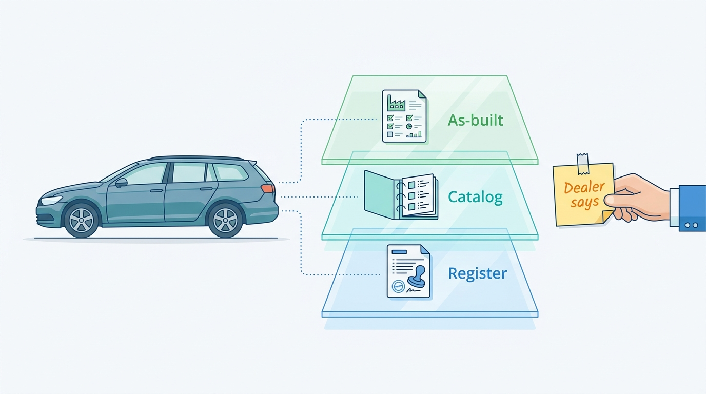
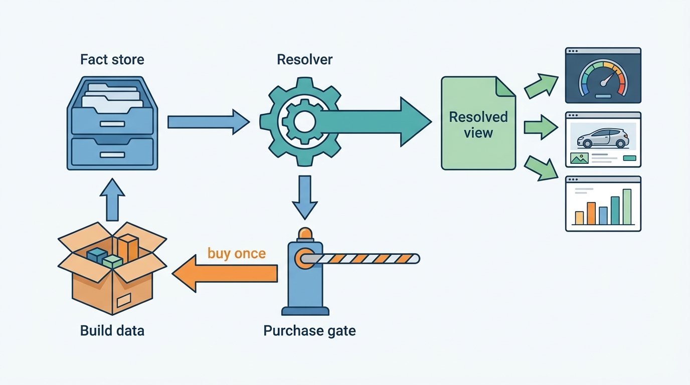
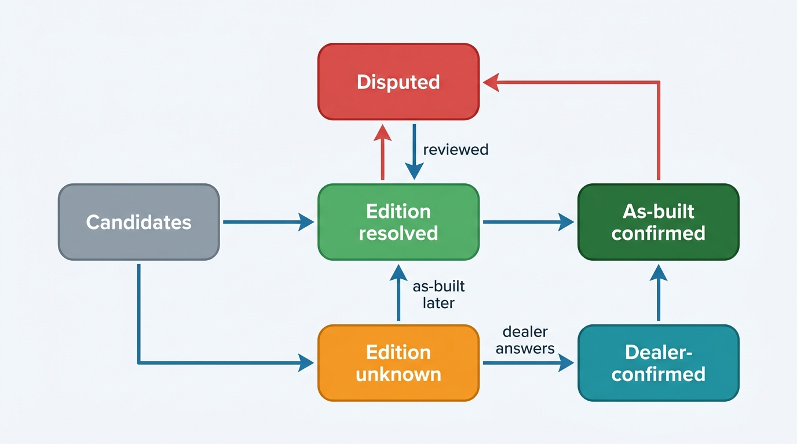
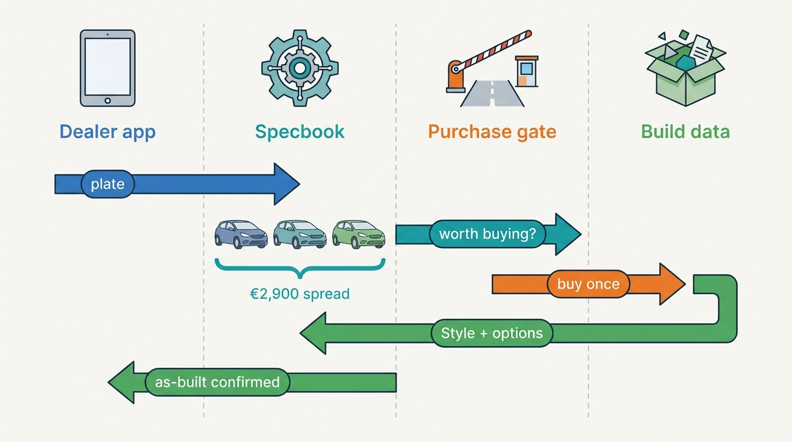
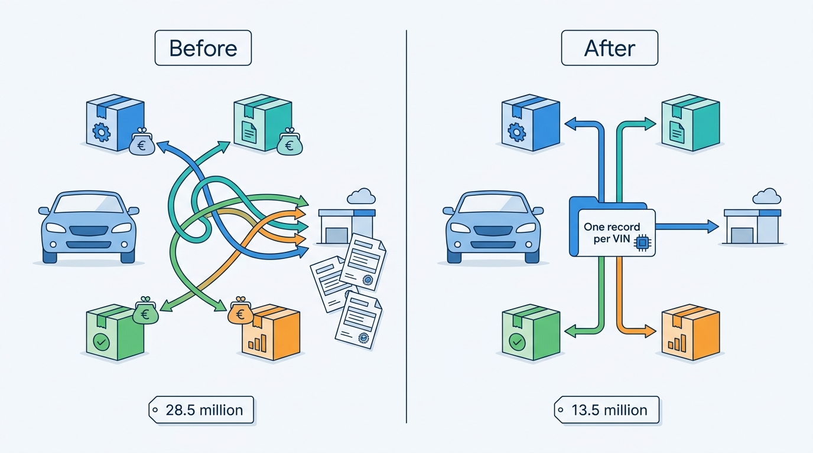

> **IN THIS CHAPTER, YOU WILL:** Take apart the specification resolver: the layers of specification data and their sources, the catalog and its provider crosswalk, how candidates, confidence and the "edition unknown" state are produced, when to buy per-VIN build data, and how one resolved equipment list feeds valuations, adverts and portal mappings.

> **WHY THE BUSINESS CARES:** A wrong edition or a missing option pack moves a trade-in offer by a thousand euros or more, puts the wrong equipment in an advert the dealer is liable for, and makes the valuation, the advert and the history report disagree about the same car. Build data that answers the question costs money on every call, so the CFO sees the specification problem twice: in margins and in the supplier invoice.

> **WHY ARCHITECTS SHOULD CARE:** Specification sits between vehicle identity and almost every product. Its data model (layers, keys, confidence), its purchase policy and its cache-and-license rules decide what every downstream system believes about a car and what that belief costs.

> **KEY POINTS:**
>
> * **A specification is three sourced layers, not one record.** Register technical data, catalog versions and the as-built option list have different keys, prices, licenses and failure modes. Store them separately, resolve them into a view per attribute, and keep the losing values; never let a dealer's drop-down choice overwrite a provider's answer.
> * **The honest answer is often a candidate set.** A VIN or plate commonly matches several catalog versions. The resolver should return candidates with a resolution state (resolved, edition unknown, dealer-confirmed) and turn low confidence into a specific question for the dealer, not a guessed trim name.
> * **Buy build data for decisions, and only once per car.** As-built data is immutable and paid per request. A purchase gate that buys it only when the candidates' value spread matters, and a license that allows storing it per VIN for every product, cut Axleby's build-data fetches by more than half without making specifications worse.

> **[FAILURE PATTERNS THIS CHAPTER ADDRESSES](where-vehicle-platforms-go-wrong.html):**
>
> * **Spec Guesswork** — edition and options inferred from model names and dealer drop-downs make the valuation, the advert and the report describe three different cars.
> * **License Blindness** — paid build data cached and reused across products, tenants and clients without knowing what the license allows is a contract breach waiting to be found.
> * **The Sticky Error** — a catalog correction or a mis-resolved edition keeps living in valuations and live adverts because nobody recorded which outputs used it.

 
A dealer who scans a plate expects the screen to say what the car is: make, model, engine, gearbox, edition and the options that make this car worth more than its neighbor. That expectation hides a hard data problem. **The vehicle identification number (VIN) identifies a car; it does not describe its equipment.** Registers record what the type-approval authority needs, not what the buyer paid for. Catalogs list what a version could have had. Only the manufacturer's build record says what this car actually received, and that record is licensed, incomplete for some makes and charged per request.

Every downstream product depends on the answer. The valuation engine needs the edition and the valuable options. The advert needs an equipment list the dealer can stand behind. The registration-tax calculation needs the CO2 value and first-registration date. The damage estimate needs the right parts. When each product resolves the specification its own way, they disagree, and the dealer notices first.

This chapter owns the **specification resolver**, the **edition (trim)**, the **factory option** and the **specification catalog**. It builds on [[vehicle-identity]], which supplies the VIN and the vehicle key, and [[registers-and-official-data]], which supplies register technical data. It hands history to [[vehicle-history]], the general mechanics of ingestion and survivorship to [[ingestion-and-entity-resolution]], and the per-portal equipment mapping to [[listing-syndication]].

## Setting the Scene at Axleby: The €46 Build-Data Question

Axleby, the fictional vehicle data and dealer software group this book follows (see [[meet-axleby]]), runs **Specbook**, its specification catalog and resolver. Specbook combines the Dutch register's technical data, licensed catalogs and per-VIN build data from a commercial build-data provider. The provider charges per request; at 2027 volumes the average is **€0.46**. A plate-to-specification call through Axleby's API lists at **€0.09**, under a no-hit-no-fee rule. For every hundred API calls that trigger a build-data purchase, Axleby pays **€46** and bills **€9**. Inside Axleby this is "the €46 per hundred" problem.

In February 2027 the provider's annual statement reached Priya Raman (VP Data and Valuation). In 2026 about **3.0%** of Axleby's billable lookups had missed Specbook's stored data and triggered a build-data fetch: roughly **78,000 a day**, or about **28.5 million** fetches a year, costing about **€13 million**. That single line was close to half of Axleby's fully loaded lookup cost ([[scale-and-cost]] owns that analysis). Ines Marchetti (Group Chief Architect) asked the question that the invoice raised: how many of those fetches changed a decision? Priya's team joined the request log to Anchor's vehicle keys and to the products that triggered each fetch.

| Trigger (2026, Axleby) | Build-data fetches | What happened |
| --- | --- | --- |
| External API clients (JSON API v1 and Connect XML) | **15.9 million** | Each stack kept its own 30-day cache; batch clients re-checked whole fleets |
| Lotwise appraisal, stock-in and advert editor | **6.8 million** | Every appraisal opened after the 30-day window fetched again |
| Odolo and Axleby Trade | **3.1 million** | Separate caches, same VINs |
| Vantage valuation enrichment | **2.7 million** | Nightly restock valuations of stock without equipment |
| **Total** | **28.5 million** | **41%** repurchases of a VIN bought before; **6%** concurrent duplicates |

Three findings followed. First, **almost half of the spend bought data Axleby already had or was buying at the same moment**. The provider contract allowed only 30 days of retention, so 41% of fetches were repurchases, and another 6% were concurrent duplicates from products asking about the same car in the same minute. Nobody had asked whether the retention clause could be renegotiated. Second, about **14%** of fetches returned only catalog-level equipment for makes the provider could not resolve at build level, and were billed anyway. Third, a sample of 2,000 Lotwise adverts showed the dealer-selected edition disagreeing with the resolved edition in **9%** of cases. In about a third of those, the advert claimed a higher edition than the car had.

Tomás Ferreira (Product Director, Lotwise) framed the opposite risk: appraisals must stay fast, and a dealer who sees "edition unknown" on a trade-in will type a trim name into the free-text field. So the question for the architecture forum in April 2027 was not "how do we buy less build data". It was **what does Axleby need to know about a car's specification for each decision, which source is good enough for that, and how do we buy each paid fact once?**

## Concepts: The Layers of "What Is This Car"

### The taxonomy

Specification catalogs use a hierarchy that is roughly the same everywhere, although providers name and split the levels differently. This book uses the following reference model; it is not an industry standard.

| Level | What it identifies | Example (illustrative) | Typical keys |
| --- | --- | --- | --- |
| **Make** | The brand | Volkswagen | Provider make ids; World Manufacturer Identifier (WMI, VIN positions 1–3) at manufacturer level |
| **Model** | The commercial model line | Golf | Provider model ids |
| **Generation** (model series) | A design period of the model | Golf 8, 2020 onward | German *Baureihe*; Auto Trader "generation" |
| **Body** | Body style and doors | Variant (estate), 5 doors | Body code |
| **Version** (derivative) | Engine, power, gearbox, drivetrain, and usually the edition | 1.5 eTSI 110 kW DSG Style | cap Code (UK), German type key numbers (HSN/TSN), Schwacke code, Auto Trader derivative id, provider version ids |
| **Edition (trim)** | The named equipment level the manufacturer sells | Life, Style, R-Line | Often part of the version; sometimes a separate line (*Ausstattungslinie*) |
| **Factory option and pack** | Equipment ordered on top of the edition, alone or in a bundle | Panoramic roof; a driver-assistance pack | Manufacturer option codes, provider feature ids |
| **As-built** | What one VIN actually received | This car: Style, panoramic roof, towbar, metallic paint | Per-VIN build record |

Three of these terms carry the weight of this chapter.

- An **edition (trim)** is the named equipment level of a version: the standard content the manufacturer bundled under a marketing name. Edition names are not stable identifiers. The same name means different content in different countries and model years, and limited "Business" or "Edition" variants appear and disappear within a generation.
- A **factory option** is an item of equipment fitted at the factory on top of the edition's standard content, ordered alone or in a **pack** whose content can change over time. Dealer-fitted accessories and retrofits are not factory options; they enter the record as dealer-asserted equipment.
- The **specification catalog** is the platform's versioned reference data of makes, models, generations, versions, editions, standard equipment and available options, with the crosswalk to every provider's and portal's keys.

### Three source layers

A car's specification arrives from three kinds of source that answer different questions.

1. **Register technical data** says what the authority approved and registered. The Dutch register's open dataset of registered vehicles is the richest public example. It holds about 16.87 million records keyed by plate (*kenteken*), with make, trade name (*handelsbenaming*), the European Union (EU) type-approval number, variant and version (*uitvoering*), mass, dimensions, colors and a list price (*catalogusprijs*). A linked dataset gives fuel type, net maximum power and CO2 values. The data is public domain and has no VIN column ([RDW open data, queried 2026-10-22](https://opendata.rdw.nl/api/views/m9d7-ebf2.json)). A 2015 Peugeot 2008 record queried for this chapter carried type-approval number `e2*2007/46*0070*24`, variant `UHMZ` and version `6`, with 60 kW in the fuel dataset. Type, variant and version identify an approved technical configuration. They are more precise than a trade name, they come free with the plate, and they say nothing about trim-level equipment.
2. **Catalog data** says what a version offers: its standard equipment and the options available for it. It comes from specification providers and their version tables, and from a VIN pattern decoder such as the United States (US) National Highway Traffic Safety Administration's (NHTSA) Product Information Catalog and Vehicle Listing (vPIC) service. Catalog data describes a population of cars, not one car.
3. **As-built data** says what this VIN received at the factory: edition, option and pack codes, colors and sometimes the as-built price. It comes from manufacturers, usually through a licensed provider, and is charged per request.

Two further sources contribute facts with weaker standing: the **dealer's assertion** ("has a panoramic roof", "towbar retrofitted") and **observed adverts** of the same car, which [[market-data]] harvests. Both are useful as evidence and dangerous as truth.

**Figure 1:** *A specification is three sourced layers, register, catalog and as-built, with the dealer's assertion kept beside them as weaker evidence, never written over them.*

> **Rule I use:** every specification fact carries its layer, its source, its source key, when it was retrieved and under which license. The layer is part of the fact, not metadata about the record. [[provenance-and-data-quality]] owns the general provenance envelope; this chapter adds the layer.

### What the VIN can and cannot tell you

In the US, Title 49 of the Code of Federal Regulations (CFR), Part 565, requires that VIN positions 4–8 "shall uniquely identify the attributes of the vehicle", leaves their encoding to the manufacturer, and obliges manufacturers to submit to NHTSA the information needed to decipher them ([eCFR, current text](https://www.ecfr.gov/current/title-49/subtitle-B/chapter-V/part-565)). That duty feeds vPIC. Every vPIC decode response carries a warning that should be copied into every specification product: "Missing value should NOT be interpreted as an indication that a feature or technology is unavailable for a vehicle" ([NHTSA vPIC, queried 2026-10-22](https://vpic.nhtsa.dot.gov/api/vehicles/DecodeVinValues/1HGCM82633A004352?format=json)). A decode of a 2003 Honda Accord queried for the research behind this book returned 154 fields, of which 45 were filled; the trim ("EX-V6") and engine were there, and every equipment field was empty.

Outside the US, the decoder knows less. European VINs follow ISO 3779 but are not bound by the US check-digit rule, and a synthetic Volkswagen-pattern VIN sent to vPIC came back with model year and make, an empty model and the error "Unable to provide information for some of the characters in the VIN". [[vehicle-identity]] owns VIN structure and validation. For specification, the lesson is narrower: **a VIN decode is a catalog-level filter, never an equipment list.**

## Sources and What Each Can Prove

| Source | Layer | Input | What it can prove | What it cannot | Cost and license |
| --- | --- | --- | --- | --- | --- |
| Dutch register open data | Register | Plate | Make, trade name, type approval, variant, version, power, CO2, list price, first registration | Edition and options; VIN | Free, public domain |
| German manufacturer and type key numbers (HSN, *Herstellerschlüsselnummer*; TSN, *Typschlüsselnummer*) on registration certificate Part I, fields 2.1 and 2.2 ([HUK-Coburg guide, n.d.](https://www.huk.de/fahrzeuge/ratgeber/hsn-tsn.html)) | Register | Document or dealer input | Manufacturer, model, engine and body class | Edition and options | Free when the document is at hand; the central register is not open data |
| UK Driver and Vehicle Licensing Agency (DVLA) Vehicle Enquiry Service (VES) | Register | Plate | Make, color, fuel, engine capacity, CO2, tax and MOT (Ministry of Transport roadworthiness test) status, type approval | Model and VIN; new API registrations were closed when checked ([DVLA, n.d.](https://developer-portal.driver-vehicle-licensing.api.gov.uk/apis/vehicle-enquiry-service/vehicle-enquiry-service-description.html)) | Not stated |
| NHTSA vPIC | Catalog (pattern) | VIN | Make, model, model year, often trim, engine, plant | As-built options; an empty field never means "not equipped" | Free; unpublished automated rate control |
| Catalog providers (version tables) | Catalog | Version key, VIN pattern or plate | Standard and optional equipment of a version | Which options this car has | Contract |
| Build-data providers | As-built (for covered makes) | VIN or plate | Options, packs, colors for this car | Dealer-fitted equipment; makes outside coverage | Per request, contract |
| Dealer assertion | Asserted | Screen input | What the dealer sees on the car | Anything the dealer guessed | Free; liability sits with the dealer |
| Observed adverts | Asserted (third party) | Advert matched to VIN | What another seller claimed | Truth | License of the market-data source |

The documented provider evidence supports three cautions.

- **One provider can return two layers.** DAT (Deutsche Automobil Treuhand) Austria's March 2026 guide to its SilverDAT VIN query names about 40 makes whose equipment comes live "from the connected manufacturer databases", and a second group (including Honda, Suzuki and Tesla) whose equipment comes from DAT's own manufacturer-standardized database ([DAT Austria, 2026](https://www.datgroup.com/fileadmin/at/VIN_Abfrage_Infos/Anleitung-VIN-Abfrage-Oesterreich_03-2026.pdf), translated from German). The same call therefore returns as-built data for some cars and catalog data for others. The guide also shows whether the car was built for the Austrian market, and lets users add equipment fitted after delivery by hand.
- **Products separate the layers commercially.** JATO describes VINView as catalog-level standard specification from a VIN or UK registration mark, and VINView Pro as showing "what was actually installed at the factory", available in eight European markets including the Netherlands, Belgium, Germany and the UK ([JATO, n.d., accessed 2026-10](https://www.jato.com/our-solutions/vinview)).
- **Some providers state their confidence.** The US developer API auto.dev sells "OEM Build Data" with factory option codes and "a match confidence score" at $0.10 per call on its Growth plan and $0.08 on Scale ([auto.dev, n.d., accessed 2026-10](https://www.auto.dev/oem-build-data)). No European provider publishes per-request prices; DAT bills each SilverDAT VIN query to subscribers, and AUTOHAUS reported in 2019 that DAT claimed 99.8% coverage of the German market ([AUTOHAUS, 2019](https://www.autohaus.de/nachrichten/autohandel/vin-abfrage-dat-erhoeht-marktabdeckung-weiter-2711912)). That claim is seven years old.

The UK market adds two keys that every UK integration meets. Cap HPI's cap Code is "a unique 20 character alpha–numeric code structure detailing vehicle characteristics", with a numeric cap ID for each code ([Cap HPI, n.d.](https://www.cap-hpi.com/products-and-services/cap-code/)). The page also says the cap ID "is unique to each vehicle"; industry usage suggests that means each vehicle type, a derivative shared by many cars, not one VIN. Auto Trader UK's Taxonomy API navigates vehicle types, makes, models, generations and derivatives; "once a derivativeId is determined, it can then be used to retrieve the vehicle technical data, standard & optional features data" ([Auto Trader developer documentation, n.d., release notes to 2026, accessed 2026-10](https://developers.autotrader.co.uk/documentation)).

## Architecture: The Specification Resolver

### Components and boundaries

The **specification resolver** turns identity plus sourced facts into a resolved specification with a state, a confidence and an explanation. It is a service with its own data, not a library inside each product. The components below are a reference architecture; Axleby's Specbook is one illustration of it.

**Figure 2:** *The resolver reads sourced facts from the fact store, asks a purchase gate before buying as-built data, which is bought once and kept in the fact store, and publishes one resolved view that every product reads.*

| Component | Responsibility | Owns | Does not own |
| --- | --- | --- | --- |
| **Fact store by layer** | Holds every specification fact with layer, source, source key, retrieval time, license class and provider confidence | Register, catalog, as-built and asserted facts per vehicle key | Identity (owned by the identity graph) |
| **Specification catalog and crosswalk** | Versioned reference data and the mapping between provider keys (provider version ids, HSN/TSN, cap Code, type approval, variant and version) and internal catalog ids | Catalog versions, standard content, option and pack definitions, generic feature taxonomy | Per-VIN facts |
| **Resolver** | Produces candidates, scores them, applies precedence per attribute, sets the resolution state and writes an explanation | The resolved view, versioned by rule set and catalog version | The decision to pay |
| **Purchase gate** | Decides whether to buy as-built data for this request, from the decision context, candidate value spread, coverage and budget | Purchase policy and the request ledger | Prices to clients (owned by [[billing-and-metering]]) |
| **Build-data adapters** | One per provider: request, idempotency key, coverage check, response normalization, cost record | Provider contracts as code | License decisions (owned by Charter, see [[data-licensing-and-governance]]) |
| **Dealer confirmation** | Captures dealer answers to specific questions as asserted facts with author and time | Confirmations | Overwriting provider facts |
| **Portal mappers** | Translate catalog equipment ids into each portal's codes | Mapping tables per portal and version | Channel delivery (owned by [[listing-syndication]]) |

Two boundaries matter most. The **resolver never writes into the fact layers**: a resolved view is a derived product, rebuildable when rules or the catalog change. And **the purchase gate is separate from the resolver**, because the question "would as-built data change this answer?" belongs to the resolver, while "is it worth €0.46 here?" depends on the decision, the customer's contract and the budget.

### Candidate generation and precedence

Resolution runs in four steps.

1. **Narrow by register and identity.** Use free register facts (type approval, variant, version, power, fuel, first registration; HSN/TSN in Germany) and the VIN pattern to select the catalog versions that are technically possible.
2. **Score candidates.** Within those versions, score editions by agreement with the remaining evidence: the register's list price where it discriminates, the model year from the VIN, colors, and observed adverts of the same VIN.
3. **Add as-built facts when present.** As-built option codes reference catalog option ids; a car's equipment list is the edition's standard content plus its as-built options, minus nothing.
4. **Apply precedence per attribute** and record the losers.

| Attribute | Highest precedence | Then | Notes |
| --- | --- | --- | --- |
| Power, fuel, CO2, mass | Register | Catalog version | The register is the legal record for tax and approval |
| First-registration date | Register | — | Never from catalog or dealer |
| Version and edition | As-built | Catalog candidate with unique score | Dealer confirmation if neither is decisive |
| Factory options | As-built | Dealer confirmation | Catalog can only say "available", never "fitted" |
| Dealer-fitted accessories | Dealer assertion | — | Labeled as dealer-supplied in adverts and reports |
| Color | As-built | Register | Registers use coarse color groups |

Precedence is per attribute, not per source. A register is the best source for power and the worst for options. **The resolved view is a projection over sourced facts**, with the same survivorship logic [[ingestion-and-entity-resolution]] describes in general, and it keeps every losing value so a reviewer can see why the view resolved as it did.

### Resolution states and confidence

A resolved specification has a state, not just a value.

**Figure 3:** *"Edition unknown" is a legitimate state with a way out. A dealer confirmation or a later as-built purchase resolves it; new conflicting evidence moves even a confirmed specification into review instead of overwriting it.*

| State | Meaning | What products do with it |
| --- | --- | --- |
| **Identified** | The vehicle key is known; nothing resolved yet | Nothing; transient |
| **Candidates** | Technically possible versions are known | Show make, model, engine; ask for nothing yet |
| **Edition unknown** | Several editions remain and no as-built data exists | Valuation uses the candidate range and widens its interval; the advert omits edition and options; the dealer gets one question |
| **Edition resolved** | One edition, from a unique candidate or as-built match | Standard equipment can be shown; options still unknown unless confirmed |
| **Dealer-confirmed** | The dealer answered the resolver's question | Shown with "dealer-supplied" wording; valuation uses it with lower confidence than as-built |
| **As-built confirmed** | Edition and factory options from the build record | Full equipment list; highest confidence |
| **Disputed** | Sources contradict each other on an attribute that matters | Products show the last agreed view and flag it; a data-operations queue reviews it |

**Confidence is expressed as an action, not a number.** A dealer does not know what to do with "0.72". They know what to do with "Is there a panoramic roof? It changes the valuation by about €450". The resolver should compute which unknown attribute carries the largest value difference between the remaining candidates and ask about that one. The same principle drives the purchase gate: the value at stake is the spread between candidates.

### Requirements per interaction

| Interaction | Latency target *(assumption)* | Consistency | Freshness | Availability |
| --- | --- | --- | --- | --- |
| Plate scan at appraisal (catalog level) | Under 1 s at the 95th percentile (P95) | Read-your-writes for the dealer's own confirmations | Register facts may be a day old | Must work when build-data providers are down |
| As-built purchase at appraisal | Under 3 s, then continue asynchronously | Exactly one purchase per VIN and license scope | Immutable once bought | Degrade to "edition unknown" with a queued upgrade |
| Data API specification call | Under 400 ms at P95 for catalog level | Same resolved view as Lotwise for the same rule-set version | Resolved view rebuilt within an hour of new facts | Per the API's service level, independent of providers |
| Stock-in and nightly revaluation | Batch | View versioned with the valuation that used it | As of the run | Retried |
| Advert publishing | Batch or event-driven | Advert equipment equals the resolved view at publish time | Republish within a day of a correction | Independent of providers |

## Option Value: Why the Edition Moves Money

Options matter because buyers pay for them and portals display them. In its results release of 1 June 2023, Auto Trader UK described "specification adjusted valuations" launched in April 2023 inside its retailer portal ([Auto Trader Group FY2023 results, 2023](https://plc.autotrader.co.uk/media/3dbbyupi/fy-press-release-fy23-final_no_pw-0106.pdf)). Its developer documentation shows the data behind that idea. Since 14 July 2025, each feature in its Stock, Search, Vehicles and Taxonomy APIs carries `factoryCodes`, "unique identifiers which the manufacturer provides to assist with identifying the specific standard specification or optional equipment". Release notes dated 6 August 2025 added `rarityRating` and `valueRating` "to identify which features are rare and valuable on a vehicle". The same documentation is candid about the limit: requested features "are all possible factory options for that derivative, not only the ones present on the actual vehicle", and the `factoryFitted` flag is filled only for certain manufacturers, otherwise null ([Auto Trader developer documentation, accessed 2026-10](https://developers.autotrader.co.uk/documentation)). That is the catalog/as-built split, published by a market leader in its API.

Three properties of option value shape the architecture.

- **Option value is uneven.** Most options add little to a used car's price; a few (panoramic roofs, larger batteries, higher-power versions, certain driver-assistance packs) add a lot. A purchase policy that buys build data for every car spends most of its money where the answer does not change a decision.
- **Option value commonly decays with age and mileage.** An option that adds a meaningful share of value to a three-year-old car may add little to a twelve-year-old one. [[valuation-engine]] owns the adjustment models; the resolver supplies the option list and its confidence.
- **Edition errors are asymmetric.** Overstating the edition in an advert creates a misdescription the dealer is liable for; understating it in an appraisal leaves margin on the table or loses the trade-in to a competitor.

## In Practice: The Golf Variant at Autobedrijf Brandsma

On Saturday 11 September 2027, Sietse Brandsma, owner of Autobedrijf Brandsma in Leeuwarden (one rooftop, about 55 cars in stock), appraises a trade-in in Lotwise Appraise: a 2021 Volkswagen Golf Variant with a Dutch plate. The flow below runs under Specbook's 2027 policy. All amounts are Axleby illustrations.

**Figure 4:** *At appraisal, free register facts narrow the car to three editions. The value spread between them, not a rule like "always buy", justifies one build-data purchase, which is then stored for every later use of the same VIN.*

1. **Identity and register.** Anchor maps the plate to the VIN and the Axleby Vehicle Key (AVK). Turnstile's register facts give make, trade name, type approval, variant, version, 110 kW, petrol, CO2 and the register list price. Elapsed: about 0.3 seconds.
2. **Candidates.** The catalog has three editions for that version: Life, Style and R-Line. The register list price falls between Style and R-Line catalog prices, so it does not discriminate; Specbook treats it as a weak signal anyway, because the published dataset does not document what the price includes.
3. **Value spread.** Vantage values each candidate at the car's mileage: **€21,400**, **€23,100** and **€24,300** retail. The spread is **€2,900**.
4. **Purchase gate.** In appraisal context the gate's threshold is a spread of **€750** (an Axleby policy value). The VIN has no stored as-built record and the make is in the provider's build-level coverage, so the gate buys once, at about **€0.58** under the July 2027 license, with the AVK and license scope as the idempotency key.
5. **As-built.** The record says Style, with a panoramic roof and an electrically folding towbar. Vantage applies option adjustments of **€650** combined and returns **€23,750** retail with its comparables; the maximum purchase price in [[vehicle-acquisition]] follows from that.
6. **Reuse.** When the car is stocked in on Tuesday 14 September, advertised on five channels, revalued nightly and checked by a Rijnstaal Verzekeringen API call months later, no further purchase is made.

Had Sietse appraised a 2011 car with the same three candidates and a spread of **€310**, the gate would not have bought. The car would show "edition unknown" with one question about the edition badge, and the appraisal would have used the candidate range with a wider interval.

### What Axleby decided

The forum in April 2027 made four decisions, implemented from July 2027:

1. **One as-built record per VIN for the group.** Priya Raman and Lena Vos (Billing and Finance Systems Lead) renegotiated the provider contract. From **July 2027**, Axleby may retain as-built data for the life of the vehicle and use it in every Axleby product and in per-vehicle answers to clients; the price of a first fetch rose to about **€0.58**. Bulk resale of raw option lists stays forbidden. Charter records the license scope on every stored record.
2. **A purchase gate by decision context**, inside the upstream budget broker that [[scale-and-cost]] describes. Appraisal, stock-in and explicit client requests for as-built equipment may buy; nightly revaluation and catalog-level API calls may not.
3. **Catalog level by default for clients.** Plate-to-specification stays at **€0.09** and returns a catalog-level answer with candidates and resolution state unless the client asks for as-built equipment; bulk clients go through a batch lane with a surcharge for fetches that miss stored data. The Saturday Batch of May 2027, when one insurer's 1.1 million calls in 41 minutes cost Axleby more than they earned, mostly in build-data fetches, made the case.
4. **Coalesced fetches and a negative cache.** Concurrent requests for the same VIN wait for one fetch, and "no build-level data for this VIN" is stored too, so catalog-only makes are not bought again.

| Measure (Axleby) | 2026 | Run rate Q4 2027 |
| --- | --- | --- |
| Build-data fetches per year | 28.5 million | **13.5 million** |
| Repurchases and concurrent duplicates | 47% | **6%** (VINs first bought under the old license, bought once more) |
| Build-data cost per year | about €13.1 million | about **€7.8 million** |
| Lotwise stock-ins with edition resolved or confirmed | not measured | **88%** (41% from free sources alone, 47% after build data); **12%** edition unknown, mostly imports and makes without build-level coverage |
| Adverts whose edition disagrees with the resolved view | 9% (sample) | **2%** |

**Figure 5:** *Before July 2027 each product bought the same car's build data again; once the license allowed one stored record per VIN for every product, fetches fell from 28.5 million to 13.5 million a year.*

## Equipment Code Mapping to Portals

The resolved equipment list must become each portal's vocabulary, and portals disagree about almost everything.

- **mobile.de** describes equipment as named fields with reference-data values, separate fields for model range (*Baureihe*) and trim line ("a.k.a feature sets (Ausstattungslinie)"), a free-text `modelDescription` used as the advert title, German HSN/TSN fields, and a Schwacke code. Reference data differs by site, and its price-rating preview can answer `NO_RATING` with reason `unsupported_make_model`, warning that the rating "might be not as accurate, especially if modelrange and/or trimline are not matching our reference data" ([mobile.de Seller API, n.d., accessed 2026-10](https://services.mobile.de/manual/new-seller-api.html)).
- **AutoScout24** takes equipment as an array of integer ids from its References API, with mutual-exclusion rules: only one automatic climate control variant per listing. Its `natCode` replaced `schwackeCode` from 13 June 2024, and on 19 October 2026 localized names changed with the warning that "Data providers using reference names to map IDs should review and update their mappings" ([AutoScout24 Listing Creation API, data models and changelog, accessed 2026-10](https://listing-creation.api.autoscout24.com/assets/docs/data-models.md)).
- **Auto Trader UK** uses its derivative taxonomy and features with OEM factory codes, as above.
- **Marktplaats** enriches car adverts with a valid plate "with data from a third party partner after posting", asynchronously, and lets dealer-supplied values take precedence ([Marktplaats API, n.d.](https://api.marktplaats.nl/docs/v1/advertisement.html)).

The architecture follows from the evidence: **map once, through ids.** Manufacturer option code → catalog option id → generic feature id → per-portal code, with each mapping table versioned and validated against the portal's current reference data. Display names are never keys; AutoScout24's October 2026 rename is the reminder. Generic vocabularies sit at the very edge: schema.org's `Car` type gives search engines fields such as `vehicleConfiguration` and `vehicleEngine`, but no option codes, sources or confidence ([schema.org, 2026](https://schema.org/Car)), so it is an output format, never the internal model. Mutual-exclusion rules are validated before publishing, not discovered in rejections. And because Marktplaats lets dealer values win over its own enrichment, sending a guessed edition is worse than sending none. [[listing-syndication]] owns the adapters and their delivery; [[merchandising]] owns how equipment becomes advert text.

## Caching, Licensing and the Cost of Build Data

Specification facts age differently. Caching should follow the fact's nature and its license, not the endpoint.

| Fact | Changes? | Cache rule (recommendation) |
| --- | --- | --- |
| As-built record | Never, except provider corrections | Store per VIN and provider dataset version for as long as the license allows |
| Catalog version content | When the provider reissues its catalog | Versioned; resolved views record the catalog version they used |
| Register technical data | Rarely (conversions, re-registration, import) | Refresh from the mutation feed ([[registers-and-official-data]]) |
| Resolved view | When any input, rule set or catalog version changes | Derived; rebuilt by event, never cached beyond its inputs |
| Dealer assertion | When the dealer changes it | Belongs to the tenant; not reused for other tenants' cars without the license and consent to do so |

**Cache entitlement is a property of the license, not of the data type.** The same option list may be storable for Axleby's own products and not resellable in bulk; a dealer's own assertion belongs to that dealer's tenant. Every stored fact therefore carries its license class, and the read path checks it. This is where specification meets [[data-licensing-and-governance]]: before July 2027, Axleby's separate caches were small License Blindness incidents, because nobody checked whether the 30-day retention ran per product or per group, or whether a cached answer bought for one client could serve another. That they saved too little money did not make them compliant.

The **no-hit** question also needs an explicit answer. If a client pays nothing when Specbook cannot resolve, but the provider bills Axleby for a catalog-only answer, the loss is structural. The purchase gate checks the provider's coverage list before buying, and [[billing-and-metering]] records the result class of every paid call (as-built hit, catalog-only, no hit, error) against the tenant and license on whose behalf it was made.

## Failure Handling

| Failure | Detection | Recovery |
| --- | --- | --- |
| **Duplicate purchases**: two products request the same VIN at once, or a timeout leads to a retry | Request ledger keyed by AVK, provider and license scope; reconcile against the provider's monthly statement | Single-flight lock per key; retries reuse the idempotency key; duplicates found at reconciliation go to the provider as credit claims |
| **Conflict between layers**: as-built says 96 kW, the register says 110 kW | Precedence rules detect disagreement on attributes both layers carry | Register wins for the legal value; the record moves to **Disputed** and data operations check for a wrong VIN, a conversion or a provider error |
| **Wrong vehicle**: build data for a different car | As-built make, model or first-registration window contradicts register facts | Treat as an identity problem first ([[vehicle-identity]]); never attach the record; the Cloned Plate is the precedent |
| **Foreign specification**: a re-import built for another market | Build data or the provider's market flag shows a non-domestic build; catalog candidates do not match | Resolve against the source market's catalog; label equipment names as source-market names; adverts say "imported" |
| **Incomplete record**: catalog-only answer, null `factoryFitted`, unknown pack content | Result class and per-attribute nulls | State stays **Edition unknown** or **Edition resolved**; never convert "unknown" into "not equipped" |
| **Provider outage or slow response** | Adapter timeouts and error rates per provider | Return the catalog-level answer with candidates within the latency budget; queue the as-built upgrade; products update when it arrives |
| **Catalog correction**: a provider reissues a version's standard content | Catalog version diff | Re-resolve affected VINs; emit specification-changed events; valuations and adverts that used the old view republish |
| **Dealer overrides the evidence**: picks a higher edition than the as-built record | Confirmation contradicts as-built | Keep both; the advert uses the as-built edition unless data operations accept the dealer's evidence (a conversion, a mis-keyed build record) |

The catalog-correction row is the one most platforms miss. If the resolved view is not versioned and its consumers are not recorded, a correction leaves the wrong equipment in every advert and valuation that used it: The Sticky Error. Recording "which rule set and catalog version produced this view", and having downstream products record "which view I used", is what makes [[journey-data-correction]] possible.

## Trade-offs

| Approach | How it works | Strength | Weakness | Right when |
| --- | --- | --- | --- | --- |
| **Dealer picks from the catalog** | Plate gives model and engine; dealer chooses edition and ticks options | Cheap; fast; no supplier cost | Spec Guesswork at scale; liability for misdescription; valuations inherit guesses | Very small platforms, or markets and ages where option value is negligible |
| **Buy as-built for every lookup** | Every resolution calls the build-data provider | Highest coverage of options where build data exists | Cost grows with lookups, not cars; still catalog-only for uncovered makes; Borrowed Uptime on the provider | High-value segments, or when the client pays per as-built call |
| **One provider's resolved answer as truth** | Store the provider's version and equipment as the record | Simple; one contract | Lock-in to its keys; its catalog/as-built mix is hidden; no losing values | Single-market products with one dominant provider |
| **Layered resolver with purchase gate** (recommended) | Register and catalog narrow; gate buys as-built for decisions; one record per VIN | Pays per car and per decision; explainable; provider-neutral | Needs a catalog, crosswalk, license negotiation and a data-operations team | Multi-product groups where several products reuse the same car's specification |

The recommendation rests on assumptions worth stating. It pays off when **the same VINs are resolved repeatedly** across products, as at Axleby, where 47% of 2026 fetches were repurchases or concurrent duplicates. It requires a **license that allows storing as-built data per VIN**; without one, the gate still reduces cost but the cache is limited to the requesting transaction. And it requires someone to **own the catalog and crosswalk** as a product, because a stale crosswalk degrades every resolution silently.

A second trade-off concerns **one specification provider or several**. No single provider covers every make at build level in every market, and DAT's own two-tier list shows coverage varies by make. Several providers improve coverage and negotiation leverage, and they double the crosswalk work. The rule I use: one primary provider per market, a second only for makes or segments where the first is catalog-only and option value is high.

## Across Markets: What Changes by Country

| Topic | Netherlands | Belgium | Germany | United Kingdom | United States |
| --- | --- | --- | --- | --- | --- |
| Usual input at the dealer | Plate (*kenteken*) | VIN (plates follow the owner, not the car; see [[vehicle-identity]]) | VIN, plus HSN/TSN from the registration certificate | Registration mark (VRM) | VIN |
| Free register technical data | Rich: type approval, variant, version, power, CO2, list price, public domain | No open bulk register examined | Central register not open; HSN/TSN on the document | DVLA VES: thin (no model, no VIN); new registrations closed when checked | No national register of individual vehicles; vPIC decodes VIN patterns for free |
| Common catalog keys | Type approval, variant and version; provider version ids | Provider version ids | HSN/TSN; Schwacke code (natCode on AutoScout24) | cap Code and cap ID; Auto Trader derivative id | VIN pattern; provider style ids |
| As-built sources | Pan-European providers (JATO VINView Pro lists NL); Dutch data companies resell several (VWE's public API schemas include JATO and SilverDAT data types) | Pan-European providers (VINView Pro lists BE) | DAT (live manufacturer data for about 40 makes per its 2026 guide); Schwacke and Autovista | JATO VINView Pro; Auto Trader `factoryFitted` for certain manufacturers | Build-data APIs (for example auto.dev, with a match score); J.D. Power ChromeData, per its marketing |
| Portal vocabulary | Marktplaats enriches from the plate; AutoScout24 ids | AutoScout24 ids; 2dehands shares the Marktplaats API | mobile.de reference data, model range and trim line; AutoScout24 ids | Auto Trader taxonomy and factory codes | Portal-specific; VIN-decoded attributes |

**What is common**: the layered fact model, the catalog with a crosswalk, the resolver and its states, the purchase gate, the license-aware store and the mapping pipeline. None of these should fork by country.

**What is a market adapter**: the input key (plate in the Netherlands and the UK, VIN in Belgium and the US, VIN plus HSN/TSN in Germany), the register adapter and the facts it can supply, the provider set and its coverage list, and the portal mappers. Germany's HSN/TSN and the UK's cap Code and derivative ids are crosswalk entries, not separate models.

**What is a rule set**: the purchase-gate thresholds. The Netherlands narrows candidates cheaply from the register, so as-built purchases can be rarer there; in the UK the register says almost nothing about the model, so catalog narrowing depends on the provider and the gate buys more often. The US has the best free VIN decoding and the least register technical data per vehicle.

## The Chief Architect's View

**Decide the layers before the tools.** The most expensive mistake in this domain is a single "vehicle specification" table that mixes register, catalog, as-built and dealer facts without saying which is which. Once that table feeds valuations and adverts, nobody can reprocess it. The layered fact store is cheap at the start and very expensive to retrofit.

**Treat the catalog as a product with an owner.** The catalog and its crosswalk to provider and portal keys decide the quality of every resolution. At Axleby, Priya Raman owns Specbook's catalog, with a data-operations queue for disputed records and a weekly crosswalk release. Hendrik Maes's integrations team owns the portal mappers, but consumes catalog ids rather than keeping its own vocabulary.

**Make cost a design input.** Paid build data is one of the few places where an architectural choice appears directly in the gross margin. The purchase gate, single-flight purchases and per-VIN storage are architecture; the storage right is procurement. The two have to be decided together, which is why Lena Vos and the procurement lead sat in the same forum as the engineers.

**Govern the license on every record.** Charter, Axleby's license and purpose register, records the scope under which each as-built record may be used. The rule that matters: a stored fact without a license class is not served.

**What to watch.**

- The share of resolutions in each state, per market and make; a rising "edition unknown" share usually means a coverage gap or a stale crosswalk.
- Build-data requests per distinct VIN; anything far above 1.0 means a cache or license problem.
- Disagreement between advert edition and resolved edition, sampled monthly.
- Catalog releases and the number of resolved views they changed, with the downstream republish lag.
- Provider coverage changes and contract renewal dates; a coverage loss for one make changes the gate's behavior silently.

**Who decides.** The Group Chief Architect owns the layer model and the resolver boundary; the data and valuation leader owns the catalog, precedence rules and purchase policy; procurement and finance own provider contracts with architecture in the room; product owners decide how each product presents states and questions.

## Questions to Ask

1. Can we show, for any vehicle, which specification facts came from the register, a catalog, as-built data and the dealer, with source, date and license?
2. What does our product show when the edition is unknown, and does any product silently turn "unknown" into a guessed trim?
3. How many paid build-data requests did we make per distinct VIN last month, and why was that number above one?
4. Does our provider license allow storing as-built data per VIN and reusing it across products and tenants? Who checked?
5. Which decisions justify buying as-built data, and is that policy written down with thresholds per context?
6. What happens to appraisals, API calls and adverts when the build-data provider is down for a day?
7. When a provider reissues catalog content, which valuations and adverts change, and how long until they are republished?
8. Are portal equipment mappings keyed by ids and versioned, and how do we learn that a portal changed its reference data?
9. Do we know which makes and markets each provider covers at as-built level, and do we stop buying where it returns only catalog data?

The specification tells the platform what was built. The next question is what has happened to the car since: damage, mileage, inspections and owners, assembled from sources that are even less complete. [[vehicle-history]] takes it up, using the same layered, sourced fact model.

## Sources and Evidence

### Company, product and investor sources

- [VIN-Abfrage über SilverDAT: Anleitung Österreich](https://www.datgroup.com/fileadmin/at/VIN_Abfrage_Infos/Anleitung-VIN-Abfrage-Oesterreich_03-2026.pdf), DAT Austria, 2026: the two source tiers (live manufacturer data for about 40 makes, DAT database for others), market-of-build flag, manual retrofit entry.
- [VIN-Abfrage: DAT erhöht Marktabdeckung weiter](https://www.autohaus.de/nachrichten/autohandel/vin-abfrage-dat-erhoeht-marktabdeckung-weiter-2711912), AUTOHAUS, 2019: DAT's 99.8% German coverage claim and per-query billing.
- [VINView and VINView Pro](https://www.jato.com/our-solutions/vinview), JATO Dynamics, n.d., accessed 2026-10: catalog versus as-built products and their European markets.
- [OEM Build Data](https://www.auto.dev/oem-build-data), auto.dev, n.d., accessed 2026-10: per-call prices and a match confidence score for build data.
- [cap Code – Vehicle Identification](https://www.cap-hpi.com/products-and-services/cap-code/), Cap HPI, n.d., accessed 2026-10: the 20-character cap Code and numeric cap ID.
- [Developer documentation (Taxonomy, Vehicles, Stock APIs and release notes)](https://developers.autotrader.co.uk/documentation), Auto Trader UK, n.d. (release notes to 2026), accessed 2026-10: taxonomy levels, derivative id, features with `factoryCodes` (14 July 2025), `rarityRating` and `valueRating` (6 August 2025), `factoryFitted` limits.
- [Full-year results FY2023](https://plc.autotrader.co.uk/media/3dbbyupi/fy-press-release-fy23-final_no_pw-0106.pdf), Auto Trader Group plc, 2023: specification-adjusted valuations launched in April 2023.
- [Seller API documentation](https://services.mobile.de/manual/new-seller-api.html), mobile.de, n.d., accessed 2026-10: site-specific reference data, trim line and model range fields, HSN/TSN and Schwacke code, price-rating `unsupported_make_model`.
- [Listing Creation API data models and changelog](https://listing-creation.api.autoscout24.com/assets/docs/data-models.md), AutoScout24, n.d. (changelog to 2026-10-19), accessed 2026-10: integer equipment ids, mutual exclusion, `natCode`, the October 2026 renaming warning.
- [API documentation](https://vwe.nl/api-documentatie/), VWE, n.d., accessed 2026-10: per-source XML schemas, including JATO and SilverDAT data types, in a Dutch vehicle-data API.
- [Advertisement API v1](https://api.marktplaats.nl/docs/v1/advertisement.html), Marktplaats, n.d., accessed 2026-10: asynchronous plate enrichment and dealer-value precedence.

### Standards, regulation and official documentation

- [49 CFR Part 565, Vehicle Identification Number requirements](https://www.ecfr.gov/current/title-49/subtitle-B/chapter-V/part-565), US eCFR, current text, accessed 2026-10: VIN positions 4–8 and manufacturer decoding submissions.
- [vPIC API](https://vpic.nhtsa.dot.gov/api/) and [DecodeVinValues response](https://vpic.nhtsa.dot.gov/api/vehicles/DecodeVinValues/1HGCM82633A004352?format=json), NHTSA, n.d., queried 2026-10-22: pattern decoding, batch limits, the "missing value" caution, field coverage.
- [Open Data RDW: Gekentekende voertuigen](https://opendata.rdw.nl/api/views/m9d7-ebf2.json) and [fuel dataset](https://opendata.rdw.nl/resource/8ys7-d773.json), RDW, 2026, queried 2026-10-22: register technical fields, public-domain licence, no VIN column.
- [Vehicle Enquiry Service API description](https://developer-portal.driver-vehicle-licensing.api.gov.uk/apis/vehicle-enquiry-service/vehicle-enquiry-service-description.html), DVLA, n.d., accessed 2026-10: returned fields, no model or VIN, registrations closed.
- [Zentrales Fahrzeugregister](https://www.kba.de/DE/Themen/ZentraleRegister/ZFZR/zfzr_node.html), Kraftfahrt-Bundesamt, n.d., accessed 2026-10: what the German central register holds.

### Research and practitioner sources

- [HSN und TSN](https://www.huk.de/fahrzeuge/ratgeber/hsn-tsn.html), HUK-Coburg, n.d., accessed 2026-10: HSN and TSN fields on the registration certificate.
- [Car (schema.org type)](https://schema.org/Car), schema.org, 2026: the publishing vocabulary for vehicle adverts, with no option codes or provenance.

Axleby is fictional; architectural recommendations, labeled inferences and labeled assumptions are the author's judgement.
