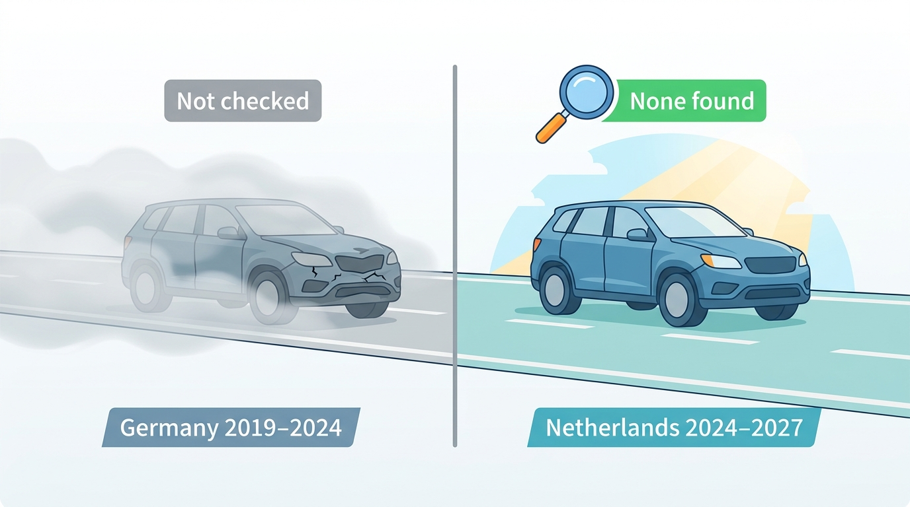
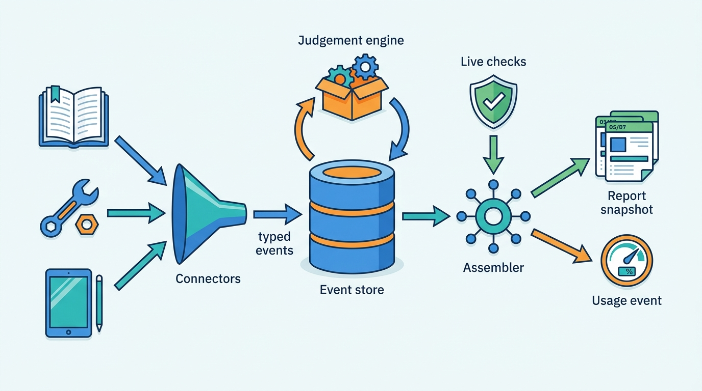
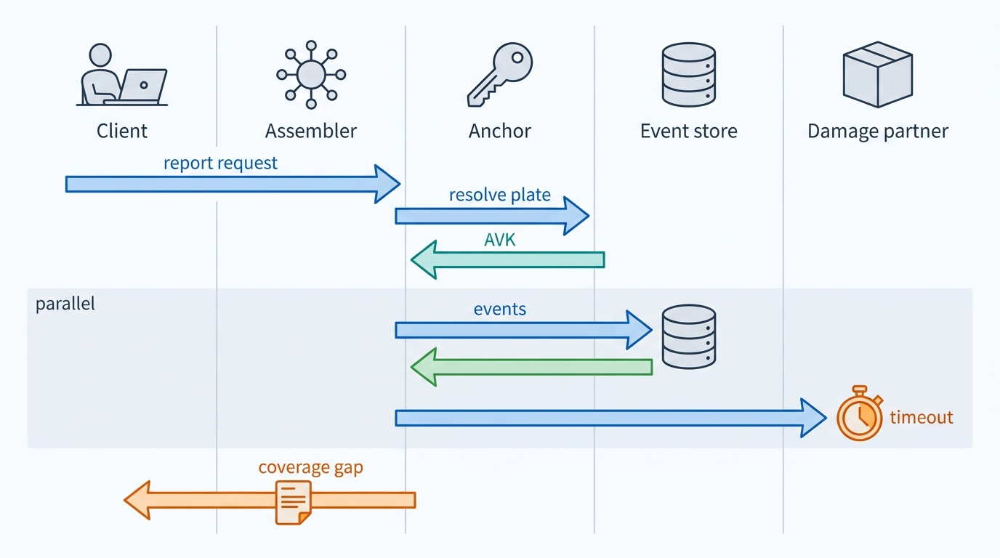
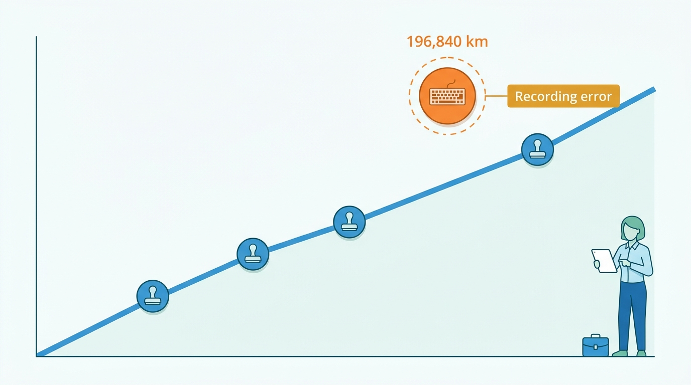

> **IN THIS CHAPTER, YOU WILL:** Take apart a vehicle history service: the event types and their sources in four markets, the history event store, the assembler that queries sources and builds a timeline, the odometer judgement and how rollback detection goes wrong, and the report as a versioned, honestly worded snapshot.

> **WHY THE BUSINESS CARES:** A history report is bought to avoid one bad decision: overpaying for a clocked, written-off or stolen car. A report that cries wolf costs a dealer a sale, and a report that reads "no damage" when it means "no data" costs a consumer money and the provider its credibility.

> **WHY ARCHITECTS SHOULD CARE:** History is the platform's most heterogeneous data. It arrives from registers, insurers, workshops, auctions, manufacturers and the platform's own dealers, each with different meaning, trust, license and delay. Its judgements feed valuations, adverts and appraisals, and how events and views are stored decides whether a correction reaches them.

> **KEY POINTS:**
>
> * **Store observations as events and compute judgements as versioned views.** A history is a log of typed, sourced, dated events per vehicle: readings, claims, brands, inspections, registrations. "Rollback suspected", "total loss" and "clean title" are judgements computed over that log by named rule versions. They are never facts typed into a column.
> * **Trust is a property of the source, and it belongs in the rules.** An official inspection reading, a manufacturer's connected-car reading, a workshop record and a dealer's appraisal entry do not carry the same weight. A rollback rule that treats them equally turns typing errors into fraud accusations. The fix is to rank sources by trust and to classify each anomaly, so a report can say "probable recording error" instead of "rollback".
> * **"No record found" is not "clean".** A report is a dated snapshot that names the sources checked, the coverage gaps and the rule versions used, and it uses the cautious wording the primary sources use themselves. Reports are stored with their inputs, so a correction can supersede them and reach the people who received them.

> **[FAILURE PATTERNS THIS CHAPTER ADDRESSES](where-vehicle-platforms-go-wrong.html):**
>
> * **Provenance Amnesia** — a rollback flag that cannot say which reading, from which source, triggered it cannot be defended to a dealer or corrected.
> * **The Sticky Error** — a wrong reading or a wrongly merged damage event lives on in issued reports, valuations and adverts unless reports are stored as snapshots with their inputs.
> * **The Cloned Identity** — history keyed by plate instead of by vehicle merges two cars' damage and odometer events into one story.

 
A vehicle history answers a buyer's question that no single source can answer: **what happened to this car before I saw it?** Registers know registrations, inspections and, in some countries, odometer readings. Insurers know claims and rarely share them. Workshops know services, manufacturers know recalls and what the connected car reports, auctions and portals know what the odometer showed on the day of sale, and the platform's own dealers know what they saw at appraisal. A history service pulls these fragments together for one vehicle into a timeline and a few judgements a buyer can act on.

The fragments disagree, have gaps and are often wrong in boring ways: a mistyped reading, miles stored as kilometers, a damage record on the wrong car because two cars shared a plate. The hard part is not collecting events. It is **deciding what the events mean, saying how sure the platform is, and correcting the story when an event turns out to be wrong**.

This chapter owns the **history event**, the **history report**, the **odometer judgement** and the **title brand**. It builds on [[vehicle-identity]], which decides which car an event belongs to, and [[registers-and-official-data]], which owns access to the registers. It hands generic ingestion and matching to [[ingestion-and-entity-resolution]], fact-level provenance to [[provenance-and-data-quality]], the consumer product to [[consumer-vehicle-checks]] and correction propagation to [[journey-data-correction]].

## Setting the Scene at Axleby: Two Complaints in One Week

Axleby, the fictional vehicle data and dealer software group this book follows (see [[meet-axleby]]), sold **3.4 million** history reports in 2026: **2.6 million** to businesses, mostly through Lotwise appraisals and the data APIs, and **0.8 million** to consumers through Odolo. All of them come from **Tracewell**, the history event store and assembler that Priya Raman's team in Utrecht runs. In the first week of March 2027 two complaints reached her desk.

The first came from **Sietse Brandsma**, who runs Autobedrijf Brandsma in Leeuwarden. A private buyer had walked away from a 2016 Volvo V60 on his forecourt after buying an Odolo report on it. The report said **"Odometer: possible rollback"**. The car was honest. Priya's team pulled the timeline:

| Date | Reading | Source | Source class |
| --- | --- | --- | --- |
| 14 May 2019 | 61,240 km | Periodic inspection (APK, *Algemene Periodieke Keuring*), via the Dutch register | Official |
| 20 May 2021 | 102,880 km | APK, via the Dutch register | Official |
| 6 June 2023 | 139,410 km | Workshop service record, via Kilometra | Commercial (workshop) |
| 22 May 2025 | 168,950 km | APK, via the Dutch register | Official |
| 11 February 2027 | **196,840 km** | Lotwise appraisal at Autobedrijf Brandsma | First-party (dealer entry) |
| 13 February 2027 | 186,950 km | Stock intake reported to the Dutch register | Official |

The appraiser had typed **196,840** for **186,840**. Two days later the register recorded 186,950 km at stock intake, 9,890 km lower. Tracewell's rule saw a later reading below an earlier one and flagged a possible rollback. The register's own judgement stayed *logisch* (logical), because the mistyped appraisal reading never reached the register. **Two judgements about the same car disagreed, and Axleby's own dealer had caused the false one.**

The second complaint came through Odolo. A consumer had bought a 2019 Peugeot 3008, imported from Germany in 2024, after an Odolo report that said **"Damage history: none"**. Her garage then found a repaired front-end impact. None of Tracewell's damage sources held a record for the car's German years, so the report was right that it had found nothing. But "none" told her there was nothing to find. Odolo refunded the report.

Priya asked for an audit of every report in the first quarter of 2027 that carried Tracewell's odometer flag. *Illustratively*, about **9,800** of the quarter's reports carried the flag, and a reviewed sample of 300 split like this:

| Cause of the flag | Share of sample |
| --- | --- |
| A single mistyped or misattributed reading from a dealer appraisal, an advert or a workshop record | 41% |
| Unit and country artifacts: miles stored as kilometers, readings across an import, replaced instruments | 18% |
| The same reading counted twice with different dates | 12% |
| A sustained step-down consistent with rollback | 29% |

So **seven in ten flags were not rollback**. Ines Marchetti, the Group Chief Architect, framed the question for the architecture forum. The question was not whether the flag should be more or less sensitive. It was this: **what may a history report claim, on what evidence, and how does the platform know and say how sure it is?**

## What a Vehicle History Is Made Of

### History events

A **history event** is one dated observation about one vehicle, from one source: "on 22 May 2025, an inspection recorded 168,950 km"; "on 3 March 2022, an insurer declared the vehicle a total loss"; "on 9 September 2024, the vehicle was first registered in the Netherlands after import from Germany". Each event has a type, a date on which it happened, a date on which the platform learned of it, a source, and a license under which the platform holds it.

Events are **observations, not conclusions**. "Odometer rolled back" is not an event; two readings are. "Accident-free" is not an event; it is a claim about the absence of events, and no source can support it. Keeping that line sharp is what lets the platform recompute its conclusions when a rule or a reading changes.

| Event type | What it asserts | Typical sources | Permanence | Volatility at decision time |
| --- | --- | --- | --- | --- |
| **Odometer reading** | A distance shown on a given date | Inspections, registers, statutory mileage registries, workshops, manufacturers, auctions, adverts, appraisals | Permanent; may be corrected | Low |
| **Inspection** | A periodic test with result, defects and reading | APK (NL), MOT (UK annual roadworthiness test), *Hauptuntersuchung* (DE) | Permanent | Low |
| **Damage or claim** | A loss, estimate, repair or damage status | Insurers, repairers, auctions, damage-data aggregators, registers' damage statuses | Permanent; often incomplete | Low |
| **Title brand or write-off** | An official or industry label on the vehicle's legal status | US state titling agencies via NMVTIS; UK insurers' write-off categories | Permanent by design | Low |
| **Theft** | Reported stolen, or recovered | Police systems, registers, commercial theft checks | Reversible | **High** |
| **Registration change** | First registration, owner change, import, export, plate change | Registers | Permanent | Medium |
| **Recall** | A campaign applies, or a remedy was done | Regulators, manufacturers, register flags | Status changes | Medium |
| **Service** | Maintenance or repair performed | Manufacturer digital service records, workshops, statutory registries | Permanent | Low |
| **Commercial observation** | Listed, appraised, auctioned, sold, with mileage and photos | The platform's own dealer SaaS, portals, auctions | Permanent | Low |

Two columns drive the architecture. **Permanence** decides storage: most history never expires. **Volatility at decision time** decides caching: theft status can change an hour before a trade-in, so the platform checks it live at the moment of decision and stores the answer with the time it was given.

### Official, commercial and first-party sources

Every event carries a **source class**, because the same kind of fact means different things depending on who recorded it and under which duty:

- **Official** sources record under a legal duty and are audited: a register, an inspection body, a statutory mileage registry such as Belgium's Car-Pass.
- **Manufacturer** sources record from the car or the franchised network: connected-car odometer transmissions, digital service books.
- **Commercial** sources record for their own business: insurers, repairers, auctions, portals, aggregators such as Axleby's fictional supplier Kilometra.
- **First-party** sources are the platform's own users: a dealer's appraisal, a stock-in, an advert's mileage field.

The ordering is a trust ranking for conflict resolution, not a moral one. First-party data matters most in practice. Carfax's 2026 information statement counted "more than 177,000" data sources at the end of 2025, of which "more than 92,000" were dealers and service shops, alongside manufacturer (OEM) certified pre-owned programs and police agencies ([Mobility Global, 2026](https://www.sec.gov/Archives/edgar/data/2090312/000110465926066592/tm2528763d9_ex99-1.htm)). A dealer platform's users are its largest and freshest source of readings, and also its least checked. Sietse's case shows the trap: **the platform's own dealers are a history source, with the error rate of people typing on a forecourt**.

### Odometer readings and odometer judgements

An **odometer reading** is an event. An **odometer judgement** is a conclusion computed over the series of readings: is the series consistent with a vehicle that was driven normally and never had its odometer turned back?

The Dutch register publishes the clearest public definition. The RDW gives three judgements for passenger cars and light commercial vehicles: *logisch* (logical), when each registered reading is higher than the one before; *onlogisch* (illogical), when a reading is lower than the one before; and *geen oordeel* (no judgement), when it has too little information. It gives "illogical" only for readings after 1 January 2014, when it took over registration from the industry's Nationale AutoPas (NAP). It withholds a judgement for imported vehicles, rebuilt vehicles with a new plate, repaired or replaced instruments, odometers that do not count to 999,999 and odometers that have rolled over to zero ([RDW, n.d.](https://www.rdw.nl/uw-voertuig-en-uw-gegevens/informatie-over-uw-voertuig/kilometerstand-controleren), translated). The register shows the judgement, not the readings. More than 30,000 recognized businesses must register readings at fixed moments: periodic inspection, stock intake, registration in a new name (*tenaamstellen*), export, fitting LPG systems or tachographs, and repair, maintenance or tire work ([RDW, n.d.](https://www.rdw.nl/over-rdw/actueel/dossiers/tellerstanden), translated).

In RDW open data on 22 October 2026, 8,261,057 registered vehicles carried "logical", 292,538 "illogical", 3,419,665 "no judgement" and 4,901,451 "not registered" ([RDW open data, queried 2026-10-22](https://opendata.rdw.nl/resource/m9d7-ebf2.json?$select=tellerstandoordeel,count(*)&$group=tellerstandoordeel)). The dataset covers every vehicle type, including vehicles no longer traded, so these counts are not a fraud rate.

The definition matters for architecture because **a judgement is a function of the readings, the rules and the moment**. Add a reading and the judgement can change. Change a rule and every judgement computed under the old rule is out of date. A platform that stores "rollback: yes" in a column has lost the ability to explain or revise it.

### Title brands

A **title brand** is a permanent label on a vehicle's legal status, such as salvage, flood, rebuilt, junk or "not actual mileage". It is a US construct: brands are applied by state titling agencies under state law. The US Department of Justice's National Motor Vehicle Title Information System (NMVTIS) pages warn that "each state has its own laws, standards, and terminology", so one state may brand a vehicle "salvage" where another does not, and that once applied a brand "becomes a permanent part of the vehicle's NMVTIS record" ([US DOJ, n.d.](https://vehiclehistory.bja.ojp.gov/nmvtis_consumers)). **Title washing**, re-titling a branded car in a state with weaker rules to obtain a clean title, exploits exactly the gap between state vocabularies.

The European equivalents are weaker and less public. In the UK, insurers classify write-offs under an industry code of practice that, as commonly reported, has used categories A and B (scrap or break for parts), S (structural damage, repairable) and N (non-structural) since 2017 ([MotorCheck, n.d.](https://www.motorcheck.co.uk/what-is-a-write-off)); the categories reach buyers through paid checks. In the Netherlands, the register has an "awaiting inspection" status (*Wacht Op Keuren*, WOK) for heavily damaged vehicles, but RDW open data withholds it for every record ([RDW open data, queried 2026-10-22](https://opendata.rdw.nl/resource/m9d7-ebf2.json?$select=wacht_op_keuren,count(*)&$group=wacht_op_keuren)). The platform's model: **store the brand as issued, with the issuing jurisdiction, code and date, and map it to a small internal vocabulary through a mapping table that can change**. Never erase a brand because a later title is clean.

### "No record found" is not "clean"

Every source that sells or publishes history says the same thing about absence. Carfax states that a report "is based only on information supplied to CARFAX. Other information about this vehicle, including problems, may not have been reported" ([Carfax, archived December 2025](https://web.archive.org/web/20251219084511/https://www.carfax.com/company/about)). The DOJ warns consumers that an NMVTIS search may return a clean history for a vehicle with unreported damage ([US DOJ, n.d.](https://vehiclehistory.bja.ojp.gov/nmvtis_consumers)). Absence is evidence only in proportion to coverage: the sources checked, the countries and years they cover, and whether they report the event type at all.

So every judgement in a history report has **at least three values**, never two: *found* (with the events), *none found in the sources checked* (with the coverage), and *not assessable* (because coverage is missing for part of the car's life, such as its years abroad). The Peugeot report needed the third value and showed the second as if it were "clean".

**Figure 1:** *Absence is evidence only where sources cover the car's life: for the imported Peugeot, 'none found' covered only the Dutch years, and the German years were not assessable.*

## Architecture: An Event Store, an Assembler and Versioned Judgements

A history service has three jobs at three speeds. **Ingestion** turns source deliveries into events, continuously or in batches. **Derivation** computes judgements over each vehicle's events whenever events or rules change. **Assembly** answers a request: it reads stored events, queries the sources that must be live, applies the judgements, and renders a report snapshot.

**Figure 2:** *Tracewell as three loops. Connectors turn deliveries into typed events, the judgement engine recomputes derived views when events or rules change, and the assembler combines stored events with live checks into a stored report snapshot and a classified usage event.*

### Components and boundaries

| Component | Responsibility | Owns | Does not own |
| --- | --- | --- | --- |
| **Source connectors** | One per source: authentication, quotas, parsing, unit normalization, mapping to event types, license class | Source contracts and raw deliveries | Which vehicle an event belongs to (Anchor decides) |
| **History event store** | Append-only events per vehicle key, with source, dates, license and corrections | History events | Person data; specification; valuations |
| **Judgement engine** | Computes odometer judgement, damage summary, brand summary and recall status from events, per rule version | Derived views and their rule versions | The register's own judgements, which it stores as events |
| **Assembler** | Serves a request: reads events, runs live checks, applies entitlement and license filters, builds the timeline | Request-time composition and the hit class | Rendering rules per product |
| **Report renderer and snapshot store** | Renders the report for a product and market, stores inputs and output under a report id | History reports | Billing; delivery to clients |

The boundary that matters most is with identity. Tracewell does not decide which car an event belongs to. Every connector resolves the source's key (a plate, a VIN, a partner id) through Anchor to the Axleby Vehicle Key (AVK), and stores the source key beside it. The Cloned Plate of 2026, when Tracewell merged a clone's damage events into the genuine car's history, was a keying failure owned by [[vehicle-identity]]. History adds one rule: **an event keyed by plate is attached to the vehicle that held that plate on the event's date**, not to today's holder of the plate.

The second boundary is with people. The event store holds **no person fields**: no keeper names, no customer of the workshop, no claimant. A plate or VIN can still be personal data for a party that can link it to its keeper; the Court of Justice of the European Union (CJEU) held in *Scania* (C-319/22, 2023) that a VIN is personal data for anyone who has the means to identify the owner ([CJEU, 2023](http://publications.europa.eu/resource/celex/62022CJ0319)). Detaching the person from the vehicle event at ingestion keeps the history useful for the vehicle's whole life and limits erasure requests to a separate, access-controlled person layer. [[privacy-and-retention]] owns that design; history's part is to never let a person field into the event schema.

### The history event

| Field | Example | Why it exists |
| --- | --- | --- |
| `event_id` | UUID | Idempotent ingestion and corrections refer to it |
| `avk` and `source_vehicle_key` | AVK; plate `XX-123-Y` on that date | Re-attach events if identity is corrected |
| `type`, `subtype` | `odometer_reading`, `inspection` | Rules select by type |
| `value` and `unit_original` | 168,950 km; `km` | Keep what the source said, as well as the normalized value |
| `occurred_on` | 2025-05-22 | Valid time: when it happened |
| `recorded_at` | 2025-05-23T04:10Z | Transaction time: when Axleby learned it |
| `source`, `source_class`, `source_ref` | Dutch register; official; register reference | Trust ranking and traceability |
| `country` | NL | Market rules, coverage, import gaps |
| `licence_class` | `register-provider`, `partner-B2B-only` | Which products may show it ([[data-licensing-and-governance]]) |
| `status` and `supersedes` | `active`, `retracted`, `corrected` | Corrections append; they never overwrite |

Valid time and transaction time make each event a **bitemporal fact** ([[provenance-and-data-quality]]): Tracewell can answer both "what happened when" and "what did we know when we issued this report", the question a dealer's lawyer asks.

### The assembler

A report request names a vehicle (by plate or VIN), a product (Lotwise appraisal summary, business report, Odolo consumer report, API response), a market, and the tenant and purpose. The assembler then works in five steps.

1. **Resolve and entitle.** Resolve the identifier to an AVK through Anchor. Ask Charter which sources and fields this tenant may see for this purpose and product. A consumer report may not show data licensed for business use only.
2. **Read and fan out.** Read stored events for the AVK. In parallel, query the sources that must be live (theft) or that are licensed per request rather than stored (some damage partners), each with its own timeout.
3. **Deduplicate and order.** Collapse events that are the same observation reported by two sources into one event with two attestations; order by `occurred_on`.
4. **Judge.** Read the current derived views, or compute them if events arrived during the request, and attach the rule versions.
5. **Classify and snapshot.** Classify the result (hit, partial, no hit, failed), render it, store the snapshot, and emit the usage event with the hit class.

**Figure 3:** *The assembler resolves the vehicle and the license first, then reads stored events and queries live sources in parallel. A source that times out becomes a stated coverage gap in the stored snapshot, not a silently shorter report.*

The fan-out is where partial failure lives. When one source times out, the assembler has three choices: wait, fail, or answer with a stated gap. Axleby's rule depends on the product. A Lotwise appraisal summary answers with the gap and refreshes when the source returns. A paid consumer report waits once and retries, then either renders with the gap stated and a lower hit class or declines and does not charge. The theft check is the one source whose failure blocks a "not stolen" statement: without it, the report says "theft status could not be checked at this time".

### Requirements per interaction

| Interaction | Consistency | Latency | Freshness | Availability |
| --- | --- | --- | --- | --- |
| Lotwise appraisal summary (dealer on the forecourt) | Read-your-writes for the dealer's own readings | p95 under 1.5 s *(assumption)* | Stored events as ingested; theft live | Degrade to stored events with gaps marked |
| Business history report | Snapshot at issue time | p95 under 8 s *(assumption)* | Partner damage per license; theft live | Retry once, then render with gaps or decline without charge |
| Odolo consumer report | Snapshot at issue time | p95 under 10 s *(assumption)* | As business report | Decline and refund rather than issue an incomplete paid report without saying so |
| JSON API history call | Snapshot; report id returned | p95 under 3 s *(assumption)* | As business report | Return explicit coverage and hit class per section |
| Register and statutory feeds into the store | Eventual; per-vehicle order by `occurred_on` | Not user-facing | Daily or event-driven *(assumption)* | Backlog with replay |
| Correction of an event | Derived views recomputed; affected reports flagged | Hours *(assumption)* | Not applicable | Must not be lost: correction log is durable |

## The Odometer Judgement in Depth

### Why the naive rule fails

The naive rule is "flag if any reading is lower than an earlier one". The RDW uses that rule for its own judgement, and for the register it works: its readings come only from recognized businesses under a legal duty, its registration screens warn the registering business about a lower or implausibly high reading before it is accepted, the RDW emails the business and then writes to the owner when an illogical reading is not corrected, and corrections run through a documented procedure ([RDW, n.d.](https://www.rdw.nl/zakelijke-partners/erkende-bedrijven/tellerstanden/tellerstand-registreren), translated). A commercial history service mixes official readings with workshop files, auction catalogs, advert fields and its own dealers' typing, with none of those controls. Apply the register's rule to that mix and every typing error becomes an accusation.

The Q1 audit showed four kinds of anomaly that the naive rule cannot tell apart:

- **The isolated outlier.** One reading sits above both neighbors, and the series is monotonic without it. Sietse's 196,840 km is the type case. It is almost always a recording error, and it is usually a lower-trust source.
- **The unit artifact.** A reading in miles stored as kilometers is about 0.62 of the true value; the reverse is 1.61 times. The ratio to the neighboring readings gives it away. The Odometer Correction of May 2027, in which a Kilometra batch recorded miles as kilometers for **2,870** UK-imported vehicles, is this pattern at batch scale ([[journey-data-correction]]).
- **The country hop.** The last reading abroad is higher than the first reading at home. This is the most common real rollback pattern for imports, and the most likely to be missed when the foreign readings are absent.
- **The sustained step-down.** Readings fall and the following readings continue from the lower value, from independent sources. That is what rollback looks like.

The country hop is now visible in public data. Since **13 January 2025** the RDW has taken over Belgian readings into the Dutch register, and since **3 February 2026** German readings; a German import whose series is not ascending gets the judgement "illogical" ([RDW, January 2026](https://www.rdw.nl/nieuws/2026/rdw-neemt-ook-duitse-tellerstanden-op-in-kentekenregister), translated). In July 2026 the RDW reported that at the start of the year **92%** of illogical readings on German imports arose between the last German registration and the first Dutch one, and that the share had since fallen to **60%**, which it attributed to rollback before import becoming visible at registration ([RDW, July 2026](https://www.rdw.nl/over-rdw/nieuws/2026/positief-effect-van-duitse-tellerstanden-in-kentekenregister), translated).

### A classifying rule, versioned

Tracewell's odometer judgement v2 (rule version `odo-2.0`, live from July 2027) replaces "flag any decrease" with a classification. Its steps are reference-architecture design, not any real provider's method:

1. **Normalize and keep the original.** Convert every reading to kilometers; keep `unit_original`. Flag a reading whose ratio to both neighbors is within 3% of 1.609 or 0.621 as *unit suspect*.
2. **Collapse duplicates.** Readings with the same value within three days from different sources become one observation with several attestations. A reading attested by two independent sources outranks either alone.
3. **Segment at known breaks.** Instrument replacement, rollover and re-plating after rebuild start a new segment, with the gap stated.
4. **Classify each decrease.** For every reading lower than its predecessor beyond a tolerance, test in order: unit suspect; isolated outlier (removing one reading makes the segment monotonic and that reading has lower trust than its neighbors); country hop (the decrease spans an import); otherwise sustained step-down.
5. **Check plausibility of use.** Flag implied distances per day above an illustrative 600 km for passenger cars as implausible, a sign of a mistyped reading rather than rollback.
6. **Emit a judgement with evidence.** The state, the readings that caused it, their sources, the rule version and the coverage.

**Figure 4:** *The odometer judgement as states. Every transition is driven by a new or corrected event, or by a new rule version, so the judgement can always be recomputed and explained.*

Run on Sietse's Volvo, `odo-2.0` sees one decrease. Removing the 11 February reading makes the series monotonic, and that reading is a first-party dealer entry sitting between two official readings. The decrease is classified as an isolated outlier. The judgement becomes *recording error suspected* in one dealer-entered reading, which is excluded from the series, and the consumer wording becomes: "Readings are consistent. One dealer-entered reading (11 February 2027) appears to be mistyped and was not used." The register's own judgement, *logical*, appears beside it, labeled as the register's.

**Figure 5:** *One mistyped dealer reading of 196,840 km sat above the official readings around it; removing it leaves an ascending series, so the classifying rule calls it a recording error, not a rollback.*

Two more changes closed the loop. Lotwise now checks a dealer's reading against the latest stored reading at entry and asks the appraiser to confirm a lower or implausibly high value, the register's own control moved to the point of entry. And because every derived view carries its rule version, moving from `odo-1` to `odo-2.0` recomputed all judgements and listed the reports issued under `odo-1` whose judgement changed.

### Showing two judgements

**The platform's judgement never replaces the register's.** Where the register publishes a judgement (the Netherlands), the report shows it as the register's, beside Tracewell's own signal, and explains any difference in plain language. The register's judgement carries legal and market weight; the RDW offers holders a free vehicle report to show buyers. Tracewell's signal adds what the register cannot see: workshop, auction and dealer readings, and readings from before import. Where there is no official judgement (Germany, the UK, most of the US), Tracewell's signal is the only one, and the report says so.

The judgement also feeds other contexts. Vantage takes the current odometer from Tracewell's derived view, not from the dealer's entry, and lowers its valuation confidence when the judgement is *rollback suspected* or *not assessable* ([[valuation-engine]]). The Lotwise dossier shows the judgement next to the stock record ([[inventory-and-vehicle-dossier]]). Both subscribe to judgement-change events, which is how a corrected judgement reaches them ([[events-webhooks-and-sync]]).

## Reports: Snapshots, Wording and Who Pays

### A report is a dated snapshot

A **history report** is a rendered, dated snapshot of a vehicle's events and judgements for one product, market and requester. Tracewell stores each one with a report id, the event ids and versions used, the rule versions, the coverage statement, the timestamped live-check responses and the rendered output. The inputs are event references, not copies, so even 3.4 million reports a year stay small. The store buys three things:

- **Defensibility.** A dealer can show a buyer, or a court, exactly what the platform knew at sale time.
- **Correction reach.** When an event is corrected, the store can list every report that used it. The Odometer Correction put wrong mileage into **412** history reports, **96** of them to consumers; finding them was a query over snapshot inputs, not a search through logs ([[journey-data-correction]]).
- **Supersession.** A corrected report is a new version with a link to the old one, never an edit in place. The holder of the old version is told; the old version stays retrievable.

### Wording is part of the architecture

The Peugeot complaint was a rendering bug with a data-model cause: the renderer had two states and the truth had three. Axleby now keeps a wording table per section and market, reviewed by Femke de Boer's governance team, and the renderer cannot emit a section without a coverage statement.

| State | Wording that is wrong | Wording Axleby uses |
| --- | --- | --- |
| Events found | "Accident car" | "2 damage records found" with date, type and source of each |
| None found, coverage good | "No damage" or "Accident-free" | "No damage records found in the sources checked for 2019–2027" |
| None found, coverage partial | "Damage history: none" | "No damage records found for 2024–2027 in the Netherlands. Damage before import (Germany, 2019–2024) could not be checked." |
| Source failed | (section omitted) | "Damage sources could not be checked at this time" |
| Rollback suspected | "Odometer fraud" | "Readings decrease between 14 March 2023 and 2 June 2024; possible odometer manipulation" |

The cautious phrasing copies the sources. Carfax's "based only on information supplied" and its reminder that problems "may not have been reported" are the model. So is the AutoCheck score's instruction to read a score against its range for similar vehicles: Experian's example is that 84 inside a 73–86 range "is actually better than" 89 below a 90–95 range ([Experian, 2025](https://www.experian.com/content/dam/marketing/na/automotive/pdf/experian_autocheck_score.pdf)). A derived score without its cohort misleads in the same way a "none" without its coverage does.

### Liability: what the market already promises

History providers that sell to consumers back specific promises, and the promises are narrow. Carfax's Buyback Guarantee applies "if the CARFAX Report fails to include a DMV-issued branded title (such as salvage, fire or flood damage, and odometer problems)" ([Carfax, archived December 2025](https://web.archive.org/web/20251219084511/https://www.carfax.com/company/about)). It covers missed official brands, not unreported accidents. HPI's UK consumer check carries a guarantee of up to £30,000 if a buyer loses money because of inaccurate data ([HPI, n.d.](https://www.home.hpicheck.com/)). The pattern is consistent: **providers guarantee what their sources make verifiable and disclaim what their sources cannot see**. Coverage claims also get litigated: in 2009 an Ohio appeals court overturned a class-action settlement over allegations that Carfax represented its reports as based on complete accident data ([Public Citizen, 2009](https://www.citizen.org/news/ohio-appeals-court-rejects-class-action-settlement-with-carfax-agrees-with-public-citizens-objections/)); the evidence is over fifteen years old.

The architectural consequence is that **the guarantee must be computable**. If Odolo promises anything about odometer readings, the snapshot must record which readings, from which sources, supported the statement. Then a claim can be judged against what the report said, not against what the platform knows today.

### No-hit-no-fee

Axleby applies **no-hit-no-fee** to history calls: the client does not pay for an empty answer. Documented equivalents exist. A Belgian Car-Pass is free when fewer than four readings exist ([Car-Pass, n.d.](https://www.car-pass.be/en/faq)), and autoDNA offers a free check of which data types exist for a VIN before purchase ([autoDNA, n.d.](https://www.autodna.com/)). The hard part is defining "hit" for a report with several sections. Tracewell classifies every assembly:

| Hit class | Definition at Axleby | Billable for a business report |
| --- | --- | --- |
| **Hit** | At least one event beyond the basic register facts, in a section the product sells | Yes |
| **Partial** | Some sections answered, at least one paid section unavailable because a source failed | Yes, with the gap stated; credit on request *(policy choice)* |
| **No hit** | Vehicle resolved, no events beyond basic register facts in any sold section | No |
| **Failed** | Vehicle not resolved, or the assembly failed | No |

The class is decided once, in the assembler, and travels with the usage event to Meterline. The No-Hit Credit of 2026, in which Connect XML and JSON API v1 implemented the rule differently and Axleby credited **€186,000** to **41** API clients, is what happens when each channel decides for itself ([[billing-and-metering]]).

## Failure Handling

| Failure | How it shows up | Detection | Recovery |
| --- | --- | --- | --- |
| **Duplicate events** | The same reading or claim arrives from a register and an aggregator, or twice from one source with different dates | Dedup key (AVK, type, value, date window); per-source idempotency on `source_ref` | Collapse into one event with several attestations; never count twice in a rule |
| **Event on the wrong vehicle** | Clone or mis-keyed plate attaches another car's damage | Implausible series (two mileage tracks, two colors, two locations); identity split in Anchor | Re-attach events to the corrected AVK; recompute views; supersede affected reports |
| **Conflicting events** | Register says "logical", Tracewell says "rollback suspected"; insurer total loss, later clean registration | Disagreement checks between official and derived judgements | Show both with sources; never overwrite an official event; brands stay permanent |
| **Incomplete history** | Import with no foreign readings; source covers only some years | Coverage map per source and country | State the gap; judgement "not assessable" for that period |
| **Unit or format error in a batch** | Readings off by a factor of 1.609 across many cars from one delivery | Ratio checks against neighbors; per-batch anomaly rate | Quarantine the batch; retract its events; recompute and supersede |
| **Retries and late arrivals** | A source redelivers, or an older reading arrives after a report | `recorded_at` after report time | Events are idempotent; judgements recompute; reports are superseded only when a judgement changed |
| **Partial failure in fan-out** | One live source times out | Per-source timeout and error metrics | Retry once; render with stated gap or decline; hit class reflects it |
| **Source outage or expired credentials** | A supplier's feed stops; an API key is revoked after 90 days unused, as the UK MOT history API does | Freshness SLO per source; credential-expiry monitoring | Serve stored events with gaps marked; never imply recency the store does not have |
| **Correction from the register** | The RDW corrects an earlier reading after a documented request, within ten working days of approval | Register mutation feed | Append a correction event; recompute; supersede affected reports |

Two design notes. **Theft is never served from cache**; the report states the time of the live check. And **source outages are where Borrowed Uptime enters history**: a report path that calls six sources synchronously is only as available as all six together. Stored events always answer, and live sources only add to them ([[reliability-and-dependencies]]).

## Trade-offs

The central choice is where history lives: fetched per request from each source, stored as events, or a mix.

| Approach | Strengths | Weaknesses | Right when |
| --- | --- | --- | --- |
| **Pass-through assembly** (query every source per request, store only the report) | Freshest; simplest licensing; no long-term storage of licensed data | Availability is the product of all sources; cost per report includes every upstream call; no cross-source judgement over time; corrections cannot be traced | A small product reselling one or two sources |
| **Event store** (ingest and store every event) | Judgements over the whole life; fast; survives outages; corrections and supersession possible | Needs storage rights for every source; ingestion and matching cost; risk of serving stale volatile facts | Sources that license storage; the platform's own first-party data; long-lived judgements |
| **Hybrid** (store what the license allows; query live what is volatile or licensed per call) | Matches each source's license and volatility; stored events answer during outages | Two code paths; coverage and hit class must merge both; harder to test | Most multi-source history services, Axleby included |

A second choice is whose judgement to show.

| Option | Strengths | Weaknesses | Right when |
| --- | --- | --- | --- |
| **Register judgement only** | Authoritative; legally recognized; no false accusations from the platform | Blind to commercial, foreign and first-party readings; not available outside NL | Products that must not add interpretation |
| **Own judgement only** | Uses all readings; works in every market | Competes with the register's; its errors are the platform's | Markets without an official judgement |
| **Both, labeled** | Combines authority and coverage; differences are explained | More complex wording; needs governance of disagreements | Markets with an official judgement and rich commercial data |

My recommendation for a group like Axleby is the hybrid store and both judgements, labeled. The requirement behind it is that the platform must be able to explain any statement on any report it has issued, for the life of the vehicle. Pass-through assembly cannot meet that requirement, and a store without rule versions cannot meet it after the first rule change. The recommendation does not hold for a single-market reseller of one licensed source. There the source's own report, with its own wording and liability, is the honest product.

## Across Markets: What Changes by Country

| Topic | Netherlands / Belgium | Germany | United Kingdom | United States |
| --- | --- | --- | --- | --- |
| **Official odometer record** | NL: RDW, mandatory registration since 1 January 2014; takes over Belgian (2025) and German (2026) readings for imports. BE: Car-Pass under the law of 11 June 2004; 345.5 million readings received in 2025 | Readings registered and checked in a way the RDW considers comparable (2026); no buyer-facing check found | MOT test readings, public per plate through the Driver and Vehicle Standards Agency (DVSA) | Odometer disclosure on title at transfer (49 CFR 580.5); NMVTIS holds title odometer readings |
| **Buyer-facing odometer document** | NL: register judgement per plate, free vehicle report for the holder. BE: Car-Pass mandatory at sale to a private buyer, €11.10, free under four readings | None | Free MOT history by plate | Disclosure statement on title; exempt after 20 years for model year 2011 and later (49 CFR 580.17) |
| **Damage and total loss** | Mostly commercial and incomplete; register damage status (WOK) not in open data | Insurance notices in the central register (ZFZR); no public damage history found | Insurer write-off categories via paid checks | Title brands from states; insurers report total losses to NMVTIS monthly |
| **Theft** | NL: in paid business register access, not in open data | Theft notices in ZFZR | Police National Computer via commercial checks | Sometimes in NMVTIS reports; commercial checks |
| **Recalls** | NL: open-recall indicator per plate in open data | No public per-vehicle recall flag found in this research | MOT history may show recalls | OEM VIN lookup free for 15 years (49 CFR 573.15) |
| **Main history gap** | Imports: years abroad | No odometer register for buyers; damage data commercial | Write-off and finance data behind paid checks | Unreported accidents; state brand vocabularies differ |
| **Report expectation** | NL buyers expect the register's judgement; BE buyers expect a Car-Pass | Commercial reports; dealer warranties | Finance, write-off and theft checks with guarantee | Title brands, accident records, a history score |

Sources beyond those cited above: Car-Pass ([n.d.](https://www.car-pass.be/en)); KBA ([n.d.](https://www.kba.de/DE/Themen/ZentraleRegister/ZFZR/zfzr_node.html)); DVSA ([n.d.](https://documentation.history.mot.api.gov.uk/)); eCFR 49 CFR [580.5](https://www.ecfr.gov/current/title-49/subtitle-B/chapter-V/part-580/section-580.5), [580.17](https://www.ecfr.gov/current/title-49/subtitle-B/chapter-V/part-580/section-580.17) and [573.15](https://www.ecfr.gov/current/title-49/subtitle-B/chapter-V/part-573/section-573.15); NMVTIS ([n.d.](https://vehiclehistory.bja.ojp.gov/nmvtis/nmvtis_who_report)); RDW paid access ([n.d.](https://www.rdw.nl/over-rdw/dienstverlening/betaald-toegang-tot-ongevoelige-kentekengegevens)).

Belgium and the Netherlands are the only two countries a 2017 study for the European Parliament found that oblige sellers to give buyers a certificate from a national mileage registry ([European Parliament, 2017](https://www.car-pass.be/public/files/IPOL_STU2017602012_EN.pdf)). It also reported Car-Pass data showing manipulation of Belgian cars falling from 8.6% in 2006 to 0.2% two years later: old figures, but still the best public evidence that a reporting duty changes behavior. The Council's compromise text of November 2025 on the roadworthiness revision would require member states to record readings at periodic inspections and when authorized repairers service passenger cars and vans, and would require manufacturers to transmit connected-car readings every three months ([Council of the EU, 2025](https://data.consilium.europa.eu/doc/document/ST-15613-2025-INIT/en/pdf)). The text gives access to the registration-certificate holder and authorities, not to buyers or data companies. The final text was not public when this chapter was written.

The judgement: **the event model, the store, the judgement engine and the snapshot discipline are common**. What differs by market is the set of connectors, the brand and write-off vocabularies, the trust ranking (an official register reading in the Netherlands, a title disclosure in the US), whether an official judgement exists to show beside the platform's own, and the wording table. These belong in market adapters and per-market rule sets, configured rather than coded. One difference is commercial: in Belgium the statutory certificate covers domestic mileage, so a paid product there sells damage and foreign coverage.

## The Chief Architect's View

**Decide what history is for, per product.** A lane-side appraisal summary, a business report, a consumer report and an API response share events and judgements but not wording, latency or failure policy. I would make the product a parameter of the assembler and the renderer, and keep one event store and one judgement engine.

**Govern the rules like a model.** Odometer and damage judgements are classifiers whose false positives and negatives cost money. They need an owner (Priya Raman at Axleby), versioning, a back-test against a labeled sample like the Q1 2027 audit, and a release that lists the reports a rule change would have changed. The data product owner proposes rules, the governance team (Femke de Boer) approves wording, and the architecture forum approves event-schema changes and any person field.

**Treat first-party data as a source with a contract.** The platform's own dealers produce more readings than any partner. Their readings need entry-time validation, a source class, and a way for a dealer to correct their own mistake. Otherwise the workflow half quietly pollutes the data half.

**Watch three numbers.** The share of judgements that change on recomputation, the flag rate per source class, and the share of reports issued with a coverage gap. A rising first is an unstable rule. A first-party flag rate above the official one is an entry-validation problem. A rising third is a source failing quietly.

**Plan for the sources that are coming.** If the EU roadworthiness revision passes as the Council proposed, quarterly manufacturer readings and repairer readings in national registers become a large, high-trust source, reached through registers and the EU Data Act rather than bilateral deals ([[connected-vehicle-data]]). An event model with source classes and trust rankings absorbs that; a column called `last_mileage` does not.

## Questions to Ask

1. Is every history fact stored as a dated, sourced event, or are some only stored as a judgement or a flag?
2. Can you name the rule version that produced each judgement on a report you issued last year, and recompute it?
3. How does your platform tell a mistyped reading, a unit error, an import gap and a rollback apart, and what does the report say in each case?
4. Where your market has an official judgement, do you show it beside yours, and what happens when they disagree?
5. Does every report section state the sources checked and the periods and countries not covered?
6. When an event is corrected, can you list every report, valuation and advert that used it, and who received them?
7. Which facts are checked live at decision time, and what does the report say when that check fails?
8. Is there any person field in your history event schema, and who approves adding one?

A history is only as good as the matching that attaches each event to the right vehicle. Registers, suppliers, partners and dealers deliver events keyed by plates, VINs, partner ids and free text, on different schedules. The next chapter, [[ingestion-and-entity-resolution]], takes up how those deliveries enter the platform, are validated, quarantined and reconciled, and become one record per vehicle.

## Sources and Evidence

**Company, product and investor sources**

- [About CARFAX (archived copy)](https://web.archive.org/web/20251219084511/https://www.carfax.com/company/about), Carfax, archived December 2025 — report limits ("based only on information supplied"), Buyback Guarantee scope. Carfax is part of Mobility Global Inc. as of 2026.
- [Mobility Global Information Statement (Exhibit 99.1 to Form 10/A)](https://www.sec.gov/Archives/edgar/data/2090312/000110465926066592/tm2528763d9_ex99-1.htm), Mobility Global Inc. / SEC, 2026 — Carfax data sources at 31 December 2025, including dealers and service shops as contributors.
- [What is the Experian AutoCheck Score?](https://www.experian.com/content/dam/marketing/na/automotive/pdf/experian_autocheck_score.pdf), Experian, 2025 — score scale and reading a score against its similar-vehicle range.
- [HPI Check](https://www.home.hpicheck.com/), HPI, n.d., accessed 2026-10 — UK check contents and guarantee up to £30,000.
- [autoDNA](https://www.autodna.com/), autoDNA, n.d., accessed 2026-10 — free pre-check of available data types.
- [Car-Pass](https://www.car-pass.be/en) and [Car-Pass FAQ](https://www.car-pass.be/en/faq), Car-Pass vzw, n.d. (2025 figures), accessed 2026-10 — legal basis, reporting parties, price, free under four readings, 2025 volumes.

**Standards, regulation and official documentation**

- [Kilometerstand controleren](https://www.rdw.nl/uw-voertuig-en-uw-gegevens/informatie-over-uw-voertuig/kilometerstand-controleren), RDW, n.d., accessed 2026-10 — definitions of the three judgements and the reasons for "no judgement" (translated).
- [RDW registreert kilometerstanden](https://www.rdw.nl/over-rdw/actueel/dossiers/tellerstanden), RDW, n.d., accessed 2026-10 — registration moments, more than 30,000 recognized businesses, Belgian and German readings (translated).
- [Tellerstand registreren](https://www.rdw.nl/zakelijke-partners/erkende-bedrijven/tellerstanden/tellerstand-registreren) and [Tellerstand corrigeren](https://www.rdw.nl/zakelijke-partners/erkende-bedrijven/tellerstanden/tellerstand-corrigeren), RDW, n.d., accessed 2026-10 — entry-time warnings, owner letters, correction within ten working days (translated).
- [RDW neemt ook Duitse tellerstanden op in kentekenregister](https://www.rdw.nl/nieuws/2026/rdw-neemt-ook-duitse-tellerstanden-op-in-kentekenregister), RDW, January 2026 — German readings from 3 February 2026 (translated).
- [Positief effect van Duitse tellerstanden in kentekenregister](https://www.rdw.nl/over-rdw/nieuws/2026/positief-effect-van-duitse-tellerstanden-in-kentekenregister), RDW, July 2026 — 92% to 60% share of illogical German-import readings arising at import (translated).
- [Open Data RDW: Gekentekende voertuigen](https://opendata.rdw.nl/api/views/m9d7-ebf2.json), RDW, queried 2026-10-22 — judgement counts, withheld WOK status, open-recall indicator.
- [Betaald toegang tot ongevoelige kentekengegevens](https://www.rdw.nl/over-rdw/dienstverlening/betaald-toegang-tot-ongevoelige-kentekengegevens), RDW, n.d., accessed 2026-10 — theft status in paid access, not in open data.
- [NMVTIS for consumers](https://vehiclehistory.bja.ojp.gov/nmvtis_consumers) and [Who must report to NMVTIS](https://vehiclehistory.bja.ojp.gov/nmvtis/nmvtis_who_report), US DOJ / BJA, n.d., accessed 2026-10 — state brand vocabularies, permanence of brands, reporting duties, limits of a clean result.
- [49 CFR 580.5](https://www.ecfr.gov/current/title-49/subtitle-B/chapter-V/part-580/section-580.5) and [580.17](https://www.ecfr.gov/current/title-49/subtitle-B/chapter-V/part-580/section-580.17), eCFR / NHTSA, current text (amended 2019), accessed 2026-10 — odometer disclosure at transfer and the 20-year exemption.
- [49 CFR 573.15](https://www.ecfr.gov/current/title-49/subtitle-B/chapter-V/part-573/section-573.15), eCFR / NHTSA, current text, accessed 2026-10 — free VIN recall lookup.
- [MOT history API documentation](https://documentation.history.mot.api.gov.uk/), DVSA, n.d., accessed 2026-10 — coverage, quotas and key revocation.
- [Zentrales Fahrzeugregister](https://www.kba.de/DE/Themen/ZentraleRegister/ZFZR/zfzr_node.html), Kraftfahrt-Bundesamt, n.d., accessed 2026-10 — insurance and theft notices in the German register (translated).
- [Judgment in C-319/22, *Gesamtverband Autoteile-Handel v Scania*](http://publications.europa.eu/resource/celex/62022CJ0319), CJEU, 2023 — VIN as personal data for parties able to identify the owner.
- [Council note 15613/25 on the roadworthiness revision](https://data.consilium.europa.eu/doc/document/ST-15613-2025-INIT/en/pdf), Council of the EU, 2025 — proposed odometer recording and manufacturer transmission every three months.

**Research and practitioner sources**

- [Odometer tampering: measures to prevent it](https://www.car-pass.be/public/files/IPOL_STU2017602012_EN.pdf), European Parliament (TRT for the TRAN committee), 2017 — certificate obligations in BE and NL, Car-Pass effect, NAP history; evidence over three years old.
- [What is a write-off?](https://www.motorcheck.co.uk/what-is-a-write-off), MotorCheck, n.d. — UK write-off categories since 2017 (secondary source).
- [Ohio appeals court rejects class-action settlement with Carfax](https://www.citizen.org/news/ohio-appeals-court-rejects-class-action-settlement-with-carfax-agrees-with-public-citizens-objections/), Public Citizen, 2009 — accuracy litigation over coverage claims; evidence over fifteen years old.

Axleby is fictional; architectural recommendations, labeled inferences and labeled assumptions are the author's judgement.
