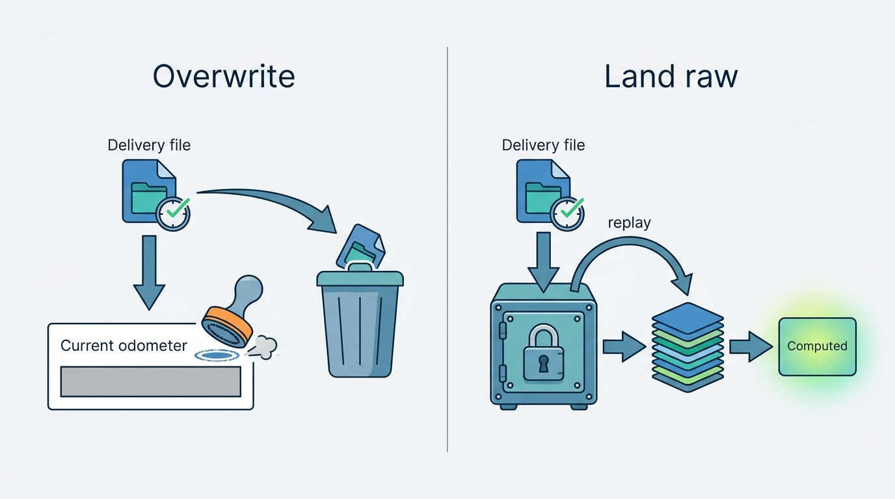
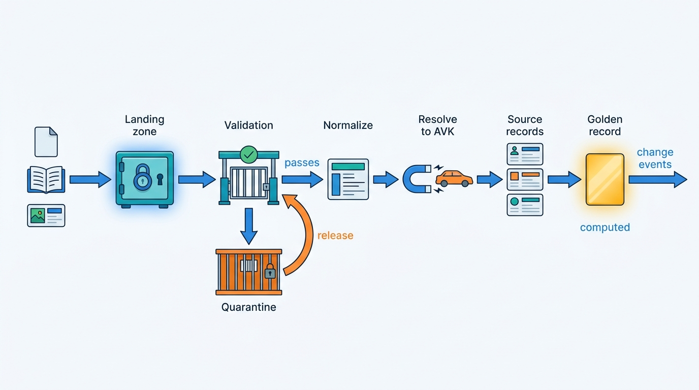
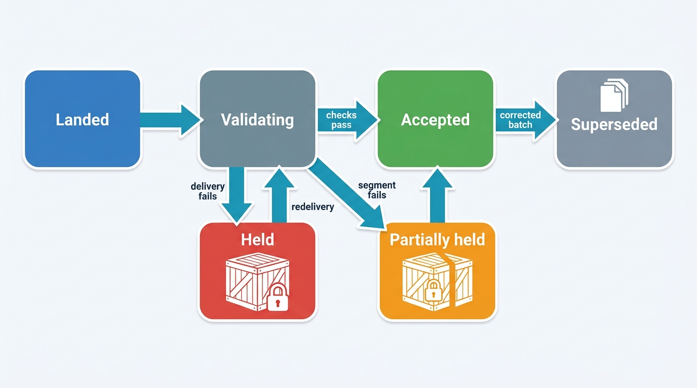
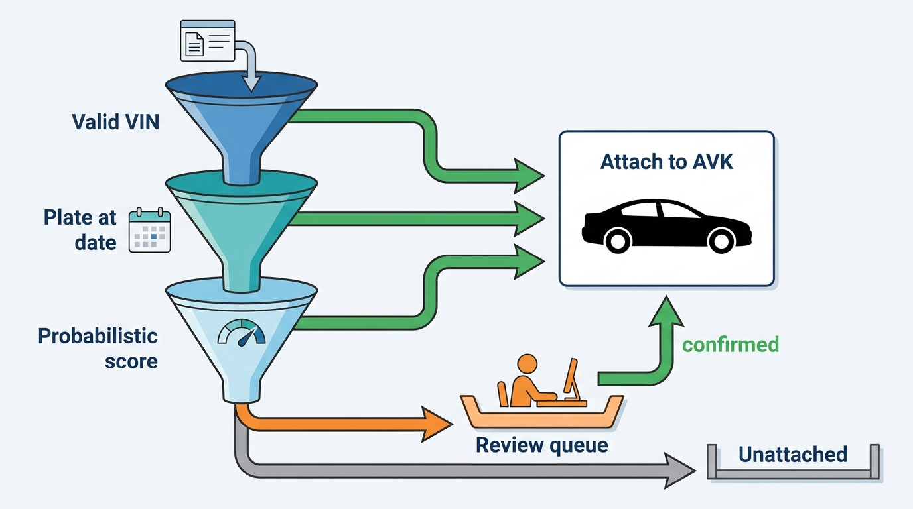
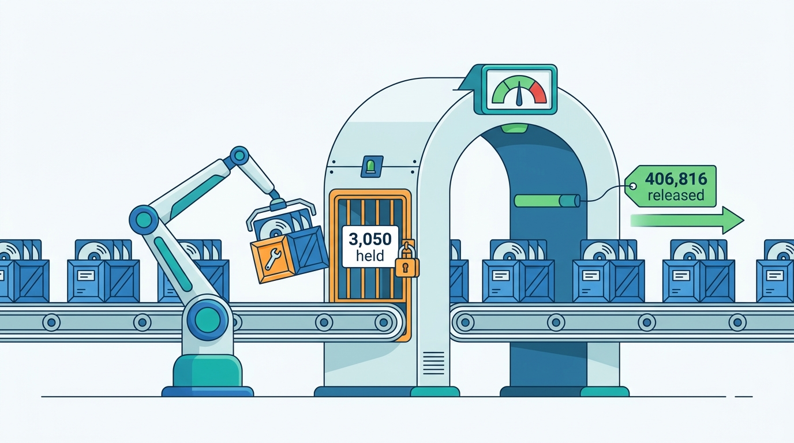

> **IN THIS CHAPTER, YOU WILL:** Follow vehicle data from a register change, a supplier file, a harvested advert or a dealer's stock entry to one resolved record per vehicle. You will compare batch and event-driven ingestion against explicit requirements, and see how landing, quarantine, normalization, entity resolution and survivorship rules fit together.

> **WHY THE BUSINESS CARES:** A valuation, a history report and an advert are only as right as the record beneath them. One supplier batch with the wrong unit can reach thousands of valuations and adverts before anyone notices; the cost of that correction falls on the dealer's trust and on the data client's contract.

> **WHY ARCHITECTS SHOULD CARE:** Ingestion decides three things that are expensive to change later: which identifier every record is keyed by, whether a bad load can be replayed or only patched, and whether the "current" value of a fact is computed from evidence or simply the last thing written.

> **KEY POINTS:**
>
> * **Choose the ingestion mode per source, from requirements.** Freshness, volume, cost and replay decide it, not architectural fashion. A product cannot be fresher than its source, most vehicle-data suppliers publish batches, and streaming a nightly file buys nothing. Stream what changes inside the platform, take batches as batches, and turn every accepted record into the same change event at the landing boundary.
> * **Land raw, validate at the door, and quarantine instead of dropping or passing.** An immutable landing zone with batch manifests makes every load idempotent and every correction a replay. Contracts that check plausibility (units, jumps, volumes), not only schema, stop a wrong batch at the gate instead of in a dealer's advert.
> * **The golden record is a view, not a table you overwrite.** Keep every source's record and every match decision, resolve vehicles by VIN first and probabilistically only where the VIN is missing, and compute the current value of each attribute with explicit, versioned survivorship rules that can be re-run when a rule or a source changes.

> **[FAILURE PATTERNS THIS CHAPTER ADDRESSES](where-vehicle-platforms-go-wrong.html):**
>
> * **The Sticky Error** — a load that overwrites the current value in place leaves nothing to replay, so a wrong batch can only be patched, and the patch never reaches every copy.
> * **The Cloned Identity** — records matched by plate instead of VIN or plate-at-date fuse two cars or split one, and every downstream report inherits the merge.
> * **Provenance Amnesia** — rows landed without batch, source record id and observation date cannot be traced, held or reversed when a source turns out to be wrong.

 
A vehicle platform does not own most of the facts it sells. The register says when a car was first registered; a workshop aggregator says what its odometer showed in March; an insurer says it was damaged; a portal says it was advertised and then removed; a dealer says it has a panoramic roof. Each source names the car its own way, publishes on its own schedule and is wrong in its own way.

**Ingestion** is how those facts enter the platform; **entity resolution** is how the platform decides which physical car each fact is about; **survivorship** is how it decides, attribute by attribute, which fact to believe. Together they turn many partial, late and sometimes contradictory records into one record per vehicle that valuations, history reports, adverts and API clients can read.

This chapter owns the **ingestion pipeline**, **quarantine**, the **survivorship rule** and the **golden record**. It builds on [[vehicle-identity]], which owns the VIN, the plate assignment and the identity graph, and on [[vehicle-history]], which owns the history event. It hands the provenance envelope, freshness service level objectives (SLOs) and data contracts to [[provenance-and-data-quality]], and the full correction workflow to [[journey-data-correction]].

## Setting the Scene at Axleby: The File That Arrived on Time

Axleby, the fictional vehicle data and dealer software group this book follows (see [[meet-axleby]]), held its post-incident review of **the Odometer Correction** in June 2027. In May, a nightly batch from **Kilometra**, a fictional odometer and service-record supplier, had recorded miles as kilometers for **2,870** UK-imported vehicles. The batch was corrected **11 days** later. By then **6,140** valuations, **412** history reports (**96** of them to consumers) and **1,180** live adverts carried the wrong mileage. [[journey-data-correction]] follows that error outward through every product; this chapter takes the other direction and asks how it got in.

The facts on the table were plain. Kilometra's file arrives at about 02:10 Central European Time (CET) every night with about **410,000** readings, of which about **34,000** concern UK-imported vehicles. Tracewell, Axleby's history event store, loaded it in about 40 minutes. Its loader checked the file's schema, which was correct: the `reading_value` column held integers and the `unit` column held `km`. It then upserted each reading into a per-vehicle table and set the vehicle's current odometer to **the newest reading by date**. Vantage, the valuation engine, read that current value in the 03:00 restock run. No step compared a reading with the vehicle's earlier readings. No step kept the file as received.

In the same week, Axleby's register mutation feed, the Dutch registration, inspection and status changes that Turnstile, the register gateway, derives each morning by diffing the register's daily open-data snapshots ([[registers-and-official-data]]), had carried about **95,000** change events a working day, ordered per plate, gap-checked and without error. Hendrik Maes, Head of Partner Integrations, proposed the obvious remedy: buy a push event feed from Kilometra, quoted at **€95,000 a year**, and treat it like the register feed.

Priya Raman, VP Data and Valuation, asked the question that turned the review: **was the file late?** It had arrived on time every night for three years. The error was in what the platform did with what arrived: it trusted the schema, overwrote, and threw the evidence away. A push feed would have delivered the same wrong unit faster, with no file to hold.

**Figure 1:** *The Kilometra file arrived on time; the damage came from overwriting the current value and discarding the file, which left nothing to hold or replay.*

Ines Marchetti, Group Chief Architect, wrote the question for the architecture forum: **how should data enter the platform, be validated and reconciled, and become one record per vehicle, so that a wrong source is stopped at the door or, failing that, reversed by replay rather than patched by hand?** Her answer became **Inlet**, Axleby's shared ingestion pipeline, specified in July 2027 as part of the first year of the One Dossier program.

## Six Ways Vehicle Data Arrives

Sources differ less in format than in **shape**: whether they publish snapshots or changes, whether they carry a VIN, and whether they can be asked again.

| Source type | Axleby example | Arrival shape | Identifier carried | Typical trouble |
| --- | --- | --- | --- | --- |
| **Register mutation feed** | Dutch register changes that Turnstile derives from daily snapshots; UK MOT (annual roadworthiness test) daily deltas | Change events, ordered per plate, at the source's daily rhythm | Plate; registration dates | A missed or partial snapshot; changes between two snapshots are invisible |
| **Register bulk data** | The Dutch register's open dataset of registered vehicles | Full dataset, refreshed by the publisher | Plate; no VIN | No guarantee of availability or currency; schema changes without notice |
| **Partner files** | Kilometra readings; insurer damage files | Nightly or weekly files, full or delta | VIN usually; sometimes only a foreign plate | Semantic drift (units, codes), duplicates, truncated files |
| **Partner APIs on demand** | Build data per VIN for Specbook (about **€0.46** a request); UK MOT history by plate or VIN | Request and response | VIN or plate in the request | Per-call cost, quotas, outages; license limits on caching |
| **Adverts** | Pulse: about **2.3 million** harvested or portal-fed adverts a day | Daily snapshots or portal feeds | Often no VIN; plate sometimes masked | Duplicates across portals; dealer-typed specifications |
| **Dealer and user input** | Lotwise stock-ins (**1.9 million** a year), DMS stock exports, dealer corrections, Odolo complaints | Interactive writes; periodic DMS files | Plate typed or scanned; VIN when the dealer has it | Typos; options claimed, not evidenced |

Connected-vehicle data from manufacturers is a seventh shape, high-volume and consent-bound; [[connected-vehicle-data]] owns it. Market data harvesting and its legal limits belong to [[market-data]]; this chapter covers only how adverts are matched to vehicles.

Two properties of this table drive the rest of the chapter. First, **only sources queried by VIN reliably carry one**: build data always, supplier files usually. The Dutch open register dataset has no VIN column ([RDW open data, dataset metadata queried October 2026](https://opendata.rdw.nl/api/views/m9d7-ebf2.json)); the UK Driver and Vehicle Licensing Agency (DVLA) Vehicle Enquiry Service returns neither model nor VIN ([DVLA developer portal, n.d., accessed 2026-10](https://developer-portal.driver-vehicle-licensing.api.gov.uk/apis/vehicle-enquiry-service/vehicle-enquiry-service-description.html)); adverts often mask both. Entity resolution is the main path, not an edge case. Second, **most sources cannot be asked again**: a removed advert cannot be re-harvested, and a register feed reaches back only as far as the register allows. Anything the platform does not keep on arrival it cannot replay later.

## The Words This Chapter Owns

| Term | Definition used in this book |
| --- | --- |
| **Ingestion pipeline** | The path every external fact takes into the platform: receive, land raw, validate, normalize, resolve to a vehicle, store as a per-source record, and publish a change. One pipeline with per-source adapters, not one pipeline per product. |
| **Landing zone** | Immutable storage of exactly what arrived (file, message or API response), with a batch or message id, a content hash, the arrival time and the source. Nothing downstream edits it. |
| **Quarantine** | A holding area for records or whole batches that failed a contract check. Quarantined data is kept, visible, counted and releasable after a fix; it is neither dropped nor passed on. |
| **Source record** | One source's statement about one vehicle at one time, normalized, linked to its landing batch and to the vehicle it was resolved to. |
| **Entity resolution** | Deciding which real-world entity, here a physical vehicle identified by its Axleby Vehicle Key (AVK), a source record is about. Deterministic when a trustworthy key exists; probabilistic otherwise. |
| **Match decision** | The stored outcome of resolution for one source record: the AVK, the rule or model and version that decided, the score, and who confirmed it if a human did. |
| **Survivorship rule** | A per-attribute rule that chooses the current value from competing source records: precedence by source class, recency, plausibility and tie-breakers, with a version number. |
| **Golden record** | The resolved current view of one vehicle: for each attribute, the surviving value plus a pointer to the source record it came from. A **view computed from source records**, rebuildable at any time, never the place where facts are written. |

The **VIN** (vehicle identification number, ISO 3779), the **plate assignment** and the **AVK** are owned by [[vehicle-identity]]; the **provenance envelope** (source, observed-at, ingested-at, license and confidence on every fact) by [[provenance-and-data-quality]]. Inlet is where the envelope is filled in.

## Batch or Event-Driven: Deciding From Requirements

### Four ingestion modes

Batch versus streaming hides two other modes a vehicle platform needs.

- **Batch**: a bounded set of records (a file, a dataset snapshot) arrives and is processed as a unit, with a natural "complete" signal: the manifest says 410,212 rows, and 410,212 rows were read.
- **Micro-batch**: small batches on a short schedule, typical of dealer management system (DMS) stock exports every 15 minutes that must be diffed against the previous snapshot to find what changed.
- **Event-driven**: change events are pushed as they happen (a register change, a price edit, a lead). There is no natural end; completeness must be inferred from sequence numbers, watermarks or heartbeats.
- **Request-time lookup**: the platform asks the source at the moment a decision needs the fact (build data for one VIN, a theft check before purchase). Freshness is perfect and cost is per call.

The question is **which mode each source and product requirement calls for**, and how to give downstream consumers one model regardless.

### The comparison, against stated requirements

The table compares batch and event-driven ingestion on the requirements that decide the choice. The figures in it are **assumptions** for a platform of Axleby's size, not measurements.

| Requirement | Batch (files, snapshots) | Event-driven (push stream) | What decides it |
| --- | --- | --- | --- |
| **Freshness** | Bounded by the schedule: a nightly file gives data 2–26 hours old *(assumption)* | Seconds to minutes after the source changes | The product's need **and the source's own freshness**: a stream over a source that updates nightly is still nightly |
| **Volume** | Efficient for large, periodic volumes: 410,000 readings in one 40-minute load | Efficient for steady, small changes: Lotwise's 1.9 million stock-ins a year, plus their edits, arrive one at a time through the working day | Peak shape matters more than total: month-end peaks in register transactions, about 4× the daily average, raise change volume and need consumer headroom |
| **Cost** | Low fixed cost: object storage plus a scheduled job; supplier files are often in the base license | Always-on consumers and broker capacity; suppliers may charge more (Kilometra's quote: €95,000 a year) | Marginal value of the freshness gained, per product |
| **Replay** | Natural: keep the file and reload it. The unit of replay matches the unit of error | Possible only while the log retains the events, or if events are also archived to the landing zone | How long errors take to find: 11 days in the Odometer Correction, so replay must reach back weeks, not hours |
| **Completeness check** | Easy: manifest row count, checksum, expected arrival time | Hard: gaps need sequence numbers per partition and periodic reconciliation against a snapshot | Whether the source can provide sequence numbers or snapshots |
| **Ordering** | Within the file, by observation date; across files, by batch | Per key if partitioned by vehicle; across partitions, none | Whether consumers need per-vehicle order (yes, for odometer and status) |
| **Blast radius of a bad source** | One batch, held as a unit | A trickle, already consumed by the time a pattern is visible | Whether plausibility checks need the whole set (unit drift is visible as a pattern, not in one record) |

Three conclusions follow, and they are the ones Axleby's forum adopted.

**First, freshness is bounded by the source.** Kilometra's garages upload readings during the day; a push feed would have moved their arrival a few hours earlier on average. No Axleby product needs an odometer reading within hours: valuations are recomputed nightly. The €95,000 bought nothing the products could use.

**Second, batches are the better unit for catching semantic errors.** The miles-as-kilometers error was visible only as a pattern: 2,870 UK-imported vehicles whose new reading was lower than their previous one by a ratio close to 1.609. One reading at a time, each looked like a possible rollback; as a batch segment, the pattern was unmistakable. **Plausibility checks that compare distributions need a bounded set**; for streams that means windows, which reintroduce batch semantics.

**Third, replay must be designed in, whatever the mode.** Axleby archives both kinds: files land as files, and stream events are also written to the landing zone in hourly segments, so any source can be replayed from Inlet's own storage.

The pattern that results is **batch at the edge, events inside**. Each source is ingested in the mode it naturally publishes in; once a record has passed validation and resolution, Inlet emits the same change event for it, keyed by AVK, whatever its arrival mode. Tracewell, Specbook, Vantage and Relay consume one change model. This is a version of what Jay Kreps called the Kappa architecture in 2014: rather than keeping a separate batch path and stream path in sync, which he found "really, really hard", reprocess by replaying the log through the same code ([O'Reilly Radar, 2014](https://www.oreilly.com/radar/questioning-the-lambda-architecture/)). The evidence is twelve years old, but the argument against two code paths has not aged.

### Axleby's decision, source by source

The freshness targets below are Axleby's product requirements, stated as **assumptions** for this example.

| Source | Product need | Natural shape | Inlet mode | Reason |
| --- | --- | --- | --- | --- |
| Dutch register changes | Status and ownership in Anchor within an hour of the daily snapshot's publication, for screening *(assumption)*; blocking facts asked live | Daily snapshot, diffed by Turnstile into change events | Event-driven consumption of Turnstile's mutation feed, with a periodic full reconciliation against the snapshot | The source publishes daily; Turnstile turns it into events once, and decisions that need current status ask the register live |
| Theft and export status at purchase | Current at the moment of decision | Request and response | Request-time lookup, never cached for decisions | Cached "not stolen" is a liability, not a saving |
| Kilometra readings | Next morning's valuations and reports | Nightly file | Batch, held as a unit until validated | Freshness bounded by source; replay and pattern checks favor files |
| Insurer damage files | Within a week for reports *(assumption)* | Weekly delta files | Batch | Same reasoning; weekly is the source's cadence |
| Build data | At the moment of appraisal or stock-in | Request and response, €0.46 a call | Request-time lookup, cached per license | Paying for build data on every VIN in Anchor would cost about €19 million (41 million × €0.46), for cars nobody asked about |
| Adverts for Pulse | Daily market picture; sale detection within a day | Daily snapshots, some portal feeds | Batch per portal per day | Market analytics and valuation training run daily |
| Lotwise stock-ins and edits | Seconds: they drive adverts and leads | Interactive writes | Event-driven via an outbox ([[events-webhooks-and-sync]]) | The platform's own changes, needed downstream immediately |
| DMS stock exports (DriveDesk) | 15 minutes for sold status *(assumption)* | Periodic snapshot files | Micro-batch with snapshot diffing | The DMS publishes snapshots; [[dms-integration]] owns the adapter |

Request-time lookup is ingestion too: the response lands, is validated and resolved like any file, and becomes a source record.

## Architecture: The Ingestion Pipeline

Inlet has six stages. Each has one job, writes its result before the next stage reads it, and can be re-run from the stage before.

**Figure 2:** *Inlet's pipeline. Every source lands raw before anything else happens; validation can send a record or a whole batch to quarantine; resolution attaches each record to a vehicle; and the golden record is computed from per-source records, never written directly.*

### Landing and raw retention

Every arrival lands first, unchanged: the Kilometra file as delivered, the register events in hourly segments, each build-data response, each advert snapshot. The landing record carries a **batch id**, a **content hash**, the **source**, the **arrival time** and, for files, the supplier's **manifest** (row count, period covered, file sequence number). Inlet's landing zone is object storage in AWS eu-central-1 with write-once retention.

Two rules make the landing zone useful rather than merely large. **Nothing downstream may read a source except through the landing zone**, so that a replay sees exactly what the first load saw. And **retention follows the license**, not the storage budget: Charter, Axleby's license and purpose register, holds the retention period per source, and the landing zone enforces it ([[data-licensing-and-governance]], [[privacy-and-retention]]). A raw zone that ignores licenses turns a replay capability into a compliance problem.

### Contract validation and quarantine

A **data contract** states what a source must deliver: schema, code lists, units, expected volume, arrival time and quality thresholds ([[provenance-and-data-quality]] owns the contract itself). Inlet checks four layers of it, because schema checks alone would have passed the Odometer Correction.

| Layer | Example check | Scope | On failure |
| --- | --- | --- | --- |
| **Delivery** | Manifest row count matches rows read; file sequence has no gap; arrived before 04:00 | Batch | Hold the whole batch; alert the integration owner |
| **Schema** | Columns, types, required fields, code lists (`unit` in {km, mi}) | Record | Quarantine the record |
| **Semantics** | Reading not lower than the previous official reading; reading not above a plausible ceiling for the vehicle's age; VIN check-sum valid where the VIN format has one | Record, compared with history | Quarantine the record; flag as a rollback candidate only if the source is official |
| **Distribution** | Median reading per age band and origin within 0.85–1.15 of the trailing 30 days (the Kilometra **batch gate**, [[observability-and-data-operations]]); share of records failing semantic checks per supplying workshop chain below a threshold; volume within the usual range | Batch segment | Hold the segment; release the rest |

The fourth layer is the one most pipelines lack. One reading lower than the last is a possible rollback and belongs in a history report; two thousand from one segment, all lower by the same ratio, are a supplier error. **Only a check that looks at the segment can tell the two apart.**

Public evidence for this practice comes mostly from behavioral data, not vehicle data, but the mechanism is the same. In June 2026, Auto Trader UK's engineering team described validating events against its schema registry and sending events that fail into a separate failed-events table, from which a PySpark pipeline recovers them, rather than dropping them ([Auto Trader Engineering, 2026](https://medium.com/autotrader-engineering/recovering-failed-snowplow-events-using-a-domain-modelled-pyspark-pipeline-752e52e90109)). AutoScout24 described its DataRunner pipeline framework in September 2023 as integrating Great Expectations for data checks and DataHub for metadata ([AutoScout24 tech blog, 2023](https://tech.autoscout24.com/blog/posts/datarunner/)). Neither covers vehicle data from external suppliers; applying the pattern there is my recommendation.

A batch's state is visible to the integration team and to the supplier's account manager.

**Figure 3:** *The life of a batch in Inlet. A delivery failure holds the whole batch; a distribution failure holds only the failing segment; a corrected redelivery supersedes the original rather than editing it.*

Quarantine has costs. A held segment delays good data, so thresholds are tuned per source; a quarantine nobody reviews is a silent drop with extra steps, so every held record has an owner, an age and an alert; and release is a **replay through the same validation**, not a bypass.

### Normalization

Normalization turns each source's representation into the platform's, while keeping the original value beside it.

- **Identifiers**: VINs to upper case, with spaces and separators removed. A VIN containing I, O or Q is invalid under the standard and is not "corrected" by guessing. Plates are normalized per country format, and the country is always stored with the plate.
- **Units and quantities**: odometer to kilometers with the original value and unit kept; power to kilowatts; prices to amount, currency, and whether VAT is included.
- **Codes and catalogs**: fuel, body, color and damage types map to Axleby's code lists; make, model and version strings map to Specbook's catalog ([[specification-and-equipment]]) where possible and stay unmapped, with a reason, where not.
- **Time**: every record gets an **observation time** (when the fact was true or observed, as the source states it) separate from the **ingestion time**. A workshop reading taken on 3 March and delivered on 9 March is a 3 March fact. The bitemporal model in [[provenance-and-data-quality]] depends on this split.

**Normalization must never destroy information**: the Odometer Correction is exactly the case where someone later needs to know what the source actually said.

### Entity resolution: which car is this?

Every source record must be attached to an AVK, or explicitly left unattached. Inlet resolves in tiers, cheapest and most certain first. The VIN, the plate assignment and the merge-and-split mechanics belong to [[vehicle-identity]]; LISTED's [[entity-resolution]] treats the clustering and governance of listing matches in depth. This section covers what the pipeline does with them.

| Tier | Rule | Typical source | Action |
| --- | --- | --- | --- |
| **1. Valid VIN** | Normalized VIN, structurally valid, found in Anchor | Build data, insurer files, most Kilometra records | Attach to the AVK; deterministic |
| **2. New valid VIN** | Valid VIN not yet in Anchor | Imports, new registrations | Create a vehicle in Anchor, attach |
| **3. Plate at date** | Plate plus country, resolved through the plate assignment valid **at the observation time** | Register events, UK-import records with only a UK plate, dealer stock-ins without VIN | Attach if exactly one assignment matches and make agrees |
| **4. Probabilistic** | Score over make, model, first-registration month, fuel, power, color, mileage band, seller location | Adverts, dealer-typed records | Auto-attach above the upper threshold; review queue between thresholds; leave unattached below |
| **5. Unresolved** | No tier succeeds | Masked adverts, malformed records | Keep as an unattached source record; retry when Anchor changes |

Tier 3 carries the lesson of **the Cloned Plate** in 2026, when Tracewell merged a clone's damage events into the genuine car's history ([[vehicle-identity]] tells the story). A plate identifies a registration, not a car, and only for a period. Resolving by "the vehicle that has this plate now" attaches a 2019 workshop reading to whichever car carries the plate in 2027. **Resolving by plate at the observation date** attaches it to the car that carried the plate when the reading was taken, and refuses when two vehicles claim the same plate in overlapping periods.

Tier 4 is where probabilistic record linkage belongs. The theory is Fellegi and Sunter's 1969 model ([*Journal of the American Statistical Association*, 1969](https://doi.org/10.1080/01621459.1969.10501049)). For each compared field, it estimates how likely agreement is among true matches and among non-matches. It then adds up the evidence into a match weight and sets two thresholds that divide links, possible links for review, and non-links. Splink, an open-source Python implementation from the UK Ministry of Justice, applies the model at scale without labeled training data. Its documentation describes linking a million records on a laptop in about a minute and Spark back ends for more than 100 million records ([Splink documentation, n.d., accessed 2026-10](https://moj-analytical-services.github.io/splink/index.html); Linacre et al., [*International Journal of Population Data Science*, 2022](https://doi.org/10.23889/ijpds.v7i3.1794)).

Two vehicle-specific choices make the model work. **Blocking**, the cheap filter that limits which pairs are compared at all, should use attributes that are rarely wrong and always present: make plus first-registration year plus fuel type is a common block. Comparing every advert with every one of 41 million vehicles is not an option. **Comparison features** should reflect how vehicle data goes wrong: mileage compared as a band, with a tolerance that grows with the gap in dates; power compared with a small tolerance because sources round differently; color compared loosely because "anthracite" and "gray" are the same paint.

The thresholds are a staffing decision as much as a statistical one. If the review band admits 3,000 records a night and a reviewer needs a minute each, the queue needs 50 person-hours a day and will not be worked. Axleby sized its review band to about **200 records a day** for Kilometra and dealer records, and accepted that adverts below the upper threshold stay unattached; Pulse can live with an unmatched advert, but Tracewell cannot live with a wrong merge. [[market-data]] discusses what Pulse's **61%** match rate means for valuation.

**Figure 4:** *Resolution tiers in Inlet. A valid VIN decides deterministically; a plate decides only through the assignment valid at the observation date; probabilistic scoring is reserved for records with neither, and its middle band goes to people.*

Every outcome is stored as a **match decision**: source record, AVK, tier, rule or model version, score, and reviewer if any. Match decisions are data, not log lines. When a model version turns out to merge too eagerly, Inlet can list every decision it made, re-resolve them under the new version and emit corrections for the records that moved. [[vehicle-identity]] owns the merge and split of vehicles in Anchor; Inlet's job is to make sure that the evidence for every attachment can be found and reversed.

Vehicles are not the only entities to resolve. **Dealers and rooftops** are matched across portal accounts, DMS ids and company numbers ([[tenancy-and-dealer-groups]]); **consumers** in leads are constrained by the General Data Protection Regulation (GDPR) and belong to [[leads-and-crm]]. Keep the three resolvers separate: different keys, error costs and legal bases.

### Per-source records, survivorship and the golden record

After resolution, each fact is stored as a **source record**: what this source said about this vehicle, observed when, landed in which batch. Several source records usually speak to the same attribute. The **survivorship rule** chooses which one is current.

Vehicle attributes come in two kinds, and they need different treatment.

- **Single-valued attributes** (first-registration date, fuel type, current odometer, edition, color) have one current value. Survivorship picks it.
- **Event sets** (damage events, inspections, ownership changes, readings) accumulate. Nothing "wins"; duplicates are merged by a deduplication key (for a damage event: source, claim reference, date, and a near-date tolerance across sources), and the set is the answer. [[vehicle-history]] owns how events become a report.

Axleby's survivorship rules for a few attributes, version 3 as adopted after the June 2027 review:

| Attribute | Candidates | Rule | Tie-breaker | Losing values |
| --- | --- | --- | --- | --- |
| First-registration date | Register, build data, dealer | Register for the vehicle's first market; build data if no register record | Earliest official date | Kept and shown on conflict |
| Edition and factory options | Build data, catalog decode, dealer entry | Build data (as-built) beats catalog decode; dealer entry adds post-factory equipment as its own fact | Most recent build-data response | Kept; dealer claims shown as "dealer stated" |
| Current odometer | Official readings (inspection, register), commercial readings (Kilometra, auctions, dealers) | Newest reading that passed semantic checks; a commercial reading wins only if it is consistent with the official readings before it | Official over commercial on the same date | Kept; inconsistent readings feed the rollback judgement, not the current value |
| Color | Register, dealer, advert | Register color class; dealer's paint name as a separate attribute | — | Kept |
| Export and scrapped status | Register | Register only | — | Not applicable |

The odometer row is the direct fix for the ingestion side of the Odometer Correction. Under version 2, "newest by date" let any reading set the current value. Under version 3, a commercial reading that contradicts the official readings before it cannot become the current value; it becomes evidence, and [[vehicle-history]]'s **odometer judgement** decides what it means.

The **golden record** is the result of applying these rules to all source records of one vehicle. Axleby materializes it beside Anchor for read speed, as a projection: Anchor's own write path stays identity only, and each attribute's evidence stays with the context that owns it, odometer in Tracewell and edition in Specbook ([[vehicle-bounded-contexts]]). Its rows are always **recomputed** from source records and never edited by hand or by a loader. Each value carries a pointer to its source record and the rule version that chose it. Three properties follow from that design:

- **Rules can change.** When version 3 replaced version 2, Inlet recomputed the golden record for all 41 million vehicles in a background job and emitted change events only where values changed.
- **Sources can be withdrawn.** A superseded batch or an ended license marks source records inactive, and the affected golden records are recomputed.
- **Disputes can be answered.** Why does the platform say the car was first registered in 2018? A source record, a date and a rule, not "that is what the table says".

A golden record that loaders write directly offers none of these; it is the classic route to **the Sticky Error**.

### Late, out-of-order and duplicate data

Vehicle data arrives late as a matter of course: workshop readings days after the visit, insurer claims weeks after the accident. Three rules keep late data harmless.

1. **Order by observation time, not arrival time.** Survivorship and history use the observation time. A reading from 3 March that arrives after one from 10 March slots in before it; it does not become current.
2. **Make every load idempotent.** The idempotency key for a source record is (source, source record id, source version), or a content hash where the source has no version. Re-delivering a file, replaying a segment or receiving a stream event twice produces the same source records, not duplicates. For files, Inlet also refuses a second batch with the same content hash unless it is explicitly marked as a redelivery.
3. **Partition change events by AVK.** Downstream consumers then see changes to one vehicle in order, while volume spreads across partitions. Dealer-level keys would put a 46-rooftop group's whole stock on one partition.

A correction from a source is **a new source version, not an edit**. When Kilometra redelivered the corrected May batch, it arrived as a new batch that superseded the original. Its records got new source versions; survivorship recomputed the 2,870 vehicles and emitted change events. [[journey-data-correction]] follows what downstream products then had to do with those events.

### Requirements per interaction

| Interaction | Consistency | Latency | Freshness | Availability |
| --- | --- | --- | --- | --- |
| Register change → Anchor | Per-vehicle order; at-least-once with idempotent apply | Seconds per event | Within an hour of the daily snapshot's publication *(assumption)* | A missed snapshot leaves the previous day in place, with its age shown; reconcile periodically against the full snapshot |
| Kilometra file → Tracewell | Batch-atomic per segment | Minutes per batch | Next morning, before the 03:00 restock valuations *(assumption)* | A held segment delays only that segment |
| Dealer stock-in → AVK resolution | Synchronous read of Anchor | p95 under 800 ms *(assumption)* | Current | Degrade to "unresolved, retry" without blocking the stock-in |
| Advert snapshot → Pulse match | Eventually consistent | Hours | Daily | Late portal files skip a day, not the whole run |
| Golden record → consumers | Per-vehicle order; consumers idempotent | Seconds after survivorship | Follows the source | Consumers replay from the log |

## In Practice

### What automotive platforms have published

No vehicle-data company has published its ingestion or vehicle entity resolution in detail; the public evidence comes from adjacent pipelines at automotive marketplaces.

- **Auto Trader UK** described in August 2026 an in-house customer data platform built in 2021 that ingests behavioral events through Kafka. It is moving segment logic to models deployed "in real-time using Spark Structured Streaming", with profile state served from Bigtable ([Auto Trader Engineering, 2026](https://medium.com/autotrader-engineering/real-time-personalisation-on-autotrader-50d0cda4b778)). Its June 2026 post on failed-event recovery, cited above, is the clearest public example of quarantine and replay in the industry.
- **AutoScout24** described DataRunner in September 2023 as built on AWS Glue, Athena, Airflow and PySpark, integrated with DataHub and Great Expectations, to support "decentralized ownership" and "data as product" ([AutoScout24, 2023](https://tech.autoscout24.com/blog/posts/datarunner/)).
- **Cox Automotive** chose an identity graph on Amazon Neptune in 2019 for consumer "householding and lead mapping". About 0.4 billion vertices and 0.5 billion edges were reported, and the householding process "creates a full data set every day" ([AWS Database Blog, 2020](https://aws.amazon.com/blogs/database/cox-automotive-scales-digital-personalization-using-an-identity-graph-powered-by-amazon-neptune/)). This is consumer, not vehicle, identity, and the evidence is six years old. Its interest here is the choice to **rebuild the resolved set daily in batch** rather than maintain it incrementally.

> **INFERENCE, NOT DOCUMENTED:** None of these sources says how these companies resolve vehicle records from suppliers and adverts, or how they apply survivorship. The pattern this chapter recommends (land raw, validate in layers, resolve by VIN then plate-at-date then probabilistically, compute the current view) is the author's reference architecture, consistent with the published evidence but not described by any of these companies.

In the **medallion** vocabulary Databricks documents (Bronze raw, Silver cleaned and standardized, Gold consumption-ready; [Databricks glossary, n.d., accessed 2026-10](https://www.databricks.com/glossary/medallion-architecture)), Inlet's landing zone is Bronze, its source records Silver and its golden record a Gold view. The rule the vocabulary implies is the one that matters: **every Silver and Gold job must be re-runnable from Bronze.**

### Axleby worked example: the May batch under Inlet

In September 2027, with Inlet's Kilometra adapter live, Axleby's data engineering team replayed the original, uncorrected May 2027 batch from the landing zone through the new pipeline in a test environment. The goal was to see where it would have stopped.

**Delivery checks** passed. The manifest said 409,866 rows, the file had 409,866 rows, the sequence number followed the previous night's, and it arrived at 02:08.

**Schema checks** passed. Every row had a valid unit code; the unit was simply wrong.

**Semantic checks** flagged 3,410 records whose reading was lower than the vehicle's previous official reading. Of these, 2,870 were UK-imported vehicles. The other 540 were scattered across NL, BE and DE workshops, at about the nightly norm for transcription errors and genuine rollback candidates *(assumption: the typical nightly rate was measured over the three months before May)*.

**Distribution checks** split. The median batch gate did not fire: 2,870 wrong readings among about 34,000 UK-import records moved no age band's median by more than 5%, because medians are built to ignore a minority. The failure-rate check per supplying workshop chain did. The wrong readings all came from one UK workshop chain's export, and in that chain's segment of **3,050** records, **94%** failed the semantic check against a threshold of **0.5%** *(assumption)*. For 2,790 of the 2,870 the ratio of previous reading to new reading lay between 1.55 and 1.67, close to 1.609 kilometers per mile. Inlet held the 3,050 records and released the other 406,816 to Tracewell on time. **A distribution check is only as sharp as its segments**: the narrower the segment matches how a source can fail (one export, one workshop chain), the smaller the error it can see.

**Figure 5:** *The median gate missed the wrong readings, but one workshop chain's segment failed at 94%, so Inlet held its 3,050 records and released the other 406,816 on time.*

**Resolution** would have mattered too. About **93%** of Kilometra records carry a valid VIN and resolved in tier 1. Most of the remaining 7% were UK-import records that carried only the plate the car had in the UK when the reading was taken. Under the old loader they were matched to "the vehicle with this plate", which for re-registered imports was either nothing or, in **118** cases, a different UK vehicle that had since been given the same retained plate. Under tier 3, plate-at-observation-date attached most of them correctly and sent the conflicting cases to the review queue. The 118 cases are a small Cloned Identity of their own, and nobody had noticed them.

**The outcome**: an alert at about 02:50, a redelivery the next night, and no valuation, report or advert reading the wrong mileage. **What the replay could not prove is that every future error will form a pattern.** A unit error confined to a few dozen vehicles would pass the distribution check and surface only as rollback candidates, which is why the history side must treat inconsistent readings as evidence for a judgement, not as truth.

Inlet's Kilometra adapter, landing storage and validation add about **€2,100 a month** in cloud cost *(assumption)*, against €95,000 a year for a push feed that would not have caught the error.

## Failure Handling

| Failure | How it shows up | Detection | Recovery |
| --- | --- | --- | --- |
| **Duplicate delivery** (same file twice, stream redelivery) | Double counts; repeated events in history | Content hash on landing; idempotency key on source records | Ignore the duplicate; no downstream effect |
| **Truncated or partial file** | Fewer vehicles updated; missing readings | Manifest row count and checksum | Hold the batch; request redelivery; earlier data stays current |
| **Missing batch** | Nothing arrives; stale data that looks fine | Freshness check per source against the expected arrival time | Alert at the SLO, not at job failure; products show the age of the data |
| **Schema drift** (new column, renamed code) | Records fail schema checks | Schema layer | Quarantine; update the adapter; replay from landing |
| **Semantic drift** (unit, code meaning, scale) | Plausible-looking wrong values | Semantic and distribution layers | Hold the segment; supplier redelivers; supersede, do not edit |
| **Conflicting sources** | Two values for one attribute | Survivorship sees both | Rule decides; the loser is kept and shown where the conflict matters to a buyer |
| **Incomplete records** (no VIN, no date) | Records cannot be resolved or ordered | Resolution tier 5; missing observation time | Keep unattached; retry when Anchor changes; never invent a date from arrival time without marking it |
| **Wrong merge** (two cars as one) | Contradictory history; a complaint | Identity conflict checks; audits of match decisions | Reverse the match decisions; re-resolve; recompute affected golden records; reissue reports ([[vehicle-identity]]) |
| **Source outage** (a snapshot not published, or Turnstile's feed stalled) | Gap in the mutation feed | Missing snapshot version; heartbeat missing | Keep the previous day with its age shown; the next snapshot diff catches up; a full reconciliation against the snapshot finds what the feed missed |
| **Retry storm or backfill overload** | Live ingestion slows behind a replay | Lag per source; queue depth | Separate replay capacity from live capacity; rate-limit backfills |

Two lines need more than a sentence.

**Reconciliation against a snapshot** is what makes an event-driven feed trustworthy. The Dutch register publishes its registered-vehicles dataset as open data under Creative Commons Zero (CC0). When I checked in October 2026 it held about 16.87 million records and had been updated that morning ([RDW open data, queried 2026-10-22](https://opendata.rdw.nl/api/views/m9d7-ebf2.json)). Turnstile derives its mutation feed from these snapshots, so the feed inherits the RDW's terms: "no guarantees on availability, currency and continuity" ([RDW, n.d., accessed 2026-10](https://www.rdw.nl/over-rdw/dienstverlening/open-data/bijsluiter)). That is why decision-time facts are asked live, and why Inlet periodically compares Anchor's registration state with a full snapshot: a diff that missed a day, or a consumer that dropped an event, shows up as a difference at almost no cost. **A stream without a reconciliation baseline cannot prove it is complete.**

**Replay capacity** must be planned. Recomputing a supplier's last three weeks, or all 41 million golden records, competes with live load. Axleby runs replays on separate, lower-priority compute and caps the change events a replay may emit per minute; otherwise a rule change floods Relay and the webhook senders.

## Trade-offs

The record-model choice matters as much as the ingestion mode.

| Option | How it works | Strengths | Weaknesses | When it is right |
| --- | --- | --- | --- | --- |
| **Overwrite in place** | Loaders update one current table | Simplest; fast reads; no extra storage | No replay; no explanation; corrections are patches; source withdrawal impossible | Never for data that is sold or that drives prices; acceptable for internal caches that can be rebuilt from elsewhere |
| **Per-source records plus computed golden view** | All source records kept; golden record recomputed by rules | Explainable; reversible; rules can change; supports bitemporal history | More storage; recompute cost; rule governance needed | The default for vehicle facts that feed valuations, reports, adverts or contracts |
| **No golden record** (consumers resolve) | Consumers read source records and choose | Maximum flexibility; no central rules | Every product resolves differently; adverts, reports and valuations disagree (**Spec Guesswork**) | Only for analytics teams studying the sources themselves |

And for resolution:

| Option | Strengths | Weaknesses | When it is right |
| --- | --- | --- | --- |
| **Deterministic only** (VIN, plate-at-date) | Explainable; no false merges from scoring | Leaves adverts and dealer records without VIN unresolved | Sources that drive history and reports |
| **Probabilistic for all** | Highest match rate | False merges inside the history of real cars; costly reviews | Never as the first tier for vehicles |
| **Tiered** (deterministic first, probabilistic for the remainder, review band) | Match rate where it is cheap to be wrong, certainty where it is not | Two mechanisms to govern; thresholds to tune | The default; set thresholds per consumer, stricter for Tracewell than for Pulse |

The recommendation in both tables rests on three requirements: facts are sold and must be explainable, errors are found days or weeks late and must be reversible, and different consumers tolerate different error rates. **If a platform only serves internal analytics and never sells a fact, overwrite-in-place with periodic rebuilds can be enough**; the moment a fact appears on a paid report or drives a price, it is not.

## Across Markets: What Changes by Country

The pipeline itself (landing, validation layers, quarantine, resolution tiers, survivorship machinery) is the same everywhere. What changes is which sources exist, what they key on, and how much resolution each market needs.

| | Netherlands / Belgium | Germany | United Kingdom | United States |
| --- | --- | --- | --- | --- |
| **Register data shape** | NL: the RDW (Netherlands Vehicle Authority) publishes an open bulk dataset under CC0 without VIN, plus paid per-plate business access (*OVI-zakelijk*) at €0.07–0.18 a lookup; BE: no open bulk register examined | Central register at the Kraftfahrt-Bundesamt (KBA, the federal motor transport authority) not open for individual vehicles | DVLA bulk anonymized data under contract with "reasonable cause"; Vehicle Enquiry Service closed to new registrations when checked | No national register of individual vehicles; state departments of motor vehicles (DMVs); the National Motor Vehicle Title Information System (NMVTIS) through approved providers |
| **Odometer sources** | NL: register judgement per plate, not readings; BE: Car-Pass, the statutory mileage register, which received 345.5 million readings in 2025 | Inspection readings at the KBA, not public; commercial sources | Driver and Vehicle Standards Agency (DVSA) history of MOT (annual roadworthiness test) readings by API: 500,000 requests a day, 15 a second on average | Title odometer statements via NMVTIS; commercial history providers |
| **Usual matching key** | Plate (a Dutch plate usually stays with the car); type-approval number, variant and version | HSN/TSN (*Herstellerschlüsselnummer* and *Typschlüsselnummer*, manufacturer and type key numbers) for the model; plates change on re-registration | Plate, but personalized and retained plates move between cars | VIN, present almost everywhere |
| **Resolution difficulty** | Low for domestic cars; high for imports | Moderate: VIN often present in commercial data, plate unreliable | High for plate-only sources because plates move | Low for VIN-bearing sources |
| **Natural ingestion mode** | Snapshot diffs turned into a change feed, plus live lookups at decision time | Partner files and request-time lookups | API lookups within quota; partner files | Partner and aggregator files; request-time lookups |

Sources: [RDW open data licence, n.d.](https://www.rdw.nl/over-rdw/dienstverlening/open-data/bijsluiter); [RDW OVI-zakelijk, n.d.](https://www.rdw.nl/over-rdw/dienstverlening/betaald-toegang-tot-ongevoelige-kentekengegevens); [Car-Pass, 2025 figures](https://www.car-pass.be/en); [KBA central vehicle register, n.d.](https://www.kba.de/DE/Themen/ZentraleRegister/ZFZR/zfzr_node.html); [DVLA, *Release of information from DVLA's registers*, 2022](https://assets.publishing.service.gov.uk/media/624dabc7e90e0729f6bf8167/inf-266-release-of-information-from-dvlas-registers.pdf); [DVSA MOT history API rate limits, n.d.](https://documentation.history.mot.api.gov.uk/mot-history-api/rate-limits/); all accessed 2026-10. The plate-behavior and resolution-difficulty rows are the author's judgement from industry practice.

The judgement: **keep one pipeline and make three things market-specific**: source adapters and contracts; blocking keys and comparison features (plate-at-date in NL, HSN/TSN in DE, a wide plate-reuse window in the UK, VIN-first in the US); and a market rule set inside survivorship (which register is authoritative for first registration, which odometer sources count as official). The two-way NL/BE odometer exchange and imports from Germany and the UK make **cross-border resolution the hardest case in Axleby's markets**: a car arrives with a VIN, a foreign plate history, and readings in another unit and another register. That is where tier 3 needs the foreign plate assignments, which [[vehicle-identity]] models as time-bounded edges, and where Kilometra's error appeared.

## The Chief Architect's View

**One ingestion platform, many adapters.** The pull at group scale is for each product, and each acquisition, to keep its own loader. That is how **the Acquisition Archipelago** reaches the data half: three vehicle keys, three ideas of "current mileage". I would insist that every external fact enters through one pipeline with one landing contract and one resolver; product teams own their adapters, the platform team owns the stages.

**Survivorship rules are product decisions with an owner.** Which odometer reading counts, whether a dealer's claim can override build data: these change what a dealer pays and what a buyer is told. At Axleby, Priya Raman owns the rule set for vehicle facts. Changes go through the architecture forum with a recompute impact estimate (how many golden records change, and which clients will receive events), and every rule set has a version that appears in the golden record.

**Quarantine is an operational function.** It needs owners per source, an age limit, a dashboard visible to supplier managers and a weekly review. Hendrik Maes's integration team owns supplier quarantine; Tomás Ferreira's Lotwise team owns dealer-input quarantine. The metric I watch is **quarantine age**, not volume: a growing backlog of old held records means the gate has become a drop.

**Raw retention is negotiated, not assumed.** Femke de Boer reviews retention per source in Charter. Where a supplier forbids keeping raw data beyond a short window, negotiate a longer one or accept that late-found errors can only be corrected, not replayed.

**What to watch.** Per source: freshness against SLO, quarantine rate and age, resolution rate by tier, review-queue age, and the false-merge rate from a monthly sample audit. Per pipeline: replay time for the largest source and recompute time for the full golden record. If a full recompute takes longer than a weekend, rule changes will start to be avoided, and the golden record will drift toward overwrite-in-place in practice.

## Questions to Ask

1. For each source, what freshness does the product that uses it actually need, and how fresh is the source itself?
2. Can we replay any source from our own storage for at least as long as it takes to find its errors? What does the license allow?
3. Which checks would catch a wrong unit or a shifted code in a schema-valid file? Do any of them look at the distribution, not just single records?
4. When a batch fails, do we hold the whole batch, a segment or single records, and who is alerted and who releases it?
5. How do we resolve a record that has a plate but no VIN, and does the plate lookup use the assignment valid at the observation date?
6. Where are match decisions stored, and can we list, reverse and re-resolve every decision made by a given model version?
7. Is the golden record ever written directly by a loader or a person? If so, how do we explain or reverse a value?
8. What happens downstream when a survivorship rule changes: how many records are recomputed, how long does it take, and how many events do clients receive?
9. How do we know an event stream is complete, and what snapshot do we reconcile it against?
10. Who owns the survivorship rules, and who owns quarantine for each source?

Inlet answers how a fact gets in and which car it belongs to. It does not yet answer where each fact came from, how old it is, what license it carries and how good its source has been. Those questions belong to [[provenance-and-data-quality]], which turns the source record into a provenance envelope and the contract checks into data-quality operations.

## Sources and Evidence

### Company, product and investor sources

- [Recovering failed Snowplow events using a domain-modelled PySpark pipeline](https://medium.com/autotrader-engineering/recovering-failed-snowplow-events-using-a-domain-modelled-pyspark-pipeline-752e52e90109) — Auto Trader UK Engineering, 2026; schema validation, failed-events table and recovery pipeline.
- [Real-time personalisation on Autotrader](https://medium.com/autotrader-engineering/real-time-personalisation-on-autotrader-50d0cda4b778) — Auto Trader UK Engineering, 2026; Kafka and Spark Structured Streaming customer data platform.
- [DataRunner](https://tech.autoscout24.com/blog/posts/datarunner/) — AutoScout24, 2023; pipeline framework with Great Expectations and DataHub.
- [Cox Automotive scales digital personalization using an identity graph powered by Amazon Neptune](https://aws.amazon.com/blogs/database/cox-automotive-scales-digital-personalization-using-an-identity-graph-powered-by-amazon-neptune/) — AWS Database Blog, 2020; consumer identity graph size and daily rebuild.

### Standards, regulation and official documentation

- [Open Data RDW: Gekentekende voertuigen, dataset metadata](https://opendata.rdw.nl/api/views/m9d7-ebf2.json) — RDW, queried 2026-10-22; record count, CC0 licence, no VIN column, update time.
- [Bijsluiter open data](https://www.rdw.nl/over-rdw/dienstverlening/open-data/bijsluiter) — RDW, n.d., accessed 2026-10; terms of reuse and absence of availability guarantees.
- [Betaald toegang tot ongevoelige kentekengegevens (OVI-zakelijk)](https://www.rdw.nl/over-rdw/dienstverlening/betaald-toegang-tot-ongevoelige-kentekengegevens) — RDW, n.d., accessed 2026-10; per-plate paid business access and prices.
- [Vehicle Enquiry Service API description](https://developer-portal.driver-vehicle-licensing.api.gov.uk/apis/vehicle-enquiry-service/vehicle-enquiry-service-description.html) — DVLA, n.d., accessed 2026-10; fields returned, no VIN or model, registrations closed.
- [Release of information from DVLA's registers (INF266)](https://assets.publishing.service.gov.uk/media/624dabc7e90e0729f6bf8167/inf-266-release-of-information-from-dvlas-registers.pdf) — DVLA, 2022; reasonable cause and bulk anonymized data.
- [MOT history API rate limits](https://documentation.history.mot.api.gov.uk/mot-history-api/rate-limits/) — DVSA, n.d., accessed 2026-10; daily quota and request rates.
- [Zentrales Fahrzeugregister](https://www.kba.de/DE/Themen/ZentraleRegister/ZFZR/zfzr_node.html) — Kraftfahrt-Bundesamt, n.d., accessed 2026-10; contents of the German central register.
- [Car-Pass](https://www.car-pass.be/en) — Car-Pass, 2025 annual figures, accessed 2026-10; odometer readings received.

### Research and practitioner sources

- [Questioning the Lambda Architecture](https://www.oreilly.com/radar/questioning-the-lambda-architecture/) — Jay Kreps, O'Reilly Radar, 2014; reprocessing by log replay (Kappa architecture).
- [A Theory for Record Linkage](https://doi.org/10.1080/01621459.1969.10501049) — Ivan P. Fellegi and Alan B. Sunter, *Journal of the American Statistical Association*, 1969; probabilistic record linkage model.
- [Splink documentation](https://moj-analytical-services.github.io/splink/index.html) — UK Ministry of Justice, n.d., accessed 2026-10; probabilistic linkage at scale without training data.
- [Splink: Free software for probabilistic record linkage at scale](https://doi.org/10.23889/ijpds.v7i3.1794) — Robin Linacre et al., *International Journal of Population Data Science*, 2022; method and performance.
- [Medallion architecture](https://www.databricks.com/glossary/medallion-architecture) — Databricks, n.d., accessed 2026-10; Bronze, Silver and Gold layers.

Axleby is fictional; architectural recommendations, labeled inferences and labeled assumptions are the author's judgement.
