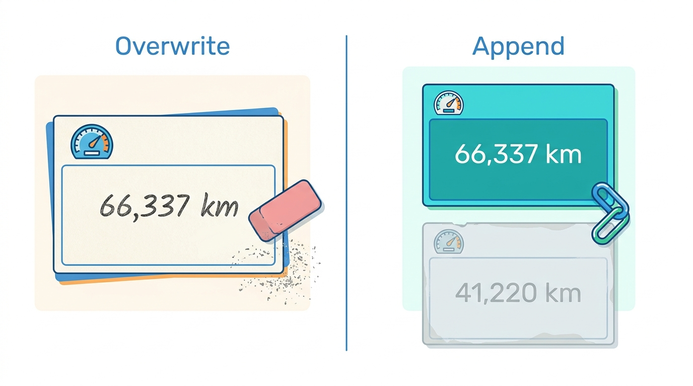
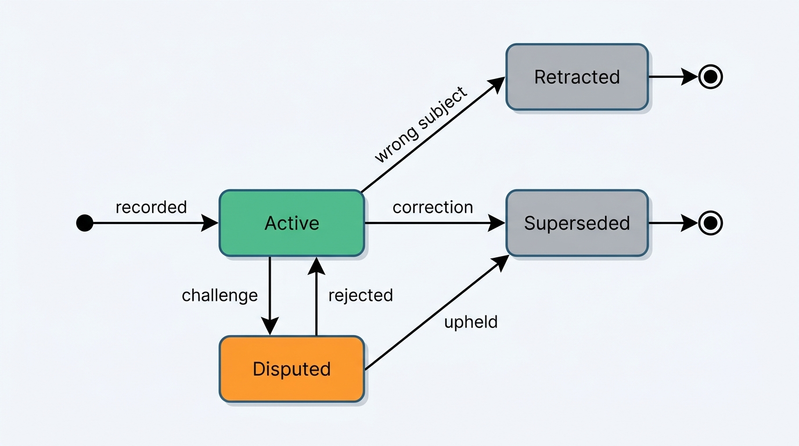

> **IN THIS CHAPTER, YOU WILL:** Design the provenance envelope that travels with every vehicle fact, model corrections bitemporally, set freshness SLOs per data class, and measure data quality per source against ground truth. You will also see how supplier data contracts, lineage and source scorecards turn provenance into governance, and how provenance shows up in reports, dossiers and API responses.

> **WHY THE BUSINESS CARES:** A data client pays for a fact it can defend: to a policyholder, a buyer, a court or a regulator. When a supplier error surfaces, the first questions are "which of our answers used it?" and "what exactly did you tell us on that day?". A platform that cannot answer them pays in credits, churn and legal exposure.

> **WHY ARCHITECTS SHOULD CARE:** Provenance cannot be added after the fact. A value written without its source, its observation date and the time it was recorded loses that information for good, and every later correction, license check and dispute depends on it. The envelope is a schema decision for every fact store, and it is cheap only on day one.

> **KEY POINTS:**
>
> * **Every fact travels in a provenance envelope.** Store with each fact its source and source class, the source record and batch it came from, when it was observed and when it was recorded, its license, its confidence and the rule or model that derived it. Keep the envelope as part of the fact, not in a separate audit log, and store batch-level fields by reference.
> * **Keep two times, and correct by appending.** Valid time says when a fact was true; transaction time says when the platform believed it. Only a bitemporal store can answer "what did we tell this client on 17 May?" after a correction. An overwrite destroys exactly the evidence the correction needs.
> * **Quality is a contract with the source, measured independently.** Set freshness SLOs per data class and per decision, and separate the source's own lag from the platform's. Write supplier contracts that cover units, correction duties and the provenance fields the supplier must deliver. Score each source against independent ground truth, such as official readings, and let the scores inform survivorship rules and renewals, not silently change them.

> **[FAILURE PATTERNS THIS CHAPTER ADDRESSES](where-vehicle-platforms-go-wrong.html):**
>
> * **Provenance Amnesia** — a reading stored as a value plus `updated_at` cannot say which batch, supplier or license it came from, so every correction and dispute becomes forensics.
> * **The Sticky Error** — when a correction overwrites the wrong value, the platform can no longer show what it served, and it cannot find everyone who received it.
> * **License Blindness** — a fact without its license in the envelope gets shown, cached or attributed in ways the source's terms do not allow.

<br>
A vehicle data business sells facts it did not observe: the register observed the first registration, a workshop the odometer, an insurer the damage. **The product is not the fact alone but the fact with its answer to "says who, as of when, under what license, and how sure are you?"** Without that answer a history report is an assertion, and a correction is a guess about what to fix.

This chapter owns the **provenance envelope**, the **bitemporal fact**, the **freshness SLO** (service level objective) and the **data contract (vehicle)**. It builds on [[ingestion-and-entity-resolution]], where Inlet, Axleby's ingestion pipeline, fills in the envelope, and on [[vehicle-history]]. Monitoring belongs to [[observability-and-data-operations]], the license register to [[data-licensing-and-governance]], and correction propagation to [[journey-data-correction]].

## Setting the Scene at Axleby: "What Did You Tell Us on 17 May?"

Axleby, the fictional vehicle data and dealer software group this book follows (see [[meet-axleby]]), received a letter in June 2027 from **Rijnstaal Verzekeringen**, a fictional insurer that uses Axleby's valuation and history calls to settle total-loss claims. In May, a nightly batch from **Kilometra**, a fictional odometer supplier, had recorded miles as kilometers for **2,870** UK-imported vehicles; it was corrected after **11 days** (**the Odometer Correction**). For each of its calls on those vehicles between 13 and 24 May, Rijnstaal asked: which mileage did you return, where did it come from, and what do you now believe it was?

Rijnstaal had made **163** such calls *(Axleby illustration)*. Priya Raman, VP Data and Valuation, expected a query. It took her team six working days.

The valuations were easy: Vantage's valuation ledger records the odometer reading id behind every valuation ([[valuation-engine]]). The readings were the problem. Tracewell, the history event store, loaded Kilometra's readings by upsert on vehicle, reading date and source. When Kilometra redelivered the corrected batch on 24 May, the loader **overwrote each wrong reading in place**. The correction had erased the evidence of the error: Tracewell said the 18 January 2027 reading was 66,337 km, and nothing said that on 17 May it had said 41,220 km. The team rebuilt the answer from 30-day API response logs and from Kilometra's copy of the original file, because Axleby had not kept its own.


**Figure 1:** *An overwrite keeps only today's answer; appending a new version keeps the reading the platform served before the correction, which is what Rijnstaal's question needed.*

Two smaller questions came up the same week. Femke de Boer, Head of Data Governance and Privacy, asked whether Kilometra's license allowed its readings in the **96** consumer reports sent through Odolo, Axleby's consumer vehicle-check app; the answer came from a contract PDF, not from the data. And Hendrik Maes, Head of Partner Integrations, found that Kilometra's contract defined the file's columns, not their meaning: it said nothing about units.

Ines Marchetti, Group Chief Architect, put the question to the architecture forum: **how does the platform know, show and govern the source, age, license and quality of every fact, so that "where did this come from, and what did we say when?" is a query and not a project?**

## The Words This Chapter Owns

| Term | Definition used in this book |
| --- | --- |
| **Provenance** | "Information about entities, activities, and people involved in producing a piece of data or thing, which can be used to form assessments about its quality, reliability or trustworthiness" (W3C PROV data model, [2013](https://www.w3.org/TR/prov-dm/)). For a vehicle fact: who observed it, who supplied it, how it reached the platform and what was done to it. |
| **Provenance envelope** | The fields stored with every fact, as part of the fact: source, source class, source record and batch, observed-at, recorded-at, license, confidence, derivation, status and version. |
| **Fact version** | One immutable version of one fact. A correction creates a new version that supersedes the old one; it never edits it. |
| **Valid time** | When the fact was true in the world: the date the odometer showed 41,220 miles. Martin Fowler calls it "actual" time ([2021](https://martinfowler.com/articles/bitemporal-history.html)). |
| **Transaction time** | When the platform recorded, and so believed, that version of the fact. Fowler's "record" time. |
| **Bitemporal fact** | A fact stored with both times, so the platform can answer what was true at any date, as known at any date. |
| **Freshness SLO** | A target for the age of a fact at the moment a decision uses it, set per data class and decision context, with a defined behavior when it is breached. |
| **Data contract (vehicle)** | The agreement with a data supplier, part commercial and part machine-readable, that fixes the schema, the semantics (units, codes, time zones), the provenance fields the supplier must deliver, delivery times, quality thresholds, correction duties and the license reference. |
| **Source scorecard** | A periodic, per-source measurement of delivery, contract compliance, accuracy against ground truth, coverage and correction behavior. |

The **survivorship rule** and the **golden record** belong to [[ingestion-and-entity-resolution]]; the **history event** to [[vehicle-history]]; the **license register** and **purpose check** to [[data-licensing-and-governance]].

## The Provenance Envelope

### What every fact carries

The envelope answers five questions about one fact: who said it, about which car, when it was true, when we learned it, and what we may do with it. Envelope v1, adopted in July 2027 alongside Inlet, turned fields that Tracewell and Specbook already kept under their own names into one standard.

| Field | Example (one odometer reading) | Why it exists |
| --- | --- | --- |
| `fact_id`, `fact_version` | `odo:7Q…:2027-01-18:km`, version 2 | Corrections append a version; downstream records cite the version they used |
| `subject` | AVK plus the source's own key (UK plate on the reading date) | Re-attach facts when identity is corrected ([[vehicle-identity]]) |
| `attribute`, `value`, `value_as_delivered` | odometer, 66,337 km; `41220`, unit field `mi` (version 1 had carried `km`, the error) | Normalized value for use, original for disputes |
| `source`, `source_class` | Kilometra, workshop feed; **commercial** | Trust ranking and wording; classes are official, commercial, first-party, derived |
| `source_record_ref`, `batch_ref` | Kilometra record id; landing batch id and content hash | Find every fact from one batch; replay it ([[ingestion-and-entity-resolution]]) |
| `observed_at` | 2027-01-18 (workshop visit) | Valid time |
| `recorded_at`, `superseded_at` | 2027-05-24T00:44Z; open | Transaction time interval of this version |
| `licence_ref` | Charter license id `KM-2024-03`, display class `consumer-allowed` | What products may show, cache and resell ([[data-licensing-and-governance]]) |
| `confidence` | **Asserted** | How much weight the fact can carry (see below) |
| `derivation` | null for observed facts; rule or model version and input fact versions for derived ones | Lineage for judgements, golden values and valuations |
| `status` | active, superseded, retracted, disputed | Lifecycle (Figure 4) |

Two rules make it useful. **The envelope is written in the same transaction as the value**, so there is no fact without it; a separate audit log drifts and gets lost in migrations. And **it is immutable per version**: a correction writes version 2 and closes version 1's transaction-time interval.


**Figure 2:** *The provenance envelope travels with the fact: source, observation time, recording time, license and confidence are written in the same transaction as the value, never in a separate log.*

### Confidence that products can obey

Confidence is only useful if products know what to do with it. Axleby uses the same four tiers for facts that Anchor, its identity graph, uses for vehicle identity ([[vehicle-identity]]), so dealers and engineers learn one vocabulary.

| Tier | Meaning for a fact | Example | What products may do |
| --- | --- | --- | --- |
| **Confirmed** | From an official source for that fact | Dutch register first-registration date; a UK MOT (annual roadworthiness test) reading from the Driver and Vehicle Standards Agency (DVSA) | State it as fact, with the source |
| **Corroborated** | Two independent sources agree within tolerance | Kilometra reading within 2% of an MOT reading taken within 30 days | State it as fact; name both sources on request |
| **Asserted** | One non-official source | A single workshop reading; a dealer's "towbar fitted" | Show it attributed: "reported by a workshop"; may feed a valuation, which is then marked provisional |
| **Suspect** | Failed a check, or disputed | A reading lower than the previous official one | Never state it as fact; feeds judgements such as the odometer judgement in [[vehicle-history]] |

The tiers are ordinal and say where the confidence came from. A probability such as 0.87 would invite false precision, and nobody can audit where it came from. A model score can sit beside the tier in `derivation`. Products never branch on it.

### Derived facts and lineage at two levels

A golden-record value, an odometer judgement and a valuation are **derived facts**: their envelope names the rule or model version and the input fact versions. That list is **fact-level lineage**, the path from one corrected reading to everything built on it. The valuation ledger's input references, report snapshots' event ids ([[vehicle-history]]) and the `fact_version` on Meterline usage events ([[billing-and-metering]]) apply the same idea.

**Dataset-level lineage** answers which jobs read a batch and which tables they wrote. OpenLineage models it with datasets, jobs and runs; a RunEvent is emitted "when something important occurs within your pipeline", and facets such as `dataQualityAssertions` carry test results ([OpenLineage object model, v1.54.0, accessed 2026-10](https://openlineage.io/docs/spec/object-model)). Inlet emits one for every load, validation and recompute.

| Question | Level | Where Axleby answers it |
| --- | --- | --- |
| Which facts came from Kilometra batch 2027-05-13? | Fact | `batch_ref` in the envelope |
| Which jobs and tables processed that batch? | Dataset | OpenLineage run events from Inlet |
| Which valuations, reports and adverts used reading version 1? | Fact | Input fact versions in the valuation ledger, report snapshots and advert renders |
| Which clients received it? | Fact | `fact_version` on Meterline usage events |
| What would a recompute touch? | Both | The impact graph in [[journey-data-correction]], built from the two |

Dataset lineage knows that a job read a file, not which value went to which client; fact-level lineage cannot show which pipelines to re-run. **A platform that sells facts needs both.**

### Paying for the envelope

Envelopes cost storage. Assume Tracewell, Specbook and Anchor hold about **2.5 billion fact versions**, roughly 60 per vehicle *(assumption)*. A full envelope repeated on every fact runs to about 600 bytes, about 1.5 TB before indexes *(assumption)*. Axleby stores **batch-level fields by reference**: source, license, contract version and landing details sit once in a batch record, and fact-level fields (observed-at, recorded-at, confidence, status, version) stay inline. That is about 90 bytes a fact, about 225 GB *(assumption)*: small next to one six-day reconstruction.

The reference has one rule: **batch records are immutable and never deleted while any fact points to them**. If retention requires a batch's raw data to go, the batch record stays, and only its landing-zone payload is removed ([[privacy-and-retention]]).


**Figure 3:** *The provenance envelope is filled in once, at ingestion, and then travels with the fact. Batch-level fields are stored by reference, derived facts cite their inputs, and every answer served records the fact versions it used.*

## Two Clocks: Bitemporal Facts

### Why one timestamp is not enough

A store with one timestamp per value can answer "what is the mileage now?" but not "what did we believe on 17 May?" once the value has changed. Both are routine: a client disputes a past answer, a court asks what the platform knew at a sale, a back-test needs inputs as they were. Fowler's example is a salary raise reported after payroll ran; the vehicle version is a workshop reading delivered months after the visit and corrected weeks later.

SQL:2011 added both times to the standard: application-time period tables and system-versioned tables ([Kulkarni and Michels, *ACM SIGMOD Record*, 2012](https://doi.org/10.1145/2380776.2380786)). Vehicle data adds one twist: **most facts are observations at an instant** (a reading on a date), while a few are **states over an interval** (a plate assignment, an export status). The model must handle both.

### Four kinds of change

Every change to a vehicle fact is one of four kinds. Treating them as one, "update the row", is what made the Odometer Correction expensive.

| Kind of change | Valid time | Transaction time | Example | Downstream effect |
| --- | --- | --- | --- | --- |
| **New observation** | New, usually recent | Now | A new MOT reading | New fact; may change the current value |
| **Late observation** | In the past | Now | A UK workshop reading from January delivered in May | New fact slotted into history; may change judgements for past dates |
| **Correction** | Unchanged | Now; previous version closed | The redelivered reading, miles not kilometers | New version supersedes the old one; everything that used the old version is affected |
| **Retraction** | Unchanged | Now; version closed, no successor | A reading attached to the wrong vehicle by plate | Fact withdrawn; the subject's derived facts recompute |

A correction is not a new observation. If the corrected reading arrives as a new fact, the vehicle appears to have two readings on 18 January, 41,220 km and 66,337 km, and the odometer judgement sees a rollback that never happened. **The supplier must say which record it corrects**, which is why that duty belongs in the data contract.

### The worked vehicle

One of the 2,870 vehicles was a 2019 compact SUV imported from the UK to the Netherlands in March 2027. Its facts, as Tracewell holds them today under envelope v1:

| Version | Observed (valid) | Recorded (transaction) | Value | Source and class | Status |
| --- | --- | --- | --- | --- | --- |
| r1 | 14 Apr 2026 | 15 Apr 2026 | 62,684 km (38,950 miles as delivered, unit `MI`) | DVSA MOT daily file; **Confirmed** | active |
| k1 | 18 Jan 2027 | 13 May 2027, 02:47 | 41,220 km (as delivered: `41220`, unit `km`) | Kilometra batch of 13 May; commercial | superseded 24 May 2027 |
| k2 | 18 Jan 2027 | 24 May 2027, 02:44 | 66,337 km (41,220 miles) | Kilometra redelivery, supersedes k1; **Asserted** | active |

Four questions, four answers:

- **What is the current odometer?** The newest valid reading, as known now: k2, 66,337 km.
- **What did Axleby tell Rijnstaal on 17 May?** As known on 17 May: k1, 41,220 km. From October 2027 every Meterline usage event records the fact version it served; for May's calls, the valuation ledger's reading ids confirm it.
- **What do we now believe the odometer showed on 17 May?** At least 66,337 km, from k2 on 18 January.
- **Why did the 14 May valuation come out high?** The valuation ledger cites k1. The value was lower than the official reading r1, and Inlet's semantic check now marks such a reading **Suspect** and keeps it out of the current value.

Under the old upsert, only the first question had an answer.


**Figure 4:** *The life of one fact version. Nothing returns from Superseded or Retracted: a correction is always a new version, and the old one keeps its transaction-time interval so the platform can show what it served.*

### Storing it

Tracewell keeps an append-only fact-version table with `observed_at` (or `valid_from` and `valid_to` for state facts), `recorded_at` and `superseded_at`; "as known at T" filters `recorded_at <= T < superseded_at`. The warehouse receives versions, not current rows, so back-tests can rebuild inputs as they were.

Two costs are real. Queries need discipline, since a forgotten transaction-time filter reads superseded values, so Axleby exposes only `current`, `as_of_valid(t)` and `as_known_at(t)`, never the raw table. And append-only data must still honor erasure: vehicle facts carry no person fields, and erasure works on the person and link stores ([[privacy-and-retention]]).

## Freshness: How Old May a Fact Be?

### Freshness is a property of a decision, not of a table

"The data is fresh" means nothing until you name the decision. A theft status from this morning is too old to complete a purchase. A specification from 2023 is perfectly fresh, because what the factory built does not change. The right question is: **how old may this fact be when this decision uses it, and what happens if it is older?**

It also helps to split a fact's age into parts, because only one of them is the platform's to control.

- **Source lag**: from observation to the source publishing it. A workshop uploads at the end of the day; a US insurer reports a total loss to the National Motor Vehicle Title Information System (NMVTIS) monthly under [28 CFR 25.55](https://www.law.cornell.edu/cfr/text/28/25.55). The platform cannot shorten this; it can only disclose it.
- **Pipeline lag**: from publication to the fact being recorded and usable. This is the platform's to own.
- **Age at use**: from recording to the decision. This depends on caches, mirrors and nightly runs ([[reliability-and-dependencies]]).

A freshness SLO should bind the parts the platform controls, and the product should disclose the rest. Promising "odometer data within 24 hours" when a supplier's garages upload weekly is a promise the platform cannot keep.

### Coverage-through, not newest record

For accumulating facts such as readings, damage and inspections, the age of the newest record says little: a car not serviced for eight months has an eight-month-old reading from a perfectly current feed. The product needs **coverage-through**, the date up to which a source has been checked for this vehicle. Tracewell records it per source and market, and each report states it: "UK workshop readings checked through 12 October 2027". It is the "none found in the sources checked" discipline of [[vehicle-history]], applied to time.

Measured values beat assumed ones. The Dutch register's open dataset returned a `Last-Modified` header of 07:01 GMT on 22 October 2026 ([RDW open data, queried 2026-10-22](https://opendata.rdw.nl/resource/m9d7-ebf2.json)), yet [[registers-and-official-data]] found that recent ownership changes arrive a few days late. Turnstile, Axleby's register gateway, therefore publishes the observed lag per field as the mirror's coverage-through date.

### Axleby's freshness SLOs per data class

The targets below are Axleby's, set by the owning product teams in 2027. Figures marked *(assumption)* are illustrative; the one-hour register target and the 03:00 deadline come from [[ingestion-and-entity-resolution]].

| Data class | Example facts | Decision | SLO (platform-controlled part) | On breach |
| --- | --- | --- | --- | --- |
| **Immutable build facts** | As-built edition and options, first registration | Appraisal, advert, valuation | None; recorded once with source and date | Not applicable; re-fetch only on dispute |
| **Registration state** | Owner-change date, export, inspection expiry | Dossier display, Axleby Trade checks | Dutch register changes in Anchor within an hour of the daily snapshot's publication; mirror coverage-through within 3 days of today *(assumption)* | Label "register status as of …"; never block display |
| **Decision-critical status** | Theft, awaiting-inspection, transfer possible | Purchase confirmation, register transaction | Live at the decision; never from a copy | Block the decision, keep the work saved ([[reliability-and-dependencies]]) |
| **Accumulating history** | Odometer readings, MOT results, damage | Reports, valuations, odometer judgement | Supplier file recorded before 03:00; MOT daily delta applied by 10:00 CET *(assumption)* | Report states coverage-through; Vantage marks affected valuations provisional |
| **Market observations** | Adverts, price changes, sale signals | Pricing signals, valuation training | Daily per portal ([[market-data]]) | Segment flagged; pricing signals withheld for that segment |
| **Derived judgements** | Valuation, odometer judgement | Offers, prices, reports | Model at most 7 days old (weekly retraining); inputs within their own SLOs | Valuation carries a stale-input flag in its ledger entry ([[valuation-engine]]) |

**A breach changes behavior, not just a dashboard**: each class has a defined degraded answer. And **freshness is disclosed in the product**, so a dealer or client can judge it. The monitors themselves belong to [[observability-and-data-operations]].

## Quality: Dimensions, Ground Truth and Contracts

### The dimensions that matter for vehicle facts

ISO/IEC 25012 defines a data quality model of 15 characteristics, from accuracy, completeness, consistency, credibility and currentness to traceability and availability ([ISO 25000 portal, n.d., accessed 2026-10](https://iso25000.com/en/iso-25000-standards/iso-25012)). The list is useful as a checklist, but a vehicle platform needs to operate five of them per source.

| Dimension | Question for a vehicle source | Check that answers it | Who can check it |
| --- | --- | --- | --- |
| **Completeness** | Did we get every record and every required field? | Manifest counts; share of records with VIN, unit, observation date | Inlet, at the door |
| **Validity** | Are values well formed and in range? | Schema, code lists, VIN structure, plausible ranges | Inlet, at the door |
| **Consistency** | Do the facts agree with each other and with history? | Reading not below the previous official one; fuel type matches register | Inlet and survivorship |
| **Accuracy** | Is the fact true of the car? | Agreement with **independent ground truth** on an overlapping sample | Data quality team, monthly |
| **Timeliness** | Does it arrive when the contract says? | Arrival against window; coverage-through against SLO | Monitors ([[observability-and-data-operations]]) |

The first three can be checked on every record ([[ingestion-and-entity-resolution]]). **Accuracy cannot**: a valid, consistent reading can still be wrong about the car. It needs an independent source of truth and a sample where both speak.

### Choosing ground truth

Ground truth for a vehicle fact is usually an **official source on an overlapping sample**, and every choice has a bias that must be written down.

| Fact | Ground truth | Overlap | Bias to state |
| --- | --- | --- | --- |
| Commercial odometer readings (UK) | DVSA MOT readings | Vehicles with a commercial and an MOT reading within 30 days | MOT covers cars over three years old in Great Britain |
| Commercial odometer readings (NL, BE) | Register judgement (NL); Car-Pass readings (BE) | Imports and cross-border cars | The Dutch open data shows a judgement, not readings |
| Edition and options | As-built build data | Stock-ins where build data was bought | Only cars someone paid to resolve ([[specification-and-equipment]]) |
| Damage events | Insurer total-loss records | Vehicles with both | Unreported damage is invisible to both |
| Valuations | Realized sale prices | Lotwise sales linked to the valuation ledger | Sold cars only; unsold stock is censored |

The official sources carry their own provenance, and that makes them good ground truth. The DVSA's MOT history API returns, per test, an `odometerUnit` (`MI` or `KM`), an `odometerResultType` (`READ`, `UNREADABLE`, `NO_ODOMETER`) and a `dataSource` field (`DVSA` for Great Britain, `DVA NI` for Northern Ireland) ([DVSA MOT history API specification, n.d., accessed 2026-10](https://documentation.history.mot.api.gov.uk/mot-history-api/api-specification/)). A reading that says what unit it was taken in, and whether it was read at all, is exactly what Kilometra's file did not provide.

The valuation row shows why ground truth must be named. Auto Trader UK publishes forecast accuracy of 99%, 97% and 95% at one, three and six months, measured against "the actual retail valuation", its own later valuation, not sale prices ([Auto Trader help centre, January 2024, updated August 2026](https://help.autotrader.co.uk/hc/en-gb/articles/16450896474141)). That measures forecast stability, not accuracy against transactions. **Every accuracy figure Axleby publishes names its ground truth and its overlap sample.**

### The supplier data contract

[[observability-and-data-operations]] uses a data contract as the reference its monitors compare against: arrival time, volume, semantics and ranges. That is the machine-checkable half. A supplier contract also has a commercial half, and the Odometer Correction failed in both. A data contract "defines the ownership, structure, semantics, quality, and terms of use" of a dataset ([Entropy Data, 2023](https://www.datamesh-manager.com/learn/what-is-a-data-contract)). The Open Data Contract Standard (ODCS) from the Bitol project gives it a machine-readable form with schema, quality, service-level, pricing and roles sections ([Bitol, n.d., accessed 2026-10](https://bitol-io.github.io/open-data-contract-standard/latest/)).

Hendrik Maes renegotiated Kilometra's contract in August 2027. Version 2 adds these clauses, shown here in simplified form, not in exact ODCS syntax:

```yaml
contract: kilometra-workshop-readings
version: 2.0.0            # August 2027
licence_ref: KM-2024-03   # held in Charter; consumer display allowed
schema:
  odometer_value: {type: integer, required: true}
  odometer_unit:  {enum: [km, mi], required: true, source: "as recorded by the workshop system"}
  observed_at:    {type: date, required: true, meaning: "date of the workshop visit"}
  workshop_chain_id: {required: true}
  source_record_id:  {required: true, stable_across_redeliveries: true}
  corrects_record_id: {required_when: "record is a correction"}
quality:
  - per workshop_chain_id: share of readings below the previous reading under 0.5%
  - unit_declared_by_chain: chains must declare their system's unit at onboarding
service_levels:
  delivery_by: "02:30 CET daily"
  coverage_through_in_manifest: true
corrections:
  notify_within: "1 business day of discovery"
  redeliver_as: "correction records referencing the original source_record_id"
remedies:
  held_segment_credit: "pro rata per day held"
```

Each clause traces to a gap in May. **`corrects_record_id`** lets Inlet append a correction as a new version instead of a second reading. **`workshop_chain_id`** enables the per-chain check that would have stopped the batch; as [[ingestion-and-entity-resolution]] shows, a median gate over all UK imports would not have fired, because the 2,870 bad readings came from one chain's export of 3,050 records, 94% of which failed. **`coverage_through_in_manifest`** sources the coverage-through date. **The chain declares its unit**, because the error began in one chain's system.

The rule I use: **a supplier contract that defines columns but not meanings, corrections and provenance is an invoice, not a contract.** Femke de Boer's team holds the license terms; Hendrik's team holds the delivery and correction terms; Priya's team holds the quality thresholds. All three sign before a source goes live.

### Source scorecards

A contract states what a supplier should deliver; a scorecard measures what it did. Axleby computes one per source per month from the envelope, Inlet's validation results and the ground-truth samples, and reviews it quarterly with the supplier.

| Measure | Kilometra, Q3 2027 *(Axleby illustration)* | Why it is on the card |
| --- | --- | --- |
| Batches delivered within window | 91 of 92 | Timeliness |
| Segments held by Inlet | 2 (one chain's export with a date-format change; one duplicate file) | Contract compliance |
| Records with all required provenance fields | 99.2% | Envelope completeness |
| Agreement with MOT readings within 2%, UK overlap sample | 96.8% of 4,100 pairs | Accuracy against ground truth |
| Corrections issued; median time to correct | 3; 2 business days | Correction behavior |
| Coverage: UK-import vehicles with a reading in the last 12 months | 71% | Value of the source |

The card drives **commercial remedies** and renewal, informs **survivorship precedence** and shapes **product wording**: a source with weak accuracy stays Asserted and is shown attributed. **Scores inform rule changes; they never change rules automatically**, because a rule whose weights move monthly cannot explain why a report said one thing in May and another in June. Changes stay versioned decisions with a recompute impact estimate ([[ingestion-and-entity-resolution]]).


## Provenance in the Product

Provenance pays back when the customer can see it. It shows up in three places, and in each the platform separates **provenance**, the internal truth about the source, from **attribution**, what the license allows the platform to say about it.

**History reports.** Each section of a Tracewell report carries source class, observation date and coverage-through. For the worked vehicle, the Odolo report now reads: "Odometer 66,337 km (41,220 miles) on 18 January 2027, reported by a UK workshop through a commercial data supplier. Official MOT reading 62,684 km (38,950 miles) on 14 April 2026. UK workshop readings checked through 12 October 2027." The wording table is owned by [[vehicle-history]]. The envelope supplies every value in it.

**API responses.** JSON API v1 carries a metadata block per section with `source`, `observedAt` and `status` ([[reliability-and-dependencies]]); envelope v1 adds `sourceClass`, `confidence`, `factVersion` and `coverageThrough` ([[vehicle-data-apis]] owns the contract). A client that stores `factVersion` can match a later `vehicle.fact.corrected` event ([[events-webhooks-and-sync]]) to the exact answers it affects. Connect XML's 210 XML-only clients get none of this.

**The dealer's dossier.** Lotwise shows "register status as of 06:12 today" and marks Asserted facts "dealer stated" or "reported by" ([[inventory-and-vehicle-dossier]]); a dealer prices an option differently when it comes from a colleague's entry rather than build data.

**Attribution is a license question.** The Dutch register's open data is published under Creative Commons Zero. Its terms add that reusers may not state that the data come from the RDW, the Netherlands Vehicle Authority, and may not use its logo or house style ([RDW open data terms, n.d., accessed 2026-10](https://www.rdw.nl/over-rdw/dienstverlening/open-data/bijsluiter)). The envelope still records the exact source, because Axleby needs it for freshness, disputes and its own license obligations. The display layer reads the license's attribution rule from Charter and renders "official register data" instead of the register's name. **The envelope always knows the source; the license decides what the product says about it.** A platform without that separation either leaks attributions its licenses forbid, or strips provenance it needs internally.

| Interaction | Consistency | Latency | Freshness | Availability |
| --- | --- | --- | --- | --- |
| Write fact with envelope | Atomic with the value | Within the ingestion step | Per data class SLO | Fails with the write; no fact without envelope |
| `as_known_at` query for a dispute | Exact, repeatable | Seconds to minutes *(assumption)* | Not applicable | Business hours; not on the request path |
| Metadata block in API response | Same fact version as the value | Adds under 5 ms at p95 *(assumption)* | Current | Same as the API; degraded answers say so |
| Report footnotes and coverage | From the stored snapshot | At render time | As of the snapshot | With the report |
| OpenLineage run events | At least once; reconciled daily against Inlet's batch log | Minutes | Not applicable | Loss does not block loads |
| Monthly scorecard | Reproducible from versions | Batch | Monthly | Not on any request path |

## In Practice

### What the public record shows

- **Registers expose provenance at field level.** The DVSA's MOT API carries unit, read status and data source per test, and publishes daily delta files and a weekly bulk file ([DVSA, n.d., accessed 2026-10](https://documentation.history.mot.api.gov.uk/mot-history-api/download-vehicle-mot-history-data/)). The Dutch register's open dataset publishes an odometer judgement per plate with an explanation code and the year of the last registered reading, but not the readings ([RDW open data metadata, queried 2026-10-22](https://opendata.rdw.nl/api/views/m9d7-ebf2.json)). A platform that shows the Dutch judgement must say it is the register's judgement, as [[vehicle-history]] does when it shows two.
- **US title law fixes some freshness and permanence.** States must report title data to NMVTIS "at a frequency of once every 24 hours" ([28 CFR 25.54](https://www.law.cornell.edu/cfr/text/28/25.54)); insurers and salvage yards report monthly ([28 CFR 25.55](https://www.law.cornell.edu/cfr/text/28/25.55), [25.56](https://www.law.cornell.edu/cfr/text/28/25.56)). Once applied, a brand "becomes a permanent part of the vehicle's NMVTIS record", and the US Department of Justice warns that a search may show a clean history for a vehicle with unreported damage ([US DOJ, n.d., accessed 2026-10](https://vehiclehistory.bja.ojp.gov/nmvtis_consumers)). Coverage and lag are part of the fact.
- **History providers disclose source limits.** Carfax states that a report "is based only on information supplied to CARFAX" ([Carfax, archived December 2025](https://web.archive.org/web/20251219084511/https://www.carfax.com/company/about)): a coverage disclaimer, not field-level provenance. AutoScout24's DataRunner (2023) integrates Great Expectations and DataHub ([AutoScout24, 2023](https://tech.autoscout24.com/blog/posts/datarunner/)): quality tooling, not a provenance model.

> **INFERENCE, NOT DOCUMENTED:** No vehicle-data company has published how it stores provenance per fact, whether it keeps transaction time, or how it scores its suppliers. The envelope, the bitemporal model and the scorecard in this chapter are the author's reference architecture. They are consistent with the published practices above, but no company describes them.

### Axleby worked example: answering Rijnstaal again

In November 2027, Axleby re-ran Rijnstaal's June questions as a test of envelope v1. Readings loaded before July 2027 had been backfilled with `recorded_at` from logs where known, `batch_ref = null` and a `provenance_basis = reconstructed` marker. The original May batch, recovered from Kilometra, was re-landed in Inlet as a historical batch, so the k1 versions were rebuilt and linked to it.

The test ran three queries:

1. **Facts from the batch**: `batch_ref = 2027-05-13` returned 2,870 superseded readings for 2,870 vehicles, each with its k2 successor.
2. **Answers served to Rijnstaal**: Meterline usage events for Rijnstaal's billing account with `fact_version` in that set. Meterline's `fact_version` field went live in October 2027, so May's calls were matched through the reconstructed versions and the valuation ledger. The result was 163 calls, 141 valuations and 22 history calls, identical to the June answer.
3. **What Axleby believes now**: `as_known_at(now)` for the same vehicles and dates.

The run took **40 minutes**, against six working days in June. The answer listed, per call, the fact version served, its source class and batch, the superseding version and the correction notice date. Rijnstaal found **9** settlements that had used a valuation more than €500 above the corrected one *(Axleby illustration)*.

One gap remained: Lotwise adverts rendered before October 2027 did not record fact versions, so the **1,180** affected adverts could be found only by vehicle and date window. Acceptable for adverts, which are re-rendered anyway; not for reports, which is why report snapshots store event ids ([[vehicle-history]]).

## Failure Handling

| Failure | How it shows up | Detection | Recovery |
| --- | --- | --- | --- |
| **Duplicate fact from one source** (redelivery, replay) | Two identical versions | Idempotency on source, `source_record_id` and source version | Keep one version; no new transaction time |
| **Same fact from two sources** | Two agreeing readings | Survivorship sees both | Keep both; tier becomes **Corroborated**; never count the car twice in a scorecard |
| **Conflicting sources** | Two readings a week apart that disagree by a factor of 1.6 | Consistency check | Keep both; lower one becomes **Suspect**; disputed wording in reports |
| **Correction without a reference** | Supplier resends a value with a new record id | Same subject, same `observed_at`, same chain, different value | Hold as a candidate correction; ask the supplier; never let both stand as observations |
| **Correction for an unknown or already superseded version** | Reference points to nothing, or to an old version | Lookup on `corrects_record_id` | Park until the original arrives, or chain it after the latest version; [[journey-data-correction]] owns the ordering cases |
| **Incomplete envelope** (no `observed_at`, no license) | Fact cannot be placed in time or shown | Envelope validation at write | No observation time: store with a "no later than" bound, exclude it from judgements. No license: **not displayable**, default deny in Charter |
| **Time zone or date-format ambiguity** | Readings land a day early, or with day and month swapped | Contract requires zone or date-only; distribution of `observed_at` per chain | Hold the segment; supplier redelivers |
| **Lineage emitter outage** | Gaps in OpenLineage runs | Daily reconciliation against Inlet's batch log | Re-emit from the batch log; loads never wait for lineage |
| **Source outage** | Coverage-through stops advancing | Freshness monitor | Products show the coverage date; decision-critical facts block per the SLO table |
| **Retroactive change to a past answer** | Client disputes a report or a call | `as_known_at` query | Show what was served and what is known now; never rewrite the served version |

**Beware the confident backfill.** Filling unknown envelope fields of old data with plausible values (`recorded_at` = migration date, `confidence` = the source's usual tier) turns ignorance into false provenance. Axleby marks reconstructed fields as reconstructed. And when a source's license ends, Charter makes its facts undisplayable for new answers while issued report snapshots keep them ([[data-licensing-and-governance]]).

## Trade-offs

**Where provenance lives.**

| Option | How it works | Strengths | Weaknesses | When it is right |
| --- | --- | --- | --- | --- |
| **Per table or dataset** | Source and load time per table | Cheapest; easy to add | Cannot separate sources inside a table; no answer per fact | Internal analytics on single-source data |
| **Per fact, inline** | All envelope fields on every row | Self-contained; simple queries | Storage about six times the reference model *(assumption)*; license text duplicated and hard to change | Small, high-value stores such as the valuation ledger |
| **Per fact, batch fields by reference** | Fact-level fields inline; source, license and batch once | Complete answers at modest cost; license changes in one place | A join on reads; batch records must be retained | **Default** for vehicle fact stores |

**How time is kept.**

| Option | What it answers | Weaknesses | When it is right |
| --- | --- | --- | --- |
| **Overwrite plus audit log** | Current value; changes only if someone reads the log | Log drifts from data; past answers need forensics | Caches that can be rebuilt from elsewhere |
| **Transaction time only** (system-versioned, as in SQL Server temporal tables) | What we believed at any time | Cannot tell a late observation from a correction | Records that are not observations: configurations, prices set by people |
| **Valid time only** | History of the world as now known | Cannot show what was served before a correction | Analytics that never answer disputes |
| **Bitemporal** | Both, for any pair of dates | Query discipline; storage; erasure handling | **Default** for facts that are sold, judged or disputed |

Both recommendations rest on three requirements: **facts are sold and must be defensible later, corrections arrive days or weeks late, and licenses change what may be shown.** A platform that only feeds internal dashboards can do with less.

## Across Markets: What Changes by Country

The envelope, the bitemporal store, the confidence tiers and the scorecard are the same in every market. What changes is which sources can serve as ground truth, how fresh they are, what they tell you about themselves, and what you may say about them.

| | Netherlands / Belgium | Germany | United Kingdom | United States |
| --- | --- | --- | --- | --- |
| **Official ground truth for odometer** | NL: register judgement per plate, not readings, in open data; BE: Car-Pass, the statutory mileage register, fed by garages, inspection, manufacturers (including connected-car readings quarterly) and the RDW for Dutch imports | Inspection readings held by the Kraftfahrt-Bundesamt (KBA, federal motor transport authority), not public | DVSA MOT readings with unit and data source per test | Odometer statements on titles via NMVTIS approved providers |
| **Freshness signal from the source** | RDW dataset `Last-Modified` header; observed lag of a few days for owner changes | None public for the register; commercial providers' own | Daily MOT delta files from 08:00 plus weekly bulk | States report within 24 hours; insurers and yards monthly |
| **Attribution rule** | RDW open data: may not state the data come from the RDW | Per commercial license (DAT, Autovista) | MOT documentation under the Open Government License; data reuse terms to be checked per agreement | Per approved-provider agreement |
| **Rectification duty when facts are personal data** | General Data Protection Regulation (GDPR) Art. 16 and Art. 19 | GDPR Art. 16 and Art. 19 | UK GDPR equivalents | No general federal right; brands are permanent by law |
| **Hardest provenance gap** | Readings behind the Dutch judgement are not available to platforms | No official odometer ground truth for platforms | Commercial readings for vehicles before import | Coverage varies by state and reporting entity |

Sources: [Car-Pass FAQ, n.d.](https://www.car-pass.be/en/faq); [KBA central register, n.d.](https://www.kba.de/DE/Themen/ZentraleRegister/ZFZR/zfzr_node.html); DVSA and RDW sources above; [28 CFR 25.54–25.56](https://www.law.cornell.edu/cfr/text/28/25.54); [GDPR, Regulation (EU) 2016/679](http://publications.europa.eu/resource/celex/32016R0679); all accessed 2026-10. The "hardest gap" row is the author's judgement.

The GDPR row has an architectural edge. Article 5(1)(d) requires personal data to be "accurate and, where necessary, kept up to date", and Article 19 requires a controller to communicate a rectification "to each recipient to whom the personal data have been disclosed, unless this proves impossible or involves disproportionate effort". This book treats plates and VINs as personal data by default where they can be linked to a keeper ([[privacy-and-retention]]). There, **recording which recipient got which fact version is a legal capability**. Whether a correction triggers Article 19 is a legal judgement; the platform's job is to make the answer possible.

My judgement: **keep the envelope, the time model and the scorecard common, and make three things market-specific**: the ground truth per fact type, the attribution rule per license, and the coverage-through computation per source. One change is coming. A November 2025 Council compromise text on the EU roadworthiness revision would require manufacturers to "transmit the odometer readings of connected vehicles which they have produced every three months" to national databases ([Council of the EU, 2025](https://data.consilium.europa.eu/doc/document/ST-15613-2025-INIT/en/pdf)). It was not adopted as of October 2026 and gives data companies no direct access, but an envelope that already separates official from commercial readings would absorb it as one more source.

## The Chief Architect's View

**Make the envelope a platform standard, not a team habit.** The data platform team owns the envelope schema, its versions and the three access paths; every service writing vehicle facts must use them. Connect XML cannot carry the envelope, so its answers are logged with fact versions at the gateway until its 2029 sunset.

**Give every SLO and contract an owner where the knowledge is.** Product owners set freshness SLOs; Hendrik Maes's team owns supplier contracts and scorecards; Priya Raman owns accuracy measurement and survivorship precedence; Femke de Boer owns license and attribution rules in Charter. A source goes live only with all four in place.

**Spend on the fact level first.** Dataset lineage tools are easy to buy and demonstrate. Fact-level lineage answers clients, courts and regulators, and it cannot be reconstructed later.

**What to watch.** Per source and product: **envelope completeness** (required fields present, not reconstructed); **served-within-SLO**; **time to answer a provenance question**, tested quarterly with a drill like the Rijnstaal re-run (Axleby's 2028 target: under one hour for up to 1,000 calls); and the **scorecard accuracy trend**.

**Keep the standard cheap to adopt.** If the envelope turns every new source into a quarter-long project, teams will route around it with "temporary" loaders, and Provenance Amnesia returns quietly.

## Questions to Ask

1. For any fact we sell, can we show its source, observation date, recording date, license and confidence without asking an engineer?
2. When a supplier corrects a fact, do we append a new version and close the old one, or overwrite it? Can we still show what we served before the correction?
3. Does every derived fact (judgement, golden value, valuation) record the input fact versions it used?
4. Do our usage or response logs record which fact version each client received, and for how long?
5. For each data class, what freshness does each decision need, which part of the age is the source's and which ours, and what happens on breach?
6. For accumulating facts, do we report coverage-through per source, or only the age of the newest record?
7. Does each supplier contract define units, time zones, correction references and the provenance fields the supplier must deliver?
8. What independent ground truth do we use to measure each source's accuracy, and what bias does it carry?
9. Where the license restricts attribution, does the product follow it while the envelope keeps the real source?

Part II now gives every fact a car, a source and a degree of trust. Part III turns to value, starting with [[part-3]] and [[market-data]], where the sources are adverts and transactions, only 61 percent of adverts match a vehicle, and license limits decide what may be harvested at all.

## Sources and Evidence

### Company, product and investor sources

- [Forecast accuracy (Auto Trader help centre)](https://help.autotrader.co.uk/hc/en-gb/articles/16450896474141) — Auto Trader UK, published January 2024, updated August 2026; 99/97/95% accuracy measured against its own later valuation.
- [About Carfax (archived)](https://web.archive.org/web/20251219084511/https://www.carfax.com/company/about) — Carfax, archived December 2025; "based only on information supplied" disclaimer.
- [DataRunner](https://tech.autoscout24.com/blog/posts/datarunner/) — AutoScout24, 2023; pipeline framework with Great Expectations and DataHub.

### Standards, regulation and official documentation

- [PROV-DM: The PROV Data Model](https://www.w3.org/TR/prov-dm/) — W3C Recommendation, 2013; definition of provenance.
- [OpenLineage object model](https://openlineage.io/docs/spec/object-model) — OpenLineage, v1.54.0, n.d., accessed 2026-10; datasets, jobs, runs and data-quality facets.
- [Open Data Contract Standard](https://bitol-io.github.io/open-data-contract-standard/latest/) — Bitol (LF AI & Data), n.d., accessed 2026-10; machine-readable data contracts.
- [ISO/IEC 25012 data quality model](https://iso25000.com/en/iso-25000-standards/iso-25012) — ISO 25000 portal, n.d., accessed 2026-10; 15 data quality characteristics.
- [Regulation (EU) 2016/679 (GDPR)](http://publications.europa.eu/resource/celex/32016R0679) — EU, 2016; Art. 5(1)(d) accuracy, Art. 16 rectification, Art. 19 notification of recipients.
- [MOT history API specification](https://documentation.history.mot.api.gov.uk/mot-history-api/api-specification/) — DVSA, n.d., accessed 2026-10; `odometerUnit`, `odometerResultType`, `dataSource` fields.
- [Download vehicle MOT history data](https://documentation.history.mot.api.gov.uk/mot-history-api/download-vehicle-mot-history-data/) — DVSA, n.d., accessed 2026-10; weekly bulk and daily delta files.
- [Open Data RDW: Gekentekende voertuigen](https://opendata.rdw.nl/api/views/m9d7-ebf2.json) — RDW, queried 2026-10-22; odometer judgement fields, last-modified time.
- [Bijsluiter open data](https://www.rdw.nl/over-rdw/dienstverlening/open-data/bijsluiter) — RDW, n.d., accessed 2026-10; CC0 terms, no attribution to the RDW, no availability guarantees.
- [Car-Pass FAQ](https://www.car-pass.be/en/faq) — Car-Pass, n.d., accessed 2026-10; sources of Belgian odometer readings.
- [Zentrales Fahrzeugregister](https://www.kba.de/DE/Themen/ZentraleRegister/ZFZR/zfzr_node.html) — Kraftfahrt-Bundesamt, n.d., accessed 2026-10; contents of the German central register.
- [28 CFR 25.54](https://www.law.cornell.edu/cfr/text/28/25.54), [25.55](https://www.law.cornell.edu/cfr/text/28/25.55), [25.56](https://www.law.cornell.edu/cfr/text/28/25.56) — US Code of Federal Regulations via Cornell LII, n.d., accessed 2026-10; NMVTIS reporting frequencies.
- [NMVTIS for consumers](https://vehiclehistory.bja.ojp.gov/nmvtis_consumers) — US Department of Justice, n.d., accessed 2026-10; permanence of brands and coverage warning.
- [Council compromise text on the roadworthiness package, ST 15613/25](https://data.consilium.europa.eu/doc/document/ST-15613-2025-INIT/en/pdf) — Council of the EU, 2025; proposed odometer recording and quarterly connected-vehicle readings.

### Research and practitioner sources

- [Bitemporal History](https://martinfowler.com/articles/bitemporal-history.html) — Martin Fowler, 2021; actual time and record time.
- [Temporal features in SQL:2011](https://doi.org/10.1145/2380776.2380786) — Krishna Kulkarni and Jan-Eike Michels, *ACM SIGMOD Record*, 2012; application-time and system-versioned tables.
- [What is a Data Contract?](https://www.datamesh-manager.com/learn/what-is-a-data-contract) — Entropy Data, 2023; data contract definition.

Axleby is fictional; architectural recommendations, labeled inferences and labeled assumptions are the author's judgement.
