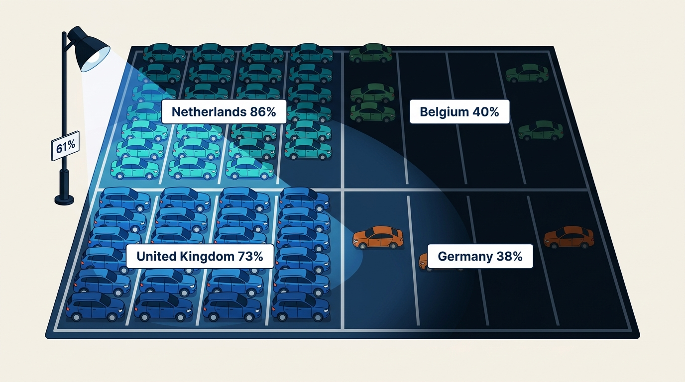
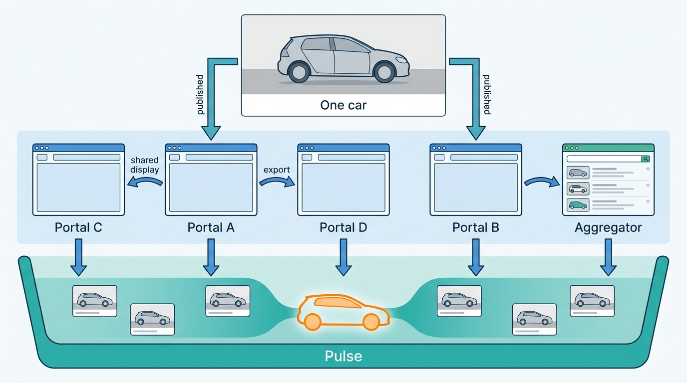
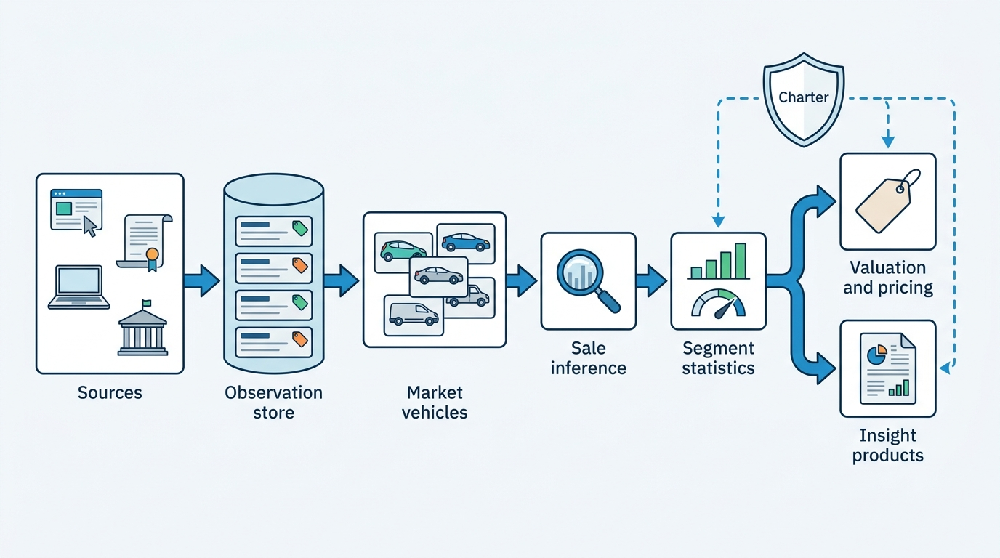
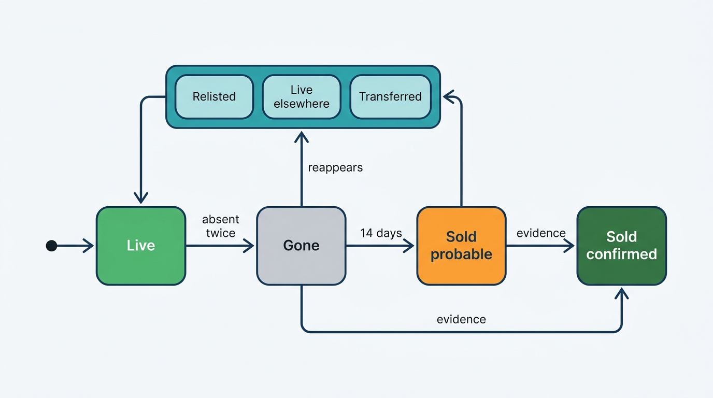
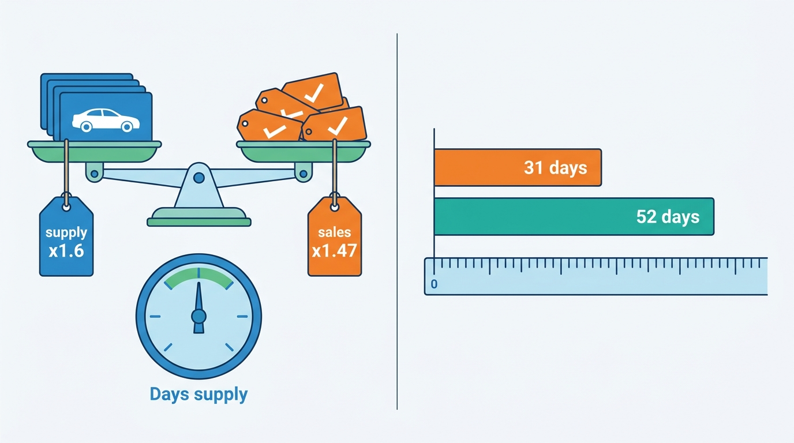

> **IN THIS CHAPTER, YOU WILL:** Build the market side of a vehicle data platform: where market observations come from and what the law lets you do with them, how adverts become market vehicles across portals and relists, how sales are inferred, and how stand-time, market days' supply and segment statistics are computed honestly enough to feed valuation and pricing.

> **WHY THE BUSINESS CARES:** Dealers price, buy and stock against market data every day, and valuations are trained on it. If de-listings are counted as sales and duplicates as supply, the platform tells a dealer that a segment sells in 31 days when it takes 52, and the dealer buys the wrong cars at the wrong price.

> **WHY ARCHITECTS SHOULD CARE:** Market data is the one vehicle dataset assembled mostly from sources the platform does not control and may not freely use. Its correctness depends on identity resolution, its legality on per-source rights, and its usefulness on knowing what it does not see. All three are architecture decisions.

> **KEY POINTS:**
>
> * **A de-listing is evidence of a sale, not a sale.** Model each advert as a listing lifecycle, cluster listings into market vehicles across portals and relists, and infer the outcome with a confidence, confirmed by register ownership changes or dealer sales where a market provides them. In Axleby's Dutch audit only 68% of de-listings were sales.
> * **Every observation carries its source and its rights.** The EU database right (*Innoweb*, 2013; *CV-Online*, 2021), terms of use and competition law decide what may be harvested, combined and shown. Tag each observation with its source, method and terms version so a source can be purged, and keep dealer-derived prices aggregated and delayed.
> * **Publish coverage with every statistic.** One match rate hides where the market is invisible. Report identity match, cluster coverage and segment coverage per market and source, fall back up a segment hierarchy when evidence is thin, and say "insufficient data" rather than publishing a confident number.

> **[FAILURE PATTERNS THIS CHAPTER ADDRESSES](where-vehicle-platforms-go-wrong.html):**
>
> * **The Cloned Identity** — one car advertised on four portals and relisted twice becomes six cars of supply and two sales.
> * **License Blindness** — harvested adverts and dealers' own sale prices flow into products and API responses that their sources never allowed.
> * **The Confident Valuation** — valuations trained on market statistics that carry no coverage or confidence inherit the market data's blind spots without showing them.

 
There is no register of used-car prices. In the Netherlands, Belgium, Germany and the United Kingdom, the state records who holds a car but not what anyone paid for it; in the United States, the wholesale auctions see transaction prices, retail mostly does not. **Everything the industry knows about the retail used-car market is inferred** from adverts, from changes of keeper, from dealers' own systems and from auctions. Each of these sources sees part of the market, with its own lag and its own bias.

Market data is still the input that the rest of the value chain leans on. Valuations are trained on it and use it for comparables ([[valuation-engine]]). Pricing tools compare a dealer's asking price with it ([[used-car-pricing]]). Importers, lessors and other data clients buy segment statistics ([[data-products-and-insights]]). **A wrong market picture becomes a wrong price in every one of those products at once**, and it does so quietly, because aggregates look plausible even when the counting beneath them is wrong.

This chapter owns the **market data lake**, **sale detection**, **stand-time** and **market days' supply**. It builds on [[ingestion-and-entity-resolution]], which owns the landing zone and the matching tiers, and on [[vehicle-identity]] and [[registers-and-official-data]]. It hands license enforcement to [[data-licensing-and-governance]] and the use of market data in valuations to [[valuation-engine]].

## Setting the Scene at Axleby: What Sixty-One Percent Means

Axleby, the fictional vehicle data and dealer software group this book follows (see [[meet-axleby]]), runs its market data in **Pulse**, a market data lake on Databricks on AWS. In 2026 Pulse harvested or received about **2.3 million** advert observations a day across the Netherlands, Belgium, Germany and the United Kingdom, plus ownership-change events from the Dutch register mirror. One number summarized its quality in every board pack: **61%** of adverts matched to a vehicle in Anchor, the group's identity graph keyed by vehicle identification number (VIN).

In February 2027, after the review of the EV Overvaluation had shown that Pulse's falling battery-electric asking prices were a leading signal nobody had wired to Vantage ([[valuation-engine]]), Ines Marchetti, Group Chief Architect, asked Priya Raman, VP Data and Valuation, a simple question before Vantage was allowed to depend on Pulse: **what does 61% mean, and what does Pulse not see?**

Priya's team broke the number down. The figures are Axleby illustrations.

| Market | Advert observations a day (2026) | Matched to a vehicle in Anchor | Main reason for the gap |
| --- | --- | --- | --- |
| Netherlands | 0.80 million | 86% | Plates are often readable in Dutch adverts and resolve through the register mirror |
| Belgium | 0.30 million | 40% | Plates rarely shown; VIN rarely shown; no open register to resolve against |
| Germany | 0.80 million | 38% | Plates usually masked; VIN rarely published |
| United Kingdom | 0.40 million | 73% | Showroomly stock carries registration marks; harvested adverts often do not |
| **All** | **2.30 million** | **61%** | |

By source, the same 2.3 million broke down into about **1.55 million** harvested public adverts, **0.35 million** received from portals under data agreements, and **0.40 million** first-party observations of Lotwise and Showroomly dealers' own stock.

First, **61% was a rate per observation, not per car**. The same car was observed once per portal per day. A Dutch car advertised on four sites counted four times in the denominator and, if its plate was readable, four times in the numerator.

Second, **Pulse counted every de-listing as a sale**. When an advert disappeared, Pulse recorded a sale on that day at the last asking price. Relists, moves between portals and transfers between a group's rooftops all became sales. Market days' supply and stand-time, the two metrics Lotwise showed dealers next to every car, were computed from those counts.

Third, **the gaps were not random**. Germany and Belgium were matched at under 40%, so any Vantage segment check that used only matched adverts was mostly a Dutch and British check.

**Figure 1:** *One 61% match rate averaged a well-lit Dutch and British market with Belgian and German markets that Pulse could barely see.*

Ines's request to the company board, when it approved One Dossier in March 2027, was therefore not "raise the match rate". It was: **define what a market observation is, what may be done with it, how a sale is inferred and with what confidence, and what every statistic must say about its own coverage.**

## The Words This Chapter Owns

| Term | Definition in this book |
| --- | --- |
| **Market observation** | One sighting of one advert or market event from one source at one time, with provenance (source, method, observed-at, terms version). Append-only. |
| **Listing** | One advert on one channel under one listing id, from first to last observation. A car can have many listings over its life. |
| **Market vehicle** | A cluster of listings believed to be the same physical car on offer: across portals, across relists, across rooftops of one group. Resolved to an Axleby Vehicle Key (AVK) when identity allows; otherwise a cluster id. |
| **Market data lake** | The store of market observations and everything derived from them (listings, market vehicles, inferred sales, segment statistics), with per-observation provenance and rights tags so that any figure can be traced to, and rebuilt without, any source. |
| **Sale detection** | Inferring that a market vehicle left the market because it was sold, with an outcome state, a confidence and a confirmation source where one exists. |
| **Stand-time** | Days from the first observation of a market vehicle on any channel to its inferred sale. Not the same as **days-to-turn**, the dealer's own stock-in to sale ([[dealer-and-data-economics]]). |
| **Market days' supply** | Market vehicles currently on offer in a segment divided by the average daily inferred sales in that segment over a trailing window, usually 30 days. |
| **Segment** | A versioned grouping of vehicles for statistics: make, model, generation, fuel, body, power band, age band, mileage band and region, arranged as a hierarchy with fallbacks. |
| **Coverage** | The share of the real market a statistic is based on, estimated per segment, market and source. |

The definitions of stand-time and days' supply follow public practice. Cox Automotive computes US used-vehicle days' supply "based on the daily sales rate for the most recent 30-day period" from its vAuto inventory data ([Cox Automotive, January 2022](https://www.coxautoinc.com/market-insights/used-vehicle-days-supply/); the source is more than three years old, so the current definition may differ). Auto Trader UK exposes "Days to Sell" and a "price-adjusted days to sell" through its APIs ([Auto Trader UK help center, 2024, updated 2026](https://help.autotrader.co.uk/hc/en-gb/articles/21946149296029-Introduction-to-Vehicle-Metrics)). Neither publishes how it decides that a car was sold.

## Where Market Data Comes From

Six kinds of source feed a market data lake.

| Source | What it sees | Identity | Price meaning | Typical rights |
| --- | --- | --- | --- | --- |
| **Harvested public adverts** | Most retail supply on public portals | Plate or VIN sometimes; often neither | Asking price | Database right, terms of use, competition and privacy law; see next section |
| **Portal data agreements** | One portal's adverts, often with history and de-listing dates | Better than harvesting; portal ids | Asking price | Contract: purposes, redistribution, retention |
| **First-party dealer stock** (Lotwise, Showroomly) | The platform's own dealers' stock, costs, price changes and sales | VIN, plate, stock id | Asking price **and** realized sale price | Dealer contract; competition law limits on sharing |
| **Register ownership changes** | That a vehicle changed keeper, and when | Plate (NL), VIN in some feeds | None | Register terms; per-vehicle access varies sharply by country |
| **Auction and B2B results** | Wholesale and trade clearing prices | VIN | Transaction price, as-is | Auction or exchange contract |
| **Aggregate statistics** | Counts of transfers by segment and month | None per vehicle | None | Publisher's terms |

**Only first-party dealer data and auctions see a transaction price.** Everything else is an asking price, and asking prices inherit dealer pricing behavior. Axleby owns no auctions; its B2B exchange, Tradefloor, hands deals to auction partners, so Pulse sees Tradefloor's own clearing prices for about **48,000** deals a year but no auction hammer prices ([[case-cox-automotive]] draws the contrast).

**Per-vehicle confirmation of a sale exists in only one of Axleby's markets.** The Dutch register publishes, per plate, the date of the latest registration in a holder's name (*datum_tenaamstelling*) in its open vehicle dataset, alongside the export indicator and the odometer judgement ([RDW open data, dataset metadata queried October 2026](https://opendata.rdw.nl/api/views/m9d7-ebf2.json)). The dataset is a snapshot keyed by plate, not an event log, so changes are found by comparing snapshots ([[registers-and-official-data]] owns the register mirror). Germany publishes ownership-change counts, not per-vehicle events: the Federal Motor Transport Authority (*Kraftfahrt-Bundesamt*, KBA) counts a *Besitzumschreibung* (registration to a new keeper) whenever an already registered vehicle changes keeper, and reported **6.03 million** for passenger cars in 2023, 93.4% of them private ([KBA, n.d., accessed 2026-10](https://www.kba.de/DE/Statistik/Fahrzeuge/Besitzumschreibungen/besitzumschreibungen_node.html)). The UK has quarterly used-car transaction counts that the Society of Motor Manufacturers and Traders (SMMT) derives from Driver and Vehicle Licensing Agency (DVLA) data: **7.81 million** in 2025, with the caveat that the DVLA "periodically revises historic data" ([SMMT, n.d., accessed 2026-10](https://www.smmt.co.uk/vehicle-data/used-car-sales/)). DVLA keeper data is released only for "reasonable cause", such as parking enforcement, not for market statistics ([DVLA INF266, 2022](https://assets.publishing.service.gov.uk/media/624dabc7e90e0729f6bf8167/inf-266-release-of-information-from-dvlas-registers.pdf)).

### Portal consolidation changes the source map

On 28 November 2025 Emerce reported that AutoTrack and Gaspedaal.nl, combined since 2019 in a joint venture of two Dutch publishers, had "come into the hands of" AutoScout24; both keep their brands, and AutoTrack's dealers move to AutoScout24's technology platform ([Emerce, 2025](https://www.emerce.nl/nieuws/autotrack-gaspedaalnl-onderdeel-autoscout24)). AutoScout24's listing API already exposes the consequence: its channel values include `AutoTrack`, a listing "displayed on both platforms", and `AutoTrackShared`, "an existing shared listing displayed on both platforms"; a `mobile_de` channel, added in November 2022, marks a listing for export to its German competitor ([AutoScout24 Listing Creation API, n.d., changelog to 2026-10-19](https://listing-creation.api.autoscout24.com/docs)). Germany's competition authority recorded in October 2026 that consumers and dealers "often use several platforms in parallel" and that "many platforms also offer dealers a data export to other platforms" ([Bundeskartellamt, 2026](https://www.bundeskartellamt.de/SharedDocs/Meldung/DE/Pressemitteilungen/2026/10_08_2026_mobile_carwow.html), author's translation).

For a market data lake this has three consequences. **Cross-portal duplicates are now partly created by the portals themselves**, not only by dealers who multi-home, so a listing seen on two sites may be one listing with two displays. **Source concentration rises**: one portal group's terms of use, API changes or commercial decisions can remove a large share of a market's observations overnight. And **the history of the Dutch market has come full circle**: Gaspedaal was the meta-search engine whose harvesting of AutoTrack produced the leading European case on database rights, and the two now belong to the same group.

**Figure 2:** *One car on sale can produce five observations a day. Dealers create two of them; portal shared displays, portal-to-portal exports and aggregators create the rest. Supply counted per listing overstates the market.*

## What the Law Allows

In market data, legal analysis is an architecture input. This section summarizes the frame; it is not legal advice.

### The EU database right and the car-advert cases

The Database Directive gives the maker of a database that shows "a substantial investment in either the obtaining, verification or presentation of the contents" a right to prevent "extraction and/or re-utilisation of the whole or of a substantial part" of it, and, under Article 7(5), "repeated and systematic extraction" of insubstantial parts that conflicts with normal exploitation ([Directive 96/9/EC, 1996](http://publications.europa.eu/resource/celex/31996L0009)). Three Court of Justice of the European Union (CJEU) judgments decide how it applies to market data, two of them on Dutch references.

- ***Innoweb v Wegener* (C-202/12), 19 December 2013.** GasPedaal.nl, a meta-search engine over car-advert sites, ran about 100,000 searches a day on AutoTrack.nl, which held 190,000 to 200,000 used cars, translating user queries in real time and merging duplicates. The Court held that such an operator re-utilizes the whole or a substantial part of the database when it offers essentially the same search functionality, searches all of the content in real time and presents the results in its own format ([CJEU, 2013](http://publications.europa.eu/resource/celex/62012CJ0202)).
- ***Ryanair v PR Aviation* (C-30/14), 15 January 2015.** Where a database is protected neither by copyright nor by the database right, the Directive does not stop its maker "from laying down contractual limitations on its use by third parties" ([CJEU, 2015](http://publications.europa.eu/resource/celex/62014CJ0030)). Terms of use matter even where the right does not.
- ***CV-Online Latvia v Melons* (C-762/19), 3 June 2021.** A specialized search engine that copies and indexes a freely accessible database extracts and re-utilizes it, and the maker may prohibit that where it creates "a risk to the possibility of redeeming" the investment. The Court asked for a fair balance and noted that aggregators "contribute to the smooth functioning of competition and to the transparency of offers and prices" ([CJEU, 2021](http://publications.europa.eu/resource/celex/62019CJ0762)).

The 2013 case is old but still directly on point. Together the three judgments draw a line an architect can design against. **Re-presenting another portal's adverts as a competing search or listing product is the high-risk end**: that is the *Innoweb* fact pattern. **Aggregated statistics that do not substitute for the portal's own product sit at the lower-risk end**, but systematic copying can still be prohibited where it threatens the portal's investment, and terms of use can bite on their own.

### The United Kingdom and the United States

The UK kept the right after Brexit. Regulation 16 of the Copyright and Rights in Databases Regulations 1997 makes it an infringement to extract or re-utilise "all or a substantial part of the contents", and says that "repeated and systematic extraction or re-utilisation of insubstantial parts" may amount to the same ([SI 1997/3032, regulation 16](https://www.legislation.gov.uk/uksi/1997/3032/regulation/16/made)). CJEU judgments after 2020, such as *CV-Online*, do not bind UK courts.

The US has no database right. The Supreme Court held in *Feist v Rural* (1991) that "facts are not copyrightable" and rejected the "sweat of the brow" theory for compilations ([Supreme Court, 1991](https://www.law.cornell.edu/supremecourt/text/499/340)). The risk sits in contract and in access law instead. In *hiQ v LinkedIn*, scraping public data was found likely to fall outside the Computer Fraud and Abuse Act, yet hiQ was found in breach of LinkedIn's user agreement and settled in December 2022 with a $500,000 judgment, an injunction and deletion of the scraped data ([Proskauer, 2022](https://www.proskauer.com/blog/hiq-and-linkedin-reach-proposed-settlement-in-landmark-scraping-case)).

### Competition law and the dealer's own prices

A platform that collects realized sale prices from thousands of competing dealers and shows each what its competitors did sits close to an information exchange between competitors. The European Commission's 2023 Horizontal Guidelines say that exchanges of aggregated information, "where the attribution of information to particular undertakings is sufficiently difficult or uncertain", are less likely to restrict competition, that "collection and publication of aggregated market information … by a trade association or market intelligence firm may benefit competitors and customers alike", and that information becomes historical, and less sensitive, when it is "several times older than the average length of the pricing cycles" ([Commission Guidelines, OJ C 259, 21 July 2023, paras 391–394](http://publications.europa.eu/resource/celex/52023XC0721%2801%29)). The architecture consequence is direct: **dealer-derived prices leave the platform only aggregated across enough dealers and cars that no one dealer can be singled out, and only after a delay**.

### Personal data in adverts

Private-seller adverts carry names and phone numbers, and plates are personal data by default in this book ([[privacy-and-retention]]). Market statistics need neither the seller nor, after matching, the plate. **Drop person fields at the door, keep the plate only as a matching key with restricted access, and store the seller type** (dealer or private) as the attribute statistics actually use.

### What this means for the design

> **The rule I use:** prefer licensed feeds and dealer-consented data to harvesting; never build a product that re-presents another portal's adverts; and record, for every observation, the source, the method, the time and the terms version under which it was obtained, so that one source can be removed without rebuilding the business.

When a contract ends or a portal objects, the platform must find every observation from that source and everything derived from it. Without per-observation provenance the only safe response is to delete everything.

## Architecture: Pulse as an Observation Store

The rebuild Axleby approved in March 2027, called Pulse v2 here, has six components.

| Component | Responsibility | Owns | Design rule |
| --- | --- | --- | --- |
| **Collectors and feed adapters** | Harvest public adverts, receive portal feeds, take first-party stock events, read register snapshot diffs | Nothing durable; writes to landing | One adapter per source with a completeness check per run |
| **Observation store** | Append-only market observations with provenance and rights tags | Market observations | Never update in place; partition by source and day; purge by source |
| **Listing lifecycle builder** | Turns observations into listings: first seen, price changes, last seen, gone | Listings | A listing is "gone" only after two complete harvests without it |
| **Market vehicle resolver** | Clusters listings across portals, relists and rooftops; attaches clusters to AVKs | Market vehicles | Deterministic links first; probabilistic clustering with thresholds; cluster ids are stable |
| **Sale inference** | Assigns outcome states with confidence; confirms against register changes and first-party sales | Inferred outcomes | Versioned classifier; outcomes revisable; precision measured against ground truth |
| **Segment statistics** | Supply, inferred sales, stand-time, days' supply, price distributions per segment, with coverage and evidence counts | Segment statistics | Minimum-evidence rule and fallback hierarchy; every row stamped with window and classifier version |

Matching mechanics, landing and quarantine belong to [[ingestion-and-entity-resolution]]. Charter, Axleby's license and purpose register, sits on the output side: every observation carries a rights tag, and Charter decides which tags may flow into which product ([[data-licensing-and-governance]]).

**Figure 3:** *Pulse v2 keeps raw observations append-only and derives listings, market vehicles, inferred sales and statistics from them. Rights are tagged at the observation and checked where data leaves the lake.*

### Requirements per interaction

The figures marked as assumptions are illustrative targets, not documented values.

| Interaction | Consistency | Latency | Freshness | Availability and degradation |
| --- | --- | --- | --- | --- |
| Harvest and feeds → observation store | Idempotent per source, listing id and observation day | Batch | Daily for harvests; hourly for partner feeds *(assumption)* | A missing or partial source run is marked incomplete and never read as removals |
| Lotwise stock events → Pulse | Exact, via the dossier event stream | Minutes | Real time | Backlog replays from the outbox ([[events-webhooks-and-sync]]) |
| Register snapshot diff → sale confirmation | Eventually consistent | Daily batch | NL only; changes typically visible within days *(assumption)* | Register mirror outage delays confirmation, not inference |
| Sale inference | Revisable; every revision versioned | Nightly | Probable outcome after 14 days; confirmed when evidence arrives | Outcomes stay "pending" rather than defaulting to "sold" |
| Segment statistics → Vantage and Lotwise pricing | Versioned daily snapshot | Nightly | Daily; weekly segment signals for drift monitoring | Serve the last good snapshot flagged as stale for up to 3 days *(assumption)* |
| Comparables for a lane-side appraisal | Read from the latest snapshot | p95 under 300 ms *(assumption)* | Yesterday | Degrade to segment statistics without comparables |
| Insight products to data clients | Aggregated, rights-checked | Scheduled | Monthly; dealer-derived prices at least 30 days old | Delay delivery rather than ship an unchecked extract |
| Purge of one source | Complete, with a report | Days | — | Statistics rebuilt without the source and marked with a new version |

## From Adverts to Market Vehicles

Matching an advert to a known vehicle answers "which car is this?" Supply, stand-time and sale detection need a different answer: "how many cars are on offer, and when did each one leave?" **That answer does not need a VIN.** A cluster of listings that are confidently the same car can be counted even if Anchor never learns which car it is.

Pulse v2 builds clusters in four passes, cheapest and most certain first.

1. **Known publications.** Relay, Axleby's syndication engine, knows which portal listing id it created for which Lotwise stock item ([[listing-syndication]]). For Lotwise-published adverts the link from listing to stock item to AVK is exact, not inferred. With **5,100** Dutch rooftops on Lotwise, this covers a large share of Dutch dealer supply.
2. **Identity keys.** A readable VIN, or a plate resolved through the plate assignment valid at the observation date, attaches the listing to an AVK through the tiers in [[ingestion-and-entity-resolution]].
3. **Portal-declared sharing.** Where a portal declares that one listing is displayed on two sites, as AutoScout24's shared AutoTrack channel does, the two observations are one listing, not two.
4. **Probabilistic clustering.** Within a block of make, model, first-registration year and fuel, listings are compared on mileage (with tolerance growing with the gap in dates), power, color, equipment, seller and location, and on image similarity where images are licensed for that use. Above an upper threshold they join a cluster; between thresholds they stay separate and are counted with a duplication adjustment.

The thresholds are a choice about which error is cheaper. **For supply counts, a missed merge inflates supply; for sale detection, a false merge hides a sale.** Pulse clusters for statistics more loosely than Inlet, Axleby's ingestion pipeline, attaches adverts to an AVK: a wrong cluster is diluted across a segment, while a wrong attachment would put another car's mileage into a history report.

Two cases need explicit rules. **Intra-group transfers**: when a car moves from one rooftop of a dealer group to another, its listing usually ends and a new one starts at the new rooftop. The same VIN, or the same Relay stock lineage, joins them into one market vehicle; otherwise the transfer becomes a sale and a new arrival. **Relists**: dealers re-advertise cars to appear fresh in "newest first" sorting. The relist joins the existing market vehicle, and stand-time keeps running.

## Sale Detection: From Disappearance to Outcome

A listing that stops appearing has an outcome, and "sold" is only one of several. Pulse v2 models the outcome as a state with a confidence, not as a boolean.

**Figure 4:** *A listing that disappears enters "Gone", not "Sold". It becomes a sale only when no reappearance explains it, and it is confirmed only by evidence from outside the portals.*

The signals available differ in speed and certainty.

| Signal | What it proves | Lag | Where available | Main false positive |
| --- | --- | --- | --- | --- |
| Advert removal | That the advert left one channel | Hours to a day | Every market | Relists, moves, holds, harvest gaps |
| Absence from all channels for 14 days | That the car left the visible market | Two weeks | Every market | Long holds, private sale off-market, cars exported |
| Register change of holder | That the car was registered to someone else | Days | NL per vehicle; DE and UK only as aggregates | Transfers between companies of one group; lease company changes |
| Dealer sale in the platform's own sales administration | That the dealer recorded a sale, with price | Same day | First-party dealers only | Canceled deals; sales recorded late |
| Auction or B2B result | Wholesale sale with price | Same day | Where the platform sees auctions | Unsold lots relisted |

**Ground truth comes from first-party data.** Lotwise records about **1.9 million** stock-ins a year and, where rooftops use Sales Admin, the sale date and price. For Lotwise-published adverts Pulse knows the true outcome, so the sale-inference classifier can be trained and its precision measured per market and segment, with the caveat that the sample follows Lotwise's customer mix.

**The 14-day window is a trade-off, not a constant.** A shorter window detects sales sooner and mistakes more holds and relists for sales; a longer one is more precise and makes stand-time and supply lag the market. Pulse publishes both: a provisional figure that includes probable sales weighted by the classifier's probability, and a settled figure 21 days later.

## Stand-Time, Days' Supply and Segments

### Stand-time without survivor bias

Stand-time is computed per market vehicle, from first observation on any channel to inferred sale, and it keeps running through relists and transfers. Two traps remain.

**Censoring.** A median computed only over cars that have sold is biased toward the fast sellers, because the slow ones are still on offer. When a segment slows, that median moves late, which is the opposite of what a drift signal needs. Pulse v2 estimates stand-time with a survival estimator (Kaplan–Meier) that counts live cars as censored observations, and reports the median and the share of cars still unsold after 30, 60 and 90 days.

**Left truncation.** A car first seen when a new source starts has an unknown true start; clusters that began in a source's first 30 days are excluded from stand-time.

### Market days' supply

Days' supply is market vehicles on offer divided by average daily inferred sales over the trailing 30 days. Dealers use it to decide how deep to stock a model. It is also where two counting errors can hide each other: duplicates inflate the numerator, and counting de-listings as sales inflates the denominator.

### Segments, minimum evidence and coverage

A statistic for "2022 Volkswagen ID.3 Pro, 40,000–60,000 km, Utrecht province" may rest on four cars. Manheim's public rule is the model: a Manheim Market Report value needs at least six transactions in the past year and two in the past 90 days for a trim, and otherwise falls back to related trims with a "Small Sample Size" flag ([Manheim MMR Help, modified 2026](https://site.manheim.com/tutorials/manheim-market-report-help)). Pulse v2 applies the same idea to market statistics: Axleby's rule is that a segment needs at least 30 market vehicles on offer and 10 inferred sales in the window, or it falls back one level up the hierarchy (edition → model generation → model → segment class; province → country), and the response names the level used.

**Coverage** cannot be measured directly, because nobody knows the full market, but it can be estimated. Lotwise-published adverts are a known sample: if Pulse's harvest of a portal finds 92% of the adverts Relay knows it published there, the harvest's recall on that portal is about 92%. Where two independent sources overlap, the overlap estimates total supply in the way ecologists estimate a population from two catches (capture–recapture). In the Netherlands, register snapshot diffs give a second check on sales. Each statistic carries a coverage band, and Vantage uses only segment statistics whose coverage is above its threshold.

## In Practice

### What public sources show

Public examples show what companies measure; none of them describes how sales are inferred from de-listings, and the research for this book found no provider that publishes the precision of its sale detection.

- **Cox Automotive** estimates US retail used-vehicle sales from inventory movement: its January 2026 report says the estimates "are based on observed unit changes tracked by vAuto", with full-year volume "based on registrations and other sources". The same note adds that "the 2024 implied sold and days' supply numbers affected by the CDK outage have been normalized" ([Cox Automotive, January 2026](https://www.coxautoinc.com/insights/used-retail-vehicle-sales-december-2025/)). The outage note is the clearest public evidence that **inferred sales break when an upstream feed stops**, and that the inference must be corrected afterwards.
- **Auto Trader UK** bases its Retail Price Index on "circa 800,000 daily pricing observations across the whole retail market" ([Auto Trader Group, July 2023](https://plc.autotrader.co.uk/news-views/press-releases/retail-price-index-june-2023/); the release is more than three years old, and the index's method may have changed since). In the same release it reported used battery-electric prices down 19.1% year on year, with supply up 174%: the kind of segment signal that should reach a valuation engine's drift monitor in days.
- **Indicata**, Autorola's market-data product, was described in 2017 trade press as tracking price development, stocking days and market days' supply from overnight sweeps of online used-car listings ([AM Online, 2017](https://www.am-online.com/news/technology/2017/09/11/autorola-s-used-vehicle-management-software-indicata-receives-uk-launch)). The source is old; the current method is not public.

> **INFERENCE, NOT DOCUMENTED:** A product that computes days' supply from listing sweeps must decide when a disappeared listing counts as sold, and must deduplicate across portals to count supply. Neither Cox's, Auto Trader's nor Indicata's public material says how. The outcome-state model in this chapter is the author's reference design, not a description of these companies' systems.

### Axleby worked example: the Dutch de-listing audit

In April 2027 Priya's team ran Pulse's first audit against ground truth. They took every de-listing in the first quarter of 2027 of a Dutch advert that Pulse had matched to an AVK, **212,000** in all, and followed each car for 21 days through Pulse's own observations, the register snapshot diffs and, for Lotwise-published adverts, Lotwise's sales records. Axleby Trade's register transactions were left out: they are customer data processed on dealers' behalf, and Charter does not permit their use for market statistics. The results are Axleby illustrations.

| What a Dutch de-listing turned out to be (Q1 2027) | Share |
| --- | --- |
| Sold to a new holder: registration in a new name (*tenaamstelling*) within 21 days | 57% |
| Sold into the trade or exported: export indicator set, or the car seen again at a trader or exporter | 11% |
| Still advertised on another channel | 12% |
| Relisted on the same channel under a new listing id within 14 days | 9% |
| Transferred to another rooftop of the same dealer group | 3% |
| No signal within 21 days: held, withdrawn or unknown | 8% |

**Only 68% of de-listings were sales.** Old Pulse had overcounted sales by about half (1 ÷ 0.68 ≈ 1.47).

The team then recomputed one segment that mattered after the EV Overvaluation: three- to five-year-old battery-electric cars in the Netherlands, first quarter of 2027.

| Metric | Old Pulse (per listing, de-listing = sale) | Pulse v2 (market vehicles, inferred outcomes) |
| --- | --- | --- |
| Cars on offer | 9,800 listings | 6,100 market vehicles |
| Sales per day | 290 de-listings | 197 inferred sales |
| Market days' supply | 33.8 days | 31.0 days |
| Median stand-time | 31 days (sold cars only, clock restarted at relist) | 52 days (survival estimate, clock kept through relists) |

The table is the reason for the chapter's third key point. **Days' supply barely moved, because the two errors canceled**: duplicates inflated supply by a factor of 1.6 and de-listings inflated sales by 1.47. Stand-time, which has no such cancellation, was wrong by three weeks. And the cancellation was luck: in the German segments, where cross-portal exports are common and matching is weaker, the two factors differed and days' supply was off by a third.

**Figure 5:** *Duplicates inflated supply by 1.6 and de-listings inflated sales by 1.47, so days' supply looked right by luck; stand-time had no such cancellation and was 31 days instead of 52.*

Pulse v2 went live in stages between April and October 2027. By the fourth quarter it reported three numbers instead of one: **AVK match 64%** of observations, **cluster coverage 93%** (observations assigned to a market vehicle, with or without an AVK), and segment coverage per segment and market. It publishes weekly segment signals (median asking price, price-cut rate, survival-based stand-time and days' supply, each with coverage) to Vantage's drift monitor ([[valuation-engine]]).

## Failure Handling

**Missing harvests.** The most damaging failure in market data is a harvest that silently returns less. If a portal blocks the collector for a night, or changes its page layout so that half the adverts no longer parse, every advert not seen looks like a disappearance, and a de-listing rule turns a technical failure into thousands of sales. Pulse v2 checks every run for completeness against the source's trailing seven-day volume and against Relay's known publications. An incomplete run is marked as such, and **a listing becomes "Gone" only after two complete runs without it**. Layout and contract changes are detected by the same checks, so the dealer is not the first to notice (**Feed Roulette**).

**Upstream outages that stop the truth.** Cox's note on the 2024 CDK outage shows the other direction: when dealers' systems stop updating inventory, inferred sales and supply move although the market did not. Pulse marks first-party sources degraded during a dealer management system (DMS) outage. During **the DriveDesk Outage** of November 2027, when **1,900** Lotwise rooftops lost DMS sync for 12 days, their stock in Lotwise stayed live because Lotwise was the fallback system, and Pulse excluded those rooftops' DMS-driven status changes from sale confirmation until reconciliation ended ([[dms-integration]]).

**Conflicting observations.** One market vehicle may show different prices on different portals on the same day. Pulse keeps every observation and uses the price from the channel with the freshest confirmed update; a large spread usually means a stale channel, a **Zombie Listing** risk for [[listing-syndication]], not a market fact.

**Incomplete records.** Adverts without mileage, edition or first-registration date count at the segment level they can be placed in, never in a finer one by guessing; where Specbook, Axleby's specification resolver, says "edition unknown", the advert stays at model level ([[specification-and-equipment]]).

**Corrections that arrive later.** Outcomes are revisable, every revision is versioned, and statistics are recomputed for the affected windows. A corrected input fact, such as the mileage error of **the Odometer Correction** in May 2027, reaches Pulse's derived statistics through the same lineage that finds affected valuations ([[journey-data-correction]]).

**Source withdrawal.** When a data agreement ends or a portal objects, the purge path runs: delete or quarantine the source's observations, rebuild listings, clusters and statistics without them, version the result, and report which products' figures changed. Axleby rehearsed this in September 2027 by rebuilding the third quarter's Belgian statistics without one partner feed; the rebuild took 31 hours; two-thirds of the Belgian segment medians moved by less than 1%, and most of the rest were thin segments that fell back one level.

**Retries and idempotency.** Harvest and feed loads are idempotent per source, listing id and observation day, so a re-run of a failed night replaces that night rather than doubling it ([[ingestion-and-entity-resolution]]).

## Trade-Offs

### Which sources to build on

| Source strategy | Coverage | Identity | Price meaning | Legal and commercial risk | When it is right |
| --- | --- | --- | --- | --- | --- |
| **Harvest public adverts** | Broad and quick to extend | Weak outside markets that show plates | Asking | Database right, terms, concentration on few portals | As a complement, for statistics that do not substitute for the portal, under counsel |
| **Portal data agreements** | One portal deep | Better; portal ids and history | Asking | Contract dependence on a competitor-supplier | Where one or two portals dominate a market |
| **First-party dealer data** | Your dealers only | Exact | Asking and realized | Competition law on exchange; dealer trust | Always, as ground truth and core signal; aggregated and delayed outward |
| **Register changes** | Whole national fleet | Plate or VIN | None | Register terms and purpose rules | Where per-vehicle data is legally available (NL) |
| **Auction and B2B results** | Wholesale only | Exact | Transaction | Contract | Where the platform owns or partners with auctions |
| **Buy a market-data product** | Provider's | Provider's | Provider's | License limits on redistribution | Markets where you have no first-party base |

Axleby's 2027 policy follows from the table: first-party and register data as the core in the Netherlands and Belgium; data agreements before harvesting wherever a portal will sign one; no harvesting of aggregator sites, which duplicate other sources and resemble the *Innoweb* pattern; and no single portal group supplying more than a quarter of a market's observations without a contract.

### How to define a sale

| Definition | Speed | Precision | Where it works | Verdict |
| --- | --- | --- | --- | --- |
| De-listing = sale | Next day | Low (68% in Axleby's audit) | Everywhere | Not acceptable for statistics anyone acts on |
| Absent everywhere for N days | N days | Medium | Everywhere | Acceptable with cross-portal clustering |
| Register-confirmed only | Days to weeks | High for transfer, no price | NL per vehicle | Ground truth for NL; too narrow alone |
| Classifier over all signals, trained on first-party outcomes | Provisional next day; settled at 21 days | Measured | Wherever first-party sample exists | The default; publish provisional and settled figures |

### How fresh to be

Harvesting more often costs crawl capacity and legal exposure (Article 7(5) addresses repeated and systematic extraction) and buys little: segment statistics move over days, not hours. **Daily observation is enough for statistics**; intraday freshness matters only for first-party stock, which arrives as events anyway. The exception is a product that shows a dealer the live competing adverts for one car, which is an *Innoweb*-shaped product and a decision for counsel, not for the data team.

## Across Markets: What Changes by Country

| | Netherlands | Belgium | Germany | United Kingdom | United States |
| --- | --- | --- | --- | --- | --- |
| **Portal structure** | Consolidating: AutoScout24 took over AutoTrack and Gaspedaal.nl (Nov 2025); Marktplaats | 2dehands/2ememain (same API as Marktplaats); AutoScout24.be | mobile.de and AutoScout24 compete; AutoScout24 can export to mobile.de; dealers multi-home (Bundeskartellamt 2026) | One dominant portal, Auto Trader, which also sells valuations and metrics | Several marketplaces; inventory reaches them mostly through dealer software feeds |
| **Per-vehicle sale confirmation** | Register open data: date of registration in the current name, export indicator, per plate | Not verified as available to market-data providers | None; KBA publishes monthly aggregate keeper changes (6.03M cars, 2023) | None for market use; SMMT quarterly transactions from DVLA data (7.81M, 2025) | Auctions see wholesale; retail inferred from dealer inventory (Cox, vAuto) |
| **Identity in adverts** (Axleby's observation for Europe) | Plate often readable; resolves through the register mirror | Rarely plate or VIN | Rarely plate or VIN | Registration mark in first-party stock; varies in harvested adverts | VIN commonly published (industry practice) |
| **Transaction prices** | First-party dealer data | First-party dealer data | First-party data; DAT reports manufacturer and customer transaction values (2024) | First-party data; portal's own trade valuations | Wholesale auctions (Manheim index on 5M+ transactions) |
| **Legal frame for harvesting** | EU database right; *Innoweb* and *Ryanair* came from Dutch references | EU database right | EU database right | UK database right (Reg. 16, SI 1997/3032); post-2020 CJEU rulings not binding | No database right (*Feist*, 1991); contract and access law (*hiQ*, 2022) |
| **Competition law on dealer data** | EU Horizontal Guidelines 2023 | Same | Same | UK competition law (not reviewed here) | US antitrust (not reviewed here) |

**What stays common:** the observation store with provenance and rights tags, listing lifecycles, market-vehicle clustering, outcome states with confidence, survival-based stand-time, the segment hierarchy with minimum evidence, coverage estimation and the purge path. None of these depends on the country.

**What becomes a market adapter or a rule set:** the collectors and feed adapters per portal; the identity tiers that work (plate-at-date in the Netherlands and the UK, clustering-only in Germany and Belgium); the confirmation sources (register diffs in the Netherlands, none per vehicle elsewhere); and the rights rules per source.

**What is a product decision:** in the UK, a dominant portal publishes its own days-to-sell and valuations, so Showroomly integrates them where dealers license them rather than competing with a thinner Pulse picture ([[case-auto-trader-uk]]). In Germany, Axleby's market data serves Wertlauf's data clients and must state its lower coverage. The Netherlands is where Pulse can be strongest, because register confirmation and Lotwise's dealer base are both there.

## The Chief Architect's View

**Treat market data as a regulated supply chain, not a scraping job.** The decisions that matter are about sources and rights. I would put four in writing, owned by the VP Data and Valuation and reviewed by the Head of Data Governance and Privacy (Femke de Boer at Axleby) and counsel each year:

1. **The source policy**: which sources are licensed, harvested or excluded per market; the concentration limit per portal group; the response when a portal objects.
2. **The outward rule for first-party data**: minimum aggregation per published cell, delay for dealer-derived prices, and the dealer contract clause that permits it. Axleby set at least five rooftops and 20 cars per published cell and a 30-day delay on dealer-derived sale prices, and updated the Lotwise terms in 2027 to describe that use.
3. **The sale definition**: the outcome states, windows and classifier, versioned, with precision published internally per market.
4. **The coverage contract**: what every statistic must carry, and the thresholds below which consumers such as Vantage must not use it.

**Measure the market data the way you measure a model.** Sale inference is a classifier and supply is an estimate; both need ground truth, back-tests and drift checks. The ground truth is first-party data: here the dealer software half is the data half's most valuable source ([[vehicle-capability-map]]).

**Watch portal consolidation as an architecture risk.** When the portals a market data lake depends on also sell dealer tools and valuations, they become competitors and suppliers at once. Source diversity, first-party data and register data are the hedge. The VWE case reads the Dutch consolidation the same way ([[case-vwe]]).

**What to watch:** the share of observations per portal group; harvest completeness per run; sale-inference precision per market; the gap between provisional and settled figures; segment coverage for segments Vantage depends on; and any change in portal terms, APIs or ownership.

## Questions to Ask

1. Is our match rate per observation, per listing or per car, and what are cluster coverage and segment coverage per market?
2. When an advert disappears, what do we record, and how do we know what share of disappearances were sales?
3. What happens to our sales counts on a night when one portal's harvest returns half its usual volume?
4. For every observation, can we name the source, the method, the time and the terms under which we obtained it, and can we rebuild our statistics without one source?
5. Which products re-present other portals' adverts to users, and has counsel reviewed them against *Innoweb*?
6. How are our dealers' own sale prices aggregated and delayed before anyone outside their business sees them?
7. Which segment statistics does the valuation engine consume, and what coverage and evidence thresholds gate that use?
8. Which single portal group's decision could remove more than a quarter of a market's observations, and what is our plan if it happens?

Pulse now says what it saw, how sure it is, and what it could not see. The next chapter turns that picture into a price: [[valuation-engine]] shows how Vantage uses Pulse's comparables and segment signals, and how a valuation stays honest when one segment moves.

## Sources and Evidence

*Company, product and investor sources*

- [Used retail vehicle sales, December 2025](https://www.coxautoinc.com/insights/used-retail-vehicle-sales-december-2025/), Cox Automotive, 2026. Sales estimated from vAuto inventory changes over 30 days; 49 days' supply; CDK-outage normalization.
- [Used vehicle days' supply](https://www.coxautoinc.com/market-insights/used-vehicle-days-supply/), Cox Automotive, 2022. Days' supply defined on the most recent 30-day sales rate.
- [Manheim Market Report (MMR) Help](https://site.manheim.com/tutorials/manheim-market-report-help), Manheim (Cox Automotive), modified 2026. Minimum-transaction rule and small-sample flag.
- [Manheim Used Vehicle Value Index](https://site.manheim.com/en/services/consulting/used-vehicle-value-index.html), Manheim, 2025. Index built on more than 5 million transactions a year.
- [Introduction to Vehicle Metrics](https://help.autotrader.co.uk/hc/en-gb/articles/21946149296029-Introduction-to-Vehicle-Metrics), Auto Trader UK, 2024, updated 2026. Days to Sell and related metrics as API outputs.
- [Retail Price Index, June 2023](https://plc.autotrader.co.uk/news-views/press-releases/retail-price-index-june-2023/), Auto Trader Group plc, 2023. About 800,000 daily pricing observations; used-EV price fall and supply growth.
- [Autorola's used vehicle management software Indicata receives UK launch](https://www.am-online.com/news/technology/2017/09/11/autorola-s-used-vehicle-management-software-indicata-receives-uk-launch), AM Online, 2017. Market days' supply from overnight listing sweeps (evidence more than three years old).
- [Produktbeschreibung SilverDAT valuateFinance](https://dynamic-www.dat.de/fileadmin/de/download/rechtliches/produktbeschreibung-silverdat-valuatefinance.pdf), Deutsche Automobil Treuhand, 2024. Transaction values reported by manufacturers and customers as a data basis (author's translation).
- [AutoScout24 Listing Creation API documentation](https://listing-creation.api.autoscout24.com/docs), AutoScout24, n.d., changelog to 2026-10-19. Shared AutoTrack channels and `mobile_de` export channel.
- [AutoTrack en Gaspedaal.nl onderdeel van AutoScout24](https://www.emerce.nl/nieuws/autotrack-gaspedaalnl-onderdeel-autoscout24), Emerce, 2025. Dutch portal consolidation, November 2025.

*Standards, regulation and official documentation*

- [Directive 96/9/EC on the legal protection of databases](http://publications.europa.eu/resource/celex/31996L0009), European Parliament and Council, 1996. Article 7 sui generis right.
- [*Innoweb BV v Wegener ICT Media BV*, C-202/12](http://publications.europa.eu/resource/celex/62012CJ0202), Court of Justice of the EU, 2013. Car-advert meta-search engine re-utilises a substantial part of the database.
- [*Ryanair Ltd v PR Aviation BV*, C-30/14](http://publications.europa.eu/resource/celex/62014CJ0030), Court of Justice of the EU, 2015. Contractual limits on unprotected databases.
- [*CV-Online Latvia v Melons*, C-762/19](http://publications.europa.eu/resource/celex/62019CJ0762), Court of Justice of the EU, 2021. Search engines copying and indexing; risk to the investment; fair balance.
- [Copyright and Rights in Databases Regulations 1997, regulation 16](https://www.legislation.gov.uk/uksi/1997/3032/regulation/16/made), UK Government, 1997. UK database right infringement.
- [*Feist Publications v Rural Telephone Service*, 499 U.S. 340](https://www.law.cornell.edu/supremecourt/text/499/340), US Supreme Court, 1991 (via Cornell LII). Facts are not copyrightable.
- [Guidelines on the applicability of Article 101 TFEU to horizontal co-operation agreements](http://publications.europa.eu/resource/celex/52023XC0721%2801%29), European Commission, 2023. Aggregated and historical information exchange, paras 391–394.
- [Freigabe mobile.de / Carwow](https://www.bundeskartellamt.de/SharedDocs/Meldung/DE/Pressemitteilungen/2026/10_08_2026_mobile_carwow.html), Bundeskartellamt, 2026. Multi-homing and platform data exports in Germany.
- [Open data dataset metadata, Gekentekende voertuigen](https://opendata.rdw.nl/api/views/m9d7-ebf2.json), RDW, queried October 2026. Date of registration in the current name, export indicator, odometer judgement per plate.
- [Besitzumschreibungen](https://www.kba.de/DE/Statistik/Fahrzeuge/Besitzumschreibungen/besitzumschreibungen_node.html), Kraftfahrt-Bundesamt, n.d., accessed 2026-10. Definition and 2023 count of keeper changes.
- [Release of information from DVLA's registers (INF266)](https://assets.publishing.service.gov.uk/media/624dabc7e90e0729f6bf8167/inf-266-release-of-information-from-dvlas-registers.pdf), DVLA, 2022. Reasonable-cause release of keeper data.

*Research and practitioner sources*

- [Used car sales data](https://www.smmt.co.uk/vehicle-data/used-car-sales/), SMMT, n.d., accessed 2026-10. UK used-car transactions derived from DVLA data; 2025 total; revisions.
- [hiQ and LinkedIn reach proposed settlement in landmark scraping case](https://www.proskauer.com/blog/hiq-and-linkedin-reach-proposed-settlement-in-landmark-scraping-case), Proskauer Rose, 2022. US scraping dispute outcome.

Axleby is fictional; architectural recommendations, labeled inferences and labeled assumptions are the author's judgement.
