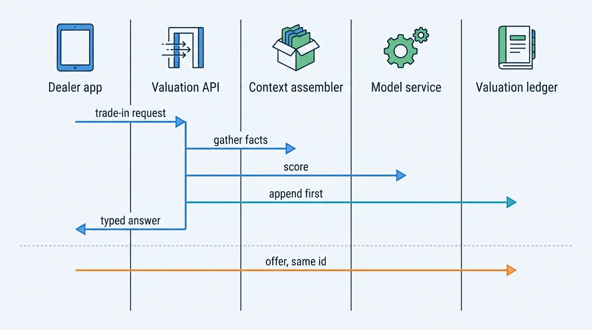
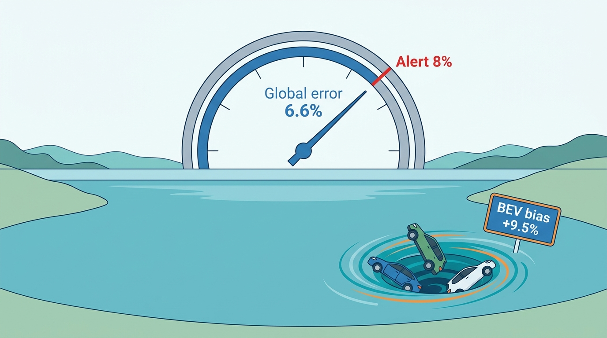
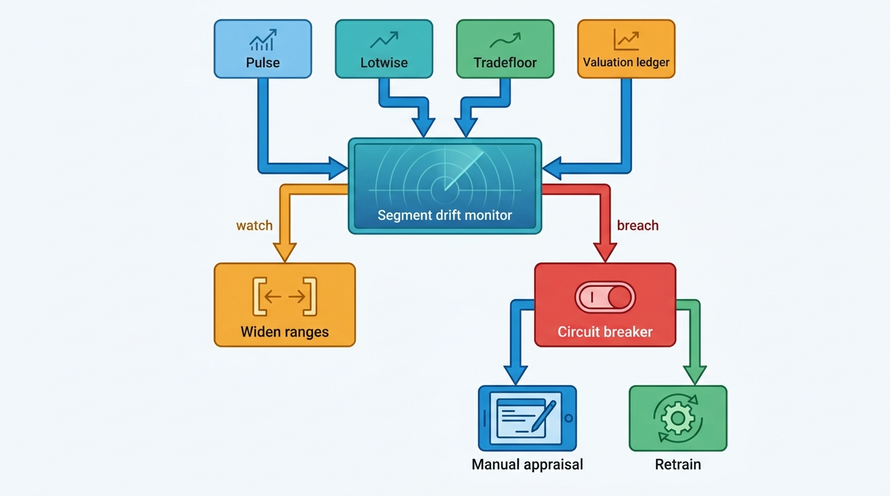

> **IN THIS CHAPTER, YOU WILL:** Take a valuation engine apart: the value types it must keep apart, the methods behind them, the answer it should return, the ledger that records every answer, and the back-testing, drift monitoring and governance that keep it honest when used-car prices move fast in one segment.

> **WHY THE BUSINESS CARES:** A dealer who pays 9% too much for a trade-in loses most of that car's gross profit before it reaches the forecourt. A lessor that sets reserve prices from an inflated value watches its cars fail to sell. A valuation sold per call is only worth its price while the people who rely on it are making money.

> **WHY ARCHITECTS SHOULD CARE:** The valuation engine reads almost every other fact the platform holds: identity, specification, mileage, history, condition, battery health and market data. Appraisal, pricing, trade, consumer checks and the data API all depend on it. Its contract, its ledger and its drift controls decide whether an error in one of those inputs, or a move in one market segment, stays small or spreads to every decision.

> **KEY POINTS:**
>
> * **A valuation is a typed, evidenced answer, not a number.** It names the value type (retail, trade-in, trade, maximum purchase price, residual), returns a range and a confidence flag, shows comparables and adjustment lines, and can answer "no valuation" when the evidence is thin. Manheim's minimum-sample rule and Auto Trader's "No analysis" label are the public models.
> * **The valuation ledger is the backbone, not an audit afterthought.** Record every valuation with its inputs, input fact versions and model version, and link it to the offer, purchase, list price and sale that followed. The ledger turns accuracy into a measured property, lets a corrected fact find every valuation it touched, and lets a dealer see why the number was what it was.
> * **Watch drift per segment, with leading indicators, and gate decisions on it.** Realized sale prices arrive a stock turn after the valuation, and a 9.5% error in battery-electric cars barely moves a global error metric. Monitor signed bias by segment, watch asking-price and stand-time signals that move first, and put a circuit breaker per segment on automated buying decisions.

> **[FAILURE PATTERNS THIS CHAPTER ADDRESSES](where-vehicle-platforms-go-wrong.html):**
>
> * **The Confident Valuation** — a value served without range, comparables or a per-segment back-test keeps being trusted for weeks after its segment's market has moved.
> * **Spec Guesswork** — when edition and options are guessed, the model values a different car than the one on the forecourt, and the error looks like model noise.
> * **The Sticky Error** — a corrected mileage or damage fact lives on in every valuation, offer and stock price computed from it unless the ledger can find them.

 
Ask three people what a 2022 Volkswagen ID.3 with 48,000 kilometers is worth and you get three honest, different answers. The dealer who might take it in trade wants to know the most they can pay and still earn a margin. The lessor returning it wants the price it will fetch at a trade auction next week. The consumer selling it wants to know whether the offer in front of them is fair. **Each question has its own value type, its own condition assumption and its own cost of being wrong**, and a valuation engine that answers all three with one number answers none of them well.

The engine also sits at the point where every upstream error turns into money. A wrong edition from the specification resolver, a mileage recorded in miles instead of kilometers, a damage event attached to the wrong car or a market sample that lags a falling segment all arrive as a wrong price. The dealer acts on it in the auction lane or at the trade-in desk. **The valuation is where the platform's data quality gets a price tag**, and the dealer pays it.

This chapter owns the **valuation ledger**, the **maximum purchase price**, **valuation confidence** and the **back-test**. It builds on [[market-data]], [[specification-and-equipment]], [[vehicle-history]] and [[provenance-and-data-quality]], and hands condition to [[condition-and-damage]], battery health to [[ev-battery-health]], the appraisal workflow to [[vehicle-acquisition]] and price-setting to [[used-car-pricing]].

## Setting the Scene at Axleby: Fourteen Weeks of Optimism

Axleby, the fictional vehicle data and dealer software group this book follows (see [[meet-axleby]]), values cars through **Vantage**, a valuation engine that came with the 2021 acquisition of Wertlauf in Munich. Vantage is Python with gradient-boosted models trained in Google Cloud on BigQuery and Vertex AI, served through an API on AWS, with a **valuation ledger** in PostgreSQL. It retrains weekly. In 2026 it issued **19 million** valuations. Lotwise Appraise uses them for trade-in offers, Lotwise Stock & Pricing for a nightly recomputation of about **350,000** stock cars (stored as price-position signals, not as issued valuations), Tradefloor for trade guidance, Odolo for consumer reports, and some of the **640** API clients, lessors and insurers among them, at €0.18 a call.

In **January 2027**, Ines Marchetti, Group Chief Architect since 2026, asked Priya Raman (VP Data and Valuation) and Jonas Kessler (Head of Engineering, Wertlauf) for a review of the **EV Overvaluation** (EV: electric vehicle). The facts were already known. In 2026, after used battery-electric vehicle (BEV) prices fell, Vantage overvalued used BEVs by **9.5%** on average for **14 weeks**, from 11 May to 16 August, before drift monitoring caught it. Fleetmoor Lease and two Lotwise dealer groups complained. Ines wanted the mechanism, not the apology.

Jonas's team laid out the window week by week. The numbers below are Axleby illustrations.

| What Vantage measured in 2026 | Before the window (Mar–Apr) | During the window (11 May–16 Aug) |
| --- | --- | --- |
| Global median absolute percentage error (MdAPE), all fuel types | 6.1% | 6.6% |
| Global alert threshold on MdAPE | 8.0% | 8.0% (never breached) |
| BEV share of valuations served (NL and BE) | 9% | 10% |
| BEV signed bias (valuation minus realized price, as a share of realized price) | +0.7% | **+9.5%** average, **+13.1%** peak (week 12) |
| Median BEV stand-time on Lotwise | 41 days | 63 days |
| Fleetmoor BEV no-sale rate on Tradefloor | 18% | 41% |

Three findings came out of the table.

First, **the global metric could not see the problem**. A 9.5% bias in a tenth of the traffic, mixed with a slightly negative bias elsewhere, moved the global error by half a point. The alert sat at 8%.

Second, **the per-segment check existed but ran on the wrong evidence**. Vantage computed bias by fuel type monthly, against realized Lotwise sale prices, and needed 400 sales per segment before it reported. A car valued in May was usually sold in July: Lotwise's average days-to-turn is **58**, and BEV stand-time had grown to 63 days. The check reported in week 14.

Third, **weekly retraining did not help**. The training set held twelve months of prices with equal weight, so each week added a few days of lower BEV prices to a year of higher ones. Retraining was frequent; what it learned from was slow.

Meanwhile the leading signals sat in Axleby's own data. In **Pulse**, the market data lake, the median Dutch BEV asking price fell for nine weeks in a row from late April; BEV stand-time on Lotwise rose every week; price cuts on BEV adverts doubled. Nobody connected those dashboards to Vantage.

The cost fell on customers. Fleetmoor set its Tradefloor reserve prices from Vantage trade values, and its returned BEVs failed to sell. Two dealer groups bought **610** BEV trade-ins at maximum purchase prices suggested from Vantage; a later comparison with their sale prices put the overpayment at about **€1.1 million**.

So the question Ines put to the company board, when it approved One Dossier in March 2027, was not "how do we make the model more accurate". It was **what should a valuation promise, how will we know when it stops keeping that promise, and what should happen to decisions built on it while we find out?**

## What a Valuation Is

### Value types

A used car has several prices, each tied to a channel, a condition assumption and a margin. The definitions below follow published ones: Kelley Blue Book's (KBB) value definitions (n.d., accessed 2026-10), Auto Trader UK's valuation documentation (2024, updated 2026), and the 2024 product description of Deutsche Automobil Treuhand (DAT) for its German valuation service.

| Value type | Who pays whom | Condition assumption | Typical evidence | Published examples |
| --- | --- | --- | --- | --- |
| **Retail (asking)** | Dealer advertises to consumer | Reconditioned, retail-ready | Dealer advert prices | Auto Trader "Retail"; KBB Typical Listing Price |
| **Retail (transaction)** | Consumer pays dealer | Reconditioned | Dealer sale records | KBB Fair Purchase Price |
| **Trade-in (part-exchange)** | Dealer pays consumer | As appraised | Auctions, appraisals, offers | KBB Trade-In Value; Auto Trader "Part-exchange" |
| **Trade (wholesale)** | Dealer to dealer, auction | As is, not reconditioned | Auction and B2B prices | Manheim Market Report; KBB Auction Value; Auto Trader "Trade" |
| **Private** | Consumer to consumer | As is, no warranty | Private adverts | KBB Private Party; Auto Trader "Private" |
| **Dealer selling / purchase value** | Dealer to consumer / consumer to dealer | Per DAT condition entry | Transactions reported by manufacturers and customers, market research | DAT *Händlerverkaufswert* and *Händlereinkaufswert* |
| **Maximum purchase price** | The dealer's own ceiling | The dealer's reconditioning plan | Retail target minus costs and margin | Not published; computed in dealer tools |
| **Future (residual)** | Lessor, lender | Projected mileage, average condition | Depreciation history, supply forecasts | Auto Trader Future Valuations (up to six years) |

A "trade" value from one provider and one from another are different products, built on different evidence. **A valuation without its value type is dangerous**: a lessor that reads a retail value as a trade value sets reserves that never clear.

**Figure 1:** *One car has several honest prices; a valuation that does not name its value type invites a lessor to set reserves from a retail number.*

### The maximum purchase price

The **maximum purchase price** (MPP, sometimes called the buy box) is the most a dealer can pay for a car and still earn its target margin. It is a computed decision, not a market fact:

> MPP = expected retail transaction price − reconditioning cost − transport and preparation − holding cost for the expected days to sell − target gross margin

Every term has an owner: the valuation engine for the retail price, the condition report for reconditioning ([[condition-and-damage]]), market data for days to sell ([[market-data]]), and the dealer for holding cost and margin ([[dealer-and-data-economics]]). The appraisal that turns MPP into an offer belongs to [[vehicle-acquisition]].

The MPP makes the cost of error asymmetric. **Overvaluing a car the dealer buys is a realized loss; undervaluing it is a lost car.** A dealer who loses a trade-in to a competitor loses a margin opportunity. A dealer who buys at 9% too much loses money on a car it already owns. Any engine whose output feeds an MPP should be judged by signed bias, not only by error size.

The engine should expose the MPP calculation as visible lines, not one opaque "buy at" number, so that a dispute is about a line: the reconditioning estimate, the days to sell or the market price.

### A valuation is a typed answer

I model a valuation as a typed record, not a number, and make that record the contract every Axleby product consumes:

| Field | Example | Why it is there |
| --- | --- | --- |
| Value type and channel | `trade_in`, NL | The question being answered |
| Point value and range | €21,400; 80% range €20,300–€22,600 | A number and how far to trust it |
| Confidence flag | `normal`, `thin_sample`, `fallback_model`, `stale_market` | Why the range is what it is |
| Basis | EUR, value-added tax (VAT) margin scheme, registration tax included, km | What the number includes |
| As-of | 2027-04-14, market surface of 2027-04-13 | When it was true |
| Adjustment lines | base, mileage, options, condition, battery, region | What moved it |
| Comparables | 8 observation ids with differences | Evidence the dealer can check |
| Inputs and versions | AVK, mileage reading id, spec version, condition report id | What the engine believed about the car |
| Method and model version | `vantage-gbt 2027.15`, adjustment set 41 | What computed it |
| Valuation id | ledger key | So everything downstream can point back |

**Basis** matters more across borders than inside one market. A Dutch value may include the registration tax BPM (*belasting van personenauto's en motorrijwielen*); a German *Händlerverkaufswert* does not. Under the EU margin scheme, VAT applies to the dealer's margin; a VAT-qualifying car carries VAT on the full price. A cross-border trader comparing values must normalize basis first. [[registration-and-trade-services]] owns BPM; [[deals-and-sales-documents]] owns the margin scheme.

### Valuation confidence

**Valuation confidence** is the engine's statement of how far a value can be trusted, returned with the value. It has two parts. A **range** is an interval expected to contain the realized price with a stated probability; an 80% range should contain 80% of outcomes. A **confidence flag** names the reason the range is wide or the value is unusual: few comparables, a fallback model, an edition the resolver could not determine, a stale market surface, or a segment under a drift warning.

Manheim publishes the clearest commercial example. Its Manheim Market Report (MMR) help page (modified June 2026) says the MMR "doesn't make assumptions when it lacks the necessary data". A trim needs at least six transactions in the past year and two in the past 90 days. Below that, MMR may estimate from related trims and shows a "Small Sample Size" icon, and it withholds mileage depreciation and forecasts when data are insufficient. Auto Trader UK's Price Indicator shows "No analysis" when there is no valuation or not enough specification data. It excludes cars under £1,500 or over £70,000, very new cars, cars over 15 years old, written-off cars, imports and rare cars (help center article, 2024, updated September 2026).

**An applicability contract, published and enforced, is the cheapest accuracy improvement available.** It says which cars the engine values and which it refuses. "No valuation" for a 2012 Japanese import with an unknown edition costs one lost call; a confident wrong number costs the dealer a car's margin and the engine its credibility.

### Guide values, own values and decisions

A platform meets three kinds of number, and they belong in different stores.

- **Licensed guide values** come from providers such as DAT, Autovista (owned by J.D. Power since March 2024), Cap HPI or Manheim. Their licenses usually restrict caching and redistribution, so they live behind a provider gateway with license checks ([[data-licensing-and-governance]]).
- **Own valuations** are what Vantage computes. They are Axleby's product and its liability.
- **Decisions** are what a dealer did: the offer made, the MPP accepted or overridden, the retail price set. They belong to the dealer's dossier ([[inventory-and-vehicle-dossier]]) and link to the valuation they were based on.

Keeping them apart answers the question a dealer asks after a bad purchase: was the number wrong, or was it overridden?

## Methods: From Guide Books to Gradient Boosting

Five methods recur, and production engines combine them.

**Guide books and licensed values.** A provider publishes values per derivative, age and mileage band, adjusted for options and condition. DAT's 2024 product description for SilverDAT valuateFinance is unusually candid about the method. From first registration and current mileage it computes the dealer selling value, then the dealer purchase value using a trade margin set by DAT or the contract partner. Optional equipment depreciates by time value or residual value, and condition, repairs and the number of previous owners can be recorded and valued. The same document says values are "only an approximation", that condition criteria "are partly subjective", and that DAT "does not owe a fully correct valuation". That disclaimer is honest, and every provider should write one.

**Comparables.** Find the closest observed adverts or transactions and adjust for differences. Dealers trust comparables most because they can check them; they are also most exposed to thin markets and to license limits.

**Depreciation curves.** Fit value against age and mileage per segment, then apply option and condition adjustments. Curves are stable and explainable and suit residual forecasting. They react slowly to shocks.

**Statistical averaging with adjustments.** Manheim's MMR help page (2026) describes a base value as "the average wholesale price, odometer, condition grade and build quality" of recent transactions, with recent transactions weighted more heavily and outliers removed. Adjustments for odometer, region, condition and exterior color are added to it, and MMR "compute[s] a separate average mileage and per-mile depreciation factor for every vehicle in its database". The recalculation runs nightly. It is the most detailed public description of a commercial method, and it rests on observed US auction prices.

**Machine learning on tabular features.** Auto Trader UK said in its June 2023 results that its specification-adjusted valuations use machine learning "based on c.500,000 [observations] that we see each day" (evidence more than three years old; the figure has probably changed). No major provider publishes its model family, features or error distributions. Gradient-boosted trees over derivative, age, mileage, options, region, condition and market metrics are a common industry choice; treat any claim beyond that about a specific company as inference. Research has moved toward **uncertainty**: the ProbSAINT paper (arXiv, March 2024; IEEE BigData industry track) argues that automated pricing needs "the ability to flag predictions that the model is unsure about".

Vantage combines three of these: a gradient-boosted model for the base retail value; versioned adjustment tables for options, condition and battery health as visible lines; and the eight nearest Pulse observations as comparables. Licensed guide values are inputs where licenses allow, never outputs. **A model that bakes every adjustment into one prediction can be accurate and still unarguable**; base plus lines lets the dealer override one line with a reason without overriding the model.

## Architecture: Vantage as a Service With a Memory

### Components

| Component | Responsibility | Design rule |
| --- | --- | --- |
| **Valuation API** | One contract for every caller: Lotwise, Tradefloor, Odolo, JSON API clients | Returns the typed answer; never a bare number |
| **Context assembler** | Gathers identity (Anchor, keyed by the Axleby Vehicle Key, AVK), specification (Specbook), odometer and damage (Tracewell), condition report, battery certificate | Records the version of every input fact it used |
| **Market surface** | Nightly base values and segment statistics from Pulse, with an intraday overlay | Stamped with the observation window it was built from |
| **Model service** | Scores the base value; holds the champion model and any challengers | Model version on every score |
| **Adjustment engine** | Applies option, condition, battery and region lines | Versioned tables; each line overridable with a reason |
| **Provider gateway** | Licensed guide values per country | License checks in the request path (Charter); no caching beyond license terms |
| **Valuation ledger** | Immutable record of every valuation and the decisions and outcomes linked to it | Append only; written before the answer is returned |
| **Model operations** | Training, back-testing, release gates, drift monitors, segment circuit breakers | Per-segment metrics; leading indicators |

**Figure 2:** *Vantage as a service with a memory. Every answer is written to the ledger with the versions of the facts and model behind it. Outcomes flow back to the same ledger, and model operations use it to back-test, watch bias by segment and trip circuit breakers.*

The loop on the right is the design choice that matters most. In 2026 Vantage's ledger recorded inputs and outputs only: nothing linked a valuation to the offer, purchase and sale that followed, and no record carried a segment key. **A ledger without outcome links is a log, and a log cannot tell you whether the valuations were right.**

### Requirements per interaction

| Interaction | Caller | Latency | Freshness | Consistency | Availability |
| --- | --- | --- | --- | --- | --- |
| Trade-in appraisal | Lotwise Appraise, mobile, at the trade-in desk or the auction lane | Illustrative target p95 under 800 ms *(assumption)* | Market surface at most 24 hours old; condition from today's inspection | Ledger write committed before the value is shown | Degrade to the cached surface with a `stale_market` flag; never block the appraisal |
| Valuation API call | Data clients (lessors, insurers, software vendors) | Illustrative target p95 under 300 ms *(assumption)* | As above | Ledger write and metering event share one idempotency key | Published availability target; documented degraded mode |
| Nightly stock recomputation | Lotwise Stock & Pricing, about 350,000 cars | Batch window 01:00–04:00 Central European Time *(assumption)* | After the nightly surface is built | Stored as stock signals with surface and model version, not as ledger entries | Rerun the batch; yesterday's signal stays with its date |
| Consumer range | Odolo report | Under 1 s | 24 hours acceptable | Range only, no MPP | Cached; omit the value rather than fail the report |
| Residual forecast | Lessors, by file or API | Batch | Weekly | Every forecast stamped with its vintage | Not real time |
| Back-test and drift | Model operations | Daily jobs | Leading indicators daily; realized outcomes as they arrive | Rolling-origin: only data available on the valuation date | Alerts per segment |

Two rows carry the architecture. The appraisal row means scoring cannot depend on a live cross-cloud call alone: Vantage's models run on Vertex AI in Google Cloud while its callers run on AWS, and a failure between them would stop trade-in offers at the roughly 4,800 Lotwise rooftops that use Appraise. The cached surface on AWS, with a flag, keeps the appraisal moving ([[reliability-and-dependencies]]). The API row ties the ledger to billing: one idempotency key per request gives one ledger entry and one billable event ([[billing-and-metering]]).

### The valuation ledger

The **valuation ledger** is the immutable record of every valuation the engine issued, with its inputs, the versions of those inputs and of the model, the answer, who saw it, and links to the decisions and outcomes that followed. It is never updated in place: a correction is a new valuation that points to the one it supersedes.

A ledger entry in One Dossier holds:

- **Request:** caller, tenant and user, purpose (appraisal, API, report, consumer), value type requested, idempotency key.
- **Context:** AVK, the mileage reading id and value, specification version and edition confidence, condition report id, battery certificate id, location.
- **Answer:** point value, range, confidence flag, basis, adjustment lines, comparable observation ids (ids, not copies, where licenses forbid copying), market-surface version, model and adjustment-table versions.
- **Segment key:** fuel type, age band, price band, body type, market. Computed at write time, so bias can be grouped without re-deriving it.
- **Outcome links,** appended as events arrive: offer made and accepted, purchase price, MPP override and reason, reconditioning cost, list price and price changes, sale price and date, or trade clearing price on Tradefloor.

The ledger does four jobs that nothing else can do.

1. **It measures accuracy.** A back-test is a query: a segment's valuations in a period, joined to their realized prices.
2. **It explains a number after the fact.** When a dealer disputes an offer six months later, the ledger shows what the dealer saw then, not what the model would say now.
3. **It finds what a correction touched.** In the **Odometer Correction** of May 2027, a Kilometra batch recorded miles as kilometers for **2,870** UK-imported cars; by the time it was corrected, **6,140** valuations carried the wrong mileage. Because every entry holds the mileage reading id, finding them is one query ([[journey-data-correction]]).
4. **It is evidence.** Lenders, insurers and tax authorities may ask what value was given, when, and on what basis. In the Netherlands a price list (*koerslijst*) or valuation report can become evidence in a BPM calculation for an imported car.

Axleby keeps the hot ledger in PostgreSQL for 24 months and streams every entry and outcome link to Snowflake and BigQuery for back-testing. Retention follows the longest legal need of its purposes. Personal data, such as a seller's name attached to an appraisal, stays in the dossier and is referenced, not copied, so it can be erased without breaking the ledger ([[privacy-and-retention]]).

### Explaining a value to a dealer

Dealers trust a number they can argue with. Vantage returns an **adjustment waterfall** and **comparables** with every trade-in value:

| Line | Amount | Source |
| --- | --- | --- |
| Base retail, 2022 VW ID.3 Pro, 58 kWh, NL | €23,900 | Model `2027.15`, surface of 2027-04-13 |
| Mileage 48,000 km vs segment median 41,000 km | −€540 | Mileage curve, adjustment set 41 |
| Options: heat pump, Design package | +€610 | Specbook option list, version 7 |
| Battery: certified state of health 91% | −€320 | Battery certificate ([[ev-battery-health]]) |
| Condition: two panels, one rim | −€1,150 | Condition report ([[condition-and-damage]]) |
| **Expected retail** | **€22,500** | 80% range €21,300–€23,700; `normal` |

Beside it, Lotwise shows eight comparables with distance, mileage and days on market. Each line can be overridden with a reason code, written to the ledger. **Overrides are training signal.** When dealers override the condition line upward a hundred times a week in one segment, either the condition tables are wrong or the inspection app is.

Explainability has a license boundary. A comparable from a portal advert may be shown only if Axleby's agreement with the portal allows it; Charter, Axleby's license and purpose register, enforces that in the request path ([[data-licensing-and-governance]]). Otherwise the ledger stores the id and the screen shows a summary ("6 similar cars within 50 km, median €22,700").

**Figure 3:** *A trade-in valuation. The ledger write happens before the dealer sees the number, and the offer that follows links back to the same valuation id, which is what makes a back-test and a correction possible.*

## Back-Testing and Drift: Knowing When the Engine Is Wrong

### The back-test

A **back-test** measures how well valuations issued in the past matched what happened next, using only information available on the valuation date. For a valuation engine, a defensible suite reports, per segment:

- **Median absolute percentage error** and the share of valuations within ±5% and ±10% of the realized price.
- **Signed bias**: an unbiased engine with a 7% error loses some deals and wins others; a +9% bias overpays on every purchase.
- **Range coverage:** whether 80% ranges contain about 80% of outcomes. Ranges that are too narrow are the technical form of **The Confident Valuation**.
- **Rolling-origin evaluation**, which re-runs the model as of each past date and never lets later data leak into an earlier valuation.
- **Separate scores against transaction prices and against final asking prices.** Asking-price targets inherit dealer pricing habits; transaction prices are the truth but arrive later and less often.

Published examples are thin. Auto Trader UK publishes forecast accuracy of 99%, 97% and 95% at one, three and six months (help center, January 2024, updated August 2026), measured **against its own later valuation, not against sale prices**, with the metric undefined. No provider found publishes error distributions by segment. A seller that published its segment-level back-test, with the method, would stand out.

### What counts as ground truth

Realized prices are scarce in Europe. There is no public register of retail sale prices in the Netherlands, Belgium, Germany or the UK. A change of owner in the register confirms a transfer but not a price. Axleby's ground truth comes from three sources, each with a lag and a bias:

| Ground truth | Lag after valuation | Bias to correct for |
| --- | --- | --- |
| Lotwise sale prices (dealers' own sales administration) | A stock turn: 58 days on average | Only cars Lotwise dealers sold; sales admin used by some rooftops only |
| Tradefloor clearing prices | Days to weeks | Trade prices only; lessor-heavy mix |
| Final asking price before de-listing (Pulse) | Days to weeks | Asking, not transaction; a de-listing is a probable sale, not a sale ([[market-data]]) |

The lag column explains the EV Overvaluation. **A back-test against realized retail sales runs a full stock turn behind the market.** It is the right measure of accuracy. It is the wrong alarm.

### Drift: two mechanisms, one lesson

The 2021–2024 used-car market supplied the evidence that valuation models drift, and it showed two different mechanisms.

| Period | Market | What happened | Source |
| --- | --- | --- | --- |
| Dec 2021 | US wholesale | Manheim Used Vehicle Value Index at a record 236.2, +46.6% year on year | Cox Automotive, January 2022 |
| Apr 2022 | UK retail | Auto Trader Retail Price Index peak annual growth of 32.2% | Auto Trader, December 2022 |
| Jun 2023 | UK used BEVs | Average used EV £31,430, −19.1% year on year, "the highest rate of YoY price contraction recorded by the Index"; EV supply +174%, demand +6% | Auto Trader, July 2023 |
| Dec 2023 | UK used BEVs vs others | Used EVs −22.7% year on year; petrol −3.8%, diesel −2.2% | Auto Trader, January 2024 |
| Dec 2023 | US wholesale | Index 204.0, −7.0% year on year, nearly −21% from the peak | Cox Automotive, January 2024 |
| Q4 2023 | US rental fleet | Hertz decided to sell about 20,000 EVs and recognized about $245 million of incremental net depreciation | Hertz Form 8-K, January 2024 |

The first mechanism is a **macro shock**: the 2021–22 supply shortage moved all prices together, and a global error monitor catches it. The second is a **segment shock**: in 2023–24 used-EV prices fell while petrol and diesel barely moved. Auto Trader attributed the June 2023 fall to EVs returning from three- and four-year lease and finance terms; press coverage of Hertz's write-down pointed to new-EV price cuts. **A segment shock is diluted in a global metric**, which is what happened to Vantage in 2026.

**Figure 4:** *A 9.5% bias in a tenth of the traffic barely moves a global error of 6.6% against an 8% alert; segment shocks need segment monitors.*

Drift monitoring therefore has to be **per segment** (fuel type, age band, price band, body type, market) and has to watch **leading indicators** that move before sale prices are known:

- **Asking-price movement** in the segment, from Pulse, against the movement in Vantage's own outputs for the same segment.
- **Stand-time and price-cut rate** on dealer stock: cars that sit and get cut are priced above the market.
- **Supply growth** in the segment (Auto Trader's June 2023 release reported EV supply up 174% year on year).
- **New-car list-price changes**, which Auto Trader names as an input to its future valuations (help center, January 2024).
- **Override rate**: dealers overriding the value downward in one segment.
- **Clearing and no-sale rates** on trade channels: Fleetmoor's no-sale rate rising from 18% to 41% was a market signal, not just a complaint.

None of these is ground truth; together they are an early warning that arrives weeks before the back-test.

**Figure 5:** *Segment drift monitoring. Leading indicators from market data, dealer stock and trade channels arrive weeks before realized prices. The monitor widens ranges when a segment needs watching and trips a per-segment circuit breaker on a breach, leaving every other segment untouched.*

### Circuit breakers per segment

When drift is suspected, the response should be proportionate and local. Vantage now has a **segment status** with three states, returned with every score:

| Status | Trigger *(Axleby thresholds)* | What changes |
| --- | --- | --- |
| `normal` | All indicators within bands | Standard ranges; suggested MPP on |
| `watch` | Any leading indicator out of band for two weeks, or bias above 3% on early outcomes | Ranges widened; confidence flag shown to dealers and API clients; daily review |
| `restricted` | Bias above 5% on early outcomes, or three indicators out of band | Suggested MPP and automated offers switched off for the segment; values shown as a range with "manual appraisal advised"; emergency retrain and review |

Restricting a segment is a product change dealers notice, so it belongs to the model and product owners, not to an on-call engineer. It keeps the other 90% of valuations running.

When a valuation becomes a **binding decision**, gate it on confidence and segment health. The best-documented cautionary case is outside cars. **Zillow** reported about $304 million of inventory write-downs in the third quarter of 2021 in its home-buying business, Zillow Offers. Its CEO said "the unpredictability in forecasting home prices far exceeds what we anticipated" (8-K, November 2021). The FY2021 10-K recorded **$407.9 million** of write-downs "as a result of purchasing homes at higher prices than the Company's then current estimates of future selling prices after selling costs". Carvana's FY2025 10-K (February 2026) names the car-retail version of the risk: price volatility "can also complicate pricing algorithms, appraisal accuracy, and residual value assumptions". Vroom's 2024 wind-down is not a comparable case: its announcement attributed it to capital, not pricing.

### Retraining cadence and stability

Weekly retraining is only as responsive as its training window and weights. Vantage now uses **recency weighting**, as Manheim describes for MMR, plus per-segment correction terms refreshed daily from asking-price movement between full retrains.

Responsiveness has a cost: **values that move every day are hard to price against**. Cox Automotive described MMR in January 2022 (an older source, but consistent with the 2025 dampening change below) as "designed to be highly stable and avoid overreacting to short-term market ups and downs". In January 2025 Manheim changed its "price dampening" threshold "to reduce fluctuation of MMR values". My rule is to **dampen the published value, never the monitor**: smooth what dealers see, within limits, but run drift detection on undamped data and flag when the value is held back.

## Model Governance

A valuation model is a product release. In One Dossier, a Vantage model reaches production only through gates that Priya Raman's team owns:

- **Model card** per release: training window and weights, features, segments covered and excluded, back-test results per segment, known weaknesses. The [[toolkit]] holds the template.
- **Back-test gate:** a challenger must match or beat the champion on signed bias and range coverage in every segment with enough data, not only on global error.
- **Shadow period:** the challenger scores live traffic for two weeks without being shown, as unbilled ledger entries with a `shadow` purpose.
- **Staged release** by market and segment, with rollback to the previous model version by configuration.
- **Applicability contract** published to API clients: segments valued, segments refused, flags and their meanings.

**The EU AI Act.** Regulation (EU) 2024/1689 lists high-risk uses in its Annex III. Point 5(b) covers AI systems used "to evaluate the creditworthiness of natural persons or establish their credit score", and point 5(c) covers risk assessment and pricing for natural persons in life and health insurance. A used-car valuation is neither, so my reading is that Vantage is not high-risk as built. The boundary: a lender that feeds Vantage values into an AI system scoring a consumer's creditworthiness may operate a high-risk system, with Axleby as a supplier into it. Counsel should confirm both points. Article 4, on AI literacy for providers' and deployers' staff, has applied since 2 February 2025 (Article 113); the Digital Omnibus on AI narrowed it. That Omnibus, Regulation (EU) 2026/1744, published on 24 July 2026, moved the high-risk obligations to **2 December 2027** for Annex III systems and **2 August 2028** for Article 6(1) systems ([CELEX 32026R1744](http://publications.europa.eu/resource/celex/32026R1744)); [[ai-in-dealer-workflows]] covers the amended timetable. Check it again before relying on these dates.

The governance that matters day to day is not regulatory. **Dealers spend money on the engine's word because they cannot check it themselves**; being able to say which model priced which car, on what evidence, and how that model performed in that segment, is how the engine keeps that trust.

## In Practice

### What public sources show

- **Manheim (Cox Automotive), US.** Beyond the MMR method described above, the MMR now carries an EV Battery Health score from 0 to 100 (help page, 2026). The Manheim Used Vehicle Value Index methodology (January 2023) documents an outlier rule (price *and* mileage beyond 2.6 standard deviations), mix weighting and seasonal adjustment. Together they are the best public template for a valuation contract.
- **Kelley Blue Book, US.** KBB's value definitions (n.d., accessed 2026-10) separate trade-in, private party, fair purchase price, typical listing price and auction value. The Instant Cash Offer is "a fixed offer amount" valid for seven days and redeemable after the dealer verifies condition and features. That is the clearest public example of a valuation becoming a binding offer with an expiry. It belongs in the offer model ([[vehicle-acquisition]]), not in the valuation.
- **Cox Automotive scale.** Launching its DRiVEQ data brand in February 2022, Cox reported about **18 billion** valuation requests a year across its businesses: valuation as the common currency of a portfolio ([[case-cox-automotive]]).
- **Auto Trader UK.** Valuations became a retailer module in April 2023 (FY2023 results, June 2023). Its help center (2024, updated 2026) documents the API: four value types, a features array, a five-level condition enum, future and trended valuations, and metrics such as days to sell. It also notes that sandbox and production return different values by design, so integration tests should assert on shape, not values. Auto Trader's consumer price flags are built on the specification-adjusted valuation (FY2026 results, May 2026). [[case-auto-trader-uk]] follows the business.

> **INFERENCE, NOT DOCUMENTED:** None of these companies publishes its model internals, feature sets or segment-level error. The way their values are computed beyond what is quoted above, including how they handled the 2023–24 EV shock, is not public. The architecture in this chapter is a reference design consistent with their published contracts, not a description of their systems.

### Axleby: replaying the EV window

In April 2027 Jonas's team replayed the 2026 window through the new design, with the ledger rebuilt from archived requests and outcomes. The numbers are Axleby illustrations.

| Control | Would have fired | Effect on the window |
| --- | --- | --- |
| Segment asking-price indicator (BEV, NL) | Week 3 (late May) | Segment to `watch`; ranges widened by about 60% |
| Stand-time and price-cut indicators | Week 4 | Second indicator out of band |
| Early-outcome bias (Tradefloor clearing prices) | Week 5, at +5.8% | Segment to `restricted`; suggested MPP off for BEVs |
| Recency-weighted retrain plus daily segment correction | From week 5 | Replayed bias fell to +2.4% by week 7 |
| Global MdAPE alert | Never | — |

On the replay, the 14-week exposure shrinks to about five weeks, and the estimated overpayment on the 610 trade-ins falls from €1.1 million to about €0.3 million. The estimate flatters the design, since dealers can still pay above a range; the point is not the figure. **The early signals were in Axleby's own data, and the 2026 architecture had no path from them to the model or to the buying decision.**

The replay also found the problem the 2026 review had missed. About **7%** of BEV valuations in the window used an edition the specification resolver had marked as low confidence: battery size unknown. For an ID.3, the battery size decides which derivative is being valued, so a wrong guess moves the base value, not just an adjustment line. Those valuations had normal ranges; they now carry a `spec_uncertain` flag, a wider range and a prompt to confirm the battery. That is **Spec Guesswork** caught where it enters ([[specification-and-equipment]]).

## Failure Handling

| Failure | Detection | Recovery |
| --- | --- | --- |
| **Duplicate requests** (app retries, double taps, client retry loops) | Idempotency key per request | Same answer and same ledger entry returned; one billable event ([[billing-and-metering]]) |
| **Conflicting inputs** (dealer types 48,000 km; Tracewell's latest reading is 61,000 km) | Lotwise checks the entry against Tracewell before it is stored | Vantage values from Tracewell's derived current odometer, not the raw entry, and lowers confidence when the odometer judgement is *rollback suspected* or *not assessable* ([[vehicle-history]]); both reading ids go to the ledger |
| **Incomplete records** (edition unknown, no condition report, no battery certificate) | Edition confidence and missing-input checks | Value from the base derivative with a wider range and a named flag; or "no valuation" outside the applicability contract |
| **Thin evidence** (rare derivative, few comparables) | Minimum-sample rule per segment | Fallback hierarchy (derivative → model → segment) with `fallback_model`; refuse below the floor |
| **Model service or cloud link down** | Health checks and timeouts on the scoring call | Serve from the cached nightly surface on AWS with `stale_market`; appraisal continues |
| **Market surface not rebuilt overnight** | Surface version older than 24 hours | Serve yesterday's surface with its date; stock recomputation waits rather than repricing on stale data |
| **Nightly stock recomputation partially fails** | Per-car status in the batch run | Retry failed cars; dealers see per-car value dates, not a silent mix |
| **Provider gateway outage** (licensed guide value unavailable) | Gateway circuit breaker | Answer without the guide-value input, flagged; never serve an expired cached guide value beyond its license |
| **Corrected input fact** (Odometer Correction) | Correction event names the fact versions it replaces | Ledger query finds affected valuations; re-value; notify dealers whose offers, MPPs or prices used them; [[journey-data-correction]] |
| **Segment drift** | Segment monitor | `watch` or `restricted` status; retrain; model card updated |

Two rules hold across the table. **Never return a degraded value without saying so**: every fallback has a flag, and every flag is in the ledger. And **never update a valuation in place**: a corrected valuation is a new entry that supersedes the old one, so the dealer's dispute about Monday's offer is settled with Monday's evidence.

## Trade-Offs

The sourcing question every group faces is how much of its valuation to build.

| Approach | Strengths | Weaknesses | Right when |
| --- | --- | --- | --- |
| **License guide values only** | Accepted by dealers, lenders and sometimes tax authorities; no model team | Per-call cost; redistribution limits; no control over drift response; no differentiation | Valuation is a supporting input, not a product |
| **Comparables only** | Explainable; dealers can check every line | Breaks in thin segments; license limits on showing portal adverts; noisy | Dense markets with licensed advert data; dealer-facing pricing tools |
| **Own ML model with adjustment lines** | Differentiating; fast response if monitored; can use the platform's own outcomes | Needs a model team, a ledger, back-testing and governance; liability for errors | Valuation is sold as a product and the platform has outcome data |
| **Hybrid: own model, licensed guides as inputs, comparables as explanation** | Combines accuracy, acceptance and explainability | Most complex; license terms must allow guide values as model inputs | A group that sells data and runs dealer workflows, as Axleby does |

A second trade-off runs across all four: **stability against responsiveness**. A stable value is easier to price against and slower to react; a responsive value tracks the market and erodes trust when it moves daily. Manheim's documented choice is stability with recency weighting and dampening. My choice for Axleby is the same for the published value, with undamped segment monitors and explicit flags.

The hybrid is right for Axleby under three conditions: its licenses allow guide values as model inputs, Lotwise and Tradefloor supply enough outcomes per segment to back-test, and the group funds model operations as a permanent team. If any of the three fails in a market, license the guide value there and say so in the applicability contract.

## Across Markets: What Changes by Country

| | Netherlands / Belgium | Germany | United Kingdom | United States |
| --- | --- | --- | --- | --- |
| Reference providers | NL: Autotelex price list, aggregators, Indicata. BE: mainly pan-European providers (Autovista, Indicata); no Belgian-specific provider verified | DAT, Schwacke (Autovista, J.D. Power since 2024) | Auto Trader UK, Cap HPI | Kelley Blue Book, Black Book, J.D. Power, Manheim MMR |
| Dominant evidence | Adverts spread over several portals, plus dealer data | Transactions reported by manufacturers and customers, plus market research (DAT 2024) | One dominant portal's adverts (Auto Trader) | Wholesale auction transactions |
| Identity key into the valuation | Dutch plate (*kenteken*) resolved through the register; vehicle identification number (VIN) | VIN, KBA key (type key from the Federal Motor Transport Authority, *Kraftfahrt-Bundesamt*), DAT code | Vehicle registration mark (VRM) resolved to a derivative id | VIN |
| Regulatory use of values | NL: price list or valuation report as evidence for BPM on imported cars; BE: not verified | Expert valuations (*Gutachten*) in insurance and disputes (practice; not verified here) | Insurance and finance | Loan-to-value and insurance total-loss practice |
| Units and basis | km; margin scheme or VAT; BPM included or not | km; margin scheme or VAT | miles; margin scheme or VAT; VAT 20% | miles; sales tax outside the value |
| What Axleby builds | Own Vantage values; guide values as inputs; BPM evidence kept separate | Wertlauf's market of origin; compete with DAT and Schwacke for data clients, accept their values where clients require them | Showroomly dealers mostly use Auto Trader valuations; Vantage UK only where Axleby has advert data | Not an Axleby market |

**What stays common:** the typed answer, the ledger, the applicability contract, back-testing, segment drift monitoring and circuit breakers.

**What becomes a market adapter or a rule set:** the identity key into the model (kenteken, KBA key, VRM, VIN); units and tax basis; the provider gateway's routing and license rules per country; the ground-truth sources; and in the Netherlands, the boundary between a Vantage value and a BPM valuation that a tax authority will accept. Axleby Trade's BPM engine uses the methods the tax rules recognize, not Vantage ([[registration-and-trade-services]]).

**What may be a separate product decision:** in the UK, where one portal sees most retail adverts and sells its own valuations, Showroomly integrates the portal's values where the dealer licenses them. Market structure decides whether valuation is a product or an integration.

## The Chief Architect's View

**Decide what a valuation promises, and publish it.** The typed answer, the applicability contract and the meaning of each flag are a contract for API clients and for Lotwise. Version them like any API ([[vehicle-data-apis]]) and make "no valuation" a legitimate answer.

**Make the ledger a platform capability, not a Vantage table.** Its outcomes live in Lotwise, Tradefloor and Pulse, so in One Dossier the ledger subscribes to dossier events on the event backbone ([[events-webhooks-and-sync]]). Without that, back-testing stays a quarterly spreadsheet.

**Assign drift to a person.** Jonas Kessler owns the models and the segment monitors; Priya Raman owns the product consequence of a restricted segment; Tomás Ferreira, Lotwise's Product Director, owns what the dealer sees when a suggested MPP is switched off. The leading indicators of 2026 lived in dashboards nobody on the valuation team watched.

**Separate the published value from the alarm.** Dampen what dealers see; never dampen what the monitor sees.

**Treat binding decisions as a separate risk class.** A consumer value, a suggested MPP, an automated offer and a lessor's reserve price carry different costs of error; gate the automated ones on segment status. If Axleby ever makes instant purchase offers, that is a balance-sheet decision with its own risk limits, and Zillow is the reference.

**Watch these over the long term:** segment-level bias and range coverage, published monthly; the share of valuations with any flag; override rates by segment; the outcome-link rate (the share of ledger entries that ever get an outcome); and the lag between a market move and a segment status change. If the outcome-link rate falls, back-testing goes blind before anyone notices.

## Questions to Ask

1. For each product that shows a value, which value type does it show, on what condition basis and tax basis, and does the screen say so?
2. What does the engine refuse to value, and where is that applicability contract published?
3. Does every valuation carry a range and a confidence flag, and do 80% ranges contain about 80% of realized prices, per segment?
4. Can you find, in one query, every valuation that used a given mileage reading, specification version or model version?
5. What share of last quarter's valuations has an outcome linked, and from which ground-truth sources?
6. What is the signed bias for battery-electric cars aged one to three years in each market, and when was it last measured?
7. Which leading indicators reach the drift monitor, and how many weeks ahead of the realized-price back-test do they move?
8. When a segment drifts, who decides to restrict it, what do dealers and API clients see, and how fast can it happen?
9. If the model service or the link to it fails during an appraisal, what does the dealer see?
10. Which licensed values and comparables may be stored, combined with others or shown to dealers, and where is that enforced?

The value a dealer acts on is only as good as the condition behind it. Two cars with the same plate history and mileage can differ by thousands of euros in panels, tires and interior, and the valuation's condition line is only as honest as the inspection that fed it. The next chapter, [[condition-and-damage]], covers how condition is captured, estimated and priced into buying and selling decisions.

## Sources and Evidence

*Company, product and investor sources*

- [Manheim Market Report (MMR) Help](https://site.manheim.com/tutorials/manheim-market-report-help), Manheim (Cox Automotive), modified 2026. Base value, recency weighting, outlier removal, adjustments, nightly recalculation, minimum-sample rule, projections, EV Battery Health score.
- [Unlock the Full Potential of MMR](https://site.manheim.com/news/unlock-the-full-potential-of-mmr), Manheim, 2024 with January 2025 update. Change to the price-dampening threshold.
- [Manheim forecast: growth in used vehicle values expected to continue through spring 2022](https://www.coxautoinc.com/news/manheim-forecast-growth-in-used-vehicle-values-expected-to-continue-through-spring-2022/), Cox Automotive, 2022. MMR described as designed to be stable.
- [Manheim forecast (December 2021 index)](https://www.coxautoinc.com/news/manheim-forecast/), Cox Automotive, 2022. Index record of 236.2.
- [December 2023 Manheim Used Vehicle Value Index](https://www.coxautoinc.com/market-insights/december-2023-muvvi/), Cox Automotive, 2024. Index at 204.0, decline from peak.
- [Used Vehicle Value Index summary methodology](https://site.manheim.com/wp-content/uploads/sites/2/2023/07/Used-Vehicle-Summary-Methodology.pdf), Manheim, 2023. Outlier rule, mileage adjustment, weighting, seasonal adjustment.
- [Cox Automotive introduces DRiVEQ](https://www.coxautoinc.com/news/driveq-launch), Cox Automotive, 2022. About 18 billion valuation requests a year.
- [Definitions of our values](https://b2b.kbb.com/kbb-vehicle-values/definitions-of-our-values), Kelley Blue Book, n.d., accessed 2026-10. Value types; Instant Cash Offer with seven-day validity.
- [Introduction to Current Valuations](https://help.autotrader.co.uk/hc/en-gb/articles/21923133513117-Introduction-to-Current-Valuations), Auto Trader UK, 2024, updated 2026. Value types, features array, condition enum, sandbox values.
- [Introduction to Future Valuations](https://help.autotrader.co.uk/hc/en-gb/articles/21945605916573-Introduction-to-Future-Valuations), Auto Trader UK, 2024, updated 2026. Six-year horizon.
- [How do you work out the future trended valuation?](https://help.autotrader.co.uk/hc/en-gb/articles/16450820091549), Auto Trader UK, 2024, updated 2026. Forecast inputs including new-car list prices.
- [How accurate is the trended valuation forecast?](https://help.autotrader.co.uk/hc/en-gb/articles/16450896474141), Auto Trader UK, 2024, updated 2026. 99/97/95% accuracy against its own later valuation.
- [Why do I have a Price Indicator on my advert?](https://help.autotrader.co.uk/hc/en-gb/articles/19212037724957), Auto Trader UK, 2024, updated 2026. "No analysis" and exclusions.
- [Retail Price Index releases, November 2022, June 2023, December 2023](https://plc.autotrader.co.uk/news-views/press-releases/retail-price-index-june-2023/), Auto Trader Group plc, 2022–2024. UK price peak and used-EV price fall, EV supply growth.
- [Full year results, year ended 31 March 2023](https://plc.autotrader.co.uk/media/3dbbyupi/fy-press-release-fy23-final_no_pw-0106.pdf), Auto Trader Group plc, 2023. Valuations module launch and machine learning on c.500,000 daily observations.
- [Full year results, year ended 31 March 2026](https://plc.autotrader.co.uk/media/usjleen0/full-year-press-release-fy26.pdf), Autotrader Group plc, 2026. Specification-adjusted valuations behind price flags.
- [Produktbeschreibung SilverDAT valuateFinance](https://dynamic-www.dat.de/fileadmin/de/download/rechtliches/produktbeschreibung-silverdat-valuatefinance.pdf), Deutsche Automobil Treuhand, 2024. Method, identification keys and disclaimer (author's translation).
- [J.D. Power completes Autovista Group acquisition](https://collisionweek.com/2024/03/04/j-d-power-completes-autovista-group-acquisition/), CollisionWeek, 2024. Ownership of Schwacke and Eurotax.
- [Hertz Global Holdings Form 8-K](https://www.sec.gov/Archives/edgar/data/1657853/000165785324000010/htz-20240111.htm), Hertz / SEC, 2024. EV fleet sale and $245 million depreciation.
- [Zillow Group Q3 2021 results (8-K exhibit)](https://www.sec.gov/Archives/edgar/data/1617640/000161764021000085/q32021991.htm), Zillow Group / SEC, 2021. Write-down and CEO statement.
- [Zillow Group Form 10-K FY2021](https://www.sec.gov/Archives/edgar/data/1617640/000161764022000013/z-20211231.htm), Zillow Group / SEC, 2022. $407.9 million inventory write-downs.
- [Carvana Form 10-K FY2025](https://www.sec.gov/Archives/edgar/data/1690820/000169082026000009/cvna-20251231.htm), Carvana / SEC, 2026. Price volatility and pricing algorithms as a risk.
- [Vroom announces wind-down of ecommerce operations](https://www.sec.gov/Archives/edgar/data/1580864/000119312524012173/d152784dex991.htm), Vroom / SEC, 2024. Wind-down attributed to capital, not pricing.

*Standards, regulation and official documentation*

- [Regulation (EU) 2024/1689 (Artificial Intelligence Act)](http://publications.europa.eu/resource/celex/32024R1689), European Union, Official Journal, 2024. Article 4, Article 113 application dates, Annex III point 5.
- [Regulation (EU) 2026/1744 (Digital Omnibus on AI)](http://publications.europa.eu/resource/celex/32026R1744), European Parliament and Council, Official Journal, 24 July 2026. High-risk dates moved to 2 December 2027 (Annex III) and 2 August 2028 (Article 6(1)); Article 4 narrowed.
- [De digitale omnibus: gevolgen voor AVG, Data Act, AI Act](https://www.dirkzwager.nl/en/insights/articles/de-digitale-omnibus-gevolgen-voor-avg-data-act-ai-act), Dirkzwager, 2025. Background on the Digital Omnibus proposals before adoption.

*Research and practitioner sources*

- [ProbSAINT: Probabilistic Tabular Regression for Used Car Pricing](https://arxiv.org/abs/2403.03812), Madhusudhanan et al., arXiv / IEEE BigData, 2024. Uncertainty flags in automated pricing.
- [Hertz is selling 20,000 electric vehicles](https://www.kcbd.com/2024/01/12/hertz-is-selling-20000-electric-vehicles-buy-gasoline-cars-instead), KCBD (CNN syndication), 2024. Press attribution of the write-down to new-EV price cuts.

Axleby is fictional; architectural recommendations, labeled inferences and labeled assumptions are the author's judgement.
