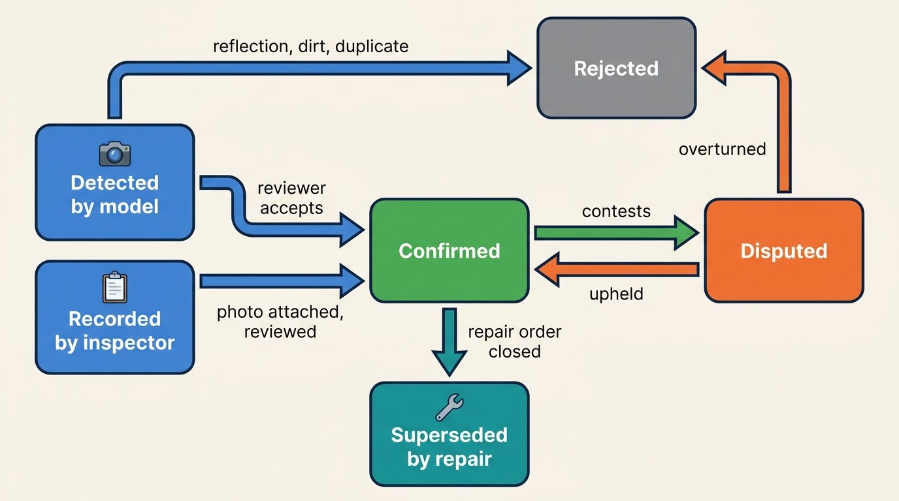
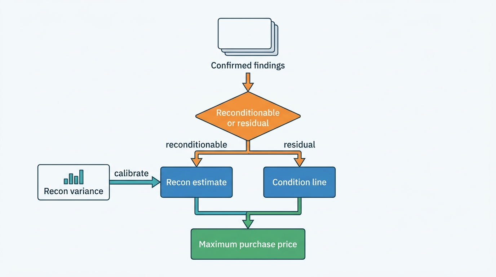
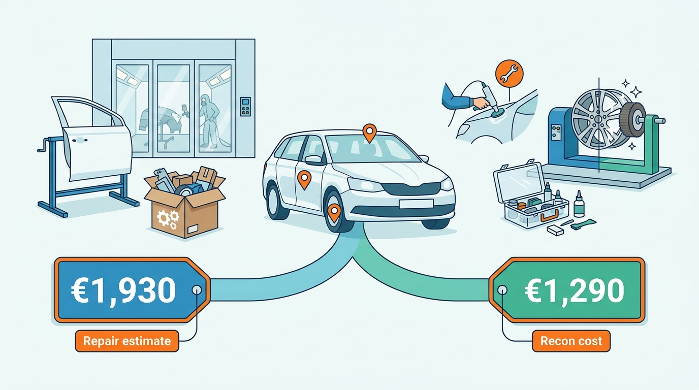

> **IN THIS CHAPTER, YOU WILL:** Take condition apart into evidence, findings and derived views; design guided capture, AI-assisted damage detection with human review, and the service that turns one inspection into a condition report, a damage estimate and a reconditioning cost; and see how those numbers enter buying, selling and dispute decisions.

> **WHY THE BUSINESS CARES:** Two cars with the same plate history and mileage can differ by a thousand euros in panels, tires and paint. A dealer who misses that pays it out of gross profit, a lessor who cannot prove it writes off the damage charge, and a trade seller who did not disclose it pays the buyer's claim.

> **WHY ARCHITECTS SHOULD CARE:** Condition is the only vehicle fact the platform creates itself, at a moment that cannot be repeated, often on a phone in a yard. It feeds valuation, appraisal offers, trade listings, lessee invoices and tax evidence. If it is stored as a grade and a PDF, every one of those decisions inherits a number nobody can recompute or defend.

> **KEY POINTS:**
>
> * **Store evidence, derive everything else.** An inspection produces dated, attributable observations: photos with capture metadata, measurements and damage items located on a panel map. The grade, the lessee charge, the repair estimate and the reconditioning cost are views computed from those items by versioned rules, so they can be recomputed when a rule changes and defended when a party disputes them.
> * **A repair estimate is not a reconditioning cost.** Insurer-grade estimating prices repair to pre-damage condition with manufacturer parts and labor times; reconditioning prices what a retailer will actually spend to make the car sellable. Use the first for claims and lessee charges, the second for buying decisions, and calibrate the second against the dealer's own invoices.
> * **AI detection is a second opinion with a confidence score, not a grader.** Keep machine detections and human-confirmed findings as separate states, route low-confidence items to a person, and measure the detector on your own confirmed outcomes, because no vendor publishes accuracy figures you can rely on.

> **[FAILURE PATTERNS THIS CHAPTER ADDRESSES](where-vehicle-platforms-go-wrong.html):**
>
> * **Provenance Amnesia** — a damage finding without photo, capture time, inspector and method cannot support a lessee charge, a trade claim or a tax valuation, so it is written off or argued from memory.
> * **The Confident Valuation** — a maximum purchase price that subtracts a reconditioning guess, never compared with the actual cost, looks precise and is systematically wrong.
> * **The Sticky Error** — a missed or invented damage item spreads into the valuation, the trade listing and the buyer's dossier unless every consumer refers to the finding, not a copy of it.

 
Every valuation in this book assumes a condition. A retail value assumes the car is ready for retail; a trade value assumes it is sold as is; a lessor's residual assumes average condition at contract end. The car on the yard has its own condition: a dented door, two worn tires, a repainted rear quarter panel nobody mentioned. **The gap between the assumed condition and the actual one is money**, and someone pays it: the dealer in reconditioning cost, the lessee in damage charges, the trade buyer in a claim, or the platform in credibility.

Condition is also different from every other fact in Part II. Identity, specification and history arrive from registers, manufacturers and data suppliers, and the platform's job is to resolve and reconcile them. **Condition is observed by the platform's own users, once, at a specific place and time.** A scratch photographed at return on 3 May cannot be re-photographed on 3 May after the car has been repaired or sold. If the evidence is weak, nothing upstream can correct it.

This chapter owns the **condition report**, the **damage estimate** and the **reconditioning cost**. It feeds the condition line of [[valuation-engine]] and the reconditioning term of the maximum purchase price, which [[vehicle-acquisition]] turns into an offer. It hands the reconditioning workflow's stages to [[inventory-and-vehicle-dossier]], damage settlement and trade disputes to [[b2b-trade-and-remarketing]], and battery health, the condition question specific to electric cars, to [[ev-battery-health]].

## Setting the Scene at Axleby: One Car, Three Inspections

Axleby, the fictional vehicle data and dealer software group this book follows (see [[meet-axleby]]), sells to **Fleetmoor Lease**, a lessor in the Netherlands and Belgium with about **64,000** vehicles and about **14,000** returns a year. Fleetmoor inspects each returned car at one of its two return centers, near Utrecht and near Antwerp, using a contracted inspection firm; in early 2027 the inspectors used that firm's app. The inspection does two jobs. It decides what the lessee, usually the driver's employer, is charged for damage beyond the return standard. And it becomes the condition report on **Tradefloor**, Axleby Trade's business-to-business (B2B) exchange, where Fleetmoor sold **8,600** returns to dealers and traders in 2026 and handed another 2,900 to auction partners ([[b2b-trade-and-remarketing]]).

In April 2027 Bas Hendriks, Fleetmoor's remarketing manager, brought a quarter's numbers to a meeting with Ines Marchetti (Axleby's Group Chief Architect), Tomás Ferreira (Product Director, Lotwise) and Daan Visser (Product Manager, Axleby Trade). All figures are Axleby illustrations.

| Fleetmoor, Q1 2027 | Value |
| --- | --- |
| Returns inspected | 3,520 |
| Returns with a damage charge to the lessee | 1,970 (56%) |
| Charges contested by the lessee | 418 (21% of charged) |
| Contested charges waived for lack of evidence | €121,000 |
| Returns sold on Tradefloor | 2,240 |
| Condition claims raised by Tradefloor buyers | 262 (11.7%), average settlement €590, about €155,000 in total |

The claims broke down into four groups: **damage not in the report** (39%), **tires** worse than reported (24%), **previous repairs** such as repainted panels that the report did not mention (21%), and **missing items and warning lights** (16%).

Bas brought one car to make it concrete: a 2023 Peugeot 308 SW with 92,400 km, returned in February. The return inspection recorded a door dent and a curbed rim and charged the lessee €260. The Tradefloor report, generated from the same inspection, graded the car "B" and listed the same two items. The buying dealer in Zwolle inspected it on arrival with Lotwise Appraise and found a repainted left rear quarter panel and two tires at 2.3 mm. His reconditioning came to €1,290 against the €610 he had expected, and he filed a claim for €480.

**Three parties had inspected the same car, and nobody's record could be compared with anybody else's.** The return app stored a PDF and 24 unpositioned photos, the Tradefloor grade was a judgement on an unwritten scale, and the dealer's appraisal held free-text notes. Fleetmoor could not show that the repaint predated the return, so it could neither charge the lessee nor reject the claim.

Ines framed the question for One Dossier: **how should Axleby capture condition once, as evidence every party can check, and turn it into the charge, the grade, the repair estimate and the reconditioning cost each decision needs?** The answer became **Gauge**, the group's condition service, and **Lotwise Inspect**, its guided-capture component, piloted at Fleetmoor's return centers from **14 June 2027** and also used by the rebuilt Lotwise Appraise ([[vehicle-acquisition]]) and the stock-in check. **Handback**, the return and settlement workflow that [[b2b-trade-and-remarketing]] describes, followed as a prototype in October 2027.

## Concepts: Evidence, Findings and Views

### The terms this chapter owns

- **Inspection.** One capture session on one vehicle, keyed by the Axleby Vehicle Key (AVK, the internal identity key from [[vehicle-identity]]), with a purpose (appraisal, stock-in, lease return, trade listing, pre-delivery), a location, an inspector, a device and a start and end time.
- **Observation.** A raw piece of evidence from an inspection: a photo, a video, a measurement (tread depth, paint-layer thickness, odometer reading), a checklist answer or a diagnostic readout. Observations are immutable.
- **Finding** (damage item). A claim about the car, located on a **panel map** (a fixed vocabulary of components and zones), with a damage type (scratch, dent, chip, crack, corrosion, wear, missing item, previous repair), a size or severity, and links to the observations that support it. A finding has a source (human, machine detection, imported report) and a review state.
- **Condition report.** A versioned, read-only document derived from one inspection's confirmed findings for a stated purpose and audience: a trade report for buyers, a return report for the lessee, an appraisal report for the dealer's file. It names the rubric version it was produced under.
- **Condition grade.** A summary score computed from findings by a published rubric. It is a view, never the source.
- **Damage estimate.** A priced repair plan for a set of findings: operations, parts, labor time, paint and their prices, produced from a repair-cost catalog or by an assessor. It answers "what does it cost to restore this to pre-damage condition?"
- **Reconditioning cost** (recon cost). The estimated, and later actual, cost to make a car ready for retail at a given dealer: mechanical work, cosmetic repairs, tires, servicing, cleaning and preparation, priced at that dealer's methods and rates. It answers "what will this dealer spend before the car can be sold?"

The separation between observations, findings and views is the design. **Observations are facts about what was captured. Findings are claims about the car. Grades, charges and estimates are opinions computed under a rule set.** When a rule changes, opinions are recomputed; when a claim is disputed, it is re-reviewed against its observations; the observations themselves never change.

**Figure 1:** *Observations never change, findings are claims reviewed against them, and grades, charges and estimates are views recomputed from confirmed findings.*

### Wear is not damage, and grades do not map

The first vocabulary problem is the line between **wear and damage**. The British Vehicle Rental and Leasing Association (BVRLA) publishes an industry Fair Wear and Tear standard for lease returns. Its public page (n.d., accessed 2026-10) defines fair wear and tear as deterioration from normal usage and says it "is not to be confused with damage which occurs as a result of a specific event or series of events such as impact, inappropriate stowing of items, harsh-treatment, negligent acts or omissions" ([BVRLA](https://www.bvrla.co.uk/home/support/products-and-services/bvrla-fair-wear-tear-guides)). Its consumer guidance says customers "are not charged at end of lease for any refurbishment that arises from normal wear and tear" ([BVRLA](https://www.bvrla.co.uk/home/consumer-advice/returning-your-leased-vehicle)). The thresholds themselves are in a copyrighted guide sold to members, so a platform implements a lessor's return standard as **licensed or customer-supplied rule content**, not as code.

The second is that **grading scales disagree**:

| Scale | Where | Direction | Status of evidence |
| --- | --- | --- | --- |
| NAAA Condition Grade Scale, 0–5 | US wholesale auctions (National Auto Auction Association) | 5 is best | Widely reported; basis of Manheim's AutoGrade, which in 2014 was offered to NAAA member auctions as a standardized grade computed from submitted damage data ([Manheim, 2014](https://press.manheim.com/2014-01-17-Aasc-Announces-Standardized-Vehicle-Condition-Grading-Technology)) |
| NAMA grades 1–5 | UK and Australian auctions (National Association of Motor Auctions) | **1 is best** | Widely reported; not read in primary form |
| Clean / Average / Below | Cap HPI trade values, UK | Three bands from a points checklist with age-dependent tolerances | Reported in 2011; may have changed |
| Excellent / Great / Good / Fair / Poor | Auto Trader UK Valuations API | Five levels | Documented in Auto Trader's help center (2024, updated 2026) |
| Recorded condition, repairs, previous owners | DAT valuation, Germany | Input fields, not a grade | DAT product description (2024) |

The AutoGrade and Cap HPI sources are over ten years old: evidence that grading by points over findings is established practice, not descriptions of today's products. The lesson: **a grade from one scale cannot be translated into another without the findings behind it.** A "3.5" and a "Good" are not the same thing at different precision. Store the findings and compute each scale with its own rubric, and a new buyer's scale is a new rubric, not a migration.

### Repair estimate versus reconditioning cost

Insurer-grade estimating systems, such as DAT's damage calculation in Germany and Solera's Audatex and Qapter products internationally, price a repair from the manufacturer's parts prices, labor times and paint operations. DAT's Austrian product page for its weDAT platform (n.d., accessed 2026-10) describes its repair-cost calculation as a full determination of repair costs "on the basis of the original manufacturer data", including linked operations and paint items ([DAT Austria](https://www.datgroup.com/de-at/produkte/wedat/); author's translation from German). That is the right basis for an insurance claim and usually for a lessee damage charge, because both restore the car to its pre-damage state.

A retailer rarely does that. It repairs a door dent without paint by paintless dent repair (PDR), touches up a bumper with a small-area repair, refurbishes a rim rather than replacing it, and leaves cosmetic wear the retail standard tolerates. No provider found in the research publishes a reconditioning-cost model; in dealer tools the estimate is commonly a dealer-maintained rate card driven by the inspection. vAuto's own content cites an average **$600** gap between reconditioning estimates and actual cost (vendor content, undated), which is the size of error that turns a profitable trade-in into a loss.

| | Damage estimate | Reconditioning cost |
| --- | --- | --- |
| Question | What restores the car to pre-damage condition? | What will this dealer spend to make it sellable? |
| Pricing basis | Manufacturer parts, labor times and paint, from a licensed catalog or an assessor | The dealer's own methods, rates, sublet prices and retail standard |
| Includes | Damage only | Damage, wear the dealer chooses to fix, tires, servicing, cleaning, preparation, inspection fees |
| Used for | Insurance claims, lessee charges, BPM valuation evidence in the Netherlands, total-loss decisions | Maximum purchase price, reconditioning approval, gross margin |
| Checked against | Assessor review, repairer invoice | The dealer's actual repair orders and invoices |
| Typical error | Overstates retail spend for cosmetic damage | Understates hidden mechanical work |

**Never use one as the other without a calibration.** A buying tool that subtracts an insurer-grade estimate from the retail value underbids every car with cosmetic damage; a lessee charge built from a dealer's PDR rate card undercharges and invites the argument that the lessor priced damage it never repaired. BVRLA guidance says charges "can still be applied" when the lessor decides not to repair, so the charge must rest on a defensible estimate, not on what the next owner spent.

## Capture: Guided Inspection

Condition data is only as good as the capture, and capture happens on phones in yards, in bad light, under time pressure. Guided capture turns an inspector's walk-around into a structured session.

**A fixed shot list, then close-ups.** Lotwise Inspect asks for a fixed set of positioned shots (four corners, each side, roof where possible, each wheel, interior front and rear, dashboard with the ignition on, odometer, trunk, keys and documents), then a close-up for every finding, tapped onto the panel map. A fixed list makes two inspections of the same car comparable, and the dashboard shot makes warning lights evidence rather than memory. The BVRLA's own advice to drivers points at the same capture conditions: good light, a clean and dry car, every panel examined along the body line ([BVRLA](https://www.bvrla.co.uk/home/consumer-advice/returning-your-leased-vehicle)).

**Measurements, not adjectives.** Tread depth per tire in millimeters (the EU minimum in the main grooves has been **1.6 mm** since Council Directive 89/459/EEC, [CELEX 31989L0459](http://publications.europa.eu/resource/celex/31989L0459); a return standard or a retail standard is usually stricter). Paint-layer thickness per panel from a coating gauge, because a panel markedly thicker than its neighbors indicates a respray; Gauge records the reading and lets a rubric decide what counts as a previous repair, rather than hard-coding a threshold. Odometer reading with a photo. Battery state of health for electric cars from a certified test ([[ev-battery-health]]). Diagnostic fault codes where a reader is connected ([[connected-vehicle-data]]).

**Capture metadata on every observation.** Device, app version, timestamp from the device and from the server on receipt, location, inspector identity, and a content hash computed on the device. The hash and the two timestamps are what later let Fleetmoor show that a photo was taken at return and not altered.

**Offline first.** Return centers, auction lanes and customer driveways have poor connectivity. Inspect is an offline-capable progressive web app (PWA) component: it stores observations on the device, uploads in the background with resumable uploads and an idempotency key per observation, and marks an inspection complete only when the server holds every mandatory observation. The appraisal workflow that uses the same component belongs to [[vehicle-acquisition]].

**Drive-through scanners.** At volume sites, fixed camera arches capture a car's exterior, underbody and tires in seconds; UVeye and ProovStation, described in the next section, are documented examples. For an architecture, a scanner is one more capture device: its images and detections enter Gauge as observations and machine findings with the scanner's identity and model version, exactly like a phone.

## AI Damage Detection and Human Review

### What is documented

| Provider | What its own public material says | Source and date |
| --- | --- | --- |
| **Tractable** | Image-based damage assessment for insurers, repairers, recyclers, fleets and dealers; "certainty scores accompany every estimate, factoring in visibility, image quality, and damage severity" | [Tractable](https://tractable.ai/), n.d., accessed 2026-10 |
| **DAT FastTrackAI** | Photo-based damage detection with "automated recording of component, type of damage and severity" and transfer into an initial damage calculation, in DAT's software "from September 1, 2026"; also offered inside the weDAT platform | [DAT AI Bundle](https://www.dat.de/ai-bundle-en/), n.d., accessed 2026-10; [DAT Austria, weDAT](https://www.datgroup.com/de-at/produkte/wedat/), n.d. |
| **Solera Qapter** | An AI-powered modular suite for insurers and repairers with "damage detection algorithms" and "photo-based estimating" | [Qapter](https://www.qapter.com/), n.d., accessed 2026-10 |
| **UVeye** (with Cox vAuto) | Drive-through inspection of exterior, underbody and tires, integrated into dealer appraisal tools | [Cox Automotive](https://www.coxautoinc.com/press-releases/cox-automotives-vauto-and-uveye-bring-ai-powered-vehicle-inspections-to-market/), January 2026 |
| **ProovStation** | Drive-through scanning that detects, locates, measures and labels damage, compares with a previous scan, and blurs faces for the EU General Data Protection Regulation (GDPR) | [ProovStation](https://proovstation.com/), n.d., accessed 2026-10 |

All five are vendor descriptions. **None of the pages read for this chapter publishes detection accuracy, false-positive rates or error by damage type.** The public research datasets are small: CarDD, published in 2022, has 4,000 high-resolution images with over 9,000 annotated instances across six damage categories ([Wang et al., arXiv 2211.00945](https://arxiv.org/abs/2211.00945)). Treat any accuracy claim as something to measure on your own confirmed findings.

### Detections are not findings

The rule that keeps AI useful is to give machine output its own state. A detection says "a model with version v, on observation o, saw a dent of severity s on the front left door with confidence c". It does not say there is a dent.

**Figure 2:** *The lifecycle of a finding. Machine detections and inspector entries both start as unconfirmed; only confirmed findings feed charges, grades and estimates, and a repair supersedes a finding rather than deleting it.*

Two design rules follow, besides recording the model version on every detection.

1. **Route by confidence and consequence.** A low-confidence detection on a panel already recorded by the inspector can be merged automatically; a high-consequence finding (structural damage, a previous repair, anything that raises a lessee charge above an illustrative €250 *(assumption)*) needs a named reviewer. Tractable's per-estimate certainty score is the public example of the pattern.
2. **Use the model as a second opinion on the inspector, and the inspector as ground truth for the model.** Each confirmed or rejected detection is a labeled example. Within three months, Gauge's confirmation and rejection rates per damage type, panel, color and light condition are a better accuracy measure than any vendor brochure.

My reading is that the binding obligations here come less from AI regulation than from contract and consumer law: a lessee or buyer can contest a charge, and the platform must show the human decision behind it. AI governance across products is in [[ai-in-dealer-workflows]].

## Architecture: Gauge

### Components

| Component | Responsibility | Design rule |
| --- | --- | --- |
| **Lotwise Inspect** (at return centers, in Appraise and the stock-in check) | Guided capture on phones and tablets; offline queue; panel-map tagging | Mandatory shot list per purpose; capture metadata and device hash on every observation |
| **Scanner adapters** | Drive-through and lane scanners at partner sites | Scanner images and detections enter as observations and machine findings with device and model version |
| **Evidence store** | Originals in object storage; metadata, hashes and lineage in PostgreSQL | Write once; originals never modified; derived renditions stored beside them |
| **Image pipeline** | Renditions for screens, plate and face blurring for shared views, quality checks (blur, exposure, framing) | Runs asynchronously; quality failures go back to the inspector while the car is still there |
| **Detection gateway** | Calls the damage-detection provider or model; normalizes output to the panel map | Detections stored as unconfirmed findings with confidence and model version |
| **Findings and review** | The finding lifecycle; review queues by confidence and consequence | Only confirmed findings feed views; every state change has an actor and reason |
| **Rubric engine** | Computes grades, lessee charges and report contents from confirmed findings | Rubrics are versioned content (return standards, trade grades, buyer scales), never code branches per customer |
| **Estimating** | Damage estimates via a licensed repair-cost catalog; reconditioning estimates via each dealer's rate card | Catalog calls only where the decision needs them; recon rate cards owned by the tenant |
| **Condition API and events** | Reports, findings and estimates to Vantage, Lotwise, Tradefloor, Odolo and API clients | Consumers reference finding and report ids, never copies; `condition.report.issued`, `finding.disputed` and `recon.actual.recorded` events |

**Figure 3:** *Gauge stores evidence once and derives every view from confirmed findings. Consumers get reports and estimates by reference, and reconditioning actuals and disputes flow back to the findings they concern.*

The boundary that matters most is between Gauge and [[vehicle-history]]. Gauge is the system of record for inspections the platform's users perform. Tracewell, the history event store, receives a **summary event** for each issued report (inspection date, purpose, structural damage yes or no, previous repairs found, odometer reading), keyed by AVK, with a pointer back to Gauge. Tracewell does not copy photos or itemized findings: they belong to the tenant who paid for the inspection, and whether a later owner or a consumer report may see them is a license and purpose question for [[data-licensing-and-governance]].

The second boundary is with workflows that capture. Handback owns the return and its settlement (appointment, handover checklist, lessee acknowledgement, charge letter, dispute deadlines), and Lotwise Appraise owns the appraisal and the offer. Both use Inspect for capture, keep their evidence and findings in Gauge and ask Gauge for grades, charges and estimates, so **there is one evidence model and many workflows, not one condition model per product**.

### Requirements per interaction

| Interaction | Latency | Freshness | Consistency | Availability |
| --- | --- | --- | --- | --- |
| Capture at the car (shot, tag, measure) | Instant on device; upload in background | n/a | Inspection complete only when the server holds every mandatory observation with a matching hash | Fully offline for a shift *(assumption: 8 hours, 300 photos)* |
| Image quality feedback | Under 30 s after upload *(assumption)* | n/a | Per observation | Degrades to "check later" without blocking capture |
| Machine detection | Under 2 min per inspection *(assumption)* | Model version pinned per run | Detections never overwrite inspector findings | If the provider is down, the inspection proceeds without detections and is queued for a later run |
| Review and report issue | Same day for returns and trade listings *(assumption)* | Report built from confirmed findings at issue time | Report is immutable and versioned; a correction issues a new version | Review queue survives outages; no report without review of high-consequence items |
| Recon estimate into appraisal | Under 2 s from confirmed findings *(assumption)* | Dealer rate card version in force | Estimate id and rate-card version written to the valuation ledger | Falls back to a segment default with a flag if findings are incomplete |
| Recon actuals back from workshop or dealer management system (DMS) | Daily | Repair orders as closed | Matched to estimate lines by finding id where possible | Late arrivals accepted; variance computed when complete |

### Image pipelines and storage

Images are most of the bytes and most of the privacy risk. Assume, for sizing, a return inspection of 60 photos at 3 MB and an appraisal or stock-in inspection of 30 photos at 2.5 MB *(assumptions)*. Fleetmoor's 14,000 returns are then about **2.5 TB** a year; if half of Lotwise's **1.9 million** annual stock-ins get a Gauge inspection, that adds about **71 TB** a year. The volume is manageable; the rules are what matter.

- **Originals are evidence; renditions are for screens.** Keep originals write-once with their hash, in the region of the tenant's cell ([[tenancy-and-dealer-groups]]). Serve resized renditions; never re-encode an original in place.
- **Blur before sharing.** Photos taken in yards capture other cars' plates, people and occasionally addresses. The image pipeline produces blurred renditions for every view that leaves the tenant: Tradefloor buyers, consumer reports, partner APIs. DAT's weDAT page lists automatic anonymization of number plates in image processing for inspection reports (n.d., accessed 2026-10), and ProovStation blurs faces; both treat it as a standard feature. Whether the car's own plate stays visible in a trade report is a product decision; other plates and faces are blurred.
- **Tier by age, delete by purpose.** Hot storage while the car is in stock or a dispute window is open, then archive tier. Retention follows the longest purpose: the lessee dispute window, the trade claim window, tax evidence where a report supports a Dutch BPM valuation, and the dealer's own record-keeping duty. Delete or anonymize after that ([[privacy-and-retention]]).

## Pricing Condition Into Decisions

### Maximum purchase price and reconditioning

[[valuation-engine]] defines the **maximum purchase price** (MPP) as expected retail transaction price minus reconditioning cost, transport and preparation, holding cost for the expected days to sell, and target gross margin. Condition enters that formula twice, and the second entry is the one most tools miss.

1. **Reconditioning cost** comes straight from Gauge's recon estimate.
2. **Reconditioning time** extends days to sell. Every day in the workshop is a day of holding cost before the car can earn anything. [[dealer-and-data-economics]] puts Axleby's illustrative holding cost at about **€8.8 per car-day**. A car that needs a body-shop slot with a six-day queue carries about €53 more cost than one that needs only cleaning, before any advert is live.

The formula also creates a **double-counting trap**. A retail value assumes a retail-ready car. If the valuation applies a condition adjustment for a dent and the MPP also subtracts the cost of fixing that dent, the dealer pays for the dent twice and underbids. Gauge prevents it by tagging each confirmed finding as **reconditionable** (the dealer will fix it and the recon estimate prices it) or **residual** (it will remain after reconditioning and affects retail value: a respray that a buyer's paint gauge will find, an accident history, a structural repair). When Lotwise Appraise asks Vantage for a value to compute an MPP, it passes the recon estimate id, and Vantage applies condition lines only for residual findings. When a caller has no recon estimate, such as an API client valuing an as-is car, Vantage applies the full grade-based condition line and says so in the answer.

### Recon cost and time in the stock record

Once the car is bought, the estimate becomes a set of **recon lines** on the stock item, each with an estimate, an approval, and later an actual from the workshop or the DMS repair order ([[inventory-and-vehicle-dossier]], [[dms-integration]]). Gauge keeps the link from each recon line to the finding it fixes. That link makes three things computable:

- **Recon variance** per line, per finding type, per rooftop and per segment: actual minus estimate.
- **Rate-card calibration**: when PDR on doors runs 30% over the card at a rooftop for a quarter, the card is wrong, not the inspector.
- **Finding closure**: a repair order closed against a finding moves it to "superseded by repair", so the dossier and any later trade report show both the damage and its repair.

**Figure 4:** *Condition enters the buying decision through two separate paths: reconditionable findings through the recon estimate, residual findings through the valuation. Actual costs return to calibrate the rate card, closing the loop that makes estimates honest.*

### Condition reports for trade and remarketing

On a B2B exchange the buyer usually cannot see the car before bidding; the condition report is the product description. The design follows from the claims Fleetmoor saw:

- **The report shows findings with photos, not only a grade.** A trader bids on the photos of the damage he will repair.
- **Tires, paint readings and warning lights are mandatory sections.** These were 61% of Fleetmoor's Q1 claims between them; a report that omits a section must say "not inspected", never leave it blank.
- **The report names its rubric and its inspection date.** A buyer claim is judged against what was disclosed then, under the rubric then.
- **Claims attach to findings.** A claim says "this finding was missing" or "this finding was understated", with the buyer's own photos as observations. The claims workflow, deadlines and settlement belong to [[b2b-trade-and-remarketing]]; Gauge supplies the evidence and records the outcome against the finding.

## In Practice

### What public sources show

- **Manheim, US (2014).** AutoGrade computed a standardized grade from damage data submitted by auctions; ADESA's Paul Lips said it would "calculate a consistent objective grade the same way, every time" ([Manheim, 2014](https://press.manheim.com/2014-01-17-Aasc-Announces-Standardized-Vehicle-Condition-Grading-Technology)). What has lasted is the separation of damage data from the grade computed from it.
- **Cox Automotive and UVeye, US (January 2026).** Drive-through scanning integrated into vAuto's appraisal, pricing and inventory tools for service-lane acquisition, with the release citing 125 users and more than 850 vehicles acquired in the first wave ([Cox Automotive, 2026](https://www.coxautoinc.com/press-releases/cox-automotives-vauto-and-uveye-bring-ai-powered-vehicle-inspections-to-market/)). Condition capture moved to where trade-ins arrive.
- **DAT, Germany and Austria (2026).** FastTrackAI detection feeds an initial damage calculation inside DAT's existing software and weDAT ([DAT](https://www.dat.de/ai-bundle-en/)). In the German-speaking markets, damage AI is entering through the estimating system dealers and assessors already use, not as a separate tool.
- **CarMax and Carvana, US (2026).** CarMax inspects "the engine and all major systems" and uses stand-alone reconditioning centers ([CarMax 10-K, 2026](https://www.sec.gov/Archives/edgar/data/1170010/000117001026000021/kmx-20260228.htm)); Carvana's inspection covers "controls, features, brakes, tires, and cosmetics" ([Carvana 10-K, 2026](https://www.sec.gov/Archives/edgar/data/1690820/000169082026000009/cvna-20251231.htm)). The largest retailers treat inspection and reconditioning as an industrial process with its own sites.

> **INFERENCE, NOT DOCUMENTED:** None of these companies describes its internal data model for condition. The evidence-findings-views model in this chapter is a reference architecture; it is consistent with what Manheim's 2014 grading service and Tractable's per-estimate certainty scores imply, but no source shows that any of them is built this way.

### Axleby: the Peugeot 308, recomputed

When Gauge went live at Fleetmoor's Utrecht return center, the team re-inspected a sample of returns twice: once the old way and once with Inspect. A car very like Bas's Peugeot showed what changes. The table lists the confirmed findings for a 2023 Peugeot 308 SW at 92,400 km and the four views Gauge derived from them. All prices are Axleby illustrations.

| Confirmed finding | Lessee charge (Fleetmoor return standard v3) | Damage estimate (licensed catalog) | Recon estimate (Zwolle dealer rate card) | Tag |
| --- | --- | --- | --- | --- |
| Front left door, dent 30 mm, paint intact | €165 | €640 (repair and repaint) | €140 (PDR) | Reconditionable |
| Front right rim, curbed | €95 | €180 | €110 | Reconditionable |
| Rear bumper, scratches within standard | €0 (wear) | €420 | €160 (small-area repair) | Reconditionable |
| Windshield chip, 6 mm, outside driver's view | €0 (wear) | €690 (replacement) | €60 (resin repair) | Reconditionable |
| Two tires at 2.3 mm | €0 (above return minimum of 2.0 mm) | n/a | €240 | Reconditionable |
| Left rear quarter panel, paint reading about 2.5× its neighbors | Referred: previous repair, no damage report on file | n/a | €0 (repair looks sound) | **Residual** |
| Service due, cleaning, preparation | n/a | n/a | €580 | n/a |
| **Total** | **€260** | **€1,930** | **€1,290** | |

Four things changed compared with February.

- **The respray became a finding with evidence.** The coating-gauge readings and close-ups were observations, captured and hashed at return. Fleetmoor's contract required lessees to report repairs, so the finding went to a reviewer, who raised it with the lessee; and the trade report disclosed it, so no buyer could claim it later. Vantage applied a residual condition line of −€350 *(Axleby illustration)* to the retail value, because a buyer's own paint gauge will find it.
- **The tires were measured, not described.** 2.3 mm is inside Fleetmoor's return standard, so the lessee owes nothing, and outside most dealers' retail standard, so the recon estimate includes two tires. Both are true; the old report could say only "tires OK".
- **The insurer-grade estimate stayed out of the buying decision.** At €1,930 it would have underbid the car by about €640 against the dealer's own rate card. It remained available for a disputed lessee charge, where repair to pre-damage condition is the right basis.
- **The dealer's €1,290 matched the estimate.** The Zwolle dealer's February surprise was the €680 gap between his €610 guess and his €1,290 bill. With the findings disclosed and priced at his own rate card, the estimate he bid on was the bill he paid.

**Figure 5:** *The same confirmed findings on the Peugeot 308 priced two ways: €1,930 to restore it to pre-damage condition, €1,290 for the Zwolle dealer to make it sellable.*

### Axleby: what the pilot changed

By the fourth quarter of 2027 both return centers used Inspect and Gauge, Tradefloor issued its condition reports from Gauge, and Handback ran as a prototype on about 200 Dutch returns. The comparison below is Axleby illustration.

| Fleetmoor | Q1 2027 | Q4 2027 |
| --- | --- | --- |
| Returns inspected | 3,520 | 3,410 |
| Charges contested (share of charged) | 21% | 9% |
| Contested charges waived for lack of evidence | €121,000 | €34,000 |
| Tradefloor buyer claims (share of sold) | 11.7% | 4.3% |
| Machine detections per car not recorded by the inspector | n/a | 1.4, of which 23% confirmed on review |

The last row is the honest one. Most machine detections that the inspector had not recorded were reflections, dirt or duplicates; about a quarter were real, mostly small scratches on lower panels and roof edges. **The model did not replace the inspector; it made the inspector's misses visible and measurable**, and its rejection rate by damage type became the input for the next vendor review.

On the dealer side, Lotwise rooftops on the rebuilt Appraise that record recon actuals saw their mean variance fall from **+€310** in Q2 2027 to **+€95** in Q4 *(Axleby illustration)*, once Inspect findings replaced free-text appraisal notes and rate cards were recalibrated each quarter. The remaining variance sat mostly in mechanical work an exterior inspection cannot see. The 2028 pilot's further targets, such as return-to-sale time, belong to [[b2b-trade-and-remarketing]].

## Evidence, Retention and Disputes

Condition data is contested more than any other vehicle fact, because money changes hands on it between parties with opposite interests. Design every record for the day it is disputed.

**What makes a finding defensible.** A finding holds up when the platform can show: the photo or measurement it rests on; when it was captured (device and server timestamps); where and by whom; that the observation has not changed since (the hash); which version of which rubric turned it into a charge or a grade; and who confirmed it. Each item answers a specific objection a lessee or a buyer will raise. Fleetmoor's Q1 waiver of €121,000 was the price of missing those answers.

**Reports are immutable and versioned.** A condition report, once issued to a buyer or a lessee, is never edited. A corrected finding issues a new report version that names the one it supersedes, and Gauge notifies every consumer that referenced the old version. This is the same discipline [[vehicle-history]] applies to history reports, and it is what stops a corrected finding from becoming **The Sticky Error**.

**Disputes are workflows on findings.** A lessee contesting a charge or a buyer filing a claim attaches to specific findings and can add their own observations. The decision, the decider and the reason are recorded on the finding. Disputes that overturn findings feed the same quality metrics as rejected machine detections.

**Tax evidence in the Netherlands.** An importer reducing the Dutch registration tax on cars and motorcycles (*belasting van personenauto's en motorrijwielen*, BPM) for a used import may use a valuation report (*taxatierapport*) only for vehicles with more than normal damage or not in a price list. The report must come from an independent recognized appraiser after a thorough physical inspection, and must date from within one month before the Dutch register's inspection. In July 2026 the tax authority announced extra checks, because published case law showed that importers often claimed non-existent or exaggerated damage, and it may require the car to be presented ([SRA, 2026](https://www.sra.nl/nieuws/004501/2026/07/extra-controles-bpm-aangiftes); author's translation from Dutch). For a platform whose inspections may support such a report, that means damage evidence with the appraiser's identity and the inspection date, retained for the tax authority's review period. Axleby Trade's BPM engine owns the calculation ([[registration-and-trade-services]]).

## Failure Handling

| Failure | Detection | Recovery |
| --- | --- | --- |
| **Duplicate uploads** (app retries after a dropped connection) | Idempotency key per observation plus content hash | Second copy acknowledged and discarded; one observation |
| **Duplicate findings** (inspector and model record the same dent; two close-ups tagged twice) | Same panel, zone and type within one inspection | Merged into one finding with both sources linked; the reviewer sees the merge |
| **Conflicting inspections** (return report says tires 3.1 mm; buyer measures 2.3 mm a week later) | A new inspection's findings differ from the last issued report on the same AVK | Both kept with dates and inspectors; the dispute workflow decides; neither overwrites the other |
| **Incomplete inspection** (mandatory shots missing, no paint readings) | Shot-list and section checks before completion | Inspection cannot complete; if issued anyway by override, the report says "not inspected" per missing section and the grade is withheld |
| **Wrong vehicle** (photos taken of the neighboring car) | Vehicle identification number (VIN) plate photo or scan mismatch with the inspection's AVK; scanner plate reading | Inspection quarantined; findings not issued until the VIN is confirmed ([[vehicle-identity]]) |
| **Detection provider outage or timeout** | Gateway timeouts and error rates | Inspection proceeds on inspector findings; detection queued and run later; the report never waits for the model |
| **Detection model update shifts rates** | Detection and confirmation rates per model version and damage type | Pin the version per inspection; review a new version on a shadow sample before switching |
| **Partial upload** (inspection marked done on the phone, half the originals missing on the server) | Server-side completeness check against the device manifest | Inspection stays "uploading"; the inspector is alerted while the car is still on site |
| **Catalog or rate card changes mid-dispute** | Version recorded on every estimate | Disputes are settled on the version in force at issue; recompute only for new reports |
| **Recon actual never arrives** (repair done outside the DMS) | Recon lines open after the car is sold | Excluded from variance metrics rather than counted as zero; the rooftop sees the gap |

Two rules carry across the table. **The car moves on, so capture must finish while it is there**: every check that can fail should fail on the phone, not in the back office a day later. And **no view without confirmed evidence**: a grade, a charge or an estimate computed from unconfirmed or missing findings is withheld or flagged, never presented as if it were complete.

## Trade-Offs

**Who captures, and how.**

| Approach | Strengths | Weaknesses | Right when |
| --- | --- | --- | --- |
| **Inspector with free-form app or paper** | Cheap to start; flexible | Not comparable across inspectors; weak evidence; grades are opinions | Low volume, no disputes, no trade use |
| **Guided capture on a phone** (fixed shot list, panel map, measurements) | Comparable; defensible; works anywhere, offline | Needs training and discipline; longer than a glance | Appraisals, stock-ins, lease returns, trade listings: the default |
| **Drive-through scanner** | Seconds per car; consistent images; underbody and tires | Fixed sites; capital cost; no interior or mechanical | High-volume return centers, auctions, large service lanes |
| **Self-inspection by driver or seller** | No inspector cost; early warning | Self-interested evidence; poor capture | Pre-return estimates and consumer trade-in offers, always followed by a verified inspection before money changes hands |

**How damage is priced.**

| Approach | Strengths | Weaknesses | Right when |
| --- | --- | --- | --- |
| **Licensed repair-cost catalog** (manufacturer parts and labor) | Accepted by insurers, assessors and courts; precise per operation | Per-call cost; overstates retail recon for cosmetic damage | Lessee charges, insurance, tax evidence |
| **Dealer rate card per finding type** | Reflects actual methods and prices; cheap | Only as good as its calibration; differs by dealer | Recon estimates in buying decisions |
| **Model trained on recon actuals** | Learns hidden costs per segment | Needs linked findings and actuals at volume; drifts with labor prices | A group with years of linked recon data |
| **Flat allowance by age and segment** | Trivial | Wrong for every individual car | No inspection available; must be labeled as such |

My recommendation for a group like Axleby is guided capture as the default, scanners where a site sees hundreds of cars a week, the licensed catalog only where the decision needs a repair-to-pre-damage price, and dealer rate cards calibrated quarterly against linked actuals for buying decisions. That recommendation assumes the platform can link recon actuals to findings for most rooftops; where the DMS keeps repair orders out of reach, the rate card cannot be calibrated and the estimate should carry a wider range.

## Across Markets: What Changes by Country

| | Netherlands / Belgium | Germany | United Kingdom | United States |
| --- | --- | --- | --- | --- |
| Return and condition standards | Lessor-specific return standards; no industry-wide public standard verified for this chapter | Lessor contracts with independent expert assessment commonly used at lease end *(industry practice; not verified here)* | BVRLA Fair Wear and Tear standard for lease returns, sold to members | Auction grading on the NAAA 0–5 scale; lessor grounding inspections |
| Damage estimating ecosystem | Insurer and assessor estimating systems with manufacturer data | DAT and Audatex estimating dominant among assessors and workshops; DAT FastTrackAI from September 2026 | Insurer estimating systems; auction grading on NAMA 1–5 (1 best) | Insurer estimating; auction condition reports; service-lane scanners (UVeye with vAuto, 2026) |
| Official inspection evidence | NL: defects found at periodic inspection (*Algemene Periodieke Keuring*, APK) published per plate in the open data of the Dutch vehicle authority RDW ([RDW, queried 2026-10-22](https://opendata.rdw.nl/resource/a34c-vvps.json)); BE: Car-Pass shows post-accident inspection data ([Car-Pass, n.d.](https://www.car-pass.be/en)) | Periodic inspection results not public per vehicle *(not verified here)* | MOT (Ministry of Transport test) history shows "what parts failed at each test, and if any parts had minor problems" ([GOV.UK, n.d.](https://www.gov.uk/check-mot-history)) | State inspection regimes vary; no national per-vehicle record used here |
| Regulatory use of condition | NL: damage valuation report as BPM evidence for imports, with extra checks announced July 2026 | Expert reports (*Gutachten*) in insurance and disputes *(practice)* | Auto Trader shows price labels only on dealer adverts because dealer cars are protected by the Consumer Rights Act and assumed retail standard ([Auto Trader, 2025](https://help.autotrader.co.uk/hc/en-gb/articles/28407654789533)) | Arbitration rules at auctions *(practice)* |
| Units | mm, µm, km | mm, µm, km | mm, µm, miles | inches and 32nds for tread, miles |

**What stays common:** the evidence-findings-views model, the finding lifecycle, guided capture with metadata and hashes, the separation of repair estimate and recon cost, immutable versioned reports, and dispute workflows on findings.

**What becomes a rule set:** the return standard and trade grade (BVRLA-based rubrics in the UK, lessor rubrics in the Benelux, NAAA or NAMA scales for auction partners), tread and other units, the official inspection sources a report may cite, and retention rules tied to tax evidence. **What becomes an adapter:** the repair-cost catalog per market, scanner vendors per site, and the detection provider. A UK lessor's return standard should be a new rubric version in Gauge, not a Showroomly fork.

## The Chief Architect's View

**Decide that condition is a platform capability, not a feature of each product.** Before Gauge, Axleby had condition in four places: the Fleetmoor contractor's app, Tradefloor's report form, Lotwise Appraise notes and DriveDesk repair orders. One Dossier makes Gauge the system of record for inspections and every product a consumer of its reports. Tomás Ferreira's Lotwise team owns Gauge; Priya Raman's valuation team owns the residual condition lines in Vantage; Daan Visser owns the trade-report rubric with Tradefloor's buyers.

**Own the rubric content as a governed asset.** Return standards, trade grades and rate cards change prices for lessees, buyers and dealers. Version them, effective-date them, require approval for changes, and keep them out of code: the tenant-level settings belong in the configuration service ([[onboarding-and-configuration]]). A lessor that wants a stricter tire threshold gets a new rubric version, not a code path.

**Decide the evidence policy before the first dispute.** Which observations are mandatory per purpose, how long originals are kept per purpose, who may see unblurred images, and what a lessee or buyer may request. Femke de Boer, Axleby's Data Protection Officer, signs off the blurring and retention rules; the trade and lease product owners sign off the dispute windows.

**Buy detection, own the ground truth.** Damage detection is a fast-moving vendor market; switching providers should be an adapter change. What Axleby must own is the confirmed-findings dataset that measures any provider, and the right to use its customers' images for that measurement, which is a contract question ([[data-licensing-and-governance]], [[build-buy-or-partner]]).

**Watch these over the long term:** dispute and claim rates per purpose and per inspector; detection confirmation rates by model version and damage type; recon variance by rooftop and segment; the share of stock items with recon actuals linked to findings; inspection completion while the car is on site; and the share of valuations that used a recon estimate rather than a default. If the actuals-linked share falls, the rate cards stop learning and the MPP becomes a confident guess again.

## Questions to Ask

1. Can you show, for any issued condition report, the original photos and measurements behind each finding, with capture time, inspector, device and an unchanged hash?
2. Are grades, charges and estimates computed from findings by versioned rules, or typed in by the inspector? Could you regrade last year's returns under a new rubric?
3. Do machine detections have their own state, model version and confidence, and do you measure confirmation and rejection rates on your own reviewed findings?
4. Which decisions use an insurer-grade repair estimate and which use a reconditioning estimate, and is that written down?
5. Does your maximum purchase price subtract reconditioning cost and holding cost for reconditioning time, and how do you prevent condition being deducted twice?
6. What share of your stock items have recon actuals linked to the findings they repaired, and what is the variance by rooftop and segment?
7. When a condition report is corrected, which consumers learn about it: the valuation ledger, the trade listing, the buyer's dossier, the history summary?
8. Which faces and plates are blurred in which views, how long are originals kept per purpose, and who decided?
9. If the detection provider is down for a day, do inspections, reports and appraisals continue?

The condition question that dominates the value of a used electric car is one no walk-around photo can answer: how much capacity the battery has left. [[ev-battery-health]] takes up state of health, how it is measured and certified, and how a platform should store and use it.

## Sources and Evidence

*Company, product and investor sources*

- [Cox Automotive's vAuto and UVeye bring AI-powered vehicle inspections to market](https://www.coxautoinc.com/press-releases/cox-automotives-vauto-and-uveye-bring-ai-powered-vehicle-inspections-to-market/) — Cox Automotive, 2026 — drive-through scanning integrated into vAuto appraisal, pricing and inventory; first-wave figures.
- [AASC announces standardized vehicle condition grading technology](https://press.manheim.com/2014-01-17-Aasc-Announces-Standardized-Vehicle-Condition-Grading-Technology) — Manheim, 2014 — AutoGrade offered to NAAA member auctions; grade computed from damage data (evidence over ten years old).
- [Tractable](https://tractable.ai/) — Tractable, n.d., accessed 2026-10 — image-based damage assessment with certainty scores per estimate.
- [AI Bundle: FastTrackAI](https://www.dat.de/ai-bundle-en/) — Deutsche Automobil Treuhand (DAT), n.d., accessed 2026-10 — photo-based damage detection with component, type and severity, from 1 September 2026.
- [weDAT](https://www.datgroup.com/de-at/produkte/wedat/) — DAT Austria, n.d., accessed 2026-10 — browser platform combining VIN lookup, repair-cost calculation on manufacturer data, valuation, and automatic plate anonymization in inspection images.
- [Qapter](https://www.qapter.com/) — Solera, n.d., accessed 2026-10 — AI damage detection and photo-based estimating for insurers and repairers.
- [ProovStation](https://proovstation.com/) — ProovStation, n.d., accessed 2026-10 — drive-through scanning, comparison with previous scans, face blurring.
- [UVeye](https://uveye.com/) — UVeye, n.d., accessed 2026-10 — automated inspections for dealers, auctions, rental and fleets (vendor claims).
- [CarMax, Inc. Form 10-K for fiscal 2026](https://www.sec.gov/Archives/edgar/data/1170010/000117001026000021/kmx-20260228.htm) — CarMax, 2026 — inspection of major systems; stand-alone reconditioning centers.
- [Carvana Co. Form 10-K for 2025](https://www.sec.gov/Archives/edgar/data/1690820/000169082026000009/cvna-20251231.htm) — Carvana, 2026 — inspection scope; inventory starts at the reconditioning site.
- [Auto Trader help article on price indicators and private adverts](https://help.autotrader.co.uk/hc/en-gb/articles/28407654789533) — Auto Trader UK, 2025 — dealer cars assumed retail standard under the Consumer Rights Act.
- [Car-Pass](https://www.car-pass.be/en) — Car-Pass, n.d., accessed 2026-10 — Belgian odometer history and post-accident inspection data.
- [How recon estimates hurt your appraisal success](https://www.vauto.com/resources/how-recon-estimates-hurt-your-appraisal-success/) — vAuto, n.d. — average $600 variance between recon estimates and actual cost (vendor content).

*Standards, regulation and official documentation*

- [BVRLA Fair Wear and Tear guides](https://www.bvrla.co.uk/home/support/products-and-services/bvrla-fair-wear-tear-guides) — British Vehicle Rental and Leasing Association, n.d., accessed 2026-10 — industry return standard; wear versus damage.
- [Returning your leased vehicle](https://www.bvrla.co.uk/home/consumer-advice/returning-your-leased-vehicle) — BVRLA, n.d., accessed 2026-10 — return inspection, charges, capture advice.
- [Council Directive 89/459/EEC on the tread depth of tyres](http://publications.europa.eu/resource/celex/31989L0459) — Council of the European Communities, 1989 — 1.6 mm minimum in the main grooves.
- [Check the MOT history of a vehicle](https://www.gov.uk/check-mot-history) — GOV.UK, n.d., accessed 2026-10 — failed parts and minor problems per test.
- [Open Data RDW: Geconstateerde Gebreken](https://opendata.rdw.nl/resource/a34c-vvps.json) — RDW, queried 2026-10-22 — defects found at inspection, per plate, with defect code and date.
- [Extra controles bpm-aangiftes](https://www.sra.nl/nieuws/004501/2026/07/extra-controles-bpm-aangiftes) — SRA, 2026 — conditions for BPM valuation reports and the announced extra checks on claimed damage.

*Research and practitioner sources*

- [CarDD: A New Dataset for Vision-based Car Damage Detection](https://arxiv.org/abs/2211.00945) — Wang et al., 2022 (IEEE T-ITS 2023) — size of public damage-detection datasets.
- [Cap releases used car condition benchmarking criteria for trade valuations](https://www.fleetnews.co.uk/news/2011/8/8/cap-releases-used-car-condition-benchmarking-criteria-for-trade-valuations/40309) — Fleet News, 2011 — points-based Clean/Average/Below grading (evidence over ten years old).
- [Introduction to Current Valuations](https://help.autotrader.co.uk/hc/en-gb/articles/21923133513117-Introduction-to-Current-Valuations) — Auto Trader UK, 2024, updated 2026 — five-level condition enum in the Valuations API.

Axleby is fictional; architectural recommendations, labeled inferences and labeled assumptions are the author's judgement.
