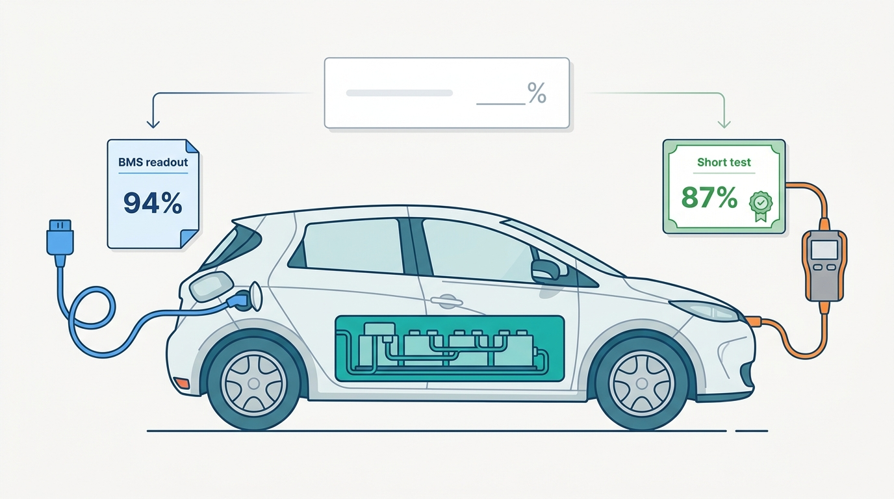
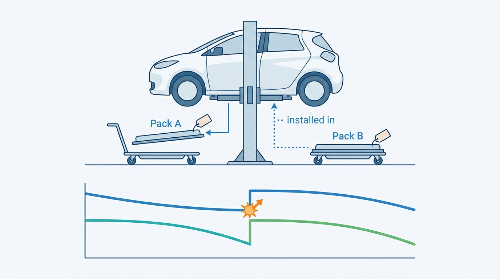
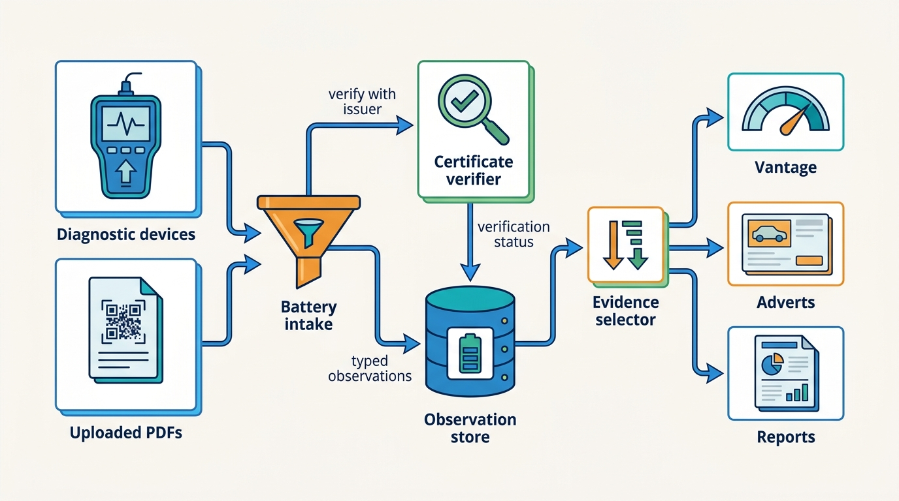
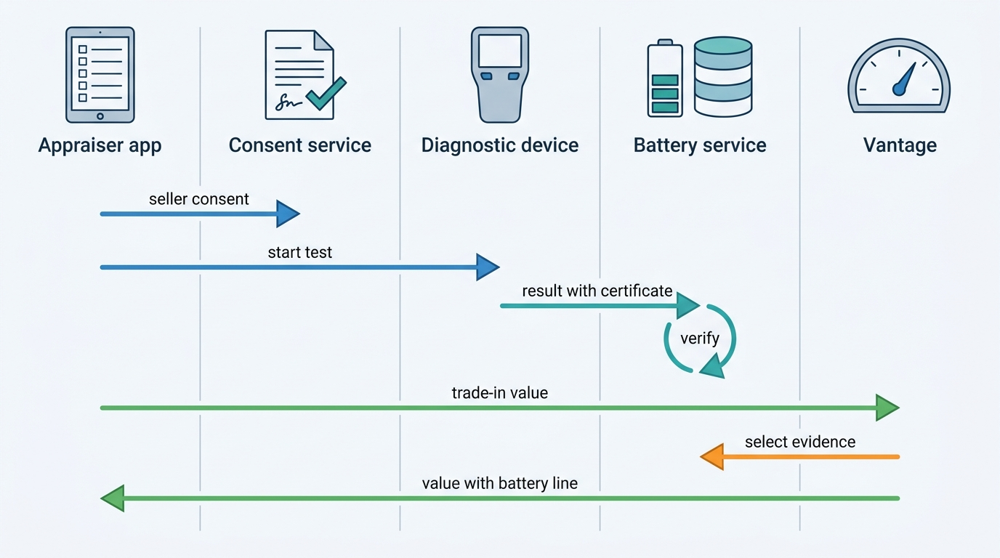
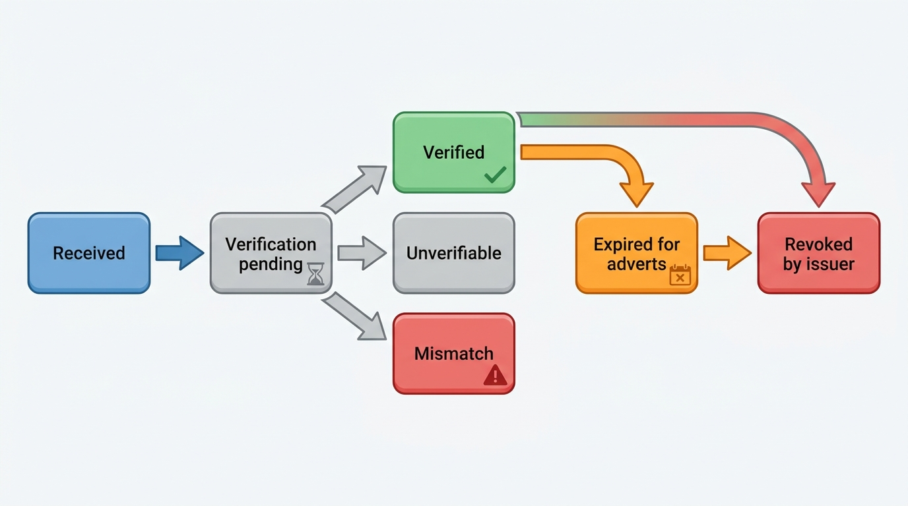

> **IN THIS CHAPTER, YOU WILL:** Learn what battery state of health means and how each measurement method produces a different number. See what the EU Battery Regulation, Euro 7, UN GTR No. 22 and the US EPA rule do and do not give a used-car platform, and design a battery-health service that stores observations, verifies certificates and feeds valuations, adverts and reports.

> **WHY THE BUSINESS CARES:** On a three-year-old electric car the battery is the part buyers fear most and the part dealers can least see. A few points of state of health can move a trade price by hundreds of euros. A wrong or forged figure in an advert or a B2B listing becomes a price dispute, and buyers who cannot trust the figure discount every used electric car.

> **WHY ARCHITECTS SHOULD CARE:** Battery health arrives from devices, vendors, manufacturers and, from 2027, a regulated battery passport. Each source has its own method, unit, key and access rule. If the platform flattens them into one "SoH %" field, the error spreads into valuations, adverts, history reports and trade listings, and no one can trace it back.

> **KEY POINTS:**
>
> * **State of health is a measurement with a method, not a property of the car.** A battery management system readout, a three-minute diagnostic test, a full charge cycle and a fleet estimate give different numbers for the same pack. Store each one as an observation with its method, unit, device, odometer and date, keyed to the battery pack as well as the vehicle. Never average across methods.
> * **A certificate is only worth what its verification is worth.** Certificates arrive as PDFs, QR codes and partner API results. Check each one with its issuer, record the verification status, give it a validity window in days and kilometers, and show "unverified" or "expired" openly instead of quietly dropping it.
> * **Regulation helps slowly, so design for "unknown".** Since 18 August 2024 the EU Battery Regulation has required SoH data in the battery management system, with read-only access for the owner and those acting for them. The battery passport starts with batteries placed on the market from 18 February 2027, so it reaches used-car lots only as those cars come back from lease. Until then, value a car without a VIN-level reading as "battery unknown", with a wider range, not at a make-and-model average.

> **[FAILURE PATTERNS THIS CHAPTER ADDRESSES](where-vehicle-platforms-go-wrong.html):**
>
> * **Provenance Amnesia** — a "94%" without its method, device, date or pack identity cannot be compared, disputed or corrected.
> * **The Confident Valuation** — a valuation that fills a missing battery reading with a make-and-model average looks certain while it hides the outliers that matter most.
> * **Spec Guesswork** — a state-of-health percentage means little when the platform does not know which battery the car was built with.

 
A used electric car has one component that can be worth a third of the car, cannot be seen on a test drive and wears at a rate that depends on how the car was charged and parked. **Battery state of health (SoH), the share of its original capacity or energy a traction battery still holds, has become the first question a buyer asks about a used electric vehicle (EV)**, before mileage and before damage.

The industry answers it in incompatible ways: the car's own battery management system (BMS, the control unit that monitors the cells), a vendor's few-minute diagnostic test, a full charge cycle, or a model of make, model, age and mileage. **Four methods, four numbers, and the platform usually receives them as a PDF with a percentage on it.**

This chapter owns **state of health (SoH)**, the **battery certificate** and the **battery passport**. It builds on [[specification-and-equipment]] (which battery the car was built with), feeds [[valuation-engine]] (the battery adjustment line), [[inventory-and-vehicle-dossier]] (where the certificate lives), [[merchandising]] and [[listing-syndication]] (where the figure is advertised) and [[consumer-vehicle-checks]]. It hands the wider question of data from the car itself to [[connected-vehicle-data]].

## Setting the Scene at Axleby: Two Certificates, One Car

Axleby, the fictional vehicle data and dealer software group this book follows (see [[meet-axleby]]), had no battery-health model before 2027. Lotwise dealers could attach any document to a stock item, and many attached battery certificates from diagnostic vendors as PDFs. **Vantage**, the group's valuation engine, did not read them. Tradefloor, Axleby Trade's B2B exchange, had a free-text field where sellers typed "SoH 94%" or "battery good". The numbers below are Axleby illustrations.

In 2026 Lotwise recorded about **150,000** battery-electric vehicle (BEV) stock-ins, about 8% of its **1.9 million**. About 23% of BEV adverts carried a battery document of some kind, from four different issuers, in four different layouts.

In **March 2027**, the gap turned into a dispute. **Fleetmoor Lease**, the NL/BE lessor that returns about **14,000** cars a year, listed a returned 2022 Volkswagen ID.3 Pro (58 kWh battery, 52,000 km) on Tradefloor with "SoH 94%" in the description. The figure came from Fleetmoor's return-inspection contractor, who had read the car's own BMS estimate with a generic diagnostic tool. A Belgian trader bought the car at **€18,400**. The trader's own workshop ran a three-minute vendor diagnostic test, which issued a certificate showing **87%**, and claimed €900. Fleetmoor settled at **€650**. Bas Hendriks, Fleetmoor's remarketing manager, asked Axleby the obvious question: which number was true?

Ines Marchetti, the Group Chief Architect, asked Priya Raman (VP Data and Valuation) and Hendrik Maes (Head of Partner Integrations) to review every Tradefloor BEV deal of the first quarter. The review found:

| Q1 2027 Tradefloor BEV deals | Value |
| --- | --- |
| BEV deals closed | 1,190 |
| Listings that stated a battery figure | 31% |
| Of those, listings that recorded how the figure was measured | 0% |
| Of those, listings with a certificate a buyer could verify with its issuer | 22% |
| Post-sale disputes that named the battery | 38 |
| Disputes settled with a payment (median €580) | 29 |

Priya's team also extracted the figures from the 6,700 battery PDFs attached to Lotwise stock items in 2026 and early 2027. Where one car had two documents, they differed by a median of **4 points**, the BMS readouts nearly always higher than the vendor tests.

Neither number in the ID.3 dispute was false. **The BMS readout and the vendor test measured different things with different methods**, and Tradefloor's free-text field threw away everything a buyer needed to tell them apart. The question for the architecture forum was not "which vendor do we trust". It was **what Axleby should store when someone says a battery is at 94%, and what it may then do with that number.**

**Figure 1:** *The same ID.3 read 94% from its own battery management system and 87% from a vendor's short test; both were honest for their method, and the listing kept neither method.*

## What State of Health Means

### State of health, energy and capacity

**State of health (SoH)** is the ratio of a battery's current ability to store energy or charge to its ability when new, as a percentage. The definition hides three choices, and each one changes the number.

- **Energy or capacity.** Capacity is charge, in ampere-hours; energy is capacity times voltage, in kilowatt-hours. The two percentages for the same pack need not match.
- **Gross or usable.** Manufacturers keep a buffer the driver cannot use; the ID.3's "58 kWh" is usable energy, and the gross pack is larger. Tests of gross capacity and of usable energy report different percentages, and a software change to the buffer moves the usable figure without any chemical change.
- **Reference.** "Original" can mean the nominal rating, the certified value at type approval, or the first measurement of this pack. A pack that beat its nominal rating when new reads high for years.

The regulators chose energy. UN Global Technical Regulation (GTR) No. 22 on in-vehicle battery durability, established in 2022, defines the **state of certified energy (SOCE)**: usable battery energy as a percentage of the usable energy certified for the vehicle when new. The EU Battery Regulation adopts SOCE as the SoH parameter for electric-vehicle batteries (Annex VII Part A), and Euro 7 and the US Environmental Protection Agency (EPA) rule build their durability floors on it. **SOCE is the closest thing the industry has to a common unit, and most certificates on the market today do not report it.**

### The battery certificate

A **battery certificate** is a document issued by a named party that states a battery's SoH for a specific vehicle at a specific time, with the method used. It is evidence, not a fact about the car: it describes the pack on the day of the test. Aviloo's certificate page says so directly: "The test result only describes the state of the battery at the time of testing and is not a prediction of its future performance" ([Aviloo, n.d., accessed 2026-10](https://aviloo.com/en/aviloo-certified)).

A useful certificate names its issuer and an identifier the issuer can confirm, the vehicle identification number (VIN), the method, the value and its unit, the odometer and the date; the observation record below lists the rest.

### The battery passport

The **battery passport** is the electronic record that the EU Battery Regulation (Regulation (EU) 2023/1542) requires for every electric-vehicle battery "placed on the market or put into service" from **18 February 2027** (Article 77(1)). It is reached through a QR code linked to a unique identifier that complies with ISO/IEC 15459 (Article 77(3)), and it identifies the **battery**, not the vehicle. Its content comes in tiers (Annex XIII):

| Tier | Who may access it | What it holds for an EV battery |
| --- | --- | --- |
| Public (battery model) | Anyone | Chemistry, materials, carbon footprint, rated capacity, voltages, original power capability, expected lifetime in cycles, the **capacity threshold for exhaustion**, commercial warranty period for calendar life |
| Legitimate interest (battery model) | Persons with a legitimate interest, the Commission | Detailed composition, part numbers, dismantling information, safety measures |
| Authorities only | Notified bodies, market surveillance, the Commission | Test reports proving compliance |
| Legitimate interest (individual battery) | Persons with a legitimate interest | Performance and durability values, **state of health under Article 14**, status (original, repurposed, re-used, remanufactured, waste), number of charge and discharge cycles, **negative events such as accidents**, temperature and state-of-charge records |

The fields a used-car buyer wants most, SoH, cycle count and accident events, sit in the restricted tier. **Who counts as having a "legitimate interest" is the question that decides whether the passport ever helps a used-car platform**, and the 2023 text does not settle it. Article 77(2) frames the purposes for individual-battery data around making the battery available to energy aggregators and energy-market participants. Article 77(9) required the Commission to adopt implementing acts by **18 August 2026** specifying who has a legitimate interest, and lists among the criteria "the necessity of having such information in order to evaluate the status and residual value of the battery". As of October 2026 I found no adopted act, only a draft: the battery industry association EUROBAT commented on a draft in May 2026 ([EUROBAT, 2026](https://eurobat.org/wp-content/uploads/2026/08/Final-EUROBAT-Battery-Passport-access-rights-feedback-27.05.2026-1.pdf)). I could not confirm the act's status from an official source, so a reader should check before relying on passport access.

### Pack identity

**A car can outlive its first battery.** Packs are replaced under warranty and after accidents, and modules are repaired. An SoH history keyed only by VIN breaks at the first replacement: the new pack reads 99%, and an algorithm that fits a degradation curve per VIN sees a miracle. The platform needs a **pack identity**, the battery's own identifier, as a second key next to the vehicle, with time-bounded "installed in" edges like the plate assignments in [[vehicle-identity]]. For batteries placed on the market from February 2027 the passport identifier provides that key. For older packs it is a serial number a diagnostic tool may be able to read, or nothing.

**Figure 2:** *A car can outlive its first battery, so battery history is keyed to the pack as well as the vehicle; a new pack reading 99% is not a miracle recovery.*

## Measuring It: Four Methods That Do Not Agree

| Method | How it works | Time | Strength | Weakness | Public example |
| --- | --- | --- | --- | --- | --- |
| **BMS readout** | Read the car's own SoH or capacity estimate over the diagnostic port or the manufacturer's API | Seconds to minutes | Cheap; no driving; works at scale on a lot | Manufacturer's algorithm, not disclosed; not every make exposes it; can be recalibrated by software | Manheim's LotVision devices (Cox Automotive, 2024) |
| **Short diagnostic test** | Read BMS data plus pack and cell parameters (cell voltage spread, energy counters), apply the vendor's statistical model | 2–5 minutes | Scalable for remarketing; vendor issues a certificate | Model-dependent; coverage varies by make and model year | Aviloo FLASH (3 minutes); Moba (under 2 minutes, vendor-stated) |
| **Full cycle test** | Record a complete charge or discharge and measure the energy | Hours to a day | Most direct measurement of energy | Needs time, a charger or a drive; temperature-sensitive | Aviloo PREMIUM |
| **Modeled estimate** | Predict SoH from make, model, age, mileage and climate | None | Needs no access to the car | Hides outliers by construction | Make-and-model averages in many valuation tools |

Two observations matter for the architecture.

**The short test is partly a model.** Aviloo's certificate page says its FLASH SoH "is calculated using a statistical model that takes into account thousands of similar vehicles and multiple predictors such as mileage, age, various SoH estimation signals from the Battery Management System (BMS), energy counters, cell voltage spread". The vendor claims that "in at least 95% of reference measurements, the maximum possible deviation of the SoH value does not exceed ±3%", and warns that "deviations in the SoH value can be caused by faulty or manipulated data in the control units" ([Aviloo, n.d., accessed 2026-10](https://aviloo.com/en/aviloo-certified)). These are vendor claims, and they tell an architect two things. A test result carries an uncertainty that should be stored with it. And if the test model uses age and mileage, a valuation that also adjusts for age and mileage risks counting them twice.

**The modeled estimate is the one to distrust most.** Cox Automotive's March 2024 release announcing VIN-level battery health at Manheim's 76 US auction locations put it plainly: "most used EV batteries are relatively healthy, the outliers tend to be significantly degraded", and Cox's president Steve Rowley said that "EV battery health scores that are based on make/model averages are just that…average" ([Cox Automotive, 2024](https://www.coxautoinc.com/wp-content/uploads/2024/03/Cox-Automotive-and-Manheim-EVBH-Release-March-27-2024.pdf)). A buyer is not exposed to the average pack. They are exposed to the outlier, and an average cannot find it.

The rule I use: **the platform may compute an expected SoH for a segment, but it must never display it as the SoH of a car.** It is a reference for the valuation and a flag for outliers, labeled "expected for this model, age and mileage".

## The Rules: What Regulation Gives a Platform

| Instrument | What it requires | Date | What it gives a used-car platform |
| --- | --- | --- | --- |
| **EU Battery Regulation 2023/1542, Article 14** | "Up-to-date data for the parameters for determining the state of health" (SOCE for EV batteries) must be in the BMS; **read-only access** "on a non-discriminatory basis to the natural or legal person who has legally purchased the battery… or any third party acting on their behalf", for purposes including "evaluating the residual value or remaining lifetime of the battery" | From **18 August 2024** | A legal route to the BMS SoH for the owner and anyone acting for them, including a dealer or platform with the owner's mandate |
| **EU Battery Regulation, Article 77 and Annex XIII** | Battery passport for each EV battery placed on the market or put into service; SoH, cycles and negative events in the legitimate-interest tier | From **18 February 2027** | A pack identifier and, if access is granted, a regulated history; access for valuation depends on the implementing act |
| **Euro 7, Regulation (EU) 2024/1257** | SoH monitors in all vehicles with traction batteries; durability minimum performance requirement (MPR) for passenger cars: **80%** of battery energy to 5 years or 100,000 km, **72%** up to 8 years or 160,000 km; durability data available through the diagnostic port | New types of passenger cars and vans (categories M1 and N1) from **29 November 2026**; all new M1/N1 registrations from **29 November 2027** | An on-board SOCE value readable through the port on new cars, and a regulatory floor to compare against |
| **UN GTR No. 22** | Defines SOCE; passenger-car MPR 80% to 5 years or 100,000 km and **70%** to 8 years or 160,000 km | Established 2022 | The common definition; the floors the US adopted |
| **US EPA, 40 CFR 86.1815-27** | From model year 2027 (vehicles at or below 6,000 lb gross vehicle weight rating): GTR No. 22 battery requirements, an "operator-accessible display" of SOCE, in-use displays "accurate within 5 percent of measured values", 80% after 5 years or 62,000 miles and 70% at 8 years or 100,000 miles | Model year 2027 | A dashboard SOCE value with a stated accuracy band |

The Euro 7 recital explains why the durability floor exists: it is "of particular importance to buyers of second-hand electric vehicles given that it would ensure that the vehicle would continue to perform as expected" ([Regulation (EU) 2024/1257](http://publications.europa.eu/resource/celex/32024R1257)). **Note the discrepancy:** Euro 7 sets 72% for the second period where GTR No. 22 and the EPA set 70%. A platform that shows "above the regulatory floor" must know which floor applies to which car.

Three limits shape the design.

**Timing.** Article 14 is product law. My reading, which is not a settled interpretation, is that it binds batteries placed on the market from August 2024 and does not reliably reach the cars built before it, which make up most of today's used EV stock. The passport applies to batteries placed on the market from February 2027; those cars reach dealers as three- and four-year lease returns from about 2030. Euro 7 durability monitors reach all new registrations only from November 2027. **For the rest of this decade, most used EVs on Axleby's dealers' lots will predate every one of these rules.**

**Access belongs to the owner.** Article 14(2) gives the right to the person who "has legally purchased the battery" and those acting for them. A dealer reading its own stock is the owner; a dealer appraising a private seller's car is not, and acts only with the seller's permission. The European Data Protection Board (EDPB) Guidelines 01/2020 on connected vehicles (version 2.0, March 2021, older than the Data Act) treat the vehicle as terminal equipment, so reading data stored in it generally needs prior consent under Article 5(3) of the ePrivacy Directive ([EDPB, 2021](https://www.edpb.europa.eu/system/files/documents/2021-03/edpb_guidelines_202001_connected_vehicles_v2.0_adopted_en.pdf)). [[connected-vehicle-data]] owns the consent model; here every observation from a car the customer does not own carries a consent reference.

**The Data Act is a weaker route.** The Commission's September 2025 vehicle guidance under the EU Data Act (Regulation (EU) 2023/2854) lists "battery level" among in-scope pre-processed data and puts scores and predictions out of scope ([Commission guidance C/2025/5026](http://publications.europa.eu/resource/celex/52025XC05026)); whether a BMS SoH estimate is pre-processed or derived is not settled. Article 14 is the clearer route.

## Architecture: Battery Health as Evidence, Not a Number

### The design principle

Axleby's review ended with one principle, which Ines wrote at the top of the decision record: **the platform stores battery observations and certificates as evidence, and derives what it shows from them, per purpose.** No table holds "the SoH of the car". There are observations, each with its provenance; a selection rule that picks the best evidence for a purpose; and outputs (a valuation line, an advert field, a report section) that cite the observation they used.

**Figure 3:** *Battery health as evidence. Every source becomes a typed observation in one store; certificates are verified with their issuer; and each consumer receives a figure chosen by a purpose-specific rule that cites the observation behind it.*

### Components

| Component | Responsibility | Owns | Must not |
| --- | --- | --- | --- |
| **Battery intake** | Accept results from integrated diagnostic devices, vendor APIs, uploaded PDFs, QR codes and, later, passport and manufacturer data; normalize to observations | Source adapters, document extraction, idempotency | Accept a value without method and date |
| **Certificate verifier** | Confirm each certificate with its issuer (API, QR landing page or signed document) and record the result | Verification status and evidence of the check | Treat an unverifiable certificate as false, or a verified one as current |
| **Battery observation store** | Hold every observation, append-only, keyed to the Axleby Vehicle Key (AVK) and, where known, the pack identity | Observation records, pack-to-vehicle edges | Overwrite or average observations |
| **Expected-SoH model** | Estimate the SoH band expected for an edition, age, mileage and climate | Segment reference curves and their version | Fill a car's SoH field |
| **Evidence selector** | Choose the observation to use for a given purpose, or return "unknown" | Selection rules per purpose, validity windows | Hide which observation it chose |
| **Battery events** | Publish `battery.observation.recorded`, `battery.certificate.verified`, `battery.certificate.expired`, `battery.pack.replaced` | Event contract | Carry personal data of the owner |

The battery-health service sits in the data half and serves both halves. Lotwise, Showroomly, Tradefloor and Odolo read it through the same API; external data clients receive the selected figure and its evidence summary under Charter, Axleby's license and purpose register, which decides whether a third-party certificate may be redistributed ([[data-licensing-and-governance]]).

### The observation record

| Field | Example | Why it is there |
| --- | --- | --- |
| Observation id, idempotency key | `bo_7f3…`, issuer + certificate id | Duplicates from retries and double uploads |
| AVK, VIN as read by the device | AVK 3381…, `WVWZZZE1ZNP…` | Vehicle key; a VIN mismatch with the dossier is a red flag |
| Pack identity | Passport id, serial, or `unknown` | Survives pack replacement |
| Method | `bms_readout`, `short_test`, `full_cycle`, `oem_telematics` | Values from different methods are not comparable |
| Value, unit | 87.0, `soce_pct` / `capacity_pct` / `vendor_score` | Units differ; a vendor score is not a percentage of anything |
| Stated uncertainty | ±3 points at 95% (issuer claim) | Lets a valuation widen its range |
| Odometer, test date, temperature, state of charge | 52,140 km; 2027-03-08; 9 °C; 64% | Validity window; temperature affects short tests |
| Issuer, device, firmware, model version | Vendor B, device v4.2 | Re-interpretation when a vendor revises its model |
| Verification status | `verified`, `unverifiable`, `mismatch`, `revoked` | What may be shown to a buyer |
| Consent reference | Consent grant id or `owner_is_customer` | Proves the read was allowed |
| Source document | Object-store pointer | Disputes need the original |

**The schema is the argument.** If the record has no method field, the ID.3 dispute cannot be explained after the fact. If it has no pack field, a replacement looks like a miracle. If it has no verification status, a forged PDF and a confirmed certificate look the same.

### Selecting evidence per purpose

Different consumers need different answers from the same observations.

| Purpose | Rule at Axleby (2027) | Result when nothing qualifies |
| --- | --- | --- |
| **Advert and Tradefloor listing** | Latest **verified** certificate from a short test or full cycle, at most **180 days** and **7,500 km** old *(Axleby policy)* | No figure; "no battery certificate" |
| **Valuation (Vantage)** | Highest-ranked observation in validity: full cycle, then verified short test, then BMS readout; uncertainty passed with it | "Battery unknown": no battery line, wider range |
| **Consumer report (Odolo)** | Latest verified certificate with its date, method and issuer, at any age; older ones listed below | "No battery test on record" |
| **Appraisal screen (Lotwise Appraise)** | All observations, newest first, with method and status; expected band for the segment shown separately | Prompt to run a test |

The ranking is a judgement, not a law of physics: a short test from a vendor with a stated ±3-point bound and a verified certificate is more useful for a price decision than an unverified BMS readout, even though the BMS readout is "the car's own number". **Recency does not override method:** a BMS readout taken last week does not displace a verified full-cycle test from two months ago for valuation, but it does trigger a check when the two differ by more than the stated uncertainty.

### Requirements per interaction

| Interaction | Consistency | Latency | Freshness | Availability |
| --- | --- | --- | --- | --- |
| Device result → observation store | Exactly once per test (idempotency key) | Seconds; store-and-forward on the device when offline | Immediate on upload | Intake queue accepts during store outage |
| Certificate verification | Eventually consistent; status may change later (revocation) | Under 10 seconds online; hours acceptable *(assumption)* | Re-verify before each new advert publication | Vendor API down → `pending`, shown as unverified |
| Selector → Vantage | Read-your-writes for the appraisal that ordered the test | Under 100 ms within the valuation budget *(assumption)* | Current observation set | Degrade to "battery unknown", never to an average |
| Selector → adverts and Tradefloor | Event-driven; the advert must not show an expired or revoked figure | Minutes | Validity window checked at publish and nightly | Withhold the figure if the service is down |
| Passport or manufacturer lookup | On demand, per consent | Seconds to minutes | Fetched when needed, not mirrored | Optional; absence never blocks a sale |

### The appraisal flow

The commonest new observation is a test run during an appraisal, on a car the dealer does not yet own.

**Figure 4:** *A battery test inside an appraisal. Consent comes before the device touches the car; the certificate is verified before the value is computed; and the valuation cites the observation it used.*

The consent step adds friction to an appraisal dealers want to finish in minutes, so Axleby put it on the seller-identity screen as one tap with a stored disclosure text. Once the dealer buys the car, new reads are the dealer's own.

## Using SoH: Valuation, Adverts and Reports

### In the valuation

[[valuation-engine]] shows a battery line in Vantage's adjustment waterfall. The line is computed against the **expected SoH band** for the edition, age and mileage, not against 100%. A 2022 ID.3 Pro 58 kWh at about 50,000 km has an expected band centered near 94% in Axleby's 2027 curves, and the adjustment slope for that segment is about **€107 per point** *(Axleby illustration)*. A certified 91% gives the −€320 line shown in the valuation chapter; the 87% in the Fleetmoor dispute gives −€750; the BMS readout of 94% gives no adjustment.

Three design rules keep the line honest.

1. **No VIN-level reading, no battery line.** The value is computed without it, the range widens by the segment's spread of SoH outcomes, and the answer carries a `battery_unknown` flag. Filling the gap with the segment average would produce a narrower range for exactly the cars whose risk is unknown.
2. **The battery size must be known first.** In the 2026 EV Overvaluation (Vantage overvalued used BEVs by **9.5%** on average for **14 weeks**), about 7% of BEV valuations used an edition whose battery size the specification resolver had not resolved. A percentage of an unknown capacity is not information. Specbook's edition resolution comes before the battery line, and a test result can resolve the edition: a device that reads 77 kWh usable settles which ID.3 it is ([[specification-and-equipment]]).
3. **Avoid double counting.** Where a vendor's SoH model already uses age and mileage, the expected band must be computed on the same basis, or the adjustment rewards or punishes the age twice. Vantage stores the method with the line, and the back-test groups battery-line error by method.

### In adverts and listings

**A figure in an advert is a claim the dealer makes to a consumer.** Axleby shows it only from a verified certificate inside the validity window, and always with its date and method: "Battery 89% (short test, 14 March 2027, verified)". Relay, the syndication engine, sends a structured field where a channel accepts one and adds the sentence to the description where it does not ([[listing-syndication]]). Auto Trader UK's documented API is an example of how portals already build battery data into their models: its description endpoint requires `batteryRangeMiles` for electric cars ([[case-auto-trader-uk]]). When a certificate expires, the battery event removes the figure from every channel; that is a delete path, and it needs the same reconciliation as any other ([[listing-syndication]]).

The commercial pull is real: VWE, the Dutch vehicle-data and dealer-software company, says vehicles with an SoH report "get up to 30% more clicks on ads" ([VWE, n.d., accessed 2026-10](https://vwe.xmedia.nl/en/?p=3520)). It is a vendor claim without a published method, but it explains why dealers will advertise a battery figure whether or not the platform governs it.

### In reports and B2B trade

Business history reports and Odolo's consumer reports show the battery section as a list of dated observations, newest first, each with method and verification status, never as one number ([[consumer-vehicle-checks]]). Tradefloor listings for BEVs now require either a verified certificate within the validity window or an explicit "battery not tested" declaration; the free-text field cannot carry a battery figure ([[b2b-trade-and-remarketing]]). A buyer can bid on an untested car, but they know they are doing it.

## Certificates and Verification

A certificate moves through states, and the platform must track them, because what may be shown depends on the state.

**Figure 5:** *The certificate lifecycle. Only Verified certificates inside their validity window appear in adverts and listings; Expired ones stay in the dossier and reports with their date; Mismatch and Revoked trigger a review.*

**Verification means asking the issuer**, not reading the PDF. Aviloo's results "can be accessed at any time via QR code, allowing buyers and sellers to verify authenticity directly" ([Aviloo, n.d., accessed 2026-10](https://aviloo.com/en/aviloo-certified)). Where an issuer offers an API or a verification page, the verifier fetches the record by certificate id and compares VIN, value, date and odometer. Where it offers neither, the certificate is `unverifiable`: kept and labeled in the dossier, never used in adverts.

When Axleby ran the verifier over the 6,700 historical PDFs in June 2027, **71%** verified, **27%** were unverifiable (issuers without a lookup, or documents without an id), and **41** documents (0.6%) did not match the issuer's record: in 33 the SoH value had been edited upward, in 8 the VIN belonged to another car *(Axleby illustrations)*. Forty-one is a small number. It is also forty-one adverts that told a buyer something the issuer never said.

**Validity is a policy, not a property.** SoH changes slowly, so a six-month-old certificate still informs a valuation, but a buyer reads an advert as a current statement. Axleby's advert window (180 days, 7,500 km) is a judgement chosen with the dealer council, stored in Baseline, the tenant configuration service, as a market-pack setting, so a market or a dealer group can tighten it but not loosen it ([[onboarding-and-configuration]]).

## In Practice

### What the public record shows

- **Manheim and Cox Automotive, US (2024–2026).** In March 2024 Cox announced that Manheim's LotVision devices, installed in every vehicle with an OBD-II port (the on-board diagnostics connector) at check-in across 76 US locations, would capture EV battery health "in minutes" after a firmware update and display "a battery health score (0-100%) that represents the remaining battery capacity captured directly from the vehicle" on condition reports and vehicle detail pages, with warranty, chemistry and charging-cable presence ([Cox Automotive, 2024](https://www.coxautoinc.com/wp-content/uploads/2024/03/Cox-Automotive-and-Manheim-EVBH-Release-March-27-2024.pdf)). Manheim's valuation help page (2026) says the Manheim Market Report incorporates "an Electric Vehicle Battery Health (EVBH) score for qualifying electric vehicles when available", which "displays the VIN-specific remaining battery capacity on a scale of 0–100" ([Manheim, 2026](https://site.manheim.com/tutorials/manheim-market-report-help)). This is the clearest public example of SoH captured at intake, attached to the condition report and fed into the valuation. [[case-cox-automotive]] covers Cox more broadly.

> **INFERENCE, NOT DOCUMENTED:** Because one device type captures the Manheim score for every car on the lot, its readings are probably consistent across the auction's own inventory, which matters more for wholesale price discovery than agreement with other vendors' scales. Cox has not published how the score is computed.

- **Aviloo (n.d., accessed 2026-10).** Besides the tests and QR verification described above, the vendor offers an "AVILOO PREVIEW" summary designed for online used-car adverts ([Aviloo, n.d.](https://aviloo.com/en/aviloo-certified)): the certificate is becoming an advert component.
- **VWE and Moba, Netherlands (n.d., accessed 2026-10).** VWE's product page describes SoH reports created with the Moba Toolbox and app "in minutes", attached automatically to the vehicle file in MijnVWE and usable in adverts ([VWE, n.d.](https://vwe.xmedia.nl/en/?p=3520)). It is a public example of the integration this chapter recommends: certificate into the dossier, dossier into the advert. [[case-vwe]] covers VWE.
- **Car-Pass, Belgium (accessed 2026-10).** Car-Pass, the non-profit that Belgian law charges with recording odometer readings for used-car sales, lets a seller have the battery tested and "link the results directly to your Car-Pass"; "the SOH value (in %) will then automatically appear on the document", and on the digital Car-Pass the buyer "can even click through directly to the full test report" ([Car-Pass, accessed 2026-10](https://www.car-pass.be/en)). A public-interest record in one market already carries SoH next to mileage.
- **Arnold Clark and Moba, UK (March 2026).** EV Powered reported on 16 March 2026 that Arnold Clark, one of the UK's largest car retailers, would offer Moba battery health checks as part of routine servicing, not only at sale ([EV Powered, 2026](https://evpowered.co.uk/news/arnold-clark-adds-moba-battery-health-checks-to-servicing-offer/)). Tests taken during ownership give a series of observations per car, which is what a degradation curve needs.

None of these sources publishes an accuracy comparison between methods on the same cars. The public evidence stops at vendor claims and the Cox statement about outliers.

### Axleby worked example: the ID.3, replayed

After the battery-health service went live in **July 2027**, Priya's team replayed the Fleetmoor ID.3 through it, as an Axleby illustration.

| Step | Under the 2027 design |
| --- | --- |
| Return inspection | Fleetmoor's contractor runs a short test from one of the two vendors Axleby integrates; the certificate verifies; the BMS readout from the same session is stored as a second observation |
| Observations | `short_test` 87.0% ±3 (verified, 52,140 km, 8 March); `bms_readout` 94% (unverified device read, same session) |
| Conflict check | Difference 7 points exceeds the stated ±3; the dossier shows both, with a note that methods differ |
| Vantage | Selects the verified short test; battery line −€750; range widened by the uncertainty; trade value about €18,000 *(Axleby illustration)* |
| Tradefloor listing | "Battery 87% (short test, 8 March 2027, verified)"; BMS figure not shown |
| Outcome | The buyer prices the 87%; no dispute |

**The fix was not a better measurement. It was keeping the method attached to the number** and choosing, per purpose, which number to show. Fleetmoor now runs the test at every BEV return, about **3,400** in 2027 (24% of its returns), and Bas Hendriks reports the battery figure as a separate line in his remarketing results.

By the fourth quarter of 2027, 61% of Lotwise BEV adverts in the Netherlands and Belgium carried a verified certificate, against about 23% with any document in 2026. In Q4 2027, two Tradefloor disputes named the battery, against 38 in Q1 *(Axleby illustrations)*.

## Failure Handling

| Failure | Detection | Recovery |
| --- | --- | --- |
| **Duplicate results** (device retries, the same PDF uploaded twice, the vendor webhook and the device both report) | Idempotency key from issuer and certificate id; content hash for documents | One observation; later copies linked as duplicates, not new evidence |
| **Conflicting observations** (BMS 94%, short test 87%) | Difference larger than the combined stated uncertainty, per method pair | Keep both; selector applies method ranking; dossier shows the conflict; a conflict rate per make and method feeds the vendor review |
| **Incomplete records** (no odometer, no certificate id, unknown unit, no battery size) | Intake validation | Stored as `incomplete`; usable for the appraisal screen, never for adverts or valuation; prompt to retest |
| **Device offline in a yard without signal** | Device queue age | Store-and-forward with the original timestamp; observation date is the test date, not the upload date |
| **Vendor verification API down** | Verification timeouts | Status `pending`; adverts publish without the figure; retry with backoff; dealers see "verification pending", not an error |
| **Forged or edited certificate** | Issuer record mismatch | Status `mismatch`; figure withdrawn from every channel by event; case to the dealer and, for repeat cases, to account management |
| **Revoked certificate** (vendor withdraws a result after finding a model fault) | Issuer revocation feed or periodic re-verification | Status `revoked`; affected valuations found through the valuation ledger's evidence id and re-run; adverts updated |
| **Pack replaced** | Pack serial or passport id changes; sudden SoH jump of more than 8 points *(assumption)* | `battery.pack.replaced` event; new pack edge; older observations stay with the old pack |
| **Software update moves the buffer** | Step change in BMS readouts across many cars of one model within days | Flag the model; do not treat as degradation or recovery; prefer test methods for that model |
| **Wrong vehicle** (device read another car) | Device VIN differs from dossier VIN | Reject; route to the appraiser |

**The revocation path is the one teams forget.** A correction to a battery figure is a correction like any other fact: the valuation ledger finds the valuations that cited the observation, Relay finds the adverts, and the report archive finds the reports. [[journey-data-correction]] follows that path end to end; for battery data it only works if every output stores the observation id, not a copy of the percentage.

## Trade-Offs

### Where the measurement comes from

| Option | Cost to the dealer | Consistency | Coverage | Right when |
| --- | --- | --- | --- | --- |
| **BMS readout only** (generic device) | Lowest | Varies by manufacturer algorithm | Wide but uneven; some makes expose nothing | Lot-wide screening, internal triage, not adverts |
| **One integrated test vendor** | Device plus per-test fee | High within one scale | Limited to the vendor's supported models | A single market with one dominant vendor |
| **Several vendors, normalized by method** (Axleby's choice) | Dealer chooses | Comparable within method, not across | Widest | A multi-market platform whose dealers already own different devices |
| **Platform's own test** | Platform builds hardware and models | Highest control | Must be built make by make | A group with auction-scale volume of its own cars, like Manheim |
| **Modeled estimate only** | None | Consistent, and blind to outliers | Universal | Never as a car's figure; only as a reference band |

Axleby chose several vendors because its dealers in four markets already owned different devices. The cost is a permanent integration and verification workload in Hendrik Maes's team and a ranking rule someone must keep defending. **Building its own test would have been a distraction:** its 150,000 BEV stock-ins a year are spread over thousands of rooftops, not passing through its own lanes.

### How much to promise

| Choice | Benefit | Risk |
| --- | --- | --- |
| Show any figure the dealer supplies | Most adverts carry a number | Forged and incomparable figures reach buyers under the platform's layout |
| Show verified certificates only (Axleby's choice for adverts) | Every figure can be checked | Fewer adverts carry a figure at first; dealers with unverifiable vendors complain |
| Show a platform-issued "battery grade" | One simple scale for buyers | The platform becomes liable for a judgement it did not measure |

I would not issue a platform-branded battery grade until the platform measures batteries itself or regulated SOCE data are widely readable. **A grade is a promise; a cited certificate is a pointer**, and pointers are the honest product while the measurements belong to others.

## Across Markets: What Changes by Country

| | Netherlands / Belgium | Germany | United Kingdom | United States |
| --- | --- | --- | --- | --- |
| BMS SoH data required in the vehicle | Yes, EU Battery Regulation Art. 14, from 18 Aug 2024 | Same (EU) | Not mandated (EU rules do not apply in Great Britain by default; not verified for Northern Ireland) | SOCE display from model year 2027 (EPA rule; check current status) |
| Third-party read access | Owner and those acting for them, read-only (Art. 14(2)) | Same | No statutory right found | No federal right found |
| Battery passport | From 18 Feb 2027 for batteries placed on the market | Same | No | No |
| Durability floor | Euro 7: 80% / 72% (passenger cars); new types from Nov 2026, all registrations from Nov 2027 | Same | None found | 80% / 70% (GTR No. 22 via EPA) |
| Consent to read a customer's car | ePrivacy consent (EDPB Guidelines 01/2020) plus the General Data Protection Regulation (GDPR) | Same | UK GDPR and the Privacy and Electronic Communications Regulations; consent model similar *(assumption)* | No equivalent federal rule; state privacy laws vary |
| Public record carrying SoH | **Belgium:** Car-Pass shows an uploaded test's SoH; **Netherlands:** none found | None found | None found | None found; auction VIN-level scores (Manheim) |
| Market practice found in public sources | Vendor certificates in dealer software (VWE with Moba) | Not verified for this chapter | Vendor checks at sale and in servicing (Arnold Clark with Moba, 2026) | Auction-captured VIN-level scores in condition reports and valuations |

**What stays common:** the observation model, the method ranking, verification, the validity policy mechanism, pack identity, the valuation rules and the events. None of that depends on the market. **What becomes a market adapter:** consent texts and lawful bases, the source adapters (Car-Pass in Belgium; passport and Article 14 access in the EU; dashboard SOCE capture in the US), the regulatory floor shown against a figure, and the validity window, which sits in each market pack. The UK is the market where the platform carries the most weight, because there is no statutory route to the data and no public record; there, the platform's verified certificate is the strongest evidence a buyer will see.

## The Chief Architect's View

**Decide the unit and the key before the feature.** The expensive mistakes in battery data are a percentage field without a method and a VIN key without a pack. Both are cheap to get right in the first schema and expensive to repair after a million observations. Ines put both in the One Dossier data standard, owned by Priya Raman's team, with the Group Chief Architect as approver for any new method or unit.

**Own the verification, not the measurement.** Axleby integrates the vendors its dealers use, verifies their certificates and refuses to show what it cannot verify. That keeps it out of a hardware business and puts its effort where customers cannot act alone: comparing, checking and propagating evidence across products.

**Treat the regulation as a roadmap with a long tail.** Article 14 and the passport will matter, but they reach the used-car market as cars age into it. Plan pack identity, passport identifiers and a consent-based Article 14 adapter in 2027 and 2028; do not plan revenue on them before about 2030. Watch three events: the Article 77(9) implementing act on legitimate interest (and any amendment to it), the Commission's battery durability report due by **31 December 2027** under Euro 7, and the first lease returns of cars with passports.

**Measure the battery line like any other adjustment.** Back-test its error by method and segment ([[valuation-engine]]). If one vendor's verified tests systematically disagree with realized trade prices, that is a vendor review, not a model tweak.

**Who decides what:** the data standard (units, methods, ranking) sits with the VP Data and Valuation; the validity window for adverts with product and the dealer council, per market pack; vendor onboarding with Partner Integrations; consent texts and lawful bases with Femke de Boer, the Data Protection Officer ([[privacy-and-retention]]).

## Questions to Ask

1. When your platform shows "SoH 89%", can it say which method, device, issuer, date and odometer produced it, and whether the issuer confirmed it?
2. Do you store battery observations against the battery pack as well as the vehicle, and what happens to the history when a pack is replaced?
3. What does your valuation do when no VIN-level reading exists: widen the range and flag it, or fill in a make-and-model average?
4. Is the battery size resolved before any SoH percentage is used, and can a test result resolve the edition?
5. How many certificates in your dossiers can be verified with their issuer today, and what do you show for the rest?
6. When a certificate expires, is revoked or is found to be edited, how long until every advert, listing and report stops showing it?
7. Before an appraiser plugs a device into a private seller's car, where is the seller's consent recorded, and does it travel with the observation?
8. Does any adjustment count age or mileage twice, once in the vendor's SoH model and once in your own?
9. Who in your organization is tracking the Article 77(9) implementing act, and what would you build if valuation providers were given passport access?

The battery is the clearest case of a fact that lives inside the car and reaches the platform only through someone else's device, account or permission. The next chapter widens the lens to every such fact: odometer readings, fault codes, location and charge level sent by the car itself, the EU Data Act that governs access to them, and the consent model the battery service already relies on ([[connected-vehicle-data]]).

## Sources and Evidence

*Company, product and investor sources*

- [Cox Automotive Deploying Industry-First, VIN-Specific EV Battery Health Solution Across Manheim Locations](https://www.coxautoinc.com/wp-content/uploads/2024/03/Cox-Automotive-and-Manheim-EVBH-Release-March-27-2024.pdf), Cox Automotive, 2024 — LotVision OBD capture at 76 US locations, 0–100% battery health score on condition reports, outlier statement, Rowley quote, about 48,000 EVs sold through Manheim in 2023.
- [Manheim Market Report (MMR) Help](https://site.manheim.com/tutorials/manheim-market-report-help), Manheim (Cox Automotive), 2026 — EVBH score incorporated into MMR; VIN-specific remaining capacity on a 0–100 scale.
- [AVILOO Certified](https://aviloo.com/en/aviloo-certified), AVILOO GmbH, n.d., accessed 2026-10 — FLASH and PREMIUM tests, statistical model inputs, ±3-point claim at 95%, QR verification, manipulation warning, snapshot disclaimer (vendor claims).
- [State of Health report: (PH)EV battery condition](https://vwe.xmedia.nl/en/?p=3520), VWE Automotive, n.d., accessed 2026-10 — Moba-based SoH reports attached to the MijnVWE vehicle file and adverts; "up to 30% more clicks" (vendor claim).
- [Car-Pass](https://www.car-pass.be/en), Car-Pass vzw, accessed 2026-10 — SoH test results linked to the Car-Pass document and visible to buyers.

*Standards, regulation and official documentation*

- [Regulation (EU) 2023/1542 concerning batteries and waste batteries](http://publications.europa.eu/resource/celex/32023R1542), European Parliament and Council, 2023 — Article 14 (SoH data in the BMS from 18 August 2024; read-only access for the purchaser and those acting for them), Article 77 and Annex XIII (battery passport from 18 February 2027; access tiers; implementing act due 18 August 2026), Annex VII (SOCE).
- [Regulation (EU) 2024/1257 (Euro 7)](http://publications.europa.eu/resource/celex/32024R1257), European Parliament and Council, 2024 — SoH monitors; battery durability MPR 80% / 72% for M1; application dates 29 November 2026 and 29 November 2027; battery durability report by 31 December 2027.
- [40 CFR 86.1815-27, Battery durability](https://www.law.cornell.edu/cfr/text/40/86.1815-27), US EPA via Cornell LII, rule text accessed 2026-10 — GTR No. 22 adoption from model year 2027, SOCE display, 5% in-use accuracy, 80% / 70% floors.
- [Guidelines 01/2020 on processing personal data in the context of connected vehicles, version 2.0](https://www.edpb.europa.eu/system/files/documents/2021-03/edpb_guidelines_202001_connected_vehicles_v2.0_adopted_en.pdf), European Data Protection Board, 2021 — vehicle as terminal equipment; consent before reading stored data.
- [Guidance on vehicle data, accompanying Regulation (EU) 2023/2854 (C/2025/5026)](http://publications.europa.eu/resource/celex/52025XC05026), European Commission, 2025 — battery level as in-scope pre-processed data; scores and predictions out of scope.

*Research and practitioner sources*

- [Battery Passport access rights feedback](https://eurobat.org/wp-content/uploads/2026/08/Final-EUROBAT-Battery-Passport-access-rights-feedback-27.05.2026-1.pdf), EUROBAT, 2026 — industry feedback on the draft Article 77(9) implementing act (status of adoption not confirmed from an official source).
- [UN GTR No. 22 summary](https://www.horiba.com/ind/mobility/applications/emissions-performance-and-durability/exhaust-emissions/gtr-no22), HORIBA, n.d., accessed 2026-10 — GTR No. 22 establishment (2022), SOCE definition, 80% / 70% floors (vendor summary, not the UNECE text).
- [Arnold Clark adds Moba battery health checks to servicing offer](https://evpowered.co.uk/news/arnold-clark-adds-moba-battery-health-checks-to-servicing-offer/), EV Powered, 2026 — battery checks offered during routine servicing in the UK.

Axleby is fictional; architectural recommendations, labeled inferences and labeled assumptions are the author's judgement.
