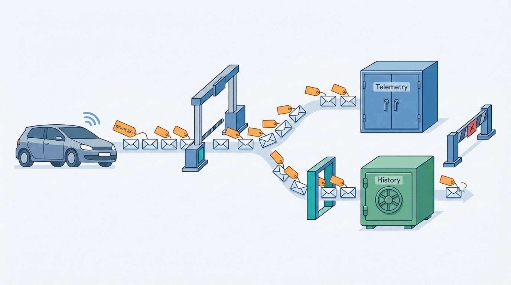
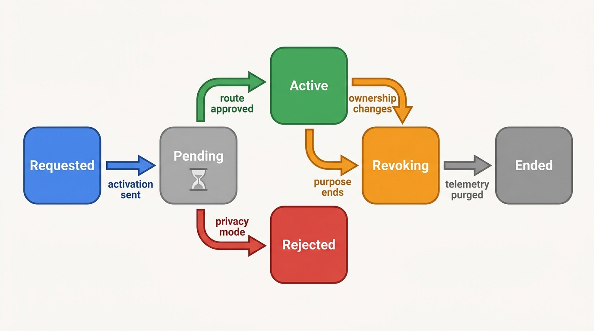
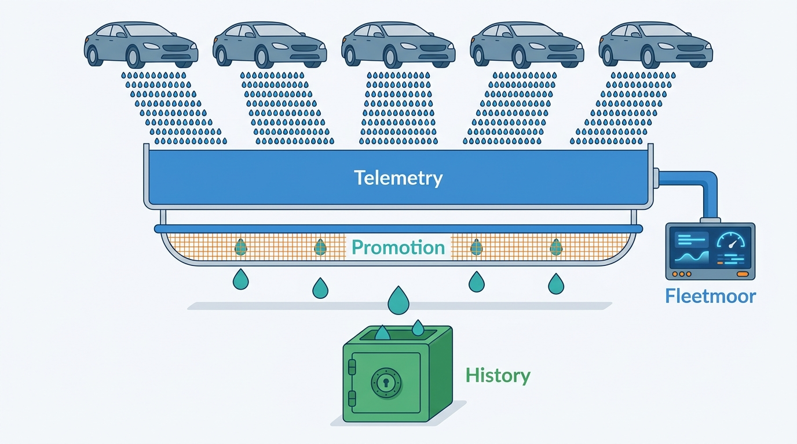
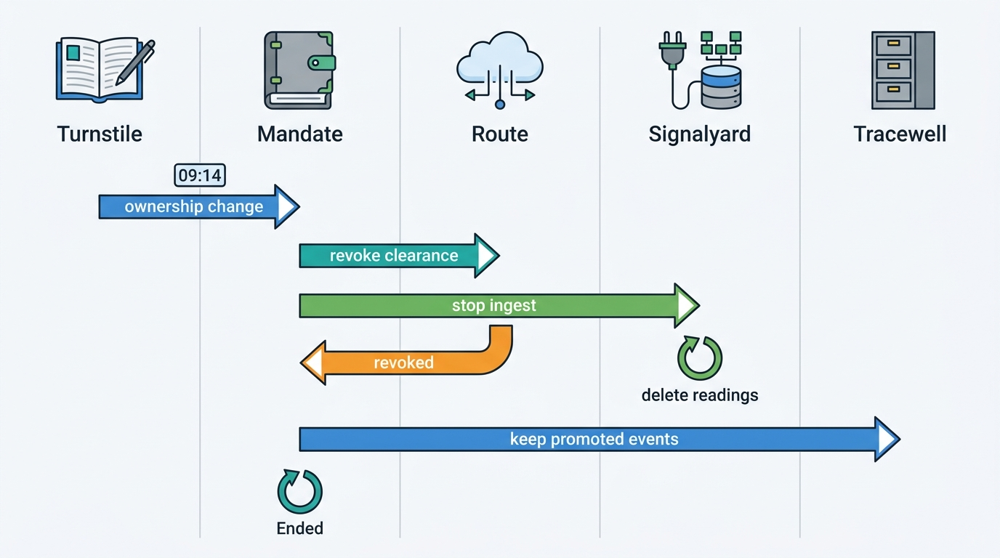

> **IN THIS CHAPTER, YOU WILL:** Learn what data a connected car can provide and through which routes, what the EU Data Act, type-approval law, ePrivacy and the GDPR require of a platform that receives it, and how to build a consent registry, per-source connectors and a governed path from raw telemetry into the vehicle history.

> **WHY THE BUSINESS CARES:** A lessor that knows each car's real mileage every day can price excess kilometers, plan returns and set auction reserves on facts instead of drivers' self-reports. A history provider that can show "mileage confirmed by the manufacturer two days ago" sells a stronger report. Both lose that advantage, and the customer's trust, if the data is used beyond what the customer agreed to.

> **WHY ARCHITECTS SHOULD CARE:** Connected-vehicle data is the first large vehicle-data source whose usage rights are tied to an individual vehicle and an individual user, not to a supplier contract. The data model, the storage split, the revocation path and the audit all follow from that. A platform that treats it as one more supplier feed builds a compliance problem into its history store.

> **KEY POINTS:**
>
> * **The right travels with the reading.** Under the EU Data Act a third party receives car data only at the request of the vehicle's user, and may use it only for the purpose agreed with that user (Art. 6). So the unit of governance is a **consent grant per vehicle**: user, data holder, recipient, purpose, data categories and validity. Every reading must point to the grant it was received under.
> * **Keep telemetry and history apart, and promote between them deliberately.** Raw connected signals belong in a purpose-scoped store that is deleted when the purpose ends. Only readings the grant allows, at a coarse granularity, become history events alongside register and workshop readings. The promotion step is where license, privacy and data quality meet.
> * **Coverage is partial and the car can say no.** Coverage depends on brand, model year, hardware, connectivity subscription and the car's own privacy setting, and some readings are stale repeats. "No connected data" says nothing about the car, and a connected reading is strong evidence, not proof. Ownership changes end the grant, and revocation must reach every copy.

> **[FAILURE PATTERNS THIS CHAPTER ADDRESSES](where-vehicle-platforms-go-wrong.html):**
>
> * **License Blindness** — readings obtained for one lessor's remarketing quietly become part of a history database sold to everyone, against the purpose the user agreed to.
> * **Provenance Amnesia** — a connected reading stored without its route, grant and signal timestamp cannot be defended when it disagrees with an inspection, or deleted when the grant ends.
> * **Borrowed Uptime** — an appraisal that waits synchronously on a manufacturer backend inherits that backend's outages and activation delays.

 
Every other source in this book observes the car from the outside. A register records what a business reported. An inspection records what a tester read off the dashboard. An advert records what a dealer typed. **A connected car reports on itself**: its odometer, its warning lamps, its battery, sometimes its position, every day or every few minutes, through the manufacturer's backend. It is the most precise odometer and condition source a platform can get, and since September 2025 the EU Data Act lets the car's user have it shared with a third party of their choice.

The catch is in the phrase "of their choice". The data is not offered to the market. It reaches a platform because **a specific user asked for it to be shared, for a specific purpose**, and the Data Act binds the recipient to that purpose. The architecture problem is therefore not ingestion. It is **keeping the right attached to every reading** as the reading moves from a connector into telemetry, into history events, into valuations and reports, and out again when the right ends.

**Figure 1:** *Every connected reading carries the grant it arrived under, and that grant decides whether it may stay in telemetry, move into history, or must stop.*

This chapter owns **connected-vehicle data**, **data holder** and **consent grant (vehicle)**. It builds on [[vehicle-history]], whose event model receives the readings, and [[ingestion-and-entity-resolution]], whose pipeline they pass through. It hands battery state of health to [[ev-battery-health]], the license and purpose register to [[data-licensing-and-governance]] and retention and erasure in depth to [[privacy-and-retention]].

## Setting the Scene at Axleby: Fleetmoor Asks for the Car's Own Odometer

Axleby, the fictional vehicle data and dealer software group this book follows (see [[meet-axleby]]), has no connected-car data in 2026. In June 2027 **Bas Hendriks**, remarketing manager at **Fleetmoor Lease**, asked for it. Fleetmoor leases about **64,000** vehicles in the Netherlands and Belgium and takes back about **14,000** a year, most of which it sells through Tradefloor, Axleby's B2B trade exchange ([[b2b-trade-and-remarketing]]). Two numbers hurt Bas. Fleetmoor charged excess kilometers on its leases from the readings drivers typed into its driver portal each month, and disputes about those charges were rising. And Vantage valued each return from the last mileage Fleetmoor knew, which could be four weeks old.

Fleetmoor owns the cars. Under the Data Act that makes it a **user**, entitled to ask each manufacturer to share the cars' data with a third party. Bas wanted Axleby to be that third party: a daily odometer reading for every car whose lease ended within 18 months, plus warning lamps and battery data for the electric cars.

**Priya Raman** (VP Data and Valuation) saw a second prize. After the Odometer Correction of May 2027, when a supplier batch put wrong mileage on **2,870** UK-imported vehicles, Tracewell needed readings it could trust more than commercial files. Manufacturer readings from 8,000 to 10,000 Fleetmoor cars would feed the odometer judgement in every history report those cars ever appeared in, including the reports a dealer buys when the car is resold.

**Femke de Boer** (Head of Data Governance and Privacy) stopped that sentence halfway. The data would arrive because Fleetmoor asked for it, for Fleetmoor's remarketing. Selling it inside history reports to other customers was a different purpose. The Data Act permits that only if it is agreed with the user. And the readings, daily and per car, described the movements of identifiable lessees and their employees.

**Hendrik Maes** (Head of Partner Integrations) added the practical problem: no single route reached all of Fleetmoor's brands, and each route had its own activation process, data dictionary and failure modes.

**Ines Marchetti**, Group Chief Architect, framed the question for the design review: **what must Axleby store about each car's right to data, how does a reading travel from a manufacturer into Fleetmoor's service and possibly into shared history, and what happens when the car is sold?**

## What a Connected Car Can Tell You

**Connected-vehicle data** is data a vehicle generates about its use and condition and sends through an electronic communications service or exposes on a physical port. In the Data Act's terms the vehicle is a **connected product**: an item that "obtains, generates or collects data concerning its use or environment" and can communicate it "via an electronic communications service, physical connection or on-device access" (Regulation (EU) 2023/2854, [Art. 2(5)](http://publications.europa.eu/resource/celex/32023R2854), 2023). The Commission's September 2025 vehicle-data guidance says which kinds of vehicle data are in scope and which are not ([European Commission, C/2025/5026, 2025](http://publications.europa.eu/resource/celex/52025XC05026)):

| Data category | Data Act status (Commission guidance, 2025) | Value to a vehicle data platform | Sensitivity |
| --- | --- | --- | --- |
| **Odometer value** | In scope: pre-processed data (para 34) | Very high: history, valuation, lease mileage | Low alone; higher at daily granularity, because it reveals use |
| **Fault codes and malfunction lamps** | In scope (para 34) | High: condition at appraisal and return | Low |
| **Battery level** and component wear (brake pads) | In scope (para 34) | Medium; state of health belongs to [[ev-battery-health]] | Low |
| **Time or distance to next service** | In scope unless predicted (para 34) | Medium: reconditioning cost | Low |
| **GNSS location** (global navigation satellite system) | In scope (para 34) | Low for history and valuation | **High**: the European Data Protection Board (EDPB) calls location "particularly revealing of the life habits of data subjects" |
| **Raw sensor and CAN-bus signals** | In scope: raw data (para 33) | Low for this platform | Varies |
| **Driving or eco-scores**, crash-severity analysis | Out of scope: inferred or derived (para 35) | Tempting for risk products | High |

Two lines in that table decide most of what follows. **Odometer values and fault codes are in scope**, so a user can direct them to a platform. **Driving scores are out of scope**: they are the manufacturer's derived data and the Data Act gives nobody a right to them. A history and valuation platform needs the first kind and should not want the second.

The terms this chapter uses:

- **User**: a person or organization that "owns a connected product or to whom temporary rights to use that connected product have been contractually transferred" (Art. 2(12)). An owner, a lessee and a renter can all be users. The registered keeper is not automatically one.
- **Data holder**: the party that has the right or obligation to use and make available the product data, in practice the manufacturer or its backend. The data holder owes the user access and must share with a third party at the user's request (Arts. 4 and 5).
- **Third party** or data recipient: the party the user chooses to receive the data. When Fleetmoor directs a manufacturer to share with Axleby, Axleby is the third party.
- **Readily available data**: data the data holder "lawfully obtains or can lawfully obtain ... without disproportionate effort" (Art. 2(17)). The guidance treats data that reaches a manufacturer's backend "notably under the 'extended vehicle' concept" as readily available (paras 39–40).
- **Consent grant (vehicle)**: this book's term for the platform's record of one right to receive one vehicle's data. It records the vehicle, the user who granted it, the data holder and route, the recipient, the purpose, the data categories, the legal basis, the validity and the state. It is a deliberately broad term. Legally, the right behind it may be a Data Act user request, an ePrivacy consent to read the car, a GDPR consent, a contract with a fleet owner, or several of these at once. The record stores which.

## The Rules a Receiving Platform Lives Under

### The EU Data Act

The Data Act applies in stages ([Regulation (EU) 2023/2854, Art. 50](http://publications.europa.eu/resource/celex/32023R2854), 2023):

| Obligation | Who owes it | Applies from | What it means for a vehicle platform |
| --- | --- | --- | --- |
| Pre-contract information about the product's data (Art. 3(2)) | **The seller, renter or lessor**, "which may be the manufacturer" | **12 September 2025** | A dealer or lessor that sells or leases a connected car must tell the customer what data it generates, where it is stored and how to access it, before the contract |
| Access by design (Art. 3(1)) | Manufacturers | Products **placed on the market after 12 September 2026** | New cars must make data available "by default, easily, securely, free of charge" and, where feasible, directly to the user. Older cars are reached through Articles 4 and 5 |
| User access on request (Art. 4) | Data holder | 12 September 2025 | Free of charge to the user, same quality as the data holder has |
| Sharing with a third party at the user's request (Art. 5) | Data holder | 12 September 2025 | The route a platform like Axleby uses |
| Third-party obligations (Art. 6) | **The receiving platform** | 12 September 2025 | Use only for the purposes agreed with the user, erase when no longer needed, no onward sharing without the user's contract |
| Compensation on fair, reasonable and non-discriminatory (FRAND) terms (Arts. 8–9) | Data holder to recipient | 12 September 2025 | The recipient may pay "reasonable" compensation that "may include a margin"; for small and medium-sized recipients it may not exceed cost |

Article 6 is the operative text for a receiving platform. The third party processes the data "only for the purposes and under the conditions agreed with the user" and erases it "when they are no longer necessary for the agreed purpose" (Art. 6(1)). It may not use the data for profiling unless that is "necessary to provide the service requested by the user", may not pass it to another third party except under a contract with the user, and may not use it to develop a competing product or to derive insights about the data holder's economic situation (Art. 6(2)). Pooling Fleetmoor's readings into a history database sold to other customers is therefore lawful only if Fleetmoor, the user, agrees to it as a purpose, and, for personal data, only with a valid basis under the General Data Protection Regulation (GDPR).

Three more provisions shape the commercial side. Access is **free to the user**; compensation runs between the data holder and the third party (Arts. 4(1), 5(1), 9). The compensation cap for small and medium-sized enterprises (Art. 9(4)) does not help a group of Axleby's size. And data holders may protect **trade secrets** by agreeing protective measures with the recipient, and may withhold or suspend sharing, with written reasons and notice to the competent authority, when no agreement is reached (Arts. 5(9)–(11)). The Commission's guidance is non-binding and expressly does not interpret the type-approval rules or the GDPR. In September 2025 it promised separate guidelines on reasonable compensation; this chapter did not verify whether they have been adopted.

### Type-approval access and SERMI

Before the Data Act, the main legal route to car data was the type-approval regulation. Regulation (EU) 2018/858 obliges manufacturers to give independent operators "unrestricted, standardised and non-discriminatory access" to on-board diagnostics (OBD) information and repair and maintenance information (RMI), including access to "the remote diagnosis services used by manufacturers and authorised dealers and repairers", at "reasonable and proportionate" fees ([Regulation (EU) 2018/858, Arts. 61 and 63](http://publications.europa.eu/resource/celex/32018R0858), 2018). Security-related functions (key coding, immobilizers) are reached through the **Security-Related Repair and Maintenance Information (SERMI)** scheme, applicable from 30 July 2023, which certifies each operator and employee ([Delegated Regulation (EU) 2021/1244](http://publications.europa.eu/resource/celex/32021R1244), 2021).

For this chapter the point is the **purpose**. The RMI regime exists for repair and maintenance. The Court of Justice of the European Union (CJEU) held in *Scania* (C-319/22, 2023) that Article 61 is a "legal obligation" under the GDPR for manufacturers to release VINs (vehicle identification numbers) to independent operators ([CJEU, 2023](http://publications.europa.eu/resource/celex/62022CJ0319)). That is a basis for the manufacturer to release, not a license for a recipient to republish service history to buyers. Tag anything obtained this way "repair and maintenance" and keep it out of reports.

### ePrivacy and the GDPR

The EDPB's guidelines on connected vehicles treat the car as **terminal equipment**. Storing information in it, or "gaining access to information already stored" in it, requires the user's prior consent under Article 5(3) of the ePrivacy Directive, unless an exemption applies. Further processing still needs a basis under the GDPR, for which consent "will generally be the most adequate" ([EDPB Guidelines 01/2020, version 2.0, 2021](https://www.edpb.europa.eu/system/files/documents/2021-03/edpb_guidelines_202001_connected_vehicles_v2.0_adopted_en.pdf), paras 12–15). The guidelines predate the Data Act, so read them as a floor.

Two consequences matter for the architecture. When the manufacturer reads the car, the ePrivacy consent step is the manufacturer's. When a **dealer plugs a reader into the OBD port** at an appraisal, the dealer is gaining access to the terminal equipment and needs the customer's consent unless the read is strictly necessary for a service the customer explicitly asked for. That is reference-architecture judgement from the EDPB's reasoning, not a ruling. Second, readings tied to a VIN are personal data for any party that can link the VIN to a person (*Scania*), and a lessor can always link its car to its lessee.

### The dealer's own Data Act duty

Article 3(2) is the Data Act's most direct hook on the **workflow half** of the platform. A dealer selling a connected car, or a lessor leasing one, has owed the customer pre-contract data information since 12 September 2025: the type, format and estimated volume of data the car generates, whether it is generated continuously, whether it is stored on the device or a remote server and for how long, and how the user can access, retrieve or erase it. No source found for this chapter describes how dealers are meeting the duty in practice. The obvious design, and my recommendation, is for dealer software to attach the manufacturer's data-information sheet for the model and model year to the deal and record its delivery before signature, as one more pre-contract document in [[deals-and-sales-documents]]. The software cannot write the sheet; only the manufacturer knows the data. It can make sure the right sheet reaches the right buyer and prove that it did.

## Routes to the Data

There is no single place to get connected-car data. Each route has its own consent model, latency, coverage and price, and a platform will usually need more than one.

| Route | How it works | Consent or clearance model | Latency and freshness | Coverage | Best for |
| --- | --- | --- | --- | --- | --- |
| **Manufacturer backend or data portal** | The vehicle talks only to the manufacturer's server; third parties call the manufacturer's web services. ISO 20077 and ISO 20078 describe this "extended vehicle" pattern | Manufacturer's own process; Data Act request by the user | Near real time to daily, per brand | One brand per integration | High-volume fleets of a few brands |
| **Aggregator, consumer-consented** | A developer API across many brands; the driver logs in with their manufacturer account and grants scopes | Smartcar describes "an OAuth 2.0 consent flow that lets your users link their vehicles", with permissions such as `read_odometer` ([Smartcar, n.d.](https://smartcar.com/docs/getting-started/introduction)) | Seconds to minutes for an on-demand read | Smartcar states "over 40 OEM brands" (vendor claim) | One car, one person, now: a trade-in appraisal |
| **Aggregator, fleet-cleared** | A business registers VINs; the manufacturer approves each one | High Mobility documents an asynchronous activation with states `pending`, `approved`, `rejected`, `revoking`, `revoked` and others that "can take several days or more", and rejection when the vehicle's "privacy mode is enabled" ([High Mobility, n.d.](https://docs.high-mobility.com/docs/getting-started/fleet-clearance/activation-process.md)) | Days to activate; then streamed or polled | High Mobility states "over 22 OEMs" (vendor claim) | Lessors' and dealers' own fleets and stock |
| **Aftermarket dongle or OBD reader** | A device on the OBD port reads the car directly | ePrivacy consent of the person who controls the car at that moment | Immediate, while plugged in | Any car with an OBD port; depth varies by brand | Appraisal and return inspections |
| **Statutory channel** | Manufacturers report readings to a public registry | By law | Quarterly where it exists | All connected cars of reporting manufacturers | Reaching connected readings through a register |

The statutory row is small today and may grow. Belgium's Car-Pass, the statutory mileage registry, already receives readings "from manufacturers and importers (including readings from connected vehicles, shared quarterly)" ([Car-Pass FAQ, n.d., accessed 2026-10](https://www.car-pass.be/en/faq)). The Council's compromise text of 27 November 2025 on the revision of the EU roadworthiness rules would require manufacturers to "transmit the odometer readings of connected vehicles which they have produced every three months" to national registers, but would give access to the registration-certificate holder and authorities, not to data companies ([Council of the EU, ST 15613/25, 2025](https://data.consilium.europa.eu/doc/document/ST-15613-2025-INIT/en/pdf)). The European Parliament confirmed its mandate to negotiate on 21 May 2026, and the file was still awaiting Parliament's first-reading position in October 2026 ([European Parliament Legislative Observatory, 2025/0097(COD), accessed 2026-10](https://oeil.secure.europarl.europa.eu/oeil/en/procedure-file?reference=2025/0097(COD))). If it passes, registers become a route to quarterly connected readings for every car, and bilateral feeds remain the route to daily ones.

Note the two different consent models in the aggregator rows. **Consumer consent** is a person granting a scope for a car they drive, in one session. **Fleet clearance** is a business registering a car it owns, approved by the manufacturer over days. A dealer platform needs both: consumer consent for a trade-in at appraisal, fleet clearance for its dealers' stock and its lessors' fleets. They must not merge. **An appraisal consent must never silently become a stock-monitoring right after the dealer buys the car**, because at that moment the user changes.

The independent aftermarket federation FIGIEFA argues that the extended-vehicle model makes the manufacturer a "self-appointed gatekeeper" and wants sector-specific rules ([FIGIEFA, n.d., accessed 2026-10](https://www.figiefa.eu/en/access-to-data.html)); no Commission proposal had appeared by October 2026. For the next few years, **the manufacturer's backend stays the main route, priced by each manufacturer within the Data Act's FRAND terms**.

## Architecture: A Consent Registry, Connectors and a Governed Promotion

The design Axleby adopted for the pilot has four parts. **Mandate** is the consent and data-rights registry: one record per consent grant, with its state. **Signalyard** holds the connectors and a purpose-scoped telemetry store. The **promotion service** decides which readings may become history events in Tracewell, the history event store described in [[vehicle-history]]. **Charter**, Axleby's license and purpose register ([[data-licensing-and-governance]]), answers whether a consuming product may use what it asks for.

**Figure 2:** *Readings enter through connectors that only run under an active grant, land in a purpose-scoped telemetry store that serves the user's own service, and reach shared history only through a promotion step that checks the grant. An ownership change ends the grant.*

### Components and boundaries

| Component | Responsibility | Owns | Does not own |
| --- | --- | --- | --- |
| **Mandate** | Records consent grants; runs their state machine; sends activation and revocation to routes; answers "is there an active grant for this vehicle, recipient, purpose and category?" | Consent grants, disclosure texts shown, grant events | Source licenses and client purposes (Charter); person data beyond the grantor reference |
| **Signalyard connectors** | One per manufacturer backend or aggregator: authentication, activation calls, webhooks, polling, the route's data dictionary, mapping to canonical signals | Route contracts and raw deliveries | Which vehicle a VIN belongs to (Anchor) |
| **Telemetry store** | Canonical signals per vehicle, tagged with grant id, signal time and receipt time; deletion by grant | Raw and normalized telemetry | History events; anything after the grant's retention date |
| **Promotion service** | Selects readings the grant allows to become history, at the granularity the grant allows, and writes them as history events | Promotion rules and their versions | The odometer judgement (Tracewell's rules) |
| **Tracewell** | History events and judgements | Promoted readings as history events, with source class `manufacturer` | Raw telemetry |

The boundary that matters most is between the telemetry store and Tracewell. **Telemetry is the user's data, held for the user's purpose. History is the platform's data, held for the vehicle's life.** Every reading starts on the telemetry side. It crosses to history only when the grant names a history purpose, and only in the form the grant names. That one rule turns Femke's objection into a design: Fleetmoor's daily readings serve Fleetmoor, and a deliberately smaller set serves everyone.

### The consent grant

| Field | Example | Why it exists |
| --- | --- | --- |
| `grant_id` | UUID | Every reading carries it; deletion and audit follow it |
| `avk`, `vin` | Axleby Vehicle Key; VIN as given to the route | Routes are VIN-keyed; Anchor resolves the AVK |
| `grantor` and `grantor_role` | Fleetmoor Lease (owner); a private seller (driver) | The user under Art. 2(12), and the basis for ending the grant when the role ends |
| `data_holder`, `route` | Brand X backend via its data portal | Which connector, which terms, which compensation |
| `recipient` | Axleby Data | Onward sharing needs the user's contract |
| `purposes` | `fleet-remarketing`; `history-contribution` | Purpose binding under Art. 6(1); checked by Charter |
| `categories` | odometer, warning lamps, battery; **not** location | Minimization; the route is asked only for these |
| `legal_basis` | Data Act Art. 5 request; contract with lessor; GDPR basis for drivers' data | Different bases have different end conditions |
| `disclosure_version` | Text version shown or signed, with time | Proof of what the user agreed to |
| `valid_from`, `valid_until`, `end_trigger` | 2027-09-06; lease end + 90 days; `ownership_change` | Revocation without a human |
| `retention` | Telemetry: 90 days after grant end; promoted events: vehicle life | Erasure when no longer needed |
| `state` | `requested`, `pending`, `active`, `rejected`, `revoking`, `ended` | Ingestion checks state at read time, not only at activation |

The state machine is short, but each transition must reach the route and the stores.

**Figure 3:** *A consent grant per vehicle. Activation is asynchronous and can be refused by the car itself. Revocation is a state of its own, because the route must confirm and the telemetry must be purged before the grant counts as ended.*

### Normalizing to the history event model

The history event model in [[vehicle-history]] already has the fields a connected reading needs: `occurred_on` (valid time), `recorded_at` (transaction time), `source`, `source_class` and `licence_class`. Connected readings add three things: the **grant id**, the **route**, and the **signal timestamp**, which is often different from the time the reading reached Axleby.

| Connected signal | History event | Promotion rule (Fleetmoor grant) | Why |
| --- | --- | --- | --- |
| Odometer, daily | `odometer_reading`, source class `manufacturer` | One reading per vehicle per calendar month (the last of the month), plus the reading on the return date | Monthly is enough for the odometer judgement and reveals far less about use than daily |
| Warning lamps and fault codes | Not promoted | Stay in telemetry for Fleetmoor's return inspection | Condition at return belongs in the condition report ([[condition-and-damage]]), not in history |
| Battery level and battery data | Not promoted by this grant | Battery evidence goes through [[ev-battery-health]] with its own method and consent | Values from different methods must not mix |
| Location | Not collected | Not requested from any route | Not needed for any agreed purpose |

The promotion rule is a function of the grant, not of the source: another lessor's grant might allow none, and a consumer appraisal grant never does. So promotion is a service with versioned rules, not a filter inside a connector.

**Figure 4:** *Daily readings stay in purpose-scoped telemetry for the lessor's own service; only the readings the grant allows, at month-end granularity, pass into shared history.*

### Requirements per interaction

| Interaction | Consistency | Latency | Freshness | Availability |
| --- | --- | --- | --- | --- |
| Fleet activation (Fleetmoor uploads VINs) | Each VIN's grant state is authoritative in Mandate | Asynchronous; days per route | Not applicable | Retry per VIN; report pending and rejected per VIN to the user |
| Daily odometer for the lessor's service | Per-vehicle order by signal time | Within 24 hours of the signal *(assumption)* | Daily | Gaps backfilled where the route allows; otherwise shown as gaps |
| On-demand read at appraisal (consumer consent) | Read-only; result tied to the appraisal | p95 under 10 s *(assumption)* | Live or the backend's last value, with its signal time | Never blocks the appraisal; falls back to the dashboard reading typed by the dealer |
| Promotion to history | Exactly once per selected reading | Daily batch | Monthly per vehicle | Replayable from the telemetry store until its retention ends |
| Revocation after ownership change | Grant state wins over any queued reading | Route revoke within 24 hours of the register event *(Axleby target)* | Not applicable | Readings received after the end are deleted and logged |

## In Practice: The Fleetmoor Pilot

### Design decisions

The pilot contract, signed in June 2027 and live on **6 September 2027**, settled Femke's objection in writing. Fleetmoor, as user, granted two purposes. **Fleet remarketing** covered daily odometer, warning lamps and battery data, held in Signalyard for Fleetmoor's mileage and returns service until 90 days after each car was sold. **History contribution** allowed the promotion service to write one month-end reading and the return-date reading per car into Tracewell, where they would be kept for the vehicle's life and could appear in any history report. Location was excluded from both. For the remarketing purpose Axleby acts on Fleetmoor's behalf; for the history contribution it decides the purpose itself. That split of roles, processor for one and controller for the other, is the kind of decision [[privacy-and-retention]] owns. Fleetmoor's new lease terms told lessees and their drivers about both purposes. Whether a lessee, who is also a "user" under Article 2(12), could object to the history purpose was left as an open question for counsel.

Hendrik's team built connectors for two routes: the data portal of one manufacturer group with a large share of Fleetmoor's fleet, and one fleet-clearance aggregator covering most other brands. Both are priced per vehicle per month. Axleby pays the routes and charges Fleetmoor a fee per active vehicle. Meterline, Axleby's usage metering service ([[billing-and-metering]]), meters active grants per month, not readings.

### What the first three months showed

All figures are Axleby illustrations.

| Measure | Value | What it taught |
| --- | --- | --- |
| VINs submitted (leases ending by end of 2028) | **11,600** | — |
| Of brands reachable by the two routes | **9,400** (81%) | Coverage is a brand-portfolio question before it is a technical one |
| Grants active after 21 days | **7,950** (69% of submitted) | Activation took a median of 4 days *(Axleby)* |
| Rejected | **830** | Privacy mode switched on, no connectivity hardware, or a lapsed connectivity subscription |
| Still pending or in error after 21 days | **620** | Many needed the car to be driven, or a software update, before activation completed |
| Daily readings that repeated an earlier value with a new delivery time | **5.8%** | Backends re-send the last known value for parked or offline cars |
| Driver-portal readings more than 1,500 km away from the connected reading | **6.9%** | The case for the pilot, in one number |
| Returns with connected data, September–November | **1,020** | — |
| Return-inspection reading within 100 km of the last connected reading | **97.8%** | The other 22: 14 data lags or instrument-cluster replacements, 8 mistyped inspection entries |

Two results changed Fleetmoor's process. Excess-kilometer invoices for cars with active grants now use the connected reading at the lease-end date, and Vantage values returns from a reading that is at most a day or two old instead of up to four weeks. Tradefloor condition sheets for those cars show **"Mileage confirmed by manufacturer data on [date]"** next to the inspection reading. Fleetmoor is the seller, so it can authorize that disclosure about its own car.

In Tracewell, promoted readings rank as a manufacturer source, below official register and inspection readings and above commercial files ([[vehicle-history]]). About **21,000** were promoted by the end of November 2027: few next to other odometer sources, valuable for their trust, not their volume.

### Public reference points

Three public examples put the pilot in context.

- **A statutory registry already uses connected readings.** Car-Pass, which takes manufacturers' quarterly connected readings, reported **345.5 million** odometer readings received in 2025 ([Car-Pass, 2026](https://www.car-pass.be/en)). In Belgium, daily connected readings compete with a statutory source that already sees quarterly ones.
- **The manufacturer is the consent bottleneck, and the car can refuse.** High Mobility's documentation shows activation taking days, depending on software updates, and failing when privacy mode is on ([High Mobility, n.d.](https://docs.high-mobility.com/docs/getting-started/fleet-clearance/activation-process.md)). The pilot's 830 rejections are that documentation in production.
- **Enrollment at the point of sale carries enforcement risk.** In January 2026 the US Federal Trade Commission (FTC) finalized an order against General Motors over allegations that it used "a misleading enrollment process" for OnStar and Smart Driver and sold drivers' geolocation and driving-behavior data. The order bans GM from disclosing such data to consumer reporting agencies for five years and requires "affirmative express consent" before collecting, using or sharing connected-vehicle data ([FTC, 2026](https://www.ftc.gov/node/327916)). In August 2024 the Texas Attorney General sued GM over the collection and sale of driving data ([ABC7, 2024](https://abc7news.com/post/general-motors-sued-texas-attorney-general-ken-paxton-files-lawsuit-car-maker-alleging-illegal-selling-driver-data/15185046/)), and press reports said enrollment was steered during vehicle setup ([WXYZ, 2024](https://www.wxyz.com/news/texas-sues-general-motors-alleging-illegal-selling-driver-data)); the case status was not verified for this chapter. When enrollment happens on a dealer's premises, dealer software that records which disclosure the customer saw, on which screen and what they agreed to protects the dealer as well as the manufacturer.

## Failure Handling

Connected data fails in ways a supplier file does not, because the car, the manufacturer and the user can each stop the flow.

**Figure 5:** *Revocation on an ownership change. The register event, not a sales-system status, ends the grant. Readings signaled after the end time are deleted. Promoted history events stay, because the history purpose was granted for the vehicle's life.*

**Ownership changes outside the platform.** By the end of November 2027, **640** pilot cars had been sold. **23** kept streaming for between 1 and 11 days after the sale. The first revocation trigger was the Tradefloor deal, and those 23 cars were sold outside Tradefloor, mostly to the drivers who had leased them. For a privately bought car the new owner is a different user, and Axleby had no right to that car's data. The fix moved the trigger to the register: for Dutch cars, the ownership change on Turnstile's register change stream; for Belgian cars, where Axleby has no comparable change stream, Fleetmoor's daily fleet list, reconciled each night against active grants. About 140 readings received after the sales were deleted. Femke's team assessed the incident as a personal-data breach unlikely to result in a risk (odometer only, no location, deleted within a day of discovery) and documented it without notifying the regulator. The lesson is general: **the grant must end on the most authoritative ownership signal available, and a nightly reconciliation must catch what the signal misses**.

**Duplicates across routes.** During the overlap when Hendrik's team moved some brands from the aggregator to the manufacturer's portal, about **1,140** vehicles had grants on both routes and the same readings arrived twice. Readings are deduplicated on vehicle, signal time, value and data holder, and the second arrival is recorded as a second attestation. A vehicle should have one active grant per data holder; Mandate now refuses a second unless the first is revoking.

**Stale repeats.** The 5.8% of readings that repeated an old value with a new delivery time would have looked like a parked car with fresh readings. Signalyard stores the signal time from the backend as `occurred_on` and drops a reading whose signal time and value match one it already holds. Where a route gives no signal time, the reading is stored with a lower trust flag and never promoted.

**Conflicts with official readings.** A connected reading that is lower than an earlier reading is not automatically a rollback. In the pilot, the drops came from instrument-cluster replacements, where the new cluster starts from a different value. Tracewell's classifying odometer rule from [[vehicle-history]] handles this if the connected reading carries its source class and the workshop event is present. When a connected reading and an inspection reading on the same day disagree by more than a tolerance, both stay in the log and the judgement says which it trusted and why.

**Incomplete coverage.** Rejected, pending and unreachable vehicles are 31% of the pilot's submissions. Reports and valuations must treat "no connected data" as **no evidence**, never as a negative signal about the car. A rejected grant because of privacy mode says something about the user's choice, nothing about the mileage.

**Route outages and backfill.** A manufacturer backend or aggregator outage stops readings for every vehicle on that route. Connectors record the gap per route. Where a route offers history retrieval, Signalyard backfills up to its window. Where it does not, the gap stays visible in the lessor's service. Appraisals never wait on a route: a consumer-consented read that times out falls back to the dashboard reading the dealer types, flagged as such. That keeps the route's availability out of the appraisal's critical path ([[reliability-and-dependencies]]).

**Schema changes and trade-secret withholding.** Routes change their data dictionaries. Connectors validate each delivery against the route's contract and quarantine unknown or changed fields, following the validation layers in [[ingestion-and-entity-resolution]]. A data holder may also suspend sharing over trade-secret measures under Article 5(10). Mandate needs a state for "suspended by data holder" with the holder's written reasons attached, so the user can be told why their service stopped.

## Trade-Offs

| Decision | Option A | Option B | When A is right | When B is right |
| --- | --- | --- | --- | --- |
| **Route** | Direct manufacturer integrations | Aggregator | A few brands make up most of the fleet and volumes justify per-brand work | Many brands, small volumes, or a consumer flow that needs one consent screen |
| **What to store** | Full telemetry kept long-term | Purpose-scoped telemetry plus coarse promoted history | Never for a third party: Art. 6(1) requires erasure when the purpose ends | Always, with promotion rules per grant |
| **Granularity of history** | Every reading | One per month plus event dates (sale, return, inspection) | The user's own service needs daily data | Shared history: enough for the odometer judgement, far less revealing |
| **Consent unit** | Per vehicle | Per fleet contract | Consumer and dealer-stock grants; anything that can end with a sale | Never alone; a fleet contract is the legal frame, but each VIN still needs its own state |
| **Appraisal read** | Remote read via consumer consent | OBD reader on the forecourt | The customer has the manufacturer app and is present | No app account, older car, or no route for the brand; needs ePrivacy consent too |
| **Revocation trigger** | Platform sales events | Register ownership changes plus nightly reconciliation | Never alone | Always; sales events can be an early warning |

The recommendation rests on three assumptions: the platform is a **third party** under the Data Act, not a data holder; its history products are sold to customers other than the user; and its users include both businesses and private people. If a platform only ever serves the user who granted the data, the promotion step collapses into a filter. If it operates a connected service of its own, such as a stock tracker that can lock cars, it may become a data holder with duties of its own.

## Across Markets: What Changes by Country

| Topic | Netherlands / Belgium | Germany | United Kingdom | United States |
| --- | --- | --- | --- | --- |
| **Legal right of the user to car data** | EU Data Act, applicable since 12 September 2025 | EU Data Act | No Data Act; access is contractual | No federal equivalent; access is contractual |
| **Consent to read the car** | National implementations of ePrivacy Art. 5(3); EDPB 01/2020 | TDDDG (*Telekommunikation-Digitale-Dienste-Datenschutz-Gesetz*, the German telecommunications and digital services data protection act) § 25: access to terminal equipment only with consent, based on "clear and comprehensive information" ([TDDDG, accessed 2026-10](https://www.gesetze-im-internet.de/ttdsg/__25.html), translated) | Privacy and Electronic Communications Regulations (PECR) regulation 6, substituted from 5 February 2026 by the Data (Use and Access) Act 2025 ([legislation.gov.uk, accessed 2026-10](https://www.legislation.gov.uk/uksi/2003/2426/regulation/6)) | No general rule; FTC order against GM (2026) requires "affirmative express consent" from GM; California treats "precise geolocation" as sensitive personal information ([California AG, 2026](https://oag.ca.gov/privacy/ccpa)) |
| **Statutory connected-odometer flow** | BE: manufacturers' quarterly connected readings to Car-Pass. NL: none found; the RDW registers readings from recognized businesses | None found | None found | None found |
| **Pending change** | EU roadworthiness revision: quarterly connected readings to national registers (Council text, 2025; in negotiation) | Same | Not applicable | Not applicable |
| **Security-related repair access** | SERMI, mandatory | SERMI, mandatory | SERMI voluntary, reported live from 1 April 2026 | No federal scheme; state right-to-repair laws (not verified for this chapter) |
| **Main enforcement risk** | Purpose creep under Data Act Art. 6 and the GDPR | Same, with active state data protection authorities | UK GDPR and PECR; Information Commissioner's Office (ICO) guidance on vehicle identifiers under review | Deceptive-practice enforcement (FTC, state attorneys general) over enrollment and resale |

Sources beyond those cited in the table: Regulation (EU) 2023/2854; Delegated Regulation (EU) 2021/1244; Car-Pass FAQ; Council note 15613/25; the UK SERMI date is reported by the trade press via the research brief and was not read in primary form.

The judgement: **the consent grant, the telemetry–history split, the promotion service and the revocation path are common**. What differs is the legal basis recorded in the grant, the consent rule for reading the car, and the available routes. In the EU the user's Data Act right does most of the work and the platform's job is to honor its purpose. In the UK the same manufacturer portals may be reachable, but only by contract, so the grant's legal basis is the contract and PECR consent. In the US the binding constraint is not a data-access right but a consent and disclosure standard set by enforcement: the GM order is the practical benchmark for any platform that touches enrollment or resale. These are rule sets in Mandate and per-market connector configurations, not separate products. The one genuinely market-specific product decision is Belgian: where Car-Pass already holds quarterly connected readings, a platform's connected data sells on freshness and condition signals, not on mileage coverage.

## The Chief Architect's View

**Decide whether you are a third party or a data holder.** Today Axleby is a third party everywhere. A dealer-stock tracker with remote commands, or a Lotwise app that reads cars over Bluetooth, could make it a data holder for that product, with Article 4 and 5 duties toward users and their chosen third parties. I would make that a deliberate decision at the architecture forum, not a side effect of a product feature.

**Put the right in the schema before the first reading arrives.** Mandate, the grant id on every reading and the telemetry–history split are cheap at 8,000 vehicles and nearly impossible to retrofit at 800,000.

**Make promotion a governed release.** Each promotion rule is a decision about what a user agreed to share with everyone. Femke de Boer approves the rule's purpose and granularity. Priya Raman approves its effect on the odometer judgement. The rule is versioned, and Tracewell can remove every event a rule promoted if a grant turns out to be invalid.

**Buy routes; own the consent grant and the canonical signals.** Aggregators and manufacturer portals will change prices, coverage and APIs, and the market will consolidate. I would treat routes as replaceable adapters ([[build-buy-or-partner]]) and keep Mandate, the canonical signal model and the promotion rules in-house, because those carry the legal and data-quality obligations that do not transfer.

**Give the workflow half its Data Act jobs.** Article 3(2) information on deals, consent screens at appraisal and dealer-stock grants that end at sale are Lotwise and Showroomly features. They protect dealers and give the data half grants it can defend.

**Watch four numbers.** Grant activation rate and median activation time per route; the share of readings that are stale repeats; the time from an ownership change to an ended grant; and the share of promoted readings that the odometer judgement ever overrides. The last one tells you whether the trust ranking was right.

## Questions to Ask

1. For every connected reading in your stores, can you name the grant, the user, the purpose and the route it arrived under?
2. Is raw telemetry stored separately from shared history, and is its deletion driven by the grant's end rather than by a fixed retention period?
3. Which signal ends a grant when a car is sold outside your own systems, and how quickly?
4. Which purposes allow a reading to appear in a product sold to someone other than the user, and who approved that?
5. Do you store the signal time from the manufacturer, and can you tell a fresh reading from a re-sent old one?
6. When a consumer links their car at a trade-in appraisal, what stops that consent from continuing after the dealer buys the car?
7. Does any appraisal, valuation or report call a manufacturer backend synchronously, and what does it do when the backend is down or the car is not activated?
8. Do your dealers deliver the Data Act Article 3(2) pre-contract information when they sell or lease a connected car, and can you prove it per deal?
9. Is there a product on your roadmap that would make you a data holder?

Connected data closes Part III's tour of where facts about a car come from and how they become value. Part IV turns to the dealer, who uses those facts to buy, price, advertise and sell. It starts with [[part-4]] and the appraisal in [[vehicle-acquisition]], where a consumer-consented connected read is one more piece of evidence on the forecourt.

## Sources and Evidence

*Company, product and investor sources*

- [Smartcar: Getting started](https://smartcar.com/docs/getting-started/introduction), Smartcar, n.d., accessed 2026-10 — consumer OAuth consent flow, odometer permission, brand-coverage claim (vendor statement).
- [High Mobility](https://www.high-mobility.com/) and [Fleet clearance activation process](https://docs.high-mobility.com/docs/getting-started/fleet-clearance/activation-process.md), High Mobility, n.d., accessed 2026-10 — fleet clearance states, activation delays, rejection when privacy mode is on, OEM-partner claim (vendor statement).
- [Car-Pass](https://www.car-pass.be/en) and [Car-Pass FAQ](https://www.car-pass.be/en/faq), Car-Pass vzw, 2026 (2025 figures) and n.d., accessed 2026-10 — statutory basis, quarterly connected readings from manufacturers, 345.5 million readings received in 2025.

*Standards, regulation and official documentation*

- [Regulation (EU) 2023/2854 (Data Act)](http://publications.europa.eu/resource/celex/32023R2854), European Parliament and Council, 2023 — definitions (Art. 2), pre-contract and design duties (Art. 3), user access and sharing (Arts. 4–5), third-party obligations (Art. 6), FRAND compensation (Arts. 8–9), dates of application (Art. 50).
- [Guidance on vehicle data, accompanying Regulation (EU) 2023/2854 (C/2025/5026)](http://publications.europa.eu/resource/celex/52025XC05026), European Commission, 2025 — in-scope and out-of-scope vehicle data, readily available data, extended vehicle, functions out of scope.
- [Regulation (EU) 2018/858](http://publications.europa.eu/resource/celex/32018R0858), European Parliament and Council, 2018 — RMI and OBD access for independent operators (Arts. 61, 63).
- [Delegated Regulation (EU) 2021/1244](http://publications.europa.eu/resource/celex/32021R1244), European Commission, 2021 — SERMI and security-related RMI, applicable from 30 July 2023.
- [Judgment in C-319/22, *Gesamtverband Autoteile-Handel v Scania*](http://publications.europa.eu/resource/celex/62022CJ0319), CJEU, 2023 — RMI duty as a GDPR legal obligation; VIN as personal data when linkable to a person.
- [Guidelines 01/2020 on connected vehicles, version 2.0](https://www.edpb.europa.eu/system/files/documents/2021-03/edpb_guidelines_202001_connected_vehicles_v2.0_adopted_en.pdf), European Data Protection Board, 2021 — vehicle as terminal equipment, consent for access, location data; evidence predates the Data Act.
- [Council note ST 15613/25 on the roadworthiness revision](https://data.consilium.europa.eu/doc/document/ST-15613-2025-INIT/en/pdf), Council of the EU, 2025 — proposed quarterly transmission of connected-car odometer readings.
- [Procedure file 2025/0097(COD)](https://oeil.secure.europarl.europa.eu/oeil/en/procedure-file?reference=2025/0097(COD)), European Parliament Legislative Observatory, accessed 2026-10 — negotiation mandate confirmed 21 May 2026; awaiting first-reading position.
- [§ 25 TDDDG](https://www.gesetze-im-internet.de/ttdsg/__25.html), German Federal Ministry of Justice, current text, accessed 2026-10 — consent for access to terminal equipment (translated).
- [Privacy and Electronic Communications Regulations 2003, regulation 6](https://www.legislation.gov.uk/uksi/2003/2426/regulation/6), legislation.gov.uk, current text (substituted 5 February 2026), accessed 2026-10 — UK rule on access to terminal equipment.
- [FTC finalizes order with General Motors and OnStar](https://www.ftc.gov/node/327916), US Federal Trade Commission, 2026 — five-year ban on disclosure to consumer reporting agencies; affirmative express consent.
- [California Consumer Privacy Act](https://oag.ca.gov/privacy/ccpa), California Attorney General, 2026 (page update) — precise geolocation as sensitive personal information.

*Research and practitioner sources*

- [Access to data](https://www.figiefa.eu/en/access-to-data.html), FIGIEFA, n.d., accessed 2026-10 — independent aftermarket's critique of the extended-vehicle model and call for sector-specific rules.
- [General Motors sued by Texas Attorney General](https://abc7news.com/post/general-motors-sued-texas-attorney-general-ken-paxton-files-lawsuit-car-maker-alleging-illegal-selling-driver-data/15185046/), ABC7, 2024 — Texas lawsuit over the collection and sale of driving data (press report; case status not verified).
- [Texas sues General Motors alleging illegal selling of driver data](https://www.wxyz.com/news/texas-sues-general-motors-alleging-illegal-selling-driver-data), WXYZ, 2024 — report that enrolment was steered during vehicle setup.

Axleby is fictional; architectural recommendations, labeled inferences and labeled assumptions are the author's judgement.
