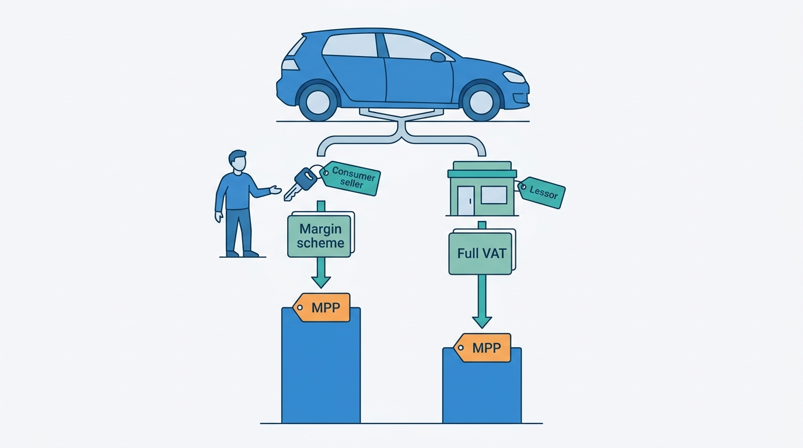
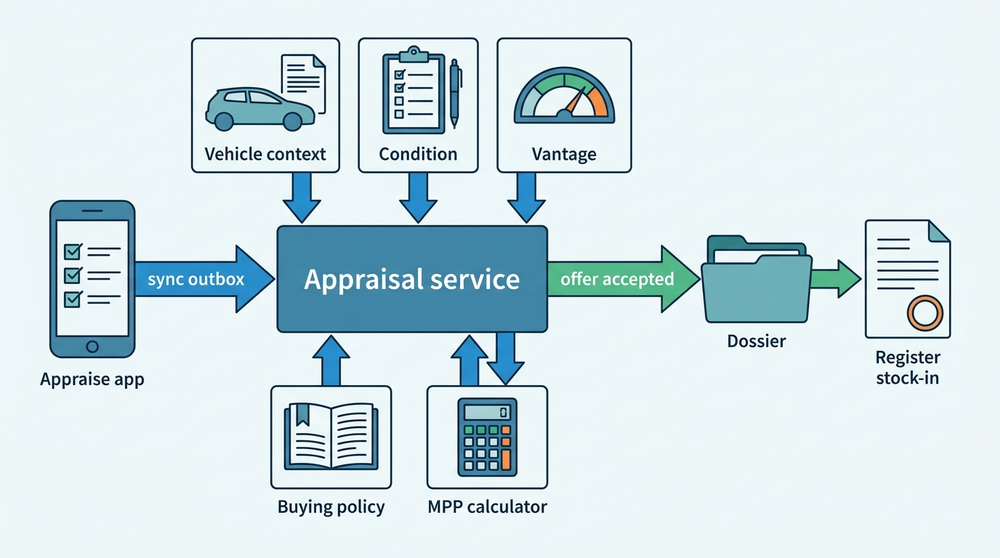
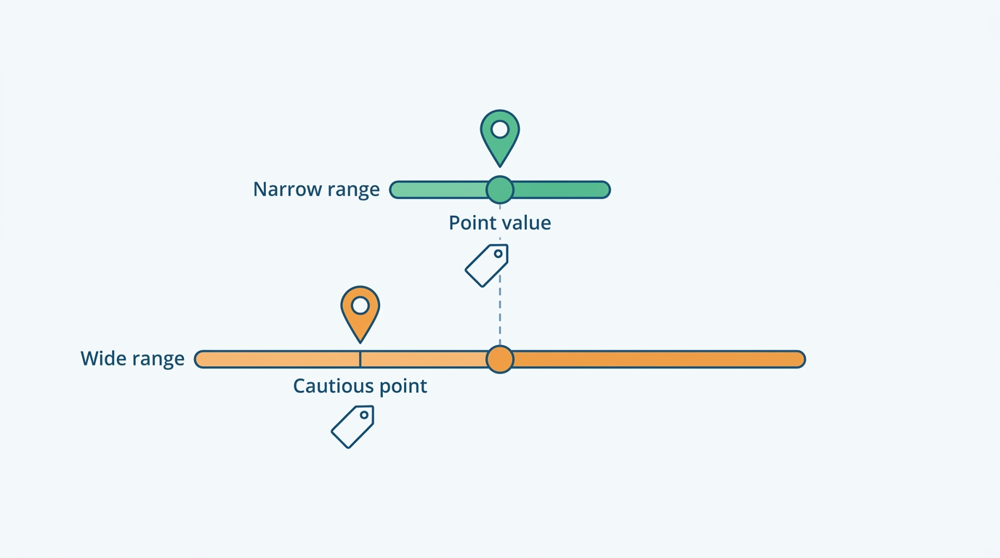
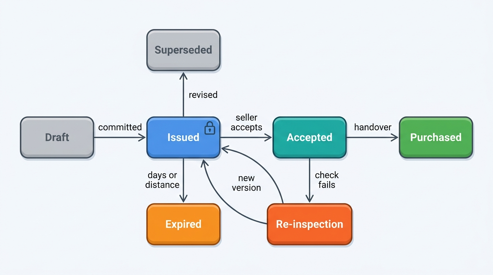
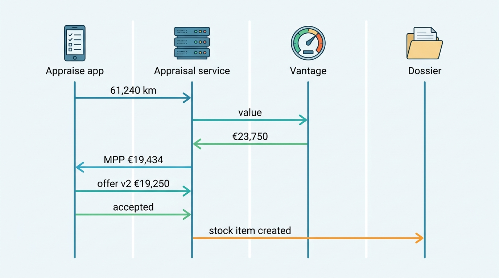

> **IN THIS CHAPTER, YOU WILL:** Follow a used car from the first plate scan to the moment it becomes stock: the acquisition channels, the appraisal workflow (identify, check, inspect, value, offer), the maximum purchase price as a computed decision, offers with validity and conditions, offline-capable capture, and the hand-off to the stock book.

> **WHY THE BUSINESS CARES:** A dealer's margin on a used car is mostly fixed when it buys the car. Pay €1,000 too much for a trade-in and half the car's gross profit is gone before reconditioning starts. Offer too little and the car goes to a competitor or an instant-offer website. The appraisal tool is where the dealer's buying discipline is either supported or left to gut feeling.

> **WHY ARCHITECTS SHOULD CARE:** Appraisal is the first workflow that uses identity, specification, history, condition, valuation and market data together, on a phone, often in a yard or an auction hall with poor coverage. Its records become the dossier's first evidence, the stock item's cost and value-added tax (VAT) regime, the register's odometer reading and the valuation ledger's outcome links. Errors captured here travel through every later chapter.

> **KEY POINTS:**
>
> * **The maximum purchase price is a computed decision with visible lines, priced on uncertainty.** Expected retail price minus reconditioning, fees, holding cost and target margin, solved on the car's VAT basis. It is computed from a cautious point of the valuation range when confidence is thin or the segment is under watch, and every input is recorded by version.
> * **An offer is a versioned, expiring commitment, not a number in a field.** Issued offers are immutable. Each carries a validity in days and distance, explicit conditions and a link to the appraisal it rests on. A revision supersedes the old version. Acceptance re-checks the conditions. The book of open offers is risk the dealer and the platform must be able to see.
> * **Capture must work in the yard and the lane, and the hand-off must happen once.** An installable web app with a durable outbox and client-generated ids captures offline. It validates odometer readings at entry and shows degraded answers with a flag instead of blocking. An accepted offer creates exactly one stock item, with its cost, VAT regime and evidence, and starts the register stock-in.

> **[FAILURE PATTERNS THIS CHAPTER ADDRESSES](where-vehicle-platforms-go-wrong.html):**
>
> * **The Confident Valuation** — a suggested buying price computed from a point value, with no range or segment status, turns a valuation error into hundreds of cars bought at too high a price.
> * **Borrowed Uptime** — an appraisal that needs live answers from the register, the history assembler, the build-data provider and the valuation model stops when any of them is slow, or when the yard has no signal.
> * **The Sticky Error** — an odometer mistyped at appraisal becomes a register reading, a history event and a rollback flag on a consumer report.

 
The profit on a used car is made when the dealer buys it. That is an old trade saying, and the arithmetic of [[dealer-and-data-economics]] supports it: on a typical compact car a dealer may keep €1,500 to €2,000 of front-end gross, and a 5% overpayment takes most of it, whatever the pricing and advertising tools do afterwards.

A trade-in is appraised at the sales desk while the customer waits; a lessor's returned car is bid on through a trade exchange; an auction car is judged in seconds in the lane. **Each channel asks the same question, "what is the most I can pay for this car?", under different time pressure, evidence and commitments.** A platform that answers it well gives the dealer one calculation, one record and one hand-off to stock, whatever the channel.

This chapter owns three terms: **appraisal**, **trade-in** and **purchase offer**. The maximum purchase price (MPP) as a value type, and the valuation behind it, belong to [[valuation-engine]]. This chapter turns the MPP into a buying decision and the decision into an offer. Condition capture and reconditioning cost belong to [[condition-and-damage]], the stock item that the purchase creates belongs to [[inventory-and-vehicle-dossier]], and the register stock-in belongs to [[registration-and-trade-services]].

## Setting the Scene at Axleby: The Offer Nobody Recorded

Axleby, the fictional vehicle data and dealer software group this book follows (see [[meet-axleby]]), sells **Lotwise Appraise** for €99 per rooftop per month, including 25 history reports. Until 2027 it was a set of screens in Lotwise Classic, the PHP monolith behind Lotwise. The dealer entered a plate, Lotwise fetched a history report and a Vantage valuation, the dealer typed condition notes, and the screen stored one number in a column called `offered_price`. Every change overwrote it.

In April 2027, during the first year of the One Dossier program, Tomás Ferreira (Product Director, Lotwise) asked his team what that design had cost. In 2026 Lotwise Appraise recorded about **1.31 million** appraisals at about **4,800** rooftops. About **600,000** of them, roughly 46%, ended in a purchase, about a third of Lotwise's 1.9 million stock-ins. The team sampled **1,000** purchased cars from the first quarter of 2027 (all Axleby illustrations):

- In **23%**, the purchase price differed from the last recorded offer, with no reason recorded.
- In **11%**, the car was bought more than 14 days after the offer at the offered price, although market and mileage had moved.
- **17%** had no valuation id: the dealer had typed a retail figure from memory or from a portal.
- **31%** had no reconditioning estimate to compare with actual cost.
- **38%** of appraisals started on a phone, and about one in 16 of those lost photos or notes when the session timed out in an auction hall or a farm yard.

Two incidents gave the numbers faces. In February 2027, at Autobedrijf Brandsma, a one-rooftop independent dealer in Leeuwarden and a Lotwise customer since 2014, an appraisal of a 2016 Volvo V60 recorded **196,840 km** instead of 186,840 km. Two days later the official stock-intake reading said 186,950 km. In March a consumer report from Odolo, Axleby's consumer check app, flagged "possible rollback" and the buyer walked away ([[vehicle-history]]). And in the 2026 **EV Overvaluation** (EV: electric vehicle), two dealer groups had bought **610** battery-electric trade-ins at maximum purchase prices suggested from Vantage, overpaying by about **€1.1 million** ([[valuation-engine]]). The suggested price had shown one number, with no range and no warning.

Ines Marchetti, Group Chief Architect, put the design question to the architecture forum in one sentence: **what did we promise this seller, on what evidence, until when, and what was the most this dealer should have paid?**

## Concepts: Channels, Appraisals, Offers and the Buying Price

### Where used cars come from

A dealer buys used cars through six channels, each with different evidence and a different job for the platform.

| Channel | Seller | How the price is set | Typical VAT basis (EU) | What the platform provides |
| --- | --- | --- | --- | --- |
| **Trade-in** (part-exchange) | Consumer buying another car from the dealer | Appraisal and offer, negotiated inside the sale | Margin scheme | Guided appraisal, MPP, offer, link to the deal |
| **Consumer purchase** ("we buy your car") | Consumer not buying | Online estimate, then inspection and a firm offer | Margin scheme | Conditional online offer, inspection, final offer |
| **Auction** (physical or online) | Lessors, rental fleets, dealers | Bidding | Usually VAT-qualifying from businesses | Lane mode: scan, MPP, bid limit |
| **Business-to-business (B2B) trade** | Dealers, traders | Asking price or offer | Depends on the seller's VAT status | Trade listings, MPP, offer ([[b2b-trade-and-remarketing]]) |
| **Lease and rental returns** | Lessors | Tender, auction or buy-back terms | VAT-qualifying | Condition report, MPP, bid |
| **Import** | Foreign dealers, auctions | Asking price plus landed cost | Cross-border rules | Landed-cost MPP including registration tax ([[registration-and-trade-services]]) |

The VAT basis column matters more than it looks. Under the EU margin scheme, a dealer who bought a car from a consumer owes VAT only on the margin when it sells, the margin being the selling price minus the purchase price ([Directive 2006/112/EC, Arts. 313–315](http://publications.europa.eu/resource/celex/32006L0112)). A car bought from a VAT-registered lessor on an invoice showing VAT is normally sold with VAT on the full price. **The same car has a different maximum purchase price depending on whom the dealer buys it from.** [[deals-and-sales-documents]] owns the scheme; its 2027 Margin-Scheme Error shows what happens when the regime is defaulted instead of recorded.

**Figure 1:** *The same car has a different maximum purchase price depending on whom the dealer buys it from, because the seller decides the VAT basis.*

### The appraisal

An **appraisal** is the dealer's structured assessment of one car for a possible purchase, in five steps:

1. **Identify.** Plate or VIN (vehicle identification number) to the vehicle key, specification candidates and register status ([[vehicle-identity]], [[specification-and-equipment]]).
2. **Check.** History: odometer readings and the register's judgement of them, damage, theft and import events, open recalls, title brands or finance where the market has them ([[vehicle-history]]).
3. **Inspect.** Condition, tires, damage, missing keys and service records, captured as evidence with photos; reconditioning estimate ([[condition-and-damage]]); battery state of health for electric cars ([[ev-battery-health]]).
4. **Value.** A typed valuation with range and comparables, and the maximum purchase price computed from it.
5. **Offer.** A price the dealer commits to, with validity and conditions.

The appraisal records evidence and judgement at a point in time, not the car's current truth. If the history is corrected next month, the appraisal still shows what the dealer saw when it decided, which is what settles a dispute.

A **trade-in** is a car the buyer hands over as part of buying another car from the same dealer. It is a purchase by the dealer, not a discount: [[deals-and-sales-documents]] books the allowance as a payment backed by its own purchase agreement. Because the trade-in is negotiated together with the sale, a dealer can give on one what it holds on the other, so the deal records the appraised value beside the allowance.

### The maximum purchase price, solved on the VAT basis

[[valuation-engine]] defines the **maximum purchase price** (MPP) as the most a dealer can pay and still earn its target margin:

> MPP = expected retail transaction price − reconditioning − transport and fees − holding cost for the expected days to sell − target gross margin

For a car bought under the margin scheme, the formula needs one more step. The VAT on the margin depends on the purchase price, so the costs and the target must be "grossed up" for it. With a VAT rate *t* (21% in the Netherlands and Belgium, 19% in Germany, 20% in the UK), a dealer who wants a gross margin *G* after margin VAT can pay at most:

> MPP = expected retail transaction price − (1 + *t*) × (reconditioning + fees + holding cost + *G*)

In plain words: every euro of cost or target margin on a margin-scheme car takes €1.21 off the Dutch buying price, because the dealer also owes VAT on the margin that covers it. A calculator that ignores this overstates the MPP by a few hundred euros on an ordinary car. For a VAT-qualifying purchase the calculation runs on net amounts. **The VAT basis is an input to the MPP, not a reporting detail.**

Three more properties make the MPP a decision rather than a lookup. **It belongs to the dealer**: target margin, holding cost, expected discount from asking price and reconditioning rates are the dealer's settings; guide books publish inputs, not this number. **It has a point in time**: it uses today's market surface and expected days to sell ([[market-data]]). And **it must carry the valuation's uncertainty**: a retail value with a narrow range supports a higher buying price than the same point value with a wide one, which is the lesson of the EV Overvaluation.

### The purchase offer

A **purchase offer** is the price a dealer commits to pay for a specific car, to a specific seller, under stated conditions, until a stated limit. The public examples all share three elements:

- **Validity.** In its 2025 annual report (February 2026), AutoNation describes its "We'll Buy Your Car" guaranteed offer as "honored for 7 days or 500 miles at any of our locations" ([AutoNation 10-K, 2026](https://www.sec.gov/Archives/edgar/data/350698/000162828026007800/an-20251231.htm)). CarMax's fiscal 2026 annual report (April 2026) says its written appraisal offer "is good for seven days" ([CarMax 10-K, 2026](https://www.sec.gov/Archives/edgar/data/1170010/000117001026000021/kmx-20260228.htm)). Kelley Blue Book's Instant Cash Offer is valid for seven days ([KBB, n.d.](https://b2b.kbb.com/kbb-vehicle-values/definitions-of-our-values)).
- **Conditions.** KBB's offer is redeemable after the dealer verifies condition and features. Carvana's 2025 annual report (February 2026) describes its online offer as "an automated, conditional offer" ([Carvana 10-K, 2026](https://www.sec.gov/Archives/edgar/data/1690820/000169082026000009/cvna-20251231.htm)).
- **A basis.** The offer assumes a mileage, a condition and a specification. If the car arrives with 900 more kilometers or a new dent, the basis has changed.

The distance limit is the detail most systems miss. **A car keeps losing value while the offer is open, and the seller keeps driving it.** Seven days and 500 miles bounds both.

### Disposition is decided at appraisal

The appraisal also decides whether the dealer will retail the car, sell it to the trade, send it to auction or export it. CarMax's 2026 annual report says that of roughly 1.1 million vehicles it bought in fiscal 2026, "approximately half" met its retail standards; the rest went through its own wholesale auctions. OPENLANE's 2025 annual report (February 2026) notes that "when used vehicle prices are high, dealer customers may retail more of their trade-in vehicles on their own" ([OPENLANE 10-K, 2026](https://www.sec.gov/Archives/edgar/data/1395942/000139594226000006/opln-20251231.htm)). So the MPP is computed **per disposition**: a twelve-year-old car with 240,000 km may have no sensible retail MPP but a clear trade MPP. The appraisal records the intended disposition and its reason, and the stock item inherits it.

## Architecture: One Appraisal Service, Two Capture Modes

The research model behind this book (see [[domain-coverage]]) splits this area into an appraisal-report module and a buying app that shows the MPP on the lot or at auction. As a target design I keep **one appraisal service with two capture modes**. The *desk mode* runs the full five steps for trade-ins and consumer purchases. The *lane mode* runs identify, check and value in seconds for auctions and trade exchanges. Both use the same MPP calculator, policy and records. If they are separate products, a dealer's buying discipline differs by channel, and the group cannot compare them.

**Figure 2:** *The appraisal service composes vehicle facts, condition evidence and a typed valuation, computes the maximum purchase price from the dealer's policy, issues offers as documents, and hands an accepted offer to the dossier, which creates the stock item and starts the register stock-in.*

| Component | Responsibility | Owns |
| --- | --- | --- |
| **Appraise app** | Capture in desk or lane mode: scan, odometer, offer presentation; guided photos and checklist through the Lotwise Inspect component; offline outbox | Local drafts until synced |
| **Appraisal service** | Appraisal and offer aggregates, their state and versions; composition of facts | Appraisal, offer versions, decision snapshot |
| **MPP calculator** | Pure function: valuation, costs, policy and VAT basis in, MPP lines out | Nothing; deterministic and versioned |
| **Buying policy** | Target margin by band, holding cost, negotiation allowance, recon rates, offer validity, approval limits | Policy versions per group, rooftop and user (in Baseline, [[onboarding-and-configuration]]) |
| **Vehicle context** | Identity, register status, specification, history | Facts with provenance |
| **Gauge** (condition service) | Inspection evidence, findings, reconditioning estimate from dealer rate cards | Condition report |
| **Vantage** | Typed valuation with range, comparables, segment status | Valuation ledger |
| **Dossier** | Stock item from the accepted offer | Stock item, cost layers, VAT regime |

Two boundaries carry the design. **The MPP calculator is a pure, versioned function**: the same valuation id, condition report, policy version and VAT basis always give the same lines, so it is testable, replayable after a correction, and identical in every channel. And **the appraisal is not a stock item.** In [[inventory-and-vehicle-dossier]] the commercial lifecycle begins at *Appraised*; I keep the appraisal in its own aggregate, because more than half of Axleby's appraisals never become stock. The dossier treats an open appraisal as a proposed stay; the stock item, with cost and risk, starts at *Purchased*.

### The appraisal record

The appraisal stores **references to versioned facts, plus copies of what the dealer typed**, the rule [[inventory-and-vehicle-dossier]] calls "reference current facts, snapshot decision inputs":

| Part | Stored as | Example |
| --- | --- | --- |
| Vehicle | AVK (Axleby Vehicle Key), plate at appraisal, VIN | AVK plus the plate as shown on the car |
| Register status | Observation id and time | Transfer allowed; no *awaiting inspection* flag |
| Specification and history | Specbook resolution version; report snapshot id and coverage | As-built version 1; report 3, rule `odo-2.0` |
| Odometer | Reading as entered, unit, photo id, validation result | 61,240 km, dashboard photo, consistent |
| Condition | Condition report id and reconditioning estimate | 4 items, €1,085 |
| Seller | Party reference, seller type, VAT status evidence | Consumer; margin scheme |
| Valuation | Valuation id (typed answer in the ledger) | Retail, range and segment status |
| MPP | Calculator version, policy version, lines | Every line visible |
| Disposition | Retail, trade, auction or export, with reason | Retail |

Seller identity is personal data kept in a referenced party record, so an appraisal that never became a purchase can be erased on schedule without breaking the valuation ledger ([[privacy-and-retention]]).

### Pricing uncertainty into the MPP

The EV Overvaluation produced one rule that I would now apply to any platform that suggests a buying price: **compute the MPP from a point of the valuation range chosen by the valuation's confidence, not always from the point value.**

| Valuation state | Expected retail price used for the MPP | Offer behavior |
| --- | --- | --- |
| Segment `normal`, confidence flag normal | Point value | Suggested MPP shown; offers up to MPP without approval |
| Thin sample, edition candidates, or `stale_market` | Midpoint of point value and the range's lower bound *(Axleby policy)* | MPP shown with the reason; flag on the offer |
| Segment `watch` | Lower bound of the 80% range | MPP shown with "segment under watch"; offers above it need manager approval |
| Segment `restricted` | None | No suggested MPP; "manual appraisal advised"; offers need the group's buying desk |
| No valuation (outside the applicability contract) | None | Dealer's own figure, recorded as such |

The segment statuses come from Vantage ([[valuation-engine]]); the appraisal service only applies them. This is that chapter's per-segment circuit breaker at the point where it saves money: **the buying decision is gated, not the valuation.** The dealer still sees the value and can still buy, but an optimistic number is no longer presented as a safe one. The same applies to specification: [[specification-and-equipment]] buys as-built data at appraisal only when the candidates' value spread exceeds **€750**; below that, the MPP uses the cautious end of the candidate range.

**Figure 3:** *A valuation with a wide range supports a lower buying price than the same point value with a narrow one, so the MPP is computed from a cautious point when confidence is thin.*

### The offer lifecycle

**Figure 4:** *The offer lifecycle. An issued offer never changes. A new price is a new version that supersedes the old one, and acceptance leads to purchase only after the handover check confirms the offer's conditions.*

| Rule | Why |
| --- | --- |
| An offer is **issued** only when its version is committed on the server and the document is generated from that version | The seller's PDF or offer page and the dealer's record can never disagree |
| Issued offers are **immutable**; revisions are new versions that supersede | The 23% of purchases with an unexplained price change become explained by construction |
| Every offer carries **validity**: an expiry time and a distance limit over the appraised odometer | Bounds both market risk and the seller's driving |
| Every offer lists its **conditions** in plain words: declared condition, keys and documents present, transfer allowed by the register, no outstanding finance where checkable | Acceptance can be checked against a list, not a memory |
| **Acceptance** before expiry moves to purchase only after a handover check: odometer reading, quick condition confirmation, documents | A car that arrives with new damage goes to re-inspection, not to stock |
| **Expiry** is a scheduled transition, and an expired offer cannot be accepted | The dealer may re-offer, but a new offer means a new version based on today's valuation |

Validity defaults are policy, set per group and rooftop in Baseline. Axleby's defaults are **7 days or 500 km** beyond the appraised odometer, borrowing the US convention, shortened to three days when the segment is under `watch`. Long validity is a free option given to the seller, and in a falling segment it costs the dealer money.

**The open-offer book is exposure.** A group's buying desk should see open offers by segment, against current MPPs. When Vantage moves a segment to `watch`, the appraisal service lists the open offers whose MPP would now be lower. The dealer still honors them, because an offer is a promise, but nobody is surprised.

### Capture that works in the yard

Axleby chose an installable web app, a progressive web app (PWA), over native apps for Lotwise Appraise. The decision was close, and two documented platform constraints shaped it:

- **Offline storage needs installation on iPhones.** WebKit's March 2020 announcement capped all script-writable storage, including IndexedDB and service-worker caches, at seven days of Safari use without interaction, and said web apps added to the home screen "are not part of Safari and thus have their own counter of days of use" ([WebKit blog, 2020](https://webkit.org/blog/10218/full-third-party-cookie-blocking-and-more/)). The evidence is six years old; recheck it. Axleby requires installation for offline mode.
- **Background synchronization cannot be assumed.** MDN marks the Background Synchronization API as "not Baseline because it does not work in some of the most widely-used browsers" ([MDN, n.d., accessed 2026-10](https://developer.mozilla.org/en-US/docs/Web/API/Background_Synchronization_API)). The outbox syncs when the app is in the foreground and connectivity returns, and shows the appraiser what has not been sent. Photos are stored on the device first and uploaded in resumable chunks, each with a device-generated id.

The client also generates the appraisal id and every offer draft id, so a submission retried three times is one appraisal. The server owns the decision of record: issued offers, MPP lines and valuation ids exist only server-side. Offline, the app can identify a car from cached data, record the odometer, take photos and complete the checklist. It cannot invent a valuation.

**Validation happens at entry, not at month-end.** After the Volvo V60, Lotwise validates every odometer reading against the latest stored reading as it is typed ([[vehicle-history]]). A reading more than 5,000 km above the expected trend, or below the last official reading, asks for a dashboard photo and a confirmation (Axleby thresholds). That matters because in the Netherlands the dealer submits the dashboard reading at stock-in, and the register judges the car's odometer history from such readings ([RDW, n.d.](https://www.rdw.nl/zakelijke-partners/erkende-bedrijven/tellerstanden/tellerstand-controleren)).

### Hand-off to stock

An accepted offer that passes the handover check becomes a purchase. The appraisal service emits one `offer.accepted` event through its outbox, keyed by the appraisal id. The dossier then does three things in one transaction ([[inventory-and-vehicle-dossier]]):

1. Creates the **stock item** in *Purchased*, keyed by tenant and AVK, with the purchase price as its first cost layer, the **VAT regime** from the seller's status and its evidence, the target gross from the MPP lines, and the disposition.
2. Links the stock item to the appraisal, the offer version, the valuation id and the condition report. The valuation ledger receives the outcome link "purchased at €X" ([[valuation-engine]]).
3. Requests the register **stock-in** through Axleby Trade with the handover odometer reading ([[registration-and-trade-services]]).

If the dossier already holds an open stock item for that tenant and AVK, for example because a stock-in from the dealer management system (DMS) arrived first, it attaches the appraisal and raises a merge task instead of creating a second one.

### Requirements per interaction

| Interaction | Consistency | Latency | Freshness | Availability |
| --- | --- | --- | --- | --- |
| Scan to vehicle context (identity, register status, specification candidates, history summary) | Read; cached answers allowed with source time | p95 ≤ 2 s end to end *(assumption, as in [[dealer-and-data-economics]])* | Register technical data from the daily mirror; theft and awaiting-inspection status asked live, non-blocking at appraisal open | Degrade per source with a flag ("status unchecked"); never block capture |
| Valuation and MPP lines | Ledger entry committed before the value is shown | Valuation p95 < 800 ms *(assumption, as in [[valuation-engine]])*; MPP local | Market surface ≤ 24 h | Cached surface with `stale_market`; MPP from the cautious point |
| Capture on device | Local durable write first; eventual sync | Instant locally | Not applicable | Offline for at least a working day *(assumption)* |
| Issue offer | Strong: offer version committed before the document exists | p95 < 1 s *(assumption)* | Uses the appraisal's snapshot | Needs connectivity, except the offline rule below |
| Accept and purchase | Exactly once per appraisal; idempotent | Seconds | Conditions re-checked at handover, including a blocking live register status check | Must work when the DMS is down |
| Register stock-in (NL) | Confirmed by the register before "done" | Minutes | Not applicable | Queued during an outage; not completed until it ends |

## In Practice: Public Evidence and the Golf Variant at Brandsma

### What the public record shows

**Trade-ins dominate franchised supply in the US.** NADA Data 2025 from the National Automobile Dealers Association (published 2026) reports the sources of used vehicles retailed by US new-car dealers: trade-ins on new vehicles **45.4%**, trade-ins on used vehicles **23.6%**, auction purchases **21.9%**, street purchases **9.1%** ([NADA, 2026](https://www.nada.org/media/4695/download)). More than two thirds of supply arrives through the appraisal desk, as part of a sale. European trade bodies publish no comparable split. In the Netherlands, BOVAG and RDC data for 2025 show that about 35% of ownership changes were private-to-private, so about two thirds involved a business on at least one side ([Autoreview, January 2026](https://www.autoreview.nl/nieuws/id/37104/verkoopcijfers-2025-occasionkoper-moet-geen-ev)).

**Large buyers treat buying as central policy.** CarMax's fiscal 2026 annual report credits its "ability to quickly adjust appraisal offers to be consistent with trends in the broader trade-in market and the pace of our inventory turns"; AutoNation's 2025 report describes "our One Price used vehicle centralized pricing and appraisal strategy". That is the case for buying policy in versioned configuration that a group owns.

**Inspection is moving into the capture point.** In January 2026 Cox Automotive announced that its vAuto appraisal tools integrate UVeye drive-through scanners that capture "exterior, underbody, and tire conditions in seconds", aimed at acquiring cars in the service lane ([Cox Automotive, 2026](https://www.coxautoinc.com/press-releases/cox-automotives-vauto-and-uveye-bring-ai-powered-vehicle-inspections-to-market/)). A record that stores condition as evidence with a source and method can take scanner output as one more source ([[condition-and-damage]]).

**Reconditioning estimates are the weak line.** vAuto's own undated content cites an average **$600** gap between reconditioning estimates and actual cost ([vAuto, n.d.](https://www.vauto.com/resources/how-recon-estimates-hurt-your-appraisal-success/)). It is the MPP line the dealer controls, and it improves only if actual costs flow back from the stock item to the policy.

**In Germany, the trade margin is a published parameter.** DAT's product description for SilverDAT valuateFinance (January 2024) derives the dealer purchase value from the dealer selling value "depending on a trade margin set by DAT or the contract partner" ([DAT, 2024](https://dynamic-www.dat.de/fileadmin/de/download/rechtliches/produktbeschreibung-silverdat-valuatefinance.pdf)): a one-parameter MPP that this design generalizes to visible lines.

> **INFERENCE, NOT DOCUMENTED:** None of the companies above describes how its appraisal records, offer versions or validity checks are stored. The record and lifecycle in this chapter are a reference design, not a description of their systems.

### The Golf Variant at Autobedrijf Brandsma

The rebuilt Lotwise Appraise ran as a pilot at 40 rooftops from June 2027, Brandsma among them, and became available to all Dutch and Belgian rooftops in October 2027. On Saturday 11 September 2027 a customer who is buying a 2023 Škoda Kodiaq from Sietse Brandsma offers his 2021 Volkswagen Golf Variant in part-exchange. [[specification-and-equipment]] follows the first half of this appraisal: the register narrowed the car to three editions, the value spread of €2,900 exceeded the €750 purchase threshold, and the as-built record showed a Style with a panoramic roof and a towbar. Vantage returned **€23,750** retail. All amounts below are Axleby illustrations.

**Figure 5:** *The Golf Variant from scan to stock. Facts, valuation and policy are read by version. The dealer sees the MPP as lines. Each offer is a committed version, and acceptance hands over once, keyed by the appraisal id.*

**Inspect.** Sietse records the odometer at **61,240 km** with a dashboard photo. The reading is consistent with the stored history, so no confirmation is needed. The checklist finds two worn tires, a service due and a scratched rear bumper. Gauge, the group condition service, prices them from Brandsma's own rate card and tags all four as reconditionable, so Vantage applies no condition deduction for them and the damage is not subtracted twice ([[condition-and-damage]]).

**Value and MPP.** The customer is a consumer, so the car will be sold under the margin scheme at the Dutch rate of 21%. Brandsma's buying policy (version 12 in Baseline) sets a target gross of **€1,600** for cars between €15,000 and €25,000, a 1.5% expected discount from asking price, and holding cost from depreciation of 1.5% a month plus 6% a year funding, the assumptions of [[dealer-and-data-economics]]. Pulse expects **45** days to sell for this car in its region.

| MPP line | Amount | Source |
| --- | --- | --- |
| Vantage retail value (80% range €22,900–€24,500; segment `normal`) | €23,750 | Valuation ledger |
| Expected discount from asking price (1.5%) | −€350 | Policy v12 |
| **Expected retail transaction price** | **€23,400** | |
| Reconditioning: two tires €420, service €310, bumper €260, valet and photos €95 | −€1,085 | Condition report |
| Register and report fees | −€18 | Price list |
| Holding cost: ≈ €12.8 a day × 45 days | −€575 | Policy v12; Pulse days to sell |
| Target gross after margin VAT | −€1,600 | Policy v12 |
| Margin VAT on the lines above: 21% × €3,278 | −€688 | Margin scheme, consumer seller |
| **Maximum purchase price** | **€19,434** | Calculator v3 |

Check: bought at €19,434 and sold at €23,400, the margin is €3,966; margin VAT is 21/121 of that, €688; after reconditioning, fees and holding cost, €1,600 remains.

Had Vantage put the segment on `watch`, the MPP would have used the range's lower bound of €22,900, an expected transaction price of €22,557, and fallen by the same €843 to **€18,591**. A cushion of that size on each of the 610 battery-electric trade-ins would have covered about half of the €1.1 million the two dealer groups lost.

**Offer.** Sietse opens at **€18,900**. The customer shows an online instant offer of €19,600 from a car-buying website. Sietse revises to **€19,250**, below the MPP, and the system issues version 2, superseding version 1 with the reason "competing offer". Version 2 is valid for seven days or until 61,740 km. Its conditions are that the condition is as inspected, both keys and the service book are present, and the register allows transfer at handover.

**Purchase.** The customer accepts the next day, Sunday, and the Golf is handed over when the Kodiaq is delivered on Tuesday 14 September, three days after the appraisal. The handover check reads **61,302 km**, 62 km over the appraisal and inside the limit; no new damage is found; the live register check confirms that transfer is allowed and no theft or awaiting-inspection flag is set. The purchase agreement is signed, and the dossier creates the stock item with **€19,250** as its purchase price, `vatRegime = margin` with the purchase agreement as evidence, and a target gross of about **€1,752**: the €1,600 target plus the €184 of MPP that Sietse did not use, less margin VAT on it. Axleby Trade submits the stock-in to the Dutch register with the handover reading, and the customer receives the indemnification certificate (*vrijwaringsbewijs*), which the register requires the dealer to hand over at stock-in ([RDW, n.d.](https://www.rdw.nl/zakelijke-partners/erkende-bedrijven/bedrijfsvoorraad/voertuig-in-bedrijfsvoorraad-zetten)). The history report was part of Brandsma's Appraise bundle. The revised offer did not buy it again, because re-opening a report bought for the same car within 30 days is free ([[billing-and-metering]]).

### Lane mode: auctions and Tradefloor

At an auction or on Tradefloor, Axleby's B2B exchange, there is no consumer offer and no time for a checklist. Lane mode runs identify, check and value, then shows a **bid limit**: the MPP for the intended disposition minus the buyer's fee (€95 on Tradefloor) and transport. Three things differ from desk mode:

- **The VAT basis comes from the seller.** Lessors sell with VAT; dealers may sell under either regime. After the Margin-Scheme Error, Tradefloor events carry the seller's VAT status, and lane mode refuses to compute an MPP when it is unknown ([[deals-and-sales-documents]]).
- **Condition comes from someone else's report**, with its own grading scale ([[condition-and-damage]]). The MPP uses it as third-party evidence, and the handover check compares it with the car that arrives.
- **The commitment is the bid.** The appraisal records the bid limit and the bids placed, so a buying desk can see how often its buyers paid above their own limits. Buyer search profiles on Tradefloor are [[b2b-trade-and-remarketing]]'s subject.

## Failure Handling

| Failure | Example | Detection | Recovery |
| --- | --- | --- | --- |
| **Duplicate appraisals** | Offline submission retried; two salespeople, or two rooftops of one group, appraise the same car | Client-generated appraisal id; open offers indexed by tenant and AVK, checked on sync | Retries return the existing record; a second appraiser sees the first offer and its expiry before issuing; group policy decides whether to match it |
| **Conflicting offer edits** | Salesperson and manager revise on two devices | Offer versions with optimistic concurrency | Second revision fails with "v2 issued by the sales manager at 14:02" and must supersede v2 explicitly |
| **Incomplete records** | No VIN visible, edition unknown, import with no history coverage, electric car without a verified battery certificate (Vantage returns `battery_unknown` and a wider range) | Appraisal completeness rules per disposition | Offer allowed with the gap named as a condition and the MPP on its cautious point; never silently assumed |
| **Mistyped odometer** | 196,840 instead of 186,840 km | Entry validation against stored readings | Confirmation with photo; handover reading compared again before the register stock-in |
| **Partial answers and supplier outages** | History assembler timed out; build-data provider down; valuation model unreachable | Per-source result class; health checks on scoring | Appraisal continues; offer carries "subject to history check" or names the edition; cached surface with `stale_market` and MPP from the cautious point |
| **Retries during issue** | Network drops after "issue offer" | Offer draft id as idempotency key | Retry returns the committed version; never two documents with different numbers |
| **Register outage** | Dutch register's transaction channel unavailable at month-end | Turnstile channel status | Purchase completes commercially; stock-in queued in order; the seller is told the indemnification certificate will follow and when; the register does not allow completion during the outage |
| **Market moves while offers are open** | Segment moves to `watch` | Segment status change event | Open-offer exposure report per segment; existing offers honored; new offers on the cautious point and shorter validity |
| **Stale register status** | Brandsma agreed a €9,800 Octavia trade-in on 14 April 2027 from a 19-day-old cache entry saying transfer was possible; the register refused the stock-in ([[registers-and-official-data]]) | Live status call at appraisal open (non-blocking) and at purchase confirmation (blocking) | "Transfer allowed" is an offer condition checked live at handover, never read from a cache |
| **Accepted offer, car differs at handover** | New damage, missing key, 900 km over the limit | Handover check against the offer's conditions | Re-inspection; a new version or withdrawal per the stated conditions; reason recorded |

Two rules hold across the table. **A gap never becomes a default.** An unknown edition, missing history or an unknown VAT status is shown as a gap and named as a condition on the offer. It is never filled with the most common value. And **the purchase waits for one outside answer only**: the live register status at purchase confirmation, because buying a stolen car or one that cannot be transferred is the most expensive error in this chapter. The register transaction, the DMS update and every supplier call are queued, idempotent and visible.

## Trade-offs

### How much to show, and to whom

| Option | What the salesperson sees | Strengths | Weaknesses | When it is right |
| --- | --- | --- | --- | --- |
| **No MPP; value only** | Retail and trade values | Simple; dealer decides | Discipline depends on the person; no comparable record | Single-owner independents who buy every car themselves |
| **MPP with lines** (Axleby default) | MPP and every line, offers up to MPP freely | Explainable; disputes are about a line; consistent across channels | Exposes margin targets to staff | Most independents and small groups |
| **Suggested offer only; MPP hidden** | An opening offer and a ceiling that requires approval | Protects negotiation room | Staff cannot reason about the number; approval traffic | Groups with central buying desks |
| **Automated binding offer** | Nothing; the system offers online | Scale; speed | Balance-sheet risk; needs segment circuit breakers and fast offer adjustment | Only with risk limits, as [[valuation-engine]] warns |

### Offer policy

| Choice | Option A | Option B | My recommendation |
| --- | --- | --- | --- |
| Validity | Fixed (7 days or 500 km) | Shorter in volatile segments | Fixed default, shortened automatically under `watch`; long validity is a free option given to the seller |
| Offline offers | Forbidden | Allowed up to the cached MPP, marked provisional | Allowed up to the cached MPP, because the dealer will make the offer verbally anyway; better recorded than not. Synced offers that conflict go to the manager |
| Revisions | Edit the offer | New version supersedes | Always a new version with a reason |
| Acceptance | Ends the appraisal | Leads to a handover check | Handover check against listed conditions |

For the capture client, native apps give the best camera, background upload and storage control at the price of two code bases and store review; a plain web page loses work offline; the installable web app sits between. **The client choice is reversible. The record model is not**: client-generated ids, a server-owned decision of record and versioned offers work with any client.

## Across Markets: What Changes by Country

| | Netherlands / Belgium | Germany | United Kingdom | United States |
| --- | --- | --- | --- | --- |
| **Supply channels** | NL: about 35% of 2025 ownership changes private-to-private (BOVAG/RDC via Autoreview, 2026); lessors are major suppliers *(industry practice)* | Independents 38% of used purchases in 2025, ahead of franchised dealers at 36% (DAT-Report 2026 via [AUTOHAUS](https://www.autohaus.de/nachrichten/gw-trends/umbruch-auf-dem-gebrauchtwagenmarkt-freie-handelsgruppen-auf-dem-vormarsch-3771080), 2026) | Consumer-buying brands are large: We Buy Any Car bought 512,000 cars in the year to March 2025 ([Car Dealer Magazine](https://cardealermagazine.co.uk/huge-112-9m-loss-revealed-for-auction-firm-bca-and-we-buy-any-cars-owner/321091), 2025) | Trade-ins 69% of franchised used supply; auctions 21.9% (NADA, 2026) |
| **Register action at purchase** | NL: stock-in to trade stock (*bedrijfsvoorraad*) with the dashboard odometer reading; seller receives the *vrijwaringsbewijs*; no completion during an outage (RDW). BE: not verified from primary sources | The registration certificate part II (*Zulassungsbescheinigung Teil II*) passes to the dealer; dealer stock is commonly deregistered *(industry practice)* | Trader tells the Driver and Vehicle Licensing Agency (DVLA) online, using the V5C log book reference ([GOV.UK, n.d.](https://www.gov.uk/sold-bought-vehicle)) | Title assigned with odometer disclosure ([49 CFR 580.5](https://www.law.cornell.edu/cfr/text/49/580.5)); lien payoff on financed trade-ins *(industry practice)* |
| **Odometer evidence** | NL: register judgement *logisch*, *onlogisch* or *geen oordeel* (logical, illogical, no judgement); BE: Car-Pass, 345.5 million readings received in 2025 ([Car-Pass](https://www.car-pass.be/en)) | No public per-vehicle register; access needs a legal claim under the Road Traffic Act (§39 *Straßenverkehrsgesetz*) | Roadworthiness-test (MOT) history from the Driver and Vehicle Standards Agency (DVSA) | Odometer at titling in the National Motor Vehicle Title Information System (NMVTIS), available to used-car businesses ([49 USC 30502](https://www.law.cornell.edu/uscode/text/49/30502)) |
| **Reference values** | Portal and data-provider values, e.g. Autotelex and aggregators *(see [[valuation-engine]])* | DAT dealer purchase value: selling value minus a trade margin | Auto Trader retail, trade, private and part-exchange values | KBB trade-in and Instant Cash Offer; Manheim Market Report (MMR) for wholesale |
| **Units and tax basis** | km; margin scheme for consumer sellers; NL registration tax (*belasting van personenauto's en motorrijwielen*, BPM) in import MPPs | km; margin scheme | miles; UK margin scheme | miles; no VAT; sales tax at registration *(industry practice)* |
| **Offer conventions** | No published convention found | No published convention found | Online offers conditional on inspection *(industry practice)* | 7 days or 500 miles (AutoNation); 7 days (CarMax, KBB) |

What stays common is most of the chapter: the appraisal and offer aggregates, the MPP calculator, the confidence rule, the capture client, the outbox and the hand-off. What changes by market is narrow and belongs in **market packs**: the register adapter and its document set, the odometer source and how its judgement is shown, the distance unit in validity limits, the VAT basis rules and rate, the reference-value provider, and default validity. The **US differs in kind** on one point: a financed trade-in carries a lien that the dealer pays off, and the payoff amount is a deal line. In that market the offer must separate the price for the car from the equity the customer receives. Axleby does not operate in the US. A platform that does needs that split in its offer model, not in a market adapter.

## The Chief Architect's View

**Decide who owns the buying policy.** MPP lines are only as good as the targets, holding costs and reconditioning rates behind them, and those belong to the dealer or the group's used-car director, not to engineering. The platform makes the policy explicit, versioned and inherited (group → region → rooftop) and shows its effect. At Axleby, Tomás Ferreira's team owns the calculator, Baseline owns the policy store, and each group's used-car leader signs off its policy; for Velto, Mirjam Kuipers.

**Treat segment thresholds as commercial changes.** Vantage's segment status gates buying, so Priya Raman's team (thresholds) and the appraisal team (their effect on offers) review changes together.

**Close the loop or the MPP never improves.** Every MPP line has an outcome: actual reconditioning, days to sell, sale price. Measure them per line, rooftop and segment each quarter and feed them into policy defaults. Axleby's 31% of purchases without a reconditioning estimate show that the line most under the dealer's control was the least measured; with rate cards and estimates on every appraisal, Lotwise's mean reconditioning variance fell from +€310 in the second quarter of 2027 to +€95 in the fourth.

**Watch four numbers**: offer acceptance rate by channel; purchases above MPP and their reasons; the open-offer book by segment against current MPP; reconditioning variance per rooftop. A rising acceptance rate in one segment is often the first sign that its MPP is too high.

**Keep automated buying a board decision.** Lotwise suggests prices to people who decide. Binding online offers to consumers would make Axleby a buyer with inventory risk, and the Zillow reference in [[valuation-engine]] applies. The architecture makes that possible; it should not make it look easy.

## Questions to Ask

1. Can you show, for any purchased car, the offer version the seller accepted, the valuation id and range behind it, and the policy version that computed the maximum purchase price?
2. Does the MPP calculation know the car's VAT basis before it runs, and what happens when the seller's VAT status is unknown?
3. Which point of the valuation range does the MPP use, and what changes when the valuation's segment is under watch or restricted?
4. Do offers expire on distance as well as time, and is expiry a transition the system enforces?
5. What can an appraiser record in a yard with no signal, and how do you prevent a retry, a second device or a second rooftop from creating a second appraisal or offer?
6. Where is an odometer reading validated, and can a typo reach the register before anyone sees it?
7. When the register, the history assembler or the build-data provider is down, what degrades, and how does the offer show it?
8. Do actual reconditioning cost and days to sell flow back to the buying policy, and can a group see its open-offer book by segment when the market turns?

The accepted offer is where buying ends and owning begins. [[inventory-and-vehicle-dossier]] takes the car from here: the stock item, its cost layers and VAT regime, the commercial lifecycle and the parallel tracks for preparation, advertising and registration.

## Sources and Evidence

### Company, product and investor sources

- [AutoNation Form 10-K for 2025](https://www.sec.gov/Archives/edgar/data/350698/000162828026007800/an-20251231.htm), AutoNation / SEC, 2026. "We'll Buy Your Car" offer honored for 7 days or 500 miles; One Price centralized pricing and appraisal.
- [CarMax Form 10-K for fiscal 2026](https://www.sec.gov/Archives/edgar/data/1170010/000117001026000021/kmx-20260228.htm), CarMax / SEC, 2026. Seven-day written offers; about 1.1 million vehicles bought, about half retail-grade; quick adjustment of appraisal offers.
- [Carvana Form 10-K for 2025](https://www.sec.gov/Archives/edgar/data/1690820/000169082026000009/cvna-20251231.htm), Carvana / SEC, 2026. "Automated, conditional offer".
- [OPENLANE Form 10-K for 2025](https://www.sec.gov/Archives/edgar/data/1395942/000139594226000006/opln-20251231.htm), OPENLANE / SEC, 2026. Retail versus wholesale disposition depends on prices.
- [Definitions of our values](https://b2b.kbb.com/kbb-vehicle-values/definitions-of-our-values), Kelley Blue Book, n.d., accessed 2026-10. Trade-in value; Instant Cash Offer valid seven days after verification.
- [Cox Automotive's vAuto and UVeye bring AI-powered vehicle inspections to market](https://www.coxautoinc.com/press-releases/cox-automotives-vauto-and-uveye-bring-ai-powered-vehicle-inspections-to-market/), Cox Automotive, 2026. Drive-through inspection inside appraisal tools.
- [How recon estimates hurt your appraisal success](https://www.vauto.com/resources/how-recon-estimates-hurt-your-appraisal-success/), vAuto, n.d. (vendor content). $600 average gap between reconditioning estimate and actual.
- [Produktbeschreibung SilverDAT valuateFinance](https://dynamic-www.dat.de/fileadmin/de/download/rechtliches/produktbeschreibung-silverdat-valuatefinance.pdf), DAT, 2024. Dealer purchase value from selling value and a trade margin.
- [Huge £112.9m loss revealed for BCA and We Buy Any Car owner](https://cardealermagazine.co.uk/huge-112-9m-loss-revealed-for-auction-firm-bca-and-we-buy-any-cars-owner/321091), Car Dealer Magazine, 2025. 512,000 cars bought by We Buy Any Car.

### Standards, regulation and official documentation

- [Council Directive 2006/112/EC (VAT Directive)](http://publications.europa.eu/resource/celex/32006L0112), EU Publications Office, 2006. Margin scheme, Articles 313–315.
- [Voertuig in bedrijfsvoorraad zetten](https://www.rdw.nl/zakelijke-partners/erkende-bedrijven/bedrijfsvoorraad/voertuig-in-bedrijfsvoorraad-zetten), RDW, n.d., accessed 2026-10. Stock-in with odometer reading; mandatory release certificate.
- [Tellerstand controleren](https://www.rdw.nl/zakelijke-partners/erkende-bedrijven/tellerstanden/tellerstand-controleren), RDW, n.d., accessed 2026-10. Register odometer judgement.
- [Car-Pass](https://www.car-pass.be/en), Car-Pass vzw, n.d. (2025 figures), accessed 2026-10. Belgian odometer history.
- [Tell DVLA you've sold, transferred or bought a vehicle](https://www.gov.uk/sold-bought-vehicle), GOV.UK, n.d., accessed 2026-10. Online notification for motor traders.
- [49 CFR 580.5](https://www.law.cornell.edu/cfr/text/49/580.5), US GPO via Cornell LII, n.d., accessed 2026-10. Odometer disclosure at transfer.
- [49 USC 30502](https://www.law.cornell.edu/uscode/text/49/30502), Cornell LII, n.d., accessed 2026-10. NMVTIS information available to prospective purchasers, including used-car businesses.
- [§39 StVG](https://www.gesetze-im-internet.de/stvg/__39.html), Bundesministerium der Justiz, n.d., accessed 2026-10. Narrow private access to German register data.
- [Full third-party cookie blocking and more](https://webkit.org/blog/10218/full-third-party-cookie-blocking-and-more/), WebKit, 2020. Seven-day cap on script-writable storage in Safari; home-screen web apps excluded.
- [Background Synchronization API](https://developer.mozilla.org/en-US/docs/Web/API/Background_Synchronization_API), MDN, n.d., accessed 2026-10. Not Baseline across major browsers.

### Research and practitioner sources

- [NADA Data 2025](https://www.nada.org/media/4695/download), NADA, 2026. Sources of used vehicles retailed by US franchised dealers.
- [Verkoopcijfers 2025: occasionkoper moet geen EV](https://www.autoreview.nl/nieuws/id/37104/verkoopcijfers-2025-occasionkoper-moet-geen-ev), Autoreview (BOVAG/RDC data), 2026. Dutch ownership changes and private-to-private share.
- [Umbruch auf dem Gebrauchtwagenmarkt](https://www.autohaus.de/nachrichten/gw-trends/umbruch-auf-dem-gebrauchtwagenmarkt-freie-handelsgruppen-auf-dem-vormarsch-3771080), AUTOHAUS (DAT-Report 2026), 2026. German independent versus franchised share.

Axleby is fictional; architectural recommendations, labeled inferences and labeled assumptions are the author's judgement.
