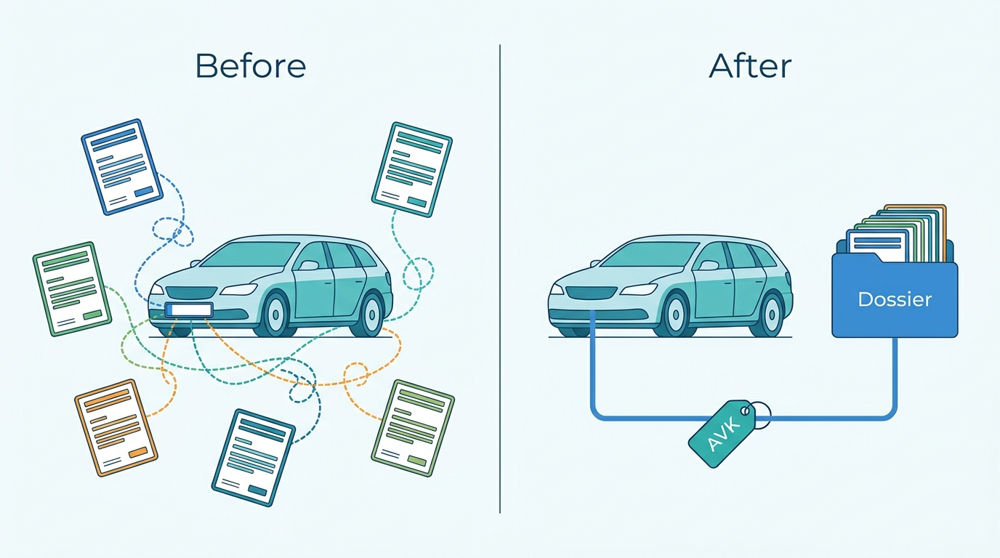
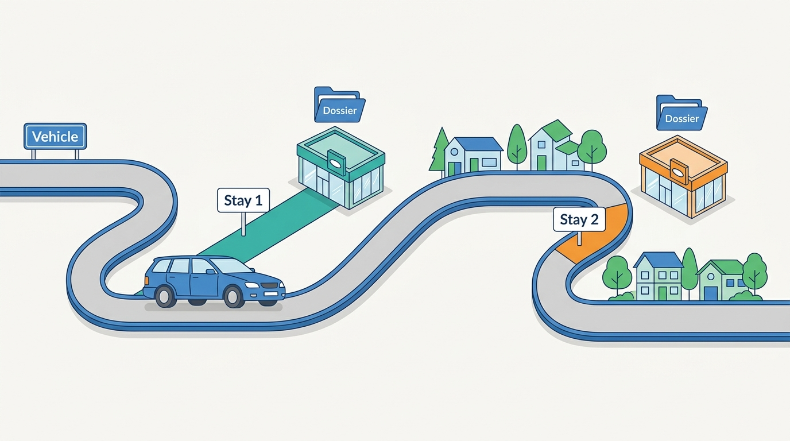
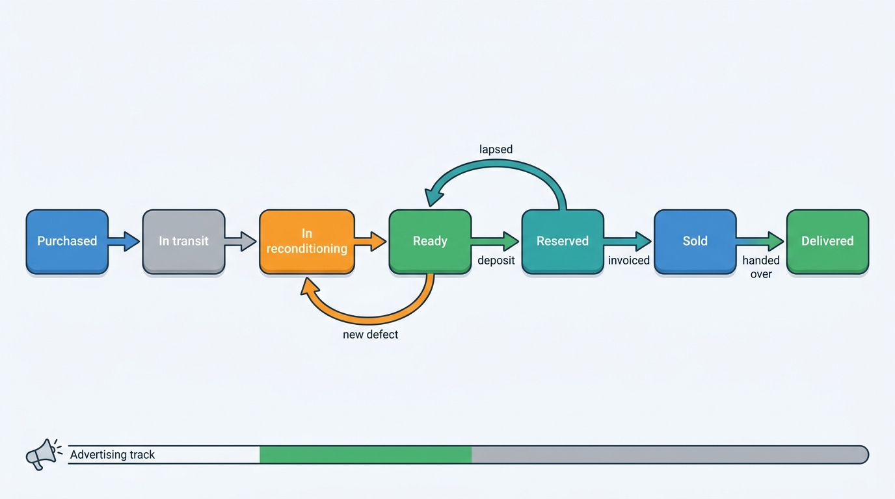
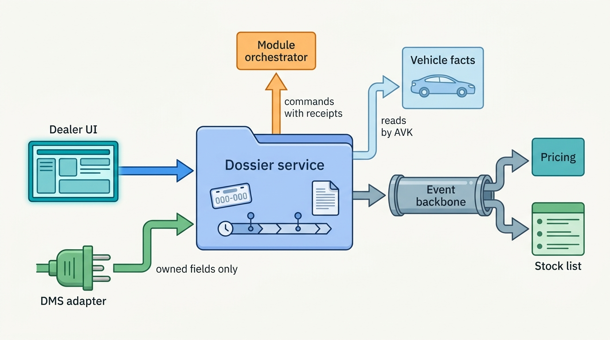
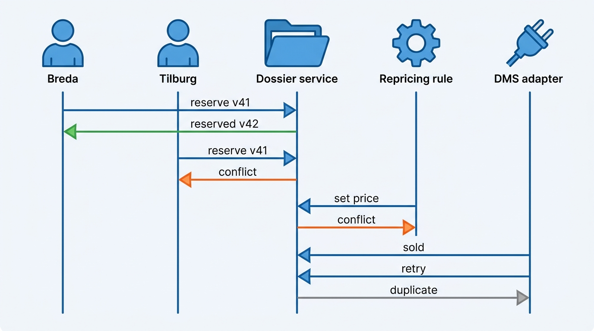

> **IN THIS CHAPTER, YOU WILL:** Take apart the dealer's stock book: the difference between a vehicle, a stock item and a vehicle dossier; the stock lifecycle as a state machine with parallel tracks; cost layers and target margin; transfers between locations, rooftops and legal entities; who owns which field when a dealer management system (DMS) is involved; and how the dossier survives concurrent edits, retries and a DMS that goes dark.

> **WHY THE BUSINESS CARES:** A dealer's used-car profit is decided car by car: what it cost, what was spent on it, how long it stood and what it sold for. When those facts are spread across five screens and a DMS, nobody knows the margin of the car in front of them, and every sold car that is still advertised costs leads, test drives and trust.

> **WHY ARCHITECTS SHOULD CARE:** The dossier is where the two halves of the platform meet. Vehicle facts, valuations, reports, adverts, leads, deals and register transactions all attach to it, so its key, its state model and its ownership rules decide whether the rest of the dealer product can be built as modules or must be built as one monolith.

> **KEY POINTS:**
>
> * **A stock item is a stay, not a car.** The vehicle (keyed by the Axleby Vehicle Key, AVK) is shared and outlives every dealer; the stock item is one tenant's ownership of it, from purchase to delivery. The dossier is the stock item plus references to versioned vehicle facts, documents and an append-only timeline. Copy facts only when a decision was made on them.
> * **Model the lifecycle as one small commercial state machine plus parallel tracks.** Appraised, purchased, in transit, in reconditioning, ready, reserved, sold, delivered and written off are commercial states with guards. Preparation, advertising, register status and financing run on their own tracks, because a car is often advertised before it is ready and withdrawn after it is reserved. One status column holding all of them is how sold cars stay on portals.
> * **Decide system of record per field, not per car.** For an independent dealer without a DMS, the dossier is the stock book. For a franchised dealer, the DMS usually owns cost, accounting status and the sale; the dossier owns price, adverts, media, documents and module actions. Write that split down, send writes as commands with receipts, and make the dossier the fallback when the DMS is dark.

> **[FAILURE PATTERNS THIS CHAPTER ADDRESSES](where-vehicle-platforms-go-wrong.html):**
>
> * **The Acquisition Archipelago** — reports, valuations and register transactions for one car are ordered from different products and stored in different systems, so the dossier exists only in the dealer's head.
> * **The Cloned Identity** — a stock book keyed by its own stock id plus plate creates a second record when a car moves rooftop and cannot tell which report belongs to which stay.
> * **DMS Hostage** — when the sold status, the cost and the stock list exist only in the DMS, a DMS outage or a failed sync stops the dealer and leaves sold cars on sale.

 
Ask a used-car manager what they own and they will not say "vehicles". They own **stock**: a set of cars bought with the company's money, each with a cost, a plan and a deadline. The car existed before the dealer bought it and will exist after; what the dealer manages is the period in between, and the decisions made in it. The record of that period is the oldest artifact in automotive retail, the **stock book**, and in a software platform it becomes the **vehicle dossier**.

The dossier sounds like a document folder. It is the **aggregate** the rest of the dealer product hangs on. Appraisal creates it ([[vehicle-acquisition]]); pricing, merchandising and syndication read it and change it ([[used-car-pricing]], [[merchandising]], [[listing-syndication]]); leads and deals reference it ([[leads-and-crm]], [[deals-and-sales-documents]]); register transactions and DMS adapters write to it ([[registration-and-trade-services]], [[dms-integration]]). If its identity, its states or its ownership rules are wrong, every one of those modules inherits the error.

This chapter owns three terms: **stock item**, **stock lifecycle** and **vehicle dossier**. It builds on the vehicle key of [[vehicle-identity]] and the bounded contexts of [[vehicle-bounded-contexts]], and leaves price, adverts, deals and DMS adapters to the chapters that own them.

## Setting the Scene at Axleby: One Octavia, Six Records

Axleby, the fictional vehicle data and dealer software group this book follows (see [[meet-axleby]]), approved its One Dossier program in March 2027. Its first visible promise is the **Lotwise Dossier**: one place in Lotwise, Axleby's dealer software for the Netherlands, Belgium and Germany, where a dealer sees history, valuation, condition and register transactions for a car. In April 2027 Ines Marchetti, Group Chief Architect, asked Tomás Ferreira, Product Director of Lotwise, for one real car to design against.

Tomás chose a 2020 Škoda Octavia Combi at Velto Mobility Group, a 46-rooftop franchised group in the Netherlands and Belgium that runs the fictional DriveDesk DMS. On 8 March 2027 a customer traded it in at Velto's Tilburg rooftop. Two days later it was moved to the group's used-car center in Breda, the rooftop where, in February, a sold Volkswagen Golf had stayed live on four portals for four days because DriveDesk's sold status failed to sync to Lotwise and the portal deletes then queued behind failed updates (the Zombie Golf, [[listing-syndication]]). By April, the Octavia existed as six records:

| Record | System | Key | What it knew |
| --- | --- | --- | --- |
| Stock item T-40218 | Lotwise Classic (Tilburg) | Lotwise stock id plus plate | Trade-in allowance, appraisal photos; status "transferred out" |
| Stock item B-77105 | Lotwise Classic (Breda) | Lotwise stock id plus plate | Asking price €17,950, adverts on 5 channels; no purchase cost |
| Vehicle 2231-0094 | DriveDesk | DriveDesk stock number | Purchase cost, reconditioning invoices, accounting status |
| Appraisal valuation | Vantage valuation ledger | Plate | Retail and trade values on 8 March |
| Business history report | Connect XML, ordered in the Axleby Data portal | Plate | Odometer readings, one damage event in 2023 |
| Indemnification transaction | Axleby Trade back office | Plate | Proof that the seller was released from liability (*vrijwaren*) on 8 March |

Nobody at Velto could answer the two questions its used-car director, Mirjam Kuipers, asked every Monday: **what did this car cost us, and what has happened to it since we bought it?** The answers were spread over six records in four systems, joined only by a plate.

Tomás's team then sampled **2,000** Lotwise stock-ins from the first quarter of 2027 (Axleby illustrations):

- Dealers typed or scanned the plate **3.4 times** per car on average across Axleby screens.
- **38%** of history reports and **44%** of register transactions could be linked to a stock item only by plate and date heuristics, because the products shared no vehicle key.
- At group rooftops, **6.1%** of stays had two or more stock items, almost all created by transfers between rooftops.
- At DriveDesk rooftops, reconditioning costs were missing from Lotwise for **71%** of cars, so Lotwise's margin figures were wrong for most of Velto's stock.

Ines framed the design question in one sentence: **what is the record of this car while it is in Velto's hands, who may change which part of it, and how does every module find it without a plate?**

**Figure 1:** *In April 2027 the Octavia existed as six records joined only by a plate; one dossier keyed by the AVK gathers them in one place.*

## What the Stock Book Holds

### Vehicle, stock item, dossier

Three entities are routinely confused, and most dossier problems start there.

A **vehicle** is the physical car, identified by its vehicle identification number (VIN) and, in Axleby, by the **Axleby Vehicle Key (AVK)** in the identity graph Anchor ([[vehicle-identity]] owns both). Vehicle facts (specification, history, registrations) belong to the data half and are shared across tenants within license rules.

A **stock item** is one tenant's ownership of one vehicle for one **stay**: from the moment the dealer commits to buy it until the moment the dealer no longer carries its risk. The same Octavia, sold to a customer, traded in again three years later and bought back by Velto, produces two stock items for one vehicle. A stock item belongs to a tenant (the contracting organization) and is owned by one legal entity within it; it has a current rooftop and location, a commercial state, cost layers, a target and an asking price.

A **vehicle dossier** is the stock item together with everything the dealer needs to manage that stay: references to vehicle facts and to the versions used for decisions, documents, the results of module actions, and a timeline of what happened. The dossier is the aggregate; the stock item is its root.

| | Vehicle | Stock item | Vehicle dossier |
| --- | --- | --- | --- |
| **What it is** | The physical car | One tenant's stay with that car | Stock item plus facts by reference, documents and timeline |
| **Key** | AVK (resolves to VIN) | Stock item id; tenant; AVK; stay sequence | Same as the stock item |
| **Owner** | Data half (Anchor, Specbook, Tracewell) | Dealer tenant, through the dealer product | Dealer tenant |
| **Lifetime** | Decades, across owners | Days to months | Stay plus statutory retention |
| **Shared across tenants?** | Yes, within license | Never | Never |
| **Display identifier** | Plate (time-bounded), VIN | Dealer stock number | Dealer stock number |

**Figure 2:** *A stock item is a stay, not a car: the vehicle outlives every dealer, and each stay in a dealer's hands gets its own stock item and dossier.*

Two rules follow. **The stock item references the vehicle by AVK and never by plate.** A plate is an attribute with a validity period; on import, re-registration or personalization it changes, and a stock book keyed by plate attaches one car's report to another (the Cloned Plate in [[vehicle-identity]]). And **the dealer stock number is a label, not a key.** Dealers want their own numbering, often encoding rooftop and year, and they renumber after restructuring; the platform stores it, searches by it and keeps the history of it, but joins nothing on it.

### Referencing facts, and when to copy them

A dossier shows the car's specification, history, valuation and condition, but none of these belong to it. Copying them into the stock record on arrival makes the screen fast and the facts editable, and produces **The Sticky Error**: when the Kilometra mileage batch was corrected in May 2027 (the Odometer Correction, [[journey-data-correction]]), 1,180 live adverts still carried wrong mileage, because adverts and stock records held copies nobody knew to update.

The rule I use: **reference current facts, snapshot decision inputs**.

- **Current facts are referenced** by AVK and read through the owning context: specification from Specbook, history from Tracewell, registration status from the register gateway. The dossier view shows them with their provenance and age ([[provenance-and-data-quality]]).
- **Decision inputs are snapshotted by identifier and version.** The Octavia's appraisal used one valuation from the Vantage valuation ledger, with its model version and timestamp, and the purchase was made against version 3 of its history report. The dossier stores those identifiers; the owning ledgers keep the values immutable. After a correction, the dossier can show both "what we knew when we bought" and "what is true now".
- **Dealer assertions are the dealer's own facts.** "Two keys present", "service book complete", "tow bar fitted after first registration" are stock-item attributes, labeled as dealer-asserted, and never written back into the shared vehicle record without going through the data half's ingestion rules ([[ingestion-and-entity-resolution]]).

### Cost layers and target margin

The stock item is where the dealer's money lives. A used car's **front-end gross** is the retail price minus everything capitalized into the car. In its 2025 annual report (published February 2026), AutoNation says it capitalizes into used-vehicle inventory cost "acquisition, reconditioning, dealer installed accessories, and transportation expenses", carries inventory at the lower of cost or net realizable value **by specific identification**, and held about 33,100 used units at year end ([AutoNation 10-K, 2026](https://www.sec.gov/Archives/edgar/data/350698/000162828026007800/an-20251231.htm)). Specific identification is the architectural point: **cost is tracked per car**, so the stock item must carry cost lines, not a single number.

| Cost layer | Typical source | Recorded when | Notes |
| --- | --- | --- | --- |
| Purchase price or trade-in allowance | Appraisal and purchase offer, or DMS | Purchase | With seller type and purchase invoice: they decide the value-added tax (VAT) regime |
| Transport | Logistics partner invoice, internal transfer | Arrival | Inter-rooftop transport within one legal entity is still a cost |
| Reconditioning lines | Recon workflow, workshop or DMS repair order | Per job | Estimate and actual, so variance can feed appraisal ([[condition-and-damage]]) |
| Fees | History reports, register transactions, inspection | Per event | Often metered by the platform itself ([[billing-and-metering]]) |
| Holding cost | Floorplan or credit line | Accrued | Interest and curtailment dates where stock is floorplanned |

Each line has a source, an amount, a VAT treatment and a status (estimated, committed, invoiced). The **VAT regime** is a stock-item attribute fixed at purchase: under the EU margin scheme, a car bought from a private seller is later sold with VAT due only on the margin, and the margin is the selling price minus the purchase price, not minus reconditioning ([Directive 2006/112/EC, Arts. 313–315](http://publications.europa.eu/resource/celex/32006L0112)). [[deals-and-sales-documents]] owns the margin scheme; the stock item must carry the regime from day one, because the purchase invoice decides it and the sale invoice depends on it.

**Target margin** is the planned front-end gross for this car, set at purchase from the appraisal's maximum purchase price ([[vehicle-acquisition]]) and revised by pricing ([[used-car-pricing]]). Treat it as a per-car target rather than a global markup. CarMax's fiscal 2026 annual report (April 2026) says it targets "a dollar range of gross profit per used unit", set per vehicle by "its probability of sale and its mileage relative to its age" ([CarMax 10-K, 2026](https://www.sec.gov/Archives/edgar/data/1170010/000117001026000021/kmx-20260228.htm)).

The stock item also needs **several clocks**: days since purchase (capital tied up), since ready (sellable time), since listing (what portal buyers see) and, for floorplanned stock, to curtailment (a financial deadline). Axleby's average days-to-turn of **58** is a purchase-to-sale clock.

### The stock lifecycle

Dealers describe a car's life in about ten words: appraised, purchased, in transit, in reconditioning, ready, advertised, reserved, sold, delivered, written off. The **stock lifecycle** is the state machine behind those words, and the first design decision is that **they are not all states of the same machine.**

"Advertised" is the clearest case. A car is often advertised before it is ready ("available from 20 March"), withdrawn when reserved and re-advertised if the reservation lapses. Put "advertised" and "in reconditioning" in one status column and it can hold only one of them. The same holds for register status and financing.

Axleby's model, which I recommend, has one **commercial lifecycle** owned by the dossier, and four **tracks** owned by other modules:

**Figure 3:** *The commercial stock lifecycle. "Advertised" is not a state here: advertising runs on its own track and is driven by these states, so a car can be advertised while in reconditioning and must be withdrawn the moment it is reserved. Signing the sale contract reserves the car; it becomes Sold only when the deal's conditions are met.*

| State | Meaning | Guard to enter | Typical events emitted |
| --- | --- | --- | --- |
| **Appraised** | An offer exists; the dealer does not own the car | Appraisal complete with valuation reference | appraisal-recorded |
| **Purchased** | The dealer has committed to buy; cost and risk start | Accepted offer or purchase invoice; VAT regime set | stock-item-created |
| **In transit** | Owned but not on site | Transport booked | location-changed |
| **In reconditioning** | On site, being prepared | Arrival confirmed | preparation-started |
| **Ready** | Retail-ready and available | Preparation track done, or dealer override with reason | stock-item-ready |
| **Reserved** | Held for one buyer | Sale contract signed, or deposit or manager hold with expiry ([[deals-and-sales-documents]]) | stock-item-reserved |
| **Sold** | The sale is binding and complete | The deal's conditions are met (payment or financing confirmed) and the invoice is issued, or delivery, where the dealer marks sold on delivery ([[deals-and-sales-documents]]) | stock-item-sold |
| **Delivered** | Handed over; risk passed | Handover recorded; register or keeper change done where required | stock-item-delivered |
| **Written off** | Left stock without a sale | Reason (total loss, theft, scrapped, returned to supplier) | stock-item-written-off |

Three details matter more than the diagram.

**"Sold" covers retail and trade.** A car sold to a trader or sent to auction leaves stock through the same transition with a **disposition** attribute (retail, trade, auction, export) and the counterparty; [[b2b-trade-and-remarketing]] owns the trade flow. A separate "wholesaled" state would duplicate every guard.

**Returns reopen the same stay only inside a window.** A UK consumer has a short-term right to reject until "the end of 30 days" after delivery ([Consumer Rights Act 2015, s22(3)](https://www.legislation.gov.uk/ukpga/2015/15/section/22)); a car returned under such a right, or under a canceled deal, reopens the same stock item, because its cost and its deal belong together. A car bought back months later is a new stay and a new stock item.

**States are commercial; tracks are operational.** The four tracks:

| Track | States (simplified) | Owner | Driven by the commercial state? |
| --- | --- | --- | --- |
| **Preparation** | not started, inspection, awaiting approval, mechanical, body, detail, photos, done | Reconditioning workflow ([[condition-and-damage]]) | Starts at purchase; "done" is the guard for Ready |
| **Advertising** | not advertised, desired live, live on N channels, withdrawing, withdrawn | Syndication ([[listing-syndication]]) | Reserved, Sold and Written off force "withdrawn" |
| **Register** | e.g. in trade stock, registered to buyer, exported, deregistered | Register transactions ([[registration-and-trade-services]]) | Delivered requires the market's register step |
| **Financing** | not floorplanned, floorplanned, curtailment due, paid off | Dealer finance, often the DMS | Sale triggers payoff; curtailment dates feed pricing |

The coupling between commercial states and tracks is where the Zombie Golf lived. In Axleby's design, **the transition to Reserved, Sold or Written off sets the advertising track's desired state to "withdrawn" in the same transaction**, and syndication reconciles toward it ([[listing-syndication]] owns desired-state sync). The dossier does not send "delete" commands to portals and hope; it changes what should be true and lets the owner of the track make it true.

## Architecture: The Dossier as Hub, Modules as Spokes

### Components and boundaries

The research model behind this book (see [[domain-coverage]]) splits this area into a dossier hub (dossier, timeline, documents, action routing) and a stock-and-pricing module (stock item, cost, target margin, price history, nightly signals). As a target design I draw the boundary differently: **the stock item and the dossier share one consistency boundary**, while pricing advice and signals sit outside it.

The reason is the guards. "Sold requires a deal whose conditions are met", "Reserved withdraws all adverts" and "Ready requires preparation done or an override" are invariants over the stock item's state, location and cost. If the stock item lives in one service and the dossier timeline in another, every transition becomes a distributed write, and the timeline will sometimes disagree with the state. Pricing, by contrast, reads the stock item and proposes prices; it does not need to be consistent with the state in the same transaction. In his 2011 essay series *Effective Aggregate Design*, Vaughn Vernon argues that aggregate boundaries should follow true business consistency rules, not object navigation ([Vernon, 2011](https://www.dddcommunity.org/library/vernon_2011/)); the stock lifecycle's guards are such rules.

**Figure 4:** *The dossier as hub. The dossier service owns the stock item, its timeline and its documents in one consistency boundary. Modules act on the dossier's behalf through commands with receipts, vehicle facts are read by key, and pricing and the stock list consume events rather than sharing the store.*

| Component | Responsibility | Owns | Does not own |
| --- | --- | --- | --- |
| **Dossier service** | Stock item lifecycle, guards, cost layers, documents, timeline | Stock item, dossier, timeline | Vehicle facts, price advice, channel listings, deals |
| **Dossier BFF** (backend for frontend) | Composes the dossier view: stock item, vehicle facts with provenance, module status | Nothing | Any state |
| **Module orchestrator** | Turns dossier actions ("order history report", "register to trade stock", "publish") into module commands; records outcomes on the timeline | Action records | The modules' results |
| **Pricing and signals** | Price advice, repricing rules, stand-time signals ([[used-car-pricing]]) | Price proposals, signals | The asking price once accepted (the dossier owns it) |
| **Stock list projection** | Searchable, group-wide stock view for desks and websites | Nothing (rebuildable) | Any decision |
| **DMS adapter** | Maps DMS records to the dossier and back ([[dms-integration]]) | Cross-reference table | Fields the dossier owns |

The orchestrator routes and records; it does not decide. "When sold in the Netherlands, start the registration in the buyer's name" belongs to the register module's policy, triggered by a stock event. An orchestrator that accumulates business rules becomes Lotwise Classic again.

### Requirements per interaction

The table sets Axleby's targets; latencies are illustrative assumptions.

| Interaction | Consistency | Latency *(assumption)* | Freshness | Availability |
| --- | --- | --- | --- | --- |
| Commercial transition (reserve, sell, write off) | Strong within the stock item, conditional on version; advertising track set in the same transaction | p95 under 300 ms | Not applicable | Must work when the DMS, portals and registers are down |
| Withdrawal visible on portals | Eventual, reconciled | p95 under 5 minutes | Publish lag measured per channel | Degrades per channel |
| Vehicle facts in the dossier view | Read-through by AVK | p95 under 800 ms | Shown with source and age | Cached facts with age labels if a source is down |
| Group stock list and desk views | Projection | Lag under 30 seconds | Lag shown if exceeded | Rebuildable from events |
| DMS update → dossier (owned fields) | Eventual, idempotent upsert | Minutes | Nightly reconciliation | Queued while DMS is down |
| Module receipt → timeline | At least once, deduplicated | Seconds | Not applicable | Retried until recorded |

The first row matters most. **A dealer must be able to reserve a car while every external dependency is down**; if reservation waits for the DMS, two salespeople can sell the same car.

### The timeline

The **timeline** is an append-only list of what happened to the stock item: state transitions, price changes, cost lines, documents attached, module actions requested and their results, notes, DMS updates, and corrections to vehicle facts the dealer relied on. Each event carries who or what caused it (user, rule, adapter, module), when it happened and when it was recorded, and a reference to the object it concerns.

The timeline is **not** an event-sourcing log from which the stock item is rebuilt. It is a queryable history written in the same transaction as the state change. I prefer that for a dossier: nearly every query needs current state, the timeline mixes domain events with human notes and external receipts, and a team migrating out of a PHP monolith needs a model it can move into. It also serves support: when a dealer asks why a car is still on a portal, the support console reads the timeline beside the advertising track ([[observability-and-data-operations]]).

### Documents

A dossier collects documents of different legal weight: purchase agreement and invoice, seller identity and registration documents, odometer statements, inspection reports, register proofs, warranty terms, sale contract and invoice, export papers. The rules:

- Documents are **immutable once attached**; a corrected document is a new version with a reason.
- Each document has a **type, a source and a retention class**; retention is set by the strictest applicable rule (fiscal, register, consumer law) and enforced by [[privacy-and-retention]], not by the module that uploaded it.
- Personal data in documents (seller identity, buyer address) is the dealer's as controller; the platform processes it. Access follows the tenant and role model of [[identity-access-and-entitlements]].
- Generated documents (sales contracts, invoices) are owned by [[deals-and-sales-documents]] and attached by reference.

## Locations, Rooftops and Legal Entities: Moving Stock

The Octavia's second stock item came from a single modeling error: Lotwise Classic treated a move from Tilburg to Breda as a sale by one rooftop and a purchase by another. The fix starts with three distinct hierarchies, which [[tenancy-and-dealer-groups]] owns in depth: the **legal entity** that owns the car, the **rooftop** that sells it, and the **location** where it physically stands (a rooftop's lot, an overflow lot, a reconditioning hub, a body shop).

| Move | Example | What changes | Register or tax effect | Platform treatment |
| --- | --- | --- | --- | --- |
| **Location move** | Breda lot to Velto's central preparation hub | Location | None | Same stock item; location-changed event; transport cost line |
| **Rooftop move, same legal entity** | Velto Tilburg to Velto Breda, both owned by Velto Nederland B.V. (one of Velto's five Dutch legal entities; name illustrative) | Selling rooftop, often location | None: same owner | Same stock item; rooftop-changed event; adverts re-pointed to the new rooftop's channel accounts |
| **Entity move inside a group** | Velto Nederland B.V. to Velto België NV | Owner | A sale between companies: invoice, VAT, register transactions in both countries | Close the stock item as Sold (disposition: intra-group); create a new stock item linked to it |
| **Sale to another dealer** | Velto to an independent trader | Owner | Normal trade sale | Sold; the buyer's stock item, if on Lotwise, is a separate tenant's record |

The test is ownership. **If the legal owner does not change, the stay does not end.** A rooftop move is an event on the same stock item; the cost layers and the dossier travel with it. An entity move is a real sale with its own invoice, and the 2021 margin-scheme guidance of HM Revenue & Customs (HMRC) asks dealers to note the date and the receiving dealer's details when vehicles are transferred to another dealer ([HMRC, 2021](https://www.gov.uk/guidance/using-the-vat-margin-scheme-for-second-hand-vehicles)). The two stock items are linked so a group dashboard can follow the car across entities, but each entity keeps its own book.

Group moves are not rare. In the Axleby illustration Velto moves about **9,000** cars a year between rooftops, mostly trade-ins into its used-car centers; in Lotwise Classic each one split the dossier, the appraisal staying with the first record and the adverts with the second. Centralized reconditioning adds location moves; CarMax's 2026 annual report says "many of our stores depend upon nearby, typically larger, CarMax stores for reconditioning" ([CarMax 10-K, 2026](https://www.sec.gov/Archives/edgar/data/1170010/000117001026000021/kmx-20260228.htm)).

## Dossier or DMS: Who Owns the Car?

For an independent dealer such as Sietse Brandsma's single rooftop in Leeuwarden, with about 55 cars and no DMS, the question is easy: **the Lotwise dossier is the stock book.** For a franchised group such as Velto, it is the hardest question in this chapter.

A DMS is the dealer's enterprise resource planning system. The Ninth Circuit described its core in 2021 as "a database containing information about a dealer's customers, vehicles, accounting, parts, and services" ([CDK Global v. Brnovich, 2021](https://storage.courtlistener.com/pdf/2021/10/25/cdk_global_llc_v._mark_brnovich.pdf)). AutoNation's 2025 annual report says it relies on CDK as DMS for "sales, service, inventory, customer relationship management, and accounting" ([AutoNation 10-K, 2026](https://www.sec.gov/Archives/edgar/data/350698/000162828026007800/an-20251231.htm)). For a franchised dealer, the DMS holds the accounting stock ledger, the purchase and repair invoices and usually the sale. It is also the dealer's channel to the manufacturer, which is why it is rarely replaced ([[dms-integration]]).

A dealer product that claims everything competes with the DMS and loses; one that owns nothing breaks whenever the DMS sync does, which is DMS Hostage. The answer is to **assign ownership per field**, record it per customer configuration and enforce it in the adapter.

| Field or fact | Independent without DMS | Franchised dealer with DMS (typical) | Why |
| --- | --- | --- | --- |
| Stock item existence and AVK | Dossier | Dossier, created from DMS stock-in or appraisal; cross-referenced to the DMS's accounting stock unit and its number, which the DMS owns | Only the dossier keys by vehicle; the DMS keys by its own number |
| Purchase cost and invoices | Dossier | DMS | The DMS posts the accounting entry |
| Reconditioning actuals | Dossier | DMS (repair orders) | Workshop runs in the DMS |
| Commercial state up to Ready | Dossier | Dossier | Preparation and advertising decisions live in the dealer product |
| Reserved | Dossier | Dossier | Must work when the DMS is down; it drives withdrawals |
| Sold and Delivered | Dossier | DMS is authoritative; dossier may record first and reconcile | The deal and invoice are posted in the DMS |
| Asking price and price history | Dossier | Dossier, written back to the DMS | Pricing is a dealer-product decision |
| Adverts, media, descriptions | Dossier | Dossier | The DMS rarely models them |
| Documents and timeline | Dossier | Dossier, with DMS documents referenced | The dossier is the one place for the stay |
| Register transactions (NL) | Dossier, through Axleby Trade | Dossier, through Axleby Trade | Register authority sits with the dealer's Axleby account |

Two rows carry the most weight. **Reserved is always owned by the dossier**, because it must work when the DMS is unreachable and it withdraws adverts. **Sold is owned by the DMS for franchised dealers**, but the dossier accepts a sold signal from whichever side sees it first, withdraws adverts at once and reconciles. A sale posted in the DMS that has not reached the dossier is a car still for sale on portals: the Zombie Golf.

Writes in both directions follow one pattern, which [[dms-integration]] develops: **inbound changes are idempotent upserts keyed by source, rooftop, external id and source version**; **outbound writes are commands with receipts**, sent through an outbox and shown to users as "pending in DMS" until acknowledged. A field owned by the DMS is read-only in the dossier UI, with the source and the time of the last update displayed, so nobody edits a cost in Lotwise that DriveDesk will overwrite tonight.

## Concurrency and Conflicting Updates

A stock item is written by more parties than most aggregates: salespeople, used-car managers, a group pricing desk, repricing rules, the buying app (sometimes offline), the DMS adapter, register receipts and module results. Most writes touch different fields; the dangerous ones touch the commercial state.

**Figure 5:** *Concurrent writes on one stock item. Commercial transitions are conditional on the version the caller read, so the second reservation fails visibly; the repricing rule re-reads and skips a reserved car; the DMS sold signal is applied once and its retry is recognized by source version.*

The mechanisms:

- **Optimistic concurrency on the aggregate.** Every command carries the version the caller read; a stale transition fails with the current state and who changed it ("reserved by Breda at 10:02").
- **Field ownership limits the conflict surface.** The DMS adapter writes only DMS-owned fields, pricing only the price; writes to disjoint fields are merged without a version conflict and both recorded.
- **Transitions are commands, not field writes.** Nobody sets `status = sold`. They send `MarkSold(deal, source)`, which checks the guard, applies the transition and its coupled effects (advertising track to "withdrawn") in one transaction, and writes the timeline event.
- **Idempotency by source identity.** Every external writer supplies an idempotency key: the DMS source version, the register transaction id, the module action id. Replays and retries are recognized and acknowledged without a second effect.
- **Out-of-order updates are resolved by source version, not arrival time.** A polling DMS adapter with an overlap window can deliver an older "in stock" after a newer "sold"; the dossier keeps the last applied source version per field group and ignores older ones.
- **Offline capture creates proposals.** An appraisal captured offline proposes a stock item when it syncs; if the same car was created meanwhile, the dossier matches by AVK and tenant and a human merges the two.

Contention is concentrated. Most of Axleby's roughly **352,000** cars in stock are written a few times a day; the hot ones are cars with many leads or in a group pricing run. Conflicts are rare overall and frequent for exactly the cars that matter, so the conflict message must be designed for a salesperson, not a log file.

## In Practice: Public Evidence and the Lotwise Dossier

### What the public record shows

Public companies describe their stock books in their filings more clearly than vendors describe their software.

- **Cost per car.** AutoNation's specific-identification costing and its list of capitalized costs (2026 filing, above) is the accounting form of the cost layers in this chapter.
- **The inventory system starts at preparation.** Carvana's 2025 annual report (published February 2026) says each acquired vehicle is transported to a reconditioning site, "at which point the vehicle enters our inventory management system" ([Carvana 10-K, 2026](https://www.sec.gov/Archives/edgar/data/1690820/000169082026000009/cvna-20251231.htm)). A dealer platform that takes trade-ins on the lot cannot start that late: Purchased and In transit need a record too.
- **Validate before resync.** After the June 2024 CDK Global ransomware attack, Sonic Automotive told the US Securities and Exchange Commission (August 2024) that it resumed DMS transactions on 30 June only after "internal risk assessments and data validation procedures" ([Sonic 10-Q, 2024](https://www.sec.gov/Archives/edgar/data/1043509/000104350924000065/sah-20240630.htm)). AutoNation reported (August 2024) that "certain ancillary systems and integrations" were restored only by the end of July, a month after the core DMS ([AutoNation 10-Q, 2024](https://www.sec.gov/Archives/edgar/data/350698/000035069824000098/an-20240630.htm)). A dossier that depends on the DMS must expect to run alone for weeks and to reconcile before trusting the DMS again.
- **Statutory stock records.** HMRC's guidance (2021) requires "a stock book that tracks each item sold under the margin scheme individually" ([HMRC, 2021](https://www.gov.uk/guidance/using-the-vat-margin-scheme-for-second-hand-vehicles)); US dealers keep odometer statements for five years (see the market table below). Parts of the stock book are legal records.

No public source describes how any DMS or dealer-software vendor structures its stock aggregate internally; what follows for Axleby is the author's design.

### The Lotwise Dossier at Axleby

Ines and Tomás agreed a sequence that fits the One Dossier plan: **Lotwise Classic is reduced to a dossier-UI shell by the end of 2029**, so the dossier logic must move out of it without a big-bang rewrite ([[modernizing-the-platform]]).

1. **Key every stock item by AVK (2027).** A backfill resolved Lotwise Classic's stock id plus plate to AVKs through Anchor. In the Axleby illustration, **97.2%** resolved automatically, **2.1%** needed a VIN from the dealer on next edit (mostly imports registered under a new plate), and **0.7%** went to a manual queue, almost all records without a VIN and with a plate that had moved to another car. From December 2027 no stock item can be created without an AVK.
2. **A new Dossier service owns the timeline, documents and module actions (Q4 2027).** It runs beside Lotwise Classic on AWS eu-west-1, the region Lotwise already uses. History reports, valuations and register transactions ordered from any Axleby product for a car in a dealer's stock attach to the dossier by AVK and tenant, which removes the plate heuristics behind the 38% and 44% figures.
3. **Stock item state moves out of Lotwise Classic in 2028**, once the transactional outbox and the event backbone of Year 2 exist ([[events-webhooks-and-sync]]). Until then the Dossier service reads stock state from Lotwise Classic and every transition still commits there; this is the one deliberate compromise in Year 1.
4. **Rooftop moves become events, not sales.** The transfer screen in Lotwise Classic is replaced by a dossier action "move to rooftop", and the 6.1% duplicate rate falls to the residue of entity moves, which are real sales.
5. **Field ownership per DMS configuration.** For Velto's 46 DriveDesk rooftops, Hendrik Maes's integrations team defines DriveDesk-owned fields (purchase cost, repair-order actuals, sold and delivered) and Lotwise-owned fields (price, adverts, media, reservation, documents). Cost fields become read-only in Lotwise for those rooftops, and the missing-recon-cost figure of 71% falls because the adapter now imports repair-order totals into the cost layers instead of expecting dealers to type them.

Sizing, as illustrative assumptions: **1.9 million** stock-ins a year at about **45** timeline events and **7** documents (1.2 MB average) per stay add about 85 million events and 16 TB a year, before photos ([[merchandising]]). **The design is constrained by correctness and ownership, not volume.**

### The Octavia's cost layers

The Octavia, reconstructed in the new dossier, shows why the cost layers and VAT regime belong to the stock item. All amounts are Axleby illustrations.

| Line | Amount | Source |
| --- | --- | --- |
| Trade-in allowance (purchase price) | €14,200 | Appraisal offer, accepted 8 March; private seller, so margin scheme |
| Transport Tilburg → Breda | €140 | Internal transport |
| Reconditioning (estimate €780) | €1,060 | DriveDesk repair orders: brakes, one wheel, paint touch-up |
| Valeting and photos | €95 | Preparation hub |
| Register and report fees | €18 | Axleby Trade transaction and Axleby Data report |
| **Capitalized cost** | **€15,513** | |
| Asking price | €17,950 | Pricing desk, 21 March |
| Front-end gross at asking price | €2,437 | Asking price minus capitalized cost |
| Margin-scheme VAT (21% inclusive, on €17,950 − €14,200) | €650.83 | Margin is selling price minus purchase price |
| **Gross after margin VAT** | **€1,786** | |

Two lessons came out of the review. Reconditioning ran **€280** over its estimate, a variance that should flow back into appraisal ([[condition-and-damage]]). And Velto's dashboard had shown a gross of €3,750, asking price minus trade-in allowance, because Lotwise Breda had no costs and no VAT regime. **The margin a dealer sees is only as good as the stock item's cost layers.**

## Failure Handling

**Duplicates.** They come from transfers modeled as sales, from the DMS and the appraisal both creating a record, and from offline captures. Detection: one open stock item per tenant and AVK, enforced in the store, plus a nightly near-duplicate report for records without an AVK. Recovery: merge into the older stock item, moving cost lines, documents and timeline, and keep the merged id as an alias so references survive.

**Conflicting updates.** Handled by versioned commands and field ownership, as above. The residual case is two authoritative sources disagreeing on a shared field, typically the sold state: the dossier marked Reserved, the DMS says Sold to a different buyer. The dossier accepts Sold from the DMS (its owner), withdraws adverts, records both on the timeline and raises a task for the used-car manager, because a reservation deposit may need refunding.

**Incomplete records.** A stock item can exist without a VIN (a plate that could not be resolved), without a purchase cost (DMS not yet synced) or without a VAT regime. The dossier allows these as explicit **incomplete** flags with an owner, not as nulls, and the guards use them: a car cannot become Ready without an AVK and cannot be Sold without a VAT regime. A car with an unknown cost may still be advertised, but its margin is shown as unknown, not as the asking price.

**Retries.** Module actions (order a history report, register to trade stock, publish) are commands with ids; retries reuse the id, and the receiving module deduplicates. The timeline shows one action with its attempts, not three actions. Ambiguous outcomes from registers, where a timeout may hide a success, are handled by the register module's own query-before-retry rule ([[registration-and-trade-services]]; the Month-End Register Outage shows why).

**Partial failures.** A transition to Sold commits its local effects (state, advertising track, timeline) together; remote effects (withdrawals, DMS write-back, register transaction) follow, each with a visible status: "sold, withdrawn from 4 of 5 channels, pending in DMS". Nothing remote rolls back the local transition.

**External outages.** In the DriveDesk Outage of November 2027, ransomware took DriveDesk offline for **12 days** and **1,900** Lotwise rooftops lost DMS sync. With field ownership in place, the dossier switched those rooftops to a **DMS-absent mode**: DMS-owned fields became editable with a "recorded during outage" marker, sold and delivered were recorded in Lotwise first, and DMS write-backs queued with their command ids. When DriveDesk returned, Axleby did not replay the queue at once. Following the pattern Sonic described in 2024, it first ran a per-rooftop reconciliation of stock counts, sold states and costs, resolved the differences with each rooftop, and only then released the queued writes. [[reliability-and-dependencies]] treats the degraded mode as a whole; the dossier's part is that **it already owned enough to keep selling.**

## Trade-offs

**How to model the stock record.**

| Option | What it is | Strengths | Weaknesses | Right when |
| --- | --- | --- | --- | --- |
| **Status column on a stock table** | One row per car, one status field, audit log on the side | Simple; every developer understands it | Tracks collide in one field; transitions are field writes without guards; audit is optional | A single-rooftop product with no syndication or DMS |
| **Aggregate with state machine, tracks and timeline** (recommended) | Stock item root, guarded commands, coupled track changes, timeline in the same transaction | Invariants enforced; history complete; current state cheap to read | More design work; tracks need clear owners | Multi-module dealer SaaS with syndication, DMS and registers |
| **Full event sourcing** | State rebuilt from an event stream | Perfect history; temporal queries | Schema evolution of events; harder migration from a monolith; human notes and receipts fit awkwardly | A greenfield team with event-sourcing experience and no legacy store to migrate |

**Who is the system of record.**

| Option | Strengths | Weaknesses | Right when |
| --- | --- | --- | --- |
| **Dossier for everything** | One record; no sync | Competes with the DMS; duplicates accounting | Independents without a DMS |
| **DMS for everything; dossier mirrors** | No ownership arguments | Dealer product stops when the DMS does; sold-state lag causes zombie listings | Rarely; only for read-only analytics products |
| **Field-level ownership** (recommended) | Each side owns what it does well; dossier can run alone | Ownership must be configured, documented and enforced per DMS | Franchised dealers and mixed groups |

The recommendations assume that DMS records have stable external ids and that the dealer product must keep working when the DMS is down. Where the DMS offers a certified API with events, the split can lean further toward the DMS; where integration is a nightly file, the dossier must own more.

## Across Markets: What Changes by Country

The dossier model, the lifecycle and the ownership rules are the same in every market. What changes is the **register track**, the **documents** the dossier must hold and the **statutory records** it feeds.

| Aspect | Netherlands | Belgium | Germany | United Kingdom | United States |
| --- | --- | --- | --- | --- | --- |
| **Register status of stock** | Dealers recognized for trade stock (*erkenning bedrijfsvoorraad*) register bought cars to trade stock; such cars owe no motor-vehicle tax, have no periodic inspection (APK) obligation and may not be parked on the public road ([Ondernemersplein, n.d.](https://ondernemersplein.overheid.nl/wetten-en-regels/erkenning-bedrijfsvoorraad-voor-voertuigen-aanvragen/)) | No trade-stock register comparable to the Dutch one was found in the sources used here | Stock cars are commonly deregistered (*außer Betrieb gesetzt*, FZV §16) and re-registered by the buyer *(industry practice)* | The keeper tells the Driver and Vehicle Licensing Agency (DVLA) of a sale to a motor trader ([GOV.UK, n.d.](https://www.gov.uk/sold-bought-vehicle)) | Title reassigned to the dealer; state law governs title, liens and dealer licensing |
| **Moving unregistered stock** | Trade plates for test drives (same source) | Dealer plate (*handelaarsplaat*), Z prefix, valid one year, for vehicles the dealer owns "with a view to promotion and sale" ([Vlaanderen.be, n.d.](https://www.vlaanderen.be/handelaarsplaat)) | Red plates ("06") for test and transfer drives, with one page per vehicle in the vehicle booklet and trip records kept one year ([FZV §41](https://www.gesetze-im-internet.de/fzv_2023/__41.html)) | Trade plates *(not examined here)* | Dealer plates under state law *(not examined here)* |
| **Documents the dossier must hold** | Register proofs (indemnification, registration in the buyer's name), odometer judgement (*Nationale AutoPas*, NAP) | Car-Pass odometer certificate, which a seller must give a private buyer ([Car-Pass, n.d.](https://www.car-pass.be/en/faq)) | Registration certificate part II, warranty-shortening agreement where used (§476 BGB) | V5C reference, margin-scheme records | Odometer statements kept five years (49 CFR 580.8); Buyers Guide with VIN and optional stock number ([FTC, 2016, edited 2025](https://www.ftc.gov/business-guidance/resources/dealers-guide-used-car-rule)) |
| **Statutory stock record** | Margin-scheme records under national VAT law | As NL | As NL | Stock book tracking each margin-scheme vehicle individually (HMRC, 2021) | No VAT; state sales tax at registration |
| **DMS landscape that shapes ownership** | Local vendors for independents; brand-approved DMSs for franchised dealers | Not verified; importer influence likely | Brand-shaped; OEM-affiliated DMSs common | Keyloop, Pinewood for large groups | Concentrated: CDK, Reynolds, Tekion and others with certified programs |

My judgement: **one dossier aggregate, one lifecycle, one ownership model; a market pack per country.** The pack supplies the register track's states and guards (Dutch trade stock, German deregistration, DVLA notification, US title), the required document types with retention classes, and the register step that guards Delivered. Germany's red-plate trip records name the VIN and must be kept a year, so test drives belong on the timeline. The United States makes the financing track first-class, because floorplan curtailments turn age into a cash deadline. None of this changes the core; all of it decides whether a dealer in that market can trust the dossier as their book.

## The Chief Architect's View

**Decide the aggregate boundary once, and defend it.** The temptation in a portfolio such as Axleby's is to let each module keep "its" copy of the car. The rule I would put in the architecture principles: **one open stock item per tenant and AVK; every module that acts on a car in stock references it.** The data half's products (history reports, valuations, register transactions) must accept a stock item reference when ordered from a dealer context, so the dossier collects them without heuristics.

**Who decides.** Tomás Ferreira's product organization owns the lifecycle and the dossier's content; Ines Marchetti's architecture forum owns the aggregate boundary, the DMS field-ownership template and the rule that commercial transitions work without external dependencies; Hendrik Maes's team owns each DMS's ownership configuration and reconciliation job; market product managers own the market packs, reviewed by legal.

**What to watch.** Four fitness measures tell whether the dossier is working: the share of stock items with an AVK (target 100% for new stays); duplicate open stock items per thousand stays; the share of stock items with complete cost layers by day 7 after purchase; and the time from a Sold transition to the last channel withdrawal ([[listing-syndication]] owns the last as publish lag). The 2027 audit numbers (3.4 plate entries per car, 38% and 44% unlinked orders, 6.1% duplicates, 71% missing recon cost) are the baseline.

**Long-term.** Automation will act on the stock item: pricing proposals, buying recommendations, AI-drafted adverts ([[ai-in-dealer-workflows]]). Each must use the same commands and guards as a human and appear on the timeline with its author. A dossier whose transitions are guarded commands is ready for agents; one whose status is a writable column is not.

## Questions to Ask

1. What is the key of a stock item, and can two open stock items exist for the same vehicle in the same tenant?
2. When a car moves between rooftops of the same legal entity, does it keep its stock item, its cost layers and its documents?
3. Which states are commercial and which are tracks? Does reserving a car withdraw its adverts in the same transaction?
4. For each field, who is the system of record for a dealer with a DMS, and where is that written down per DMS?
5. Can a dealer reserve, sell and deliver a car while the DMS, the portals and the register are all unreachable? What reconciles afterwards?
6. Does the stock item store vehicle facts by copy, or references with the versions used for each decision? What happens to the dossier when a supplier corrects a fact?
7. Are cost layers kept per line, with estimate and actual, and is the VAT regime set at purchase?
8. How are concurrent commercial transitions detected, and what does the salesperson see when they lose the race?
9. What fraction of stock items are complete (AVK, cost, VAT regime) seven days after purchase, and who is paged when it drops?

The stock item now has a cost, a target margin and clocks that start running the day it is bought. The next chapter, [[used-car-pricing]], turns to the decision that most affects how long those clocks run: what to ask for the car, and when to change it.

## Sources and Evidence

*Company, product and investor sources*

- [AutoNation, Inc. Form 10-K for 2025](https://www.sec.gov/Archives/edgar/data/350698/000162828026007800/an-20251231.htm) — AutoNation, 2026 — capitalized inventory costs, specific identification, about 33,100 used units, CDK as DMS for inventory and accounting.
- [AutoNation, Inc. Form 10-Q for Q2 2024](https://www.sec.gov/Archives/edgar/data/350698/000035069824000098/an-20240630.htm) — AutoNation, 2024 — ancillary systems and integrations restored a month after the core DMS.
- [CarMax, Inc. Form 10-K for fiscal 2026](https://www.sec.gov/Archives/edgar/data/1170010/000117001026000021/kmx-20260228.htm) — CarMax, 2026 — per-vehicle gross-profit targets; stores depending on larger stores for reconditioning.
- [Carvana Co. Form 10-K for 2025](https://www.sec.gov/Archives/edgar/data/1690820/000169082026000009/cvna-20251231.htm) — Carvana, 2026 — vehicles enter the inventory management system at the reconditioning site.
- [Sonic Automotive Form 10-Q for Q2 2024](https://www.sec.gov/Archives/edgar/data/1043509/000104350924000065/sah-20240630.htm) — Sonic Automotive, 2024 — DMS transactions resumed after data validation procedures.

*Standards, regulation and official documentation*

- [Council Directive 2006/112/EC (VAT Directive)](http://publications.europa.eu/resource/celex/32006L0112) — EU, 2006 — margin scheme, Articles 313–315.
- [Using the VAT margin scheme for second-hand vehicles](https://www.gov.uk/guidance/using-the-vat-margin-scheme-for-second-hand-vehicles) — HMRC, 2021 — per-item stock book; transfers to other dealers.
- [Consumer Rights Act 2015, section 22](https://www.legislation.gov.uk/ukpga/2015/15/section/22) — UK Parliament, 2015 — 30-day short-term right to reject.
- [Tell DVLA you've sold, transferred or bought a vehicle](https://www.gov.uk/sold-bought-vehicle) — GOV.UK, n.d., accessed 2026-10 — keeper notification on sale to a motor trader.
- [49 CFR 580.8, Odometer disclosure statement retention](https://www.law.cornell.edu/cfr/text/49/580.8) — US Code of Federal Regulations, n.d., accessed 2026-10 — dealers keep odometer statements for five years.
- [Dealers' Guide to the Used Car Rule](https://www.ftc.gov/business-guidance/resources/dealers-guide-used-car-rule) — US Federal Trade Commission, 2016, edited 2025 — Buyers Guide with VIN and optional stock number.
- [Fahrzeug-Zulassungsverordnung §41, rote Kennzeichen](https://www.gesetze-im-internet.de/fzv_2023/__41.html) — German Federal Ministry of Justice, n.d., accessed 2026-10 — red plates, vehicle booklet, one-year trip records.
- [Fahrzeug-Zulassungsverordnung §16, Außerbetriebsetzung](https://www.gesetze-im-internet.de/fzv_2023/__16.html) — German Federal Ministry of Justice, n.d., accessed 2026-10 — deregistration and re-registration.
- [Erkenning bedrijfsvoorraad voor voertuigen aanvragen](https://ondernemersplein.overheid.nl/wetten-en-regels/erkenning-bedrijfsvoorraad-voor-voertuigen-aanvragen/) — Ondernemersplein (Dutch government), n.d., accessed 2026-10 — Dutch trade-stock recognition and its effects.
- [Handelaarsplaat](https://www.vlaanderen.be/handelaarsplaat) — Flemish Government, n.d., accessed 2026-10 — Belgian dealer plates.
- [Car-Pass FAQ](https://www.car-pass.be/en/faq) — Car-Pass vzw, n.d., accessed 2026-10 — odometer certificate at sale to a private buyer.
- [CDK Global v. Brnovich, Ninth Circuit opinion](https://storage.courtlistener.com/pdf/2021/10/25/cdk_global_llc_v._mark_brnovich.pdf) — US Court of Appeals for the Ninth Circuit, 2021 — what a DMS's core database contains.

*Research and practitioner sources*

- [Effective Aggregate Design](https://www.dddcommunity.org/library/vernon_2011/) — Vaughn Vernon, DDD Community, 2011 — aggregate boundaries drawn around real consistency rules.

Axleby is fictional; architectural recommendations, labeled inferences and labeled assumptions are the author's judgement.
