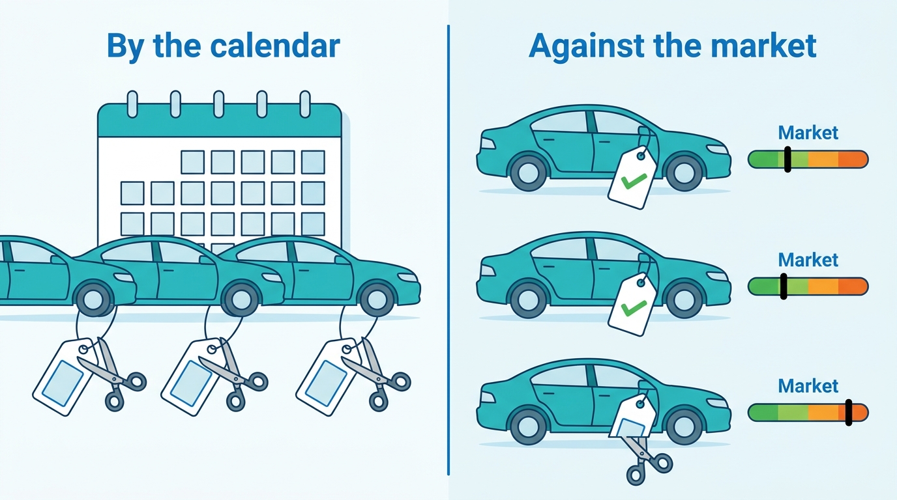
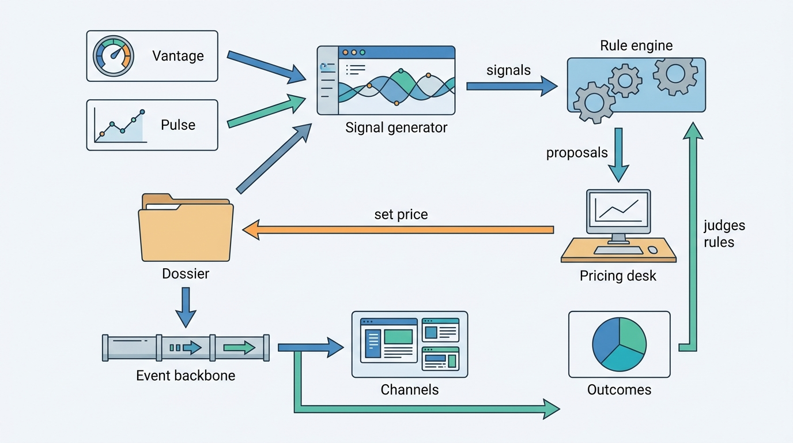
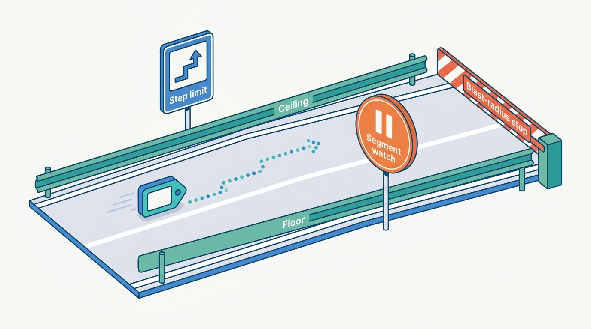
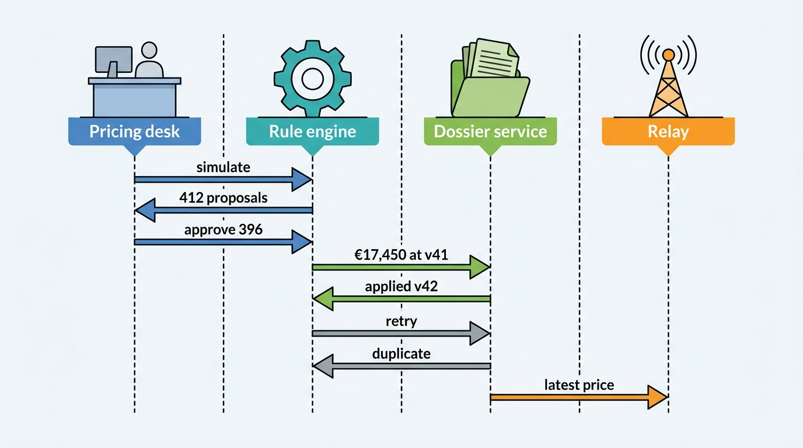
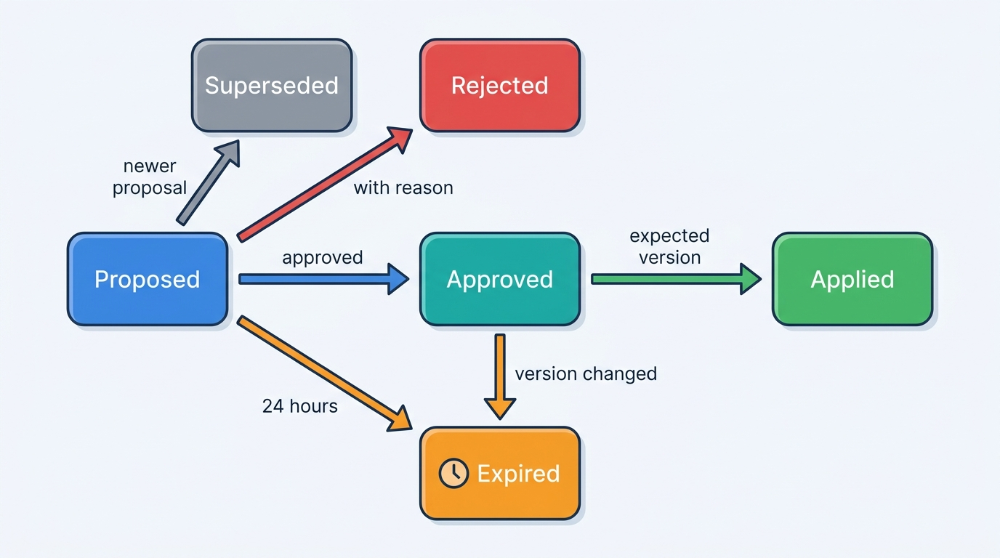

> **IN THIS CHAPTER, YOU WILL:** Take apart the pricing capability of a dealer platform: the price position and stand-time signals it computes, the repricing rules that act on them, the guardrails and approvals that keep rules safe, the price change as an event that reaches portals, websites and valuations, and the way to tell whether any of it made the dealer money.

> **WHY THE BUSINESS CARES:** A used car loses value and costs money every day it stands. A price set too high costs days, and a price cut too early or too often gives gross away on cars that would have sold anyway. For a dealer group, the pricing desk is where the margin of thousands of cars is won or lost each week.

> **WHY ARCHITECTS SHOULD CARE:** A price change is the most frequent commercial write in a dealer platform. It reads valuation, market data and the stock record, and its result fans out to every portal, the dealer's website, the valuation ledger and sometimes a consumer-law record. Whether price changes are explained, idempotent, bounded and measured is an architecture decision.

> **KEY POINTS:**
>
> * **A price is a decision, not a field.** Store every price change with its author (a person or a rule version), its reason and the market reference it was made against. Without that, nobody can explain a price, undo a bad rule, prove a former price under consumer law, or learn which pricing worked.
> * **Price against the market and the car, not against the calendar.** Age-step price cuts, the old "velocity" doctrine, cut cars that were already cheap and leave overpriced young cars alone. Compute a price position against a valuation with a stated confidence, combine it with stand-time, demand and cost signals, and act per car, as the doctrine's own author concluded in 2023.
> * **Automate repricing only behind guardrails, simulation and a control group.** Rules need floors that know the VAT regime, step and frequency limits, a blast-radius stop, a pause when the valuation segment is under drift watch, and absolute target prices so that a retry cannot cut twice. Judge rules by gross, days-to-turn and aged stock against untreated rooftops, not by the number of prices changed.

> **[FAILURE PATTERNS THIS CHAPTER ADDRESSES](where-vehicle-platforms-go-wrong.html):**
>
> * **The Confident Valuation** — a repricing rule that treats a valuation as exact cuts or raises prices on numbers whose range, sample or segment status says they should not be trusted.
> * **The Sticky Error** — a price computed from a wrong mileage or a wrong edition stays on every portal after the fact is corrected, unless each price records the facts it was based on.
> * **Customization Creep** — group pricing desks demand their own repricing logic; without a versioned rule language with guardrails, each demand becomes a code path.

 
A used-car manager makes one decision more often than any other: **what to ask for each car, and when to change it**. The car was bought at a price the dealer can no longer change ([[vehicle-acquisition]]), and every day it stands it loses value and ties up money ([[dealer-and-data-economics]]). The asking price is the main lever left.

Pricing software turns that lever into a system. It compares each car with the market, raises **signals** for cars that are drifting (priced above comparable cars, standing too long, drawing no enquiries), proposes or applies new prices through **repricing rules**, and sends each change to portals and the dealer's website. Done well, it shortens stand-time without giving gross away. Done badly, it produces thousands of unexplained price cuts a week, each sent to six channels, and nobody can say whether they helped.

This chapter owns three terms: **price position**, the **stand-time signal** and the **repricing rule**. It builds on the valuation and its confidence from [[valuation-engine]], the market's supply and stand-time from [[market-data]], and the stock item, its cost and its clocks from [[inventory-and-vehicle-dossier]]. It hands the advert to [[merchandising]] and the channel mechanics to [[listing-syndication]].

## Setting the Scene at Axleby: The Thursday Run

Axleby, the fictional vehicle data and dealer software group this book follows (see [[meet-axleby]]), sells pricing to dealers inside Lotwise, its dealer software for the Netherlands, Belgium and Germany. The Lotwise Stock & Pricing module (€189 per rooftop per month) shows each car's price against the market and a list of signals. Every night Vantage, Axleby's valuation engine, recomputes about **350,000** stock cars; the results are stored as price-position signals, not as issued valuations ([[valuation-engine]]).

**Velto Mobility Group** joined Lotwise in 2026: 46 rooftops in the Netherlands and Belgium, 11 franchise brands, DriveDesk as its dealer management system (DMS), about **2,650** used cars in stock. Its used cars are priced by a **central pricing desk** of seven people under Mirjam Kuipers, the group used-car director. The desk brought its pricing method from its previous dealer-software vendor, and Lotwise's onboarding team rebuilt it as configuration ([[onboarding-and-configuration]]). Every Thursday the desk ran it across the group. The method had two parts:

- An **age-step rule**: cut 2.5% at 30, 45 and 60 days in stock, then 1.5% a week from day 75 until the price reached cost plus €300, and offer the car on Tradefloor, Axleby's trade exchange, at day 90.
- A weekly **re-anchoring and rounding** pass that moved every price with a group price index and rounded it to a price ending in 450 or 950.

On **Thursday 11 February 2027** the run changed **2,300** prices, most by less than €200. At an average of 5.3 channels per car, that put about 12,200 channel updates into Relay, Axleby's syndication engine, in one afternoon. Those updates were the ones that failed on an unmapped equipment code and blocked the deletes behind them: the **Zombie Golf**, a sold car that stayed live on four portals for four days ([[listing-syndication]]).

The Zombie Golf was fixed in Relay. But Mirjam asked a different question: her desk spent most of Thursday changing prices, and her aged stock was not falling. In April 2027, Tomás Ferreira, Lotwise's Product Director, and Ines Marchetti, the Group Chief Architect, reviewed Velto's first quarter of 2027 with her. The numbers below are Axleby illustrations.

| Velto, Q1 2027 | Value |
| --- | --- |
| Price changes | about **29,400** (about 2,260 a week); median change €120; 81% decreases |
| Price changes per car sold | **6.4** (about 4,600 cars sold) |
| Decreases applied to cars already at or below 98% of Vantage's retail value | **41%** |
| Cars under 21 days old priced above 106% of market, untouched until day 30 | **17%** of stock-ins |
| Stock older than 90 days | **8.5%**; sold on Tradefloor at an average wholesale loss of €1,240 |
| Days-to-turn (stock-in to sale) | **53** (Lotwise average 58) |
| Gross given away by cuts on cars already at or below 98% *(rough estimate, see below)* | about **€520,000** |

The last figure is the weakest: it assumes those cars would have sold within the same week at their previous price, which some would not. But the pattern held under any assumption. **The rule cut prices by the calendar.** It cut cars that were already cheap and selling, and it ignored young cars that were too expensive until they were a month old. The weekly rounding pass changed hundreds of prices for no commercial reason and loaded Relay with work every Thursday. And nobody could say why a given car had its price, because Lotwise stored the current price and a bare list of earlier ones, with no author, reason or market reference.

**Figure 1:** *Velto's age-step rule cut prices by the calendar, including cars already below the market; price position acts only on the cars priced above it.*

So the question for the review was not "how do we reprice faster". It was **what should a price change record, what should trigger it, what should stop it, and how will we know whether it worked?**

## Concepts: Position, Signals and Rules

### The asking price and who owns it

The **asking price** is the price at which the dealer offers a car to consumers, on its own website and on portals. It is a field of the stock item, and the dossier owns it ([[inventory-and-vehicle-dossier]]); for DMS-connected rooftops, Lotwise remains the owner of price and price history ([[dms-integration]]). Pricing software does not own the price. It owns **proposals** and **signals**, and it changes the price only through the dossier, like any other writer.

Three other prices sit near it and must not be confused with it. The **valuation** is Vantage's estimate of what the car is worth, with a value type, a range and a confidence flag. The **target margin** is the planned front-end gross for this car, set at purchase from the maximum purchase price ([[vehicle-acquisition]]). The **transaction price** is what the buyer finally pays after negotiation and trade-in, recorded on the deal ([[deals-and-sales-documents]]). Pricing works in the gap between them.

### Price position

**Price position** is the asking price divided by a **market reference value** for the same car, expressed as a percentage: a car at 97% is asked 3% below the market reference. The industry also calls it *price-to-market*. It is the single most used number in used-car pricing, and it is only as good as its reference.

The reference must be the right value type: a **retail asking value** for a retail-ready car of this edition, mileage, options and condition, in this market and region ([[valuation-engine]] defines value types). A trade value gives a position that looks generous; a national average for the model ignores the options and the mileage. At Axleby the reference is Vantage's retail asking value for the stock item, computed nightly, with its 80% range, confidence flag and segment status. A position therefore carries three things, not one:

| Part | Example | Why it matters |
| --- | --- | --- |
| Position | 97.6% | The headline number |
| Reference and range | €18,400, 80% range €17,700–€19,100 | A position of 97.6% inside a ±4% range is not distinguishable from 100% |
| Reference quality | `normal`; 14 comparables within 75 km; surface of last night | Rules may act only on references they can trust |

Portals publish their own version of the same idea, and dealers see it as a constraint. Auto Trader UK labels each dealer advert with a **Price Indicator**: Higher, Fair, Good, Great or Lower price, or "No analysis" when there is no valuation or not enough specification data, with the label updating after a 15-minute delay (help center, 2024, updated September 2026). Its pricing guidance for dealers uses the same term, "Price Position", and says that "cars selling quickest on Autotrader are priced at 99%-100% of the current market value" and that "overpricing to try and make a higher margin increases the number of days to sell" (help center, 2023, updated August 2026). mobile.de's Seller API returns a **price rating** per advert with five labels, from `VERY_GOOD_PRICE` to `HIGH_PRICE`, plus `NO_RATING` when "a realistic rating for the ad is not possible"; it also offers a **preview** endpoint that rates an advert "that has not been created yet" (Seller API documentation, n.d., accessed 2026-10). **When a portal rates the price, the portal's valuation becomes a second reference the dealer cannot ignore**, and a pricing tool should show both.

### Stand-time and the stand-time signal

**Stand-time** is how long a car has been for sale; [[market-data]] owns it as a market measure, computed from adverts across all dealers. Inside one dealer's stock, the same idea runs on several clocks: days since stock-in, since the car was ready, since its first live advert, and, for financed stock, until a curtailment date ([[inventory-and-vehicle-dossier]]). On Lotwise, a car waits about seven days on average between stock-in and its first advert, so the 58-day average stock-in-to-sale is 51 days from first advert.

A **stand-time signal** is a per-car alert that a car has stood longer than it should, **given its segment, its price position and the market's current pace**. The calendar alone is not the signal. A sports car in a thin segment at 45 days may be on track; a five-year-old compact estate at 25 days with no enquiries is not. The signal compares the car's own clock with an **expected days-to-sell** for comparable cars at a comparable price position, taken from market data and the dealer's own history.

Stand-time is one of several signals. Axleby's design uses six, each with a definition, an input and an owner:

| Signal | Fires when *(Axleby thresholds)* | Main inputs |
| --- | --- | --- |
| **Above market** | Position above 104% and outside the reference range, reference confidence `normal` | Valuation, asking price |
| **Below market** | Position below 96% with at least average demand: gross may be left on the table | Valuation, leads and views |
| **Stand-time** | Days since first advert beyond the 70th percentile of expected days-to-sell for the segment and position | Market stand-time, dealer history |
| **No response** | Fewer enquiries in 14 live days than a quarter of the segment median | Leads ([[leads-and-crm]]), advert views |
| **Stale price** | Price unchanged for 21 days while the reference moved more than 3% | Valuation history |
| **Financial deadline** | Curtailment or internal age limit within 10 days | Stock item funding |

A signal is information, not an action. The rules decide what to do with it.

### Pricing strategies: from velocity to the individual car

Dealer pricing doctrine has changed, and many tools still embed the old one.

**Velocity pricing** was popularized in the 2000s and 2010s by Dale Pollak, founder of vAuto (now part of Cox Automotive). It held that a used car should be priced to sell fast, with scheduled price cuts as it aged, to maximize turns "even at the expense of gross profit per vehicle". The "60-day rule", that no car should stand longer than 60 days, came out of that school; it is industry practice, not a published standard. In 2019 Pollak and vAuto described a different product, ProfitTime, as an "investment-portfolio approach" in which high-potential cars need not be repriced at day 15 or 30, used by about 600 dealers at the time ([Wards, 2019](https://www.wardsauto.com/news/archive-wards-new-way-to-price-cars-doesn-t-play-beat-the-clock/793537/)). In December 2023 he went further and told Canadian Auto Dealer about the velocity method: "In retrospect, I was wrong. There was a race to the bottom." His replacement, which he calls **variable management**, classifies each car by expected potential on three factors (cost to market, market days' supply and local retail volume) into Bronze, Silver, Gold and Platinum tiers, and found that dealers were selling high-potential cars quickly and holding low-return ones ([Canadian Auto Dealer, 2023](https://canadianautodealer.ca/?p=63771)). **Velocity pricing is a documented historical practice, not current doctrine**, and its own author replaced it with per-car, return-based tiers.

Public retailers describe the same shift in their filings. CarMax's fiscal 2026 annual report (April 2026) says it "systematically adjust[s] individual vehicle prices based on proprietary pricing algorithms in order to appropriately balance sales trends, inventory turns and gross profit achievement", and targets "a dollar range of gross profit per used unit", set per vehicle by "its probability of sale and its mileage relative to its age" ([CarMax 10-K, 2026](https://www.sec.gov/Archives/edgar/data/1170010/000117001026000021/kmx-20260228.htm)). Carvana's 2025 annual report (February 2026) states the link between days and price directly: lower average days to sale leads to "fewer vehicle price reductions, and therefore higher average selling prices" ([Carvana 10-K, 2026](https://www.sec.gov/Archives/edgar/data/1690820/000169082026000009/cvna-20251231.htm)).

The architectural consequence is that **a pricing system must express targets and actions per car**, using that car's position, potential and cost, not one schedule for the whole stock. Velto's age-step rule was velocity pricing in configuration form.

### The repricing rule

A **repricing rule** is a versioned, declarative instruction that, for cars matching a scope and a signal, computes a proposed new asking price, subject to guardrails, and either proposes it to a person or applies it. It has six parts:

| Part | Example (Velto, rule `vel-core` version 7) |
| --- | --- |
| **Scope** | Velto group, all NL and BE rooftops, retail stock, not reserved, not in the EV segment while its status is `watch` or `restricted` |
| **Trigger** | Above-market signal, or stand-time signal with position above 100% |
| **Target** | Move toward a target position by tier: high potential 100%, standard 98%, low potential 96% |
| **Guardrails** | Floor and ceiling, maximum step 4%, at most one change per car per 7 days, no change under €100 |
| **Mode** | Propose to the desk (default) or apply automatically (only for named, low-risk rules) |
| **Version and owner** | Version 7, effective 18 June 2027, owner: Velto pricing desk; approved by Mirjam Kuipers |

Two design choices in that table carry most of the safety. **The rule computes an absolute target price, never a relative cut.** "Set the price to €17,450, computed from the reference of last night" can be retried, replayed or applied twice with the same result; "cut 2.5%" applied twice cuts 5%. And **the rule is configuration, not code**: it lives in Baseline, Axleby's tenant configuration service, with effective dates, inheritance from group to region to rooftop and locks, so a group's pricing method is one more versioned setting, not a fork ([[onboarding-and-configuration]]).

## Architecture: Signals, Rules and the Price Event

### Components

| Component | Responsibility | Owns | Does not own |
| --- | --- | --- | --- |
| **Reference provider** | Supplies each stock car's market reference: Vantage retail asking value with range, confidence and segment status; licensed portal ratings where available | Nothing; reads [[valuation-engine]] | The valuation |
| **Signal generator** | Computes price position and the six signals per car, nightly and on relevant events (new cost, new price, new lead) | Signals with their inputs and dates | Prices |
| **Rule engine** | Evaluates repricing rules from Baseline against signals; produces proposals; runs simulations | Proposals, rule runs | Rules' content (Baseline), prices |
| **Pricing desk workspace** | Lists signals and proposals by group, region and rooftop; bulk approve, edit or reject with a reason | Approval decisions | Who may approve (authorization) |
| **Dossier service** | Applies a price change conditionally on the stock-item version; records price history; emits the price event | Asking price, price history | Signals, proposals |
| **Outcome service** | Joins price history to leads, sales, gross and days; compares treated and control rooftops | Outcome metrics per rule version | Decisions |

Who may approve which proposal is an authorization question. A regional manager may reprice the rooftops of their region but not a neighbor's; a salesperson may propose but not apply. Gatekeeper, Axleby's relationship-based authorization service, answers it ([[identity-access-and-entitlements]]).

**Figure 2:** *Pricing as a loop. Signals combine valuation, market and stock facts; rules turn signals into proposals; the dossier alone changes the price; the price event fans out to channels, the website, the valuation ledger and outcome measurement, which in turn judges the rules.*

The boundary that matters is between **advice** and **the price**. Signals and proposals can be recomputed, discarded and replayed. The price is a commercial fact with legal weight once advertised, and only the dossier writes it, conditional on the version the writer read. That is what lets a repricing rule and a salesperson reserving the same car collide safely: the rule's write fails on the version check, re-reads the car, sees it is reserved and skips it ([[inventory-and-vehicle-dossier]], Figure 5).

### The price change as an event

Every accepted price change emits one event, and the event carries the decision, not just the number:

| Field | Example | Who needs it |
| --- | --- | --- |
| Stock item and AVK | stock item 8812207, AVK of the car | Every consumer |
| New and previous price, currency, basis | €17,450 from €17,950, EUR, VAT margin scheme | Channels, website, price history |
| Author | rule `vel-core` v7, run 2027-06-18-A, approved by a desk user; or a named user | Audit, outcome analysis |
| Reason code | `above_market`, `stand_time`, `manual_negotiation_signal`, `cost_change` | Outcome analysis, dealer explanation |
| Reference snapshot | Vantage value €18,400, range, `normal`, surface date | Explanation, [[journey-data-correction]] |
| Idempotency key | run id + stock item, or the user command id | Every consumer |
| Effective time | 2027-06-18 14:02 CEST | Price history and consumer-law evidence |

The event fans out to five consumers, each with different needs:

1. **Channels.** Relay writes the new price into the desired state of each channel listing; the latest price wins, and intermediate prices may be skipped when changes arrive in bursts ([[listing-syndication]]). Coalescing matters here: a group run that changes a price twice within minutes should reach the portal once.
2. **The dealer's website**, which reads Lotwise directly and should show the new price within a minute.
3. **Price history** in the dossier: append-only, the evidence for every question about what was asked, when and why.
4. **The valuation ledger**, which links list prices and price changes to the valuation they followed, so that back-tests can compare Vantage's value with the price at which the car finally sold ([[valuation-engine]]).
5. **Outcome measurement**, which needs the reason code and rule version to attribute results.

Portals add effects the platform does not control. mobile.de recalculates its price rating when the advert changes ("this can lead to a change in one direction or the other"), and Auto Trader's Price Indicator follows the price after 15 minutes; a cut that moves a car from "Fair" to "Good" may matter more to enquiries than the euros. **Delete-and-recreate is never a pricing tool**: it resets the portal's price history and days on market ([[listing-syndication]]).

### Requirements per interaction

The targets are Axleby's; latencies are illustrative assumptions.

| Interaction | Consistency | Latency | Freshness | Availability |
| --- | --- | --- | --- | --- |
| Price position and signals in the stock list | Stamped with signal date and reference surface | p95 under 500 ms *(assumption)*, read from precomputed signals | Nightly; recomputed within 5 min of a new price, cost or lead | Show the last signals with their date; never block the stock list |
| Manual price change by desk or rooftop | Strong, conditional on stock-item version; one event per accepted change | p95 under 300 ms *(assumption)* | Not applicable | Must work when Vantage, Pulse and Relay are down |
| Repricing run (simulate, approve, apply) | Idempotent per run and stock item; absolute target prices | Under 30 min for a 3,000-car group *(assumption)* | Never on a market surface older than 24 hours | Pauses, never half-applies silently; per-car status |
| Price change → portals | Latest price wins; intermediate prices may be skipped | p95 under 15 min, as for all updates in [[listing-syndication]] | Reconciled daily against portal state | Degrades per channel |
| Price change → website | Latest price wins | Under 1 min *(assumption)* | Live read | As the website |
| Price history and evidence | Append-only; never updated in place | Query under 2 s *(assumption)* | Complete for every channel | Retained with the stock item (seven years in Axleby's schedule) |

The second row is the one dealers feel. **A price change is a local decision that must not wait for remote systems**: the dossier accepts it, and the remote effects follow with visible status.

### Guardrails

Rules fail at scale, so the guardrails are the design. Axleby's minimum set:

- **A VAT-aware floor.** The floor is the lowest price at which front-end gross after VAT meets the rule's minimum. Under the EU margin scheme, VAT is due on the selling price minus the purchase price, so the floor depends on the VAT regime recorded on the stock item ([[deals-and-sales-documents]]). A car without a known cost or VAT regime has no floor, and **a rule never reprices a car without a floor**; it raises a task.
- **A ceiling**, usually the top of the reference range plus a margin, so a rule cannot raise prices beyond what the evidence supports.
- **Step and frequency limits**: a maximum change per step (4% at Velto), at most one rule change per car per 7 days, and no change below €100 or 0.75%. These limits removed most of Velto's Thursday churn.
- **Reference quality gates**: rules act only on references flagged `normal`; `thin_sample`, `fallback_model`, `spec_uncertain` or `stale_market` downgrade an automatic action to a proposal. **When Vantage puts a segment on `watch` or `restricted`, automatic repricing in that segment stops** and proposals carry the warning. Axleby learned in the 2026 EV Overvaluation that a drifting segment can look normal in a global metric ([[valuation-engine]]).
- **Blast-radius stop**: a run that would change more than 25% of a tenant's stock, or move the average price by more than 2%, pauses for named approval. It is the pricing equivalent of the truncated-feed guard in syndication.
- **State exclusions**: reserved, sold, in a deal, or locked by the desk.
- **Simulation before activation.** Every new rule version is first run against current stock and shown as a list: "this version would change 412 prices today, average −2.1%, 31 blocked by floor". The same simulation runs on the last quarter's history to estimate effect, with the caveat that history is no proof.

**Figure 3:** *Guardrails make a repricing rule safe: a VAT-aware floor, a ceiling, step limits, a pause for segments under watch and a blast-radius stop bound every automatic change.*

**Figure 4:** *A repricing run. The rule is simulated before it acts, proposals are approved in bulk with reasons, each write is an absolute price conditional on the version read, and a retry after a timeout is recognized as a duplicate rather than applied as a second cut.*

### Proposals and approval

At Axleby, a proposal has a short life, because the facts behind it age:

**Figure 5:** *The life of a price proposal. A proposal expires when its reference is a day old or the car changed underneath it, so an approval given on Monday is never applied to Tuesday's car.*

Rejections with reasons are training signal: when the desk keeps rejecting one rule's proposals for one model ("the reference ignores the panoramic roof"), the rejection log says which reference or rule to fix.

## In Practice

### What public sources show

- **Central pricing in groups.** AutoNation's 2025 annual report (February 2026) describes "our One Price used vehicle centralized pricing and appraisal strategy" ([AutoNation 10-K, 2026](https://www.sec.gov/Archives/edgar/data/350698/000162828026007800/an-20251231.htm)). Central desks are a documented pattern in large groups; how they work inside is not public.
- **Algorithmic pricing per car.** CarMax's description (2026, quoted above) is the clearest public statement that pricing is per vehicle, balanced between turn and gross, and adjusted for "pricing elasticity". Its earlier statement that "generally 99% of our entire used vehicle inventory offered at retail is sold at retail" (same report) shows what the wholesale exit is for: the cars that pricing could not sell.
- **From calendar to potential.** Pollak's 2019 and 2023 interviews (above) document the change from age-based cuts to per-car potential tiers inside the company that popularized velocity pricing. The Wards evidence is seven years old and describes a product, not its current algorithm.
- **Portals as price authorities.** Auto Trader UK's FY2026 results (May 2026) describe tools for retailers covering "pricing, retail rating, market health, demand, supply, vehicle marketplace performance and predicted days to sell", and price flags built on its specification-adjusted valuations ([Auto Trader Group, 2026](https://plc.autotrader.co.uk/media/usjleen0/full-year-press-release-fy26.pdf)). mobile.de exposes price ratings, including a preview for an advert not yet created, to software partners through its Seller API. In both markets a dealer's software can ask the portal how it will judge a price before publishing it.
- **The dealer tool as a market instrument.** Cox Automotive states (January 2026) that its monthly US retail used-sales estimates "are based on observed unit changes tracked by vAuto", from vAuto Live Market View data over the most recent 30 days ([Cox Automotive, 2026](https://www.coxautoinc.com/insights/used-retail-vehicle-sales-december-2025/)). A pricing tool that sees many dealers' stock is also a market data source; [[market-data]] and [[data-licensing-and-governance]] decide what may be reused.

> **INFERENCE, NOT DOCUMENTED:** None of these companies publishes how its pricing rules, guardrails or approval flows are built, how often its prices change, or how it measures the effect of a price change. The rule model, guardrails and event design in this chapter are a reference architecture consistent with their public statements, not a description of their systems.

### Axleby: a single car

The **2020 Škoda Octavia Combi** traded in at Velto's Tilburg rooftop on 8 March 2027 shows the difference between the old rule and the new one ([[inventory-and-vehicle-dossier]] follows its cost layers). Capitalized cost was **€15,513**, the trade-in allowance **€14,200** under the margin scheme, and the desk set the asking price at **€17,950** on 21 March. On 4 April, day 27, the dossier showed (the reference and engagement figures are Axleby illustrations):

| Item | Value |
| --- | --- |
| Vantage retail asking value | €18,400; 80% range €17,700–€19,100; `normal`; 14 comparables within 75 km |
| Price position | 97.6% |
| Enquiries | 9 in 14 days live; segment median 6 |
| Signals | none |
| Floor (front-end gross after margin VAT at least €600) | **€16,550** |

The floor is computed, not typed. At a price *P*, gross after VAT is *P* − €15,513 − (*P* − €14,200) × 21/121; setting that to €600 gives *P* ≈ €16,515, rounded up to €16,550. Under the old age-step rule, the Octavia would have been cut 2.5% on day 30, to €17,450 after rounding, although it was below the market, drawing more enquiries than its peers, and had no signal. Replayed through `vel-core` version 7, it is untouched. That one avoided cut is €500 of gross; across 41% of Velto's Q1 decreases it is the €520,000 estimate.

### Axleby: the Velto pilot

Ines, Tomás and Mirjam agreed a pilot that respected the One Dossier plan: automated pricing signals are a Year 2–3 deliverable (2028–29), so in 2027 the work stayed inside Lotwise and kept a person in every decision.

1. **Price history became decisions (May 2027).** Every price change in Lotwise now records author, reason code, rule version and reference snapshot, and emits a price event through the same path that feeds Relay. Earlier history was kept and marked "reason unknown".
2. **Signals replaced the age calendar (June 2027).** The nightly restock run already produced positions; the signal generator added stand-time against expected days-to-sell, no-response and stale-price signals, with thresholds per segment.
3. **`vel-core` version 7 ran in proposal mode** at 12 Velto rooftops from 18 June to 16 September 2027, with the guardrails above. The weekly rounding pass was retired; rounding now happens only when a price changes for a reason.
4. **Twelve matched rooftops kept the old rule as a control**, chosen by brand mix, region and stock size.

Results after 13 weeks (Axleby illustrations):

| Measure | Pilot rooftops, before → during | Control rooftops, before → during |
| --- | --- | --- |
| Price changes per car sold | 6.1 → **2.2** | 6.3 → 6.0 |
| Days-to-turn | 53 → **49** | 53 → 52 |
| Front-end gross per car sold | +**€160** relative to control | baseline |
| Stock older than 90 days | 8.3% → **5.6%** | 8.6% → 8.1% |
| Desk hours on pricing per week (pilot rooftops) | 61 → 34 | — |
| Proposals rejected by the desk | 9% (mostly options the reference missed) | — |

The control group is what makes the table credible. Summer stock turns faster in the Benelux, and the control rooftops improved by a day without any change. The pilot's three extra days and €160 per car are the effect worth attributing, and even that carries rooftop-selection noise. Velto adopted `vel-core` across all 46 rooftops in **November 2027**, still in proposal mode; automatic application for small, in-band moves is planned for 2028, when the pricing service moves out of Lotwise Classic onto the event backbone ([[events-webhooks-and-sync]]).

Two side effects mattered as much as the gross. **Relay's Thursday peak disappeared**: Velto's weekly price changes fell from about 2,260 to about 800, and the remaining ones were spread across the week. And **the desk's work changed** from changing prices to reviewing exceptions: the 9% of proposals it rejected became the backlog for Vantage's option tables ([[specification-and-equipment]]).

### Group-wide volume

As an Axleby illustration, Lotwise recorded about 6.3 million price changes in 2026, about 3.3 per stock-in or 24,000 per working day. At 5.3 channels per car that is about 127,000 channel operations a day, close to a tenth of Relay's 1.4 million, concentrated on the days group desks run their rules. **Pricing design is also capacity design**: frequency limits and minimum changes remove load no adapter tuning would.

## Failure Handling

| Failure | Detection | Recovery |
| --- | --- | --- |
| **Duplicate application** (run retried after a timeout, user double-submits) | Idempotency key: run id + stock item, or command id | Absolute target price makes a replay harmless; dossier returns "duplicate, no change" |
| **Conflicting updates** (rule versus salesperson, desk versus rooftop, car reserved meanwhile) | Version-conditional write; desk lock flag on the stock item | Rule re-reads and re-evaluates; a manual price wins over a rule for 7 days unless the desk lifts it; reserved cars are skipped |
| **Incomplete records** (no cost, no VAT regime, edition unknown) | Missing floor; reference flagged `spec_uncertain` | No automatic action; task to the rooftop to complete the record; position shown with a wide range |
| **Untrustworthy reference** (thin sample, stale surface, segment `watch` or `restricted`) | Reference flags and segment status on every signal | Automatic actions become proposals with a warning; runs never start on a surface older than 24 hours |
| **Runaway rule** (wrong threshold, unit error, bad index) | Simulation diff; blast-radius stop; maximum step | Run pauses for approval; rollback by re-applying each car's previous price as a new event with reason `rollback`, never by editing history |
| **Partial failure** (price applied, some channels failed) | Desired-state lag per channel listing ([[observability-and-data-operations]]) | Relay converges each channel to the latest price; the dossier shows "price live on 4 of 5 channels" |
| **Corrected fact** (wrong mileage or edition behind the reference) | Correction event names the fact versions it replaces; price events carry the reference snapshot | Find every price set against the wrong reference, re-propose, and tell the dealer which adverts showed the wrong price ([[journey-data-correction]]) |
| **Portal rejects the price** (below a portal minimum, missing mandatory price fields) | Channel error classified as permanent | Parked without retry; desk sees the rule and the channel's reason |
| **External outages** (Vantage, Pulse or Relay unavailable) | Health checks; surface age | Manual pricing continues; signals show their date; channel updates wait in desired state and send the latest price once on recovery |

The Odometer Correction of May 2027 shows why the reference snapshot belongs on the price event. A supplier batch recorded miles as kilometers for **2,870** UK-imported cars; by the time it was corrected, **1,180** live adverts carried the wrong mileage, and some of those cars had been repriced against valuations computed from it. Because price events from May 2027 carry the valuation id, and the valuation ledger holds the mileage reading id, finding the affected prices is a join, not an investigation.

## Trade-Offs

### Pricing strategy

| Strategy | Strengths | Weaknesses | Right when |
| --- | --- | --- | --- |
| **Manual, by experience** | Captures local knowledge; no rule risk | Inconsistent; does not scale to a group; no record of reasons | Small independents with a few dozen cars |
| **Age-step cuts (velocity)** | Simple; guarantees movement; easy to explain | Cuts cheap cars, ignores expensive young ones, gives gross away; abandoned by its own author | As a last-resort backstop for a financial deadline, not as the method |
| **Market position target** | Market-anchored; explainable with comparables | Only as good as the reference; pushes everyone toward the same price | Dense segments with a trustworthy reference |
| **Per-car potential or return tiers** | Matches price effort to each car's gross and turn potential; current documented direction | Needs good reference, demand and cost data; harder to explain | Groups with central desks and complete cost data |
| **Fully algorithmic per car** | Consistent at scale; uses elasticity and probability of sale | Model risk, drift, a hard explanation problem; needs a pricing science team | Large retailers that own data and outcomes, as CarMax describes |

### Automation level

| Level | What happens | Risk | Fits |
| --- | --- | --- | --- |
| **Advice only** | Signals and suggested prices; people decide | Low; signals ignored | Independents; first rollout |
| **Propose and approve** | Rules produce proposals; desk approves in bulk | Approval fatigue; rubber-stamping | Group desks; new rule versions |
| **Automatic within bands** | Small in-band moves applied; the rest proposed | A wrong reference moves many prices quietly | Proven rule versions on `normal` segments, with blast-radius stops |
| **Fully automatic** | Rules apply all changes | Runaway rules; drift spreads straight to every advert | Rarely; only with a control group and fast rollback |

My recommendation for Axleby is **per-car tiers with propose-and-approve as the default, and automatic application only for in-band moves on `normal` segments**, under three conditions: the stock item carries cost and VAT regime, Vantage's segment status is wired into the rules, and every rule version is measured against a control. If a market lacks a trustworthy reference, as in the UK where Showroomly dealers mostly price against Auto Trader, show the portal's rating as the reference and keep automation off.

A third trade-off runs underneath: **which reference to price against**. The platform's own valuation is explainable and under its control; the portal's rating is what buyers see. Pricing to the portal alone hands the dealer's margin to the portal's model; ignoring it hands enquiries to competitors whose label reads "Good price". Show both, price against the own reference, and use the portal preview, where offered, to check the label before publishing.

## Across Markets: What Changes by Country

| | Netherlands / Belgium | Germany | United Kingdom | United States |
| --- | --- | --- | --- | --- |
| Reference dealers price against | Own-tool valuations from advert data spread over several portals (Marktplaats, 2dehands, AutoScout24, AutoTrack); aggregators such as VWE and Indicata | DAT and Schwacke values; mobile.de and AutoScout24 market data | Auto Trader valuations (one dominant portal) | Inventory tools such as vAuto; Manheim MMR, Kelley Blue Book, Black Book |
| Portal price label | No seller-API documentation of a price label found for Marktplaats or 2dehands in this research | mobile.de price rating: five labels plus `NO_RATING`; preview before creation (Seller API, n.d.) | Auto Trader Price Indicator: five labels, "No analysis", exclusions, 15-minute delay (2024, updated 2026) | Marketplace deal labels are common practice; not verified here |
| Announcing a price reduction | Directive 98/6/EC Article 6a: show the lowest price of the prior 30 days, applying since 28 May 2022 through national law | Same, as PAngV § 11, which exempts individual price reductions | No Article 6a after Brexit; misleading price claims fall under the Digital Markets, Competition and Consumers Act 2024 regime in force since April 2025 (CMA207 guidance, 2025) | FTC Guides Against Deceptive Pricing, 16 CFR 233.1: a former price must be bona fide, offered "for a reasonably substantial period of time" |
| What drives the deadline | Bank lines, captive finance, lessor buy-backs | Bank lines, captive finance | Stocking finance | Floorplan with curtailments: age is a contractual deadline |
| Units in signals | km; margin scheme or VAT | km; margin scheme or VAT | miles; margin scheme or VAT | miles; sales tax outside the price |

The price-reduction row matters to architecture. Article 6a of Directive 98/6/EC, inserted by Directive (EU) 2019/2161, says that "any announcement of a price reduction shall indicate the prior price", and that the prior price is "the lowest price applied by the trader during a period of time not shorter than 30 days prior to the application of the price reduction". Germany implemented it as § 11 of its price indication ordinance (PAngV), which excludes "individual price reductions", such as a discount negotiated with one buyer. A dealer that shows "was €17,950, now €17,450" on its website or in an advert therefore needs, per car, the lowest price it applied in the previous 30 days. **The price history is a legal record, not a chart**, and the platform must answer "lowest price in the last 30 days" per car from its own events, including prices applied on any channel. It also kills a classic abuse: raising a price briefly in order to advertise a cut. The rule engine should refuse a version whose simulation shows raise-then-cut patterns within 30 days. Counsel should confirm per market whether a portal's automatic "price reduced" badge counts as the dealer's announcement.

**What stays common:** the stock item's ownership of the price, the price event with author, reason and reference, signals, the rule model and guardrails, simulation, proposals and approval, and outcome measurement against a control.

**What becomes a market adapter or rule set:** the reference source per market (Vantage, a licensed guide value, a portal valuation), the portal-rating integration per channel, the price-reduction disclosure rule and its lookback, rounding and price-ending conventions, units, and the financial-deadline inputs (US floorplan curtailments do not exist in the same form in Velto's world).

**What may be a separate product decision:** in the UK, where one portal sells valuations and pricing tools to the same dealers, Showroomly integrates the portal's figures and adds signals and an audit trail; competing on the reference itself is a data-business decision ([[case-auto-trader-uk]]).

## The Chief Architect's View

**Decide who owns the price, and enforce it.** The dossier owns the asking price; pricing owns proposals and signals; the DMS owns neither for Lotwise rooftops. Every writer, human or rule, goes through the same version-conditional command and produces the same event. A second write path, such as a bulk import that sets prices directly, would reopen every problem this chapter solves.

**Make the reference explicit and graded.** A position is only as good as the valuation it divides by. Wire Vantage's range, confidence flags and segment status into the signals, so that pricing inherits the drift controls of [[valuation-engine]] instead of re-learning them. Priya Raman owns the reference; Tomás Ferreira owns what dealers do with it.

**Treat repricing rules as product configuration with a release process.** Versioned, simulated, approved, effective-dated, measured. A dealer group's pricing method is one of its most sensitive settings; it belongs in Baseline under the same "no tenant-conditional code" policy as everything else, not in a custom job.

**Measure with a control, and publish the result to the dealer.** Price changes per car, days-to-turn, gross per unit, aged-stock share and wholesale losses, per rule version, against untreated rooftops or held-out cars. A group that cannot see what its rules earned will keep the rule it is used to. Velto kept the age-step rule for a year because nobody could show it what it cost.

**Watch these over the long term:** the share of price changes with a reason code and reference (target 100%); price changes per car sold; the share of automatic actions taken on non-`normal` references (target zero); proposal rejection rates by segment; the gap between portal ratings and Vantage positions; and the lag from price change to portals. If the rejection rate climbs in one segment, the reference is drifting before the back-test shows it.

## Questions to Ask

1. Who may change a price, through which path, and does every change record author, reason, rule version and the market reference it used?
2. What is the reference behind your price position: which value type, which edition and options, which region, and does the screen show its range and confidence?
3. Which signals fire for a young car priced well above market, and how many days does it wait before anyone acts?
4. Are repricing actions absolute target prices or relative cuts, and what happens if a run is retried after a timeout?
5. What stops a wrong rule: floors that know the VAT regime, step and frequency limits, a blast-radius stop, a simulation step?
6. Does automatic repricing pause when the valuation segment is under drift watch?
7. Can you answer, per car and channel, "what was the lowest price in the 30 days before this reduction", from your own records?
8. What share of syndication traffic is price changes, and which of them changed nothing a buyer would notice?
9. How do you know a rule earned money: what control group, which metrics, over what period?
10. When the portal's price label and your own position disagree, which one does the dealer see first, and why?

The price is now set and its reasons recorded. What the buyer sees, though, is not a price but an advert: photos, a title, an equipment list, a description, a financing example and the disclosures each market requires. The next chapter, [[merchandising]], covers how those adverts are produced completely, accurately and at scale.

## Sources and Evidence

*Company, product and investor sources*

- [CarMax Form 10-K, fiscal year ended 28 February 2026](https://www.sec.gov/Archives/edgar/data/1170010/000117001026000021/kmx-20260228.htm), CarMax / SEC, 2026. Algorithmic per-vehicle pricing balancing turn and gross; per-unit gross targets by probability of sale; share of retail inventory sold at retail.
- [AutoNation Form 10-K FY2025](https://www.sec.gov/Archives/edgar/data/350698/000162828026007800/an-20251231.htm), AutoNation / SEC, 2026. One Price centralized pricing and appraisal.
- [Carvana Form 10-K FY2025](https://www.sec.gov/Archives/edgar/data/1690820/000169082026000009/cvna-20251231.htm), Carvana / SEC, 2026. Lower days to sale leads to fewer price reductions and higher selling prices.
- [Used retail vehicle sales, December 2025](https://www.coxautoinc.com/insights/used-retail-vehicle-sales-december-2025/), Cox Automotive, 2026. Days' supply of 49; sales estimates based on vAuto-tracked unit changes.
- [Full year results FY26](https://plc.autotrader.co.uk/media/usjleen0/full-year-press-release-fy26.pdf), Autotrader Group plc, 2026. Retailer pricing and predicted-days-to-sell tools; price flags on specification-adjusted valuations.
- [Why do I have a Price Indicator on my advert?](https://help.autotrader.co.uk/hc/en-gb/articles/19212037724957), Auto Trader UK, 2024, updated 2026. Labels, "No analysis", exclusions, 15-minute delay.
- [How do I price my car as a dealer?](https://help.autotrader.co.uk/hc/en-gb/articles/13143564149021), Auto Trader UK, 2023, updated 2026. "Price Position"; quickest-selling cars priced at 99–100% of current market value; overpricing increases days to sell.
- [Seller API documentation](https://services.mobile.de/manual/seller-api.html), mobile.de, n.d. (accessed 2026-10). Price rating labels, `NO_RATING`, preview endpoint, recalculation when images change.

*Standards, regulation and official documentation*

- [Directive (EU) 2019/2161](http://publications.europa.eu/resource/celex/32019L2161), European Union, Official Journal, 2019. Article 2 inserts Article 6a into Directive 98/6/EC (prior lowest price over at least 30 days); application from 28 May 2022.
- [Preisangabenverordnung § 11](https://www.gesetze-im-internet.de/pangv_2022/__11.html), Bundesministerium der Justiz, n.d. (accessed 2026-10). German implementation; exemption for individual price reductions (German).
- [Unfair commercial practices (CMA207)](https://www.gov.uk/government/publications/unfair-commercial-practices-cma207), Competition and Markets Authority, 2025, updated November 2025. Guidance under the Digital Markets, Competition and Consumers Act 2024.
- [16 CFR 233.1, Former price comparisons](https://www.ecfr.gov/current/title-16/chapter-I/subchapter-B/part-233/section-233.1), US Federal Trade Commission / eCFR, n.d. (accessed 2026-10). Bona fide former prices; fictitious reference prices.
- [Council Directive 2006/112/EC (VAT Directive)](http://publications.europa.eu/resource/celex/32006L0112), European Union, 2006. Margin scheme for second-hand goods, which sets the VAT-aware price floor.

*Research and practitioner sources*

- [Dale Pollak shifts gears on used car selling tactics](https://canadianautodealer.ca/?p=63771), Canadian Auto Dealer, 2023. Pollak's reversal of velocity pricing and the variable-management tiers.
- [New way to price cars doesn't play beat the clock](https://www.wardsauto.com/news/archive-wards-new-way-to-price-cars-doesn-t-play-beat-the-clock/793537/), Wards Auto, 2019. ProfitTime's investment-portfolio approach; no fixed day-15 or day-30 cuts.

Axleby is fictional; architectural recommendations, labeled inferences and labeled assumptions are the author's judgement.
