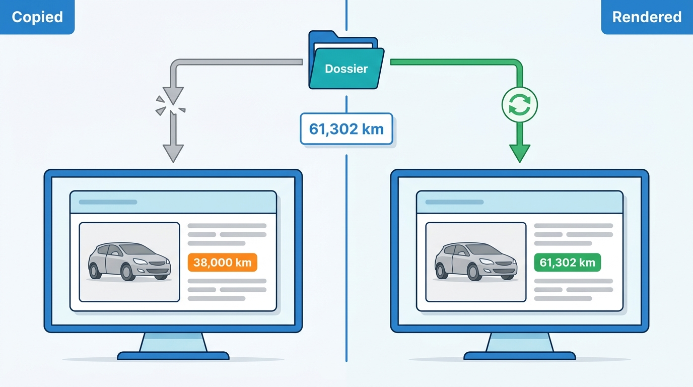
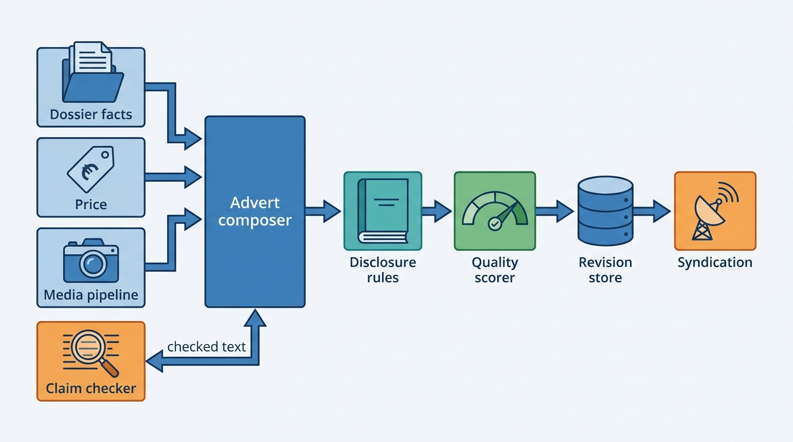
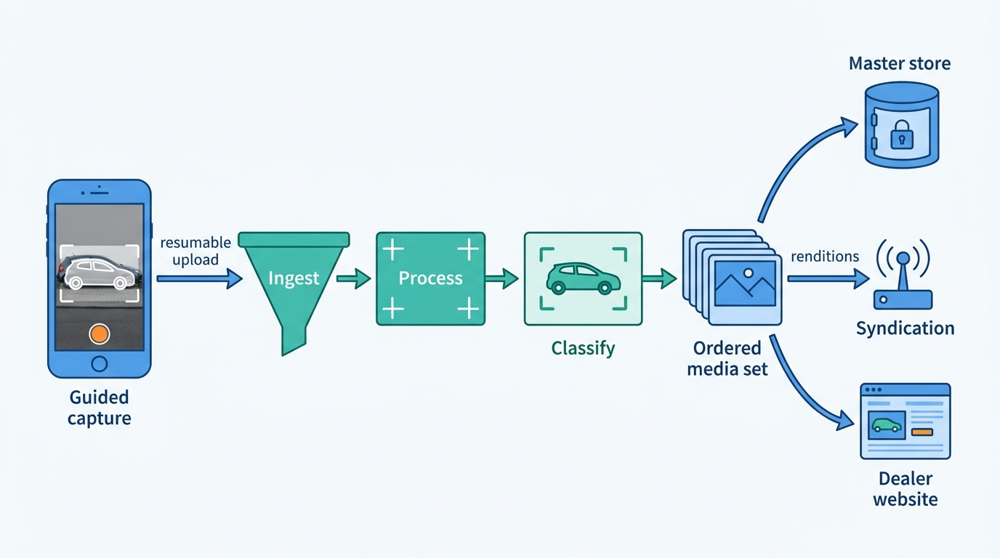
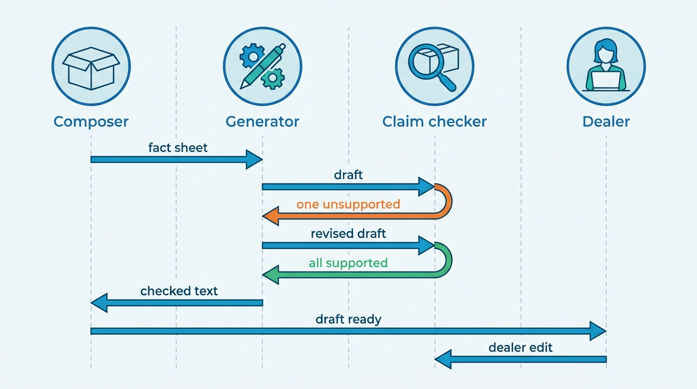

> **IN THIS CHAPTER, YOU WILL:** Design the advert as a content model built from dossier facts, follow a vehicle media pipeline from the dealer's phone to the channels, turn a resolved specification into equipment text, put guardrails on generated descriptions, compute mandatory disclosures per market, and define a listing quality score that tells a dealer what to fix first.

> **WHY THE BUSINESS CARES:** A car nobody can see online costs a dealer holding cost and earns nothing. A car advertised with the wrong edition, the wrong mileage or an unlawful financing example costs a sale, a complaint or a regulator's letter. The dealer is liable for every word in the advert, whoever or whatever wrote it.

> **WHY ARCHITECTS SHOULD CARE:** The advert is the most widely copied rendering of the vehicle record: sixty channels, a dealer website, buyers' screenshots. If its text and photos are copies rather than renderings of versioned facts, every upstream correction stops at the advert, and generated text adds a new way for an unsourced claim to reach the public.

> **KEY POINTS:**
>
> * **An advert is a rendering, not a document.** Compose it from referenced facts (identity, resolved specification, mileage, price, history, battery certificate) plus a small amount of dealer-authored content, version every revision, and re-render when any input changes. Copied text is how a corrected mileage stayed wrong in 307 live adverts.
> * **Generate only what you can prove.** Equipment text and generated descriptions must come from a fact sheet that carries each fact's source and resolution state, and a claim checker must reject any statement the fact sheet does not support. That gate matters far more than tone or length.
> * **Disclosures and quality are computed, not typed.** Financing examples, energy data, mileage certificates and price-reduction claims follow per-market rules that change with law and portal policy; evaluate them as versioned rule sets on every revision. Score each advert on completeness and correctness, and turn the score into the dealer's next three actions.

> **[FAILURE PATTERNS THIS CHAPTER ADDRESSES](where-vehicle-platforms-go-wrong.html):**
>
> * **Spec Guesswork** — an advert editor that offers an edition picker, or a text generator that lists every catalog option, publishes equipment the car does not have.
> * **The Sticky Error** — mileage and equipment typed or generated into free text survive the correction of the structured fact, as the Odometer Correction showed.
> * **Provenance Amnesia** — a generated description stored without its fact-sheet, prompt and model versions cannot be explained or re-checked when a buyer complains.

 
A used car is sold twice. First the dealer sells it to a buyer's screen: photos, a title, an equipment list, a price, a few lines of description and the small print the law requires. Only then does the dealer sell it in the showroom. **Merchandising** is the first sale: producing complete, accurate and attractive adverts for every car in stock, quickly, and keeping them true while the car and its facts change.

Most dealer software treats the advert as a form. That fails at Axleby's **352,000** cars in stock and **1.9 million** stock-ins a year: typing is slow, typed values drift from their sources, and the content carries legal duties a form cannot enforce. **The architectural move is to stop treating the advert as something a dealer writes and start treating it as something the platform renders from facts it can prove,** with the dealer adding judgement, photos and a voice.

This chapter owns the **advert**, the **vehicle media pipeline** and the **listing quality score**. It builds on the stock record from [[inventory-and-vehicle-dossier]], the resolved specification from [[specification-and-equipment]] and the price from [[used-car-pricing]], and hands the finished advert to [[listing-syndication]], which owns channel adapters, publish rules and per-channel validation. Generic image engineering (derivatives, content delivery networks, perceptual hashing, storage tiers) is covered in LISTED's [[media-pipeline]] and is not repeated here.

## Setting the Scene at Axleby: The Seven-Day Gap

Axleby, the fictional vehicle data and dealer software group this book follows (see [[meet-axleby]]), sells merchandising inside Lotwise, its dealer software for the Netherlands, Belgium and Germany. Lotwise Classic, the PHP monolith that has owned stock, dossier and adverts since 2009, holds the **advert editor**: free-text title and description, an equipment checklist, a photo upload and a channel selection.

Lotwise reported average days-to-turn of **58** from stock-in, while dealer dashboards counted from the first live advert and showed **51** ([[dealer-and-data-economics]]). A car spent a week in stock before any buyer could see it. At about **€8.8** of holding cost per car-day, each day of that gap costs Lotwise's dealers about **€17 million** a year in total (illustrative). In April 2027, Tomás Ferreira, Product Director of Lotwise, had his team take the gap apart for a sample of **118,000** first-quarter stock-ins whose dossier timelines were complete enough to attribute each day (Axleby illustrations):

| Where the seven days went (Q1 2027 stock-ins, average) | Days |
| --- | --- |
| Waiting for reconditioning to finish before anyone photographed the car | 3.2 |
| Waiting for photos once the car was ready (photographer's round, weather, photo-bay slot) | 1.6 |
| Writing title, description and equipment; entering the price | 1.1 |
| Fixing channel rejections and missing mandatory fields | 0.4 |
| Not attributable from the timeline | 0.7 |
| **Stock-in to first live advert** | **7.0** |

A sample of 2,000 live adverts showed the result: median **19** photos, **23%** with fewer than 12, **31%** with no description beyond the equipment list, and **9%** showing a dealer-selected edition different from the one Specbook, Axleby's specification resolver, had resolved ([[specification-and-equipment]]).

Two incidents made it more than a productivity problem. In the **Odometer Correction** of May 2027, a Kilometra batch recorded miles as kilometers for **2,870** UK-imported vehicles, and **1,180** live adverts carried the wrong mileage before the batch was corrected eleven days later ([[journey-data-correction]]). The structured mileage field was corrected when the dossiers re-synced. But **307** of those adverts also stated the mileage in description text, and nothing corrected that. A text search found them two weeks later; **41** were still live with the wrong figure three weeks after the correction. Then, in the June 2027 pilot of generated descriptions, a draft for a Peugeot 3008 offered "a panoramic glass roof" because the catalog listed one as optional for the edition. The car had none. The dealer published the draft, and a buyer drove 140 km to see it.

Tomás's question to Ines Marchetti, the Group Chief Architect, was practical: **how does Lotwise get a complete, correct advert live within two days of stock-in, for any car, without the dealer writing it?**

## Concepts: The Advert and What It Is Made Of

### Advert, channel listing and stock item

| Object | What it is | Owner | Lifetime |
| --- | --- | --- | --- |
| **Stock item** | One stay of one car in the dealer's stock, with cost, state and location | Dossier ([[inventory-and-vehicle-dossier]]) | Stock-in to delivery or write-off |
| **Advert** | The channel-independent offer content for one stock item: title, description, equipment text, ordered media, price presentation, disclosures, availability | Merchandising (this chapter) | First draft to withdrawal |
| **Channel listing** | One advert on one channel, with the portal's id and desired and actual state | Syndication ([[listing-syndication]]) | Insert to confirmed withdrawal |

A stock item has at most one current advert. An advert has many **revisions**; each is immutable and carries a content hash, and syndication publishes revisions, never "the current form".

### Five kinds of advert content

The content model sorts every element by where its truth comes from. This is merchandising's most important design decision, because it settles what the dealer may edit and what happens when a source changes.

| Kind | Examples | Source of truth | Dealer may edit? | When the source changes |
| --- | --- | --- | --- | --- |
| **Referenced facts** | Make, model, edition, engine, first registration, mileage, color, CO2, odometer judgement, history summary | Anchor, Specbook, Tracewell, the dossier | No; corrections go to the fact's owner, which records the dealer as a source | Advert re-renders |
| **Derived content** | Equipment list, highlights, generated title and description, availability text | Rendered from facts | Only through stored, checked overrides | Re-rendered; overrides re-checked |
| **Commercial terms** | Asking price, price-reduction claim, financing example, warranty, delivery terms | Pricing ([[used-car-pricing]]), lender rate cards ([[deals-and-sales-documents]]), dealer settings | Through their owning modules | Re-rendered; disclosures recomputed |
| **Dealer-authored content** | Personal note, photos, video, photo order | The dealer | Yes | Checked for stale numbers and unsupported claims |
| **Disclosures** | Financing warning and example, energy data, mileage certificate link, prior price on reductions | Per-market rules evaluated on the other four kinds | No | Recomputed on every revision |

Two consequences follow. **A dealer never types mileage, edition or equipment into an advert;** they correct those facts in the dossier, where the correction is sourced and visible to valuation and history too ([[provenance-and-data-quality]]). And **free text is a liability to contain**: every number or equipment claim in it is a copy that will not follow its source.

**Figure 1:** *A rendered advert follows a corrected fact on its next revision; a copied sentence keeps the old figure until someone finds it.*

The **vehicle media pipeline** is the path a car's photos and video take from capture to channel, with the rights and retention rules that govern them. The **listing quality score** is a per-advert measure of completeness and correctness, computed from explicit checks and delivered with a ranked list of actions. It is not a beauty score: a beautiful advert with the wrong edition scores low.

## Architecture: Compose, Check, Render

Axleby's 2027 design splits the old advert form into five components around one store of advert revisions.

**Figure 2:** *The advert is composed from referenced facts, commercial terms, a processed media set and checked text. Disclosure rules and the quality scorer run on every draft before it is stored. Syndication publishes stored revisions and never edits content.*

| Component | Owns | Does not own |
| --- | --- | --- |
| **Advert composer** | The advert aggregate and its revisions; field-kind rules; dealer overrides; re-render triggers | Facts, price, channel payloads |
| **Media pipeline** | Media assets, processing, classification, order, rights, retention | Per-channel image counts and renditions (syndication renders them) |
| **Description generator and claim checker** | Fact sheets, generated text per language, claim verification, generation records | The dealer's decision to publish |
| **Disclosure rules** | Versioned per-market rule sets and their evaluation | Legal interpretation (legal owns it; product encodes it) |
| **Quality scorer** | Checks, score, ranked actions, calibration against outcomes | Channel acceptance rules ([[listing-syndication]]) |

The boundary with syndication is deliberate. Syndication's pre-publish validation answers "will this channel accept this revision?"; merchandising answers "is this advert true, complete and lawful?" Where they overlap, as with the Belgian Car-Pass link, merchandising produces the content and syndication checks the channel's form. A rejection caused by missing content becomes a dealer action, not a syndication retry.

### Re-render on fact change

The composer subscribes to fact-change events for every stock item with an active advert: specification resolution, mileage corrections, history updates, price changes, lender rate-card updates, media changes. Each event produces a new revision if, and only if, the rendered content hash changes. A revision records the version of every input it was rendered from, so "which mileage did this advert show on 14 May?" has an answer.

Dealer-authored text cannot be re-rendered, so the composer runs a **stale-content check** on it at every revision. Any number that looks like a mileage, price, year or power figure, and any equipment term, is compared with the current facts. A mismatch blocks republication of that text and raises an action: "Your description says 38,000 km; the car's mileage is now 61,302 km." The Odometer Correction's 307 adverts are why this check exists.

### Requirements per interaction

Targets marked *(assumption)* are Axleby's illustrative design targets.

| Interaction | Consistency | Latency | Freshness | Availability |
| --- | --- | --- | --- | --- |
| Photo upload from the dealer's phone | Each photo stored once by content hash; partial sets visible as partial | Processed preview ≤ 2 min p95 *(assumption)* | — | Capture works offline; resumable upload |
| Fact change → new advert revision | Revision records exact input versions | ≤ 5 min p95 *(assumption)* | Mileage, price and availability current at publish | Composer outage delays adverts, never publishes wrong ones |
| Description generation | Text tied to one fact-sheet version | ≤ 20 s p95, asynchronous *(assumption)* | Regenerated only when a stated fact changes | Template fallback when the model provider is down |
| Disclosure evaluation | Deterministic for given inputs and rule version | ≤ 300 ms, synchronous with the save *(assumption)* | Rule sets effective-dated | Publication blocked if rules cannot be evaluated |
| Quality score | Per revision | ≤ 1 min *(assumption)* | Current revision only | Degrades to "not scored", never blocks |

## The Vehicle Media Pipeline

Photos sell used cars, and they are where most of the seven-day gap lived. This section covers what is specific to vehicles; [[media-pipeline]] covers the generic design.

**Figure 3:** *The vehicle media pipeline. Capture is guided and offline-tolerant, ingest makes every photo idempotent by content hash, and processing and classification turn raw shots into an ordered set. Channels receive renditions derived from the master set at publish time.*

### Capture: guided, offline, early

Industry practice has moved photography from a photographer's round to the dealer's phone, guided by an overlay that shows the next angle. Axleby's capture mode in the Lotwise app uses a **24**-shot template (illustrative: eight exterior, ten interior, six details including odometer, tires and service book). The app checks blur, exposure and framing on the device, so a bad shot is retaken while the car is still there, and queues uploads that resume after a dropped connection. A half-uploaded set must never look complete.

The bigger change was **when** photos are taken. 3.2 of the seven days were spent waiting for reconditioning to finish. Axleby split photos into **intake photos**, shot at stock-in, which serve the dossier and an early advert marked "in preparation, available from [date]", and **retail photos**, shot when the preparation track reaches *photos* ([[inventory-and-vehicle-dossier]]), which replace them. Advertising early is a per-rooftop setting with rules. Google's vehicle ads guidelines forbid "Coming Soon" placeholders and allow stock photos only for new cars ([Google Merchant Center Help, n.d.](https://support.google.com/merchants/answer/11190670)), so an early advert needs real photos of the real car. If intake photos show damage that reconditioning will repair, the scorer flags the advert until the retail set arrives.

### Processing, classification and renditions

Processing is idempotent by content hash plus pipeline version, so a retry never creates a second asset. Location data in each photo's EXIF metadata is stripped at ingest because it reveals where staff and private sellers live and work.

- **Background replacement** is common practice, offered by specialist vendors and some portals. It is cosmetic, so it never blocks an advert: if the processor is down, the originals publish and processed versions replace them later.
- **Masking.** Other cars' plates and bystanders' faces are personal data in Axleby's European markets and are blurred by default ([[privacy-and-retention]]). Showing the car's own plate is a dealer setting: Dutch buyers check plates against public register data, while some dealers hide them to stop competitors tracking their stock.
- **Angle classification.** Each photo gets an angle tag. Auto Trader's Images API documents the same idea with `classificationTags` such as "Rear Left", and its Co-Driver product recommends an order and flags missing angles ([Auto Trader developer documentation, accessed 2026-10](https://developers.autotrader.co.uk/documentation)). Tags drive ordering (Google wants a front-to-side view at about 45° as the main image), coverage checks, and renditions that cut 30 photos to a channel's maximum without losing the dashboard.

Dealers like their logo or a price banner on photos; Google forbids "watermarks, overlays, logos", while the portal APIs reviewed for this book do not. **Keep one clean master set in original resolution, and create overlays and crops as per-channel renditions at publish time.** A logo burned into the master cannot be removed for Google, and a set cut to fifteen images for one portal cannot be restored for another.

### Rights, reuse and retention

Photos raise a license question most dealer platforms never write down. Axleby's terms state it:

- **The dealer owns its photos.** Axleby holds a license to process and publish them to the channels the dealer chooses.
- **Photos never cross tenants.** When a car's vehicle identification number (VIN) returns to stock at another dealer, the new dealer starts with an empty set, even though Axleby holds 24 photos of that car. Reuse would publish one dealer's work for a competitor and could show old condition as current.
- **Market data does not see dealer photos.** Pulse, the market data lake, works from harvested adverts under portal agreements, not from Lotwise's photo store; Charter records the scope ([[data-licensing-and-governance]]).
- **Retention follows the stay.** Masters are kept 24 months after the stock item closes, as evidence in condition disputes, then deleted. This is Axleby policy, not a legal standard.

Storage is not the constraint (24 photos of about 4 MB per stock-in is about 180 TB of masters a year *(assumption)*); upload reliability from the lot, processing latency and channel upload budgets are.

## Equipment Text From the Specification

The equipment list is where Spec Guesswork shows most. [[specification-and-equipment]] resolves what the car is and gives it a **resolution state**. Merchandising turns that state into wording, and **the advert never claims more than the state supports.**

| Resolution state | What the advert may show | Wording |
| --- | --- | --- |
| **As-built confirmed** | Edition, standard equipment and factory options | "Factory-fitted: panoramic roof, electrically folding towbar" |
| **Edition resolved** | Edition and standard equipment; no options | Options omitted; dealer prompted to confirm visible options |
| **Dealer-confirmed** | Edition and equipment as confirmed | Listed normally; stored source "dealer-supplied" |
| **Edition unknown** | Only equipment standard on **every** remaining candidate edition | Edition name omitted; one question to the dealer |
| **Disputed** | The last agreed view | Flagged in the dealer's actions; no generated claims about the disputed attribute |

The "edition unknown" rule deserves emphasis. If three editions remain possible, equipment shared by all three is true of the car whichever edition it is. The intersection is usually most of the list, so the advert stays useful while one question goes to the dealer ("Is there a panoramic roof? It changes the valuation by about €450"). This, more than anything else, cut Axleby's edition disagreement in adverts from **9%** to **2%** during 2027: the dealer was no longer offered an edition picker, and the only way to change the edition was through Specbook.

**Figure 4:** *When the edition is unknown, the advert shows only equipment shared by every remaining candidate and asks the dealer one question, which cut edition disagreement from 9% to 2%.*

Two transformations follow. **Order by what buyers value**: 140 standard items in catalog order bury the four that matter. Auto Trader publishes `rarityRating` and `valueRating` on features, and since 14 July 2025 manufacturer `factoryCodes`; its API takes up to three `advertiserVehicleHighlights` ([Auto Trader developer documentation](https://developers.autotrader.co.uk/documentation)). Axleby sorts by option value and lifts the top three into highlights. **Localize by canonical id**: labels come from the canonical feature catalog in each language, never from translated dealer text, and the same ids map to portal codes in syndication ([[specification-and-equipment]] owns the mapping).

Dealer-fitted accessories are real equipment that no build record contains. DAT's 2026 guide to its VIN query lets users add retrofitted equipment by hand ([DAT Austria, 2026](https://www.datgroup.com/fileadmin/at/VIN_Abfrage_Infos/Anleitung-VIN-Abfrage-Oesterreich_03-2026.pdf)). Axleby records a dealer-added item as a sourced fact on the stock item, labeled "dealer-fitted", without touching the vehicle's as-built record.

## Generated Descriptions With Guardrails

Dealers will use large language models (LLMs) to write adverts; the public evidence is clear. In its results of 21 May 2026, Auto Trader Group reported that its Co-Driver tools had generated **1.9 million** descriptions and **700,000** "smart image re-orders", that 86% of retailers had used a Co-Driver tool since launch, and that Co-Driver "anecdotally reduces the average time taken to list a vehicle from 28 minutes to 5 minutes" across more than 340,000 vehicles uploaded a month ([Auto Trader Group, 2026](https://plc.autotrader.co.uk/media/usjleen0/full-year-press-release-fy26.pdf)). Its May 2025 results had introduced Co-Driver with AI-generated descriptions, vehicle highlights and smart image management ([Auto Trader Group, 2025](https://plc.autotrader.co.uk/media/umddcnxx/full-year-press-release-fy25.pdf)).

> **INFERENCE, NOT DOCUMENTED:** Auto Trader has not published how Co-Driver grounds or checks its text. Its release sequence (taxonomy in 2022, specification-adjusted valuations in 2023, generated descriptions and highlights in FY2025) is consistent with generation from structured vehicle data, but the design below is Axleby's, not Auto Trader's.

Fluency is not the problem; **unsupported claims are.** Under the EU Unfair Commercial Practices Directive (UCPD), a practice is misleading if it contains false information about "the main characteristics of the product", explicitly including its "accessories" and "specification" (Directive 2005/29/EC, Article 6(1)(b); [CELEX 32005L0029](http://publications.europa.eu/resource/celex/32005L0029)). In the United Kingdom, the Digital Markets, Competition and Consumers (DMCC) Act 2024 treats "false or misleading information relating to a product" as a misleading action, in force from 6 April 2025 ([DMCC Act 2024, s226](https://www.legislation.gov.uk/ukpga/2024/13/section/226)). Neither cares whether a person or a model wrote the sentence. The dealer publishes and carries the liability.

### The fact sheet

The generator never sees the dossier, the internet or old adverts. It sees a **fact sheet**: a compact, versioned document assembled by the composer, in which each entry has a value, a source and a state.

| Section | Example entry (Brandsma's Golf, below) | May the text assert it? |
| --- | --- | --- |
| Specification and options | Edition Style, as-built; panoramic roof and electrically folding towbar, factory-fitted | Yes |
| Mileage | 61,302 km, dealer reading 2027-09-14, register odometer judgement "logical" | Yes, with its date |
| History | One registered owner in NL; no damage records found by Tracewell | Only in approved, licensed phrasing |
| Condition | New front tires, preparation done 2027-09-17 | Yes |
| Commercial | 12-month dealer warranty | Yes, exactly as configured |
| Not for text | Asking price, financing, CO2 class | No; rendered in their own blocks |

Three rules govern it. **Prices and regulated figures never enter prose**: a monthly payment in a sentence is a disclosure without its rules and a copy that will not follow the next price change. **History claims are licensed phrases, not free claims**: "accident-free" is a promise no history source can make, while "no damage records found in the sources checked on [date]" states what the platform knows, and even that appears only if Charter allows Tracewell's facts for the purpose "public advert" ([[data-licensing-and-governance]]). **Battery claims need a certificate**: a state-of-health (SoH) figure for a battery-electric vehicle enters the fact sheet only from a verified test certificate no older than 180 days and 7,500 km, with issuer, date and method ([[ev-battery-health]]).

### Generation and checking

**Figure 5:** *Generation is grounded in one fact-sheet version and gated by a claim checker that maps every extracted claim to a fact. The dealer's own edits pass through the same checker.*

The **claim checker** is the component that matters. It extracts every factual claim from the draft (equipment, numbers, history, condition, warranty) and matches each to a fact-sheet entry. Extraction may use a second model constrained to structured output; matching is deterministic code against canonical feature ids and typed values, not one model judging another. An unsupported claim triggers one regeneration without it. If the second draft fails, it is discarded and the dealer gets a template description built from the facts. Dealer edits go through the same check, so a dealer may write "panoramic roof" only if the fact sheet supports it, or after confirming the roof in Specbook, which turns the claim into a sourced fact.

Every generated text carries a **generation record**: fact-sheet version, prompt template version, model and version, checker version, claims with their matched facts, and the dealer's edits. When a buyer says the advert promised a roof, the record answers who said so and on what evidence. Cheaper guardrails matter less but still matter: a banned-phrase list per market ("perfect condition", "full service history" without service records), channel-specific titles (Google ignores a dealer-supplied `title` and composes its own; [Google Merchant Center Help, n.d.](https://support.google.com/merchants/answer/11192663)), and regeneration only when a stated fact changes, so a price change never overwrites the dealer's edits.

### Multilingual adverts

Belgium is the hard case. Marktplaats and its Belgian sites 2dehands and 2ememain share one API ([Marktplaats API, n.d.](https://api.marktplaats.nl/docs/v1/index.html)), and Belgian dealers commonly advertise in Dutch and French; Google vehicle ads accept multi-language offers as an exception to their duplicate-VIN rule. Axleby generates each language **from the fact sheet, not by translating the Dutch text**, with equipment labels from the canonical catalog and the claim checker run per language. Translation would carry one language's errors into the other and hide where each claim came from. A dealer's free-text note is machine-translated for review and published untranslated until the dealer approves the translation.

## Mandatory Disclosures

Some advert content is required by law or portal policy, depending on market, car and commercial terms. Axleby's **disclosure rules** are versioned, effective-dated rule sets per market, evaluated on every draft revision. They return blocks that must be rendered and blockers that stop publication. Four families cover most of a used-car advert.

**1. Financing examples.** A monthly payment is credit advertising in every market this book covers. The second Consumer Credit Directive (CCD2), which EU member states must apply from 20 November 2026, requires every credit advertisement to carry the warning "Caution! Borrowing money costs money" or equivalent wording. An advertisement showing an interest rate or any cost figure must give the borrowing rate, total amount of credit, annual percentage rate of charge (APR), duration, cash price and advance payment, total amount payable and instalments "by means of a representative example" (Directive (EU) 2023/2225, Article 8; [CELEX 32023L2225](http://publications.europa.eu/resource/celex/32023L2225)). What counts as representative differs, and that matters for architecture:

- **Germany**: the Price Indication Ordinance (*Preisangabenverordnung*, PAngV) §17(4) requires an example at an APR that the advertiser can expect **at least two thirds** of resulting contracts to meet or beat ([PAngV §17, accessed 2026-10](https://www.gesetze-im-internet.de/pangv_2022/__17.html)).
- **United Kingdom**: the Financial Conduct Authority's (FCA) Consumer Credit sourcebook, CONC 3.5.5R, requires figures the firm "reasonably expects … to be representative of credit agreements to which the representative APR applies", and its guidance applies a **51%** test to the representative APR ([FCA Handbook, CONC 3.5, accessed 2026-10](https://www.handbook.fca.org.uk/handbook/CONC/3/5.html)).
- **United States**: Regulation Z makes "the amount of any payment" a triggering term that requires the down payment, terms of repayment and APR ([12 CFR 1026.24(d), CFPB, accessed 2026-10](https://www.consumerfinance.gov/rules-policy/regulations/1026/24/)).

So **a representative example is a statistical claim about future contracts**, and the platform cannot invent it from a price and a rate. Axleby's lender, Merelstad Auto Finance (fictional), supplies a rate card with the representative APR per product and market; the composer computes the example for the advert's price and records which rate-card version it showed, as [[deals-and-sales-documents]] requires for the finance file. If the rate card is stale or the lender's service is down, **the advert drops the monthly payment** rather than show an example that may no longer be representative.

**2. Energy and CO2 data.** The EU car-labeling directive requires fuel consumption and CO2 data in promotional literature for **new** passenger cars (Directive 1999/94/EC, Articles 1 and 6; [CELEX 31999L0094](http://publications.europa.eu/resource/celex/31999L0094)). Used cars are mostly outside it, but the boundary is computed. Germany's passenger car energy labeling ordinance (*Pkw-EnVKV*) exempts used cars but presumes a car new if first registered at most **eight months** ago or driven **1,000 km or less** ([Pkw-EnVKV, last amended 2 March 2026](https://www.gesetze-im-internet.de/pkw-envkv/BJNR103700004.html)), and AutoScout24 has enforced the matching fields for German dealer listings since 16 September 2026 ([AutoScout24 changelog, 2026](https://listing-creation.api.autoscout24.com/docs)). A pre-registered demonstrator can cross the line while advertised, so the rule is evaluated on every revision from registration date and current mileage.

**3. Mileage evidence.** From 1 June 2026, AutoScout24 rejects Belgian dealers' used-car listings without a link to the car's Car-Pass mileage certificate, citing the Car-Pass law ([AutoScout24 changelog, 2026](https://listing-creation.api.autoscout24.com/docs); [Car-Pass, n.d.](https://www.car-pass.be/nl)). Whether the law requires the link in every online advert was not verified, so Axleby applies it to all Belgian channels. In the Netherlands the register publishes an odometer judgement (*tellerstandoordeel*) per plate, and Dutch adverts commonly show the *Nationale AutoPas* (NAP) result; the advert renders it as a dated referenced fact, never as dealer text.

**4. Price-reduction claims.** In the EU, "any announcement of a price reduction shall indicate the prior price", the "lowest price applied by the trader during a period of time not shorter than 30 days" before the reduction (Directive 98/6/EC, Article 6a, inserted by Directive (EU) 2019/2161 and applied from 28 May 2022; [CELEX 32019L2161](http://publications.europa.eu/resource/celex/32019L2161)). A "price reduced" badge or struck-through price is such an announcement. The rule reads the price history that [[used-car-pricing]] owns and refuses the badge when the struck-through price is not the 30-day lowest. Dealers who raise a price for a week and then "reduce" it are the case the rule was written for.

Portal policies, such as Auto Trader's rejection of write-off categories A and B and of "price on application", belong to the channel validation profiles in [[listing-syndication]]; merchandising reads them only to show the dealer early what is missing.

A rule set is data with two owners. At Axleby, the Lotwise product team maintains each market's set with legal review. Every set carries an effective date and test cases (a near-new German demonstrator, a Belgian car without Car-Pass, a price drop within 30 days of a rise) that run on every change. Hendrik Maes's partner-integrations team reads portal changelogs weekly. AutoScout24 announced the Car-Pass rule on 14 May 2026 and enforced it on 1 June: seventeen days is enough only if someone is reading.

## The Listing Quality Score

Portals score adverts too: mobile.de offers quality checks of "images, description, and attribute completeness" to partners in its Data Partner Program ([mobile.de Seller API, n.d., accessed 2026-10](https://services.mobile.de/manual/seller-api.html)). A dealer platform needs its own score because each portal sees one channel and none sees the dossier.

Axleby's score has two layers. **Blockers** stop publication: a missing mandatory disclosure, a disputed attribute stated in text, no photos, a set still uploading. **The score** (0–100) weights explicit checks in five groups:

| Group | Checks (examples) | Why it is in the score |
| --- | --- | --- |
| **Identity and facts** | Edition resolved or confirmed; mileage from a dated source | Wrong facts cost sales and trust |
| **Photos** | Required angles present (front three-quarter, dashboard, odometer); quality flags; retail photos after bodywork | Coverage, not count, predicts enquiries |
| **Text** | Description in each advertised language; all claims supported; no stale numbers | Unsupported text is a liability |
| **Commercial terms** | Price present; financing example valid; warranty stated | Buyers filter on them |
| **Freshness** | Rendered from current fact versions; photos newer than the last condition change | Catches the Sticky Error |

A score alone helps nobody. **The product is the ranked action list**: "Add the dashboard and odometer photos", "Confirm whether the car has a panoramic roof", "Your description repeats an old mileage", each with an estimated effect on enquiries. Axleby's Q3 2027 analysis (illustrative) found that adverts with all required angles received about **1.4×** the leads per advert-day of adverts missing three or more, at similar price position. Ines insisted on the caveat: dealers who shoot every angle also do other things well, so a cross-dealer correlation overstates one photo's effect. New checks now earn weight only after a holdout, in which the prompt is withheld from a random tenth of adverts for four weeks.

Two traps are worth naming. If the score rewards photo count, dealers upload thirty near-identical shots, so it rewards distinct angles, checked by classification and perceptual hash. And generated descriptions would earn "text present" points automatically, so the text group scores claim support and dealer review, not presence.

## In Practice: Brandsma's Golf Variant and the 2027 Results

### One car, end to end

In September 2027, Sietse Brandsma (Autobedrijf Brandsma, Leeuwarden, one rooftop, about 55 cars) stocked in the 2021 Volkswagen Golf Variant he had appraised three days earlier, on Saturday 11 September. Specbook had bought its as-built record at appraisal: edition Style, panoramic roof, electrically folding towbar ([[specification-and-equipment]]). Times and figures are Axleby illustrations.

1. **Draft, Tuesday 14 September, 09:40.** The stock item was created at 09:31, after the 09:15 handover, and the asking price set at 09:38 ([[journey-inventory-to-portal]]). The composer opens a draft with referenced facts: edition, engine, first registration, mileage **61,302 km** (handover reading, consistent with the register's odometer judgement), color, CO2.
2. **Intake photos, 09:55–10:14.** An employee shoots the 24-shot template in eleven minutes; two shots fail the blur check and are retaken. Processing, including masking a neighbor's plate in shot 7, finishes two minutes after upload.
3. **Equipment and text, 10:15.** The state is *as-built confirmed*, so both options appear as factory-fitted, with panoramic roof, towbar and adaptive cruise control as highlights. The claim checker accepts all nine claims of the Dutch draft first time. Sietse adds that the car has new front tires, which becomes a condition fact.
4. **Disclosures, 10:21.** The Netherlands rule set renders the CCD2 warning and a representative example from Merelstad's current rate card. No energy label is needed and there is no price-reduction claim.
5. **Publish, 10:22.** Score 84; the top action is "Retail photos due after preparation", because the preparation track includes a paint touch-up on the rear bumper. Sietse publishes "in preparation, available from 17 September" to five channels, and [[listing-syndication]] takes over.
6. **Friday 17 September.** The retail set replaces the intake set. Score 93.
7. **Price change, 4 October.** [[used-car-pricing]] lowers the price by €400. Revision 6 recomputes the financing example; the "price reduced" badge is allowed because the struck-through price is the lowest of the previous 30 days.

The car was online **51 minutes** after its stock item was created, 42 minutes after the draft opened, against the 2026 average of seven days. Advertising from intake photos did more than faster capture.

### Results across Lotwise

| Measure (Axleby) | Q1 2027 | Q4 2027 |
| --- | --- | --- |
| Average stock-in to first live advert | 7.0 days | **3.4 days** |
| Rooftops using guided capture | 9% | **64%** |
| New adverts using generated descriptions | — (pilot from June) | **71%**, of which 38% edited by the dealer |
| Generated drafts discarded after a failed second check | — | **1.6%** |
| Adverts whose edition disagrees with the resolved view | 9% | **2%** |
| Adverts with dealer text contradicting current facts | not measured | **0.4%** flagged; median 2 days to fix |
| Median photos per advert | 19 | **24** |

If days listed stayed the same, 3.6 fewer days of pre-advert waiting across 1.9 million stock-ins would be worth about **€60 million** a year of dealer holding cost at €8.8 per car-day (illustrative upper bound). The real effect is smaller, because an earlier advert partly shifts selling time forward rather than removing it. Tomás reports both clocks on the dealer dashboards.

Showroomly, Axleby's UK product, still runs its own advert editor in Rails. Moving it onto the shared composer and disclosure rules is a year-2–3 deliverable of the One Dossier program; the UK rule set (CONC examples, no "price on application", write-off categories) was written and tested in 2027 so that migration starts from tested rules.

## Failure Handling

| Failure | Detection | Recovery |
| --- | --- | --- |
| **A fact is corrected upstream** (Odometer Correction, edition dispute) | Fact-change events; stale-content scan of dealer text | Re-render referenced and derived content; flag dealer text with the old figure; withdraw from channels if a disputed claim stays in the text past the dealer's response window |
| **Duplicate photos** (same upload twice; one photo on two cars of a rooftop) | Content hash per stock item; perceptual hash across the rooftop's live stock | Exact duplicates collapse to one asset; a near-duplicate across two cars raises an action, not an automatic removal |
| **Partial upload** (12 of 24 photos arrived) | Device upload manifest against received assets | Set shown as incomplete; publishing with what arrived is the dealer's explicit choice and lowers the score |
| **Conflicting edits** (dealer edits text while a price change re-renders) | Optimistic concurrency on the revision | Price and disclosure blocks re-render without touching dealer text; a save on an outdated revision merges by content kind, not last writer |
| **Processing or model provider outage** | Health checks; queue age per processor | Cosmetic processing replays later; generation falls back to fact templates; no advert waits for either |
| **Rate card stale or lender service down** | Rate-card age; quote errors | Monthly payment and example removed until a valid card returns |
| **Rule input missing** (no first-registration date) | Evaluation error | Publication blocked in that market with a specific action; a missing input is never a reason to skip the rule |
| **A generated claim slips through** | Buyer complaint linked to the revision | Generation record identifies fact-sheet and checker versions; the case joins the checker's regression set; texts from the same checker version are rescanned |

One rule sits above the table: **when in doubt, render less.** An advert without a monthly payment, without an unproven option, or with intake photos labeled as such loses a little appeal. An advert with a wrong claim loses the buyer and exposes the dealer.

## Trade-offs

### Who writes the description

| Approach | Strengths | Weaknesses | Right when |
| --- | --- | --- | --- |
| **Dealer free text** | Voice, local knowledge | Slow; copies facts that drift; unchecked claims | Small dealers who want it, with the stale-content check on |
| **Templates from facts** | Deterministic, consistent, cheap | Repetitive; buyers discount boilerplate | Fallback; low-value cars; untested languages |
| **LLM from raw car data** | Fluent, fast | Unsupported claims; no provenance; hard to re-check | Never for public adverts |
| **LLM from a fact sheet with claim checking** | Fluent and provable; re-renderable; auditable | Checker and regression set to maintain; per-language evaluation | Default at Lotwise scale |

Model cost does not decide this. At an illustrative €0.005 per description *(assumption)*, 1.9 million cars in two languages cost about €19,000 a year, less than one day of the holding cost saved. The cost that matters is the **claim checker and its regression set**, which need an owner, as a channel adapter does.

### Where media processing runs

| Option | For | Against |
| --- | --- | --- |
| **In-house pipeline** | Control of rights, masking and retention; one master set for all channels | Models for background and classification to build or license |
| **Specialist photo vendor** | Studio-grade backgrounds; capture apps | Photos, and people in them, leave the platform; vendor reuse terms; another outage source |
| **Portal-side tools** | Free with the package | Helps one channel; the dealer website and other portals see unprocessed photos |

Axleby runs the pipeline itself and licenses the background-replacement model under terms that forbid the vendor to retain images, because the photos are the dealer's and some contain personal data.

### How strict disclosures are

Blocking publication on a missing disclosure annoys dealers. Warning only lets a near-new German demonstrator or a Belgian car without Car-Pass go live until a portal or regulator objects. Axleby blocks where a rule is law or hard portal policy and warns where it is practice, and each rule carries that classification as data.

## Across Markets: What Changes by Country

| Concern | Netherlands / Belgium | Germany | United Kingdom | United States |
| --- | --- | --- | --- | --- |
| **Languages** | NL: Dutch. BE: Dutch and French through one API (2dehands/2ememain) | German | English | English; Spanish where relevant (not researched for adverts) |
| **Financing example** | CCD2 from 20 Nov 2026: warning plus representative example; transposition varies | CCD2 and PAngV §17: example at an APR that at least two thirds of resulting contracts meet or beat | FCA CONC 3.5: representative example; 51% test for the representative APR | Regulation Z: a payment amount triggers down payment, repayment terms and APR |
| **Energy and CO2 data** | Directive 1999/94/EC covers new cars; used cars outside it | Pkw-EnVKV: used cars exempt, "new" presumed at ≤ 8 months or ≤ 1,000 km; AutoScout24 enforces fuel and CO2 fields measured under the Worldwide Harmonised Light Vehicles Test Procedure (WLTP) from 16 Sept 2026 | Not researched for used-car adverts | Not researched for used-car adverts |
| **Mileage evidence** | NL: public register odometer judgement (NAP) per plate. BE: Car-Pass link mandatory on AutoScout24 from 1 June 2026 | Dealer reading; the central register's inspection readings are not open data | Dealer reading; readings from the annual roadworthiness test (MOT) history are public | Dealer reading |
| **Price-reduction claims** | EU 30-day prior lowest price (Directive 98/6/EC Art. 6a) | Same EU rule | No equivalent rule verified; general misleading-actions test (DMCC Act 2024) | Not researched |
| **Misleading content** | UCPD as transposed | UCPD as transposed | DMCC Act 2024, from 6 April 2025 | Not researched |
| **Portal-enforced content** | Car-Pass link (BE); plate enrichment by Marktplaats (NL) | WLTP data for near-new cars | Write-off categories A/B rejected; no "price on application" | Google requires VIN and dealer details on the landing page |

Sources: the regulations and portal documentation cited in this chapter. The US column is thin by design: Axleby has no US business, and the evidence gathered covers federal credit-advertising rules, not state dealer-advertising law.

**What stays common.** The content model and its five kinds, the composer and its re-render rules, the media pipeline, the fact sheet and claim checker, the score's structure and the revision store. **What is a market rule set.** Disclosure rules, banned-phrase lists, approved history phrasing (which also depends on data licenses per market), language sets and photo conventions such as showing the plate. **What would be a separate product.** Nothing in these four markets. US adverts would need another credit-advertising rule set and a Spanish path, not another architecture.

## The Chief Architect's View

**Put merchandising in the dealer product, not in syndication.** At Axleby the advert lived in Lotwise Classic next to Relay's queue, and the team boundary ran through the middle of the advert form. In 2027 Ines and Tomás moved advert content, the media pipeline and the quality score to the Lotwise stock-and-advert team; syndication kept publishing and channel validation. The test of the boundary: syndication never edits content, and merchandising never calls a portal.

**Make "render, don't copy" a platform rule.** Every product that shows a vehicle fact (adverts, dealer websites, Odolo reports, appraisal documents) should render it from a referenced, versioned fact and be able to say which version it showed. That turns the next Odometer Correction from a three-week text search into a re-render, and [[journey-data-correction]] depends on it.

**Govern generation like a data product.** Prompt templates, model version, claim checker and regression set are versioned and released like code, with an owner. A model change is a release evaluated on a fixed set of fact sheets per language. Whether dealers may publish generated text unreviewed is a product and legal decision per market. At Axleby, Femke de Boer (Head of Data Governance and Privacy) and Tomás let groups enable automatic publication per rooftop, with the claim checker mandatory and the dealer named as publisher. [[ai-in-dealer-workflows]] takes the wider view.

**Give each rule set a legal and an engineering owner,** and measure the lead time from a law's or portal's announcement to a tested rule.

**Watch five numbers:** stock-in to first live advert per rooftop (median and 90th percentile); the share of live adverts rendered from current fact versions; the claim checker's discard rate and complaint-linked misses; disclosure-rule coverage against announced changes; and the media pipeline's p95 from capture to processed set. The first is the business number. The other four keep it honest.

## Questions to Ask

1. Can a dealer type mileage, edition or equipment into your advert? What corrects that text when the fact is corrected?
2. For any live advert, can you say which version of each fact, which price and which rule set it was rendered from?
3. What does your advert show for a car whose edition is unknown: the dealer's guess, every catalog option, or only what all candidate editions share?
4. Does your description generator see a sourced fact sheet or raw data? What checks each claim, and what happens when a check fails twice?
5. Where does the representative APR in your financing examples come from, and what does the advert show when the rate card has expired?
6. Is "new car" in Germany a field the dealer sets, or a classification you compute on every revision?
7. Who may reuse a dealer's photos: another rooftop in the group, another dealer when the car returns to stock, your market-data product? Where is that written down?
8. When a background-replacement or language-model provider is down, do adverts wait or publish without the cosmetic step?
9. Which actions does your quality score suggest most often, and how did you show that they change results rather than merely correlate with good dealers?

The advert is now true, complete and lawful in one place. Getting it onto sixty channels, keeping it correct there and removing it the moment the car is sold is a different problem with different failure modes, and [[listing-syndication]] takes it from here.

## Sources and Evidence

### Company, product and investor sources

- [Full year results for the year ended 31 March 2026](https://plc.autotrader.co.uk/media/usjleen0/full-year-press-release-fy26.pdf), Autotrader Group plc, 2026. Co-Driver usage: 1.9 million descriptions, 700,000 smart image re-orders, 86% of retailers, 28 to 5 minutes listing time (anecdotal), more than 340,000 vehicles uploaded a month.
- [Full year results for the year ended 31 March 2025](https://plc.autotrader.co.uk/media/umddcnxx/full-year-press-release-fy25.pdf), Autotrader Group plc, 2025. Co-Driver launched with AI-generated descriptions, vehicle highlights and smart image management.
- [Autotrader Connect developer documentation](https://developers.autotrader.co.uk/documentation), Autotrader UK, n.d. (release notes 2024–26, accessed 2026-10). Image `classificationTags`; factory codes from 14 July 2025; `rarityRating` and `valueRating`; up to three advertiser highlights; write-off and price-on-application rejections.
- [Seller API documentation](https://services.mobile.de/manual/seller-api.html), mobile.de, n.d. (accessed 2026-10). Quality checks for images, description and attribute completeness, limited to Data Partner Program partners.
- [Listing Creation API documentation and changelog](https://listing-creation.api.autoscout24.com/docs), AutoScout24, n.d. (changelog to 2026-10-19, accessed 2026-10). Car-Pass link mandatory for Belgian dealers from 2026-06-01 (announced 2026-05-14); WLTP enforcement for German near-new cars from 2026-09-16.
- [Marktplaats API 1.0 documentation](https://api.marktplaats.nl/docs/v1/index.html), Marktplaats B.V., 2019 (© 2023, accessed 2026-10). One API for Marktplaats and 2dehands/2ememain.
- [Vehicle ads image guidelines](https://support.google.com/merchants/answer/11190670) and [vehicle ads attributes](https://support.google.com/merchants/answer/11192663), Google Merchant Center Help, n.d. (accessed 2026-10). No overlays, logos or "Coming Soon" placeholders; main image at about 45°; dealer titles not used; multi-language exception to duplicate VINs.
- [SilverDAT VIN query guide for Austria](https://www.datgroup.com/fileadmin/at/VIN_Abfrage_Infos/Anleitung-VIN-Abfrage-Oesterreich_03-2026.pdf), DAT Austria, 2026. Manual addition of retrofitted equipment.

### Standards, regulation and official documentation

- [Directive (EU) 2023/2225 on credit agreements for consumers (CCD2)](http://publications.europa.eu/resource/celex/32023L2225), European Parliament and Council, 2023. Article 8: warning and representative example in credit advertising; application from 20 November 2026.
- [Preisangabenverordnung §17](https://www.gesetze-im-internet.de/pangv_2022/__17.html), Bundesministerium der Justiz, n.d. (accessed 2026-10). Representative example and the two-thirds rule for consumer-credit advertising.
- [Consumer Credit sourcebook, CONC 3.5](https://www.handbook.fca.org.uk/handbook/CONC/3/5.html), Financial Conduct Authority, as in force 2026 (CONC 3.5.5R dated 06/04/2020, accessed 2026-10). Representative example contents and representativeness; the 51% test in guidance.
- [12 CFR 1026.24, Advertising (Regulation Z)](https://www.consumerfinance.gov/rules-policy/regulations/1026/24/), Consumer Financial Protection Bureau, n.d. (accessed 2026-10). Triggering terms and additional disclosures.
- [Directive 1999/94/EC on fuel economy and CO2 information for new passenger cars](http://publications.europa.eu/resource/celex/31999L0094), European Parliament and Council, 1999. Scope limited to new cars; promotional literature duty.
- [Pkw-Energieverbrauchskennzeichnungsverordnung (Pkw-EnVKV)](https://www.gesetze-im-internet.de/pkw-envkv/BJNR103700004.html), Bundesministerium der Justiz, last amended 2026-03-02. New-car presumption; used-car exemption.
- [Directive (EU) 2019/2161 amending Directive 98/6/EC and others](http://publications.europa.eu/resource/celex/32019L2161), European Parliament and Council, 2019. Article 6a prior-price rule; application from 28 May 2022.
- [Directive 2005/29/EC on unfair commercial practices](http://publications.europa.eu/resource/celex/32005L0029), European Parliament and Council, 2005. Article 6: misleading actions about main characteristics, accessories and specification.
- [Digital Markets, Competition and Consumers Act 2024, section 226](https://www.legislation.gov.uk/ukpga/2024/13/section/226), UK Parliament, 2024. Misleading actions; in force 6 April 2025.
- [Car-Pass](https://www.car-pass.be/nl), Car-Pass vzw, n.d. (accessed 2026-10). Belgian mileage certificate under the law of 11 June 2004.
- [RDW open data: Gekentekende voertuigen](https://opendata.rdw.nl/api/views/m9d7-ebf2.json), RDW, queried 2026-10-22. Odometer judgement (`tellerstandoordeel`) per plate.

### Research and practitioner sources

- [[media-pipeline]], LISTED (sibling book), 2026. Generic upload-to-edge image pipeline, derivatives, perceptual hashing and storage tiers.

Axleby is fictional; architectural recommendations, labeled inferences and labeled assumptions are the author's judgement.
