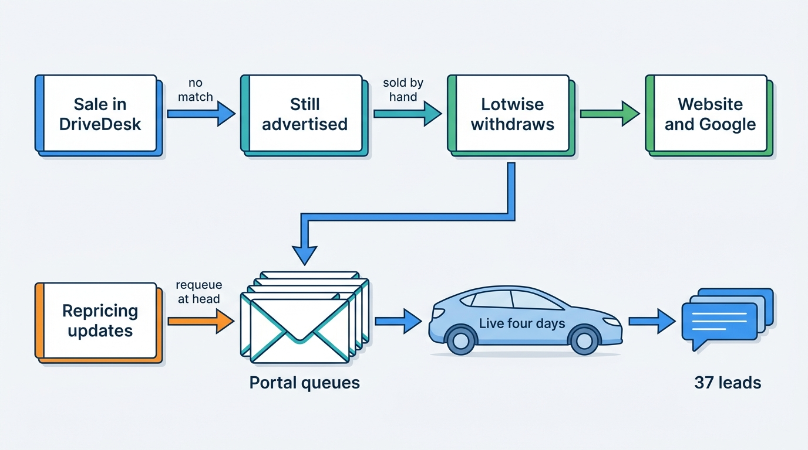
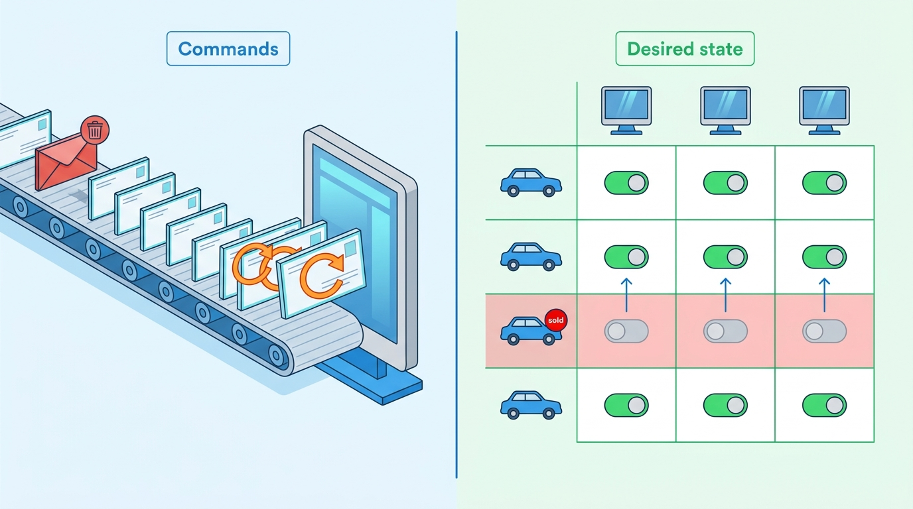
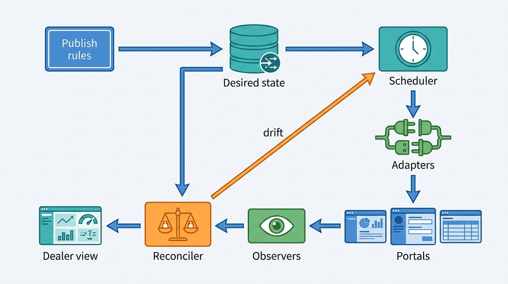
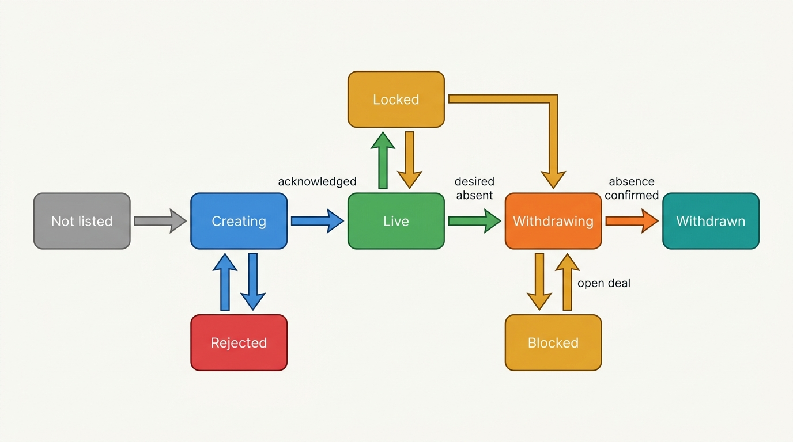
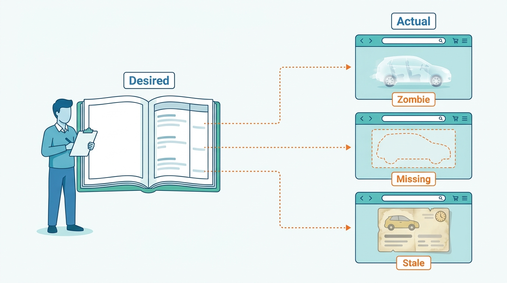

> **IN THIS CHAPTER, YOU WILL:** Take apart a syndication engine: the channel listing as its unit, desired state as its contract, the publish queue and the adapters that carry it out, withdrawal as a saga, reconciliation against what each portal shows, and the work of running sixty adapters as products.

> **WHY THE BUSINESS CARES:** A dealer pays a portal for every car it advertises and loses a buyer's trust for every car it advertises that is already sold. A car that goes live a day late loses a day of its turn, and a car that stays live after its sale produces leads that end in an apology. A dealer group judges its software vendor on both.

> **WHY ARCHITECTS SHOULD CARE:** Syndication is the platform's widest write fan-out into systems it does not control: sixty contracts, sixty failure modes and no shared transaction. Whether the design sends commands or converges on state decides whether a retry, an outage or a lost message is harmless or creates a zombie listing.

> **KEY POINTS:**
>
> * **Publish desired state, not commands.** A queue of inserts, updates and deletes forgets what it was trying to achieve once one message fails. A desired-state record per car and channel, which adapters converge the portal toward, makes retries, outages and replays safe, and lets a newer intent replace an older one instead of waiting behind it.
> * **Withdrawal is the operation that matters most, and it is a saga.** Portals model "the car is gone" in different ways, some refuse it while a deal is open, and some change state on their own. Give withdrawals their own priority lane, a deadline per channel and an alert on any sold car still live, and guard against the opposite failure: a truncated feed that withdraws a whole rooftop.
> * **What you sent is not what the portal shows.** Dealers edit listings on the portal, portals lock, enrich, expire and restore them, and push channels drop messages. Only a reconciler that reads each portal's actual state back and compares it with the desired state can say what the dealer's stock looks like on the market. Run each adapter as a product with a contract, an owner and per-channel health metrics.

> **[FAILURE PATTERNS THIS CHAPTER ADDRESSES](where-vehicle-platforms-go-wrong.html):**
>
> * **The Zombie Listing** — the Zombie Golf stayed live on four portals for four days because its delete was a fire-and-forget message queued behind failing updates, and nothing compared Relay's view with the portals'.
> * **Feed Roulette** — sixty adapters without contracts, error classification or per-channel monitoring mean a portal's changelog entry is discovered by a dealer whose cars did not go live.
> * **Borrowed Uptime** — when one channel's failures block the queue other channels share, a single portal's outage or rule change stops a rooftop's whole advertising.

 
A dealer enters a car once. Within the hour it should appear, correct and complete, on every portal the dealer pays for: Marktplaats and AutoScout24 in the Netherlands, mobile.de in Germany, Auto Trader in the United Kingdom, Google vehicle ads, the dealer's own website. When the price changes it should change everywhere. When the car is sold it should disappear everywhere, quickly, because every hour it stays visible produces enquiries the dealer can only disappoint. **Listing syndication** is the capability that does this: publishing one dealer's stock to many advertising channels and keeping each copy in step with the stock record.

It looks like an export job. It is not. Each portal has its own format, identity keys, update and delete semantics, rate limits and mandatory fields per country. Portals also write: dealers edit listings there, fraud systems switch them off, portals enrich and expire them. **A syndication engine is a distributed system whose remote nodes belong to sixty other companies.**

This chapter owns the **channel listing**, the **publish queue**, **desired-state sync** and the **channel adapter**. It builds on the stock record and its lifecycle from [[inventory-and-vehicle-dossier]] and on the advert content from [[merchandising]], and hands the leads that adverts produce to [[leads-and-crm]]. The end-to-end flow from trade-in to live advert is walked in [[journey-inventory-to-portal]].

## Setting the Scene at Axleby: The Zombie Golf

Axleby, the fictional vehicle data and dealer software group this book follows (see [[meet-axleby]]), runs syndication for its Lotwise rooftops through **Relay**: a channel publish queue inside the Lotwise Classic monolith (RabbitMQ) and **61** channel adapters written as Go services. In 2026 Relay carried about **1.4 million channel operations a day** (inserts, updates and deletes) for about **352,000** cars in stock, each advertised on **5.3** channels on average. Lotwise sells the capability as the Syndication module at **€129 per rooftop per month**, with unlimited channels.

On **Thursday 11 February 2027**, the Breda rooftop of **Velto Mobility Group** (46 rooftops in the Netherlands and Belgium, with DriveDesk as its dealer management system, or DMS) sold a 2021 Volkswagen Golf. The salesperson recorded the sale in DriveDesk at 15:10. What followed took four days and two independent faults to undo.

**The first fault was in the DMS sync.** Three weeks earlier, Velto had moved the Golf from its Tilburg rooftop to Breda, and DriveDesk had given it a new stock number. Lotwise's DriveDesk adapter matched rows by that number, so the sold row matched no Lotwise stock item and went to an error file that nobody read ([[dms-integration]] tells that part). The Golf stayed "advertised" in Lotwise until Friday at 09:30, when Breda's sales administrator, preparing the delivery, marked it sold in Lotwise by hand. Lotwise withdrew the car from all six of its channels. Two withdrawals went through at once: the Velto website, which reads Lotwise directly, and the Google vehicle ads feed, which is rebuilt from a snapshot.

**The second fault was in Relay.** The other four channels were portals: Marktplaats, 2dehands, AutoScout24 and a regional Dutch portal. Relay's queues were keyed by rooftop and channel, and consumed in order. On Thursday afternoon Velto's group pricing desk had repriced 2,300 cars. On the same day an update to Axleby's equipment catalog had introduced a new canonical code for adaptive cruise control that none of the four portal mappings knew. Every update for a Breda car with that option threw a mapping exception, which the adapter treated as transient and requeued. RabbitMQ's documentation says what happens next: a requeued message "will be placed to its original position in its queue, if possible", and consumers that keep requeueing "will create a requeue/redelivery loop" ([RabbitMQ, n.d.](https://www.rabbitmq.com/docs/confirms)). Dozens of failing updates sat at the head of each of the four Breda queues. The Golf's delete sat behind them.

Nobody noticed over the weekend. Queue depth was monitored per RabbitMQ node, not per rooftop and channel, and a few thousand messages in a node that handled a million a day did not alert. On **Monday 15 February** at 10:40, the Breda sales manager escalated after the third buyer who arrived for a test drive learned that the car had been sold. Hendrik Maes's integrations team found the loop, parked the failing updates and drained the queues; the deletes reached the four portals by 15:30.

By then the Golf had been live on **4** portals for **4 days** after its sale. It had produced **37** leads and **9** booked test drives.

**Figure 1:** *The Zombie Golf needed two faults: a sold row the DMS adapter could not match, and a delete stuck behind updates that could never succeed. Either fault alone would have cost hours, not days.*

Ines Marchetti, Axleby's Group Chief Architect, left the mapping fix to Hendrik's team and asked three architectural questions. Why could a delete wait behind an update for a different car? Why did a message that could never succeed count as transient? And why did Relay, which had sent every one of those messages, have no idea what the four portals were showing? The rest of this chapter answers them.

## Concepts: Channels, Listings and Desired State

### The channel and the channel listing

A **channel** is one destination where a dealer's stock is advertised under one contract: a portal in one country (mobile.de, AutoScout24.nl, Auto Trader UK), a general classifieds site's car category (Marktplaats, 2dehands), an advertising catalog (Google vehicle ads, a Meta automotive catalog), a dealer website, or a B2B exchange. A channel is defined by its contract, not by its brand. Marktplaats and 2dehands share one API, but "an ad can only be placed on the platform whose URL is used", so they are two channels ([Marktplaats API documentation, n.d., © 2023](https://api.marktplaats.nl/docs/v1/overview.html)).

A **channel listing** is one car on one channel: the pairing of a stock item from the dossier ([[inventory-and-vehicle-dossier]] owns the stock item) with a channel, plus the identifiers both sides use for it, the content last sent, and the state the channel reports. It is the unit of syndication. The Zombie Golf was one stock item with six channel listings, two of which behaved and four of which did not.

The channel listing carries three identifiers, and losing any one of them is how duplicates and orphans start:

| Identifier | Who assigns it | Example | What it is for |
| --- | --- | --- | --- |
| **Platform listing key** | The dealer platform | Lotwise stock id plus channel id | The platform's own join; written into the portal's external-id field |
| **Portal listing id** | The portal | mobile.de `mobileAdId`; AutoScout24 listing UUID; Auto Trader `stockId` | Addressing updates and deletes; reading status back |
| **Creation key** | The dealer platform, once per creation attempt | mobile.de `X-Mobile-Insertion-Request-Id` | Making a retried create safe |

Portals provide an external-id field for the first: mobile.de's seller key `internalNumber` (up to 40 characters, unique per seller), AutoScout24's `offerReferenceId` and hidden `crossReferenceId`, and Auto Trader's `externalStockId` (200 characters) ([mobile.de Seller API, n.d.](https://services.mobile.de/manual/seller-api.html); [AutoScout24 Listing Creation API, n.d.](https://listing-creation.api.autoscout24.com/docs); [Autotrader Connect, n.d.](https://developers.autotrader.co.uk/documentation)).

### Desired state versus commands

**Command semantics** sends operations: create this listing, set this price, delete this listing. The queue holds the operations, and the portal's state is whatever the sequence of successful operations produced. Relay was built this way, as most syndication engines start, because it maps directly onto POST, PATCH and DELETE.

**Desired-state semantics** stores what each channel listing should look like now: present or absent, and if present, with which content. An adapter compares that desired state with what it last knows the portal holds and issues whatever calls close the gap. If a newer desired state arrives before the old one was applied, the adapter applies the newer one and skips the old. Kubernetes controllers, BOOKED's channel managers in reverse ([[connectivity-and-channel-managers]]) and every good file-feed generator work this way.

| Question | Command semantics | Desired-state semantics |
| --- | --- | --- |
| What does the queue hold? | Operations, in order | A pointer: "this channel listing needs attention" |
| What happens to an old update when a newer one arrives? | Both are sent, in order | The old one is replaced; only the latest is sent |
| What does a retry do? | Re-sends the same operation, which may not be idempotent | Recomputes the gap and sends what is still missing |
| What does an outage leave behind? | A backlog to replay in order | A set of listings marked out of step; catch-up sends current state |
| Can the platform answer "what should the portal show"? | Only by replaying the log | Yes, from the desired-state record |
| What must the adapter know? | How to translate one operation | The portal's current state and how to move it |

The Zombie Golf delete was a command waiting its turn. Under desired-state semantics, the Golf's four channel listings would have become "absent" and needed attention, independent of any other car's updates.

**Figure 2:** *A command queue makes a withdrawal wait behind unrelated failures; desired state marks each car on each channel absent on its own.*

### Who else writes the listing

A channel listing has more writers than the platform. AutoScout24's API FAQ answers the question "Do other systems update listings?" with "Yes", and names dealers editing manually, customer care, the fraud system activating or deactivating listings, and phishing: "If a dealer gets phished, all their listings get deleted. If the dealer gets reactivated and requests to restore their listings, suddenly all listings reappear" ([AutoScout24 FAQ, n.d.](https://listing-creation.api.autoscout24.com/assets/docs/faq.md)). Portals also give dealers locks against their own software. AutoScout24's `overwriteProtection` means changes are possible "only … using the dealers My Area on the website"; mobile.de's `uploadSticky` rejects Seller API changes with `ad-only-modifiable-in-dealer-area`. Marktplaats enriches car ads from the plate after posting; Auto Trader moves stock between lifecycle states on its own timers.

So the **actual state**, what the portal shows now, can differ from the desired state for reasons the platform did not cause. The design needs a way to observe it, a rule for which writer wins per field, and a way to tell the dealer.

## The Channel Landscape: Four Kinds of Contract

A syndication engine for European and US markets meets four kinds of channel, and they need different adapters.

| Kind | Examples (as documented in 2024–26) | Write model | How you learn actual state |
| --- | --- | --- | --- |
| **Portal write API** | mobile.de Seller API; AutoScout24 Listing Creation API; Auto Trader Connect Stock API; Marktplaats/2dehands API | Per-listing REST calls, each with its own update and delete semantics | Change streams (mobile.de Ad Stream WebSocket), webhooks (Auto Trader Stock Notifications), list endpoints |
| **File feed** | US portals through inventory-management providers; legacy FTP uploads | Full snapshot of the rooftop's stock, generated on a schedule | Usually none; sometimes an error report |
| **Ad catalog** | Google vehicle ads (Merchant Center); Meta automotive catalog | Catalog items in a file, sheet or API; availability flags | Diagnostics in the ad tool |
| **Portal as syndicator** | AutoScout24 `mobile_de` and `AutoTrack` channels; Auto Trader `exportAdvert` | A flag on a listing in another channel | Through the first portal, if at all |

The first kind dominates in Germany, the Netherlands, Belgium and the UK. mobile.de grants Seller API access to **Transfer Service Providers** (TSPs, the DMS and inventory-tool vendors that upload for dealers) and to self-uploading dealers, and asks TSPs serving more than ten customers for contacts, VAT number and customer numbers before granting access. No major US portal publishes a write API in public; CarGurus's FY2025 annual report lists its sources as "inventory management systems, automotive website providers, customer relationship management systems, dealer management systems" and others ([CarGurus Form 10-K, filed 2026-02-19](https://www.sec.gov/Archives/edgar/data/1494259/000119312526059435/carg-20251231.htm)). A platform serving both sides of the Atlantic needs both adapter styles.

The fourth kind is new enough to catch platforms out. AutoScout24 added `mobile_de` as a publication channel on 2022-11-28, so a listing sent to AutoScout24 can be exported to its German competitor; its `ChannelId` values also include `AutoTrack` and `AutoTrackShared` for a listing "displayed on both platforms" after AutoScout24 took over AutoTrack and Gaspedaal.nl, which Emerce reported on 28 November 2025 ([Emerce, 2025](https://www.emerce.nl/nieuws/autotrack-gaspedaalnl-onderdeel-autoscout24)). Germany's competition authority recorded in its October 2026 clearance of the mobile.de/Carwow transaction that dealers "often use several platforms in parallel" and that "many platforms also offer dealers a data export to other platforms" (translated from German) ([Bundeskartellamt, 2026](https://www.bundeskartellamt.de/SharedDocs/Meldung/DE/Pressemitteilungen/2026/10_08_2026_mobile_carwow.html)). A dealer platform that publishes to AutoScout24 with the `mobile_de` flag and to mobile.de directly creates a duplicate it did not intend. **The channel model needs a "reached via" relation**, so the dealer makes one decision per destination.

## Architecture: Converge, Do Not Command

A desired-state engine has six parts; the stock record and advert content are its inputs.

**Figure 3:** *Desired-state syndication. Publish rules turn stock and advert changes into a desired state per channel listing; the scheduler hands listings, not operations, to adapters; observers and a reconciler compare what each portal shows with what it should show, and feed the gap back into the same loop.*

| Component | Owns | Does not own |
| --- | --- | --- |
| **Publish rules** | Which cars go to which channels, when, with which price and content variant | The car's facts, price or photos |
| **Pre-publish validation** | Each channel's mandatory fields, regulatory rules and policy rules, evaluated before sending | Fixing the content (that is [[merchandising]]) |
| **Desired-state store** | One record per channel listing: present or absent, content version, deadline, three identifiers, last acknowledged version, last error | The portal's actual state |
| **Scheduler (the publish queue)** | Which channel listings need attention, in which priority, within each channel's rate budget | What to send |
| **Channel adapter** | Translation to one channel's contract, its idempotency, its error classification, its observers | Business rules about which cars to publish |
| **Reconciler** | The comparison of desired and actual state, drift classification, repair and alerts | Overruling a portal lock or a dealer's edit on the portal |

### Publish rules and validation

**Publish rules** decide the desired state. A rule is evaluated per rooftop, channel and car: "all ready stock to Marktplaats", "only cars older than 30 days to Auto Trader", "nothing under €3,000 to Google vehicle ads", "group stock to the hub's AutoScout24 account". The stock lifecycle drives the rest: a car becomes eligible when it reaches *ready* (or earlier, in preparation, if the dealer's rules allow early adverts) and must become absent on every channel when it reaches *reserved*, *sold* or *written off* ([[inventory-and-vehicle-dossier]] owns the lifecycle).

Publish rules are a dealer's commercial lever. When UK dealers protested Auto Trader's Deal Builder rollout and price rises in November 2025, they did it through what they syndicated. Auto Trader's FY26 results say that "From November 2025 … a number of retailers reduced the number of vehicles advertised on the platform", which cost £48 of average revenue per retailer ([Auto Trader Group, 2026](https://plc.autotrader.co.uk/media/usjleen0/full-year-press-release-fy26.pdf)). A dealer who wants to move from seventy cars on a portal to seven needs that change to take effect in minutes and to be reversible, which only works if the rules are data the engine re-evaluates.

**Pre-publish validation** runs each channel's rules on the desired content and tells the dealer before sending why a car will not go live on a channel. The rules change on the portals' schedules. AutoScout24 announced on 2026-05-14 that from 2026-06-01 Belgian dealers' used-car listings must carry `belgianCarpassMileageUrl`, a link to the car's Car-Pass mileage certificate, and that requests without it get HTTP 400 `missing-belgian-carpass-mileage-url` ([AutoScout24 changelog, 2026](https://listing-creation.api.autoscout24.com/docs)). Seventeen days' notice is normal. Validation is where the platform turns a portal's 400 into a dealer's to-do item.

### The desired-state store and the scheduler

The desired-state record is small: the channel listing's key, the desired presence, a content version (a hash of the rendered channel payload), a deadline, the three identifiers, the last version the portal acknowledged, the last error and its class. Writing it is cheap and idempotent: a price change that produces the same content hash as the last acknowledged version is a no-op.

The **scheduler** replaces the old publish queue. It holds no payloads, only channel-listing keys with a priority and a not-before time. Three rules do most of the work:

1. **Serialize per channel listing, parallelize across them.** Only one call for a given car on a given channel is in flight at a time. mobile.de says it plainly: "Do not send multiple requests for the same ad at the same time." Calls for different cars proceed in parallel within the channel's budget. The Zombie Golf's delete waited because Relay serialized per *rooftop*; a fault in one car blocked forty-nine others.
2. **Coalesce.** If a car's desired state changes three times while its previous call is in flight, the adapter sends the latest state once. Repricing runs, photo reorders and description edits arrive in bursts; coalescing is the main reason desired-state engines send fewer calls than command engines for the same stock.
3. **Prioritize by consequence.** Withdrawals go first, then price changes, then new listings, then content edits. A withdrawal has a deadline in minutes; a description edit can wait an hour.

The scheduler can sit on Kafka, on a table polled with `SKIP LOCKED`, or on any queue with per-key ordering; the key matters more than the technology. **Key by channel listing, never by rooftop or dealer.**

### The channel adapter

Each adapter is the only code that knows one channel's contract. Its interface to the rest of the engine is narrow: *converge this channel listing to this desired state and tell me what happened*, plus *tell me what the channel currently shows for this rooftop*. Behind that interface it handles four concerns that differ by channel, plus withdrawal (next section).

**Create idempotency.** A create that times out leaves the platform not knowing whether the listing exists. mobile.de solves it with a header: the client sends `X-Mobile-Insertion-Request-Id` (up to 100 characters, "unique per each ad creation"), and a retry with the same id returns HTTP 303 with a `Location` header pointing to the existing ad. AutoScout24 documents POST as not idempotent and warns: "If you encounter a 500 when fetching listings, do not assume that the listing does not exist. Assuming those listings do not exist and creating them can lead to duplicates" ([AutoScout24 error handling, n.d.](https://listing-creation.api.autoscout24.com/assets/docs/error_handling.md)). The adapter therefore persists the creation key before the call and, where the portal offers none, treats "unknown" as a state of its own: it looks the listing up by the platform's external id before creating again.

**Update semantics.** mobile.de's PUT requires "the complete ad with all fields". AutoScout24 supports PATCH but documents fields "not supported by the PATCH API" where the "existing value gets removed, patched value is ignored", among them `financingOffer` and `leasingOffers`; a PATCH can silently delete a financing offer. Auto Trader treats list fields as replace-only: "the complete list should be sent in the request, you cannot add or remove individual items from the list in isolation". The rule I use: **send full desired state by default, and use PATCH only as a per-channel optimization with an explicit allow-list of fields the adapter has tested.**

**Error classification.** Every response falls into one of four classes, and the class decides what the scheduler does:

| Class | Examples | Scheduler action |
| --- | --- | --- |
| **Transient** | Timeouts, 5xx, connection resets | Retry with exponential backoff and jitter; the channel listing keeps its place among others |
| **Throttled** | HTTP 429, a reputation-based 403 at Auto Trader | Slow the whole channel's token bucket; do not retry the single call faster |
| **Permanent for this content** | HTTP 400 validation errors, unknown equipment code, missing Car-Pass URL | Stop; mark the channel listing *rejected* with a reason the dealer can act on; retry only when the desired content changes |
| **Locked or blocked** | `ad-only-modifiable-in-dealer-area`; Auto Trader deal holding a reservation | Stop; mark *locked* or *blocked*; show the dealer; reconcile later |

The Zombie Golf's updates were permanent errors classified as transient. A mapping exception is never transient: the same input will throw again.

**Rate budget.** Each channel has its own token bucket and ramp-up. AutoScout24 returns 429 and advises against "sending requests in big batches"; where batches are unavoidable, it suggests a "5 to 10 minutes timeframe to ramp up your batch jobs from 0 to maximum capacity"; for 5xx and timeouts it says to retry at least three times with exponential backoff and jitter. CarGurus described in 2023 how one advertising API escalated its back-off from 15 seconds to 15 minutes under concurrent load, and how one actor per external service brought "rate limit escalations to almost none" ([CarGurus Revved, 2023](https://cargurus.dev/2023/07/19/actor-pattern-controlling-connection-pool-in-kotlin-to-honor-api-rate-limit-exceptions/)). The scheduler applies **backpressure** by withholding work from an adapter whose budget is spent, keeping a reserved share for withdrawals.

### Withdrawal as a saga

Removing a car is the operation dealers judge the platform by, and portals make it hard:

| Channel | What "the car is gone" means (as documented) |
| --- | --- |
| **mobile.de** | DELETE removes the ad; "All associated images will be purged as well" |
| **AutoScout24** | DELETE; images of the deleted listing are deleted |
| **Auto Trader** | Lifecycle states `DUE_IN`, `FORECOURT`, `SALE_IN_PROGRESS`, `SOLD`, `WASTEBIN`, `DELETED`; "all advert destinations should be first updated to NOT_PUBLISHED" before setting the later states; partners are "prohibited from updating the lifecycleState once the reservationDealId is present" |
| **Marktplaats** | A `closeDate` on the advertisement |
| **Meta catalog** | `availability` set to `not_available`, or `status` archived |
| **Snapshot feeds** | Absence from the next file |

Sources: the portals' API documentation as listed in Sources and Evidence; Auto Trader's lifecycle rules from [Autotrader Connect, n.d.](https://developers.autotrader.co.uk/documentation).

So a withdrawal is a **saga**: a sequence of steps per channel with its own deadline, its own blockers and its own compensation. On Auto Trader it is "unpublish all destinations, wait for acknowledgement, then move to `SOLD`", and it can be blocked by a reservation the buyer made on Auto Trader itself, in which case the right move is the reverse: ingest the reservation as an event and withdraw the car from every *other* channel. On a snapshot feed it is "leave the car out of the next file and confirm the next file was accepted".

**Figure 4:** *The channel listing's actual-state machine. "Withdrawn" means the portal confirmed absence, not that a delete was sent; "Blocked" and "Locked" are states the dealer sees, not errors the engine retries.*

Two guards belong in the saga. The first is a **deadline alarm**: any car whose stock state is *sold* or *reserved* and whose channel listing is not *Withdrawn* after a set time raises an alert to the integrations on-call and, if it persists, to the dealer. The second guards the opposite failure. A DMS that sends a truncated stock file looks like a dealer who sold everything. Google's now-discontinued vehicle listings feed blocked any feed that would "reduce the total inventory by more than 30%" ([Google for Developers, 2024](https://developers.google.com/vehicle-listings/integration-process/feed-setup)), the clearest published version of a **mass-withdrawal guard**. A syndication engine should pause and ask a human when one input would withdraw more than a threshold share of a rooftop's live listings.

One thing the saga never does is delete and re-create to apply a change. mobile.de notes that this yields a "new ad placement"; it also destroys the portal's price history and days-on-market for the car.

### Observing actual state and reconciling

The platform cannot know what the portal shows from what it sent. It learns it in three ways, in rising order of reliability:

1. **Responses to its own calls**, which say what the portal accepted, not what it shows an hour later.
2. **Push channels.** mobile.de's Ad Stream is a WebSocket feed of listing events; reconnecting with `catchup=true` replays events from the last disconnect, retained for 24 hours ([mobile.de Ad Stream, n.d.](https://services.mobile.de/manual/ad-stream.html)). Auto Trader's Stock Notifications are signed webhooks retried 10 seconds, 30 seconds and 30 minutes after a failure; Auto Trader warns that delivery "is tracked on a per message basis" and that receivers interested in the latest state "should store and use the time field in the message to decide if it's relevant or has been superseded". Its `stockEventSource` field shows when a change came from the dealer's own portal account.
3. **Reads of the portal's listings**: Auto Trader's stock search (up to 200 results per page), AutoScout24's listing endpoint with `include=overwriteProtection` (added 2026-09-03), mobile.de's seller ads.

Push is fast but lossy: Auto Trader's retry window ends about half an hour after the first failure, and Ad Stream keeps one day. Many channels offer less: of Axleby's 61, only **19** confirm state by callback or status API, **25** accept a call and process it later without telling, and **17** are file feeds with no status at all ([[observability-and-data-operations]]). **Every push subscription needs a periodic pull behind it.** The **reconciler** reads each rooftop's listings per channel on a schedule, matches them to channel listings by portal id or external id, and classifies every difference:

| Drift | Example | Repair |
| --- | --- | --- |
| **Zombie** | Desired absent, portal shows live | Re-mark for withdrawal at top priority; alert if past deadline |
| **Missing** | Desired present, portal shows nothing | Re-mark for creation; check for a portal-side deletion first (fraud, phishing) |
| **Stale** | Content version on portal older than desired | Re-mark for update |
| **Orphan** | Portal listing carries no known external id | Match by vehicle identity; adopt, or flag as a possible duplicate |
| **Foreign edit** | Dealer changed price on the portal | Apply the field-ownership rule: overwrite, adopt or flag |
| **Locked** | Overwrite protection on | Mark *Locked*; stop writing; show the dealer |

Reconciliation is cheap compared with publishing. At Axleby's volumes, 352,000 cars on 5.3 channels each are about 1.87 million channel listings; reading them all once a day at 100 per page is under 19,000 list calls, against 1.4 million write operations. The hard part is the **field-ownership rules**: which system wins per field when platform and portal disagree. Record them per channel; default to the platform for what the dealer entered and to the portal for what it derived (quality seals, plate enrichment).

**Figure 5:** *Only reading back what each portal shows reveals zombies, missing listings and stale content; at Axleby's volumes a daily read is under 19,000 list calls.*

### Mapping vehicles, equipment and images

Three translations fail most often.

**Make, model and equipment codes.** mobile.de takes enumerated values from its reference-data endpoints. AutoScout24 takes equipment as **integer IDs** with exclusion rules ("only allowed to send one Automatic Climate Control equipment for a given listing"), replaced `schwackeCode` with `natCode` on 2024-06-13, made reference values marketplace-specific from 2025-02-19, and on **2026-10-19** changed localized names with the warning: "Data providers using reference names to map IDs should review and update their mappings." Auto Trader added manufacturer `factoryCodes` to features from 14 July 2025. The design that survives this is **one canonical equipment model** — option code to normalized feature to per-channel code, keyed by identifiers and never by display names — owned with the specification catalog ([[specification-and-equipment]]), with versioned per-channel mapping tables and a test that fails the build when a canonical code has no mapping for a channel that needs one. The Zombie Golf's adaptive cruise control code would have failed that test on Thursday morning instead of in production.

**Images.** AutoScout24 returns an MD5 of each original so clients can skip re-uploads; Google vehicle ads take at most eleven images and forbid watermarks and overlays. Keep **one master image set** with content hashes ([[merchandising]] owns the media pipeline), derive per-channel renditions at publish time, and upload only what changed.

**Vehicle identity.** Google disapproves offers when "a VIN is submitted for more than one vehicle offer". After an inter-branch transfer, two rooftops of one group can hold the same car, so deduplicate on vehicle identity across the group before syndication ([[vehicle-identity]] owns the key).

### Requirements per interaction

| Interaction | Consistency | Latency target | Freshness of actual state | Availability need |
| --- | --- | --- | --- | --- |
| Car sold or reserved → absent on all channels | Must converge; no lost withdrawal | 99% confirmed within 10 minutes; alert at 30 minutes | Confirmed by read-back within 1 hour | Highest; reserved budget share |
| Price change → all channels | Latest value wins; intermediate values may be skipped | 95% confirmed within 15 minutes | Daily reconciliation, sampled hourly | High |
| New car → live with photos | Exactly one listing per channel | p95 under 30 minutes after *ready* | Confirmed on creation | Medium; may queue during an outage |
| Content edit (description, equipment) | Latest wins | Within 1 hour | Daily | Medium |
| Portal edit or lock → platform aware | Eventually consistent | Within 1 hour (push) or 1 day (pull) | — | Low |
| Mass change (repricing, publish-rule change) | Ordered per car, not across cars | Spread over ramp-up window | — | Must not starve withdrawals |

The withdrawal and price targets are Axleby's 2027 targets; the other rows are illustrative assumptions.

## In Practice: Axleby Rebuilds Relay

Ines's review of the Zombie Golf split the response into what could ship in weeks and what belonged to the One Dossier program approved in March 2027, whose Year 2–3 scope includes "Relay rebuilt as desired-state sync with reconciliation".

**2027: fixing the old Relay.** In February Hendrik Maes's team fixed the equipment mapping and added a build-time test that fails when a canonical code has no mapping for a channel. That removed the trigger, not the mechanism. When Axleby's publish-lag dashboard went live on **7 June 2027** ([[observability-and-data-operations]] owns it), it measured withdrawal lag at the 99th percentile at **6 hours 20 minutes**, for the Zombie Golf's reason: per-rooftop ordering behind failing updates. Over the summer the team changed three things inside the old Relay. Mapping and validation exceptions now park the message, without requeue, with the reason written to the advert's channel status in Lotwise. Withdrawals got their own **priority lane**, and operations were ordered per advert instead of per rooftop. And a **sold-but-live** job every 15 minutes pages the integrations on-call for any car sold or reserved more than 30 minutes ago that is not withdrawn everywhere. By September the withdrawal p99 was **14 minutes**, against the target of 99% within 10 minutes.

**The first reconciliation run.** In spring 2027 the team ran a read-only reconciler once for the three largest Dutch channels across all Lotwise rooftops. It found **2,940** listings live on those portals for cars that were sold, reserved or withdrawn in Lotwise, about **0.4%** of the listings on those channels, and **1,610** cars that Lotwise showed as published but that the portals did not show at all. Most zombies were weeks old and had never produced a complaint; most missing listings had failed creation with errors Relay logged and nobody read. *(Axleby illustration.)*

**The rebuild (2028).** Relay 2 follows Figure 3. Lotwise Classic writes stock and advert changes to an outbox in the same transaction as the change, relayed to Amazon MSK keyed by stock item ([[events-webhooks-and-sync]] owns the outbox and event design). A new Relay service holds publish rules, the desired-state store (Aurora PostgreSQL) and the scheduler; the 61 Go adapters keep their translation code but lose their queue, and gain a common interface for *converge* and *observe*. Replaying a week of 2026 operations through a coalescing simulator showed that about **a third** of Relay's updates were superseded by a newer update for the same channel listing within ten minutes, mostly from repricing runs and photo reordering; desired-state publishing would send roughly a million operations a day instead of 1.4 million. *(Axleby illustration.)*

**Showroomly.** Axleby's UK product syndicates from its own Rails code, with Auto Trader's lifecycle states and deal locks already modeled. Moving it onto shared syndication is a Year 2–3 deliverable; Callum Reid's condition, now part of the Relay 2 adapter interface, was that a portal reservation arrives as an event that withdraws the car from every other channel.

**Success measures.** Ines set four, each per channel and per rooftop: sold-but-live listings older than 30 minutes (target: zero), withdrawal lag at p99, the share of channel listings in drift at each reconciliation run, and the share of channel listings in *Rejected* with a reason older than 24 hours.

## Channel Adapters as Products

Sixty-one adapters are sixty-one small integration products, each depending on a contract that changes on someone else's calendar. How they are run decides whether the engine fails loudly or quietly.

**A contract per adapter.** Each adapter has a written channel profile: supported operations (create, full update, PATCH allow-list, delete, lifecycle), identity fields, idempotency mechanism, withdrawal saga, error-class mapping per response code, rate budget and ramp-up, push and pull observers, field-ownership rules, mandatory fields per market and the mapping-table versions it depends on. The [[toolkit]] carries a channel adapter contract template. A profile that cannot be filled in for a channel is a channel the platform should not sell as supported.

**An owner and a changelog watcher.** Portals publish breaking changes in changelogs: AutoScout24 removed the `autoproff_marketplace_internal` channel on 2025-12-17, after which requests with it fail with HTTP 400; a 2024-era Auto Trader release note ended partners' ability to set a lead's status to `NEW_MESSAGE`. Someone must read every channel's changelog weekly and turn entries into dated tickets; at Axleby, each of the top ten channels has a named engineer in Hendrik Maes's team. [[organizing-engineering]] discusses where adapter ownership belongs.

**Certification and test accounts.** Portals gate access (mobile.de's TSP onboarding, Marktplaats's "Car Dealer API partner" configuration). Keep a test rooftop on every channel that supports one and run a synthetic car through create, price change and withdrawal every hour. It is the cheapest monitor of a portal's contract.

**Per-channel health, per rooftop.** Aggregates hid the Zombie Golf. Track convergence latency by operation, errors by class, listings in *Rejected*, *Locked* and *Blocked*, drift and sold-but-live count, each drillable to rooftop. [[observability-and-data-operations]] covers how to carry tenant and channel tags without a metrics cardinality bill.

**Build, buy or partner per channel.** Not every adapter must be Axleby's. For long-tail channels with small volumes, a multi-posting aggregator or the portal-as-syndicator route (AutoScout24's export to AutoTrack) may be cheaper. The cost is control: the platform loses read-back, error detail and reconciliation. I would keep adapters in-house for every channel that carries more than a few percent of a market's leads and accept intermediaries only where the channel profile can still be filled in. [[build-buy-or-partner]] has the general decision card.

## Failure Handling

| Failure | Detection | Recovery |
| --- | --- | --- |
| **Create retried after a timeout** creates a duplicate | Orphan listings in reconciliation; same external id twice | Use the portal's creation key where it exists (mobile.de); otherwise look up by external id before re-creating; delete the newer duplicate, keep the one with history |
| **Duplicate across channels** via a portal-as-syndicator export | Same VIN on a portal from two sources; dealer complaint | Model "reached via"; publish to the destination directly or via the syndicator, never both |
| **Duplicate across rooftops** after a group transfer | Two stock items with one VIN in one group | One owning rooftop per channel listing |
| **Conflicting update**: dealer edits price on the portal | Push notification with a non-platform source; stale or foreign-edit drift | Apply the field-ownership rule; show the dealer which value is live where |
| **Concurrent writes** for one car on one channel | Lost update, version mismatch | Serialize per channel listing; send full desired state |
| **Incomplete record**: missing mandatory field | Pre-publish validation; HTTP 400 | Mark *Rejected* with a reason the dealer can fix; retry only on content change |
| **Unknown code** in a mapping table | Build-time mapping test; permanent error class | Block release of the catalog change until mapped; never retry |
| **Partial failure**: one image of twelve fails | Adapter result; AutoScout24 cancels the whole call | Retry the whole convergence once the image is available; do not publish a half-updated listing |
| **Portal throttling** | 429s; rising latency | Slow the channel's token bucket; keep the withdrawal reservation |
| **Portal outage** | Error rate, synthetic car failure | Open the channel's circuit; desired state keeps accumulating; on recovery, converge current state rather than replaying history; tell dealers which channel is affected |
| **Missed push event** | Reconciliation finds stale actual state | Periodic pull behind every push subscription |
| **Portal-side withdrawal or restore** (fraud, phishing, auto-expiry) | Missing or orphan drift | Do not re-create blindly; check the portal reason; tell the dealer |
| **Truncated DMS feed** would withdraw a rooftop | Mass-withdrawal guard | Pause withdrawals above threshold; human confirmation ([[dms-integration]]) |
| **Withdrawal blocked** by a portal deal | *Blocked* state | Treat the portal's reservation as a stock event; withdraw from all other channels |

Retry in one place, the scheduler, not also in the HTTP client and the queue consumer; stacked retries multiply load on a portal exactly when it struggles. Amazon's guidance is that "our best practice is to retry at a single point in the stack" ([Amazon Builders' Library, 2019](https://aws.amazon.com/builders-library/timeouts-retries-and-backoff-with-jitter/)).

An outage is where desired state pays for itself. After a six-hour portal outage, a command queue replays every change in order, into the portal's own recovery. A desired-state scheduler accumulates a set of channel listings marked out of step, and on recovery sends each one's current state once, withdrawals first. The other 60 channels never noticed, because no channel's failures share a queue with another's. That is the cure for Borrowed Uptime in syndication.

## Trade-offs

| Decision | Option A | Option B | When A is right | When B is right |
| --- | --- | --- | --- | --- |
| **Sync semantics** | Command queue (insert, update, delete in order) | Desired state with convergence | Few channels, low volume, all with idempotent upserts and reliable deletes | Many channels, bursts of change, unreliable channels, any need to know what the portal should show (almost always) |
| **Queue key** | Per rooftop or dealer | Per channel listing | Never for writes; acceptable for batch file generation | Always for API channels |
| **Update payload** | PATCH of changed fields | Full desired state | Portal PATCH is documented lossless for the fields sent, and payloads are large | Default; mandatory where PATCH is lossy (AutoScout24 financing fields) or lists are replace-only (Auto Trader) |
| **Actual state** | Trust call responses and push | Push plus periodic pull and reconciliation | Never on its own | Always; pull frequency by channel volume |
| **Feed style** | Per-listing API | Full snapshot file | Portal offers an API; change volume is high; latency matters | US portals via providers; ad catalogs; channels with no API; with a mass-withdrawal guard |
| **Adapter sourcing** | In-house adapter | Aggregator or portal-as-syndicator | Channels with material lead share, regulatory rules or deal locks | Long-tail channels where the platform can accept weaker read-back |

The recommendation, desired state keyed by channel listing with reconciliation, assumes three things: more than a handful of channels, portals that change on their own schedules, and a business that sells "your stock correct everywhere" rather than "we sent it". A platform publishing only to its own marketplace can use a simpler command stream. The cost is real: a second store, an observer per channel, field-ownership rules to argue about, and a reconciler whose findings someone must act on.

## Across Markets: What Changes by Country

| Concern | Netherlands / Belgium | Germany | United Kingdom | United States |
| --- | --- | --- | --- | --- |
| **Main channels** | Marktplaats and 2dehands/2ememain (one API); AutoScout24 with AutoTrack and Gaspedaal after the November 2025 takeover; Google vehicle ads in open beta in NL (not listed for BE) | mobile.de, AutoScout24.de, Kleinanzeigen; Google vehicle ads in open beta | Auto Trader dominant; Motors, CarGurus UK, eBay Motors, Gumtree, Carwow, PistonHeads (Auto Trader's own competitive set, FY26) | Cars.com, CarGurus, Autotrader.com (Cox), Facebook Marketplace; Google vehicle ads fully released |
| **Publisher contract** | REST APIs with partner configuration (Marktplaats "Car Dealer API partner"; AutoScout24) | REST APIs for TSPs (mobile.de Seller API; AutoScout24) | Auto Trader Connect APIs with integration capabilities | No public portal write API found; files through inventory-management and website providers |
| **Withdrawal model** | Delete or close date | Delete | Rich lifecycle with deal and reservation locks and auto-transitions | Absence from the next snapshot |
| **Vehicle taxonomy** | Portal enriches from the plate (Marktplaats); AutoScout24 integer IDs | KBA type codes (*HSN/TSN*, manufacturer and type key numbers) plus Schwacke/`natCode`; mobile.de reference data | Auto Trader derivative taxonomy plus OEM factory codes | VIN decoding |
| **Regulatory fields enforced by portals** | BE: Car-Pass mileage URL mandatory on AutoScout24 from 2026-06-01 | WLTP fuel and CO2 data for near-new cars under the passenger car energy labeling ordinance (*Pkw-EnVKV*), enforced by AutoScout24 from 2026-09-16 | Write-off categories rejected; minimum price; no "price on application" | No portal-side regulatory validation found; FTC and state advertising rules apply |
| **Back-channel** | Signed webhooks for leads (Marktplaats); list reads | Ad Stream WebSocket with 24-hour catch-up; Lead API | Stock and deal notifications (signed webhooks, short retry window) | Typically none beyond error reports |
| **Consolidation risk** | Highest: two of the main portals now share AutoScout24's platform | AutoScout24 exports to mobile.de | Auto Trader exports to third parties (`exportAdvert`) | Cox owns both an inventory tool and a portal |

Sources: the portal documentation and filings cited in this chapter; Google vehicle ads availability from [Google Merchant Center Help, n.d.](https://support.google.com/merchants/answer/11189169).

**What stays common.** The channel listing, desired-state store, scheduler, error classes, withdrawal saga, mass-withdrawal guard, reconciler and canonical equipment model. **What is a market adapter or rule set.** Each channel's adapter and profile, the per-market regulatory validation rules (Car-Pass in Belgium, WLTP data in Germany), the vehicle taxonomy mapping (KBA codes in Germany, Auto Trader derivatives in the UK, VIN decoding in the US), and the withdrawal saga for the UK's lifecycle-and-deal model. **What is a separate product line.** US syndication is file-feed engineering through intermediaries with little read-back; it needs a different reconciliation strategy that I would not build without US customers to pay for it.

## The Chief Architect's View

Syndication is where the workflow half meets the market, visible to every buyer who calls about a sold car. Five decisions belong at group level, not inside the integrations team.

**Make desired state the contract.** Moving from commands to desired state changes what other systems may assume: the dossier publishes stock state, not syndication commands, and "is this car live on mobile.de" is answered by the channel listing, not a log search. [[vehicle-bounded-contexts]] should show that boundary.

**Set the withdrawal objective at board level.** "No sold car live on any channel for more than 30 minutes" is a sentence a CEO can repeat and a dealer can hold the vendor to. It forces the priority lane, the deadline alarm, the read-back and per-rooftop monitoring.

**Fund adapters as products, and count them.** A channel that carries little traffic but needs a dozen changes a year is a candidate for an aggregator or retirement. Hendrik's team should report the cost and the health of each channel, and Tomás Ferreira's product team should decide which channels Lotwise sells as supported.

**Watch portal consolidation.** When portals merge or export to each other, as in the Netherlands in November 2025, channels change underneath the platform. Review the channel map twice a year and keep "reached via" relations current.

**Keep the evidence.** What was live where, when, at which price, and which leads it produced is the dealer's evidence in disputes with portals, like UK dealers' 2025–26 dispute with Auto Trader. Keep channel-listing history and join it to leads in [[leads-and-crm]]; it is also a product dealers will pay for in [[data-products-and-insights]].

## Questions to Ask

1. What is the unit of your publish queue: an operation, a rooftop, or a car on a channel? Can one car's failure delay another car's withdrawal?
2. If a portal is down for six hours, what do you send when it returns: every operation in order, or each listing's current state once?
3. How long after a sale is a car still live on each channel, at the 95th percentile and at the worst case, and how do you know?
4. Which of your adapters classify errors into transient, throttled, permanent and locked, and what happens to a message that can never succeed?
5. When did you last compare what each portal shows with what you think it shows, and how many zombies and missing listings did you find?
6. Which fields does a dealer's edit on the portal win, and which does your next update overwrite? Is that written down per channel?
7. What stops a truncated DMS file from withdrawing a whole rooftop?
8. Where does a new mandatory field announced in a portal changelog land, and how many days before enforcement will your validation know about it?
9. Can a car reach a destination twice, once directly and once through another portal's export?

Syndication sends the car out; the market answers with enquiries. The next chapter, [[leads-and-crm]], follows those enquiries back in: how leads from portals, websites and phones are captured, deduplicated, routed to the right rooftop and salesperson, and delivered into systems the platform does not control.

## Sources and Evidence

### Company, product and investor sources

- [Seller API documentation](https://services.mobile.de/manual/seller-api.html), mobile.de, n.d. (accessed 2026-10). TSP access, `internalNumber`, insertion-request idempotency header and 303 response, full-replace PUT, concurrency warning, `uploadSticky`, delete semantics, renewal behavior.
- [Ad Stream documentation](https://services.mobile.de/manual/ad-stream.html), mobile.de, n.d. (accessed 2026-10). WebSocket listing events and 24-hour catch-up.
- [Listing Creation API documentation: design, workflow, data models, error handling, FAQ, migration guide and changelog](https://listing-creation.api.autoscout24.com/docs), AutoScout24, n.d. (changelog to 2026-10-19, accessed 2026-10). Non-idempotent POST, lossy PATCH fields, partial-failure behavior, rate-limit and retry advice, overwrite protection, other writers, equipment IDs and mapping changes, `mobile_de` and `AutoTrack` channels, removed channel ids, Car-Pass and WLTP enforcement dates.
- [Autotrader Connect developer documentation and release notes](https://developers.autotrader.co.uk/documentation), Autotrader UK, n.d. (release notes 2024–26, accessed 2026-10). Lifecycle states and auto-transitions, deal locks, list-field replacement, external ids, Stock Notifications retry schedule and `time` field, event source fields, factory codes, `exportAdvert`.
- [Marktplaats API 1.0 documentation](https://api.marktplaats.nl/docs/v1/overview.html), Marktplaats B.V., 2019 (© 2023, accessed 2026-10). Shared API for Marktplaats and 2dehands, Car Dealer API partner fields, plate enrichment, close date.
- [Full year results for the year ended 31 March 2026](https://plc.autotrader.co.uk/media/usjleen0/full-year-press-release-fy26.pdf), Autotrader Group plc, 2026. Retailers reducing advertised stock from November 2025; stock-lever effect; competitive set.
- [CarGurus, Inc. Form 10-K for FY2025](https://www.sec.gov/Archives/edgar/data/1494259/000119312526059435/carg-20251231.htm), CarGurus / SEC, 2026. Inventory data sources in the US.
- [Actor Pattern Controlling Connection Pool in Kotlin to Honor API Rate Limit Exceptions](https://cargurus.dev/2023/07/19/actor-pattern-controlling-connection-pool-in-kotlin-to-honor-api-rate-limit-exceptions/), CarGurus Revved, 2023. Rate-limit escalation and per-service actors.
- [Vehicle ads overview](https://support.google.com/merchants/answer/11189169) and [vehicle ads attributes](https://support.google.com/merchants/answer/11192663), Google Merchant Center Help, n.d. (accessed 2026-10). Market availability, duplicate-VIN disapproval, image rules.
- [Vehicle Listings: feed setup](https://developers.google.com/vehicle-listings/integration-process/feed-setup), Google for Developers, 2024. The 30% inventory-drop guard on the discontinued feed.
- [Automotive Ads catalog reference](https://developers.facebook.com/documentation/ads-commerce/marketing-api/auto-ads/reference), Meta for Developers, n.d. (accessed 2026-10). Status and availability fields; duplicate ids.

### Standards, regulation and official documentation

- [Freigabe mobile.de / Carwow](https://www.bundeskartellamt.de/SharedDocs/Meldung/DE/Pressemitteilungen/2026/10_08_2026_mobile_carwow.html), Bundeskartellamt, 2026. Dealer multi-homing and cross-platform data export.
- [Car-Pass](https://www.car-pass.be/nl), Car-Pass vzw, n.d. (accessed 2026-10). Belgian mileage certificate under the law of 11 June 2004.
- [Consumer Acknowledgements and Publisher Confirms](https://www.rabbitmq.com/docs/confirms), RabbitMQ documentation, n.d. (accessed 2026-10). Requeue position and requeue/redelivery loops.

### Research and practitioner sources

- [AutoTrack en Gaspedaal.nl onderdeel van AutoScout24](https://www.emerce.nl/nieuws/autotrack-gaspedaalnl-onderdeel-autoscout24), Emerce, 2025. Dutch portal consolidation.
- [Timeouts, retries, and backoff with jitter](https://aws.amazon.com/builders-library/timeouts-retries-and-backoff-with-jitter/), Amazon Builders' Library, 2019. Retrying at a single point.
- [[connectivity-and-channel-managers]], BOOKED (sibling book), 2026. The channel-manager parallel, seen from the receiving side.

Axleby is fictional; architectural recommendations, labeled inferences and labeled assumptions are the author's judgement.
