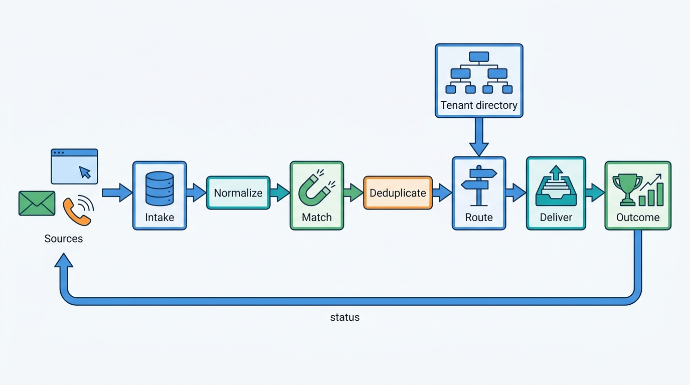
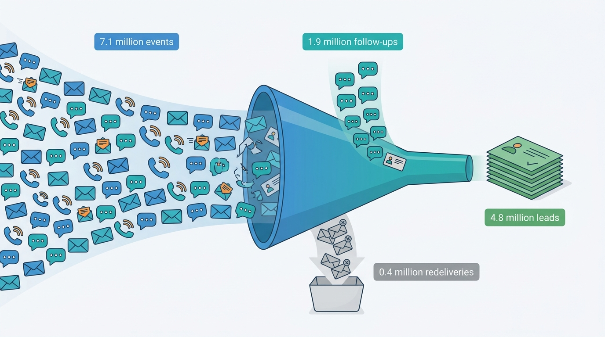
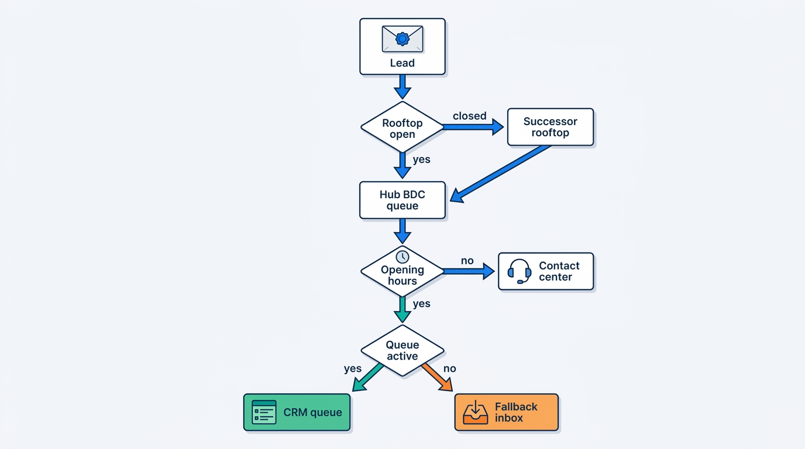
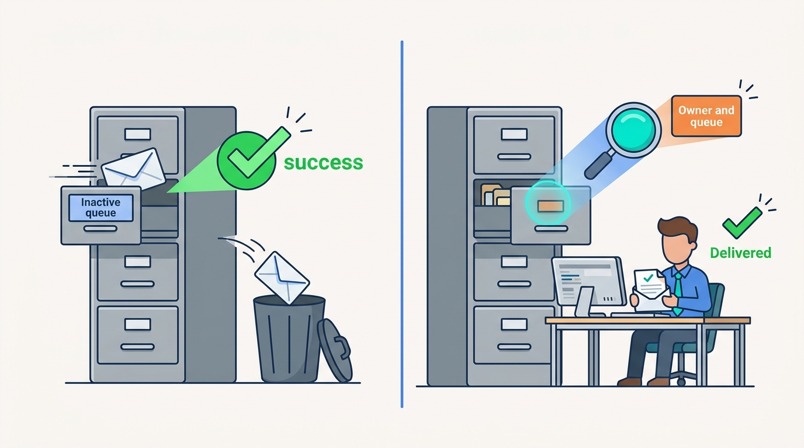
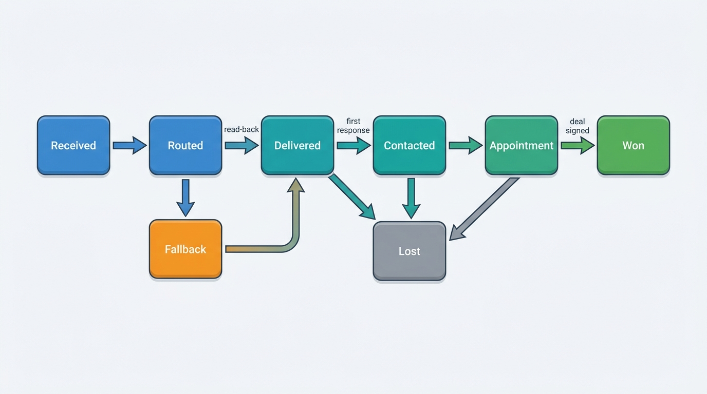

> **IN THIS CHAPTER, YOU WILL:** Learn what a lead is in automotive retail, how portals, dealer websites, e-mail in the Auto-lead Data Format (ADF/XML) and phone calls deliver leads, and how to build a lead service that normalizes, deduplicates, matches, routes and delivers them into an in-house inbox or a customer relationship management (CRM) system the platform does not control, with outcomes flowing back to the portals and to attribution.

> **WHY THE BUSINESS CARES:** A dealer pays portals and builds websites to produce enquiries, and studies of dealer response repeatedly find that minutes matter and that many enquiries never get a personal answer. A lead that is lost, delivered twice or sent to the wrong rooftop is marketing money spent for nothing, and the dealer rarely finds out.

> **WHY ARCHITECTS SHOULD CARE:** The lead path crosses more boundaries than any other dealer workflow: a dozen inbound contracts, the tenant hierarchy, consent law, and outbound delivery into CRMs and dealer management systems (DMS) that report success whether or not anyone reads the lead. Idempotency, routing-rule validation, delivery read-back and outcome feedback decide whether the platform can say where every enquiry went.

> **KEY POINTS:**
>
> * **A lead is a buyer's interest in a car at a rooftop, not a message.** Model the lead, its interactions (messages, calls, bids, trade-in details) and the prospect separately. Deduplicate on three levels: exact redelivery, follow-ups within one portal, and the same person across portals. Link the last level; do not merge it, because each portal claims the lead and the dealer pays for it.
> * **Routing rules encode the dealer's organization, so they must be checked against it.** Keep rules as versioned configuration that names rooftops, hubs, teams and queues from the tenant directory. Validate them when they are saved and again whenever a target closes or goes quiet, and end every rule chain in a fallback that a person watches. Velto's nine hubs in September 2027 showed what an unvalidated rule costs.
> * **A lead is delivered when a person can see it, not when the CRM returns success.** The dealer platform is usually not the lead's system of record. Its job is lossless, routed delivery with read-back, a measured time to first human response, and outcomes written back to portals and to the attribution store that tells the dealer which channel sold the car.

> **[FAILURE PATTERNS THIS CHAPTER ADDRESSES](where-vehicle-platforms-go-wrong.html):**
>
> * **The Leaky Lead** — leads pass through portal webhooks, mail gateways, routing rules and CRM adapters, and each hop reports success to the one before it, so a lead can vanish with every log saying "delivered".
> * **The Tenant Blur** — person matching and routing that ignore the tenant and legal-entity boundary either merge one dealer's buyers into another's, or keep sending leads to rooftops that a group has closed.
> * **The Zombie Listing** — enquiries about a sold car are a symptom of a listing that should be gone, and a lead service that does not look at stock state hides the signal instead of raising it.

<br>
A **lead** is the commercial unit of the dealer's marketing. A dealer advertises a car on four portals and its own website, and the market answers with e-mails, form submissions, chat messages, phone calls, bids and trade-in requests. Each answer is evidence that a person wants a particular car, or one like it, from a particular business. The dealer's question is simple: **did someone answer that person quickly, and did it become a sale?** 

The dealer platform owns almost none of this path. The portals own the buyer's account, the conversation and the delivery contract, and each contract is different. The CRM or DMS that salespeople work in belongs to another vendor. The dealer group's organization, which decides who should answer, changes during the year. **The platform's job is to be the one place that can account for every enquiry from arrival to outcome** while the systems on both sides change.

This chapter owns the **lead**, **lead routing**, **ADF/XML** and **lead attribution**. It takes the adverts that produce leads from [[listing-syndication]] and the rooftop hierarchy from [[tenancy-and-dealer-groups]], and it hands DMS-side delivery mechanics to [[dms-integration]] and the full end-to-end walk of one lead, with acknowledgement and dead-letter review, to [[journey-lead-to-dms]]. LISTED's [[messaging-and-leads]] covers the portal's side.

## Setting the Scene at Axleby: Nine Hubs and a Routing Table

Axleby, the fictional vehicle data and dealer software group this book follows (see [[meet-axleby]]), delivered about **4.8 million** leads into the Lotwise and Showroomly inboxes in 2026: **61%** from portals, **27%** from dealer websites and **12%** from phone and chat. They pass through **Switchboard**, the lead intake, normalization and routing service Axleby built in Go in **2024**. Switchboard delivers to the Lotwise inbox, to the Showroomly inbox and, through adapters, to external CRMs and DMS products. Every rooftop on the Lotwise Syndication module gets Switchboard routing and a basic Lotwise inbox; the **Website & Leads** module (€149 per rooftop per month) adds the dealer website, web forms, follow-up tasks and response-time reports.

In August 2027 Mirjam Kuipers, group used-car director of **Velto Mobility Group** (46 rooftops in the Netherlands and Belgium, 11 franchise brands, DriveDesk as DMS), sent Tomás Ferreira, Product Director of Lotwise, the plan for Velto's reorganization. From September the 46 rooftops would be run as **9 regional hubs** instead of brand clusters. Each hub would have a business development center (BDC), a team that answers every enquiry first and books appointments. Three rooftops would close. They were not small sites: their stock, about **1,100** cars plus Velto's central used-car stock that had been advertised under one of their codes, would move to a regional hub. Velto's salespeople work in DriveDesk's CRM, so their leads are delivered there, not to the Lotwise inbox.

Mirjam's request was one sentence: "Every lead for a car in a hub goes to that hub's BDC queue in DriveDesk within a minute, and after 19:00 to our group contact center." Switchboard's routing rules for Velto were rewritten for the new hubs, but the three closing rooftops were left out of the hub lists. Their cars stayed advertised on the portals under the three old rooftop codes, so leads for them fell through to older rooftop rules that pointed at a former brand-cluster queue Velto had just deactivated in DriveDesk. DriveDesk's CRM accepted leads into that inactive queue, returned success and discarded them. **1,460** leads, about 160 a day across a hub-sized stock, went unworked for **9 days** before anyone noticed. That is the **Lost Leads of Velto**; [[journey-lead-to-dms]] walks it hop by hop.

Ines Marchetti, Group Chief Architect, asked the architecture forum to treat it as a design question, not an incident ticket: **what is a lead at Axleby, who owns it at each step, and what would have to be true for a routing change like Velto's to fail loudly instead of silently?** The rest of this chapter is the answer the forum reached for Switchboard's 2028 design.

## Concepts: Lead, Interaction, Prospect and Routing

Portals call a message a lead, CRMs call a person a lead, and dashboards count form submissions. Switchboard uses four terms.

| Term | Definition | Identity | Example |
| --- | --- | --- | --- |
| **Enquiry event** | One inbound message from a source: a webhook call, a cursor event, an ADF e-mail, a web-form post, a tracked call | The source's event id, or a hash of the raw message | Marktplaats webhook delivery of a `MessagingLead` |
| **Lead** | A buyer's interest in a vehicle (or a kind of vehicle) at one rooftop, with a lifecycle from new to won or lost | Switchboard lead id, plus each source's lead id as a reference | "Buyer B wants the 2022 Škoda Octavia at Velto Breda" |
| **Interaction** | Each message, call, bid, trade-in detail, callback request or status change attached to a lead | Source event id | A reply three hours later; a missed call |
| **Prospect** | The person behind one or more leads, as known to one dealer legal entity | Per legal entity: normalized e-mail and phone, the portal's pseudonymous buyer id | The same buyer on Marktplaats and on Velto's website |

Three distinctions matter.

**Lead versus interaction.** The portals already draw this line. mobile.de's Lead API, version 2026-06-25, models a lead as "qualified intent" with an ordered series of lead events: `MessagingLeadSubmitted`, `BuyerReplied`, `MessagingLeadResubmitted`, `LeasingLeadSubmitted`, `PhoneCallReceived` and others ([mobile.de, 2026](https://services.mobile.de/manual/lead-api.html)). A platform that stores every e-mail as a new lead inflates counts, sends the second message to a different salesperson and breaks attribution.

**Lead versus prospect.** The prospect is a person, and personal data belongs to a controller. At Axleby the dealer is the controller of its buyers' data and Axleby is its processor, the same split [[dms-integration]] applies to DMS customer records. A prospect therefore exists **per dealer legal entity**, never across tenants, and not automatically across the legal entities of one group. Velto operates through **7** legal entities; a buyer who enquires at a Dutch and a Belgian Velto rooftop is two prospects unless Velto has a basis to combine them.

**Lead routing** (owned here) is the assignment of a lead to the rooftop, team, queue and person who should answer it, by rules the dealer configures and the platform evaluates. **Lead attribution** (owned here) is the record of which channels, adverts and campaigns touched a lead and its eventual sale, and the rule that decides which of them gets credit.

### Lead types

| Lead type | Evidenced in | What arrives | Routing consequence |
| --- | --- | --- | --- |
| Message or form | ADF; mobile.de `MessagingLeadSubmitted`; Marktplaats `MessagingLead`; dealer web forms | Contact details, message text, vehicle reference | Standard queue |
| Conversation follow-up | mobile.de `BuyerReplied`; Marktplaats Chat Message Webhook | Text appended to an existing conversation | To the lead's current owner, not re-routed |
| Bid | Marktplaats `BidCreatedLead`, `BidRemovedLead` | Amount, bid id | To whoever may accept prices; may need a manager |
| Tracked phone call | Marktplaats `CallTrackingLead`; mobile.de `PhoneCallReceived`; Auto Trader Calls API | Start time, duration, answered flag, caller number unless withheld | A missed call is a callback task |
| Finance or leasing request | mobile.de `LeasingLeadSubmitted`; Marktplaats `FinancingInfoRequest` | Product interest | Finance desk or a referral ([[deals-and-sales-documents]]) |
| Trade-in | ADF `<vehicle interest="trade-in">`; Marktplaats `TradeIn`; Auto Trader Part Exchange API | A second vehicle with mileage and condition | Appraisal task ([[vehicle-acquisition]]) |
| Reservation or deal | Auto Trader Deals and Deal Notifications | Transactional state | Locks stock; not only a lead ([[listing-syndication]]) |

Sources: ADF 1.0 (2000), mobile.de Lead API (2026), Marktplaats webhook v3.2.0 (n.d.), Auto Trader documentation (n.d.).

### ADF/XML, the US lead lingua franca

The **Auto-lead Data Format (ADF)** is an XML format for sending a car-buying lead from whoever captured it to whoever must answer it. Drafted from December 1998 with comments from Reynolds and Reynolds, Cars.com, Kelley Blue Book and others, its final 1.0 document is dated **3 May 2000** ([ADF 1.0, 2000](https://adfxml.info/adf_spec.pdf)); it was designed to be "easy to append to existing email leads making them both human and electronically readable". It is still the format US portals and CRMs exchange.

A minimal ADF lead looks like this (the data is invented):

```
<?xml version="1.0"?>
<?adf version="1.0"?>
<adf>
  <prospect status="new">
    <id sequence="1" source="ExamplePortal">LD-778812</id>
    <requestdate>2027-09-14T19:42:10+02:00</requestdate>
    <vehicle interest="buy" status="used">
      <year>2022</year><make>Skoda</make><model>Octavia</model>
      <stock>BRD-24117</stock>
    </vehicle>
    <customer>
      <contact><name part="full">J. Example</name><phone>+31600000000</phone></contact>
      <comments>Is the car still available on Saturday?</comments>
    </customer>
    <vendor><vendorname>Example Motors Breda</vendorname></vendor>
  </prospect>
</adf>
```

Five properties of the format shape the design:

- **The minimum valid lead is small**: "Date and time; Vehicle: year, make, model; Customer: name, and either phone number or email address; Vendor: name". There is no VIN requirement, so matching the lead to a stock item depends on the optional `<stock>` or `<vin>` element.
- **Identity across hops** uses a repeatable `<id sequence="…" source="…">`: "Different sources may use different ids for the same data as it is passed around." Each hop should add its id and keep the others; the chain is the only trace across portal, aggregator and CRM.
- **`status="resend"`** marks a lead sent again. A receiver must treat it as a possible duplicate, not a new lead.
- **The transport is e-mail.** Errors are reported by bouncing the e-mail, and there is no acknowledgement beyond a bounce.
- **Implementations drift.** Kelley Blue Book's 2014 LeadDriver usage guide said "the original ADF 1.0 specification contradicts itself in certain places and the DTD does not validate" and filled missing contact fields with "not provided" ([Kelley Blue Book, 2014](https://ldti.syndication.kbb.com/reference/files/ADF_Usage_Guide.pdf)). The guide is twelve years old, but its point stands: **parse ADF tolerantly** (no DTD validation, unknown elements kept, placeholder values recognized) and keep the raw message.

In June 2025 STAR (Standards for Technology in Automotive Retail), the US dealer-software standards body, released a **Sales Lead API** to "create new sales leads, retrieve details of any specific sales lead", update, remove and list them, free to download ([STAR, 2025](https://www.starstandard.org/index.php/2025/06/03/star-announces-new-sales-lead-standards-api-for-automotive/)). The announcement does not mention ADF. I would use STAR's resource vocabulary for a canonical lead model, as [[dms-integration]] does for stock and deals, and treat ADF as one more inbound and outbound adapter format. No European equivalent exists: each European portal publishes its own JSON contract.

## Where Leads Come From: One Service, Many Contracts

| Source | Contract | Delivery semantics | Identity and routing data | Status back to source |
| --- | --- | --- | --- | --- |
| **mobile.de** (DE) | Lead API, REST, Basic auth; access for "Transfer Service Providers and Lead Management System partners" | **Pull** with a cursor: `GET …/sellers/:mobileSellerId/events?cursor=…` returns events and a `nextCursor` | Lead id and ordered events; pseudonymous `buyerIdentifier`; the vehicle's `internalNumber` (the dealer's stock reference) | `POST …/leads/:leadId/status`: `IN_PROGRESS`, `SOLD`, `NOT_INTERESTED`, `SPAM`, with optional `occurredAt` |
| **Marktplaats / 2dehands** (NL, BE) | Lead Delivery Webhook v3.2.0; Bidirectional Communication API; Chat Message Webhook | **Push**; "we do not give guarantees on the specific order you will receive webhook messages in"; new fields may appear "even in patch version updates" | Lead id unique per (lead kind, advertisement, buyer); `seller.vestiging` "to distinguish different rooftops"; location postcode | Replies through the communication API; no outcome status found |
| **Auto Trader** (UK) | Deals, Messages, Calls, Part Exchange and Leads APIs; Deal Notifications | Pull pages (Leads API at most 100 per request since June 2024) plus signed notifications | Deal and stock ids | Deal state updates; partners can no longer set a lead to `NEW_MESSAGE` |
| **US portals and lead providers** | ADF e-mail to a per-rooftop address; some CRM APIs | E-mail; bounce on error | `<id source sequence>` chain; optional stock number or VIN | Typically none |
| **Dealer website** (own product) | Form post to the platform | Synchronous capture; the platform owns the form and the consent text | Advert id and stock item known exactly | Not needed |
| **Phone and chat** | Call-tracking numbers per advert or channel; chat widgets | Call events after the call | Tracking number → channel and advert | Not needed |

Sources: [mobile.de (2026)](https://services.mobile.de/manual/lead-api.html); [Marktplaats (n.d.)](https://api.marktplaats.nl/docs/v2/lms/index.html); [Auto Trader (n.d.)](https://developers.autotrader.co.uk/documentation).

Two points from the table drive the architecture. First, **the delivery semantics differ in every column**: pull with a cursor, push without ordering, paged pull with notifications, e-mail. One intake design must absorb all of them without losing or doubling a lead. Second, **only mobile.de documents an outcome write-back as a public contract**. Elsewhere the platform needs attribution of its own.

## Architecture: Switchboard From Intake to Outcome

Switchboard has seven stages. Each persists its result before the next starts, so a lead can always be found where it stopped.


**Figure 1:** *Switchboard's stages. Intake stores every raw event before anything else happens; matching and deduplication turn events into leads; routing reads the dealer's rules and the live tenant directory; delivery is not finished until read-back confirms the lead is where a person will see it, and outcomes flow back to portals and attribution.*

### The stages and what each owns

| Stage | Responsibility | Owns |
| --- | --- | --- |
| **Intake** | Receive each source on its terms: verify webhook signatures, answer within the source's budget, advance cursors, read rooftop mailboxes | Raw event store; per-source cursors and mailbox state |
| **Normalize** | Map each source format to the canonical lead event; tolerant ADF parsing; keep unknown fields | Mapping versions per source |
| **Match** | Resolve the vehicle (stock reference → stock item → Axleby Vehicle Key), the rooftop and the prospect | Match results with confidence and method |
| **Deduplicate** | Apply the three dedup levels; attach interactions to leads | Lead and interaction records; links between leads |
| **Route** | Evaluate the rooftop's effective rule set against the tenant directory and calendars | Routing decisions stamped with rule version |
| **Deliver** | Put the lead in the Lotwise inbox and, where configured, send it to an external CRM or DMS as a command with a receipt | Delivery state per target |
| **Outcome** | Collect status from the inbox and CRMs; write back to portals that accept it; feed attribution | Lead lifecycle; attribution touches |

Routing rules themselves live in **Baseline**, Axleby's versioned, effective-dated tenant configuration service ([[onboarding-and-configuration]]), and the rooftop hierarchy lives in the **tenant directory** ([[tenancy-and-dealer-groups]]). Switchboard owns neither; it owns the decisions it makes with them.

### Intake: acknowledge fast, store first

Every source has a different patience. Marktplaats expects a webhook response within **2 seconds**; mobile.de's cursor can be read whenever the client likes; an ADF e-mail sits in a mailbox. The rule is the same for all: **persist the raw event, then acknowledge, then process**. Intake does nothing else. A webhook handler that matches stock or calls a CRM before answering will time out under load, be retried by the portal and create the duplicates the next stage has to remove.

The raw store is the evidence when a dealer says "the portal shows 41 leads for that car and we have 38", and it lets a mapping bug be fixed by replay. Its retention is short, about **30 days** *(assumption)*, set in the retention schedule ([[privacy-and-retention]]).

Cursor-based sources advance the cursor **only after** the batch is stored. mobile.de's `cursor=0` replays "from the oldest retrievable lead event", so a lost cursor costs a burst of duplicates, not lost leads.

### Normalize: one canonical lead event

The canonical event borrows STAR's sales-lead vocabulary and adds what the platform needs: the **source** (system, lead id, event id, the full ADF id chain, receipt time and a pointer to the raw event); the **lead type**; the **vehicle reference** as sent (stock reference, VIN or plate if present, advert id, and year, make and model text, which is a hint and never identity); the **seller reference** (portal account, `vestiging`, postcode, ADF vendor, website or tracking number); the **buyer** (name, normalized e-mail and phone, the portal's pseudonymous id, language, message), encrypted under the tenant's key; **consent**; and typed **enrichment** such as a trade-in vehicle, a bid amount or a call's duration.

### Match: vehicle, rooftop and prospect

**Vehicle.** The strongest reference is the dealer's own stock reference echoed by the portal: mobile.de returns the `internalNumber` the platform sent when publishing, and the channel listing in [[listing-syndication]] maps a portal listing id to a stock item. From the stock item Switchboard gets the Axleby Vehicle Key (AVK) from Anchor ([[vehicle-identity]]) and the car's current state. Free text ("2022 Octavia") only ranks candidates when no reference exists, and such a match carries a visible low-confidence flag.

**Rooftop.** The rooftop is the stock item's current rooftop, not the portal account's. After a transfer or closure, a buyer may still answer an old advert or a portal account under the old name. **The stock item, read at routing time, is the authority on where the car is.**

**Prospect.** Normalized e-mail and phone (E.164 format) plus the portal's pseudonymous buyer id are matched within the dealer legal entity. A match links the lead to the prospect; it never pulls in data from another legal entity or tenant.

### Deduplicate: three levels, two of them links

| Level | Question | Key | Action | Why not merge |
| --- | --- | --- | --- | --- |
| **1. Exact** | Is this the same event again? | Source event id; for ADF the id chain plus a content hash | Drop, record the redelivery | It *is* the same event |
| **2. Within source** | Is this the same buyer about the same car on the same portal? | Source lead id; Marktplaats (kind, advertisement, buyer); mobile.de lead id; ADF `resend` | Append as an interaction to the existing lead | Merging is correct: one lead, many interactions |
| **3. Across sources** | Is this the same person about the same or a similar car through another channel? | Prospect match plus vehicle within a window (Axleby: 14 days *(assumption)*) | **Link** the leads, show them together, keep both | Each portal claims the lead, the dealer may pay per lead, and attribution needs both touches |

Level 3 fails both ways. Merging hides the second channel and makes portal invoices uncheckable; not linking sends one buyer to two salespeople. The linked view gives the salesperson one conversation and the dealer two touches.

In 2026 Switchboard received about **7.1 million** inbound enquiry events. About **0.4 million** were exact redeliveries, about **1.9 million** were follow-ups attached to existing leads, and **4.8 million** created leads, of which about **8%** were linked to another lead of the same prospect within 14 days (Axleby illustration). Counting events as leads would have overstated the dealers' enquiries by half.


**Figure 2:** *Of 7.1 million inbound events in 2026, 4.8 million created leads; counting events as leads would have overstated the dealers' enquiries by half.*

### Requirements per interaction

| Interaction | Consistency | Latency target | Freshness | Availability |
| --- | --- | --- | --- | --- |
| Source event → raw store and acknowledgement | Durable before acknowledgement; idempotent on event id | Under 2 seconds (Marktplaats budget) | n/a | Intake stays up when matching, routing or CRMs are down |
| Raw event → routed lead | Exactly one lead per (source, lead id); deterministic rule version | Under 30 seconds at the 95th percentile *(assumption)* | Stock state and directory read at routing time | Queue absorbs a backlog; routing never waits on a CRM |
| Routed lead → Lotwise inbox | Exactly once | Under 60 seconds end to end *(assumption)* | n/a | Inbox is the fallback for every other target |
| Routed lead → external CRM | Exactly once, with read-back of owner and queue | Under 2 minutes *(assumption)*, as in [[dms-integration]] | n/a | Commands queue during CRM outages; lead visible in Lotwise meanwhile |
| CRM status → Switchboard | Eventually consistent; ordered per lead | Minutes | Read-back on demand | Not needed for answering the buyer |
| Outcome → portal write-back | At least once; idempotent per (lead, status) | Hours | Daily reconciliation | Not needed for selling |

The main decision: **nothing that a salesperson needs to answer the buyer waits on a system the platform does not control.** CRM delivery, write-back and attribution may lag; the lead's arrival in a place a person watches may not.

### Routing: rules as validated configuration

Routing at a single-rooftop independent such as Autobedrijf Brandsma in Leeuwarden is trivial: every lead goes to the rooftop's inbox, and Sietse Brandsma or one of his two salespeople picks it up. At a group it is a policy engine. Switchboard evaluates a rule set per rooftop, resolved through Baseline's inheritance (market pack → group → region or hub → rooftop), in a fixed order:

1. **Lead type.** Finance requests to a finance desk, bids to a manager, follow-ups to the lead's current owner.
2. **Vehicle to rooftop.** The stock item's current rooftop, or for leads without a car the rooftop of the advert, website or tracking number.
3. **Group policy.** "All leads for hub rooftops go to the hub BDC queue first"; "Belgian leads in French go to the French-speaking team".
4. **Calendar.** The rooftop's opening hours and holidays; outside them, an after-hours branch (group contact center, auto-acknowledgement, callback scheduling).
5. **Assignment.** A named salesperson for a returning prospect, round-robin within a team, or load-based assignment weighted by open leads. Where a CRM exists, it usually assigns people.
6. **Fallback.** Every chain ends in a target a person watches: the rooftop's general inbox, then the group's lead administrator. A rule set without a terminal fallback does not validate.

Three properties make the rules safe to change.

**Validated against the directory, on save and on change.** A rule that names a rooftop, a hub, a team or a CRM queue is checked against the tenant directory and the integration registry when it is saved. It is checked again when the target changes: the directory publishes `rooftop.closed` with a successor rooftop, and an integration health signal marks a CRM queue that accepts leads but shows no activity. A rule whose target fails either check is **invalid**, and leads that would have used it go to its successor or fallback with an alert to the group's administrator. This is the rule [[onboarding-and-configuration]] states as "closing a rooftop must invalidate every rule that names it".

**Simulated before activation.** A rule-set change is replayed against the rooftop group's last 30 days of leads *(assumption)* and shows the difference per target: "Hub Noord-Brabant BDC would receive 2,310 leads; 0 leads would go to rooftops in Closing; 312 leads would change language team." A target that receives leads and has no active users is flagged. Velto's September change, simulated this way, would have shown the three old rooftop codes still drawing about 160 leads a day into a queue with nobody behind it.

**Stamped on every decision.** Each routing decision records the rule-set version, the branch taken and the directory version it read. "Why did this lead go there?" becomes a lookup.


**Figure 3:** *The routing decision for one lead at a hub-organized group. Closures and inactive targets are explicit branches that lead to a named successor or a watched fallback, never to a target that only looks valid.*

### Delivery: in-house inbox, external CRM, or both

A **CRM** (customer relationship management system) is where salespeople work their leads and customers: tasks, calls, appointments, follow-up sequences, pipeline reports. In the US it is often sold or hosted by the DMS vendor: in the June 2024 CDK Global outage, Sonic Automotive listed its CRM among the affected systems ([Sonic Automotive 8-K, July 2024](https://www.sec.gov/Archives/edgar/data/1043509/000104350924000060/sah-20240705.htm)). European franchised groups commonly use manufacturer-mandated or DMS-integrated CRMs; independents often use the platform's inbox. No verified market shares exist.

So the platform has three delivery modes, chosen per rooftop:

| Mode | Where salespeople work | Platform's role | Typical customer |
| --- | --- | --- | --- |
| **Inbox** | Lotwise or Showroomly inbox | System of record for the lead | Independents such as Autobedrijf Brandsma |
| **External CRM** | DriveDesk CRM, a brand CRM, a US CRM via ADF | Router and courier; inbox as fallback and audit view | Franchised groups such as Velto |
| **Both** | Inbox for used cars, CRM for new cars, or the reverse | Router; must not let two systems both chase the buyer | Mixed groups |

In external-CRM mode the platform is **not** the lead's system of record, and it should not pretend to be. Its duties are narrower and harder: deliver every lead exactly once, prove that it arrived where a person will see it, keep a read-only copy for audit and fallback, and get the outcome back. At Axleby, delivery to DMS-vendor CRMs goes through Hitch, the DMS integration layer of [[dms-integration]], as a command with an idempotency key and a receipt. The receipt for a lead is stricter than for a stock update: Hitch reads back the CRM record's **owner and queue**, and the lead counts as delivered only when the queue is one the directory and the integration registry consider active. In September 2027 Velto's leads still used the older direct DriveDesk lead path, which treated an HTTP success as delivery.


**Figure 4:** *An HTTP success means the CRM accepted the lead; only a read-back of owner and queue shows that a person will see it.*

For US CRMs that accept only e-mail, delivery means **ADF out**: an ADF document with the platform's own `<id>` added to the chain, sent through a queue with bounce handling. Because e-mail has no acknowledgement, ADF delivery is never trusted alone; the lead also stays visible in the platform's inbox until the CRM's status or the dealer confirms it.

### Status feedback, outcome write-back and attribution

A lead's lifecycle is the same whichever system holds it; only the source of each transition differs.


**Figure 5:** *The lead lifecycle. Delivered is a confirmed state, not a sent one; Fallback is a visible state with an owner; Contacted is the first human response, which is what response time measures; Won comes from a signed deal, not from a salesperson's checkbox.*

**Won** is set when a deal for the same stock item and prospect is signed in Lotwise Sales Admin or reported by the DMS ([[deals-and-sales-documents]]), which is the only reliable link from enquiry to sale. Where the dealer enables it, Switchboard writes outcomes back to the portal: to mobile.de as `IN_PROGRESS`, `SOLD`, `NOT_INTERESTED` or `SPAM`, idempotently per (lead, status). Write-back is **off by default and enabled per channel by the dealer**: it hands the portal the dealer's conversion data, which is the dealer's decision as controller and customer.

**Attribution** records every touch: channel, advert, tracking number, campaign and the time of each lead linked to a prospect, then the sale. Reports can apply first touch, last touch or "the channel of the lead that became the sale". The rule I use for dealers is to show **cost per sold car by channel** under the last rule and to keep the touches so the dealer can rerun the others. Attribution is the dealer's evidence in portal price disputes. UK dealers' **November 2025** protest against Auto Trader, over the Deal Builder rollout, enquiry changes and price rises ([Car Dealer Magazine, 2025](https://cardealermagazine.co.uk/hundreds-of-car-dealers-claim-they-have-cancelled-auto-trader-packages-as-part-of-mass-protest/320149)), was such a dispute; Auto Trader Group's 2026 results report that from November 2025 "a number of retailers reduced the number of vehicles advertised on the platform" ([Auto Trader Group, 2026](https://plc.autotrader.co.uk/media/usjleen0/full-year-press-release-fy26.pdf)). [[case-auto-trader-uk]] covers the portal's side.

### Consent travels with the lead

A buyer who sends an enquiry asks the dealer to answer it. Under the General Data Protection Regulation (GDPR), processing "necessary … in order to take steps at the request of the data subject prior to entering into a contract" is a lawful basis (Article 6(1)(b), [Regulation (EU) 2016/679, 2016](http://publications.europa.eu/resource/celex/32016R0679)); answering the enquiry needs no separate consent. **Marketing to the buyer later is different**, and the rules differ by market and by channel:

- In the EU, Article 13 of the ePrivacy Directive allows e-mail direct marketing with prior consent, or to a business's own customers for "its own similar products or services" when the details were obtained "in the context of the sale of a product or a service" and the customer can object every time ([Directive 2002/58/EC, 2002](http://publications.europa.eu/resource/celex/32002L0058)). Whether an enquiry without a sale qualifies is for national law and regulators.
- Germany's Act against Unfair Competition (*Gesetz gegen den unlauteren Wettbewerb*, UWG) treats advertising calls to a consumer without "prior express consent" as unacceptable harassment ([UWG § 7, n.d.](https://www.gesetze-im-internet.de/uwg_2004/__7.html)).
- The UK's Privacy and Electronic Communications Regulations (PECR) extend the existing-customer exception to details obtained "in the course of the sale or negotiations for the sale" (regulation 22(3), [PECR 2003](https://www.legislation.gov.uk/uksi/2003/2426/regulation/22)).
- In the US, the Federal Communications Commission's (FCC) rules under the Telephone Consumer Protection Act (TCPA) require "prior express written consent" for autodialed or prerecorded telemarketing calls and texts to mobile numbers ([47 CFR 64.1200, n.d.](https://www.law.cornell.edu/cfr/text/47/64.1200)); CarGurus' 2025 Form 10-K names TCPA compliance as a requirement of its messaging features.

The design consequence is the same in every market: **consent is data on the lead**, with scope (answer this enquiry; marketing by e-mail; by SMS or WhatsApp; by phone), source (portal, website form, call), timestamp and the version of the text the buyer saw. Switchboard propagates it with the lead to the CRM and enforces it in Axleby's own outbound channels: a follow-up sequence in the Lotwise inbox checks the consent scope per message, not per lead. Axleby's dealer websites capture consent with versioned text; portal leads carry only what the portal passes. This is not legal advice; [[privacy-and-retention]] owns the lawful-basis analysis per market.

## Response Time: The Lead Path's Latency Budget

In a 2011 Harvard Business Review study, Oldroyd, McElheran and Elkington sent web leads to 2,241 US companies: 37% responded within an hour, the average among those that answered within 30 days was 42 hours, and 23% never responded. Firms that made contact within an hour were "nearly seven times as likely to qualify the lead" as those who waited longer ([HBR, 2011](https://hbr.org/2011/03/the-short-life-of-online-sales-leads); [SmartCompany summary, 2011](https://www.smartcompany.com.au/?p=20719)). The study is fifteen years old and cross-industry. Newer automotive evidence: Pied Piper's 2025 mystery-shopping study of 4,023 US dealerships found that **19% failed to personally respond** to a web enquiry within 24 hours, and that dealers moving from below 40 to above 80 on its score "on average sell 50% more units from the same quantity of internet leads" ([Auto Remarketing, 2025](https://www.autoremarketing.com/ar/retail/dealerships-responsiveness-to-internet-leads-hits-record-high-again)). No comparable European study was found.

Timing outside opening hours matters as much as speed inside them. mobile.de's summer 2026 update reported that in a pilot of its call assistant with 19 dealers from March to May 2026, **91%** of the calls it answered fell outside opening hours, and one in three became a qualified lead ([mobile.de, 2026](https://newsroom.mobile.de/plattform-update-sommer-2026/); the page refused automated access when this chapter was reviewed in October 2026, so these figures were not re-checked).

The platform cannot make salespeople fast, but it owns two things: its own segment of the delay (under 2 minutes from source to a place a person watches, per the requirements table above) and the measurement. Outside opening hours its tools carry the load: an auto-acknowledgement within a minute, a callback slot, an after-hours queue.

**Time to first human response** is measured from arrival to the first outbound message or answered call by a person, not to an auto-reply. In 2027 Switchboard measured a median of **52 minutes** during opening hours across Lotwise rooftops and about **14 hours** for leads that arrived outside them, which was **29%** of leads (Axleby illustration). The dealer's dashboard shows the platform's segment separately, so a slow week is not blamed on the wrong party.

## In Practice: Velto's Hubs and Brandsma's Channels

### Velto: what the forum changed

The forum's review of the Lost Leads of Velto produced five changes to Switchboard and its neighbors, each tied to a property above. [[journey-lead-to-dms]] tells the incident.

| Change | Property it restores | Owner |
| --- | --- | --- |
| Routing rules read the tenant directory and invalidate on `rooftop.closed`; closed targets route to the named successor | Rules validated against the organization | Switchboard, tenant directory |
| Rule-set simulation is mandatory for group changes; a target with leads and no active users blocks activation | Rules checked before they act | Baseline, Switchboard |
| Lead delivery to DriveDesk moves behind Hitch with owner-and-queue read-back | Delivered means visible | Hitch |
| Lead-flow monitor: a rooftop whose leads go unacknowledged for 4 business hours while leads still arrive raises an alert ([[observability-and-data-operations]]) | Silence is a signal | Platform and SRE |
| Portal lead reports reconciled daily against Switchboard counts per rooftop where the portal exposes them | Every hop is checked by someone other than itself | Switchboard |

The last change is the cheapest: **the best monitor for a lead pipeline is the source's own count**, compared daily per rooftop with what reached a person.

### Autobedrijf Brandsma: attribution for a one-rooftop dealer

Sietse Brandsma's rooftop in Leeuwarden holds about **55** cars and advertises on four Dutch channels plus his Lotwise website. In the second quarter of 2027 *(all figures below are illustrative assumptions)*, his inbox received 151 leads and he sold 84 cars, 61 of which had a lead linked to the buyer before the sale. With the touches recorded, the quarter looks like this:

| Channel | Leads | Sold cars (last-touch lead) | Channel cost for the quarter | Cost per sold car |
| --- | --- | --- | --- | --- |
| Portal A | 64 | 27 | €2,100 | €78 |
| Portal B | 38 | 14 | €1,650 | €118 |
| Portal C (aggregator) | 17 | 4 | €600 | €150 |
| Portal D | 9 | 1 | €450 | €450 |
| Own website and phone | 23 | 15 | Website & Leads module, €447 | €30 |
| No lead linked (walk-ins, repeat customers) | — | 23 | — | — |

Two things change Sietse's decisions. Portal D costs **€450** per sold car, three to six times the other portals, and the per-channel publish rules in [[listing-syndication]] let him advertise there only cars older than 30 days instead of canceling outright. And 11 of the 61 linked sales had touches on two channels, so under first-touch attribution Portal B would gain three sales from Portal A. **The dealer, not the platform, chooses the rule; the platform keeps the evidence that makes either rule possible.**

## Failure Handling

| Failure | Example | Detection | Recovery |
| --- | --- | --- | --- |
| **Duplicate delivery** | A webhook retried after a slow acknowledgement; an ADF `resend`; a re-read cursor | Exact-duplicate key on event id or id chain plus hash | Drop and count; a rising redelivery rate means intake is too slow |
| **Out-of-order events** | A Marktplaats follow-up arrives before the lead it belongs to | Follow-up references an unknown source lead id | Park for a short window *(assumption: 10 minutes)*, then create the lead from the follow-up and merge when the original arrives |
| **Incomplete record** | ADF with "not provided" contact fields; a lead with no stock reference | Normalizer flags missing fields; matcher returns low confidence | Route to the rooftop's general queue with the gap shown; never drop a lead for missing data |
| **Lead for a sold or reserved car** | The Zombie Golf's **37** leads after its sale ([[listing-syndication]]) | Matcher sees stock state Sold or Reserved | Route normally with a "car no longer available" banner and similar stock; raise a channel-state check for that listing in Relay |
| **Closed or inactive target** | The Lost Leads of Velto | Directory event; simulation; queue-activity monitor | Successor or fallback routing; alert to the group administrator |
| **Silent acceptance** | CRM returns success and discards | Read-back of owner and queue; acknowledgement monitor | Re-route to the Lotwise inbox, alert, dead-letter review ([[journey-lead-to-dms]]) |
| **CRM or DMS outage** | The DriveDesk Outage, November 2027: about **34,000** leads went to the Lotwise inbox ([[dms-integration]]) | Circuit breaker per CRM and rooftop | Inbox becomes the working tool; queued deliveries replayed after reconciliation, with "already handled in Lotwise" marked so salespeople do not call twice |
| **Conflicting status** | CRM says Lost, a deal for the same car and prospect is signed | Outcome stage compares sources | The signed deal wins; the conflict is logged for the attribution report |

**A lead for a sold car is a syndication alarm.** Relay knows what it sent; a buyer enquiring about a car that Lotwise marks as sold is evidence that some portal still shows it. Switchboard emits an event and Relay reconciles the listing. The Zombie Golf's 37 leads were 37 such alarms that nobody heard.

**Retries happen at one place.** Intake does not retry; it stores. Delivery retries through Hitch's command queue with its per-DMS retry budget. If the webhook handler, router and CRM adapter all retry, an outage produces duplicates in the CRM and retry storms on the DMS.

## Trade-offs

| Decision | Option A | Option B | Choose A when | Choose B when |
| --- | --- | --- | --- | --- |
| **Where salespeople work** | Platform inbox as system of record | External CRM as system of record | Independents and groups without a CRM; used-car teams the platform serves end to end | Franchised groups with a manufacturer or DMS-vendor CRM, where new-car, service and finance leads already live |
| **Where routing happens** | In the platform | In the CRM | Leads must reach the right rooftop and queue before any CRM sees them; group policies across several CRMs | One CRM per group with its own assignment logic; the platform delivers to a single group queue |
| **Cross-source duplicates** | Link and show together | Merge into one lead | Always for portal leads the dealer pays for | Never silently; only on a salesperson's explicit merge |
| **Outcome write-back to portals** | On, per channel | Off | Dealer wants the portal's ranking and reporting to reflect conversions | Dealer treats conversion data as commercially sensitive |

My recommendation for a group like Axleby is routing in the platform, with delivery to whichever CRM each rooftop uses, and the platform inbox always present as the fallback and the audit view. It rests on two requirements: a group can change its organization without re-integrating each CRM, and the platform can show where every lead went. It does not hold for a group standardized on one CRM with its own routing; there the platform should route to the rooftop and step aside.

## Across Markets: What Changes by Country

| Dimension | Netherlands / Belgium | Germany | United Kingdom | United States |
| --- | --- | --- | --- | --- |
| Main lead contracts | Marktplaats/2dehands Lead Delivery Webhook (push, unordered), Bidirectional Communication API, Chat Webhook | mobile.de Lead API (cursor pull, ordered events, status write-back) | Auto Trader Deals, Messages, Calls and Leads APIs; Deal Notifications | ADF/XML e-mail; CRM APIs; STAR Sales Lead API (2025) |
| Rooftop data in the lead | `seller.vestiging`, postcode | `internalNumber`, `customerNumber` | Stock and deal ids | ADF `<vendor>`, optional `<stock>` or VIN |
| Outcome back to the portal | Not found in public contracts | Public status contract | Through deal state | Typically none |
| Transactional leads | Bids (`BidCreatedLead`) | Leasing leads; direct offers | Deal Builder reservations, which lock stock | Varies by portal |
| CRM landscape | DMS-vendor and brand CRMs; platform inbox common for independents | Brand and DMS CRMs; portal lead tools compete | DMS-vendor CRMs; Showroomly inbox for Axleby customers | CRM often bundled with the DMS (CDK 2024 filings) |
| Marketing follow-up rules | GDPR plus national ePrivacy law (Directive 2002/58/EC Art. 13) | GDPR plus UWG § 7: phone advertising to consumers needs prior express consent | UK GDPR plus PECR reg. 22: soft opt-in covers "negotiations for the sale" | TCPA: prior express written consent for autodialed telemarketing calls and texts to mobiles |
| Axleby position | Lotwise; Switchboard; DriveDesk CRM for 1,900 rooftops | Lotwise for 500 rooftops; German DMS CRMs | Showroomly inbox and portal partner integrations | No customers; ADF adapter only as design evidence |

What stays common is the whole of Switchboard: the canonical lead model, the three dedup levels, routing rules validated against the directory, delivery with read-back, the lifecycle, attribution and consent as data. What is market-specific is **the set of source adapters and the consent policy pack**. Germany needs the strictest phone rule, the UK's soft opt-in wording is broader than the EU's, and a US launch would add an ADF mail gateway and TCPA consent capture, not a different lead service. The Netherlands and Belgium share one portal contract; a Belgian rooftop differs mainly in language routing.

## The Chief Architect's View

**Decide the system of record for leads per rooftop, explicitly.** "Leads live in Lotwise" and "leads live in the CRM" are both defensible. Not deciding produces two systems chasing one buyer. The decision is a configuration value per rooftop, owned by product, and every report must say which system it counted.

**Make routing a governed configuration, not a support task.** After Velto, group rule changes at Axleby go through Baseline with simulation and the group administrator's approval. Tomás Ferreira owns the routing product; Hendrik Maes owns the CRM and portal adapters; Marta Nowak's team owns the lead-flow monitor.

**Measure the pipeline by what the dealer sees.** Leads per source and rooftop against the source's own counts, the share delivered with read-back, the share that reached a fallback, and time to first human response. Throughput and error rates are inputs, not the measure.

**Keep the dealer's evidence.** Lead and attribution history is what a dealer brings to a portal negotiation. Keep it as long as the retention schedule allows ([[privacy-and-retention]]) and share it only on the dealer's instruction.

**Watch the portals' lead tools.** mobile.de's summer 2026 update describes a Lead Manager whose AI writes "45 percent of all written replies" and a Lead Manager Pro offering "a central pipeline for leads from all channels" ([mobile.de, 2026](https://newsroom.mobile.de/plattform-update-sommer-2026/), translated from German). Portals are moving into lead handling; the platform's defensible position is consolidation across all portals, the dealer's website and CRM, which no single portal offers. [[ai-in-dealer-workflows]] discusses the AI side.

## Questions to Ask

1. What is a lead in our system, what is an interaction, and how many inbound events became how many leads last month?
2. Which system is the lead's system of record for each rooftop, and does every report say which one it counted?
3. Which routing rules name a rooftop, team or queue, and what happens to them when the tenant directory closes that target?
4. Can we simulate a routing change against last month's leads before it goes live, and is it mandatory for group changes?
5. What does "delivered" mean for each CRM: a success code, or a read-back of owner and queue?
6. Which rooftops have leads arriving but none acknowledged in the last four business hours, right now?
7. Where is consent recorded on the lead, and which outbound channels check it per message?
8. Can a dealer see cost per sold car by channel, and which attribution rule produced the number?

Leads end where the sale begins. The next chapter, [[deals-and-sales-documents]], picks up the buyer who said yes: quotes, contracts, financing, margin-scheme VAT and the signed deal that tells Switchboard a lead was won.

## Sources and Evidence

**Company, product and investor sources**

- [Lead API documentation, version 2026-06-25](https://services.mobile.de/manual/lead-api.html), mobile.de, 2026: lead and lead-event model, cursor pull, status write-back, consent-gated enrichment.
- [Schneller zum Abschluss: Plattform-Update Sommer 2026](https://newsroom.mobile.de/plattform-update-sommer-2026/), mobile.de newsroom, 2026: AI-written replies, lead-performance report, Lead Manager Pro, call-assistant pilot (not re-checkable in October 2026; automated access refused).
- [API solutions for Lead Management Systems](https://api.marktplaats.nl/docs/v2/lms/index.html) and [Lead Delivery Service webhook v3](https://api.marktplaats.nl/docs/v2/lms/lead-delivery-webhook-v3.yaml), Marktplaats B.V., n.d., accessed 2026-10: lead kinds, lead identity, rooftop fields, ordering, forward compatibility, 2-second budget.
- [Autotrader Connect developer documentation](https://developers.autotrader.co.uk/documentation), Auto Trader UK, n.d., accessed 2026-10: Deals, Messages, Calls, Part Exchange and Leads APIs; page size and status changes.
- [Full year results for the year ended 31 March 2026](https://plc.autotrader.co.uk/media/usjleen0/full-year-press-release-fy26.pdf), Auto Trader Group plc, 2026: reduced advertised stock from November 2025; Deal Builder conversion.
- [CarGurus Form 10-K for fiscal 2025](https://www.sec.gov/Archives/edgar/data/1494259/000119312526059435/carg-20251231.htm), CarGurus, 2026: TCPA compliance for messaging features.
- [Sonic Automotive Form 8-K, July 2024](https://www.sec.gov/Archives/edgar/data/1043509/000104350924000060/sah-20240705.htm), Sonic Automotive, 2024: CRM affected alongside the DMS in the CDK outage.

**Standards, regulation and official documentation**

- [Auto-lead Data Format (ADF) Version 1.0](https://adfxml.info/adf_spec.pdf), ADF working group (hosted by Dealer Inspire), 2000: structure, minimum lead, id chain, e-mail transport, resend status.
- [Auto-Lead Data Format Usage by LeadDriver, release 1.1](https://ldti.syndication.kbb.com/reference/files/ADF_Usage_Guide.pdf), Kelley Blue Book, 2014: interpretation drift and tolerant handling (twelve years old).
- [STAR Announces New Sales Lead Standards API for Automotive](https://www.starstandard.org/index.php/2025/06/03/star-announces-new-sales-lead-standards-api-for-automotive/), STAR, 2025: Sales Lead API operations.
- [Regulation (EU) 2016/679 (GDPR)](http://publications.europa.eu/resource/celex/32016R0679), EU Publications Office, 2016: Article 6(1)(b) pre-contractual steps.
- [Directive 2002/58/EC (ePrivacy Directive)](http://publications.europa.eu/resource/celex/32002L0058), EU Publications Office, 2002: Article 13 on unsolicited communications and the existing-customer exception.
- [Gesetz gegen den unlauteren Wettbewerb, § 7](https://www.gesetze-im-internet.de/uwg_2004/__7.html), German Federal Ministry of Justice, n.d., accessed 2026-10: consent for phone and e-mail advertising.
- [Privacy and Electronic Communications (EC Directive) Regulations 2003, regulation 22](https://www.legislation.gov.uk/uksi/2003/2426/regulation/22), legislation.gov.uk, n.d., accessed 2026-10: UK e-mail marketing and soft opt-in.
- [47 CFR 64.1200, delivery restrictions](https://www.law.cornell.edu/cfr/text/47/64.1200), Legal Information Institute, n.d., accessed 2026-10: TCPA consent for autodialed and prerecorded telemarketing.

**Research and practitioner sources**

- [The Short Life of Online Sales Leads](https://hbr.org/2011/03/the-short-life-of-online-sales-leads), Oldroyd, McElheran and Elkington, Harvard Business Review, 2011, with the [SmartCompany summary](https://www.smartcompany.com.au/?p=20719), 2011: response-time audit and qualification odds (fifteen years old; cross-industry).
- [Dealerships' responsiveness to internet leads hits record high again](https://www.autoremarketing.com/ar/retail/dealerships-responsiveness-to-internet-leads-hits-record-high-again), Auto Remarketing, 2025: Pied Piper 2025 study of 4,023 US dealerships.
- [Hundreds of car dealers claim they have cancelled Auto Trader packages as part of mass protest](https://cardealermagazine.co.uk/hundreds-of-car-dealers-claim-they-have-cancelled-auto-trader-packages-as-part-of-mass-protest/320149), Car Dealer Magazine, 2025: November 2025 dealer protest.

Axleby is fictional; architectural recommendations, labeled inferences and labeled assumptions are the author's judgement.
