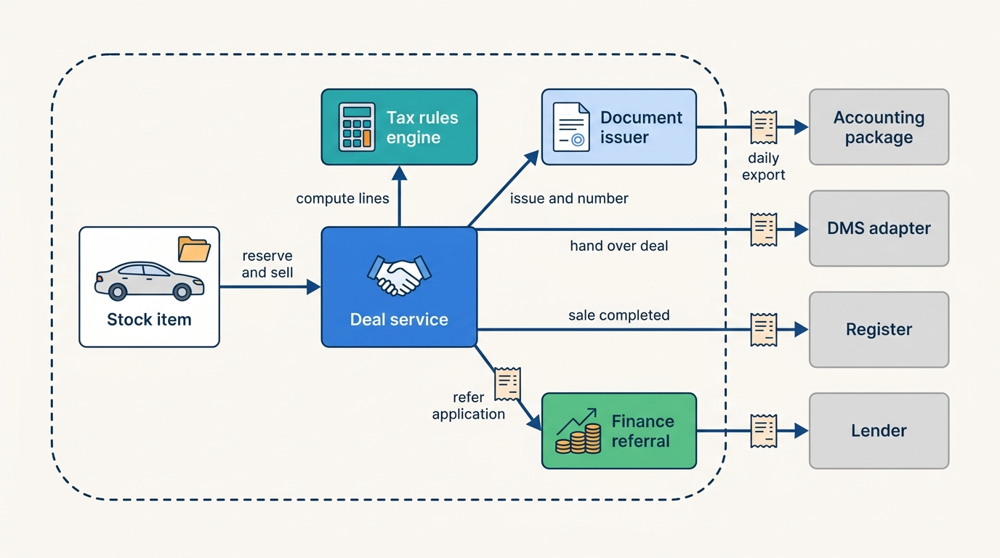
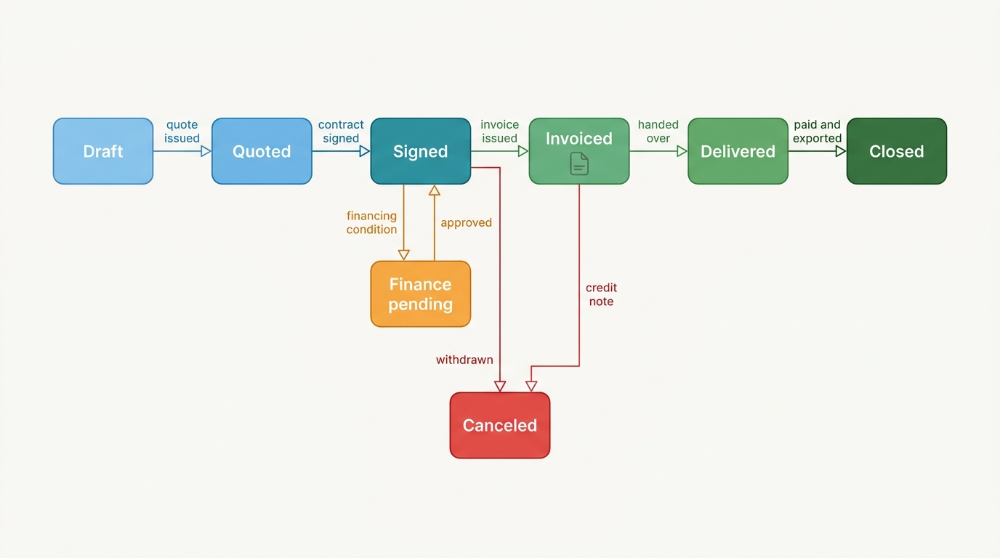
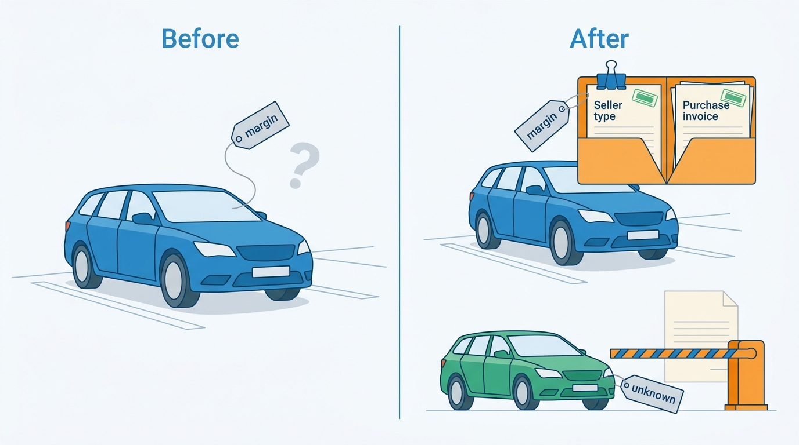
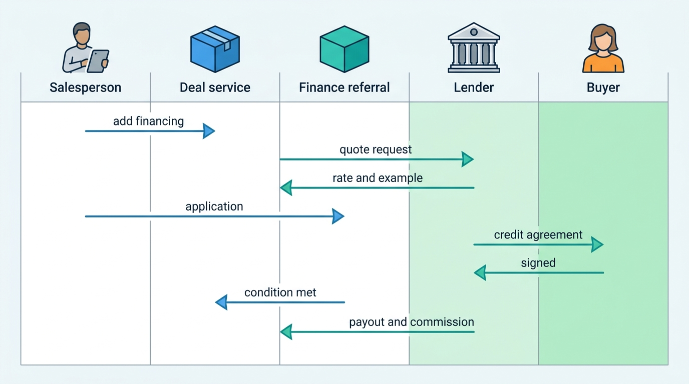
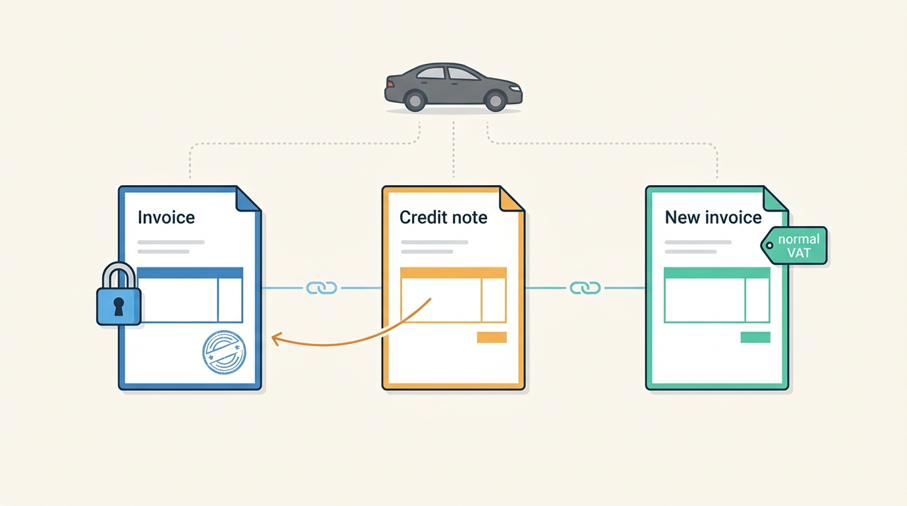

> **IN THIS CHAPTER, YOU WILL:** Take apart the deal: the quote, the sales contract, the trade-in, the deposit, the financing referral and the invoice. You will see how issued documents are numbered and kept immutable, how margin-scheme VAT constrains the invoice, and where the platform must stop and hand over to a dealer management system (DMS) or a lender.

> **WHY THE BUSINESS CARES:** A dealer earns the margin on a car only when the deal closes correctly. A wrong VAT treatment, a lost deposit or a contract that disagrees with the invoice becomes a tax correction, a consumer complaint or a regulator's question years later. For the vendor, sales documents are a small module by price and a large one by liability.

> **WHY ARCHITECTS SHOULD CARE:** The deal is where stock state, money, tax law, consumer-credit law and an external system of record meet in one transaction. The boundaries drawn here decide whether the platform is a reliable front end to the DMS and the lender, or a half-built DMS that owns accounting problems it cannot solve.

> **KEY POINTS:**
>
> * **A deal is a contract-shaped aggregate, and issued documents are facts.** Quotes and drafts are mutable; a signed contract or an issued invoice is numbered at issue, never edited, and corrected only by a new document such as a credit note. Each one is stored with the data snapshot, template version and tax-rule version that produced it.
> * **The VAT regime is a fact of the purchase, not a setting of the sale.** Whether a used car may be sold under the margin scheme depends on who sold it to the dealer and whether that invoice showed VAT. Capture the regime with its evidence at stock-in, lock it when a sale document is issued, and refuse to invoice when it is unknown.
> * **Close the deal; do not become the DMS or the lender.** Be the system of record for sales documents only for dealers without a DMS. Otherwise hand the deal over with receipts. Refer financing to lenders who own the credit decision and the regulated contract. Export to accounting; never build a general ledger.

> **[FAILURE PATTERNS THIS CHAPTER ADDRESSES](where-vehicle-platforms-go-wrong.html):**
>
> * **Provenance Amnesia** — a VAT regime stored as a bare flag, with no record of the seller type or the purchase invoice behind it, cannot be checked until the dealer's accountant finds the error.
> * **DMS Hostage** — when a franchised group's DMS goes down, a platform that can only hand deals over, and cannot issue documents itself, stops the sale.
> * **Customization Creep** — invoice templates, number formats and contract clauses forked per dealer group turn every VAT or consumer-credit change into a migration.

 
Every other chapter of Part IV moves a car toward this moment: bought at the right price ([[vehicle-acquisition]]), stocked and dossiered ([[inventory-and-vehicle-dossier]]), priced ([[used-car-pricing]]), advertised ([[merchandising]], [[listing-syndication]]), and enquired about ([[leads-and-crm]]). Then a buyer says yes, and the platform has to turn that yes into a quote, a contract, a trade-in purchase, a deposit, perhaps a finance application, an invoice and an accounting entry. Each carries legal weight that the earlier steps did not.

This is where dealer software is most tempted to grow into a **dealer management system** (DMS), the dealer's enterprise resource planning (ERP) system for accounting, deals, finance, service and parts ([[dms-integration]] owns the term). A sales-documents module that issues invoices soon feels like it should keep the receivables, then the general ledger, then the commissions. **The question of this chapter is how to support the close of a sale fully, correctly and provably, without becoming a DMS.**

The chapter owns the **deal**, the **margin scheme** and the **financing referral**. It hands registration to [[registration-and-trade-services]], DMS adapters to [[dms-integration]], the platform's own invoices to dealers to [[billing-and-metering]], and the end-to-end flow from signature to new owner to [[journey-sale-to-registration]].

## Setting the Scene at Axleby: The Margin-Scheme Error

Axleby, the fictional vehicle data and dealer software group this book follows (see [[meet-axleby]]), sells **Lotwise Sales Admin** for €59 per rooftop per month. In 2027 about **3,900** Lotwise rooftops use it, mostly independent dealers in the Netherlands and Belgium who have no DMS. In 2026 it issued about **610,000** sales invoices. For a dealer like Sietse Brandsma, who runs **Autobedrijf Brandsma** in Leeuwarden with about 55 cars in stock, Sales Admin *is* the sales administration. His accountant receives a daily export from it, and nothing else.

On **14 April 2027**, the external accountant of a Belgian Lotwise dealer was reconciling the first-quarter VAT return. She found six sales invoices issued under the margin scheme for cars whose purchase invoices, from a lease company, showed VAT separately. The dealer had deducted that VAT as input tax, which was correct for the purchase. Then Lotwise had sold the cars as if no VAT had ever been charged. Tomás Ferreira, Product Director of Lotwise, had the root cause two days later.

In **October 2026**, Lotwise had shipped a direct import of cars bought on **Tradefloor**, Axleby Trade's B2B exchange, into Lotwise stock. The manual stock-in screen had always asked the user for the VAT regime and defaulted to "margin" for any car first registered more than six months earlier. The new import skipped the screen and kept the default. Tradefloor did not pass the seller's VAT status, so every ex-lease car bought from a lessor entered stock as a margin car. Lessors deduct VAT when they buy cars and charge it when they sell them.

| Measure | Value |
| --- | --- |
| Period | 19 October 2026 – 16 April 2027 |
| Vehicles sold under the wrong regime | **1,240** |
| Rooftops affected | **186** (NL 139, BE 47) |
| Output VAT under-declared by the dealers, total | about **€3.68 million** (average about €2,970 per car) |
| Sales to traders in other EU countries invoiced under the margin scheme instead of as zero-rated intra-Community supplies | **64** |
| Axleby's direct cost (Sales Admin credits and funded accountant support) | about **€212,000** |

Take one of the cars. A 2022 Škoda Octavia Combi was bought on Tradefloor from Fleetmoor Lease for €15,600 plus €3,276 VAT (21%), and sold to a consumer for €22,950 including VAT.

| | Correct (normal VAT) | As invoiced (margin scheme) |
| --- | --- | --- |
| Output VAT on the sale | 22,950 × 21/121 = **€3,983.06** | Margin €7,350 × 21/121 = **€1,275.62** |
| Input VAT deducted on the purchase | €3,276.00 | €3,276.00 (the accountant booked it from the purchase invoice) |
| Net VAT for this car | **€707.06** | **−€2,000.38** |
| Under-declared | | **€2,707.44** |

The consumer paid the same €22,950 either way. The money owed was the dealer's, and the dealer's to correct through a supplementary return (*suppletie*, in the Netherlands) or the Belgian equivalent, with Axleby producing a per-rooftop correction pack. The 64 export sales were worse. A trader in another member state who buys a normal-VAT car can receive a zero-rated invoice, but the zero rating does not apply to margin-scheme supplies (Article 139(3) of the VAT Directive). Those buyers had paid Dutch or Belgian VAT hidden in a margin price that they could not recover.

Ines Marchetti, the Group Chief Architect, framed the review around one sentence: *the invoice was computed correctly from a fact that was wrong, and the fact had no evidence attached.* The arithmetic in Sales Admin was fine. The architecture let a tax-relevant property of a car be set by a default, with no record of why. That is the subject of this chapter. **What does the deal need to know, from whom, and when must it refuse to proceed?**

## Concepts: The Deal and Its Documents

### The deal

A **deal** is the commercial agreement to sell one or more vehicles to one buyer, together with everything settled with it: trade-ins, add-ons, payments and financing. It is the aggregate that owns the sale. It references stock items by identity (the stock item of [[inventory-and-vehicle-dossier]]); it does not copy the car. It holds:

- **Parties**: the selling legal entity and rooftop, the buyer (consumer or business, with VAT number when business), co-buyers, and the salesperson.
- **Vehicle lines**: each stock item sold, with agreed price and a snapshot of the VAT regime and the vehicle facts that the documents state (VIN, plate, odometer reading, first registration).
- **Trade-in lines**: each car the buyer hands in, with the agreed allowance. A trade-in is a *purchase* by the dealer, not a discount.
- **Add-on lines**: warranties, delivery packages, accessories and third-party products, each with its own VAT treatment.
- **Payments**: deposit, financing payout, transfer or card payment of the balance, each with source and status.
- **Documents**: the quote, the sales contract, purchase agreements for trade-ins, invoices, credit notes and the delivery receipt.

### The four documents

| Document | What it is | Mutable? | Legal effect |
| --- | --- | --- | --- |
| **Quote** (offer) | Priced proposal to a named buyer, with validity date | Yes, until superseded; each version kept | Usually none until accepted; some markets treat a signed offer as binding |
| **Sales contract** (order, *koopovereenkomst*, *Kaufvertrag*) | The binding agreement: vehicle, price, trade-in, delivery terms, warranty, conditions such as financing approval | No, once signed; changes by signed addendum | Binds both parties; consumer law attaches here |
| **Purchase agreement** | The dealer's purchase of a trade-in or other car | No, once signed | Proves the dealer's purchase price and the seller's status, which the VAT regime depends on |
| **Invoice** | The tax document for the supply | No, once issued; corrected by a credit note | VAT liability; needs a sequential number |

In this book "purchase agreement" always means the dealer buying.

### Issued documents are facts

Article 226 of the EU VAT Directive requires every invoice to carry "a sequential number, based on one or more series, which uniquely identifies the invoice" ([Council Directive 2006/112/EC, 2006](http://publications.europa.eu/resource/celex/32006L0112)). Two consequences follow, and they shape the storage design.

1. **Numbers are allocated at issue, never at draft.** A draft has an internal identifier. The invoice number is taken from the series in the same transaction that freezes the document. Gaps from failed transactions must be explainable. Duplicates must be impossible.
2. **"One or more series" permits a series per issuer.** A series per legal entity, per rooftop, or a separate fallback series is legal, provided each is sequential and unique. This is what makes a fallback series during a DMS outage possible (see Failure Handling).

An **issued document** in this design is four things stored together: the structured data (the deal snapshot at issue), the rendered file (PDF/A) the buyer received, the template and tax-rule versions used, and a content hash. The accounting export and any correction read the structured data; the rendered file survives template changes.

### The margin scheme

The **margin scheme** is the EU's special VAT arrangement for second-hand goods sold by a **taxable dealer**: VAT is charged on the dealer's profit margin, not on the full selling price. Article 313 obliges member states to apply it. Article 315 defines the taxable amount as the profit margin less the VAT on it, where the margin is the selling price minus the purchase price ([Directive 2006/112/EC, 2006](http://publications.europa.eu/resource/celex/32006L0112)). The conditions that matter for software:

- **Who sold it to the dealer (Article 314).** The scheme applies when the dealer bought the car from a non-taxable person (typically a private seller or a trade-in from a consumer), from a taxable person whose own supply was exempt, from a small enterprise under the exemption, or from another taxable dealer who applied the margin scheme. A car bought on an invoice with VAT shown does not qualify. HMRC's UK guidance excludes a vehicle "purchased on an invoice which shows VAT separately" ([HMRC, 2021](https://www.gov.uk/guidance/using-the-vat-margin-scheme-for-second-hand-vehicles)).
- **No VAT on the invoice (Article 325).** The dealer "may not enter separately on the invoices which he issues the VAT relating to supplies of goods to which he applies the margin scheme". The invoice must instead refer to the scheme (Article 226(14)), in national wording.
- **No deduction for the buyer (Article 323).** A business buyer cannot reclaim VAT on a margin-scheme purchase.
- **Opting out (Article 319).** The dealer may apply normal VAT to a supply that qualifies for the margin scheme.
- **Not for intra-Community zero rating (Article 139(3)).** A margin-scheme car sold to a business in another member state stays taxed, on the margin, in the dealer's country.
- **New means of transport (Article 2(2)(b)).** A land vehicle supplied within six months of first entry into service, or with no more than 6,000 km, is "new" for intra-Community supplies and follows different rules.

Article 318 lets member states compute the margin per tax period instead of per item. For cars this rarely applies. Germany allows the per-period total margin only for items with a purchase price up to €750 (§ 25a(4) UStG, [Gesetze im Internet, n.d.](https://www.gesetze-im-internet.de/ustg_1980/__25a.html)); HMRC's global accounting excludes "motor vehicles, including motorcycles" ([HMRC, 2021](https://www.gov.uk/guidance/using-the-global-accounting-vat-margin-scheme)). In practice **margin VAT on cars is computed per vehicle**, which is why the stock book must track each car individually.

The architectural conclusion is the second KEY POINT. **The VAT regime is determined at purchase, by the seller's status and the purchase document, and constrains the sale.** The sale can only choose between the margin scheme and normal VAT when the car qualifies, and only normal VAT when it does not.

### Trade-in netting

A **trade-in** (part-exchange) is two transactions that happen to settle together: the dealer buys the buyer's car, and the buyer buys the dealer's car. The invoice for the sold car shows its full price; the trade-in allowance appears as a payment against the balance, backed by its own purchase agreement. Netting the allowance into the price ("€18,950 minus your Polo, so €15,550") reduces the stated selling price, and with it the margin and the margin VAT. That is wrong under Article 315, which counts everything received for the car. The traded-in car enters stock with its allowance as purchase price and its own VAT regime: margin, if the buyer was a consumer.

A dealer who over-allows on a trade-in moves margin from one car to the other, so the deal records the appraised value from [[vehicle-acquisition]] beside the allowance.

### Financing referral

A **financing referral** is the dealer presenting a lender's credit product to the buyer and passing the application to the lender. The lender decides on credit, issues the regulated credit agreement and pays out. The dealer is usually a **credit intermediary**. The second Consumer Credit Directive, (EU) 2023/2225 (CCD2), defines one as a person who, for remuneration, "presents or offers credit agreements to consumers" or does preparatory work for them, and member states must apply it from **20 November 2026** ([Directive (EU) 2023/2225, 2023](http://publications.europa.eu/resource/celex/32023L2225)). National transposition varies, so check the national law in force. Three CCD2 provisions shape the software directly:

- Advertising with an interest rate or cost figure must carry standard information through a **representative example**, and a warning that borrowing costs money (Article 8). A monthly-payment figure on an advert or a quote is advertising; [[merchandising]] owns how it is shown.
- The consumer may withdraw from the credit agreement within **14 calendar days** (Article 26).
- A car loan arranged through the dealer is typically a **linked credit agreement** (Article 3(20)): if the consumer withdraws from the sale contract under Union law, they are no longer bound by the credit agreement (Article 27). The deal and the finance application are therefore linked in law, not only in the user interface.

In the United Kingdom, a dealer who brokers finance is a credit broker regulated by the Financial Conduct Authority (FCA). The FCA's motor finance redress scheme, set out in policy statement PS26/3 of 30 March 2026, covers agreements from 6 April 2007 to 1 November 2024 that involved discretionary commission, high commission or tied arrangements, with estimated redress and costs of £9.1 billion across about 12.1 million agreements ([Slaughter and May, 2026](https://www.slaughterandmay.com/insights/new-insights/fca-publishes-motor-finance-redress-scheme-policy-statement/)). Legal challenges were reported. The design lesson does not depend on their outcome: **commission type, commission amount and what was disclosed to the buyer must be recorded per deal and kept for the long term**, because a regulator may ask about a sale nearly twenty years old.

## Architecture: Deal, Documents, Tax and Hand-Offs

### Components and ownership

The sales side of a dealer platform splits into five components with clear ownership, and three hand-offs to systems the platform does not own.

**Figure 1:** *The deal service owns the agreement; the document issuer owns numbering and immutability; tax rules and the finance referral are separate components; the lender, the DMS, accounting and the register are hand-offs with receipts, not parts of the platform.*

| Component | Owns | Does not own |
| --- | --- | --- |
| **Deal service** | The deal aggregate, its state machine, its lines, payments and links to stock items | The stock item's lifecycle (it requests transitions from [[inventory-and-vehicle-dossier]]) |
| **Tax rules engine** | Versioned rules per country: VAT regime eligibility, margin calculation, rates, invoice wording, rounding | The VAT regime of a car (a stock fact with evidence) |
| **Document issuer** | Templates, number series, issue, rendering, hash, archive, credit notes | Deal content (it freezes what the deal service gives it) |
| **Finance referral** | Quotes from lenders, applications, status, commission records, disclosures given | The credit decision, the credit agreement and the payout (the lender) |
| **Accounting export** | Mapping of issued documents and payments to the dealer's chart of accounts, per accounting package | The general ledger |

Two rules keep this from becoming a DMS. First, **the deal service never computes a balance sheet**. It knows what was invoiced and which payments arrived for this deal, and nothing about the dealer's other money. Second, **the document issuer is the only writer of numbered documents**: no other module, import or support script may create an invoice. The margin-scheme error entered through an import that bypassed a screen; this rule closes that side door for documents.

### Deal state versus stock state

The deal and the stock item have separate state machines, and the coupling between them is a common source of defects. [[inventory-and-vehicle-dossier]] owns the stock lifecycle (… ready, reserved, sold, delivered …, with advertising as a separate track). The deal owns its own.

**Figure 2:** *The deal's own lifecycle. Signing reserves the stock item; once the deal's conditions (payment or financing) are met, issuing the invoice or delivering marks it sold, depending on the dealer's configuration; cancellation after an invoice needs a credit note, never a deleted invoice.*

The coupling rules, which the deal service enforces:

| Deal event | Stock transition requested | Consistency |
| --- | --- | --- |
| Contract signed (or deposit paid, if the dealer reserves on deposit) | Ready → **reserved**; the advertising track is set to withdrawn in the same transaction | Synchronous, conditional write: fails if the car is already reserved or sold |
| Online reservation from a portal or website | → reserved, with an expiry | Same conditional write; the reservation lapses unless a deal is signed |
| Conditions met (payment or financing confirmed), then invoice issued or delivery (per dealer setting) | Reserved → **sold** | Synchronous within the deal transaction; the outbox emits *stock item sold* |
| Deal canceled before invoice | Reserved → previous state | Synchronous; adverts are republished by [[listing-syndication]] |
| Credit note after invoice | Sold → back in stock, if the car comes back | Manual confirmation: a credit note does not prove the car is on the lot |
| Trade-in purchase agreement signed | New stock item created (purchased, with VAT regime and evidence) | Synchronous; trade-in becomes stock on delivery of the sold car |

The reservation is the deal's only hard dependency on stock, and it must be a conditional write on the stock item's version, not a check followed by an update. Everything that follows from the reservation, such as withdrawing adverts, notifying the website and stopping lead routing for that car, is asynchronous and owned elsewhere. The Zombie Golf in [[listing-syndication]] shows what happens when the *sold* signal fails to travel. The deal's job is to emit it exactly once and durably, through an outbox ([[events-webhooks-and-sync]]).

### Requirements per interaction

| Interaction | Consistency | Latency target | Freshness | Availability need |
| --- | --- | --- | --- | --- |
| Quote calculation (price, VAT, finance example) | Read-your-writes on the deal | Under 1 s *(assumption)* | Current price and VAT regime; lender rates no older than a day *(assumption)* | High: salespeople quote face to face |
| Sign contract and reserve stock | Strong, conditional on stock version | Under 2 s *(assumption)* | Current | High; degrade to "reserved on paper" with later confirmation |
| Finance application to lender | Exactly-once effect via idempotency key | Lender decision minutes to hours | Lender status pushed or polled | Lender-dependent; deal can sign with a financing condition |
| Issue invoice | Strong; number allocated in the issuing transaction | Under 2 s *(assumption)* | VAT regime locked | High; outage blocks closing |
| E-signature completion | Idempotent callback handling | Minutes (buyer-driven) | Event-driven | Provider-dependent; paper fallback with upload |
| Accounting export | At-least-once delivery, idempotent by document number | Daily batch | Previous day | Low; catch-up allowed |
| DMS hand-off | Command with receipt, idempotent by deal id | Minutes *(assumption)* | Event-driven or polled | DMS-dependent; queue with expiry and fallback issue |
| Sale completed to register transactions | Event, consumed once | Minutes | Event-driven | Owned by [[registration-and-trade-services]] |

### The tax rules engine and VAT regime evidence

After the error, Axleby rebuilt the VAT regime as a **stock fact with evidence**, owned by the stock item and set at stock-in:

| Field | Example | Source |
| --- | --- | --- |
| `vatRegime` | `margin` / `normal` / `unknown` | Derived by rule |
| `sellerType` | `consumer` / `vat-registered business` / `margin dealer` / `exempt` | Purchase agreement or Tradefloor trade deal |
| `sellerVatId` | BE0xxx… | Purchase invoice |
| `purchaseDocument` | Document id of the purchase invoice or agreement | Document store |
| `vatShownOnPurchase` | true / false | Purchase invoice |
| `derivedBy` | rule id and version, or user and reason for an override | Tax rules engine |
| `lockedBy` | Document number of the first sale document that used it | Document issuer |

The derivation is a rule in the tax rules engine: a VAT-registered seller with VAT shown means `normal`; a consumer seller means `margin`; a missing input means `unknown`. A user may override the derivation only with a reason, which is logged. The document issuer **refuses to issue a sale invoice for a car whose regime is `unknown`**. Once an invoice has been issued, the regime is locked; changing it requires a credit note and a reissue. Tradefloor now publishes the seller's VAT status in every trade-deal event, so the B2B import path fills the evidence instead of skipping it. A nightly check compares purchase documents that show VAT with margin-scheme sales and raises a ticket on any match.

**Figure 3:** *The VAT regime became a stock fact with evidence: the seller type and purchase invoice stand behind it, and a regime that is unknown blocks the invoice instead of defaulting to margin.*

The tax rules engine itself is a versioned rule set per country rather than code in the template, because the same deal must produce the same invoice when re-rendered for an auditor. It covers rate tables by date, the margin computation and its rounding, mixed invoices (a margin car plus a normal-VAT delivery package, where the package's VAT is shown and the car's is not), the national scheme wording, and national quirks. One example: in the Netherlands, the taxable amount for the supply of a used passenger car under normal VAT excludes the remaining registration tax (*BPM*, *belasting van personenauto's en motorrijwielen*), unless the margin scheme applies (Article 8(5)(d) of the Dutch VAT Act, [wetten.overheid.nl, consolidated 2026](https://wetten.overheid.nl/BWBR0002629/2026-01-01)). [[registration-and-trade-services]] owns the BPM calculation itself.

### Financing referral: what the platform holds

The flow from quote to payout has more parties than any other part of the deal, and the sequence makes the hand-offs explicit.

**Figure 4:** *Financing referral. The platform requests quotes, carries the application and records status, disclosures and commission. The lender owns the credit decision, the regulated agreement with the buyer and the payout.*

The finance referral component keeps application data, which includes income and identity data, only as long as the lender agreement and the law allow. It stores the **disclosure record**: which representative example and which commission statement were shown, in which version, and when. It does not store the credit decision's reasons beyond what the lender returns. It never decides credit. In Axleby's case, Lotwise refers NL and BE applications to **Merelstad Auto Finance**, a fictional consumer-credit lender, through one lender adapter. In 2026 that adapter carried about **98,000** applications, of which about **58,000** were paid out. Merelstad pays the dealer's commission and pays Axleby a referral share of about **€180** per paid-out contract, about €10.4 million in 2026, reconciled through [[billing-and-metering]]. That makes the referral one of Lotwise's larger revenue lines, and one reason its disclosure records matter. German Lotwise rooftops have no integrated lender yet.

### E-signature

Article 25 of the eIDAS Regulation (electronic identification and trust services), (EU) No 910/2014, says an electronic signature "shall not be denied legal effect and admissibility as evidence in legal proceedings solely on the grounds that it is in an electronic form", and gives a **qualified electronic signature** the effect of a handwritten one ([Regulation (EU) No 910/2014, 2014](http://publications.europa.eu/resource/celex/32014R0910)). For most car sales contracts, a simple or advanced electronic signature with a good audit trail is common practice. Qualified signatures matter where national law requires written form for a specific document. The platform design is the same either way. The document issuer freezes and hashes the document *before* sending it for signature, the provider's evidence package is stored with it, and the signed version replaces nothing: it is a new artifact linked to the issued one.

In the United States, retail installment contracts are typically assigned to a lender, and the Uniform Commercial Code's control test for electronic chattel paper requires a "single authoritative copy" that is unique, identifiable and unalterable (UCC § 9-105, [Cornell LII, n.d.](https://www.law.cornell.edu/ucc/9/9-105); revised by the 2022 amendments where adopted). That is why US e-contracting runs through specialized vaults and lender networks, and why a European platform should treat it as a different product.

### Handing over to a DMS

Where a dealer runs a DMS, the platform's role changes from system of record to front end. For **Velto Mobility Group**, a fictional group of 46 rooftops on the DriveDesk DMS, Lotwise produces the quote and the signed contract, carries the financing referral and then hands the deal to DriveDesk. DriveDesk issues the invoice, posts to accounting and owns the receivable. The hand-off is a command with a receipt ([[dms-integration]] owns the adapter):

- The deal is sent with an idempotency key (the deal id) and the DMS's own customer and stock references from the cross-reference table.
- Lotwise shows "pending in DMS" until DriveDesk acknowledges and returns its deal number, then records that number on the deal.
- A rejection (an unknown customer, a stock number mismatch) leaves the deal in *Signed* with a visible error; nothing is silently retried with changed data.
- DriveDesk's invoice number comes back and is linked to the deal, so the dossier timeline refers to the legal document.

The configuration that decides who issues invoices is per legal entity, not per user or per screen. **A legal entity issues from exactly one primary system.** Mixing in a second issuer is allowed only through a declared fallback series.

## In Practice

### What documented players do

Public evidence describes deal products, not their architecture. Three documented points bear on this chapter's boundaries.

- **Portals moving into the transaction meet dealer resistance.** Auto Trader UK reported in May 2026 that its Deal Builder (online deal and reservation) had over 6,700 retailers and 175,000 live vehicles at March 2026, with 137,000 deals with a full reservation in the year. After a retailer backlash it paused auto-rollout and added a "request a reservation" option; some retailers cut advertised stock from November 2025 ([Auto Trader Group, 2026](https://plc.autotrader.co.uk/media/usjleen0/full-year-press-release-fy26.pdf)). Online reservations therefore arrive from systems the dealer does not control, and the stock reservation must accept them as conditional writes with expiry that the dealer can decline.
- **US omnichannel retailers put the full deal online.** [AutoNation's 10-K published in February 2026](https://www.sec.gov/Archives/edgar/data/350698/000162828026007800/an-20251231.htm) describes customers selecting a vehicle at a guaranteed price, receiving a trade-in offer, applying for financing, selecting protection products and signing paperwork electronically. [CarMax's 10-K published in April 2026](https://www.sec.gov/Archives/edgar/data/1170010/000117001026000021/kmx-20260228.htm) reports that CarMax Auto Finance financed 44.9% of used units sold in fiscal 2026, third-party lenders most of the rest, and 30.1% of buyers arranged their own finance or paid cash. Financing is often most of the deal's gross. [Lithia reported in February 2026](https://investors.lithiadriveway.com/press-releases/mlhx5dwodygiwog5j1b) $1,844 of finance and insurance (F&I) gross profit per unit in 2025 against $1,756 of used-vehicle gross.
- **The DMS is where deals, F&I and accounting live for franchised dealers.** CDK's fiscal 2021 annual report, its last public one (five years old), says its DMS products "facilitate the sale of new and used vehicles, consumer financing" and enable "company-wide accounting" ([CDK Global 10-K, 2021](https://www.sec.gov/Archives/edgar/data/1609702/000160970221000058/cdk-20210630.htm)). During the June 2024 CDK Global cyberattack, dealer groups told the US Securities and Exchange Commission (SEC) they sold cars with "workaround solutions" ([[case-cdk-global]]).

> **INFERENCE, NOT DOCUMENTED:** No public source describes how any of these companies stores issued deal documents, allocates invoice numbers or links a deal to a lender application. The component split in this chapter is a reference architecture, not a description of any named company's system.

### Worked example: Brandsma closes a sale

In **June 2027**, a customer buys a 2020 Toyota Corolla Touring Sports hybrid at Autobedrijf Brandsma. Brandsma bought the Corolla from a private seller in May for €14,200, so its stock item carries `vatRegime = margin`, `sellerType = consumer` and the signed purchase agreement as evidence. The customer trades in a 2014 Volkswagen Polo, appraised in Lotwise Appraise at €3,500, and Sietse allows €3,400. The customer adds a delivery package (registration handling, full tank, floor mats) and finances part of the price through Merelstad.

| Deal line | Amount | VAT treatment |
| --- | --- | --- |
| Corolla, sale price | €18,950.00 | Margin scheme; no VAT shown |
| Delivery package | €395.00 | Normal VAT 21%: €68.55 shown |
| **Invoice total** | **€19,345.00** | |
| Trade-in allowance (Polo, separate purchase agreement) | −€3,400.00 | Payment, not a discount |
| Deposit paid by card at signing | −€500.00 | Payment |
| Financing payout from Merelstad (48 months) | −€9,000.00 | Payment, condition of the contract |
| **Balance due before delivery** | **€6,445.00** | Bank transfer |

Internally, the tax rules engine computes the margin VAT for the dealer's records: margin €18,950 − €14,200 = €4,750, of which VAT is 4,750 × 21/121 = **€824.38**. That figure appears in the stock book and the accounting export, but not on the invoice (Article 325). The invoice carries the Dutch margin-scheme wording for second-hand goods and the VAT on the delivery package only.

The sequence in Lotwise:

1. **Quote** v1 and v2 (48 instead of 60 months), both kept, with Merelstad's quote id and the representative example shown.
2. **Contract signed** electronically on a tablet. The Corolla moves to *reserved*. The Polo's purchase agreement is signed in the same session and creates a stock item in *purchased* state, with `vatRegime = margin` and the purchase agreement as evidence.
3. **Finance application** submitted with the buyer's consent; deal state *FinancePending*. Merelstad approves within the hour, the buyer signs the credit agreement in Merelstad's flow, and the condition is met.
4. **Invoice** issued on delivery day, once the financing condition is met and the balance is covered, with number `LW-0412-2027-000318` from Brandsma's rooftop series. The Corolla moves to *sold*; the outbox emits *stock item sold*; [[listing-syndication]] removes the adverts; and, because Brandsma uses Sales Admin, the sold event starts the registration in the buyer's name (*tenaamstellen*) automatically, as it has for Sales Admin rooftops since June 2027 ([[registration-and-trade-services]]). The Polo's stock-in with release of its previous keeper (*vrijwaren*) is submitted when the customer hands it over.
5. **Accounting export** that night: the invoice, the deposit, the expected finance payout as a receivable from Merelstad, and the Polo purchase, mapped to Brandsma's accountant's package.

Sales Admin is the system of record for the documents and nothing else; Brandsma's accountant owns the books.

## Failure Handling

| Failure | Detection | Recovery |
| --- | --- | --- |
| **Two salespeople sell the same car** | Conditional write on the stock item version fails for the second | Second deal stays in *Quoted* with a visible conflict; it never reaches *Signed* |
| **Duplicate invoice from a retried request** | Issue requests carry the deal id and document type as idempotency key | The retry returns the already-issued document; no second number is taken |
| **Gap in the number series** | Series monitor compares allocated with issued numbers | Each gap has a logged cause (aborted transaction); gaps are reported, never refilled |
| **VAT regime unknown or contradicted** | Issuer refuses; nightly check of purchase invoices showing VAT against margin sales | Fix the evidence on the stock item; if already invoiced, credit note and reissue |
| **Incomplete buyer record** (missing VAT number for a business buyer, missing address) | Validation per document type and country before issue | Deal stays in *Signed*; the missing field is named |
| **Lender callback duplicated or out of order** | Status updates keyed by application id and lender event sequence | Ignore older statuses; never move a deal backwards on a late "pending" |
| **Lender unavailable** | Circuit breaker on the lender adapter | Quote without live rate (marked indicative); sign the contract with a financing condition; submit when back |
| **E-signature provider down** | Provider health and timeouts | Print the frozen document, sign on paper, upload the scan against the same document id |
| **Invoice issued, export failed** | Export receipts per document number | Re-export idempotently by document number; accounting packages that reject duplicates are fed the same key |
| **DMS hand-off rejected or DMS down** | Missing receipt within the expiry window | Deal stays visibly pending; in a declared outage, issue from the fallback series (below) |
| **Sale canceled after invoice** | User action | Credit note referencing the original; stock returns only on confirmation; linked credit agreement unwound by the lender |
| **Customer withdraws from the credit agreement within 14 days** | Lender status | Deal reverts to *Signed* with an unmet financing condition; dealer and buyer settle payment another way, or cancel |

### The fallback series

When DriveDesk was offline for twelve days in **November 2027** after a ransomware attack, Velto's rooftops had no system that could issue invoices ([[dms-integration]] tells the outage). Lotwise had been designed for this case after the margin-scheme review. Each Velto legal entity had a pre-declared **fallback series** in Sales Admin with a distinct prefix. The fallback was dormant until the group's finance lead switched it on. When active, Sales Admin issued invoices from it with the same tax rules and templates, and each one was flagged for import into the DMS. After recovery, the DMS adapter imported the fallback invoices as externally issued documents, matched by deal id. The fallback series was closed, not deleted.

The rule: **a legal entity has one primary issuer and one declared fallback, never two live primaries**, because two systems numbering in parallel produce duplicate invoices and unreconcilable VAT returns. Activation is a governance act with a named owner, not an automatic failover.

### Correcting the margin-scheme error

The correction followed the same rules. No issued invoice was edited. For each of the 1,240 cars, Sales Admin generated a credit note referencing the original invoice and a new invoice under normal VAT, with the same gross price for consumer buyers. For the 64 intra-Community sales, the correct document was a zero-rated invoice, and the hidden VAT had to be refunded to the buyer. Each dealer received a correction pack: the affected cars, the purchase evidence, the documents to issue (drafts, not issued, because issuing them was the dealer's decision) and the VAT difference per period for the accountant. **The correction itself was a deal-document operation, which is only possible when issued documents are immutable and linked.** Had invoices been editable, nobody could have shown what the buyer received.

**Figure 5:** *No issued invoice was edited: each of the 1,240 cars got a credit note referencing the original invoice and a new invoice under normal VAT, so everyone can still see what the buyer received.*

## Trade-offs

### How much of the sale the platform owns

| Option | What the platform holds | Right when | Costs and risks |
| --- | --- | --- | --- |
| **Front end only**: quotes and contracts, hand-off to the DMS for invoices | Deal, quote, contract, finance referral | Franchised dealers and groups with a DMS that owns accounting | Dependent on the DMS for closing; needs a fallback series to avoid DMS Hostage |
| **Document system of record**: Sales Admin issues invoices, exports to accounting | Plus invoices, credit notes, stock book, accounting export | Independent dealers without a DMS (most of Lotwise's NL and BE base) | Tax-law liability for the documents; per-country rule sets; retention |
| **Full DMS**: receivables, general ledger, commissions, service | Everything | Only as a deliberate product strategy with years of investment | Competes with the dealer's accountant and with DMS vendors; accounting regulation per country; OEM certification for franchised brands |

My recommendation for a group like Axleby is the first two options, configured **per legal entity**, and not the third. The second option is worth doing well because, for independent dealers, nobody else issues the documents. The third looks like a natural extension and is a different business. The dealer's accountant, not the platform, should own the books, and the export is the contract between them. This judgement would change for a vendor whose customers are mostly small independents in a market without an affordable DMS. There, a light DMS can be the product.

### Number series and tax rules

Axleby numbers invoices **per rooftop within each legal entity**, which avoids contention across rooftops and shows the rooftop in the number, plus a declared fallback series for entities whose primary issuer is a DMS. One series per legal entity is simpler for the accountant but needs central allocation. Restructuring a group into hubs closes old series and opens new ones; it never renumbers ([[tenancy-and-dealer-groups]] owns the hierarchy). For tax rules, commercial tax engines cover rates and invoice rules in many countries but rarely the margin-scheme evidence chain or the Dutch BPM rule, so Axleby keeps its own versioned rule set for four markets. The deciding requirement is **re-rendering an old invoice exactly**: whichever engine is used must be versioned, and each document must record the version.

## Across Markets: What Changes by Country

| Topic | Netherlands / Belgium | Germany | United Kingdom | United States |
| --- | --- | --- | --- | --- |
| Tax on a used car sale | VAT, margin scheme per Directive Arts 311–343 (NL Wet OB Art. 28b); NL excludes remaining BPM from the normal-VAT base | VAT, *Differenzbesteuerung* (§ 25a UStG); total-margin method only up to €750 purchase price | VAT margin scheme (HMRC); no global accounting for vehicles; stock book per vehicle | No VAT; state sales tax at registration, rules set by each state *(not verified per state)* |
| Invoice rules | Sequential numbering (Art. 226); scheme reference instead of VAT | Same, national wording | Similar, under UK law since Brexit | No federal invoice regime; the retail contract is the key document |
| B2B e-invoicing | BE: structured e-invoices between VAT-liable businesses since 1 January 2026; NL: no domestic B2B mandate found *(re-verify)* | Receiving since 2025; issuing for turnover above €800,000 from 2027, all from 2028 (widely reported) | Mandatory for VAT invoices from 2029, roadmap announced in Budget 2025 | None federal |
| Consumer credit | CCD2 from 20 November 2026 as transposed; dealer as credit intermediary | CCD2 as transposed; linked contracts under the German Civil Code (BGB) | FCA-regulated broking; motor finance redress for 2007–2024 agreements | Truth in Lending; retail installment contracts assigned to lenders; Federal Trade Commission (FTC) Holder Rule notice in consumer credit contracts ([16 CFR 433.2](https://www.law.cornell.edu/cfr/text/16/433.2)) |
| Mandatory sale documents and warranty | Trade-body warranty and contract forms are common | Warranty limitation for used goods to one year only by separate agreement (§ 476(2) BGB) | 30-day short-term right to reject (Consumer Rights Act 2015, s22) | FTC Buyers Guide on the window, incorporated in the contract |
| E-signature | eIDAS | eIDAS; written-form exceptions in national law | Electronic signatures recognized under UK law | ESIGN and UETA; UCC control of electronic chattel paper for assigned contracts |
| Retention of invoices | Set nationally; NL seven years for fiscal records | Eight years for accounting vouchers (§ 147(3) Fiscal Code, *Abgabenordnung*, AO) | Six years for VAT records | State and lender requirements; FTC Safeguards Rule for customer information |
| Hand-off after sale | Register transaction in the buyer's name and *vrijwaren* (NL); DIV through a partner (BE) | Registration (*Zulassung*) by the buyer or dealer service | Keeper change with DVLA | Title and lien filing with the state |

Sources for the table: the VAT Directive and national laws cited above; [einvoice.belgium.be, n.d.](https://einvoice.belgium.be/en); [KPMG, 2024](https://kpmg.com/us/en/taxnewsflash/news/2024/10/tnf-germany-guidelines-for-complying-with-first-phase-of-e-invoicing-mandate.html); [HM Treasury Budget 2025, 2025](https://www.gov.uk/government/publications/budget-2025-document/budget-2025-html); [AO § 147, n.d.](https://www.gesetze-im-internet.de/ao_1977/__147.html); [§ 476 BGB, n.d.](https://www.gesetze-im-internet.de/bgb/__476.html); [Consumer Rights Act 2015 s22](https://www.legislation.gov.uk/ukpga/2015/15/section/22); [FTC Used Car Rule guide, 2016, edited 2025](https://www.ftc.gov/business-guidance/resources/dealers-guide-used-car-rule).

**What is common and what is an adapter.** The deal aggregate, the state machine, the document issuer, immutability, number series, the evidence model for the VAT regime and the hand-off pattern are common across markets. They are platform. The **tax rules engine**, document templates, mandatory clauses, consumer-credit disclosures, e-invoicing output and retention schedules are **country rule sets**, versioned data loaded per legal entity's country. The United States is not a rule set; it is a **different product**. It has no VAT and puts sales tax and title at registration, and its contracts are assigned to lenders through e-contracting networks with their own control rules. A European platform should not pretend that one more country pack covers it.

B2B e-invoicing mostly affects dealer-to-dealer and dealer-to-lessor sales, not consumer retail (my reading of the mandates' B2B scope; check each national text). EU cross-border digital reporting under VAT in the Digital Age (ViDA) follows from 1 July 2030 ([European Commission, n.d.](https://taxation-customs.ec.europa.eu/taxation/vat/vat-digital-age-vida_en)). The e-invoicing output, in practice Peppol, is a feature of the document issuer; [[billing-and-metering]] faces the same mandate for Axleby's own invoices.

## The Chief Architect's View

Ines's review after the margin-scheme error produced five decisions, and I would take the same ones to any dealer-software group.

1. **The issuer is a platform capability with one owner.** Sales Admin, Showroomly's planned UK deal module and the Tradefloor trade invoices all issue through one document issuer with per-entity series. Three issuers would be The Acquisition Archipelago where it carries tax liability.
2. **Tax-relevant facts carry evidence or block.** The VAT regime is the first such fact; the BPM remainder and the "new means of transport" test are the next. An `unknown` that blocks issue is better than a default that issues wrong documents for six months.
3. **Country rule sets are data with versions, owned by a named team with a tax adviser.** Template changes go through the same review as code. No dealer group gets a forked template ([[onboarding-and-configuration]] owns the extension points); groups get configurable clauses within the country rule set.
4. **Financing stays a referral.** Becoming a lender, or an intermediary on the dealer's behalf, changes the license position. The platform's duty is the record of disclosures, commission and consent, kept for the long term.
5. **Per legal entity: one primary issuer, one declared fallback.** The DMS-or-Sales-Admin decision is configuration on the legal entity, decided at onboarding, with a dormant fallback series for DMS-connected entities.

Who decides: the Group Chief Architect owns the boundaries; the Lotwise product director owns the deal workflow; a named tax owner with external advisers owns the rule sets; Femke de Boer, as Data Protection Officer, owns retention of credit-application data ([[privacy-and-retention]]). What to watch: invoices blocked for missing evidence, series gaps, fallback activations, export failures, lender-adapter errors and every manual VAT-regime override. The long-term pressure is the portal moving into the transaction: the deal service must accept a deal *started elsewhere*, with its reservation, deposit and consent records, without letting the external party issue the dealer's documents.

## Questions to Ask

1. Which system issues invoices for each legal entity, and is there exactly one? What is the declared fallback?
2. When a VAT regime is set on a used car, what evidence is stored with it, and what happens when the evidence is missing?
3. Can any path other than the document issuer, such as an import, a migration or a support script, create a numbered document?
4. Given an invoice from two years ago, can you show the exact file the buyer received, the data it came from and the tax-rule version used?
5. How does the reservation of a stock item work: a conditional write, or a check and then an update? What happens to an online reservation that is never confirmed?
6. For each financing referral, can you show the representative example and the commission disclosure the buyer saw, and will you still have them in fifteen years?
7. What happens to an open deal when the lender, the e-signature provider or the DMS is down?
8. Which document templates are country rule sets, and which have been forked for customers?
9. Which of your business buyers will need structured e-invoices from you, and by when?

## Closing

The deal turns a car into money and a contract. The next step turns it into a new owner on the register: registration in the buyer's name, indemnification of the seller, registration tax and the proof that it happened. [[registration-and-trade-services]] takes the *stock item sold* event from here and asks how official transactions with registers should be built so they are correct, ordered and provable.

## Sources and Evidence

### Company, product and investor sources

- [Auto Trader Group plc full-year results FY26](https://plc.autotrader.co.uk/media/usjleen0/full-year-press-release-fy26.pdf), Auto Trader Group, 2026 (published 21 May 2026). Deal Builder adoption figures and the retailer backlash.
- [AutoNation, Inc. annual report on Form 10-K for 2025](https://www.sec.gov/Archives/edgar/data/350698/000162828026007800/an-20251231.htm), AutoNation, 2026 (February). Online deal steps; DMS dependence and the CDK outage.
- [CarMax, Inc. annual report on Form 10-K for fiscal 2026](https://www.sec.gov/Archives/edgar/data/1170010/000117001026000021/kmx-20260228.htm), CarMax, 2026 (15 April). Finance penetration by lender tier.
- [Lithia & Driveway 2025 results](https://investors.lithiadriveway.com/press-releases/mlhx5dwodygiwog5j1b), Lithia Motors, 2026 (11 February). F&I and used gross per unit.
- [CDK Global annual report on Form 10-K for fiscal 2021](https://www.sec.gov/Archives/edgar/data/1609702/000160970221000058/cdk-20210630.htm), CDK Global, 2021. DMS scope including sales, consumer financing and accounting (five years old; CDK private since 2022).

### Standards, regulation and official documentation

- [Council Directive 2006/112/EC on the common system of value added tax](http://publications.europa.eu/resource/celex/32006L0112), EU, 2006 (consolidated). Arts 2(2)(b), 139(3), 226(2) and (14), 311–325.
- [Directive (EU) 2023/2225 on credit agreements for consumers](http://publications.europa.eu/resource/celex/32023L2225), EU, 2023. Credit intermediary, linked credit agreement, advertising, withdrawal; application from 20 November 2026.
- [Regulation (EU) No 910/2014 (eIDAS)](http://publications.europa.eu/resource/celex/32014R0910), EU, 2014. Legal effect of electronic signatures (Art. 25).
- [Umsatzsteuergesetz § 25a Differenzbesteuerung](https://www.gesetze-im-internet.de/ustg_1980/__25a.html), German Federal Ministry of Justice, n.d., accessed 2026-10. German margin scheme and the €750 total-margin limit.
- [Abgabenordnung § 147](https://www.gesetze-im-internet.de/ao_1977/__147.html), German Federal Ministry of Justice, n.d., accessed 2026-10. Eight-year retention for accounting vouchers.
- [Bürgerliches Gesetzbuch § 476](https://www.gesetze-im-internet.de/bgb/__476.html), German Federal Ministry of Justice, n.d., accessed 2026-10. Warranty limitation for used goods.
- [Wet op de omzetbelasting 1968](https://wetten.overheid.nl/BWBR0002629/2026-01-01), Dutch government, consolidated 2026. Arts 8(5)(d), 28b and 28d.
- [Using the VAT margin scheme for second-hand vehicles](https://www.gov.uk/guidance/using-the-vat-margin-scheme-for-second-hand-vehicles), HMRC, 2021. Exclusion of vehicles bought with VAT shown; stock book.
- [Using the global accounting VAT margin scheme](https://www.gov.uk/guidance/using-the-global-accounting-vat-margin-scheme), HMRC, 2021. Vehicles excluded.
- [Consumer Rights Act 2015, section 22](https://www.legislation.gov.uk/ukpga/2015/15/section/22), UK legislation, 2015. 30-day short-term right to reject.
- [Budget 2025](https://www.gov.uk/government/publications/budget-2025-document/budget-2025-html), HM Treasury, 2025. UK e-invoicing from 2029.
- [e-invoice Belgium](https://einvoice.belgium.be/en), Belgian FPS Finance, n.d., accessed 2026-10. B2B structured e-invoicing since 1 January 2026.
- [VAT in the Digital Age](https://taxation-customs.ec.europa.eu/taxation/vat/vat-digital-age-vida_en), European Commission, n.d., accessed 2026-10. Cross-border digital reporting from 1 July 2030.
- [UCC § 9-105 Control of electronic chattel paper](https://www.law.cornell.edu/ucc/9/9-105), Cornell LII, n.d., accessed 2026-10. Single authoritative copy.
- [16 CFR 433.2 Holder Rule](https://www.law.cornell.edu/cfr/text/16/433.2), Cornell LII, n.d., accessed 2026-10. Required notice in consumer credit contracts.
- [Dealer's Guide to the Used Car Rule](https://www.ftc.gov/business-guidance/resources/dealers-guide-used-car-rule), US Federal Trade Commission, 2016, edited 2025. Buyers Guide as part of the contract.

### Research and practitioner sources

- [FCA publishes motor finance redress scheme policy statement](https://www.slaughterandmay.com/insights/new-insights/fca-publishes-motor-finance-redress-scheme-policy-statement/), Slaughter and May, 2026. PS26/3 scope and estimates.
- [Germany: guidelines for complying with first phase of e-invoicing mandate](https://kpmg.com/us/en/taxnewsflash/news/2024/10/tnf-germany-guidelines-for-complying-with-first-phase-of-e-invoicing-mandate.html), KPMG, 2024. German e-invoicing phases (secondary source for the BMF letter).

Axleby is fictional; architectural recommendations, labeled inferences and labeled assumptions are the author's judgement.
