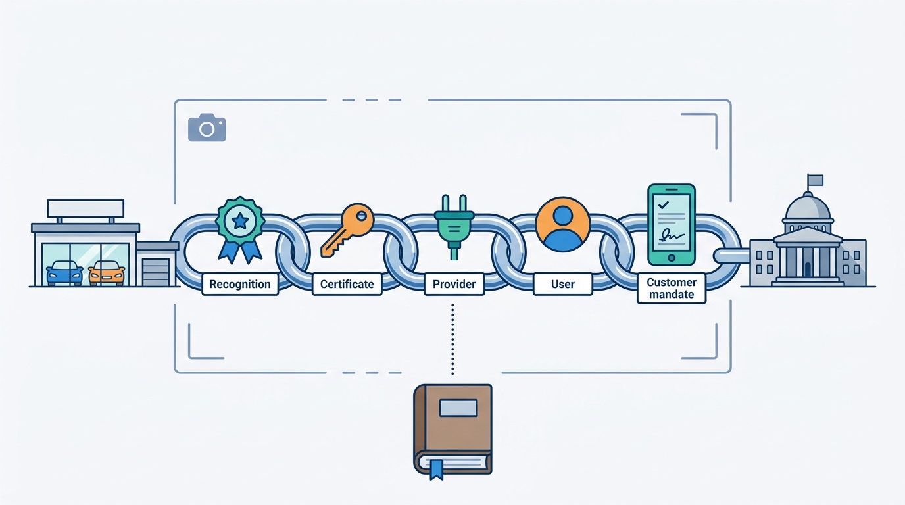
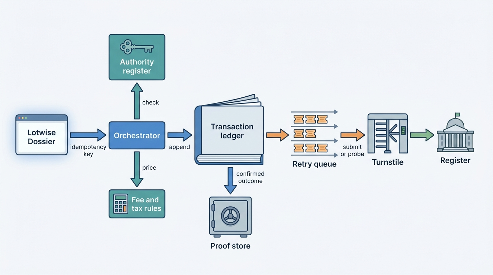
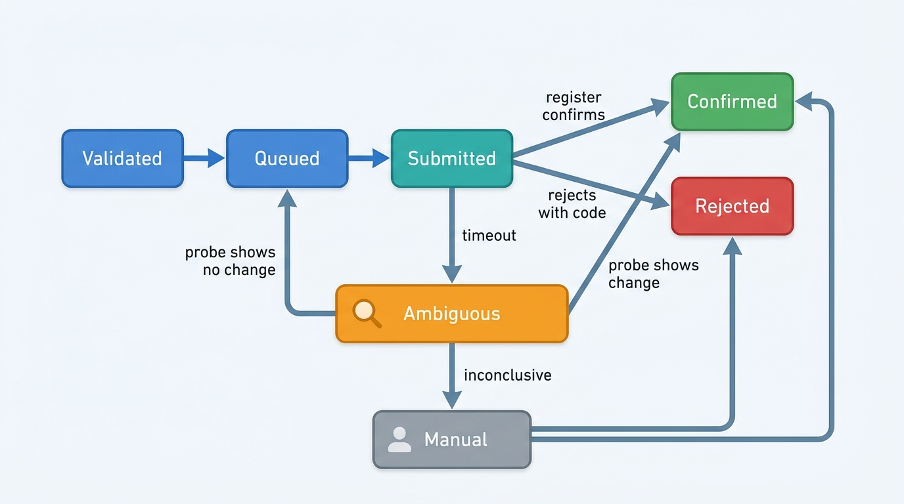
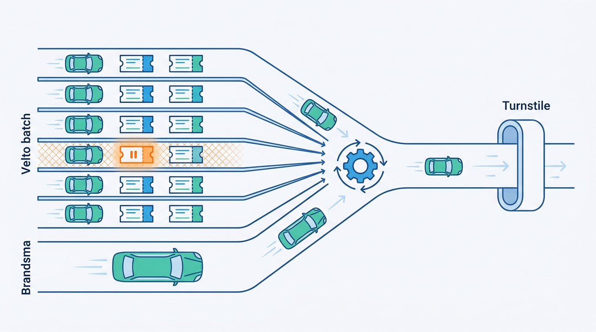
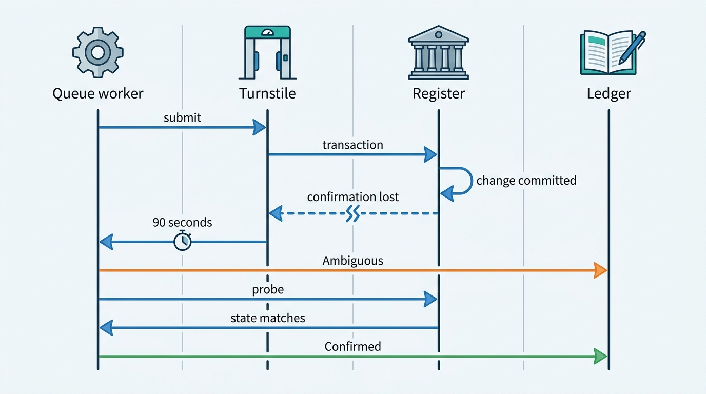

> **IN THIS CHAPTER, YOU WILL:** Learn what a register transaction is in each market, who may submit one on whose behalf, and how to build the transaction service around it: prerequisite validation, fees, an ordered retry queue, duplicate prevention after ambiguous timeouts, proof documents, import and export paperwork, registration-tax engines and plate fulfillment.

> **WHY THE BUSINESS CARES:** A car that is not registered in the buyer's name cannot leave the showroom, and a seller without proof of release keeps receiving the car's tax and fines. Registration is the last step of every sale and the first step of every purchase. When it fails at quarter-end, the dealer loses deliveries, and the platform loses the trust that its other products rely on.

> **WHY ARCHITECTS SHOULD CARE:** A register transaction is a write with legal effect into a system you do not control, over a channel that can fail after the change is committed. Authority, ordering, idempotency and proof are not features you can add later. They decide whether an outage produces a queue that drains cleanly or hundreds of double submissions that people have to correct by hand.

> **KEY POINTS:**
>
> * **A register transaction is a legal act, not an API call.** Record who acted for whom, under which recognition and certificate, with which customer mandate, what was sent, what came back, and the proof. Validate every prerequisite before submission, because the register's rejection costs a customer's delivery slot.
> * **An ambiguous timeout is a third outcome, not a failure.** The register may have committed the change before the connection broke. Ask the register what it did before you resubmit, give every transaction one idempotency key from the dealer's click to the invoice line, and charge on confirmation only. That is the lesson of Axleby's 214 double submissions.
> * **Queue per vehicle, in order, and tell the truth while you wait.** The Dutch register forbids completing a registration during a disruption, so the only honest degraded mode is a visible, ordered queue with per-vehicle lanes, per-dealer fairness and a status the dealer can show the buyer. Registration taxes need the same discipline: versioned, dated rule sets whose results can be reproduced for the tax authority.

> **[FAILURE PATTERNS THIS CHAPTER ADDRESSES](where-vehicle-platforms-go-wrong.html):**
>
> * **Borrowed Uptime** — every sale and stock-in depends on a register channel that peaks at month-end, so a register outage becomes the dealer's outage unless the platform queues, orders and explains.
> * **The Tenant Blur** — registration authority belongs to a legal entity and its recognitions; when it is modeled as a shared login, nobody can prove who registered which car on whose behalf.
> * **The Unmetered Call** — a fee charged on submission rather than on confirmation turns every retry into a billing dispute.

 
Most of what a vehicle platform does is advisory. A valuation can be wrong and corrected; an advert can be withdrawn. **A register transaction is different: it changes who is legally responsible for a car.** Once the Dutch register records a car in a buyer's name, the buyer owes its road tax, insurance and periodic inspection. None of this can be undone by deleting a row.

This chapter owns three terms: the **register transaction**, the **transaction authority** and the **registration tax engine**. It builds on [[registers-and-official-data]], which owns the register gateway and the read side of register access, on [[inventory-and-vehicle-dossier]], whose register track records what the transactions achieved, and on [[deals-and-sales-documents]], whose *stock item sold* event starts the registration in the buyer's name. Since **June 2027** that start is automatic for rooftops on Lotwise Sales Admin, with the transaction held as a draft until the deal's balance is covered (a per-entity payment release rule); for sales that originate in a DMS, the dealer still starts it with a click. The full journey from signed contract to new owner, including the hours of the Month-End Register Outage seen from the showroom, belongs to [[journey-sale-to-registration]]; general dependency budgets and degraded modes belong to [[reliability-and-dependencies]].

## Setting the Scene at Axleby: Quarter-End, 14:20

Axleby, the fictional vehicle data and dealer software group this book follows (see [[meet-axleby]]), runs **Axleby Trade**, a business line since **2004** that submits official register transactions for the Dutch trade, prepares import and export documents, calculates registration tax and sells plates and trade materials. It processed **1.25 million** Dutch register transactions in 2026, at **€6.50** each plus the register's own fee, with month-end and quarter-end peaks of about **4×** the daily average. The **Axleby Trade back office** (.NET services and a transaction retry queue) reaches the register through **Turnstile**, the group's register gateway.

On Wednesday **31 March 2027**, the last working day of the quarter, the Dutch register's transaction channel became unavailable to Axleby at 14:20. It stayed unavailable for **5 hours 40 minutes**. The retry queue did what it was built to do: **3,100** transactions queued, and when the channel came back the queue drained them in order. But **214** transactions were submitted twice after ambiguous timeouts and needed correction.

Daan Visser, Product Manager of Axleby Trade, reconstructed the 214 the next morning (Axleby figures, fictional):

| What arrived during the window | Count | Submitted twice |
| --- | --- | --- |
| Registrations in a buyer's name (*tenaamstellen*) | 1,610 | 131 |
| Stock-ins with release of the seller (*vrijwaren*) | 1,240 | 83 |
| Export notifications | 180 | 0 |
| Other (plate and document requests) | 70 | 0 |
| **Total** | **3,100** | **214** |

All 214 double submissions happened in two short windows: the first 45 minutes of the outage, while the channel still answered some requests slowly before it stopped answering at all, and the first 20 minutes after it recovered. In every case the register had committed the first submission; Axleby's 30-second client timeout fired before the confirmation arrived. The worker treated the timeout as a failure and resubmitted. The register rejected the second message, because the car was no longer in the state the message assumed, and **the back office recorded that rejection as the outcome**. Dealers saw "rejected" for 214 acts that had succeeded. No proof documents were produced for them. Billing had emitted a fee on each submission, so 214 fees would have been charged twice.

Three people spent two working days correcting them: query the register for each car, set the true status, produce the missing release certificates, credit the duplicate fees. Ines Marchetti, Group Chief Architect, asked the post-incident review a narrower question than "how do we avoid register outages", which no one at Axleby can answer: **what must be true of a register transaction so that an outage, a timeout or a retry can never make Axleby's record disagree with the register's?**

## What a Register Transaction Is

### The legal act and its types

A **register transaction** is a request, submitted by a party with the legal authority to make it, that changes the official record of a vehicle in a government register and produces proof that it did. The types differ by market:

| Market | Main dealer transactions | Channel for the trade | Proof |
| --- | --- | --- | --- |
| **Netherlands** (RDW, *Rijksdienst voor het Wegverkeer*, the national vehicle authority) | Stock-in to trade stock (*bedrijfsvoorraad*) with release of the seller (*vrijwaren*); registration in the buyer's name (*tenaamstellen*); export notification; import registration with or without inspection; dismantling | Online message under an RDW recognition, through a provider or directly | Release certificate (*vrijwaringsbewijs*) printed for the seller; transaction code and date; registration card mailed to the buyer |
| **Belgium** (DIV, the vehicle registration directorate) | Registration of the new owner; plates follow the owner | Commonly insurer- or broker-driven electronic requests (not verified from a primary source) | Registration certificate; plate posted to the owner |
| **Germany** (local registration offices; central register at the KBA, the federal motor transport authority) | New registration, re-registration with or without keeper change, deregistration (XKfz codes NZ, UO/UM/UI, AB) | Local office, registration services, i-Kfz (internet-based registration) portals; a machine interface for large customers (GKS) since 2023 | Registration documents and notices, delivered electronically for GKS users |
| **United Kingdom** (DVLA, the Driver and Vehicle Licensing Agency) | Keeper change to or from the trade on the V5C (the vehicle log book); first registration of new cars | Online keeper notifications; Register a Vehicle (RaV) for manufacturers and retailers | New V5C to the keeper; online confirmation |
| **United States** (state Departments of Motor Vehicles, DMVs) | Title transfer, title and registration for the buyer, lien recording and release | State DMV systems, often through dealer service providers; electronic lien and title (ELT) for lenders | Title (paper or electronic), registration, lien record |

The Dutch row carries most of this chapter, because that is where Axleby transacts. The RDW's 2026 information pack for the trade describes it ([RDW, 2026](https://www.rdw.nl/-/media/rdwnl/documenten/bedrijf-met-rdw-erkenning/toezichtbeleid/tbb-en-informatiemap-2026/informatiemap.pdf)). To take a car into trade stock, the dealer enters the registration document number with its 9-digit transfer code (*tenaamstellingscode*) and the odometer reading. The dealer then cuts the registration card in half and must print and hand the seller a **release certificate**, which "proves that the registration has been put in another name". From that moment the seller is no longer responsible for road tax, insurance and inspection. To sell out of stock, a dealer with the right recognition registers the car in the customer's name after the customer signs a **digital authorization** (*machtiging*) with DigiD or eHerkenning, the Dutch government logins for citizens and companies. It is valid for three months; the RDW mails the registration card within five working days ([RDW, n.d.](https://www.rdw.nl/zakelijke-partners/bedrijven-met-rdw-erkenning/op-naam-zetten/voertuig-op-naam-van-een-klant-zetten)).

Two properties make these transactions hard to build:

- **They are synchronous, all-or-nothing and cannot be faked during an outage.** The RDW's information pack is explicit (in translation): "During a disruption of message traffic with the RDW you may not receive confirmation of the registration. You can only register the vehicle once the disruption is over." No degraded mode can complete the transaction; it can only queue it.
- **They are state-guarded.** A stock-in consumes the transfer code; a registration in the buyer's name requires the car to be in the dealer's stock. Submitting the same message twice does not produce the same result twice. The second one is rejected, because the first one changed the state it depended on. That is why a blind retry turns a success into an apparent failure.

### Transaction authority: who may act for whom

**Transaction authority** is the chain of legal permissions that allows a particular submission: which legal entity acts, under which recognition, through which credential, operated by which person, on behalf of which customer. In the Netherlands the chain has five links, all documented in the RDW's 2026 pack:

1. **The recognition (*erkenning*).** Every company starts with a basic recognition (which requires a certificate of conduct and a Chamber of Commerce entry), then adds recognitions per activity: trade stock, registration in customers' names, export, dismantling, import registration. If the basic recognition is withdrawn, all others lapse.
2. **The certificate.** An RDW-issued certificate, "as it were the key to RDW's electronic front door", valid for **2 years** and renewed automatically. The dealer needs one whether it connects directly or through a provider.
3. **The provider.** "For most recognitions you need an online connection with the RDW. For this connection you need a provider." The RDW lists eight providers on its site, and says that through providers dealers pay less than through the RDW itself ([RDW, n.d.](https://www.rdw.nl/zakelijke-partners/erkende-bedrijven/voorwaarden-en-gebruik/providers)). Inspected import registration needs a direct connection.
4. **The user.** The employee who performs the action. The register sees the company and its certificate; the platform must know the person.
5. **The customer mandate.** The buyer's DigiD authorization for a registration in their name; the seller's documents and transfer code for a stock-in.

Since **1999** Axleby has been what this book calls an **authorized information provider** to the Dutch register: a book term, defined in [[registers-and-official-data]], for a contractual data-supply and transaction-provider relationship, not an official RDW title. That relationship lets Axleby carry messages; it does not give Axleby authority to act. **Authority belongs to the dealer's legal entity**, which is why [[tenancy-and-dealer-groups]] attaches it to the entity and rooftop in the tenant hierarchy, and why [[identity-access-and-entitlements]] decides which users may use it. Germany adds a sixth link: a registration service acting for third parties through the large-customer interface needs a power of attorney signed with a qualified electronic signature ([KBA brochure, 2024](https://www.landkreis-eichstaett.de/fileadmin/Dateien/Website/Dateien/SG_52_Verkehrswesen_KFZ/Informationsbroschuere_GKS.pdf)).

The rule I use: **every transaction record stores the whole chain as it was at submission time**: entity and recognition ids, certificate serial and expiry, user id, mandate id and validity, provider route. Store the chain itself, not references to the current values. A recognition withdrawn next year must not change what last year's records say.

**Figure 1:** *Authority for a Dutch register transaction is a chain of five links, from the recognition to the customer mandate, and every transaction record stores the whole chain as it was at submission time.*

### The proof

The **proof** is the evidence that the register accepted the act: the confirmation message stored verbatim, the transaction code and timestamp the register returned, and the documents produced from them, such as the release certificate the seller takes home. The dealer and customer need it today, auditors may ask for it years later, and the platform reconciles against it. A transaction without stored proof is a claim, not a record.

## Architecture: The Axleby Trade Transaction Service

After the outage review, Axleby kept the Trade back office and its queue but changed what they promise. The components:

**Figure 2:** *The transaction ledger is the system of record for what Axleby asked the register to do and what it knows came back; everything downstream, including the fee, reads the ledger's confirmed outcomes rather than the submission.*

| Component | Owns | Does not own |
| --- | --- | --- |
| **Transaction orchestrator** | Validation of prerequisites, authority and fees; creating the transaction with its idempotency key | Talking to the register |
| **Authority register** | Recognitions, certificates (serial, expiry, custody), provider route and user delegations per legal entity and rooftop | Customer mandates (stored on the transaction) |
| **Transaction ledger** | One record per legal act: state, attempts, verbatim requests and responses, authority chain, proof references | Vehicle facts (read from Anchor and the register mirror) |
| **Retry queue** | Ordering per vehicle, fairness per dealer, pacing per certificate and channel | Business decisions about what to submit |
| **Turnstile** | Sessions, certificates on the wire, channel health, timeouts, the circuit to the register ([[registers-and-official-data]]) | Retry policy for legal acts |
| **Proof store** | Immutable documents with hashes and retention class | Generating them before confirmation |
| **Fee and tax rules** | Register fees, Axleby fees, registration-tax calculations (versioned) | Invoicing ([[billing-and-metering]]) |

### The transaction record and its states

The ledger models each legal act as a small state machine. The state that the March design lacked is **Ambiguous**:

**Figure 3:** *An ambiguous outcome is resolved by asking the register what it did, never by resubmitting; only a probe that shows no change sends the transaction back to the queue.*

Three rules keep the states honest. **Rejected means the register said no with a reason code** about this submission; a rejection that arrives for a retry after an ambiguous outcome is evidence for the probe, not a final outcome. **Confirmed requires evidence from the register**: the confirmation message or a probe showing the change. **Only Confirmed produces proof, events and a fee.**

### Prerequisite validation

A register rejection at the counter is expensive: the buyer is waiting, the slot is gone and the dealer calls support. The orchestrator therefore checks everything it can before submission, and the dealer sees the result while the customer is still at the desk. In the Netherlands:

| Check | Source | Typical failure caught |
| --- | --- | --- |
| Entity holds the recognition for this transaction type | Authority register | A rooftop added to a group before its recognition transferred |
| Certificate valid and not expiring before the queue could drain | Authority register | Certificate renewal stuck; the two-year expiry falls on a peak day |
| Vehicle status allows the act | Register mirror (transfer-possible flag, export flag) plus a live register status query for the awaiting-inspection status (*wachten op keuren*), which RDW open data withholds | Car flagged for inspection after damage; car already exported |
| Document number and transfer code present and well-formed | Dealer input, scanned card | Typo in the 9-digit code |
| Odometer reading captured, with who read it and when | Dealer input | Missing reading, or a reading lower than the last one in the dossier |
| Buyer's digital authorization present and within its three months | Mandate record | Authorization signed for a previous car or expired |
| Stock cover registered by the dealer's trade insurer | Register mirror | Insurer has not registered the trade policy for a new rooftop |
| Per-vehicle order: no earlier unfinished act for this car | Transaction ledger | Registration in the buyer's name submitted before the stock-in confirmed |

The RDW requires recognized companies to record the odometer reading at stock-in, transfer and export, always as read from the dashboard. The orchestrator warns when a reading is lower than the dossier's last one but never "corrects" it: it is a regulated declaration whose provenance matters to [[vehicle-history]].

### Fees

A transaction carries two fees: the register's fee and Axleby's own. The RDW lists **€13.10** for a registration in a customer's name done through the RDW itself, and says provider rates are lower ([RDW, n.d.](https://www.rdw.nl/zakelijke-partners/bedrijven-met-rdw-erkenning/op-naam-zetten/voertuig-op-naam-van-een-klant-zetten)); Axleby charges **€6.50** plus the register's fee. The register's fee is a **pass-through cost** ([[scale-and-cost]]): Axleby pays it and recharges it, so each fee line must cite the ledger record and the register's transaction code. After March, the orchestrator quotes both fees at validation, and the ledger emits one usage event to **Meterline**, Axleby's usage metering service, keyed on the transaction id, **on confirmation only** ([[billing-and-metering]] owns the meter). A double submission can no longer produce a second fee, because there is no second transaction.

### The retry queue: order per vehicle, fairness per dealer

The March queue was a single first-in, first-out list. It preserved global order, which was more than was needed, and it let one dealer group's quarter-end batch (Velto's central desk started about 380 registrations between 14:00 and 15:00 on 31 March) delay a one-rooftop dealer's single sale. The redesigned queue has three levels:

- **One lane per vehicle (AVK).** Acts on the same car must happen in order: stock-in before registration in the buyer's name, stock-in before export. The lane key is the Axleby Vehicle Key from Anchor, not the plate; a plate can change on import, and two acts on the same car must share a lane ([[vehicle-identity]] owns the key). A lane whose head is Blocked, Ambiguous or Manual holds every later act on that car, and only that car.
- **Fair scheduling across dealers.** Lanes are drawn round-robin per legal entity, so a group's batch shares capacity rather than taking it.
- **Pacing per certificate and channel.** After an outage the queue drains at a controlled rate that Turnstile sets from channel health, not at full speed. A queue that floods a recovering channel creates the slow, half-working conditions that produced the 214 ambiguous outcomes.

Lanes also carry priority, derived from the delivery time on the deal ([[deals-and-sales-documents]]): a buyer in the showroom goes before a stock-in from last week.

**Figure 4:** *One lane per vehicle, fair scheduling across dealers and a paced drain mean that a group's batch of about 380 registrations shares capacity with a one-rooftop dealer's single sale, and a stuck act holds only its own car.*

### Ambiguous timeouts and duplicate prevention

Duplicates come from two places: the dealer, who clicks again, and the platform, which retries. Each has its own defense.

**Against dealer duplicates: one idempotency key from click to invoice.** The Lotwise Dossier and the Trade API send an idempotency key with every request. The orchestrator stores key → transaction for the life of the transaction, so a repeated click, a browser retry or an API client's retry returns the existing transaction instead of creating a new one. A second, business-level guard catches what keys miss: the ledger refuses a second open transaction of the same type for the same vehicle and entity unless the first ended in Rejected.

**Against platform duplicates: probe before retry.** When a submission times out, the worker does not resubmit. It moves the transaction to Ambiguous and asks the register for the car's current state through the information channel: is the car now in this dealer's stock, or in this buyer's name, since the submission time? Where the channel accepts a client reference that it echoes back, Axleby sends the transaction id and uses it in the probe. Whether a given register channel offers that is a fact to check per channel, not to assume.

**Figure 5:** *Probe before retry: the worker treats the timeout as a question and asks the register; the answer, not the timeout, decides between Confirmed and a resubmission.*

The probe has limits: the information channel can fail together with the transaction channel, and a matching state can have another cause. So a probe has three outcomes: **matches** (Confirmed by probe, with the evidence stored), **does not match** (back to Queued, safe to resubmit) and **inconclusive** (Manual, a person decides). During a full outage, Ambiguous transactions simply wait in their lanes. They are never resubmitted while the probe cannot run.

Two settings changed too: the client timeout for transaction messages rose from 30 to 90 seconds, because a slow confirmation beats an ambiguous one, and Turnstile now opens the circuit when response times degrade, not only on errors, so the queue stops submitting into a brownout ([[reliability-and-dependencies]]).

### Requirements per interaction

| Interaction | Consistency | Latency | Freshness | Availability |
| --- | --- | --- | --- | --- |
| Prerequisite check at the desk | Read from register mirror and authority register; show data age | p95 under 2 s *(assumption)* | Status flags same day; recognitions and certificates on change | Must work during a register outage (mirror) |
| Create transaction | Strong in the ledger; idempotent per key | p95 under 500 ms *(assumption)* | Not applicable | Must work during a register outage (queues) |
| Submission | One act per transaction; per-vehicle order | Bound by the register; 90 s timeout | Not applicable | Only when the channel is open; never simulated |
| Ambiguous resolution | Register state is the truth | Minutes; Manual within one working hour at peaks *(assumption)* | Probe at resolution time | Waits for the register |
| Status to dealer and buyer | Ledger state, including Queued and Ambiguous, with times | Seconds after state change | Real time | Must work during an outage; "waiting for the register" is a valid answer |
| Proof document | Only from Confirmed | Under 1 minute after confirmation *(assumption)* | Not applicable | Can lag; must not be lost |
| Fee event | Exactly one per Confirmed transaction | Same day | Not applicable | Can lag; reconciled before the invoice run |

## Import, Export and Trade Documents

Cross-border trade adds documents and dependencies that a domestic sale never touches. They are a trade desk's case work, and the platform's job is to make the sequence, the deadlines and the evidence visible.

**Export from the Netherlands to another EU country.** The RDW's pack describes the act: the exporter appears in person; the dealer checks original identification, enters the odometer reading, prints a paper part II of the registration certificate for registration abroad, cuts the plates and gives the exporter a release certificate; the register returns a transaction code and date. The money follows a separate rule. The Belastingdienst, the Dutch tax authority, refunds part of the registration tax (BPM, the Dutch tax on passenger cars and motorcycles paid at first registration) on export of a used vehicle only if it received a Dutch plate on or after 16 October 2006, is not a damage vehicle, has the status "Export" at the RDW and is registered in another country of the European Economic Area (EEA) within **13 weeks** of that status ([Belastingdienst, n.d.](https://www.belastingdienst.nl/wps/wcm/connect/nl/bpm/content/teruggaaf-bpm-export-gebruikt-motorrijtuig)). So an export case has a clock that starts with the register transaction, and evidence (the foreign registration) that arrives weeks later from another country. The case store tracks both, and the refund claim waits for the evidence.

**Export outside the EU.** The car becomes goods leaving the customs union. The export declaration "must be submitted by electronic means, through the Automated Export System (AES)" and the goods are presented at the customs office of exit ([European Commission, n.d.](https://taxation-customs.ec.europa.eu/customs-4/customs-procedures-import-and-export-0/what-exportation_en)). The register act (export notification) and the customs act (declaration and exit) are separate, with separate proofs. A case is complete only when both are.

**Import into the Netherlands.** Here the register depends on the tax authority. A dealer with the inspected-import recognition applies over a direct RDW connection; the RDW checks that BPM has been paid before registering; the dealer files the BPM return and must post the original foreign registration certificate to the RDW within **10 working days**. A dealer holding a permit under article 8 of the BPM Act may pay after registration ([RDW, 2026](https://www.rdw.nl/-/media/rdwnl/documenten/bedrijf-met-rdw-erkenning/toezichtbeleid/tbb-en-informatiemap-2026/informatiemap.pdf)). Foreign documents are read through the harmonized field codes of Directive 1999/37/EC: (A) registration number, (B) first registration date, (D.1–D.3) make, type and commercial description, (E) vehicle identification number (VIN) and (K) type-approval number ([Directive 1999/37/EC](http://publications.europa.eu/resource/celex/31999L0037)). Capturing them by code gives one canonical import record whatever the source country.

| Case | Register act | Other authority | Deadline the platform tracks | Evidence that closes it |
| --- | --- | --- | --- | --- |
| Export, EU | Export notification | Belastingdienst (BPM refund) | Foreign registration within 13 weeks for the refund | Foreign registration document |
| Export, non-EU | Export notification | Customs (AES declaration, exit) | Exit confirmation *(timing set by customs)* | Customs exit record |
| Import, EU used car | Inspected import registration | Belastingdienst (BPM return) | Foreign certificate posted within 10 working days | RDW confirmation; BPM assessment |

The proposed replacement of Directive 1999/37/EC, COM(2025) 179 of April 2025, would introduce digital registration certificates and cross-border register data sharing through a new hub. It had not been adopted as of October 2026 ([EPRS, 2026](https://www.europarl.europa.eu/RegData/etudes/BRIE/2026/782608/EPRS_BRI(2026)782608_EN.pdf)). The design implication is modest and immediate: model the foreign certificate as evidence with a type (paper scan, digital credential), not as a scan field on the case.

## Registration Taxes: The Engine That Must Be Reproducible

A **registration tax engine** computes the one-off taxes due when a car is registered (or the refund when it leaves), from versioned, dated rule sets, and records every input and rule version so that the result can be reproduced for the tax authority. Registration taxes are not a back-office detail. Dutch BPM can be several thousand euros on a used import, so it changes the landed cost of every import and the residual value of every export, which makes it an input to [[vehicle-acquisition]] and [[used-car-pricing]].

### What the Dutch rules require of an engine

The Belastingdienst's own pages, read in October 2026 (quotations translated), show why BPM is an engine and not a formula:

- **Gross BPM is a banded CO2 table.** For 2026, a passenger car between 100 and 139 g/km pays €2,727 plus €181 per gram above 100; above 155 g/km, €14,538 plus €594 per gram above 155. Diesel cars above 70 g/km add a surcharge of €114.83 per gram above 69 g/km ([Belastingdienst, n.d.](https://www.belastingdienst.nl/wps/wcm/connect/nl/bpm/content/personenauto-bpm-tarief-berekenen)).
- **The CO2 value has rules of its own.** The engine uses the value the RDW registered; for cars first admitted before 1 July 2020 the declarant may choose between values from the current (WLTP) and former (NEDC) EU test procedures in defined cases; when no value is known, default values apply (for example 550 g/km for a petrol car first admitted from July 2020).
- **For a used car the declarant may choose the current tariff or an older one**, so the engine must hold every historic tariff year; the Belastingdienst publishes them back to 1993.
- **Depreciation has three methods**: a trade price list (*koerslijst*), a valuation report (*taxatierapport*, only for cars with more than normal damage or not in a price list) or a fixed table (*forfaitaire tabel*). "You may choose the most favorable depreciation method. Your choice is final." With the fixed table, a car first admitted at least 17 years and 10 months ago owes no BPM ([Belastingdienst, n.d.](https://www.belastingdienst.nl/wps/wcm/connect/nl/bpm/content/bpm-afschrijving-koerslijst-taxatierapport-forfaitaire-tabel)).
- **The methods have evidence rules and dates.** The price-list method uses the most recent list, one list only, the full vehicle specification including options, and a reference date of the day the RDW completed its inspection. A valuation report is valid only if the appraiser examined the car within one month before the RDW inspection; the car must remain available unchanged for six working days after payment; and if the inspector calls the car in, "the RDW issues no registration as long as the vehicle has not been shown".

The Belastingdienst's own worked example shows the arithmetic: a diesel first admitted on 8 October 2024 with 100 g/km has a gross BPM of €5,196 at the 2024 tariff; a price-list depreciation of 56.54% leaves **€2,258** to pay.

The architecture follows from that list:

- **Rule sets are data with effective dates**, released before they take effect, and the engine can evaluate any historic tariff year. A new year's table is a release, not a code change.
- **Inputs carry provenance.** CO2 from the register, catalog price, specification and options from [[specification-and-equipment]], the price-list value with the list's name and edition, the odometer reading. A wrong edition means a wrong reference vehicle and a wrong tax.
- **The engine computes every permitted method and shows them side by side**, then records the declarant's choice, because the choice is final and the dealer, not the engine, makes it.
- **Every calculation is stored with inputs, rule version and method choice** for the fiscal retention period and can be re-run exactly; a rule change lists the open cases calculated under the old rule.
- **The tax and register cases share one case id**, because the register waits for the tax and the tax refers to the register's inspection date.

### Belgium and the UK

Belgium's equivalent, the tax on putting a vehicle into use (*belasting op de inverkeerstelling*, BIV), is regional. In Flanders it is collected by the Flemish tax service; it is owed on every first use on public roads, including by the buyer of a second-hand car; the person named on the registration certificate pays; vehicles on a trade plate are exempt; and the calculation depends on the vehicle type and, in some cases, on when it was registered with the DIV ([Vlaanderen.be, n.d.](https://www.vlaanderen.be/belastingen-en-begroting/vlaamse-belastingen/verkeersbelastingen/belasting-op-de-inverkeerstelling/wie-moet-de-belasting-op-de-inverkeerstelling-betalen)). The engine therefore needs the owner's region as an input, which is a personal-data field and a privacy decision ([[privacy-and-retention]]).

The UK's Vehicle Excise Duty (VED) is paid at first registration and yearly afterwards. For cars first registered from April 2017, the first payment depends on CO2, from £10 at 0 g/km to £5,690 above 255 g/km; the standard rate afterwards is £200 a year (rates as of 2026); and an expensive-car supplement applies above a list-price threshold ([GOV.UK, n.d.](https://www.gov.uk/vehicle-tax-rate-tables)). Rates change every April, and tax does not transfer to the buyer: the seller is refunded for full remaining months ([GOV.UK, n.d.](https://www.gov.uk/sold-bought-vehicle)). The engine shape is the same as for BPM, with a smaller rule set.

## Plates and Materials

Plates, export plates and trade materials are physical goods tied to register acts: export plates follow an export notification, new plates a registration. For the platform this is ordinary order fulfillment with one rule: **an order that depends on a register act references the transaction and waits for its Confirmed state.** At Axleby, the "other" row of the March table (70 plate and document requests) is the part of the outage dealers felt last: plates for cars registered late on 31 March were made on 1 April.

## In Practice

### What one register publicly documents: the German large-customer interface

No register publishes its transaction channel's internals, but the KBA's 2024 brochure on the German large-customer interface (*Großkundenschnittstelle*, GKS) is a rare documented design ([KBA, 2024](https://www.landkreis-eichstaett.de/fileadmin/Dateien/Website/Dateien/SG_52_Verkehrswesen_KFZ/Informationsbroschuere_GKS.pdf)). Any company with more than **500** registration transactions a year may become a large customer, paying a one-off **€3,320** and **€0.30** per request from April 2024. Each request gets a unique number. A validation module checks it against the central register and reports errors synchronously; valid requests go to the responsible local office's portal and, if that portal does not collect them, to the office's back office. Statuses are *Bearbeitet* (processed), *Abgelehnt* (rejected), *Weitergeleitet* (forwarded for manual handling) and *Eskaliert* (escalated when a portal collects a request but sends no response within five minutes). The brochure also makes the large customer's **software provider** the first line of support.

Three lessons transfer: a **client-created request number** makes "did you get this?" answerable; **"forwarded" and "escalated" are first-class states**, because some acts take days and involve people; and **a vendor that transacts for dealers inherits support** for the register's errors. A trade advertorial reported that about **4.7%** of German registration transactions used the GKS in the first half of 2025 ([autohaus.de, 2025](https://www.autohaus.de/advertorials/artikel/digitale-zulassungsservices-wie-die-premiumzulasser-ihre-fuehrungsposition-ausbauen-3690153); paid content, so treat the figure with care).

### Axleby: Brandsma's Corolla after the redesign

The redesigned service went live on **14 June 2027**, before the next quarter-end (Axleby, fictional). Two weeks later, Autobedrijf Brandsma in Leeuwarden delivered the 2020 Toyota Corolla described in [[deals-and-sales-documents]], with a 2014 Volkswagen Polo traded in.

1. **At signing**, the buyer signed the DigiD authorization for the Corolla on her phone in the showroom, and Lotwise drafted the Polo's stock-in from the customer's registration card and transfer code. Both were validated on the spot: Brandsma's recognitions, its certificate (expiring in **11 months**), the Corolla's status, the authorization's validity and the Polo's documents. Nothing was submitted yet, because the Polo was still the customer's car.
2. **On delivery day**, the customer handed over the Polo. Sietse Brandsma read **187,420 km** from its dashboard; the stock-in was submitted and Confirmed in seconds, and the release certificate printed for the customer.
3. **The invoice** moved the Corolla to *sold*, and, because Brandsma is a Sales Admin rooftop, the *stock item sold* event created the registration in the buyer's name automatically, with the deal's idempotency key. A dealer whose sales originate in a DMS would have clicked to start it. The quoted fees were €6.50 plus the register's fee.
4. **The first submission timed out at 90 seconds** on a slow afternoon. The transaction went to Ambiguous; the probe showed the Corolla registered to the buyer two minutes earlier; the transaction became Confirmed by probe. One fee, one proof, one dossier event. Sietse saw "confirmed (verified with the register)" and never knew a timeout had happened.

On **30 June 2027**, quarter-end, the queue's dashboard showed peak lane depth and the oldest Ambiguous item; there were 41 ambiguous outcomes that day, all resolved by probe, and no double submissions (Axleby figures, fictional). The full showroom-side story of 31 March, including what dealers told waiting buyers, is told in [[journey-sale-to-registration]].

## Failure Handling

| Failure | Detection | Recovery |
| --- | --- | --- |
| **Dealer double click or API client retry** | Same idempotency key | Return the existing transaction; no new act |
| **Second transaction of the same type for the same car** | Ledger guard on open transactions per vehicle, type and entity | Refuse with a link to the open one |
| **Ambiguous timeout** | No response within 90 s; connection lost after send | Ambiguous state; probe; never resubmit unprobed |
| **Rejection after a retry** | Rejection code on a transaction with an earlier ambiguous attempt | Treat as probe evidence; resolve by register state, not by the code |
| **Conflicting acts on one car** (two rooftops of a group, or a dealer and another provider) | Probe or rejection shows the car in an unexpected state | Manual; the register's state wins; the dossier shows who holds the car |
| **Incomplete record** (missing code, reading or mandate) | Validation | Blocked with the missing field named; nothing queued |
| **Partial failure in a multi-step case** (stock-in confirmed, registration rejected) | Case state with per-act outcomes | Each act stands on its own; the case shows what is done and what is not; no compensating register act without a person |
| **Register outage** | Turnstile circuit open; channel health | Queue with visible status and estimated position; banner in Lotwise; paced drain on recovery |
| **Certificate expiring or revoked** | Authority register monitors expiry 60 days ahead *(assumption)* | Alert entity admin; block submissions under that certificate before the register rejects them |
| **Tax rule change** | New rule set effective date | Recalculate open cases; flag any declared under the old rule |

Wrong registrations are corrected by the register, not by the platform: the RDW can reverse an owner transfer or import registration if the vehicle "does not have the identity" given, under article 51a of the Road Traffic Act ([RDW, 2026](https://www.rdw.nl/-/media/rdwnl/documenten/bedrijf-met-rdw-erkenning/toezichtbeleid/tbb-en-informatiemap-2026/informatiemap.pdf)). The platform's job is to record the correction as a new act linked to the old one, and to propagate it to the dossier, the history record and any report that showed the old owner change ([[journey-data-correction]] shows how far such a correction travels).

## Trade-offs

### How to retry an official transaction

| Approach | How it works | When it is right | What it costs |
| --- | --- | --- | --- |
| **Blind retry** | Resubmit after timeout | Never for state-changing legal acts | Double submissions; false rejections (Axleby, March 2027) |
| **Client request id honored by the register** | Register deduplicates on a reference the client sends | Where the channel offers it (the German GKS request number is the model) | Nothing extra, but depends on the register |
| **Probe before retry** | Ask the register's current state; resubmit only if unchanged | Where an information channel exists and state is observable | Extra reads; waits when the information channel is down too |
| **Manual resolution** | A person checks and decides | Inconclusive probes; low volumes | People time at peaks |

I would combine the last three: use the register's request id where offered, probe everywhere else, and keep a staffed manual queue for what remains. The requirement that justifies this is simple: **the platform must never report an outcome the register did not produce**.

### Be the provider, or integrate with one

| Option | Gains | Costs | Right when |
| --- | --- | --- | --- |
| **Become a register provider** (Axleby's position in NL) | Control of the channel, of transaction latency and of the dealer's experience; fees | Certificates, compliance with provider terms, support obligations, peak capacity | High volume, transactions core to the product, long horizon |
| **Integrate with a provider** | Faster start; the provider carries the register relationship | Two hops between you and the register; outages and ambiguity are reported to you second-hand | Low volume or a new market |
| **Hand off to the dealer or a registration service** | No liability for the act | Re-typing; no proof in the dossier; no fee revenue | Markets where the act is rare or local (Germany for Axleby today) |

## Across Markets: What Changes by Country

| Topic | Netherlands / Belgium | Germany | United Kingdom | United States |
| --- | --- | --- | --- | --- |
| **Who submits** | NL: recognized dealer through a provider or directly; BE: commonly the insurer or broker (not verified from primary sources); Axleby's Belgian transactions run through a partner | Local registration offices, registration services, i-Kfz; large customers (over 500 a year) by machine interface | Keeper or motor trader online; retailers through RaV for first registrations | Dealer or service provider at the state DMV; lenders through ELT |
| **Authority** | Recognitions, a 2-year RDW certificate, the buyer's DigiD authorization | Credentials and technical certificate; qualified-signature power of attorney for third parties | V5C document reference; motor-trader option in the online service | State dealer license; ELT participant ids |
| **Channel shape** | Synchronous; no completion during a disruption | Asynchronous, multi-hop; forwarded and escalated states | Online service with set opening hours | State-specific; batch and online |
| **Proof** | Release certificate; transaction code; card mailed | Electronic documents and notices | New V5C | Title, registration, lien record |
| **Registration tax** | NL: BPM, refund on export; BE: regional BIV (Flanders: Flemish tax service) | None at registration; annual vehicle tax *(general practice; not verified from a primary source here)* | VED first-year rate by CO2, then annual | State sales or use tax and title fees *(general practice; varies by state)* |
| **Axleby's offer (2027)** | Full transaction service in NL; BE through a partner | None; hand-off | None; Showroomly does no register transactions | Not an Axleby market |

California shows the US shape: its electronic lien and title program holds lienholders' title information electronically, lienholders join directly or through approved service providers, and the title goes to the owner automatically when the lien is satisfied ([California DMV, n.d.](https://www.dmv.ca.gov/portal/vehicle-industry-services/electronic-lien-and-title-program/)). Odometer disclosure on transfer is federal and must be supported by electronic title systems ([49 CFR 580.5](https://www.law.cornell.edu/cfr/text/49/580.5)).

**What is common and what is an adapter.** The transaction ledger, the state machine with Ambiguous, idempotency keys, per-vehicle lanes, fair scheduling, the authority-chain record, the proof store, fees on confirmation and the rule-engine shape are common. They are platform. Each register channel is an adapter: message formats, probe method, timeouts, whether a client request id is honored, opening hours and asynchronous statuses. Each tax is a versioned rule set. The German interface would fit the same ledger with more states; the UK keeper notification would fit it with fewer. The authority model differs most and should be data per market, not code.

## The Chief Architect's View

**Decide where the legal act lives.** One service, one ledger, for every register act the group performs, whichever product the dealer clicks in. Lotwise, the Trade API and fleet integrations are clients. The [[one-platform-from-many-products]] work treats this as a shared capability; products that build their own submission path recreate March 2027.

**Make authority a governed asset.** Recognitions and certificates belong to customers' legal entities; Axleby holds some in custody. Name an owner for custody, expiry monitoring and the audit trail, and capture authority at onboarding ([[onboarding-and-configuration]] cut its confirmation time from 11 days to 2).

**Put the queue under product management.** The queue's behavior at month-end is a product decision: what goes first, what dealers see, what support says. Daan Visser owns it at Axleby, with Marta Nowak's platform team owning capacity and Turnstile. A game day before every quarter-end, with a simulated brownout, costs a day and tests the only path that matters on the worst day ([[reliability-and-dependencies]]).

**Watch four numbers**: ambiguous outcomes per day and their resolution time; transactions in Manual; rejected-at-register rate (a rising rate means validation is missing something); and days to certificate expiry across all entities. Show them on the same console support uses ([[observability-and-data-operations]]).

**Plan the next market as an adapter.** Transacting in Germany would make Axleby a registration aggregator, with power-of-attorney management and first-line support for the register's errors. That is a business decision with an architecture bill; the ledger should handle asynchronous states before anyone signs.

## Questions to Ask

1. For each register act we perform, what is the legal actor, the credential and the customer mandate, and do we store the chain as it was at submission time?
2. What does our worker do after a timeout on a state-changing act? Show me the code path.
3. Can the platform ever show "rejected" for an act the register completed? How would we know?
4. Is the idempotency key created at the dealer's click and carried through to the fee line, or invented by the worker?
5. Is the queue ordered per vehicle, and is the lane key stable when the plate changes?
6. Can one dealer group's batch delay another dealer's showroom delivery during a peak?
7. When is a fee emitted: on submission or on confirmation?
8. Which certificates expire in the next 90 days, and who is told?
9. Can we reproduce last year's registration-tax calculation for a given car, with the same rule version and inputs?
10. What does the dealer see, and what can they tell the buyer, while a transaction waits for the register?

The register transaction is the platform's most formal integration: a write with legal effect into a system that sets its own rules. The next chapter deals with a less formal one, a peer system that holds the dealer's books and that the platform also does not control: [[dms-integration]].

## Sources and Evidence

**Company, product and investor sources**

- [Digitale Zulassungsservices: wie die PremiumZulasser ihre Führungsposition ausbauen](https://www.autohaus.de/advertorials/artikel/digitale-zulassungsservices-wie-die-premiumzulasser-ihre-fuehrungsposition-ausbauen-3690153), autohaus.de (paid content by PremiumZulasser eG), 2025: GKS share of German registrations in the first half of 2025.

**Standards, regulation and official documentation**

- [Informatiemap voor de voertuigbranche](https://www.rdw.nl/-/media/rdwnl/documenten/bedrijf-met-rdw-erkenning/toezichtbeleid/tbb-en-informatiemap-2026/informatiemap.pdf), RDW, 2026: recognitions, certificates, providers, stock-in and release, odometer duties, outage rule, export and import acts, article 51a corrections.
- [Providers voor digitale diensten](https://www.rdw.nl/zakelijke-partners/erkende-bedrijven/voorwaarden-en-gebruik/providers), RDW, n.d., accessed 2026-10: the provider model, the listed providers and provider pricing.
- [Voertuig op naam van een klant zetten](https://www.rdw.nl/zakelijke-partners/bedrijven-met-rdw-erkenning/op-naam-zetten/voertuig-op-naam-van-een-klant-zetten), RDW, n.d., accessed 2026-10: digital authorization, its three-month validity, delivery of the card and the €13.10 fee.
- [Personenauto: hoe bereken ik de bpm?](https://www.belastingdienst.nl/wps/wcm/connect/nl/bpm/content/personenauto-bpm-tarief-berekenen), Belastingdienst, n.d., accessed 2026-10: 2026 BPM table, diesel surcharge, CO2 rules and tariff choice for used cars.
- [Bpm afschrijving gebruikte motorrijtuigen](https://www.belastingdienst.nl/wps/wcm/connect/nl/bpm/content/bpm-afschrijving-koerslijst-taxatierapport-forfaitaire-tabel), Belastingdienst, n.d., accessed 2026-10: the three depreciation methods, their evidence rules, the final choice and the worked example.
- [Teruggaaf bpm bij export gebruikt motorrijtuig](https://www.belastingdienst.nl/wps/wcm/connect/nl/bpm/content/teruggaaf-bpm-export-gebruikt-motorrijtuig), Belastingdienst, n.d., accessed 2026-10: export refund conditions and the 13-week window.
- [Wie moet de belasting op de inverkeerstelling betalen?](https://www.vlaanderen.be/belastingen-en-begroting/vlaamse-belastingen/verkeersbelastingen/belasting-op-de-inverkeerstelling/wie-moet-de-belasting-op-de-inverkeerstelling-betalen), Vlaanderen.be, n.d., accessed 2026-10: who pays BIV in Flanders and trade-plate exemption.
- [Großkundenschnittstelle: Informationsbroschüre für Zulassungsbehörden](https://www.landkreis-eichstaett.de/fileadmin/Dateien/Website/Dateien/SG_52_Verkehrswesen_KFZ/Informationsbroschuere_GKS.pdf), Kraftfahrt-Bundesamt, 2024: GKS eligibility, flow, statuses, fees and support model.
- [Council Directive 1999/37/EC on the registration documents for vehicles](http://publications.europa.eu/resource/celex/31999L0037), EU Publications Office, 1999: harmonized certificate field codes and re-registration rules.
- [Revision of the roadworthiness package](https://www.europarl.europa.eu/RegData/etudes/BRIE/2026/782608/EPRS_BRI(2026)782608_EN.pdf), European Parliamentary Research Service, 2026: COM(2025) 179 and its legislative stage.
- [What is exportation](https://taxation-customs.ec.europa.eu/customs-4/customs-procedures-import-and-export-0/what-exportation_en), European Commission, n.d., accessed 2026-10: electronic export declaration through AES.
- [Vehicle tax rate tables](https://www.gov.uk/vehicle-tax-rate-tables) and [Tell DVLA you've sold, transferred or bought a vehicle](https://www.gov.uk/sold-bought-vehicle), GOV.UK, n.d., accessed 2026-10: VED rates and keeper-change rules.
- [Electronic Lien and Title Program](https://www.dmv.ca.gov/portal/vehicle-industry-services/electronic-lien-and-title-program/), California DMV, n.d., accessed 2026-10: ELT in one US state.
- [49 CFR 580.5: Disclosure of odometer information](https://www.law.cornell.edu/cfr/text/49/580.5), US Government Publishing Office via Cornell LII, n.d., accessed 2026-10: odometer disclosure on electronic titles.

**Research and practitioner sources**

- [Timeouts, retries and backoff with jitter](https://aws.amazon.com/builders-library/timeouts-retries-and-backoff-with-jitter/), Amazon Builders' Library, 2019: retrying at one point in the stack and choosing timeouts.
- [Designing robust and predictable APIs with idempotency](https://stripe.com/blog/idempotency), Stripe, 2017: client-supplied idempotency keys on mutating requests.

Axleby is fictional; architectural recommendations, labeled inferences and labeled assumptions are the author's judgement.
