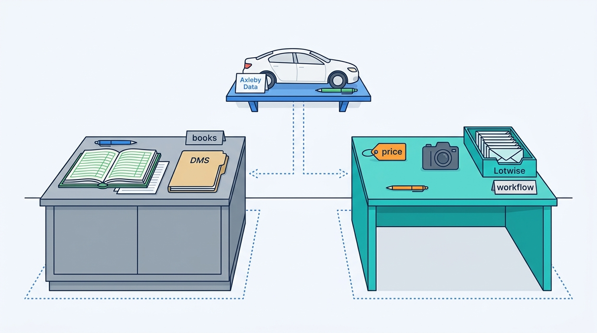
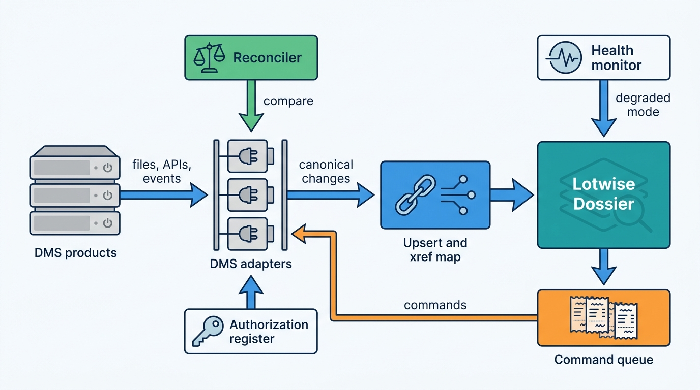
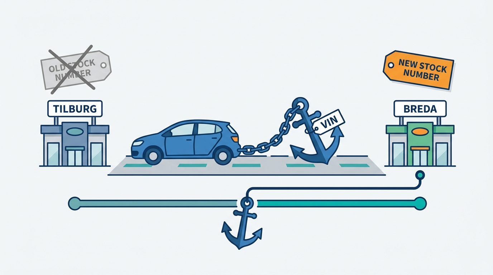
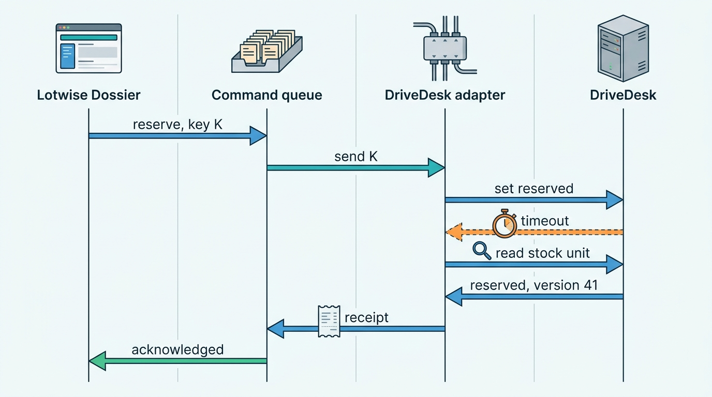
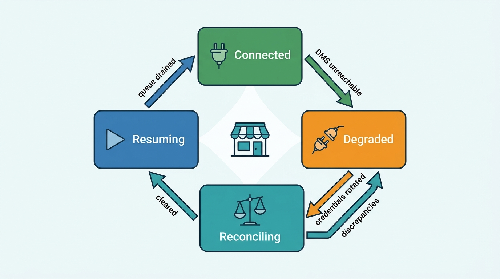

> **IN THIS CHAPTER, YOU WILL:** Learn what a dealer management system owns, how the US and European DMS ecosystems control access to it, and how to build an integration layer of per-DMS adapters, cross-reference maps, idempotent upserts, write-back commands with receipts and reconciliation that keeps working when the DMS does not.

> **WHY THE BUSINESS CARES:** For a franchised dealer the DMS is the accounting system, the deal file and the manufacturer's channel. A dealer SaaS product that cannot read from and write to it gets typed twice or not used. When the DMS stops, the dealer's ability to keep selling depends on whether the SaaS product was designed to carry on alone.

> **WHY ARCHITECTS SHOULD CARE:** DMS integration is the one integration where the other side holds the system of record, sets the access terms and can change both. Field ownership, the adapter boundary, idempotency, reconciliation and degraded mode decide whether DMS data makes your product better or makes it the place where the DMS's errors and outages surface.

> **KEY POINTS:**
>
> * **The DMS owns the books; your platform owns the workflow; decide the rest field by field.** Accounting, the deal file, parts, service and, for most franchised dealers, the stock ledger belong to the DMS. Price, adverts, photos, appraisals and leads usually belong to the dealer SaaS. Write the ownership of every shared field down, per DMS and per rooftop. "Two-way sync" without that table is a promise to overwrite somebody's data.
> * **Integrate only through sanctioned interfaces, one adapter per DMS, behind an anti-corruption layer.** US history from 2015 to 2024 shows that credential-sharing and scraping can be switched off, litigated or repriced overnight. Each DMS is an adapter with its own transport, certification, contract, rate limits and dealer authorization record. The core product never sees a DMS field name.
> * **Assume duplicates, silence and a DMS that is gone for weeks.** Apply inbound changes as idempotent, versioned upserts. Send outbound changes as commands that wait for a receipt. Reconcile counts and checksums per rooftop every night, and always before write-back resumes after an outage. In the 2024 CDK Global outage, dealer groups reported that integrations came back weeks after the core DMS.

> **[FAILURE PATTERNS THIS CHAPTER ADDRESSES](where-vehicle-platforms-go-wrong.html):**
>
> * **DMS Hostage** — workflows built on unsanctioned DMS access, or on a DMS being up, stop the dealer when the vendor changes terms or goes offline.
> * **Borrowed Uptime** — a stock-in, a lead or a sales document that waits synchronously on the DMS inherits the DMS's availability, and the DMS's worst week becomes yours.
> * **The Zombie Listing** — a sold status that never crosses the DMS boundary leaves the car advertised, and every hop reports success.

 
A dealer management system (DMS) is the enterprise resource planning (ERP) system of a car dealership. It keeps the general ledger, the deal file, the parts stock, the workshop's repair orders and, for most franchised dealers, the official list of cars the business owns. The dealer SaaS products this book describes (appraisal, pricing, adverts, syndication, leads) sit next to it. They are faster to change and closer to the market, but **they are not the books**.

That makes DMS integration unlike the other integrations in Part IV. A portal is a channel the platform publishes to; a register is an authority it transacts with. A DMS is **a peer that holds the system of record for half the dealer's business**, is sold by a vendor who may also compete with you, and is often chosen by the car manufacturer rather than the dealer. You do not control its data model, its release cycle, its access terms or its uptime.

This chapter owns three terms: the **DMS**, the **certified interface** and the **DMS adapter**. It builds on [[inventory-and-vehicle-dossier]], which decides what the vehicle dossier holds; on [[listing-syndication]], whose delete propagation depends on a sold status arriving; and on [[leads-and-crm]], whose CRM delivery often lands in a DMS vendor's CRM. It hands the dependency budget and the general degraded-mode design to [[reliability-and-dependencies]], and the lead journey through a DMS to [[journey-lead-to-dms]].

## Setting the Scene at Axleby: The Golf That Changed Its Stock Number

Axleby, the fictional vehicle data and dealer software group this book follows (see [[meet-axleby]]), runs Lotwise for **7,200** dealer rooftops in the Netherlands, Belgium and Germany. Most of them, the independents, use Lotwise as their main system and have no DMS integration at all. The rest are connected to a DMS, and one DMS dominates: **DriveDesk**, a fictional Dutch and Belgian DMS used by **1,900** Lotwise rooftops, including all **46** rooftops of **Velto Mobility Group**.

The post-mortem of the Zombie Golf in **February 2027** started as a syndication problem (the full story is in [[listing-syndication]]). Velto sold a 2021 Volkswagen Golf at its Breda rooftop. DriveDesk recorded the sale. The car stayed live on **4** portals for **4 days**, producing **37** leads and **9** booked test drives for a car that was gone. Relay's queued deletes explained the four days. They did not explain why the sold status never reached Lotwise.

Hendrik Maes, Head of Partner Integrations, traced that part. Three weeks before the sale, Velto had moved the Golf from its Tilburg rooftop to Breda. DriveDesk treats an inter-rooftop transfer as a sale out of one rooftop's stock and a purchase into another's. The Golf got a **new DriveDesk stock number** in Breda. The Lotwise DriveDesk adapter polled DriveDesk's stock export every 15 minutes and matched rows by DriveDesk stock number. The transfer row created nothing (Lotwise already had a Golf with that VIN at Velto), and the sold row for the new stock number matched no Lotwise stock item. It went to an error file that nobody read. Every component did what it was built to do.

Hendrik's inventory of Axleby's DMS integrations made the wider point (Axleby figures, fictional):

| DMS integration | Lotwise rooftops | Transport | Direction | Match key | Reconciliation |
| --- | --- | --- | --- | --- | --- |
| **DriveDesk** (NL, BE) | 1,900 | Stock file export polled every 15 min; partner REST API for leads and customers (since 2025) | Stock in; leads out | DriveDesk stock number | None |
| Two German DMS products | 140 | Nightly CSV extract via SFTP | Stock in | Vendor stock number | None |
| Several franchise-brand systems | 210 | Brand-specific files and XML messages | Stock in; some leads out | Mixed | None |
| **Total connected** | **2,250** | | | | |

A different match key per DMS family, three transports, no reconciliation and no record of which dealer had authorized what. Ines Marchetti, Group Chief Architect, put one question to the architecture forum: **what should Lotwise own, what should the DMS own, and what has to be true of every DMS integration so that a car sold in the DMS is sold everywhere, whatever the DMS does?** The answer became **Hitch**, Axleby's DMS integration layer, built through 2027. In November it would be tested harder than anyone planned.

## What a DMS Owns and Why It Holds the Pen

### The dealer management system

A **dealer management system (DMS)** is the transactional core of a dealership: the software that records what the business owns, sells, repairs and owes. Courts and vendors describe the same scope. The US Court of Appeals for the Seventh Circuit wrote in 2017 that dealerships use a DMS to track "accounting, payroll, inventory, sales, parts, service, finance, and insurance" ([Authenticom v. CDK Global, 2017](https://www.courtlistener.com/opinion/4440779/authenticom-incorporated-v-reynolds-and-reynolds-company/)). The Ninth Circuit added in 2021 that "the core of a DMS is a database containing information about a dealer's customers, vehicles, accounting, parts, and services", some of it highly sensitive, and that dealers rely on separate applications that "must be able to access the data stored in a dealer's DMS" ([CDK Global v. Brnovich, 2021](https://storage.courtlistener.com/pdf/2021/10/25/cdk_global_llc_v._mark_brnovich.pdf)).

For a **franchised dealer** (one that sells new cars under contract with a manufacturer), the DMS is also the manufacturer's channel. The US Federal Trade Commission's 2018 complaint against CDK Global's planned purchase of Auto/Mate explained that franchise DMS software "manages information flow between dealers and manufacturers" ([FTC, 2018](https://www.ftc.gov/node/45596)). Vehicle orders, parts orders, warranty claims and recall checks run through it. In Europe, manufacturers typically approve a short list of DMS products per brand and country and build their order and reporting interfaces with those vendors ([dewiki, n.d.](https://dewiki.de/Lexikon/Dealer-Management-System)). So a franchised dealer rarely chooses its DMS freely and rarely replaces it. An **independent dealer** chooses freely, often uses lighter garage software, and in Axleby's markets often has no DMS at all beyond what Lotwise provides.

### Who owns which entity

The useful question is not "is the DMS the system of record?" but "for which entity, which field and which kind of dealer?" This table is the default Hitch applies. Each DriveDesk or German rooftop can override a row through configuration (see [[onboarding-and-configuration]]), never through code.

| Entity or field | Franchised dealer with a DMS | Independent with a light DMS | Independent without a DMS | Why |
| --- | --- | --- | --- | --- |
| General ledger, invoices, payroll | DMS | DMS or accounting package | Accounting package (Lotwise exports) | Statutory books; auditors expect one ledger |
| Deal file and sales invoice | DMS | DMS | Lotwise Sales Admin | Numbering and immutability of issued documents ([[deals-and-sales-documents]]) |
| Stock unit: existence, purchase cost, stock status | DMS | DMS or Lotwise (configured) | Lotwise | Cost and status feed the ledger and the manufacturer's stock reporting |
| Stock unit: asking price, price history | Lotwise | Lotwise | Lotwise | Pricing is a market decision ([[used-car-pricing]]) |
| Adverts, photos, equipment text | Lotwise | Lotwise | Lotwise | Merchandising and syndication live in Lotwise |
| Appraisal and purchase offer | Lotwise, purchase posted to DMS | Lotwise | Lotwise | The decision is Lotwise's; the purchase is a ledger event |
| Vehicle facts (VIN, specification, history) | Axleby Data, by reference | Axleby Data | Axleby Data | Facts come from the data half, not from either workflow system |
| Customer master and consent | DMS | DMS or Lotwise | Lotwise | The dealer is controller; one master per dealer |
| Leads and follow-up | Lotwise inbox or DMS-vendor CRM (configured) | Lotwise | Lotwise | Depends on where salespeople work ([[leads-and-crm]]) |
| Repair orders, parts, warranty | DMS | DMS | Out of scope | The manufacturer channel |

Three rules follow. **Every shared field has exactly one writer**; the other side holds a copy and shows its age. **Facts about the car come from the vehicle identity graph, not from either workflow system**: the DMS's model text is an input to [[specification-and-equipment]], not a source of truth. And **ownership is per rooftop configuration, not per product**: the same Lotwise screen shows "stock status from DriveDesk, 14 minutes ago" for a Velto rooftop and an editable status for Autobedrijf Brandsma.

**Figure 1:** *The DMS owns the books, Lotwise owns the workflow and Axleby Data supplies the vehicle facts; every shared field has exactly one writer, configured per rooftop.*

The stock rows name two different entities. At a DMS-connected rooftop the DMS owns the **accounting stock unit** (its stock number, purchase cost and posting status); the Lotwise Dossier owns the **stock item**, the platform's record of the car's stay, with its adverts, prices and timeline. Hitch's cross-reference map links the two. Both statements, "the DMS owns stock unit existence and status" and "the dossier owns stock item existence", are true; [[vehicle-bounded-contexts]] records this split in its entity–owner table.

### Certified interfaces and DMS adapters

A **certified interface** is an access channel that the DMS vendor documents, licenses and tests for a named third party, under a partner agreement. It typically comes with vendor-issued credentials, a scoped data catalog, rate limits, fees and a certification or recertification process. The contrast is **dealer-authorized access without the vendor**: the dealer gives an integrator its own login, and the integrator reads screens, reports or the database. The dealer consents; the vendor does not.

A **DMS adapter** is the component on your side that speaks one DMS family's transport and model, translates it into your canonical model and back, and enforces that DMS's contract terms. It is the anti-corruption layer (in domain-driven design, a translation boundary that keeps a foreign model out of your own) for exactly one DMS. One adapter per DMS family, versioned with that vendor's certification, is the unit of integration work, cost and risk.

## The Gatekeepers: How DMS Access Is Controlled

### The US: a concentrated market and a decade of litigation

The US record is the best documented because litigation and securities law forced it into the open. In 2017 the Seventh Circuit recorded that CDK Global held "over 40%" of the US DMS market, Reynolds and Reynolds "around 30%" and Dealertrack (Cox Automotive) "roughly 17%" ([Authenticom v. CDK Global, 2017](https://www.courtlistener.com/opinion/4440779/authenticom-incorporated-v-reynolds-and-reynolds-company/)). The figures are nine years old, and Tekion has since taken share, but the concentration explains everything that followed.

| Date | Event | What it teaches |
| --- | --- | --- |
| August 2003 | Reynolds launches the Reynolds Certified Interface (RCI): business and technical analysis, interface testing, security checks, recertification every two years or sooner on change, and a warning against "hostile interfaces" ([F&I and Showroom, 2003](https://www.fi-magazine.com/news/reynolds-and-reynolds-announces-the-reynolds-certified-interfacet-program)) | Certification is a release gate, not a one-off |
| 2015 | CDK moves from open to closed access; CDK and Reynolds sign a Data Exchange Agreement and mutual access agreements for 3PA (CDK's Third Party Access program) and RCI (court record, 2017) | Access terms can change for every integrator at once |
| 2011–2017 | Court record: one vendor paid independent integrators "$30 to $35 per month, per dealer" in 2011 while Reynolds charged $247, later $893; AutoLoop said CDK's price rose from "$160 per month" to "$735 per month for the identical service" after 2015 | Integration fees are a commercial lever, and they reach dealers |
| November 2017 | Seventh Circuit vacates a preliminary injunction that would have forced CDK and Reynolds to let Authenticom use dealer logins; antitrust law does not generally force a firm to deal with a rival | A dealer's consent does not oblige the DMS vendor to accept your access |
| 2019–2021 | Arizona's Dealer Data Security Law requires DMS providers to allow dealer-authorized integrators meeting security standards, limits fees to direct costs and requires a standardized framework, preferably an open API; the Ninth Circuit upholds it in October 2021 ([CDK Global v. Brnovich, 2021](https://storage.courtlistener.com/pdf/2021/10/25/cdk_global_llc_v._mark_brnovich.pdf)) | Dealer data ownership can become statute, state by state |
| 2019–2020 | CDK settles with Cox Automotive, MVSC, i3 Brands and Authenticom (CDK 10-Q for the quarter to December 2020, [SEC, 2021](https://www.sec.gov/Archives/edgar/data/1609702/000160970221000005/cdk-20201231.htm)) | Litigation settles; the architecture lesson stays |
| August 2024 | CDK agrees a $100 million settlement with the dealer class without admitting fault ([Repairer Driven News, 2024](https://www.repairerdrivennews.com/2024/08/21/cdk-agrees-to-100m-settlement-in-dealership-class-action-anti-trust-suit/)) | Closing access carries legal and reputational cost |
| December 2024 | Tekion sues CDK for antitrust violations, citing an October 2024 order compelling CDK to transfer four Asbury dealerships' data to Tekion ([CBT News, 2024](https://www.cbtnews.com/tekion-slams-cdk-with-a-federal-antitrust-lawsuit-citing-anticompetitive-practices-in-dms-market/)) | Switching a DMS is itself an integration problem; outcome not verified as of 2026 |

The court's description of how independent integrators worked is the clearest statement of the pattern this chapter tells you to avoid: "An interested dealer would provide its log-in credentials to the integrator, which would then be able to pull data from the dealer's management system and provide it to an app vendor" (Seventh Circuit, 2017). It worked for years. Then the vendors closed it, and integrators and app vendors who had built products on it paid more or lost access.

### The certified programs today

| Program | Owner | What is publicly documented | Evidence date |
| --- | --- | --- | --- |
| **Fortellis** (successor to 3PA and the Partner Program) | CDK Global | API directory and marketplace; an API contract can have several providers and Fortellis "routes this call through to the appropriate provider"; RESTful and asynchronous APIs announced 2023; site claims 135+ APIs and 425+ apps ([Fortellis, n.d.](https://fortellis.io/)) | 2018–2026 |
| **RCI** | Reynolds and Reynolds | Certification since 2003; one CRM vendor describes it in 2026 as a "signed SOAP exchange", "not screen-scraping or a shared login", and lists operations it does not expose ([DealerFunnel, n.d.](https://dealerfunnel.com/integrations/reynolds-reynolds)) | 2003; n.d. |
| **Opentrack** | Cox Automotive (Dealertrack DMS) | Certified third-party program; Motive Retail announced certification in 2024 for an "integrate once, connect to many" aggregator ([Auto Remarketing, 2024](https://www.autoremarketing.com/ar/technology/motive-retails-mix-platform-joins-dealertracks-integration-program)) | 2017–2024 |
| **Automotive Partner Cloud (APC)** | Tekion | Partner tiers with "foundational APIs and standard rate limits" up to "additional APIs, higher rate limits"; "APIs and webhooks"; partners apply and are approved ([Tekion, n.d.](https://tekion.com/products/apc)) | n.d., accessed 2026-10 |
| **Open Platform** | Keyloop (CDK's former international business, renamed in 2021) | "A single interface to dealer management systems" across Europe, the Middle East, Africa and Asia; endpoint availability varies by DMS; security review for partners ([Keyloop, n.d.](https://developer.keyloop.io/)) | n.d. (2022 footer) |

No official fee schedule for any of these programs is public. Plan for per-rooftop or per-transaction fees, certification lead times measured in months and recertification when you change what you read or write, and verify each with the vendor. Fortellis's split between the **API contract** and the **provider** that fulfils it is the most interesting design in the list. In principle another DMS can implement a CDK-published contract. Whether other vendors do so in practice is not documented in public sources.

### Europe: more gatekeepers, smaller gates

Europe has no CDK-sized vendor and no DMS-specific data-access statute. It has more vendors, more manufacturer influence and more national variation. **Keyloop**, owned by Francisco Partners since 2021, descends from Kerridge (UK) and CDK International ([Keyloop, n.d.](https://keyloop.com/about-us)). **Pinewood Technologies** (UK, listed) reports use in 21 countries by about 35,000 users and partnership with more than 50 manufacturer brands, and in 2024 rolled out across Lithia's UK network ([Pinewood annual report, 2025](https://pinewood.ai/na/wp-content/uploads/sites/5/2025/04/PinewoodTechnologiesGroup-FY24AnnualReport.pdf)). **incadea**, Munich-based and part of Volaris Group (Constellation Software) since December 2018, not part of Cox Automotive, claims more than 4,000 dealerships ([Volaris, 2022](https://www.volarisgroup.com/home/customer-focus-takes-the-driver-s-seat); [incadea, n.d.](https://www.incadea.com/)). In Germany, Porsche Informatik's CROSS served over 75% of German and Austrian Volkswagen Group dealerships in 2019 ([Journal de l'Automobile, 2019](https://journalauto.com/services/porsche-informatik-simplante-en-france-et-deploie-son-dms-cross/); seven years old), and Loco-Soft claims more than 3,400 user businesses and 28 manufacturer certifications or recommendations ([Loco-Soft, n.d.](https://www.loco-soft.de/)). In the Netherlands, Autoflex describes itself as garage software used by more than 2,400 Dutch car businesses ([Autoflex, n.d.](https://www.autoflex.nl/)). No Belgian DMS vendor could be verified for this book, and no German market-share study was found.

The consequence for a European platform is a **long tail**. Three or four certified adapters reach most US franchised rooftops. In Europe, reaching the same share needs a dozen adapters, several of them brand variants, and the order should follow dealer count per country and brand in your own customer base, not vendor size.

## Integration Patterns and Why Scraping Loses

Every DMS integration chooses one or more of six access patterns. The table compares them on the properties that matter to an architect.

| Pattern | Typical latency | Fragility | Legal and contract position | When it is right |
| --- | --- | --- | --- | --- |
| **Certified REST API** | Seconds | Low to medium; versioned | Partner agreement, fees, certification | The default where the vendor offers one |
| **Vendor events or webhooks** | Near real time | Medium: at-least-once, unordered | As above | Stock status, deals, customer changes where offered |
| **SOAP or XML message exchange** | Seconds to minutes | Low; rigid | Certification and recertification | Older programs (RCI, STAR web services) |
| **Batch file extract** | Hours | Medium: schema drift, partial files | Usually allowed by the dealer; vendor-specific | Smaller DMS products; stock and history backfill |
| **Aggregator ("integrate once")** | Varies; adds a hop | Medium | Extra contract; inherits each DMS's terms | The long tail you cannot justify building |
| **Screen scraping or shared credentials** | Minutes to hours | High: breaks silently on any UI change | Breaches "closed" DMS licenses; blocked by CDK and Reynolds since 2015 | Never as a product foundation |

The judgement on the last row is not moral. **Scraping fails in the way that hurts most**: silently, all at once, on a date chosen by someone else, with a legal question attached. It also gives the integrator the dealer's full login, so every scraped integration widens the dealer's attack surface. If a dealer insists and the DMS vendor's license permits it, treat it as a dated, dealer-signed, time-boxed bridge with an exit plan, never as the integration.

STAR (Standards for Technology in Automotive Retail), the US industry standards body, is worth borrowing from even where you never exchange its XML. Its Business Object Documents (BODs) cover more than 200 message formats across sales leads, repair orders, parts and vehicle specifications ([STAR, 2019](https://www.starstandard.org/?p=811)), and its verbs (process, sync, show, acknowledge, notify) map cleanly onto command, upsert, query and receipt. In June 2025 STAR introduced a Sales Lead API standard ([Auto Remarketing, 2025](https://www.autoremarketing.com/ar/technology/star-introduces-new-api-to-standardize-sales-lead-data-in-auto-retail-industry/)). No pan-European dealer-data standard exists; European manufacturer–DMS exchange is typically brand-proprietary.

## Architecture: Hitch, an Anti-Corruption Layer With One Adapter per DMS

Hitch sits between Lotwise and every DMS. Its job is to make the core product **DMS-agnostic**: the Lotwise Dossier, Relay and Switchboard see canonical events and commands, never a DriveDesk field.

**Figure 2:** *Hitch keeps every DMS behind its own adapter. Inbound changes become idempotent upserts through a cross-reference map; outbound changes leave as commands that wait for a receipt; a reconciler compares both sides per rooftop; and the authorization register and health monitor decide what each adapter may do and when the product switches to degraded mode.*

### The components and what each owns

| Component | Responsibility | Owns |
| --- | --- | --- |
| **DMS adapter** (one per DMS family) | Transport, authentication, rate limits, polling watermarks, mapping to and from canonical model, contract-scope enforcement | Adapter version tied to the vendor's certification; per-rooftop cursors |
| **Cross-reference (xref) map** | Maps (DMS, rooftop, external id) to Axleby ids: stock item, Axleby Vehicle Key (AVK), customer, deal | The mapping and its history, including stock-number changes |
| **Upsert service** | Applies inbound canonical changes to the dossier idempotently, by field ownership | Field-ownership rules per rooftop; inbound change log |
| **Command queue** | Sends outbound changes as commands, tracks receipts, retries idempotently, expires stale commands | Command state: pending, acknowledged, rejected, expired |
| **Reconciler** | Compares Lotwise and DMS per rooftop and entity; raises discrepancies as tickets | Reconciliation runs and their results |
| **Authorization and scope register** | Records which dealer authorized which integration, for which rooftops and scopes, under which contract, until when | The dealer's authorization as data |
| **Health monitor** | Tracks freshness and error rates per DMS and per rooftop; opens circuit breakers; drives degraded mode | Integration health state |

The canonical model borrows STAR nouns (StockUnit, Deal, Customer, SalesLead, RepairOrder) and is published as event types on the One Dossier backbone ([[events-webhooks-and-sync]] owns the envelope and the outbox). Vehicle facts never travel through Hitch as truth. When DriveDesk says a stock unit is a "Golf 1.5 eTSI Style", Hitch passes the VIN to Anchor and records the DMS's description as an observation with its source ([[provenance-and-data-quality]]).

### Identity across the boundary

Most DMS integration bugs are identity bugs. The Zombie Golf was one. The rules Hitch applies:

- **The vehicle key is the VIN, resolved to an AVK.** The DMS stock number identifies a *stock unit at a rooftop*, not a car. It can change on transfer, re-stocking or a buy-back; the same car can have had three stock numbers at one group.
- **The xref map is time-bounded.** Each (DMS, rooftop, stock number) edge has a valid-from and valid-to, like plate assignments in [[vehicle-identity]]. A transfer closes one edge and opens another on the same stock item.
- **The DMS customer id is per rooftop or per legal entity, never global.** Do not merge DMS customers across Velto's Dutch and Belgian entities just because the names match; the dealer is controller of each entity's customers.
- **Deal and invoice numbers are DMS documents.** Lotwise stores them as references and never generates competing numbers for a rooftop whose DMS issues invoices.

**Figure 3:** *A DMS stock number identifies a stock unit at a rooftop, not a car: when the Golf moved from Tilburg to Breda it got a new stock number, so Hitch keys on the VIN and closes one time-bounded edge as it opens the next.*

### Inbound: idempotent, versioned upserts

Every inbound change is applied as an upsert keyed by **(DMS, rooftop, external id)** and guarded by a **version**: the DMS's own row version or last-modified timestamp where it has one, a content hash where it does not. Polling uses a watermark with an overlap window (DriveDesk's export is read from "last watermark minus 10 minutes"), so the same row arrives two or three times; the version guard makes that harmless. A change with a version lower than the stored one is recorded and ignored. A change to a field Lotwise owns (the asking price, say) is recorded as an observation and not applied; if it differs, the reconciler raises it.

**Incomplete records are held, not half-applied.** A DriveDesk stock row without a VIN, or with a VIN that fails the check digit, does not create a stock item with a plate as its key. It waits in a quarantine with a visible reason on the rooftop's integration page until the dealer fixes it in the DMS or links it manually.

### Outbound: commands with receipts

Writes to the DMS are commands, not fire-and-forget calls. A purchase confirmed in Lotwise Appraise, a lead routed to a DriveDesk CRM queue, or a reserved status for a car in a signed deal, leaves Lotwise through the outbox as a command with an idempotency key. The adapter sends it and waits for a **receipt**: an acknowledgement that names the DMS-side record created or changed. The user sees "pending in DriveDesk" until then.

**Figure 4:** *A write-back that times out is resolved by reading the DMS state, not by blindly resending. The receipt names the DMS-side version, so the user sees an honest "pending" until the DMS confirms, and a retry cannot apply the same change twice.*

The read-before-retry step matters because few DMS interfaces accept idempotency keys. Where the DMS cannot be queried for the outcome, the command is retried only if it is naturally idempotent ("set status to reserved") and never if it is additive ("create a customer"), which goes to manual review instead. Commands carry an **expiry**: a price change queued for three days is worse than useless, because a newer price has superseded it.

**Success is not a receipt.** The Lost Leads of Velto in **September 2027** ([[journey-lead-to-dms]] tells it in full) happened on the older lead path that Hitch had not yet replaced: DriveDesk's CRM accepted leads for cars still advertised under three closed rooftops' codes (a hub-sized stock, not three small sites) into an inactive queue, returned success and discarded them. **1,460** leads went unworked for **9 days**. A receipt has to prove the record exists where a person will see it, which for leads means reading back the CRM record's owner and queue, and alerting when a queue receives leads but nobody opens them.

### Reconciliation

The reconciler runs nightly per rooftop and entity. For stock it compares the set of VINs in stock, the stock status of each, and a checksum over the fields each side owns. It does not overwrite anything. It raises a **discrepancy ticket** that names the field, both values, both versions and the owner rule, and resolves automatically only in two cases: Lotwise holds a stale copy of a DMS-owned field (apply the DMS value), or the DMS holds a stale copy of a Lotwise-owned field (resend the command). Everything else goes to a person.

### Requirements per interaction

| Interaction | Consistency | Latency target | Freshness | Availability |
| --- | --- | --- | --- | --- |
| Stock sold or withdrawn in DMS → adverts withdrawn | Must converge; no lost updates | Under 15 minutes end to end *(assumption)* | Status age shown in Lotwise | Queue survives DMS and Relay outages |
| New stock unit in DMS → Lotwise stock item | Exactly one item per VIN per rooftop | Under 1 hour *(assumption)* | Daily reconciliation | Lotwise stock-in works without the DMS |
| Purchase from appraisal → DMS purchase record | Exactly once, with receipt | Minutes; may wait hours | n/a | Commands queue during outage, expire after 5 days *(assumption)* |
| Lead → DMS-vendor CRM | Exactly once, with read-back | Under 2 minutes *(assumption)* | n/a | Lotwise inbox is the fallback |
| Customer master changes → Lotwise | Eventually consistent | Hours | Nightly | Not required for selling |
| Asking price in Lotwise → DMS copy | Eventually consistent | Minutes to hours | Nightly reconciliation | Not required for selling |

The table is the heart of the design: **nothing in the dealer's ability to sell waits synchronously on the DMS**. Stock-in, pricing, adverts, leads and quotes all work with the DMS unreachable. Only ledger-bound documents need it, and those queue.

### Authorization as data

The authorization and scope register stores, for every integration: the dealer legal entity that authorized it, the rooftops covered, the scopes (read stock, write leads, read customers), the DMS contract or partner agreement it relies on, who signed, when, and the expiry. The adapter enforces scopes on every call. This is evidence in a commercial dispute, a record of the dealer's instructions under the General Data Protection Regulation (GDPR) (the dealer is controller of its customers' data, and Axleby and the DMS vendor are its processors), and the basis for [[identity-access-and-entitlements]] to show a dealer exactly which systems hold its data.

## In Practice: The June 2024 CDK Outage and the DriveDesk Outage

### What the public record of the CDK attack shows

On **19 June 2024** CDK Global notified dealership customers that it had shut down systems after a cybersecurity incident. Security press attributed the attack to the BlackSuit ransomware group, and CDK served nearly 15,000 dealer locations ([CyberScoop, 2024](https://www.cyberscoop.com/cdk-ransomware-car-dealers/)). CDK has published no post-incident report. The best evidence is what publicly listed dealer groups told the US Securities and Exchange Commission (SEC) in 2024:

- **Sonic Automotive** said its dealerships stayed open "utilizing workaround solutions", and resumed DMS transactions on 30 June only after "internal risk assessments and data validation procedures" ([Sonic 8-K, July 2024](https://www.sec.gov/Archives/edgar/data/1043509/000104350924000060/sah-20240705.htm); [Sonic 10-Q, August 2024](https://www.sec.gov/Archives/edgar/data/1043509/000104350924000065/sah-20240630.htm)).
- **Lithia Motors** severed "business service connections" between its systems and CDK's as part of its incident response ([Lithia 8-K, June 2024](https://www.sec.gov/Archives/edgar/data/1023128/000102312824000079/lad-20240619.htm)).
- **AutoNation** reported its DMS and core functions restored on 29 June, while "certain ancillary systems and integrations, such as those that help automate ordering, scheduling, payment, and reporting processes, were restored by the end of July"; it attributed an estimated 5% decline in second-quarter gross profit to the outage ([AutoNation 10-Q, August 2024](https://www.sec.gov/Archives/edgar/data/350698/000035069824000098/an-20240630.htm)).
- **Group 1 Automotive** said its UK dealerships "do not use CDK's dealers' systems and are therefore not impacted" ([Group 1 8-K, June 2024](https://www.sec.gov/Archives/edgar/data/1031203/000103120324000048/gpi-20240619.htm)).

Reading the filings together, the core DMS was unavailable for about 7 to 11 days depending on when each group resumed, and integrations took up to about six weeks. Three lessons follow for anyone integrating with a DMS: **integrations come back last**; **the dealer, not just the vendor, will cut your connection on purpose**, and resumption must be clean; and **groups validate data before they resume**, so your platform needs a reconciliation step it can run on demand. Re-onboarding after an incident is also a phishing window: during the CDK recovery, scammers posed as CDK support to obtain dealer credentials ([TechTarget, 2024](https://www.techtarget.com/whatis/feature/The-CDK-Global-outage-Explaining-how-it-happened)).

> **INFERENCE, NOT DOCUMENTED:** How CDK's own partner integrations were suspended, rekeyed and restored has not been described publicly. The sequence above is reconstructed from customers' filings, not from CDK.

### Axleby: twelve days without DriveDesk

On **Tuesday 9 November 2027**, DriveDesk was hit by ransomware. Karin Smit, DriveDesk's CTO, took the platform offline the same morning and asked every partner to disable access. DriveDesk stayed offline for **12 days**, until Sunday **21 November**, and **1,900** Lotwise rooftops lost DMS sync. The figures below are Axleby illustrations.

| Day | Date (2027) | DriveDesk | Hitch and Lotwise |
| --- | --- | --- | --- |
| 0 | Tue 9 Nov | Offline; partners asked to disconnect | Hendrik disables the DriveDesk adapter and revokes its credentials; health monitor puts 1,900 rooftops into degraded mode |
| 0–12 | 9–21 Nov | Offline | Lotwise is the system of record for stock-in, stock status, adverts, leads and sales documents at those rooftops; commands queue |
| 12 | Sun 21 Nov | Core DMS restored | Hitch stays disconnected; partner API still closed |
| 15 | Wed 24 Nov | Partner API reopens with new credentials, issued out of band | Adapter re-keyed; read-only reconciliation starts per rooftop |
| 17 | Fri 26 Nov | Normal | Write-back resumes rooftop by rooftop after each rooftop's discrepancies are cleared |

During the 12 days, DriveDesk rooftops recorded about **16,000** stock-ins and about **19,000** sales in Lotwise, and about **34,000** leads went to the Lotwise inbox instead of DriveDesk's CRM. **Lotwise served as the fallback for stock, adverts and sales documents**, as the ownership table had prepared it to. Relay kept withdrawing sold cars because the sold status now originated in Lotwise.

Degraded mode was not one switch. Each rooftop moved through explicit states, and the Lotwise screens showed which one.

**Figure 5:** *Each rooftop moves through explicit integration states. Ownership of stock status switches to Lotwise in degraded mode and returns to the DMS only after a read-only reconciliation, so queued write-backs never land on data nobody has checked.*

Reconciliation found what the CDK filings suggest it would. DriveDesk restored from backups taken before the attack, so cars bought on 8 and 9 November were missing in DriveDesk. Some DriveDesk users had kept working on paper and re-keyed deals after the restore, creating DriveDesk stock units that Lotwise already held under a degraded-mode stock item. The reconciler raised **2,140** discrepancy tickets across the 1,900 rooftops: missing stock units, duplicate units for one VIN, and status conflicts where Lotwise said sold and DriveDesk said in stock. Duplicates resolved through the VIN and the xref map; status conflicts went to the rooftop with both histories shown. **Of the queued commands, about 3,900 expired** (mostly price copies that newer prices had superseded) and were dropped by design rather than replayed.

Mirjam Kuipers, Velto's group used-car director, later described the difference from the Zombie Golf in one line: in February a sold car stayed online because Lotwise trusted DriveDesk; in November cars kept selling because Lotwise did not need it.

## Failure Handling

| Failure | How it shows up | Detection | Recovery |
| --- | --- | --- | --- |
| **Duplicate inbound rows** | Polling overlap, webhook retries, a DMS re-export | Version guard on (DMS, rooftop, external id) | Ignore lower or equal versions; log |
| **Duplicate stock units for one car** | Transfer or re-stocking creates a new DMS stock number | Two open xref edges for one VIN at one group | Close the old edge; one stock item per VIN per rooftop |
| **Conflicting updates** | Both sides changed a field | Field-ownership rule; reconciler | Owner wins; non-owner change recorded as observation; ticket if material |
| **Incomplete records** | No VIN, invalid VIN, missing cost | Validation in the adapter | Quarantine with visible reason; never key by plate |
| **Ambiguous write timeouts** | DMS times out after accepting the change | Missing receipt | Read DMS state before retry; additive commands to manual review |
| **Silent acceptance** | DMS or CRM returns success and discards | Read-back of the created record; queue activity monitors | Re-route; alert rooftop; dead-letter review ([[journey-lead-to-dms]]) |
| **Partial batch files** | Truncated or half-written extract | Row count and checksum trailer; file-size baseline | Reject the whole file; keep previous watermark |
| **Schema drift** | DMS release renames or reformats a field | Contract tests on every file and response; unmapped-field counter | Adapter fix; replay from stored raw input |
| **Credential revocation or expiry** | Vendor or dealer disconnects | Authentication failures per rooftop | Degraded mode; out-of-band re-authorization only |
| **Vendor outage** | DMS unreachable for minutes or weeks | Health monitor per DMS and rooftop | Circuit breaker; degraded mode; reconcile before resume |
| **Certification change** | Vendor narrows scope or reprices | Partner-management calendar; contract register | Adapter versioning; feature flags per scope |

Two rules sit under the table. **Keep raw inbound data** (files and responses) for a bounded period, typically 30 days *(assumption)*, so a mapping bug can be fixed by replay rather than by asking the dealer to re-export. And **retry at one point only**, in the adapter, with jitter and a per-DMS retry budget ([[reliability-and-dependencies]]), so a slow DMS is not hit by retries from Relay, Switchboard and the dossier at once.

## Trade-offs

### Which access pattern, and who builds it

| Option | Strengths | Weaknesses | Choose it when |
| --- | --- | --- | --- |
| **Build a certified adapter yourself** | Full control of mapping, monitoring and reconciliation; direct vendor relationship | Fees, certification time, one team's attention per DMS | The DMS covers a large share of your connected rooftops (DriveDesk at Axleby) |
| **Use an aggregator** | One contract and one model for many DMS products | Extra hop, extra contract, the aggregator's outages and terms, less control of reconciliation | The long tail, where each DMS has few of your rooftops |
| **File extract** | Works with small DMS products that have no API; dealer controls it | Hours of latency; schema drift; partial files | Stock backfill and daily sync where latency does not matter |
| **Dealer-authorized scraping** | Fast to start | Fragile, contractually exposed, widens the attack surface | Only as a dated bridge where the license permits and an exit is planned |
| **Do not integrate** | No cost, no dependency | Double keying; the product loses franchised dealers | The rooftop has no DMS, or the DMS covers too few of your customers to justify any option above |

### Who should be the system of record for the stock unit

| Option | Strengths | Weaknesses | Choose it when |
| --- | --- | --- | --- |
| **DMS owns stock existence and status; SaaS owns market fields** | Matches the ledger and the manufacturer's reporting; fewer disputes with dealers' finance teams | Sold status depends on the DMS reaching you; outages need a degraded mode | Franchised dealers and groups with a DMS (Axleby's default) |
| **SaaS owns stock; DMS receives purchases and sales** | Fast, market-led workflow; the SaaS works alone | The ledger depends on your write-back; finance teams resist | Independents with light DMS or accounting packages |
| **Both write, last write wins** | Simple to build | Overwrites; untraceable disputes; zombie listings | Never |

The recommendation is the first row for franchised dealers and the second for independents, **switchable per rooftop**. It rests on two assumptions worth revisiting: that franchised dealers' finance teams will not accept a ledger fed by a third party's stock record, and that the DMS can deliver status changes within minutes. Where the DMS can only deliver nightly files, the first row produces a zombie listing every evening, and a hybrid in which Lotwise owns the sold status until the nightly file confirms it is the safer choice.

## Partner Contracts and Dealer Data Ownership

Partner agreements are architecture inputs. They decide which fields Hitch may read and store, for how long, at what cost and with what duties when things go wrong. Hendrik's checklist for every DMS partner agreement:

- **Scope**: entities and operations, read and write, per rooftop; how scope changes are approved.
- **Fees**: per rooftop, per call or per transaction; who pays (Axleby or the dealer); price-change notice.
- **Certification**: initial test, recertification triggers and lead time; which Hitch changes require it.
- **Data use**: what Axleby may store, for how long, and whether it may use DMS-sourced data beyond serving that dealer (it may not use it for market data or valuations without the dealer's separate permission; [[data-licensing-and-governance]] records this in Charter).
- **Incidents**: notification time, credential rotation, who decides when to reconnect, who pays for degraded operation.
- **Termination and data return**: what happens to the xref map and DMS-sourced copies when a dealer leaves either product.

On **dealer data ownership**, the markets differ sharply. In the US, the Arizona statute upheld in 2021 says DMS providers may not prohibit a dealer-authorized integrator that meets security standards and may charge no more than direct costs; the Ninth Circuit held that dealer data "consists of facts" that copyright does not protect. In the EU, no DMS-specific law exists, but two instruments matter. Under GDPR the dealer is normally the controller and both the DMS vendor and Axleby are processors acting on its instructions. And the **Data Act** (Regulation (EU) 2023/2854), applicable from 12 September 2025, gives customers of data processing services, which its recital 81 says includes software as a service, contractual switching rights: a notice period of at most two months, a transition period of normally 30 days, and **no switching charges from 12 January 2027** ([Regulation (EU) 2023/2854, 2023](http://publications.europa.eu/resource/celex/32023R2854)). Whether a given SaaS DMS falls within those switching obligations is a legal question that has not been settled in practice. The architecture conclusion is the same either way: **Axleby sits on both sides of the rule**. It must be able to receive a dealer's data from a DMS the dealer is leaving, and it must be able to hand Lotwise data to a competitor on request, completely and without charge.

## Across Markets: What Changes by Country

| Dimension | Netherlands / Belgium | Germany | United Kingdom | United States |
| --- | --- | --- | --- | --- |
| DMS market shape | Many local and brand-approved vendors; Autoflex reports 2,400+ Dutch businesses; Belgian vendors not verified | Most manufacturer-shaped: CROSS for VW Group (over 75% of DE/AT VW dealers in 2019), Loco-Soft and incadea across brands | Independent vendors compete for groups (Keyloop, Pinewood) plus a tail | Concentrated: CDK, Reynolds, Dealertrack, with Tekion growing |
| Typical access | Vendor APIs and file exports, negotiated per vendor | Brand-variant interfaces; manufacturer approval matters | Vendor partner programs (Keyloop Open Platform) | Certified programs with fees: Fortellis, RCI, Opentrack, APC |
| Data-access law | GDPR; EU Data Act switching (charges end 12 January 2027) | Same as NL/BE | UK GDPR; the EU Data Act does not apply to UK-only customers | State dealer-data laws (Arizona 2019, upheld 2021); antitrust litigation |
| Lead delivery into dealer systems | Vendor CRM APIs; e-mail | Vendor and brand systems; e-mail | Vendor CRM APIs; e-mail | ADF/XML e-mail and CRM APIs; STAR Sales Lead API (2025) |
| Axleby position | DriveDesk 1,900 rooftops; brand systems | 140 rooftops on two DMS products, nightly files | Showroomly delivers leads to UK dealer systems; no stock-in adapters yet | No customers; relevant as evidence |

What stays common is the whole of Hitch: field ownership, the xref map, idempotent upserts, commands with receipts, reconciliation, the authorization register and degraded mode. What is **market-specific is the adapter set and the contract register**: which DMS families, which certification regimes, which fees, and in the US which state laws. Germany needs one more rule set than the others: brand-specific variants of the same DMS, so the adapter is parameterized by brand, and the manufacturer's position is checked before a franchised dealer is connected. The judgement is that a European platform should not wait for a US-style certified program to appear in each market. It should prioritize adapters by its own connected-rooftop count per country and brand, and buy the tail through aggregators where one exists for that market.

## The Chief Architect's View

**Decide ownership before code.** The field-ownership table is a product decision with commercial consequences, and it belongs to the architecture forum, with the product director and the head of partner integrations at the table. At Axleby, Ines Marchetti made the default table a group standard; Tomás Ferreira's Lotwise team and Callum Reid's Showroomly team both work from it.

**Treat each DMS as a supplier with a lifecycle.** Each adapter has an owner, a contract, a certification calendar, a cost per connected rooftop and a health dashboard. Hendrik's team reviews the portfolio twice a year: rooftops connected, discrepancy rate, fees paid, incidents. An adapter whose cost per rooftop exceeds what those rooftops pay for the modules that need it is a candidate for an aggregator or for retirement.

**Keep the dealer's ability to sell independent of any DMS.** That is the line between living with the DMS and being hostage to it. It costs a degraded mode that must be exercised: Marta Nowak's site reliability engineering (SRE) team runs a game day each quarter in which one DMS adapter is disabled for a sample of rooftops ([[reliability-and-dependencies]]).

**Do not become a DMS by accident.** Every outage tempts the dealer, and the product team, to ask for one more DMS function in Lotwise: deal numbering, a parts list, a ledger export. Lotwise Sales Admin already serves rooftops without a DMS; extending it into accounting and the manufacturer channel is a different business with different certifications. That choice belongs in [[build-buy-or-partner]], not in an incident retrospective.

**Watch the regulatory clock.** The EU Data Act's zero-charge switching from January 2027 changes the economics of the integration Axleby offers and of the one it needs: exports become a product feature that must be complete, documented and free.

## Questions to Ask

1. For every field shared with a DMS, who is the single writer, per rooftop type, and where is that written down?
2. Is every DMS integration through an interface the vendor sanctions, and where is the dealer's authorization recorded, with scope and expiry?
3. Which identifier does each adapter use to match a DMS record, and what happens when the DMS changes the stock number?
4. Can any inbound change be applied twice without effect? Show the version guard.
5. Which outbound writes have receipts, and how does the system resolve a write that timed out?
6. Which success responses from a DMS or CRM do we verify by reading back the record?
7. When did reconciliation last run per rooftop, and how many discrepancies are open and how old are they?
8. What can a dealer still do with the DMS unreachable for two weeks, and when did we last test it?
9. What must be true before we resume write-back after a DMS outage, and who decides?
10. What does each partner agreement say about fees, certification, data use, incidents and data return, and when does each change next?

The DMS is the last system in the dealer's own building that the platform must accommodate rather than replace. The next chapter leaves the single dealer and follows cars between businesses: [[b2b-trade-and-remarketing]] covers trade exchanges, auctions and lessors' returns, where the counterparty is another trader rather than a system of record.

## Sources and Evidence

**Company, product and investor sources**

- [CDK Global Form 10-K, fiscal year ended 30 June 2021](https://www.sec.gov/Archives/edgar/data/1609702/000160970221000058/cdk-20210630.htm), CDK Global, 2021: DMS scope, Partner Program and Fortellis descriptions, settlements and litigation provisions (five years old; CDK no longer files).
- [CDK Global Form 10-Q, quarter ended 31 December 2020](https://www.sec.gov/Archives/edgar/data/1609702/000160970221000005/cdk-20201231.htm), CDK Global, 2021: MDL parties and settlement dates.
- [Fortellis home page](https://fortellis.io/), CDK Global, n.d., accessed 2026-10: API and app counts, Partner Program migration.
- [Automotive Partner Cloud](https://tekion.com/products/apc), Tekion, n.d., accessed 2026-10: partner tiers, APIs and webhooks.
- [Keyloop Developer](https://developer.keyloop.io/), Keyloop, n.d. (2022 footer), accessed 2026-10: Open Platform scope and partner review; [About us](https://keyloop.com/about-us), Keyloop, n.d., accessed 2026-10: Kerridge and CDK International lineage.
- [Pinewood Technologies Group FY24 Annual Report](https://pinewood.ai/na/wp-content/uploads/sites/5/2025/04/PinewoodTechnologiesGroup-FY24AnnualReport.pdf), Pinewood Technologies Group, 2025: scale and Lithia rollout.
- [incadea home page](https://www.incadea.com/), incadea, n.d., accessed 2026-10, and [Customer focus takes the driver's seat](https://www.volarisgroup.com/home/customer-focus-takes-the-driver-s-seat), Volaris Group, 2022: ownership since 2018 and scale.
- [Loco-Soft](https://www.loco-soft.de/), Loco-Soft, n.d., accessed 2026-10; [Autoflex](https://www.autoflex.nl/), Autoflex, n.d., accessed 2026-10: German and Dutch vendor scale claims.
- [Reynolds & Reynolds integration](https://dealerfunnel.com/integrations/reynolds-reynolds), DealerFunnel, n.d., accessed 2026-10: RCI as a signed SOAP exchange and its scope limits for one vendor.
- SEC filings on the June 2024 CDK outage: Sonic Automotive [8-K, July 2024](https://www.sec.gov/Archives/edgar/data/1043509/000104350924000060/sah-20240705.htm) and [10-Q, August 2024](https://www.sec.gov/Archives/edgar/data/1043509/000104350924000065/sah-20240630.htm); Lithia Motors [8-K, June 2024](https://www.sec.gov/Archives/edgar/data/1023128/000102312824000079/lad-20240619.htm); AutoNation [10-Q, August 2024](https://www.sec.gov/Archives/edgar/data/350698/000035069824000098/an-20240630.htm); Group 1 Automotive [8-K, June 2024](https://www.sec.gov/Archives/edgar/data/1031203/000103120324000048/gpi-20240619.htm): workarounds, severed connections, integrations restored last, data validation before resumption.

**Standards, regulation and official documentation**

- [Authenticom, Inc. v. CDK Global, LLC, 874 F.3d 1019](https://www.courtlistener.com/opinion/4440779/authenticom-incorporated-v-reynolds-and-reynolds-company/), US Court of Appeals for the Seventh Circuit, 2017: DMS scope, market shares, integrator practice, 2015 agreements, price evidence, vacated injunction.
- [CDK Global LLC v. Brnovich](https://storage.courtlistener.com/pdf/2021/10/25/cdk_global_llc_v._mark_brnovich.pdf), US Court of Appeals for the Ninth Circuit, 2021: Arizona Dealer Data Security Law and dealer data as facts.
- [FTC challenges CDK Global's proposed acquisition of Auto/Mate](https://www.ftc.gov/node/45596), US Federal Trade Commission, 2018: DMS as the dealer–manufacturer information channel.
- [Regulation (EU) 2023/2854 (Data Act)](http://publications.europa.eu/resource/celex/32023R2854), EU Publications Office, 2023: switching rights, periods and the end of switching charges on 12 January 2027.
- [2019 Annual STAR XML Release](https://www.starstandard.org/?p=811), STAR, 2019: Business Object Documents and their scope.
- [Dealer-Management-System](https://dewiki.de/Lexikon/Dealer-Management-System), dewiki, n.d., accessed 2026-10: manufacturer approval of DMS vendors in Europe.

**Research and practitioner sources**

- [Reynolds and Reynolds announces the Reynolds Certified Interface program](https://www.fi-magazine.com/news/reynolds-and-reynolds-announces-the-reynolds-certified-interfacet-program), F&I and Showroom, 2003: RCI certification terms (23 years old; origin of the "hostile interface" vocabulary).
- [CDK agrees to $100M settlement in dealership class action](https://www.repairerdrivennews.com/2024/08/21/cdk-agrees-to-100m-settlement-in-dealership-class-action-anti-trust-suit/), Repairer Driven News, 2024: dealer-class settlement.
- [Tekion slams CDK with a federal antitrust lawsuit](https://www.cbtnews.com/tekion-slams-cdk-with-a-federal-antitrust-lawsuit-citing-anticompetitive-practices-in-dms-market/), CBT News, 2024: Tekion suit and the Asbury data-transfer order.
- [Motive Retail's MIX platform joins Dealertrack's integration program](https://www.autoremarketing.com/ar/technology/motive-retails-mix-platform-joins-dealertracks-integration-program), Auto Remarketing, 2024: Opentrack certification and the aggregator model.
- [STAR introduces new API to standardize sales lead data](https://www.autoremarketing.com/ar/technology/star-introduces-new-api-to-standardize-sales-lead-data-in-auto-retail-industry/), Auto Remarketing, 2025: STAR Sales Lead API.
- [Car dealers report CDK impact to SEC](https://www.cyberscoop.com/cdk-ransomware-car-dealers/), CyberScoop, 2024: attack date, scale and attribution as reported.
- [The CDK Global outage: explaining how it happened](https://www.techtarget.com/whatis/feature/The-CDK-Global-outage-Explaining-how-it-happened), TechTarget, 2024: second incident and phishing during recovery.
- [Porsche Informatik s'implante en France et déploie son DMS Cross](https://journalauto.com/services/porsche-informatik-simplante-en-france-et-deploie-son-dms-cross/), Journal de l'Automobile, 2019: CROSS footprint (seven years old).

Axleby is fictional; architectural recommendations, labeled inferences and labeled assumptions are the author's judgement.
