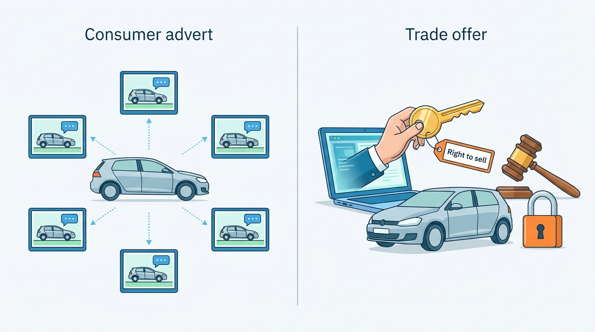
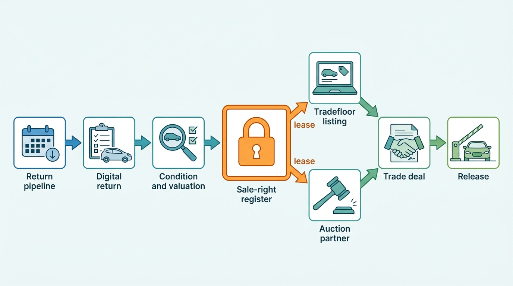
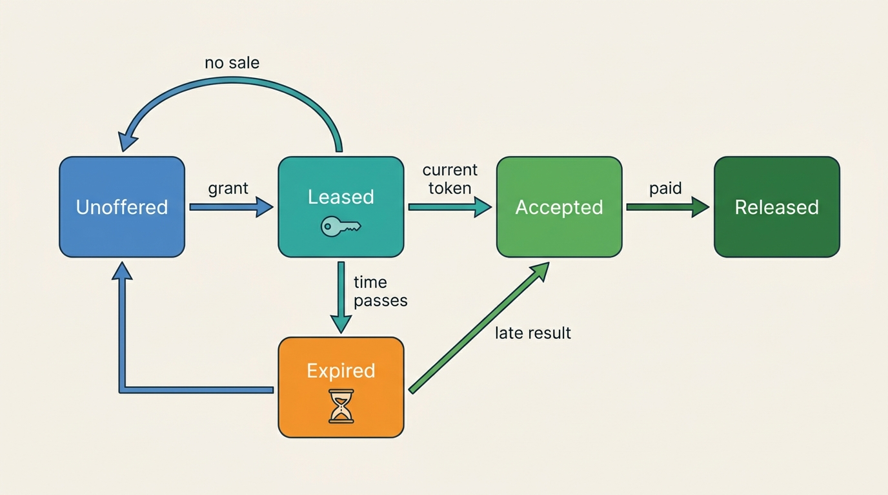
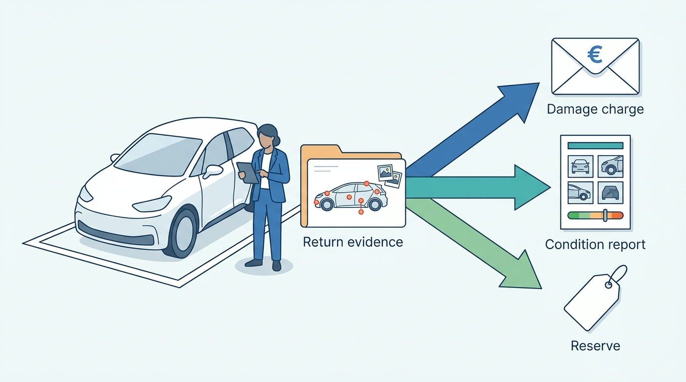

> **IN THIS CHAPTER, YOU WILL:** Learn how wholesale trade differs from retail advertising, how lessors plan and run de-fleets, and how to design a B2B trade exchange, a digital return and an auction hand-off so that a car is offered once, described honestly, sold once and handed over only when money, VAT status and documents are settled.

> **WHY THE BUSINESS CARES:** For a dealer, the trade channel is where aged stock and unwanted trade-ins turn back into cash. For a lessor, remarketing is where the residual value it promised years earlier is realized or lost. A car sold twice, a disputed damage charge or a wrong VAT status costs money on every one of thousands of cars a year, and it costs trust in a market where the same few hundred buyers come back every week.

> **WHY ARCHITECTS SHOULD CARE:** B2B trade binds faster than retail. An auction hammer or a "buy now" click is a contract, so the concurrency that is tolerable on consumer portals becomes a double sale. The exchange also crosses tenants, borders and partners, so its records must stand up in a dispute between two businesses the platform does not control.

> **KEY POINTS:**
>
> * **A binding channel needs an exclusive right to sell.** A consumer advert can run on many portals because each sale is still negotiated. A trade offer, a tender or an auction lot can bind the seller the moment someone clicks. Hold the right to sell as one time-bounded lease per vehicle, granted to one channel at a time and released only by that channel's confirmation or by expiry.
> * **The return is the evidence moment; record it once and use it three times.** A lessor's de-fleet is a pipeline known months ahead, and the inspection at return decides the lessee's damage charge, the buyer's condition report and the reserve price. Capture it as neutral, time-stamped evidence against a published return standard, and derive each use from the same item list under its own rules.
> * **Trade is a deal, not a listing.** Price, VAT status, money, title, register transactions and export documents have to agree before the car leaves the compound. Keep them in one deal record with explicit release conditions, carry the seller's VAT status as evidence, and treat partner auctions as contracts with status feedback, not as file uploads.

> **[FAILURE PATTERNS THIS CHAPTER ADDRESSES](where-vehicle-platforms-go-wrong.html):**
>
> * **The Zombie Listing** — a car handed to an auction partner while its trade listing stays live is a B2B zombie, and in a binding channel it does not produce stray leads: it produces a second sale.
> * **The Confident Valuation** — reserve prices and buy-now prices set from a valuation without confidence or drift monitoring turned Fleetmoor's battery-electric returns into no-sales for a summer.
> * **The Acquisition Archipelago** — trade listings re-typed from the dealer system, auction results returned as spreadsheets and VAT status lost between products are what a group of separately built products does to a car that crosses them.

 
Most of this book's dealer chapters follow a car from a consumer to a dealer and back to a consumer. A large share of used cars never meets a consumer in between. In the United States, auction purchases supplied **21.9%** of the used vehicles that franchised dealers retailed in 2025, according to the [2025 annual data](https://www.nada.org/media/4695/download) of the National Automobile Dealers Association (NADA). CarMax said in its [fiscal 2026 annual report](https://www.sec.gov/Archives/edgar/data/1170010/000117001026000021/kmx-20260228.htm) that only "approximately half" of the roughly 1.1 million vehicles it bought met its retail standards; the rest went through its own wholesale auctions. In the Netherlands, the lease association VNA (*Vereniging van Nederlandse Autoleasemaatschappijen*) [counted](https://www.vna-lease.nl/actualiteiten/omvang-autoleasepark-stabiliseert-in-2025) **1,371,900** leased cars and vans at the end of 2025 (about 256,600 of them vans), and every one of them returns to the market at contract end.

This is **wholesale** or **B2B trade**: sales between businesses (dealers, traders, exporters, lessors, rental companies and auction houses) at prices that assume the buyer will recondition, re-advertise and carry the risk. Buyers are professionals who inspect at a distance. Offers bind faster. Condition is disclosed rather than repaired. VAT depends on who sold the car to whom, and cross-border sales make export documents matter as much as the price.

This chapter owns four terms: the **trade listing**, the **de-fleet**, the **digital return** and the **auction hand-off**. It builds on [[inventory-and-vehicle-dossier]], where "sold to a trader" is a disposition of the stock item; on [[valuation-engine]], which supplies trade values; on [[condition-and-damage]], which owns inspection standards and damage estimates; and on [[registration-and-trade-services]], which owns the register transactions and export paperwork a trade deal triggers. It does not re-teach those chapters. It asks a narrower question: **what does a platform have to guarantee when one business sells a car to another, at volume, through channels it does not all own?**

## Setting the Scene at Axleby: Seventeen Cars Sold Twice

Axleby, the fictional vehicle data and dealer software group this book follows (see [[meet-axleby]]), runs **Tradefloor**, a B2B trade exchange inside its Axleby Trade business line. Dealers and lessors offer cars to the trade there, and buyers (other dealers and exporters) buy at a fixed price, make offers or bid in timed tenders. Axleby owns no auctions. When a seller wants an auction, Tradefloor hands the car to an auction partner. In 2026, Tradefloor concluded about **48,000** B2B deals and handed about **11,500** further cars to two auction partners. The figures in this section are Axleby illustrations.

| Tradefloor in 2026 | Value |
| --- | --- |
| Deals concluded on Tradefloor | about **48,000** |
| Sellers: lessors and rental companies / dealers | about **21,000** / **27,000** deals |
| Buyers: NL and BE dealers / exporters and foreign traders | about **38,500** / **9,500** deals |
| Cars handed to auction partners | about **11,500** |
| Buyer success fee (2027 list price) | **€95** per deal |
| Referral fee from auction partners | about **€40** per sold hand-off |

Its largest seller is **Fleetmoor Lease**, a lessor with about **64,000** vehicles in the Netherlands and Belgium and about **14,000** returns a year. Bas Hendriks, Fleetmoor's remarketing manager, runs those returns from a Lotwise remarketing desk. In 2026 they went four ways:

| Fleetmoor's 2026 returns by channel | Cars |
| --- | --- |
| Bought by the driver or the client company at contract end | 1,400 |
| Sold on Tradefloor (fixed price and tenders) to dealers and traders | 8,600 |
| Handed to an auction partner through Tradefloor | 2,900 |
| Sold directly to Fleetmoor's own export buyers, outside Tradefloor | 1,100 |
| **Total** | **14,000** |

On **Tuesday 8 June 2027**, seventeen Fleetmoor cars were sold twice. The mechanism was simple. Fleetmoor's desk offered each returned car on Tradefloor first, as a fixed-price "buy now" listing for five working days. Unsold cars went into the weekly online sale of **Kavelstad**, one of the two auction partners (Kavelstad is fictional). The hand-off was a CSV file that the desk uploaded to Kavelstad's portal every Monday. Withdrawing the Tradefloor listings was a separate, manual step. A rota change meant nobody took it that week. **31** cars stood in both channels for a day and a half. Seventeen were bought on Tradefloor during the same hours in which Kavelstad's sale hammered them to other buyers.

Fleetmoor honored the auction sales, because Kavelstad's conditions made the hammer binding, and canceled the Tradefloor deals. Axleby refunded seventeen success fees, and Fleetmoor paid each Tradefloor buyer €250 in compensation. The money was small; the trust was not. Two buyers had already booked transport, one had resold a car to a Belgian retailer, and six dealers stopped buying on Tradefloor for the rest of the quarter. Bas's complaint to Daan Visser, Axleby Trade's product manager, was blunt: "Your exchange let me sell a car I had already given away."

It was not the first trade problem. In 2026 Fleetmoor had set Tradefloor reserve prices from Vantage trade values while Vantage overvalued used battery-electric vehicles (BEVs) by **9.5%** for **14 weeks**; Fleetmoor's BEV no-sale rate on Tradefloor rose from **18%** to **41%** (the EV Overvaluation, told in [[valuation-engine]]). From October 2026 to April 2027, a new Tradefloor-to-Lotwise stock import dropped the seller's VAT status, so **1,240** ex-lease cars were invoiced under the margin scheme at **186** rooftops (the Margin-Scheme Error, told in [[deals-and-sales-documents]]). And in the first quarter of 2027, lessees contested **21%** of Fleetmoor's damage charges and Tradefloor buyers raised condition claims on **11.7%** of the returns they bought, because the return inspection could not show what the car had looked like (the condition side is told in [[condition-and-damage]]).

Ines Marchetti, Axleby's Group Chief Architect, saw one problem behind the four symptoms: Tradefloor had been built as a second advert channel, a copy of the car's data published to a different audience. **Who holds the right to sell this car right now, what evidence describes it, and what has to be true before it changes hands?** The condition evidence was already being fixed: Gauge, the group's condition service, and Lotwise Inspect, its capture app, went into Fleetmoor's return centers on 14 June 2027. The One Dossier program planned "digital returns for lessors" for 2028–29. The June double sale moved the rest of the trade-exchange redesign forward, and this chapter follows it.

## Concepts: Channels, Pipelines and the Right to Sell

### The wholesale channels

Four kinds of channel carry B2B trade, and a platform usually touches all of them:

| Channel | How a sale binds | Who holds the car | Typical sellers | Documented examples |
| --- | --- | --- | --- | --- |
| **Trade exchange** (fixed price, offers, tenders) | Buy-now click or accepted offer; tender at close | Seller, until collection | Dealers with aged stock or unwanted trade-ins, lessors | Ayvens Carmarket "car auctions for dealers" (Ayvens site, 2026) |
| **Online auction** | Hammer at close, under the auction's conditions | Seller or the auction's compound | Lessors, rental companies, dealer groups | Autorola: open, tender, sealed-bid, "Fleet Owner Selection" and damaged-car sales, "over 70,000 active buyers" (Autorola site, read October 2026) |
| **Physical auction** (often simulcast online) | Hammer in the lane | Auction compound | Fleet, rental, manufacturers | Manheim UK lists physical and virtual auctions and "defleet services" (Manheim UK site, read October 2026) |
| **Export buyer** (direct or through an exchange) | Contract, usually prepaid | Seller, until collection | Dealers and lessors with stock that sells better abroad | Manheim Express, a B2B cross-border platform started 1 January 2025 (AUTOHAUS, 2025) |

The auction market is large where it is concentrated. OPENLANE, in its [annual report for 2025](https://www.sec.gov/Archives/edgar/data/1395942/000139594226000006/opln-20251231.htm) (published February 2026), facilitated about **1.5 million** transactions with **$28.8 billion** of gross merchandise value, usually without taking title. It said its software powers "more than 40 private label digital remarketing applications representing the majority of North American manufacturers and captive finance companies", and that "the majority of all off-lease vehicles available in North America are offered first, and exclusively on OPENLANE". It also observed that "when used vehicle prices are high, dealer customers may retail more of their trade-in vehicles on their own rather than selling them in the wholesale channel". Whether a car goes retail or wholesale is a price-dependent decision, not a fixed route.

In the Netherlands, VWE sold its auction subsidiary **Automotive Trade Center (ATC)** to the Danish remarketing group Autorola on 1 February 2026. At the sale, ATC offered about **40,000** inspected vehicles at any time to just over **8,000** professional sellers and about **7,000** buyers, and Autorola's chief executive said ATC would continue "independently, with an unchanged organization and services" (Journal de l'Automobile, 5 February 2026). VWE's own product still offers auctions "from partner Automotive Trade Center" ([[case-vwe]]). A data-and-software company now integrates as a partner with the marketplace it used to own; Axleby is in that position by design.

### Lessors and the de-fleet

A **lessor** owns cars and lends them to drivers or companies for a contract term. It prices the contract on a **residual value**: its forecast of what the car will fetch at contract end. A **de-fleet** is the planned disposal of fleet vehicles at contract end or at the end of a holding period. Three properties make it different from a dealer selling aged stock:

- **It is known in advance.** Contract end dates are in the lessor's system months ahead. Hertz reported an average holding period of about **18 months** in the Americas in its [2025 annual report](https://www.sec.gov/Archives/edgar/data/1657853/000165785326000008/htz-20251231.htm). A lessor with 64,000 cars on three- and four-year contracts knows roughly which 14,000 will come back next year, and in which months.
- **The result is measured against a promise.** Remarketing is judged by sale price against residual value. Ayvens reported a net used-car sales result of **€411 million** in 2025, **€1,075** per unit ([Ayvens, February 2026](https://www.ayvens.com/en-cp/news/newsroom/press-releases-2026/q4-and-fy0-2025-strong-financial-results/)). That margin is the gap between what the lessor forecast years ago and what the market paid this week.
- **Three parties have a stake in condition.** The driver (or client company) pays for damage beyond fair wear and tear. The lessor sells the car. The buyer prices the car from the condition report. Their interests differ, and the same inspection serves all three.

### The digital return

A **digital return** is the handover of a lease or rental car recorded electronically at the moment it happens: identity check (plate and VIN), odometer, keys, documents and accessories, guided photographs, findings against a published return standard, battery state of health for an electric car, the lessee's acknowledgement, and the settlement of any charge. Its opposite is a paper form at a compound and photos in someone's phone. In the UK, the British Vehicle Rental and Leasing Association (BVRLA) publishes fair wear and tear guides for cars, light commercial vehicles and goods vehicles that "set an industry-wide standard" for returns (BVRLA, read October 2026). No equivalent single published standard was found for the Netherlands or Germany in this research; lessors there publish their own return rules. Inspection grading and damage estimation are owned by [[condition-and-damage]]; battery measurement by [[ev-battery-health]].

### The trade listing and the right to sell

A **trade listing** is an offer of one vehicle to a defined professional audience, on trade terms. It looks like an advert and is not one:

| | Consumer advert ([[merchandising]], [[listing-syndication]]) | Trade listing |
| --- | --- | --- |
| Audience | Anyone | Verified businesses, often in tiers (seller's own dealers first, then all) |
| Price basis | Retail, VAT included, reconditioned | Trade, often excluding VAT, as is, collection by buyer |
| Condition | Presented, repaired | Disclosed: damage items, photos, grade, known defects |
| What a click does | Starts a conversation (a lead) | Can conclude a contract (buy now, accepted offer, tender close) |
| Concurrency across channels | Tolerated: the dealer can decline a second buyer | Dangerous: two binding acceptances are two contracts |
| Must carry | Disclosures for consumers | Seller's VAT status, location, release conditions, dispute window, documents available |

The row that matters most is concurrency. **On consumer portals, a car advertised in six places is normal; in binding trade channels, a car offered in two places is a double sale waiting to happen.** So the central concept of this chapter is the **right to sell**: a per-vehicle, exclusive, time-bounded lease that a channel must hold before it may accept a binding transaction. Tradefloor's buy-now listing holds it for five working days. An auction hand-off transfers it to the partner until the lot closes. A driver buy-out holds it while the driver signs. When the lease expires or the holder confirms a no-sale, the right returns to the seller.

**Figure 1:** *A consumer advert can run in six places at once because each sale is still negotiated; a binding trade offer needs one right to sell, held by one channel at a time.*

An **auction hand-off** is then precise: the transfer of the right to sell one vehicle to an auction partner, with the evidence the partner needs, a reserve, a time limit, and an obligation on the partner to report status and the result.

## Architecture: The Trade Exchange Redesign

### Components and responsibilities

The redesign approved in September 2027 kept Tradefloor's name and buyers but split its responsibilities. All component names are Axleby's and fictional.

| Component | Owns | Does not own |
| --- | --- | --- |
| **Return pipeline** (lessor-facing, in Lotwise) | Expected returns from the lessor's contract feed, return appointments, channel plan per car | The lease contract and driver (lessor's own system) |
| **Handback** (return and settlement workflow) | Return appointment, handover checklist (keys, documents, accessories), lessee acknowledgement, charge letter, charge disputes and their deadlines, release to remarketing | Inspection capture (Lotwise Inspect), findings, rubrics and charges computed from them (Gauge, [[condition-and-damage]]) |
| **Sale-right register** | One active right-to-sell lease per vehicle and seller; grant, renew, release, expire; fencing tokens | What the channel does with the lease |
| **Trade listing service** | Trade listings, audiences and tiers, offers, tenders, buy-now | Stock state (Lotwise Dossier), valuation (Vantage) |
| **Buyer matcher** | Standing buyer searches ("buy boxes") and alerts | Buyer identity and verification (Axleby ID) |
| **Auction hand-off adapters** | One adapter per auction partner: lot creation, status, results, withdrawals | The auction itself |
| **Trade deal service** | The deal record from acceptance to collection: price, VAT basis, payment state, documents, register actions, release conditions, disputes | Invoices (document issuer in [[deals-and-sales-documents]]); register transactions (Axleby Trade back office, [[registration-and-trade-services]]) |

Three ownership choices shaped the rest. The **stock item stays the seller's**: the buyer receives a copy of agreed dossier facts at sale, never a live reference (the cross-tenant rule in [[tenancy-and-dealer-groups]]). The **right to sell is not a field on the listing**: it lives in its own register, so a car that is not on Tradefloor at all (an export sale Fleetmoor makes by phone) can still be locked. And **money does not pass through Axleby**: buyers pay sellers directly or through a regulated payment provider, and the deal service records confirmations. Holding buyers' money would bring payment-services regulation and safeguarding into scope ([[payments-fundamentals]]). That is a separate business decision, not a feature.

**Figure 2:** *A return flows from a contract end date known months ahead to a released car. Every selling channel goes through the sale-right register; no channel can accept a binding sale without holding the lease.*

### The sale-right register

The register is small and strict. Each row is `(AVK, seller organization, holder channel, lease id, granted at, expires at, fencing token, state)`. AVK is the **Axleby Vehicle Key**, the internal vehicle key in Anchor, Axleby's identity graph ([[vehicle-identity]]). The rules:

1. **One active lease per vehicle and seller.** A grant fails if one is active. The seller's desk sees who holds it and until when.
2. **Every binding action carries the fencing token.** Tradefloor's buy-now handler, the tender closer and each auction adapter present the token when they accept. The deal service rejects an acceptance whose token is not the current one. A channel that lost its lease, but did not notice, cannot conclude a sale.
3. **Release needs a reason.** A holder releases with `sold`, `no_sale`, `withdrawn_by_seller` or `expired`. A partner that has received a car cannot have its lease revoked silently: the seller asks for withdrawal, the adapter sends it, and the lease ends only when the partner confirms the lot is withdrawn.
4. **Expiry is the safety net, not the plan.** Leases expire so that a dead partner integration cannot keep a car locked forever. An expired auction lease raises an alert, because the partner may still sell.

The register is the B2B counterpart of the rule in [[inventory-and-vehicle-dossier]] that "Reserved" withdraws adverts in the same transaction. Advert withdrawal is a best effort that [[listing-syndication]] reconciles afterwards; the lease is checked before acceptance.

**Figure 3:** *The right to sell one vehicle. "Expired" is a state of its own, because an auction partner that missed the withdrawal may still report a sale, and the platform must be able to take that result rather than pretend it cannot happen.*

### Handback: one return record, three uses

The digital return wraps one inspection. Lotwise Inspect captures it offline-first at the return center: photos with time, position, device and a content hash, the odometer photo and reading, tread depths, paint readings and **findings** (component, type, size, severity, photo references). Gauge stores the confirmed findings ([[condition-and-damage]] owns the capture and the rubrics). Handback adds what makes it a return: who handed the car over, which keys, documents and accessories came back, the lessee's acknowledgement, and the settlement of the charge.

Each use derives from the same findings under its own rule:

| Use | Rule applied to the damage items | Owner of the rule | Audience |
| --- | --- | --- | --- |
| **Lessee damage charge** | Findings beyond the lessor's return standard (for example, fair wear and tear thresholds), priced from the lessor's tariff | Lessor's rubric version in Gauge | Lessee (usually the driver's employer) and driver |
| **Buyer condition report** | All findings, including wear, with photos and a grade; battery figure only from a verified certificate ([[ev-battery-health]]) | Trade-report rubric in Gauge | Trade buyers |
| **Reserve and channel plan** | Reconditioning estimate from the findings, with confidence | Gauge and Vantage ([[valuation-engine]]) | Lessor's desk |

**Figure 4:** *One return inspection, captured once as neutral evidence, feeds the lessee's damage charge, the buyer's condition report and the reserve, each under its own rule.*

Neither list is edited by hand into a separate document, so **disagreements become disagreements about evidence, not about versions**. A lessee disputing a charge points at a finding and a photo; the lessor confirms, waives or re-inspects within a deadline Handback tracks, and the decision is appended to the finding with its reason. A buyer's claim after collection points at a finding that was missing or understated, and what the evidence showed at the return can be checked.

Return photos can contain faces and other people's plates. Buyers see only the blurred renditions Gauge produces, and Handback keeps the settlement record for the dispute window plus the lessor's retention period, not indefinitely ([[privacy-and-retention]]).

### Matching buyers to stock

Professional buyers keep **buy boxes**: standing searches such as "BEVs under three years old, under 60,000 km, Benelux, up to €22,000 trade". The buyer matcher evaluates each new trade listing against all active buy boxes and notifies matching buyers. Two rules matter more than the matching algorithm:

- **Tiers are part of the listing, not a filter in the UI.** A lessor may give its franchise partners a first look, then all Lotwise dealers, then exporters, as US off-lease remarketing commonly gives the dealer where the lease ends the first option. Tier times are fields of the listing; the matcher alerts only the current tier.
- **Alerts are rate-limited per buyer and fair across buyers.** A buyer with 200 buy boxes must not get a car minutes before a buyer with one. Alerts for one listing go out in one batch, and a buy-now opens at the same moment for everyone in the tier.

### The auction hand-off

The hand-off is an integration with a partner the platform does not control, so it gets the same treatment as a DMS in [[dms-integration]]: one adapter per partner, a contract, status feedback and reconciliation.

**Figure 5:** *An auction hand-off is a lease transferred to a partner, a lot created with the lease id, and a result that comes back through the deal service. The daily reconciliation catches results and withdrawals that the callbacks missed.*

The adapter sends the evidence pack (condition report, photos, odometer, VAT status, location, documents) unless the partner's terms require its own inspection, and stores the partner's lot id against the lease. Results arrive by callback or by a daily lot export; both go through one idempotent handler keyed by partner and lot id.

### The trade deal and its release conditions

A trade deal starts at a binding acceptance and ends when the buyer collects the car. Between the two, the deal service tracks conditions that must all be true before the seller's compound releases the car and documents:

| Release condition | Evidence | Why it is a gate |
| --- | --- | --- |
| Payment received | Seller's bank confirmation or the payment provider's settlement | Collection before payment is the classic B2B loss |
| VAT basis agreed and invoice issued | Seller's VAT status, buyer's VAT number, invoice from the document issuer | The Margin-Scheme Error started where this was missing |
| Register action done | Dutch stock-register transfer, release (*vrijwaren*) or export notification confirmed by the register | The seller stays liable for the car until the register says otherwise |
| Export documents ready, if exported | Transport proof for an intra-EU sale; export declaration for a non-EU sale | Without them, the VAT exemption fails ([[registration-and-trade-services]]) |
| Dispute window opened | Collection timestamp | Condition claims count from collection, not from sale |

The VAT condition deserves detail, because its absence produced about €3.68 million of under-declared dealer VAT in the Margin-Scheme Error. A lessor that bought the car with VAT and deducted it sells under normal VAT; a dealer that bought from a consumer may sell under the **margin scheme**, where VAT is due only on the dealer's margin (Articles 311–343 of Directive 2006/112/EC; [[deals-and-sales-documents]] owns the term). A sale to a VAT-registered buyer in another member state is exempt only if the buyer "has indicated" its VAT identification number to the supplier and the supplier files a correct recapitulative statement (Article 138, as amended by Directive (EU) 2018/1910). So the trade listing carries the seller's VAT status as evidence, the buyer's VAT number is validated at acceptance, and an `unknown` status blocks the deal, exactly as it now blocks a Lotwise sale invoice.

### Requirements per interaction

| Interaction | Consistency | Latency target | Freshness | Availability posture |
| --- | --- | --- | --- | --- |
| Grant or check a right-to-sell lease | Strong, single writer per vehicle | under 200 ms *(assumption)* | Current | If unavailable, no channel may accept; listings show "temporarily unavailable" |
| Buy-now or tender close | Strong: token check and deal creation in one transaction | under 1 s *(assumption)* | Current | Fail closed; never accept without a lease |
| Buyer alerts from buy boxes | Eventual | within 2 minutes of listing *(assumption)* | Listing as published | Queue and catch up; same-batch release per tier |
| Auction partner status and result | Eventual, reconciled daily | callback within minutes; daily export | Up to 24 h for missed callbacks | Partner outage pauses new hand-offs; leases do not expire silently |
| Return capture and settlement | Local first, synced | Works offline | Synced within an hour of coverage | Capture continues offline; evidence hashed at capture; charge letters wait for sync |
| Release conditions | Strong per deal | Seconds | Payment and register confirmations as they arrive | Release blocked until all conditions are confirmed |

## In Practice

### What public sources show

Companies publish what they sell and how much, not how their exchanges work. What follows is the documented shape of the market; the design patterns in this chapter are the author's inference from it.

- **Concentration of off-lease supply on private-label platforms (US).** OPENLANE's 2025 annual report (February 2026) describes software-as-a-service remarketing for "the majority of commercial off-lease sellers in North America" and more than 40 private-label applications. Commercial consignment was about 52% of its transaction volume. **INFERENCE, NOT DOCUMENTED:** a private-label app run for a captive finance company implies per-seller rules (buyer tiers, reserve logic, inspection requirements) as configuration on one platform; OPENLANE does not describe how.
- **Formats as product.** Autorola's site (read October 2026) lists open auctions, closed-bid tenders, sealed bids, buy-now, damaged-car sales and a "Fleet Owner Selection" format. The formats differ in when a sale binds, which is why the right-to-sell lease has to be format-neutral.
- **Retail versus wholesale disposition is a recorded decision.** Hertz said in its 2025 annual report that it "prioritizes retail as our primary disposition channel" and uses "dealer direct wholesale channels, retail and auction"; CarMax sends cars that miss its retail standard to its own auctions. Hence the disposition on the dossier's stock item ([[inventory-and-vehicle-dossier]]).
- **Battery health at the auction lane.** Cox Automotive reported in March 2024 that Manheim's LotVision devices, installed at check-in at 76 US locations, capture an EV battery health score "in minutes" ([[ev-battery-health]]). For a lessor returning thousands of BEVs, a battery reading belongs in the return record, not as a later add-on.
- **Data and marketplace ownership diverge.** VWE sold ATC to Autorola in 2026, and Autorola also owns the Indicata pricing-analytics business. Axleby's ledger records that it owns no auctions, so Vantage sees asking prices and register sale events but not hammer prices ([[case-cox-automotive]] draws that lesson). Every auction partner contract is therefore also a data contract: whether results may flow into valuation is a licensing question ([[data-licensing-and-governance]]).

### Axleby: Fleetmoor's returns under the new design

Bas Hendriks agreed to a prototype trial on about 200 of Fleetmoor's Dutch returns in October and November 2027, ahead of a full pilot in 2028. The worked example below follows one of those returns. The car, prices and charges are Axleby illustrations.

**Months before.** Fleetmoor's lease system sends contract end dates to the return pipeline nightly. A 2023 Kia Niro EV on a 48-month contract is due back in October 2027. In July, the pipeline lists it among **1,180** expected October returns. Vantage values the planned returns as a batch with confidence intervals. The desk reviews segments, not cars: BEVs get a battery reading at return and a tighter reserve review after the EV Overvaluation.

**Return day.** The driver brings the car to Fleetmoor's return center near Utrecht. The contracted inspector's Inspect session records identity (plate and VIN agree with Anchor), odometer **71,460 km**, two keys, the charging cable, 64 photos and six confirmed findings; a short battery test issues a verified certificate at **91%**. The driver signs the handover in Handback. Two findings exceed Fleetmoor's return standard (a 4 cm dent in the tailgate, a curbed alloy wheel), so the lessee's charge letter lists those two at **€385**. The buyer condition report lists all six.

**Channel plan.** The reconditioning estimate from the six items is **€640** with medium confidence. Vantage's trade value for the car, condition-adjusted, is **€19,900** with an interval of ±€1,100. The desk sets a five-day Tradefloor buy-now at **€20,450**, tier one (Fleetmoor's partner dealers) for 48 hours, then all Lotwise dealers. The sale-right register grants Tradefloor a lease until Friday 17:00.

**No sale, hand-off.** Nobody buys. At expiry, Tradefloor releases the lease with `no_sale`, and the desk hands the car to the auction partner. The register grants the adapter a lease for the Tuesday sale. The adapter creates the lot with the evidence pack and a reserve of €19,200. The Tradefloor listing is already closed, because the lease it held is gone and the listing service subscribes to lease events.

**Sale and release.** The car is hammered at **€19,650** to a dealer in Antwerp. The adapter posts the result with its token; the deal service creates the deal. The buyer's Belgian VAT number is validated; Fleetmoor's VAT status is `normal` (it deducted VAT on purchase), so the invoice is an intra-Community exempt supply with Fleetmoor's recapitulative-statement obligation flagged. Payment arrives on Thursday. The register action is a Dutch export notification, because the car is leaving for Belgian registration ([[registration-and-trade-services]]). The transporter collects on Monday; the dispute window opens at collection.

For the 2028 pilot, the targets Ines set were measurable. Double sales: zero, enforced by the token check rather than by rota. Condition claims and contested charges are Gauge's measures, and both had already fallen by the fourth quarter of 2027 ([[condition-and-damage]]). Return to sale: the median from return to binding sale was **19 days** in 2026; the target is 10 *(target, assumption)*, because pricing and channel planning start before the car arrives.

## Failure Handling

| Failure | How it shows up | Detection | Recovery |
| --- | --- | --- | --- |
| **Duplicate sale across channels** | Two binding acceptances for one car | Impossible by design if all channels hold tokens; for channels outside the register (seller's phone sales), the deal service checks the lease before release | First valid token wins; the other acceptance is refused before a contract forms. Off-platform sales must register a lease first, or the desk cannot release the car |
| **Partner reports a sale after lease expiry** | Late hammer result on an expired lease | Adapter flags results on expired leases | Accept the result if no other lease was granted since; otherwise escalate to the seller, because two contracts may exist. Leases for partner sales expire only after the partner's sale date plus a margin |
| **Duplicate result messages** | Callback and daily export report the same lot | Idempotency key: partner, lot id, result version | Second message is a no-op; a changed result (for example, a canceled hammer) is a new version with a reason |
| **Incomplete return record** | Missing odometer photo, missing VIN check, handover unsigned | Handback refuses to close the return without required fields; "driver absent" is an explicit state | Return closes as `unacknowledged`; the charge letter says so, and the dispute window is longer |
| **Conflicting condition evidence** | Buyer claims a defect not in the report | Claim attached to a finding, within the dispute window counted from collection | Re-inspection if the photos are inconclusive; settlement recorded on the deal and the outcome on the finding in Gauge, never edited into the report |
| **Payment received but register action fails** | Buyer paid; the register's transaction channel is unavailable | Release condition stays open | Car is not released; the buyer sees "awaiting register". Register submissions are queued and never faked, which is the rule behind the Month-End Register Outage ([[registration-and-trade-services]]) |
| **Ambiguous timeout on lease grant or acceptance** | Channel does not know whether it holds the lease or the sale went through | Client request id on every grant and acceptance | Retry with the same request id returns the original outcome rather than a second lease or deal |
| **Auction partner outage** | No callbacks, no daily export | Adapter health check and missing-export alert | New hand-offs pause; existing leases are extended, not expired, while the partner is down; reconciliation runs before any lease is released |
| **Valuation drift on a segment** | Reserve prices miss; no-sale rates rise | No-sale and clearing-rate monitor per segment ([[valuation-engine]]) | Segment flagged `restricted`; reserves for that segment need desk approval |
| **Buyer default** | Buyer does not pay or collect | Payment deadline on the deal | Deal canceled with reason; lease returns to the seller; buyer's trading status reviewed |

The **off-platform sale** is the leak in any lock. Fleetmoor sold 1,100 cars to export buyers by phone in 2026. Unless the desk takes a lease for those sales too, the register protects the channels Axleby runs, not the car.

## Trade-offs

### How to prevent double sales

| Option | How it works | Right when | Cost |
| --- | --- | --- | --- |
| **Sequential channels, manual withdrawal** | Desk withdraws from one channel before offering in the next | Low volume, one person per car | Fails on rota changes, as in June 2027 |
| **Withdraw-then-offer automation** | Platform sends withdrawals, then offers elsewhere | All channels confirm withdrawals reliably | Withdrawal confirmations from partners can lag or fail; gap between channels lengthens time to sale |
| **Exclusive lease with fencing token** (chosen) | One holder at a time; acceptance requires the current token | Binding channels, several partners, high volume | Every channel adapter must carry the token; partner contracts must include withdrawal confirmation |
| **Simultaneous offering with first-acceptance-wins** | Car in several channels; the first binding acceptance cancels others | Seller owns every channel and can cancel sales | Not possible when a partner's terms make its sale binding; produces canceled contracts by design |

I chose the lease for Axleby because it fits the constraint that matters: **Axleby does not own the auctions, so it cannot cancel their sales**. If a group owns every channel, simultaneous offering with first-acceptance-wins is a reasonable alternative and can shorten time to sale.

### Own the auction, partner with one, or stay an exchange

| Option | Gains | Costs | Fits when |
| --- | --- | --- | --- |
| **Own auctions** (compounds, auctioneers, logistics) | Hammer prices for valuation; full control of formats | Capital, logistics, a marketplace business with its own liquidity problem ([[liquidity-and-network-effects]]) | The group sees itself as a marketplace operator; Cox with Manheim is the documented case |
| **Partner auction hand-off** (Axleby's choice) | No compounds; several partners compete; focus on data and workflow | No hammer prices unless licensed; partner contracts; integration per partner | The group is a data-and-software business; VWE's move after the ATC sale points the same way |
| **Exchange only, no auctions** | Simplest | Sellers leave for auction groups for the cars the exchange cannot sell | Dealer-to-dealer aged stock only, no lessor volume |

### Who captures the return

Driver self-capture is cheap and builds trust but varies in quality; the lessor's own staff are consistent but look partisan to lessees; a contracted independent inspector is neutral and costs most; a drive-through scanner is consistent for the exterior but still needs a person for interior and mechanical checks. For the 2028 pilot Fleetmoor adds a driver pre-capture two weeks before contract end, so the driver knows what is coming, and keeps the contracted inspector at the return center for the record that counts. The pre-capture is a forecast, not evidence for charges, and the app says so.

## Across Markets: What Changes by Country

| Topic | Netherlands / Belgium | Germany | United Kingdom | United States |
| --- | --- | --- | --- | --- |
| **Where wholesale stock comes from** | Lease returns are a major source; VNA counted 1.37 million leased cars and vans in NL at end 2025 (VNA, 2026) | Lessors, manufacturer banks and B2B auctions *(industry practice; no primary share found)* | Lessors and rental de-fleets through auction groups and digital remarketing (Manheim UK "defleet services"; Cox's Dealer Auction) | Off-lease supply concentrated on private-label platforms (OPENLANE, 2026); auctions supply 21.9% of franchised dealers' used retail (NADA, 2026) |
| **Main auction and exchange players named in sources** | ATC (Autorola since February 2026), Autorola, lessor platforms such as Ayvens Carmarket | Autorola, Manheim Express, manufacturer and lessor platforms | Manheim UK, Dealer Auction, Autorola | OPENLANE, Manheim, Carvana's ADESA (56 sites, 2022 purchase) |
| **Register step in a trade sale** | NL: dealer-to-dealer stock transfer through the provider's "trade purchases" function, without documents if stock types match (RDW, n.d.); export notification with plates cut and paper Part II (RDW *informatiemap*, 2026). BE: register details not verified here | Registration certificate Part II (*Zulassungsbescheinigung Teil II*) travels with the car; deregistration common before export *(industry practice)* | Seller tells DVLA of a sale to a motor trader; vehicle tax does not transfer (GOV.UK, n.d.) | State title assignment with odometer disclosure (49 CFR 580.5); title and lien release often handled by the auction |
| **Return and condition standard** | Lessor-specific return rules; no single published standard found | Lessor-specific; assessor organizations used *(industry practice)* | BVRLA fair wear and tear guides for cars, vans and goods vehicles | Auction condition grades; National Auto Auction Association (NAAA) 0–5 scale with 5 best, reported as the basis of Manheim's AutoGrade (Manheim, 2014; trade reports) |
| **VAT or tax on the trade sale** | EU VAT; margin scheme or normal; intra-EU exemption with buyer VAT number (Directive 2006/112/EC, Art. 138) | Same EU rules | UK VAT margin scheme with its own vehicle stock-book rules (HMRC, 2021) | No VAT; sales tax on retail, typically not on dealer-to-dealer resale *(industry practice)* |
| **Cross-border pattern** | Strong export flows to and through neighbors; BPM refund on export of used cars exists (Belastingdienst) | Large export and import market inside the EU | Exports to the EU are customs exports after Brexit | Exports leave through customs; the National Motor Vehicle Title Information System (NMVTIS) reports salvage and junk vehicles |

**What stays common:** the sale-right register, the trade listing model, the return and settlement workflow, the buyer matcher, the deal record and its release conditions, and the adapter pattern for partners. **What is a market adapter:** the register step in a trade sale, export documents, VAT rules and invoice wording, the return standard (a configurable rule set per lessor and market, with BVRLA thresholds as one preset), condition-grade scales (US scales run in the opposite direction from the UK scheme, which a mapping must state explicitly), and the partner adapters themselves. **What would be a separate product:** a US auction business. Axleby does not enter the US, and if it did, the private-label off-lease platforms would be competitors with a head start, not partners.

## The Chief Architect's View

**Decide which channels bind, and govern the lease as a platform rule.** I would put one rule in the architecture principles: no Axleby service and no partner adapter may accept a binding B2B transaction without a current right-to-sell lease. Exceptions go into the same register as tenant-specific code paths, approved by the Group Chief Architect. The rule costs each new channel a day of integration work; it removes a class of incidents that otherwise recurs with every rota change.

**Treat auction partners as data and contract relationships, not as file drops.** Each partner contract needs withdrawal confirmation within a stated time, status callbacks or a daily export, result data licensed for valuation, and an exit plan. VWE's ATC sale shows that an internal marketplace can become an external partner overnight. A partner can also be bought by a competitor of the data business. Hendrik Maes's partner team owns these adapters in the same way it owns DMS adapters, with the same reconciliation discipline.

**Fund the return as a data product.** An independent inspection, a verified battery reading and a known history, 14,000 times a year from one lessor alone, is the best condition evidence Axleby will see. If the lessor's contract allows it from day one, returns calibrate reconditioning estimates and condition adjustments in Vantage.

**Watch the conflicts of interest.** Axleby sells valuations to lessors, runs the exchange where they sell, and sells software to the dealers who buy. Fleetmoor will ask whether the trade value that sets its reserve is independent of the exchange that earns a success fee. The answer has to be visible: the same Vantage method for every caller, the confidence interval on screen, and no exchange-specific adjustment to valuations.

**Keep money out unless the business case says otherwise.** Holding buyers' funds would solve "collected before paid" and create a regulated payments business. Release conditions plus seller-direct payment are enough for Axleby; revisit if cross-border buyers, where payment risk concentrates, grow beyond about a fifth of deals *(assumption)*.

## Questions to Ask

1. Which of our channels can bind a sale, and does every one of them check an exclusive right to sell before it accepts?
2. When a car is handed to an auction partner, what confirms that it is withdrawn everywhere else, and what happens if the partner sells after our lock expires?
3. Is the return inspection one record that drives the driver's charge, the buyer's condition report and the reserve, or three documents that can disagree?
4. Which return standard applies to each lessor and market, and is it a configured rule set with a version or a PDF on a desk?
5. Does every trade listing carry the seller's VAT status as evidence, and does an unknown status block the deal?
6. What must be true before a car leaves the compound: payment, invoice, register action, export proof? Who can override a gate, and is the override logged?
7. Can our valuations be reconciled against trade outcomes (clearing prices, no-sale rates) per segment, and do partner contracts let us use auction results for that?
8. How are buyer tiers and alert timing enforced, and can we show a buyer that nobody saw a car earlier than their tier allowed?
9. If an auction partner is acquired by a competitor tomorrow, what data, screens and contracts would we need to replace?

The trade exchange is where Part IV's single-dealer workflow meets other businesses: lessors, exporters and auction houses whose systems and terms the platform does not control. Part V turns to the commercial and organizational structure that all of these workflows run inside. It opens with [[part-5]] and starts with how tenants, dealer groups and rooftops are modeled and isolated in [[tenancy-and-dealer-groups]].

## Sources and Evidence

**Company, product and investor sources**

- [OPENLANE Form 10-K for fiscal 2025](https://www.sec.gov/Archives/edgar/data/1395942/000139594226000006/opln-20251231.htm), OPENLANE, 2026: transactions and GMV, private-label remarketing applications, off-lease concentration, consignment share, retail-versus-wholesale behavior.
- [Carvana Form 10-K for fiscal 2025](https://www.sec.gov/Archives/edgar/data/1690820/000169082026000009/cvna-20251231.htm), Carvana, 2026: ADESA US sites and wholesale marketplace.
- [Hertz Global Holdings Form 10-K for fiscal 2025](https://www.sec.gov/Archives/edgar/data/1657853/000165785326000008/htz-20251231.htm), Hertz, 2026: disposition channels and holding periods.
- [CarMax Form 10-K for fiscal year ended 28 February 2026](https://www.sec.gov/Archives/edgar/data/1170010/000117001026000021/kmx-20260228.htm), CarMax, 2026: vehicles bought and the share meeting retail standards; wholesale auctions.
- [Q4 and FY 2025 results](https://www.ayvens.com/en-cp/news/newsroom/press-releases-2026/q4-and-fy0-2025-strong-financial-results/), Ayvens, 2026: net used-car sales result per unit; Carmarket channels.
- [Autorola home page](https://www.autorola.com/), Autorola, n.d., accessed 2026-10: auction formats, countries, active buyers.
- [Manheim UK home page](https://www.manheim.co.uk/), Cox Automotive, n.d., accessed 2026-10: physical and virtual auctions, defleet and inspection services.
- [Cox Automotive Europe](https://www.coxautoinc.eu/) and [Manheim Express](https://www.coxautoinc.eu/our-products/manheim-express/), Cox Automotive UK Limited, n.d., accessed 2026-10: Dealer Auction and continental dealer-to-dealer auctions.
- [Cox Automotive launches tool to check batteries of EVs running at Manheim](https://www.autoremarketing.com/ar/technology/cox-automotive-launches-tool-to-check-batteries-of-evs-running-at-manheim), Auto Remarketing, 2024: battery health capture at auction check-in.
- [Aasc announces standardized vehicle condition grading technology](https://press.manheim.com/2014-01-17-Aasc-Announces-Standardized-Vehicle-Condition-Grading-Technology), Manheim, 2014: AutoGrade origins (12 years old; scale details are from trade reports).

**Standards, regulation and official documentation**

- [Council Directive 2006/112/EC (VAT Directive)](http://publications.europa.eu/resource/celex/32006L0112), EU Publications Office, 2006: margin scheme (Articles 311–343) and intra-Community supplies.
- [Council Directive (EU) 2018/1910](http://publications.europa.eu/resource/celex/32018L1910), EU Publications Office, 2018: amended Article 138 conditions (buyer VAT number, recapitulative statement).
- [Voertuig kopen en opnemen in bedrijfsvoorraad](https://www.rdw.nl/zakelijke-partners/erkende-bedrijven/bedrijfsvoorraad/voertuig-in-bedrijfsvoorraad-zetten), RDW, n.d., accessed 2026-10: dealer-to-dealer trade purchases without documents.
- [Informatiemap voor de voertuigbranche](https://www.rdw.nl/-/media/rdwnl/documenten/bedrijf-met-rdw-erkenning/toezichtbeleid/tbb-en-informatiemap-2026/informatiemap.pdf), RDW, 2026: export procedure, release certificates, outage rule.
- [What is exportation?](https://taxation-customs.ec.europa.eu/customs-4/customs-procedures-import-and-export-0/what-exportation_en), European Commission, n.d., accessed 2026-10: export declarations through the Automated Export System.
- [Tell DVLA you've sold, transferred or bought a vehicle](https://www.gov.uk/sold-bought-vehicle), GOV.UK, n.d., accessed 2026-10: motor-trader notifications and tax not transferring.
- [Using the VAT margin scheme for second-hand vehicles](https://www.gov.uk/guidance/using-the-vat-margin-scheme-for-second-hand-vehicles), HMRC, 2021: UK margin scheme and stock-book rules.
- [BPM](https://www.belastingdienst.nl/wps/wcm/connect/nl/bpm/bpm), Belastingdienst, n.d., accessed 2026-10: BPM refund when exporting a used vehicle (page headings only).
- [49 CFR 580.5](https://www.law.cornell.edu/cfr/text/49/580.5), US Code of Federal Regulations, n.d., accessed 2026-10: odometer disclosure on title transfer.
- [BVRLA Fair Wear and Tear Guides](https://www.bvrla.co.uk/home/support/products-and-services/bvrla-fair-wear-tear-guides), British Vehicle Rental and Leasing Association, n.d. (© 2026), accessed 2026-10: industry standard for returned cars, vans and goods vehicles.

**Research and practitioner sources**

- [NADA Data 2025](https://www.nada.org/media/4695/download), NADA, 2026: sources of used vehicles retailed by US franchised dealers.
- [Autorola reprend une filiale de VWE Automotive](https://journalauto.com/distribution/autorola-reprend-une-filiale-de-vwe-automotive/), Journal de l'Automobile, 2026: ATC sale, size and continuity.
- [Omvang autoleasepark stabiliseert in 2025](https://www.vna-lease.nl/actualiteiten/omvang-autoleasepark-stabiliseert-in-2025), VNA, 2026: Dutch lease fleet size at end 2025.
- [Gebrauchtwagenhandel in der EU wächst: Manheim Express startet B2B-Plattform](https://www.autohaus.de/nachrichten/gw-trends/gebrauchtwagenhandel-in-der-eu-waechst-manheim-express-startet-b2b-plattform-3614199), AUTOHAUS, 2025: cross-border B2B export platform from 1 January 2025.

Axleby is fictional; architectural recommendations, labeled inferences and labeled assumptions are the author's judgement.
