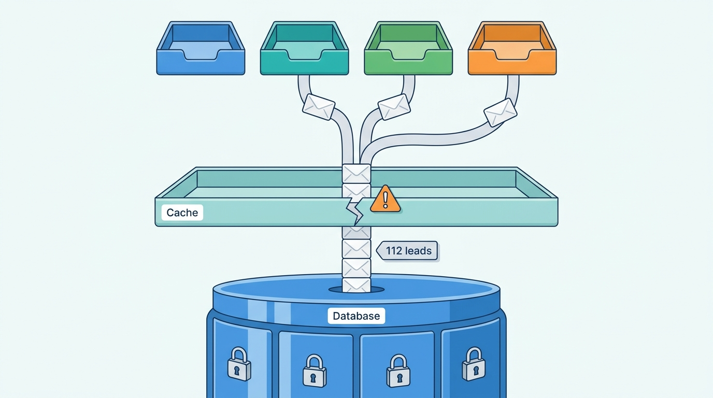
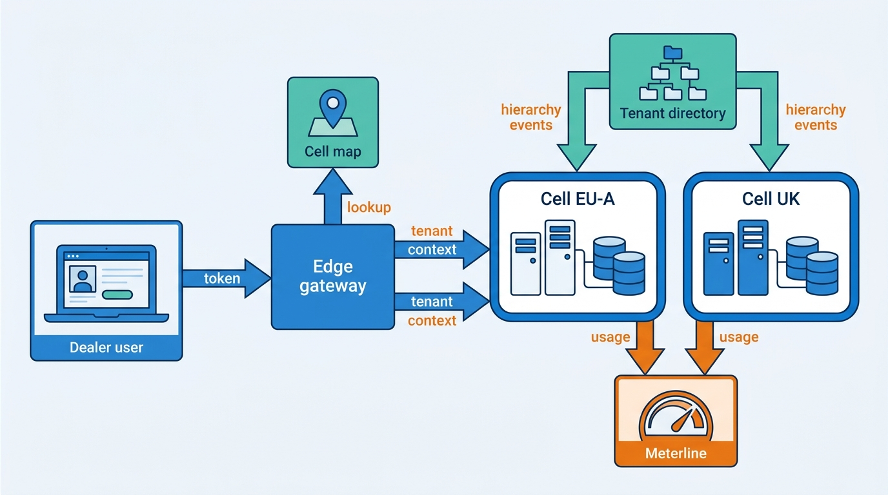
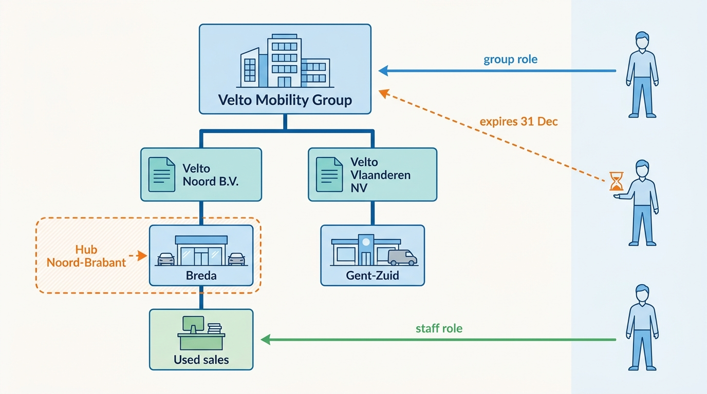
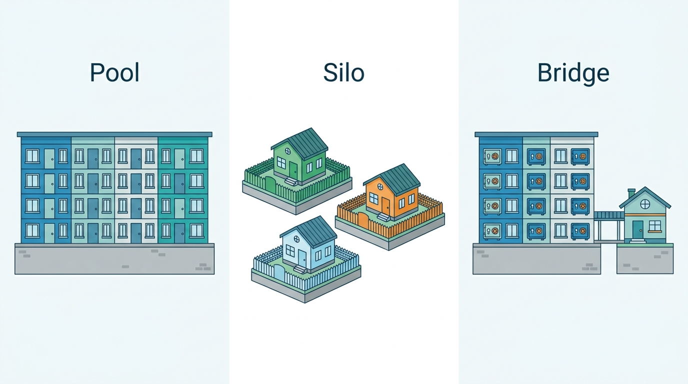
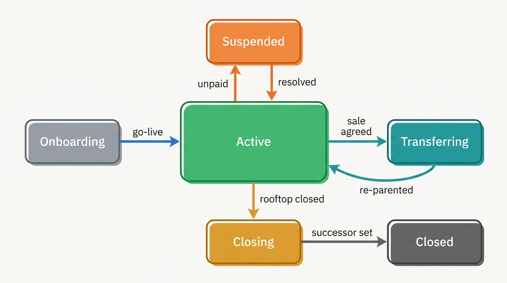

> **IN THIS CHAPTER, YOU WILL:** Model the dealer customer hierarchy from group to rooftop to user, separate tenancy as a data model from tenancy as infrastructure, compare shared (pool), isolated (silo) and mixed (bridge) tenant infrastructure against explicit requirements, and design tenant context, cross-tenant features, restructuring and per-tenant observability.

> **WHY THE BUSINESS CARES:** A dealer that sees another dealer's leads leaves, and the regulator hears about it. A dealer group that cannot see its 46 rooftops as one business buys a competitor's group tool, and every rooftop it sells or buys becomes a support project.

> **WHY ARCHITECTS SHOULD CARE:** The tenant model is the one schema decision that every table, cache key, event, log line, invoice and permission inherits. It is cheap to get right before the first customer and very expensive to retrofit into a monolith with seven thousand rooftops.

> **KEY POINTS:**
>
> * **The tenant is the contracting organization; the rooftop is a first-class child.** Modeling each rooftop as its own tenant makes every group feature a cross-tenant join and every acquisition a data merge. A tenant with a versioned hierarchy (legal entities, optional regions, rooftops, departments) turns a rooftop sale into a re-parenting operation with an explicit data-ownership decision.
> * **Isolation is a property of every layer that can hold data, not of the database alone.** The Cross-Tenant Lead leaked through a cache key, not a query. Tenant context must be set from a verified token at the edge, carried through services, jobs, events and caches, enforced again in the database, and tested with deliberate leak tests.
> * **Choose pool, silo or bridge per component against stated requirements, not per customer.** For a dealer platform whose largest group is under 1% of rooftops, pooled application and data planes with per-tenant keys, fair queuing and a small number of cells meet the isolation, cost and noisy-neighbor requirements. A silo-clone cell on the same release train is a priced option, never a fork.

> **[FAILURE PATTERNS THIS CHAPTER ADDRESSES](where-vehicle-platforms-go-wrong.html):**
>
> * **The Tenant Blur** — Lotwise keyed everything by rooftop and bolted groups on with shared logins, and Showroomly's tenant id was optional in a cache key.
> * **The Acquisition Archipelago** — five products held five customer records for the same dealer, so nobody could say which tenant a Velto rooftop belonged to.
> * **Customization Creep** — the usual answer to a large group's isolation demand is a dedicated, forked installation; a silo-clone cell gives the isolation without the fork.

 
A one-person used-car lot in Leeuwarden and a 46-rooftop franchise group spread across the Netherlands and Belgium buy the same dealer software. The independent wants a login, a stock list and an invoice. The group wants single sign-on, a central pricing desk that sees every rooftop, regional managers who see only their region, salespeople who see only their own leads, one consolidated invoice per legal entity, and the right to sell three rooftops next quarter without losing their history. **Both customers must fit one tenant model**, because a second model for groups is how dealer platforms end up with two products.

This chapter asks how tenants should be modeled and isolated across that range. The answer has two halves that are often confused: **tenancy as a data model** (what a tenant is and how every record knows its owner) and **tenancy as infrastructure** (which tenants share compute, databases, keys and deployments). The first is hard to change; the second can change per component, if the first was done well.

This chapter owns the terms **tenant**, **rooftop** (in depth), **tenant context** and **pool, silo and bridge**. Authentication, roles and relationship-based permissions belong to [[identity-access-and-entitlements]]; per-tenant configuration and group policies belong to [[onboarding-and-configuration]]; usage events and invoices belong to [[billing-and-metering]]. The vehicle itself is not tenant data at all, a distinction [[vehicle-bounded-contexts]] draws and this chapter relies on.

## Setting the Scene at Axleby: 112 Leads in 47 Minutes

Axleby, the fictional vehicle data and dealer software group this book follows (see [[meet-axleby]]), entered 2027 with three tenant models, none of them designed as such.

- **Lotwise Classic**, the PHP and MySQL monolith in Ghent, keys everything by a `dealer_id` that means one rooftop. A `dealer_group` table added later links rooftops for reporting; a user belongs to exactly one rooftop.
- **Showroomly**, the UK product on Rails and PostgreSQL, keys by an `account_id` that is sometimes a rooftop and sometimes a whole group, depending on how the customer was sold.
- **Axleby Portal accounts** in Connect XML, used by Axleby Data and Axleby Trade, are keyed by the customer's legal entity, because that is who signs the data license and pays the invoice.

One dealer group can therefore be 46 Lotwise tenants and several Axleby Portal customers. There are **12,400 business customers** by legal entity, **7,200 Lotwise rooftops** and **1,350 Showroomly rooftops**, and **410 dealer groups** that own **58%** of Lotwise rooftops. Nobody at Axleby can produce a list of tenants, because the word means three different things.

Two events in 2027 forced the issue.

The first came from **Velto Mobility Group**: 46 rooftops (38 in the Netherlands, 8 in Belgium), a Lotwise customer since its migration from a competitor finished in November 2026, 11 franchise brands, DriveDesk as the dealer management system (DMS, the dealer's system of record for deals, accounting and workshop). In April 2027 Mirjam Kuipers, Velto's group used-car director, asked for a group stock view, central price bands and single sign-on for her central desk. Her seven-person desk held 322 Lotwise logins between them (one per person per rooftop) and in practice used three shared ones. Her procurement team also asked, as large groups' procurement teams often do, for "a dedicated environment with our own database."

The second was an incident. In **June 2027** a change to the lead-inbox backend-for-frontend (BFF, the service that shapes data for one user interface) in Showroomly moved the account identifier from the cache key into a filter object, to let users of one dealer share cached inbox pages. One code path, the default "Unread" view, built that filter without the account. For **47 minutes**, **112** leads belonging to one dealer, with consumers' names, phone numbers and part-exchange details, appeared in the inboxes of users at **3** other dealers. A salesperson at one of them phoned support. Showroomly reverted the change, Femke de Boer (Head of Data Governance and Privacy and the group's Data Protection Officer) reported a personal-data breach to the UK Information Commissioner's Office (ICO), and Callum Reid's team wrote to the four dealers. This is **the Cross-Tenant Lead**.

The database was never queried across tenants. Every SQL statement had its `WHERE account_id = ?`. **The leak was in a layer nobody thought of as holding tenant data.**

**Figure 1:** *In the Cross-Tenant Lead every query was filtered by tenant; 112 leads reached 3 other dealers through a cache key that had lost the tenant.*

Ines Marchetti, Group Chief Architect, put one question to the architecture forum: **what is a tenant at Axleby, and what must be true in every layer so that no tenant's data can reach another without an explicit, audited decision?** Velto's request for a dedicated database was the second question: is isolation something Axleby sells by size, or something it guarantees to everyone?

## Concepts: Who the Customer Is

### Five levels, not one

A dealer customer has at least five levels that software must represent. Each has a different job.

| Level | What it is | What hangs off it | Example at Velto |
| --- | --- | --- | --- |
| **Organization (tenant)** | The contracting party: an independent dealer, a dealer group, a lessor, a data client | Contract, master data, identity provider settings, group policies, the boundary of data isolation | Velto Mobility Group |
| **Legal entity** | A company with its own registration and VAT number | Invoices, VAT, sales documents, register authority, data-protection controller role | Velto's 7 operating companies, 5 Dutch and 2 Belgian |
| **Region or cluster** | An optional grouping used for management | Reporting, permissions, lead routing, price bands | 9 regional hubs from September 2027 |
| **Rooftop** | One physical dealership location | Stock, adverts, leads, opening hours, franchises, DMS site, subscriptions | Velto Breda, Velto Gent-Zuid, … (46) |
| **Department** | A function within a rooftop | Lead queues, approval rights, workshop and sales split | Used sales, new sales, workshop |

The **rooftop** is what most dealer software is built around: stock sits there, portal accounts and franchise agreements name it, and subscriptions are priced per rooftop (Lotwise's Stock & Pricing module is €189 per rooftop per month, an Axleby illustration). It is the right **billing and operational unit** and a poor **isolation unit**, because the people who run groups work across rooftops by definition.

**Users** are not a level of the hierarchy. A **membership** connects a person's identity in Axleby ID (the group's shared login service) to one node with a role: Mirjam to the Velto organization, a salesperson to the Breda rooftop's used-sales department. People outside the tenant, such as a marketing agency, a manufacturer's field manager or an auditor, hold **external memberships** with an expiry and an inviting party, not copied accounts. [[identity-access-and-entitlements]] owns how memberships become permissions.

### What a tenant is, and what it is not

A **tenant** is the unit of data ownership and isolation: the boundary inside which data may flow freely subject to permissions, and across which data may flow only through explicit, audited features. The design choice is which level of the hierarchy carries that boundary.

Microsoft's multitenancy guidance warns that for business customers you should "consider whether your customers have divisions, like teams or departments, and whether they have a presence in multiple countries or regions" ([Microsoft Azure Architecture Center, 2025](https://learn.microsoft.com/en-us/azure/architecture/guide/multitenant/considerations/tenancy-models)). Its tenant-lifecycle guidance lists merges and splits as normal events: "companies might be acquired or merge" and "companies might split or divest" ([Microsoft, 2025](https://learn.microsoft.com/en-us/azure/architecture/guide/multitenant/considerations/tenant-lifecycle)).

| Candidate tenant unit | Works well for | Breaks when |
| --- | --- | --- |
| Rooftop | Single-site independents; per-site billing | A group wants one stock view, central pricing, one identity: every group feature becomes cross-tenant |
| Legal entity | Invoices, VAT, contracts, controller role | One group has many entities; one entity runs many rooftops; groups restructure entities for tax reasons |
| Organization (group or independent) | Group users, reporting, single sign-on, policies | A rooftop is sold to another group: the split must be designed |
| Manufacturer franchise | Manufacturer programs | Multi-franchise rooftops; independents have no franchise |

The rule I use is: **the tenant is the contracting organization, and rooftops, legal entities and regions are versioned children inside it.** Splits are rarer than group features, and a split designed as one operation is cheaper than group features built as cross-tenant joins. An independent dealer such as Autobedrijf Brandsma (one rooftop, about 55 cars) is simply an organization with one legal entity and one rooftop. Nothing about it is a special case.

Two things are deliberately **not** tenant data:

- **The vehicle.** The Axleby Vehicle Key (AVK) in Anchor, the specification in Specbook and the history in Tracewell describe a physical car, and many tenants will hold that car over its life. They are shared reference data, licensed rather than owned ([[vehicle-identity]]). What a tenant owns is its **stock item** and **dossier** for that car: purchase price, appraisal, photos, adverts, leads, documents ([[inventory-and-vehicle-dossier]]).
- **Usage and audit records about the tenant.** These belong to Axleby's control plane, are attributed to the tenant and are shown to it, but the tenant cannot delete them.

### Tenancy as data model versus tenancy as infrastructure

Getting the data model wrong produces the Tenant Blur; getting the infrastructure wrong produces noisy neighbors, cost blow-outs and oversized blast radius. If the data model is right (every tenant-owned row, message, object and cache entry carries a mandatory, immutable tenant id), moving a tenant between infrastructure models later is a migration. If it is wrong, no infrastructure choice rescues it: a silo database per Lotwise rooftop would still leave Velto's central desk with 46 logins.

### Tenant context

**Tenant context** is the verified answer, for one unit of work, to "on behalf of which tenant, and which node within it, is this happening?" It consists of the tenant id, the active hierarchy node (usually a rooftop), the acting user or client, and the hierarchy version used to resolve them. It is established once, at the edge, from a verified token; it is never taken from a client-supplied header or request body; and it is carried, not re-derived, through every service call, job, event and cache operation that follows. Work that has no tenant context, such as a nightly batch across all stock, must say so explicitly with a system context, and must then attach the tenant context of each item it touches.

## Architecture: One Hierarchy, Context Everywhere, Isolation in Layers

### The control plane and the application plane

AWS's SaaS guidance separates the **control plane** (onboarding, identity, metrics, billing) from the **application plane**, and notes that the control plane is "global to all tenants" and "not actually multi-tenant" ([AWS, 2022](https://docs.aws.amazon.com/whitepapers/latest/saas-architecture-fundamentals/control-plane-vs.-application-plane.html), marked historical by AWS). Axleby's target splits the same way.

- **Control plane** (shared across the group, one instance): the **tenant directory** (organizations, legal entities, regions, rooftops, departments, external identifiers, lifecycle state, hierarchy versions), the **cell map** (which deployment serves which tenant), Axleby ID (identity, built on Keycloak with organizations), Gatekeeper (relationship authorization on OpenFGA), Meterline (usage metering) and the subscription and entitlement store.
- **Application plane** (one or more **cells**): Lotwise, Showroomly, Switchboard, Relay and the data APIs, each holding tenant-owned data and trusting the control plane for who the tenant is.

A **cell** is a complete deployment of the application plane serving a defined set of tenants, with its own databases, queues, credentials and network boundary. Microsoft calls this pattern **deployment stamps** and describes a tenant-mapping layer that routes each request to the stamp holding its data, with tenants movable between stamps ([Microsoft, 2025](https://learn.microsoft.com/en-us/azure/architecture/guide/multitenant/considerations/tenancy-models)).

**Figure 2:** *The control plane decides who the tenant is and where it lives; cells hold tenant data. The edge turns a verified token into a signed tenant context, routes it to the tenant's cell, and every cell reports usage and receives hierarchy changes from the same tenant directory.*

### The tenant directory

The tenant directory is the system of record for the hierarchy. Four properties matter more than its storage engine.

1. **Opaque, immutable ids.** A tenant id never encodes a name, country or customer number, because all three change. Rooftop ids are global, not per tenant, so a rooftop keeps its id when it moves to another tenant.
2. **External identifiers as attributes, with sources.** The legal entity carries its company registration number and VAT number; the rooftop carries the DMS site code, portal account ids and manufacturer dealer codes. These are how duplicate customers across acquired products are found and merged ([[one-platform-from-many-products]]).
3. **Versioned hierarchy.** Every structural change (add rooftop, move rooftop, close rooftop, re-parent legal entity) creates a new hierarchy version with an effective date and an author. Consumers can ask what the hierarchy looked like on a past date when they replay leads or recompute a report.
4. **Lifecycle events.** Every change is published (on the One Dossier event backbone, [[events-webhooks-and-sync]]) so that routing rules, syndication accounts, entitlements and caches react. The Lost Leads of Velto (September 2027, [[journey-lead-to-dms]]) is what happens when they do not: Velto reorganized **46** rooftops into **9** regional hubs; the stock of three closed rooftops (about 1,100 cars, plus central used-car stock) stayed advertised under their old rooftop codes, routing rules nobody updated sent those codes' leads to an inactive queue, and **1,460** leads went unworked for **9 days**. A `rooftop.closed` event with a named successor rooftop is the structural fix; a routing rule that points at a closed rooftop should fail a check, not silently forward.

**Figure 3:** *Velto as one tenant. Legal entities own rooftops for invoicing and legal purposes; regions group rooftops for management without owning them; users hold memberships at the level where they work, and outsiders hold expiring external memberships. The two legal entities shown are two of Velto's seven (five Dutch, two Belgian); their names and the hub are illustrative.*

Regions are a **separate, optional grouping**, not a level every rooftop must sit under: some groups have none, and Velto replaced its regions in 2027. A rooftop is owned by one legal entity and grouped into zero or more management clusters, independently.

### Carrying tenant context through every layer

Isolation fails where context is dropped, and context is dropped at boundaries. Ines's team inventoried every layer; each needs its own control, because each fails independently. The Cross-Tenant Lead was a cache failure; the SQL was correct.

| Layer | How context arrives | Control |
| --- | --- | --- |
| **Edge** | Access token from Axleby ID with organization id; active rooftop selected in the session | Gateway validates the token, checks the rooftop is in the tenant at the current hierarchy version, and issues a short-lived signed internal context |
| **Service calls** | Signed internal context header | Services reject calls without it; a library exposes it, so handlers never parse ids from payloads |
| **Caches** | Cache client library | Keys are built only by a library that prefixes the tenant id and refuses to build a key without context; a cached value carries its tenant id and is checked on read |
| **Database** | Per-transaction setting | Application filter plus database-enforced row-level security where the engine supports it |
| **Search indexes** | Query builder | Mandatory tenant filter in the query library; one index per cell, tenant id on every document |
| **Events and jobs** | Event envelope | CloudEvents extension attributes for tenant and rooftop; consumers set context from the envelope, not the payload |
| **Object storage** | Path and encryption key | Tenant id in the object key prefix; per-tenant data key; signed URLs scoped to one object |
| **Telemetry** | Span and log attributes | Tenant id on traces and logs, tenant tier only on metrics |
| **Egress** | Outbound calls to portals, DMS, suppliers | Strip internal context and baggage at the egress proxy |

Three controls in that table deserve more than a line.

**Row-level security, and where the estate cannot have it.** In PostgreSQL, with row-level security (RLS) enabled, "all normal access to the table for selecting rows or modifying rows must be allowed by a row security policy"; with no policy, "a default-deny policy is used"; and "superusers and roles with the BYPASSRLS attribute always bypass the row security system", as do table owners unless `FORCE ROW LEVEL SECURITY` is set ([PostgreSQL 18 documentation, accessed 2026-10](https://www.postgresql.org/docs/current/ddl-rowsecurity.html)). AWS's 2020 write-up of the pattern warns that session settings "may conflict with server-side poolers" ([AWS Database Blog, 2020](https://aws.amazon.com/blogs/database/multi-tenant-data-isolation-with-postgresql-row-level-security/), an older source whose guidance still holds). The safe recipe: the application connects as a non-owner role without `BYPASSRLS`, every tenant table has `FORCE ROW LEVEL SECURITY`, and the tenant is set with `SET LOCAL` inside each transaction so a pooled connection cannot carry it into the next request. Showroomly and the services on Aurora PostgreSQL use this.

Lotwise Classic runs on MySQL, which has no native row-level security. Its control is the ORM: Doctrine's filters "add SQL to the conditional clauses of queries" wherever the ORM generates SQL ([Doctrine ORM documentation, n.d., accessed 2026-10](https://www.doctrine-project.org/projects/doctrine-orm/en/current/reference/filters.html)). Because filters hook into the ORM's SQL generation, hand-written SQL falls outside them, so Axleby added a static check that fails the build on raw SQL touching tenant tables outside a reviewed allow-list. This is weaker than RLS, and one reason the strangler plan moves dossier data out of Lotwise Classic first.

**Response-side assertion.** Every tenant-owned object returned by a service carries its tenant id. The BFF compares it with the request's context and drops and alerts on any mismatch before rendering. Had this existed in June 2027, the Cross-Tenant Lead would have been 112 dropped records and a page to on-call, not a breach.

**Leak tests and canary tenants.** Microsoft's guidance recommends testing that "one tenant's data isn't accidentally leaked to another" ([Microsoft, 2025](https://learn.microsoft.com/en-us/azure/architecture/guide/multitenant/considerations/tenancy-models)). Axleby's CI now runs every API and BFF endpoint as two synthetic tenants with overlapping data and fails if any response contains the other tenant's records. In production, each cell holds **canary tenants** whose leads and stock items carry unique marker strings; a log and response scanner alerts if a marker appears in another tenant's traffic.

### Isolation is two layers: tenancy and authorization

**Tenant isolation must not depend on fine-grained authorization being correct.** Gatekeeper decides, inside the tenant, whether a salesperson may see a colleague's lead or a regional manager may reprice Gent-Zuid's stock ([[identity-access-and-entitlements]]). The tenant boundary is enforced by context, cache library, database and response assertion, none of which consult Gatekeeper. A wrong relationship tuple can then expose data to the wrong colleague, but not to a competitor.

### Requirements per interaction

| Interaction | Consistency | Latency target | Freshness | Availability |
| --- | --- | --- | --- | --- |
| Resolve tenant context at the edge | Token plus cached hierarchy version | under 5 ms added *(assumption)* | Hierarchy cache under 60 s; membership removals pushed | Must work if the tenant directory is down (static stability) |
| Membership removed (person leaves) | Strong for revocation: next request denied | Revocation effective under 60 s *(assumption)* | Consistency token after change | Fail closed |
| Hierarchy change (add, move, close rooftop) | Strong in the directory; eventual downstream, reconciled daily | Seconds to publish; minutes to apply | Effective-dated versions | Directory writes may pause; reads may not |
| Rooftop transfer between tenants | Saga with explicit steps and a reconciliation report | Hours, scheduled | Effective date agreed in contract | Planned, out of hours |
| Per-tenant cost and usage view | Lossless for usage events; estimated for compute | Daily | Previous day | Best effort |

The first row is the one teams underrate. If every request calls the tenant directory synchronously, the directory's availability caps the platform's. With tokens carrying the organization, cached hierarchy versions and pushed removals, existing sessions survive a control-plane outage: the [[reliability-and-dependencies]] rule against Borrowed Uptime, applied to Axleby's own control plane.

## Pool, Silo or Bridge: Choosing Tenant Infrastructure

### The three models

AWS's SaaS Lens defines the vocabulary most teams now use ([AWS Well-Architected SaaS Lens, 2023](https://docs.aws.amazon.com/wellarchitected/latest/saas-lens/silo-pool-and-bridge-models.html)):

- **Silo**: "tenants are provided dedicated resources", but "a silo environment still relies on a shared identity, onboarding, and operational experience". The shared control is what separates SaaS from hosting separate versions per customer.
- **Pool**: tenants share resources, "the more classic notion of multi-tenancy".
- **Bridge**: "some microservices in your architecture might be implemented with silo and others might use pool", decided by "the regulatory profile of a service's data and its noisy neighbor attributes".

AWS's isolation whitepaper adds two warnings that frame the comparison. The pool model cannot be used "as a rationale to relax the isolation requirements"; and when premium tenants pay for silos, providers "will often require these premium customers to run the same version of the product", so that "the silo environment becomes a clone of the pooled environment that happens to be supporting one tenant" ([AWS, 2020](https://docs.aws.amazon.com/whitepapers/latest/saas-tenant-isolation-strategies/tier-based-isolation.html), marked historical). Microsoft states the silo's cost plainly: "If a single tenant requires a specific infrastructure cost, 100 tenants probably require 100 times that cost" ([Microsoft, 2025](https://learn.microsoft.com/en-us/azure/architecture/guide/multitenant/considerations/tenancy-models)).

At the database level, silo means a database per tenant, bridge often means a schema per tenant, and pool means shared tables with a tenant column, ideally enforced by row-level security. Sharded pools add a middle path: Citus's multi-tenant guide notes that tenant sizes "tend to follow a Zipfian distribution" and can move one large tenant to its own shard without leaving the pool ([Citus documentation, n.d., accessed 2026-10](https://docs.citusdata.com/en/stable/use_cases/multi_tenant.html)).

**Figure 4:** *Pool shares every resource, silo gives each tenant its own stack, and bridge pools by default while siloing chosen components, such as per-tenant encryption keys.*

### The requirements Axleby wrote down

Ines refused to answer "silo or pool?" in the abstract. The forum wrote eight requirements first, with numbers where it could. The numbers marked as assumptions are illustrative targets for this book, not documented industry figures.

| # | Requirement | Statement |
| --- | --- | --- |
| R1 | **Isolation** | No tenant's data reaches another tenant through any single defect in application code; a leak requires at least two independent controls to fail |
| R2 | **Cost to serve** | Infrastructure cost for a dealer rooftop stays below 3% of its module subscription revenue *(assumption)*; at Lotwise's average of about €540 per rooftop per month, that is under about €16 |
| R3 | **Noisy neighbors** | A bulk job by one tenant (a DMS re-sync of 2,000 cars, a 50,000-plate enrichment) does not move another tenant's interactive p95 latency by more than 10% *(assumption)* |
| R4 | **Compliance** | Meet the General Data Protection Regulation (GDPR) and UK GDPR as processor for dealers; hold ISO/IEC 27001 certification; produce per-tenant evidence of isolation and access on request |
| R5 | **Enterprise demands** | Single sign-on and user provisioning, per-tenant audit export, contractual data location (EU or UK), and an option for customer-specific encryption keys |
| R6 | **Restructuring** | Move a rooftop between tenants, or merge two tenants, within one working day of the effective date, without data loss |
| R7 | **Blast radius** | A security compromise or a bad deployment can be contained to a fraction of the dealer base |
| R8 | **One product** | Every customer runs the same release; no customer-specific code branches |

### The comparison

| Requirement | Pool (shared everything, tenant id in every row) | Silo (dedicated stack per tenant) | Bridge (pool by default; silo for chosen components or tenants) |
| --- | --- | --- | --- |
| R1 Isolation | Met only with layered controls: context, cache library, RLS or ORM filter, response assertion, leak tests | Met structurally for data at rest; shared control plane and caches still need context | Met with layered controls in pooled parts, structurally in siloed parts |
| R2 Cost to serve | Best: fixed cost shared by about 7,200 rooftops; marginal cost per rooftop of a few euros *(assumption: about €11 per rooftop per month for Lotwise)* | Fails for independents: a minimal production stack (cluster share, multi-zone database, queues, observability, on-call share) of about €6,000 per month *(assumption)* is about €130 per rooftop even for Velto's 46 | Close to pool; silo cost only where a requirement demands it |
| R3 Noisy neighbors | Needs per-tenant queues, fair scheduling, concurrency caps and query limits | Met by construction | Pool controls, plus siloing the components with spiky shared load |
| R4 Compliance | Met; auditors sample isolation controls and leak-test evidence | Met; easier to explain to procurement | Met |
| R5 Enterprise demands | SSO, audit export, location by cell are pool-compatible; customer keys via per-tenant key hierarchy | All met; the dedicated environment is the selling point | All met |
| R6 Restructuring | Best: re-parenting is a metadata change plus data moves inside one database | Worst: every rooftop move between two silos is a cross-database migration | Good if siloing follows the tenant, not the rooftop |
| R7 Blast radius | Worst inside one cell: one bad deploy or compromise reaches every tenant in it | Best | Controlled through the number of cells, independently of silo or pool |
| R8 One product | Met naturally | At risk: dedicated environments attract dedicated versions | Met if silos are clones on the same release train |

Three things stand out once the table exists.

**Blast radius is a cell decision, not a silo decision.** R7 is the strongest argument for silos, and it is answered by **cells**, not by one stack per tenant. Two or three cells, each with its own AWS account, credentials, network and database, cut the blast radius to a half or a third at a fraction of silo cost. The public record of the June 2024 CDK Global incident shows why this matters in this industry: after cyberattacks on 19 June 2024, CDK shut its systems down as a precaution; it said it served "more than 15,000 retail locations across North America" ([AP via ClickOnDetroit, 2024](https://www.clickondetroit.com/business/2024/06/21/car-dealerships-are-being-disrupted-by-a-multi-day-outage-after-cyberattacks-on-software-supplier/)), and many dealers wrote orders by hand. CDK has published no architectural post-mortem.

> **INFERENCE, NOT DOCUMENTED:** A provider that shuts everything down "as a precaution" is usually one that cannot prove a compromise is contained to part of its fleet. Cells whose boundaries are also security boundaries (separate credentials, networks and control-plane access) are what would let a provider isolate one cell and keep the others running. This is a general lesson, not a statement about CDK's architecture.

**Noisy neighbors on a dealer platform are workloads, not whales.** Tenant size is skewed, but less than in many SaaS markets: Velto, among Axleby's largest groups, holds 46 of 7,200 Lotwise rooftops, about **0.6%**, and about 2,650 of the 352,000 cars in stock. No single tenant can saturate the pool by its size. What saturates it is **bulk work**: a group's DMS re-sync, a fleet-list enrichment, the nightly restock valuation of about **350,000** cars, month-end reports. Microsoft treats these as "resource governance problems": per-tenant monitoring, throttling and query-cost caps, communicated openly ([Microsoft, 2025](https://learn.microsoft.com/en-us/azure/architecture/antipatterns/noisy-neighbor/noisy-neighbor)). The design answer is **per-tenant work queues with fair scheduling and concurrency caps**, kept apart from interactive appraisal and stock traffic, which pool handles without silos.

**Restructuring punishes silos.** R6 is where dealer SaaS differs from generic SaaS. Dealer groups buy and sell rooftops routinely; a silo per tenant turns each transaction into a cross-database migration with an outage window. Pool makes it a metadata change plus row moves inside one store.

### Axleby's decision

The architecture forum's decision record, approved in **July 2027**, reads in substance:

1. **Data model**: tenant = organization in Axleby ID; legal entity, region, rooftop and department are directory nodes; every tenant-owned record, event, object and cache entry carries a mandatory tenant id and, where meaningful, a rooftop id.
2. **Default infrastructure: bridge, chosen per component.**
   - *Pooled*: Lotwise application and data, Switchboard, Relay, Showroomly, the data APIs. Isolation by the layered controls above.
   - *Siloed per tenant, inside the pool*: **encryption**. Every tenant gets its own data keys for documents and personal data at rest, wrapped by one AWS Key Management Service (KMS) key per cell. A dedicated KMS key that the customer can audit and revoke is an enterprise option. AWS lists KMS keys at "$1/month (prorated hourly)" ([AWS KMS pricing, accessed 2026-10](https://aws.amazon.com/kms/pricing/)), so one dedicated key per business customer for all 12,400 would cost about $149,000 a year before request fees; wrapped per-tenant data keys give most of the benefit (crypto-shredding at offboarding, per-tenant key rotation) for almost nothing.
   - *Siloed per workload class*: bulk queues and workers run in separate pools from interactive services.
3. **Cells**: one UK cell (Showroomly, AWS eu-west-2) and, from 2028, two EU cells for Lotwise in eu-west-1, assigned by tenant, never by rooftop, with separate AWS accounts and credentials. The cell map lives in the control plane from day one so that tenants can be moved.
4. **Silo-clone tier**: a dedicated cell for one tenant is a priced option for any tenant with more than 100 rooftops or a regulatory requirement it can name. It runs the same release on the same day as the pooled cells and is operated by the same team. No customer-specific code, ever.
5. **Evidence**: per-tenant isolation evidence (leak-test results, access logs, key ids) is a standard export, because R4 and R5 are mostly satisfied by evidence, not by dedicated hardware.

Velto's procurement team received the requirement table, the isolation evidence pack and a price for the silo-clone tier: at the assumed €6,000 per month, about **€130 per rooftop per month**, roughly a quarter on top of Velto's module subscriptions. Mirjam Kuipers took the pooled tier with a dedicated KMS key and a contractual commitment to EU data location. What her team had actually wanted, it turned out, was the group stock view and single sign-on, which no amount of hardware would have provided.

### When the decision would be different

The recommendation changes when the inputs do:

- **One customer is a large share of the base.** If one contract (say, a manufacturer's whole dealer network) is 20% of load, a dedicated cell for it is cheap per unit and lowers everyone's risk.
- **A regulator or contract names the isolation.** A contractual requirement for dedicated infrastructure is met with a priced silo-clone cell.
- **Data residency splits the base.** A US expansion would be a new cell (or region of cells) for legal and latency reasons, not a silo per tenant.
- **The data engine lacks row-level controls and the code is untrusted.** Lotwise Classic on MySQL is Axleby's weak spot until dossier data moves to PostgreSQL services; its leak tests run hardest there.

## Cross-Tenant Features and Their Rules

Some of the most valuable features in dealer software deliberately move data between tenants. Each needs a rule that says who decided, what crosses, and how it can be undone.

| Feature | Within one tenant or across? | What crosses | Rule |
| --- | --- | --- | --- |
| **Group stock view, central pricing** | Within (across rooftops) | Nothing crosses a tenant boundary | Permissions (Gatekeeper) decide who sees which rooftops; regions are just groupings |
| **Stock transfer between rooftops** | Within | Stock item moves rooftop; dossier and history move with it | Effective-dated move; adverts withdrawn and republished per rooftop channel accounts |
| **Trade between dealers on Tradefloor** | Across | A **listing** the seller chose to publish; at sale, a **copy** of agreed dossier facts | Explicit publish by the seller; buyer receives a copy, not a reference; personal data of the previous retail customer never crosses ([[b2b-trade-and-remarketing]]) |
| **Lessor returns to a dealer** | Across | Return condition report, agreed documents | Contracted data-sharing agreement between the two tenants; scoped, expiring access |
| **External members** (agency, manufacturer field manager, DMS support) | Into a tenant | Access, not data | Expiring membership invited by a tenant admin; every action audited under the person's own identity |
| **Market benchmarks** built from many tenants' stock and prices | Across, aggregated | Aggregates only | Contract permits it; minimum cell sizes; never per competitor ([[data-products-and-insights]]) |
| **Shared vehicle facts** (identity, specification, history) | Not tenant data | — | Licensed reference data, governed by [[data-licensing-and-governance]] |

The rule behind the table: **cross-tenant flows copy data on an explicit act by the owning tenant, and never share mutable references.** If Tradefloor showed the buyer the seller's live dossier, the seller's later edits (and its customer's personal data) would reach the buyer. A copy with provenance ("transferred from seller, 14 October 2027") is auditable and survives the seller deleting its record.

## Restructuring: When Groups Buy, Sell and Reorganize

Dealer groups change shape all the time. Van Mossel Automotive Group reported 567 locations across six countries in 2025, after acquiring Nord-Ostsee Automobile (40 locations) and announcing the LöhrGruppe acquisition the same year ([Van Mossel annual report 2025, in Dutch](https://com-back.vanmossel.com/assets/Jaarberichten/Jaarbericht-2025-NL-Van-Mossel-Automotive-Group.pdf)). For a dealer SaaS vendor, restructuring is routine and needs a designed procedure, not a support ticket.

### The rooftop lifecycle

**Figure 5:** *A rooftop's lifecycle in the tenant directory. Transfer and closure are explicit states with effective dates, so routing rules, channel accounts, entitlements and invoices react to an event instead of discovering the change from failures.*

### Three restructuring cases

**A rooftop moves to another tenant.** Suppose Velto sells its Gent-Zuid rooftop to another Lotwise customer. The rooftop id stays the same; its parent changes on the effective date. The hard part is not the pointer, it is deciding **which data goes with the rooftop**.

| Data class | Default at transfer | Reason |
| --- | --- | --- |
| Current stock items and dossiers | Move with the rooftop | The cars are physically there and are part of the sale |
| Live adverts and channel accounts | Move if the portal account is per rooftop; otherwise withdraw and republish | Portal contracts are often per legal entity |
| Open leads and their personal data | Move only if the sale agreement transfers the customer relationship | The buyer becomes controller of that data; a legal decision, not a technical default |
| Closed deals, sales documents, invoices | Stay with the selling legal entity, archived | Fiscal retention obligations stay with the seller |
| Users | Memberships end at the effective date; the buyer invites whom it keeps | Prevents the new-enemy problem: a salesperson who moved should not still see the old tenant |
| Usage, billing and audit history | Stay attributed to the seller up to the effective date | Invoices and audits are historical facts |
| Configuration (price rules, templates) | Buyer's group policies in Baseline, the tenant configuration service, apply from the effective date; rooftop overrides are offered for review | [[onboarding-and-configuration]] owns policy inheritance |

The procedure is a **saga**: freeze writes on the rooftop for a short window, move rows and objects (re-encrypting documents under the buyer's data keys), update Gatekeeper relationships, re-point channel accounts, switch billing at the effective date, publish `rooftop.transferred`, and produce a reconciliation report that both tenants sign off. Each step is idempotent and individually retryable.

**Two tenants merge.** When a group buys an independent that was already an Axleby customer, two organizations become one. The independent's rooftops are re-parented one by one through the same saga; its organization is closed with a successor pointer, so old ids still resolve for audit and reports.

**A group reorganizes internally.** Velto's September 2027 move from brand clusters to **9** regional hubs changes no tenant boundary. It creates a new hierarchy version with new regions and three rooftops in Closing. If lead routing had subscribed to the directory, the three closed rooftops would have had named successors and the rules would have failed a validation, instead of forwarding **1,460** leads (for hub-sized stock still advertised under the old rooftop codes) to a queue that accepted and discarded them ([[journey-lead-to-dms]]).

## Tenant-Aware Observability and Cost Attribution

Before 2027, Axleby had no shared tenant tag in Datadog. During the Cross-Tenant Lead, support took most of an hour to establish which dealers' users had loaded the bad inbox page, because logs carried user ids and session ids but not the tenant.

OpenTelemetry baggage can carry a tenant id downstream, but it is not added to spans automatically, it travels in headers visible on the network, and "automatic instrumentation includes Baggage in most of your service's network requests", including to third-party APIs ([OpenTelemetry, n.d., accessed 2026-10](https://opentelemetry.io/docs/concepts/signals/baggage/)). Axleby's rules:

- **`org.id` (the tenant) and `rooftop.id` on every trace and log line**, set from the signed context, never from the request.
- **Only tenant tier and product on metrics.** Seven thousand tenant values as a metric label, multiplied by endpoints and status codes, is a cardinality bill; per-tenant views come from traces and logs ([[observability-and-data-operations]]).
- **Baggage stripped at egress** to portals, DMS vendors and data suppliers.
- **No consumer identifiers in telemetry**: plates tied to a consumer, names and phone numbers are hashed or omitted ([[privacy-and-retention]]).

**Cost attribution** follows Microsoft's ladder from cheap to precise: indicative metrics, transaction metrics, per-request metrics, and estimates, which it calls reasonable when each tenant uses less than about 2% of a deployment ([Microsoft, 2024](https://learn.microsoft.com/en-us/azure/architecture/guide/multitenant/considerations/measure-consumption)). Every Axleby dealer tenant is below it, so infrastructure cost is **estimated** from stock, channel operations and leads. Upstream data is **measured** exactly: each build-data request costs Axleby about **€0.46**. Those requests flow through Meterline as usage events with tenant, rooftop and product tags, the same lossless events that drive invoices ([[billing-and-metering]]), not through sampled monitoring. [[scale-and-cost]] owns cost to serve as a unit metric.

## Failure Handling

Tenancy fails in characteristic ways. Each needs detection and a recovery path.

| Failure | Example | Detection | Recovery |
| --- | --- | --- | --- |
| **Cross-tenant exposure** | The Cross-Tenant Lead | Response-side assertion drops and alerts; canary-tenant markers; leak tests in CI | Kill switch per feature; identify exposed records from tenant-tagged logs; breach assessment within the legal window; notify affected tenants |
| **Duplicate tenants** | Velto exists as 46 Lotwise accounts, 7 Axleby Portal customers and later a Showroomly account | Directory match on company registration and VAT numbers, DMS site codes, portal account ids | Merge saga with a successor pointer; old ids keep resolving; manual review for weak matches |
| **Missing tenant context** | A background job or consumer runs without context | Libraries throw; database denies by default; a metric counts rejected calls | Fail closed; the job retries per item with that item's context |
| **Conflicting hierarchy changes** | Two admins move the same rooftop at once | Optimistic concurrency on hierarchy version | Second write rejected with the current version; admin retries |
| **Incomplete hierarchy** | A rooftop without a legal entity, so no invoice and no register authority | Directory validation on activation | Rooftop stays in Onboarding until complete |
| **Partial restructuring** | Rooftop moved in Lotwise but channel accounts and billing still point at the seller | Saga state per step; daily reconciliation of directory against Gatekeeper, Relay, Meterline | Retry the failed step; reconciliation report lists drift for an operator |
| **Stale permission after a move** | A salesperson who moved to a competitor still sees old leads through a cached decision | Consistency token on membership changes; cache invalidation on `membership.ended` | Short cache lifetimes; revocation is pushed, not polled |
| **Control-plane outage** | Tenant directory or Axleby ID unavailable | Health checks; synthetic logins | Existing sessions continue on signed tokens and cached hierarchy; new logins and structural changes wait |
| **Noisy neighbor** | A group's DMS re-sync of 2,000 cars slows appraisals for everyone | Per-tenant queue depth and latency by tenant tier | Fair scheduler throttles the tenant's bulk queue; interactive pool is unaffected |

The cross-tenant row has a legal clock. Under GDPR Article 33 a controller notifies the supervisory authority "without undue delay and, where feasible, not later than 72 hours after having become aware of it" ([Regulation (EU) 2016/679, CELEX 32016R0679](http://publications.europa.eu/resource/celex/32016R0679)); UK GDPR keeps the same rule. As processor for its dealers, Axleby must tell each affected dealer without undue delay so the dealer can meet its own clock. **Tenant-tagged logs are what make that possible**: in June 2027 the first hour went on finding out whom to tell.

## Across Markets: What Changes by Country

The tenant model itself does not change by country: no dealer-software regulator in these markets prescribes a tenancy model, and pressure for isolation comes from customers' procurement more than from law. What changes is the attributes on the hierarchy and the obligations that follow a leak or a restructuring.

| Topic | Netherlands / Belgium | Germany | United Kingdom | United States |
| --- | --- | --- | --- | --- |
| **Legal entity identifiers** | Chamber of Commerce number (KvK) in NL; enterprise number (KBO/BCE) in BE; VAT number | Commercial register entry (Handelsregister) and VAT number | Companies House number; VAT number | State registration and federal employer id; dealer license per state |
| **Register authority on the hierarchy** | Axleby Trade's register transactions need the dealer's company authorization from the Dutch register, held by a legal entity for its locations; Belgian transactions run through a partner. Authority is an attribute of the entity and rooftop, not of the user ([[identity-access-and-entitlements]]) | Axleby offers no register transactions; registration happens at local registration offices (*Zulassungsstelle*) | Showroomly performs no register transactions; register lookups use Axleby's own API access | Not an Axleby market; state dealer licenses attach to the entity and location |
| **Breach notification after a cross-tenant leak** | GDPR Art. 33: supervisory authority within 72 hours (Autoriteit Persoonsgegevens; Belgian Data Protection Authority) | GDPR Art. 33; state data-protection authorities | UK GDPR: ICO within 72 hours | FTC Safeguards Rule: notify the FTC when at least 500 consumers' unencrypted information is involved, within 30 days, plus state breach laws ([FTC, n.d.](https://www.ftc.gov/business-guidance/resources/ftc-safeguards-rule-what-your-business-needs-know)) |
| **Customer compliance pulled into the platform** | GDPR processor terms | Same | UK GDPR processor terms | Most dealers that arrange financing are covered by the Safeguards Rule, which requires multi-factor authentication and user-activity logging and oversight of service providers "by contract" ([FTC, 2025](https://www.ftc.gov/business-guidance/resources/automobile-dealers-ftcs-safeguards-rule-frequently-asked-questions); [16 CFR 314.4](https://www.law.cornell.edu/cfr/text/16/314.4)) |
| **Per-user activity data inside a tenant** | NL: works-council consent for systems suitable for monitoring staff ([WOR art. 27(1)(l)](https://wetten.overheid.nl/BWBR0002747/)) | Works-council co-determination over technical devices that monitor employees ([BetrVG §87(1) no. 6](https://www.gesetze-im-internet.de/betrvg/__87.html)) | No equivalent veto | No equivalent veto |
| **Switching and export at offboarding** | EU Data Act switching rules apply from 12 September 2025; switching charges end 12 January 2027 ([Regulation (EU) 2023/2854](http://publications.europa.eu/resource/celex/32023R2854)) | Same | EU Data Act does not apply to UK customers | No equivalent law |

The judgement: **one hierarchy model, market-specific attributes and rule sets.** Legal-entity identifiers, register authority, dealer licenses and invoicing rules are attributes and validations per market on the same directory nodes. Breach-notification clocks are runbook parameters per market. The works-council row is the one that changes product design in Germany and the Netherlands: per-user activity views (lead-response times by salesperson, user audit logs) should be configurable per tenant, with documented purposes, so a large group can get works-council approval. The US would change infrastructure: an expansion means US cells, and large public US groups are the likeliest buyers of a silo-clone tier. Cross-border groups belong in one hierarchy, not in a tenant per country: Velto's Dutch and Belgian legal entities are one tenant (LISTED's [[multi-country-platforms]] covers the general multi-country case).

## The Chief Architect's View

**What to decide, and who decides.**

- **The definition of tenant.** Decided once, at group level, by the Chief Architect with product and finance. At Axleby: the contracting organization, in Axleby ID, with a single tenant directory for every product. Product teams decide how their own data maps onto it, not whether.
- **The isolation requirements.** Written as requirements (R1–R8 above) and owned jointly with the security lead and the Data Protection Officer. Isolation infrastructure (pool, silo, bridge, cells) is then an engineering decision against those requirements, revisited yearly.
- **The silo-clone tier's price and threshold.** A commercial decision with an architectural floor: the same release, the same team, no forks. Sales must not be able to promise a dedicated version.
- **Cross-tenant features.** Each new one (a benchmark, a trade exchange, a lessor portal) goes through a short review that names the explicit act, what is copied, and how access ends.

**What to watch.**

- **Context coverage**: share of services, queues, caches and tables that enforce tenant context in a library or the database, by product. Lotwise Classic's raw-SQL allow-list should shrink every quarter.
- **Leak-test coverage and canary alerts**: zero canary alerts is the target; zero leak tests is the warning sign.
- **Duplicate-tenant backlog**: customers still represented by more than one record across products. This is the Acquisition Archipelago's measure ([[one-platform-from-many-products]]).
- **Restructuring lead time**: days from a signed rooftop sale to a reconciled transfer. Velto will sell rooftops again.
- **Noisy-neighbor incidents** by tenant tier, and **per-tenant cost** against R2.

**Long-term considerations.** Cells and the cell map keep options open: data residency, a US entry, a silo-clone customer, a smaller blast radius after an incident. And the tenant directory becomes the group's answer to "who is this customer?" for billing, licensing, support and sales; it deserves a product's ownership and service-level objectives, not a table in the oldest monolith.

## Questions to Ask

1. What is a tenant in each of our products, and can we produce a list of tenants that finance, support and security agree on?
2. Where is tenant context established, and can any row, event, cache entry, service call or job exist without it?
3. Which data stores enforce tenant isolation in the engine (row-level security, per-tenant keys), and which rely on application code alone?
4. If a developer builds a cache key or a query without the tenant, what stops it before production, and what catches it in production?
5. Which requirement does each silo or dedicated environment we run satisfy, and could a cell or a per-tenant key satisfy it instead?
6. How long does it take to move a rooftop from one tenant to another, and who decides what data moves with it?
7. When a rooftop closes or a group reorganizes, which systems learn about it from an event, and which from failures?
8. Can we list every user who saw a given tenant's data in the last hour, within the hour?
9. What is our cost to serve per rooftop by tenant tier, and which part of it is measured rather than estimated?

## From Tenants to People

A tenant model answers whose data this is and where it lives. It does not answer which person inside the tenant may do what: whether a regional manager may reprice Breda's stock, whether a salesperson may see a colleague's lead, whether a user holds the register authority to transfer ownership, or how a DMS vendor's integration acts on a dealer's behalf. Those decisions sit on top of the hierarchy built here, in Axleby ID and Gatekeeper, and they are the subject of [[identity-access-and-entitlements]].

## Sources and Evidence

**Company, product and investor sources**

- [Car dealerships are being disrupted by a multi-day outage after cyberattacks on software supplier](https://www.clickondetroit.com/business/2024/06/21/car-dealerships-are-being-disrupted-by-a-multi-day-outage-after-cyberattacks-on-software-supplier/), Associated Press via ClickOnDetroit, 2024: the CDK Global shutdown of June 2024, "more than 15,000 retail locations", dealers writing orders by hand.
- [Jaarbericht 2025](https://com-back.vanmossel.com/assets/Jaarberichten/Jaarbericht-2025-NL-Van-Mossel-Automotive-Group.pdf), Van Mossel Automotive Group, 2025 (Dutch): 567 locations and 2025 acquisitions, as an example of continuous group restructuring.
- [AWS Key Management Service pricing](https://aws.amazon.com/kms/pricing/), Amazon Web Services, n.d., accessed 2026-10: $1 per KMS key per month, used for the per-tenant key cost comparison.

**Standards, regulation and official documentation**

- [SaaS Lens: Silo, Pool, and Bridge Models](https://docs.aws.amazon.com/wellarchitected/latest/saas-lens/silo-pool-and-bridge-models.html), AWS Well-Architected, 2023: definitions of silo, pool and bridge.
- [SaaS Tenant Isolation Strategies: tier-based isolation](https://docs.aws.amazon.com/whitepapers/latest/saas-tenant-isolation-strategies/tier-based-isolation.html), AWS whitepaper, 2020 (marked historical): silo as a clone on the same version; pool does not relax isolation.
- [SaaS Architecture Fundamentals: control plane vs. application plane](https://docs.aws.amazon.com/whitepapers/latest/saas-architecture-fundamentals/control-plane-vs.-application-plane.html), AWS whitepaper, 2022 (marked historical): the control-plane split.
- [Tenancy models for a multitenant solution](https://learn.microsoft.com/en-us/azure/architecture/guide/multitenant/considerations/tenancy-models), Microsoft Azure Architecture Center, 2025: B2B divisions, commercial nature of the choice, deployment stamps, 100× cost warning, leak testing.
- [Tenant lifecycle considerations](https://learn.microsoft.com/en-us/azure/architecture/guide/multitenant/considerations/tenant-lifecycle), Microsoft, 2025: merges and splits as lifecycle events.
- [Noisy Neighbor antipattern](https://learn.microsoft.com/en-us/azure/architecture/antipatterns/noisy-neighbor/noisy-neighbor), Microsoft, 2025: resource governance and tenant ids in telemetry.
- [Measure the consumption of each tenant](https://learn.microsoft.com/en-us/azure/architecture/guide/multitenant/considerations/measure-consumption), Microsoft, 2024: cost-attribution ladder, the 2% estimate threshold, sampling warning.
- [Row Security Policies](https://www.postgresql.org/docs/current/ddl-rowsecurity.html), PostgreSQL Global Development Group, PostgreSQL 18 documentation, accessed 2026-10: default deny, BYPASSRLS, FORCE ROW LEVEL SECURITY.
- [Filters](https://www.doctrine-project.org/projects/doctrine-orm/en/current/reference/filters.html), Doctrine ORM documentation, n.d., accessed 2026-10: SQL filters as the application-level control on MySQL.
- [Multi-tenant applications](https://docs.citusdata.com/en/stable/use_cases/multi_tenant.html), Citus Data documentation, n.d., accessed 2026-10: Zipfian tenant sizes and tenant isolation to a dedicated shard.
- [Baggage](https://opentelemetry.io/docs/concepts/signals/baggage/), OpenTelemetry, n.d., accessed 2026-10: propagation risks of tenant context in baggage.
- [Regulation (EU) 2016/679 (GDPR), CELEX 32016R0679](http://publications.europa.eu/resource/celex/32016R0679), European Union, 2016: Article 33 breach notification.
- [Regulation (EU) 2023/2854 (Data Act), CELEX 32023R2854](http://publications.europa.eu/resource/celex/32023R2854), European Union, 2023: switching rules from 12 September 2025, switching charges abolished from 12 January 2027.
- [FTC Safeguards Rule: What Your Business Needs to Know](https://www.ftc.gov/business-guidance/resources/ftc-safeguards-rule-what-your-business-needs-know), US Federal Trade Commission, n.d., accessed 2026-10: notification threshold of 500 consumers within 30 days.
- [Automobile Dealers and the FTC's Safeguards Rule: FAQs](https://www.ftc.gov/business-guidance/resources/automobile-dealers-ftcs-safeguards-rule-frequently-asked-questions), US Federal Trade Commission, 2025: which dealers are covered.
- [16 CFR 314.4](https://www.law.cornell.edu/cfr/text/16/314.4), Legal Information Institute, accessed 2026-10: MFA, activity logging and service-provider oversight.
- [Betriebsverfassungsgesetz §87](https://www.gesetze-im-internet.de/betrvg/__87.html), German Federal Ministry of Justice, accessed 2026-10: works-council co-determination over monitoring devices.
- [Wet op de ondernemingsraden](https://wetten.overheid.nl/BWBR0002747/), Dutch government, accessed 2026-10: Article 27(1)(l) works-council consent for monitoring systems.

**Research and practitioner sources**

- [Multi-tenant data isolation with PostgreSQL Row Level Security](https://aws.amazon.com/blogs/database/multi-tenant-data-isolation-with-postgresql-row-level-security/), M. Beardsley, AWS Database Blog, 2020: the RLS pattern and the pooler caveat (older than three years; still accurate).

Axleby is fictional; architectural recommendations, labeled inferences and labeled assumptions are the author's judgement.
