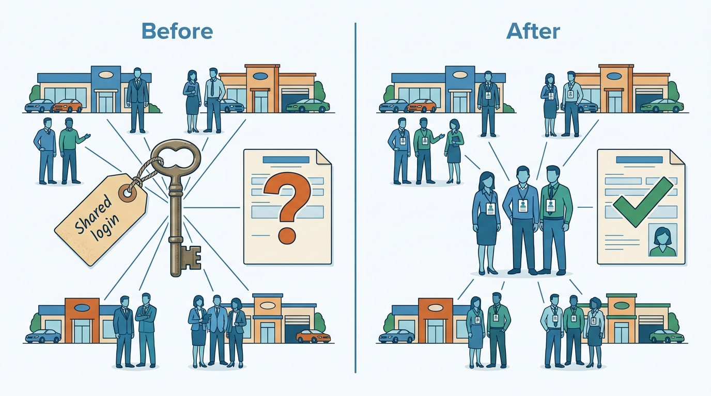
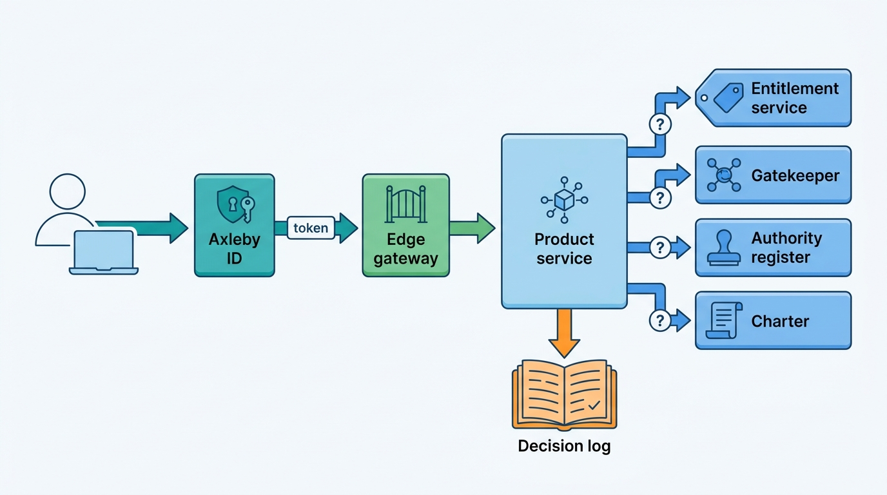
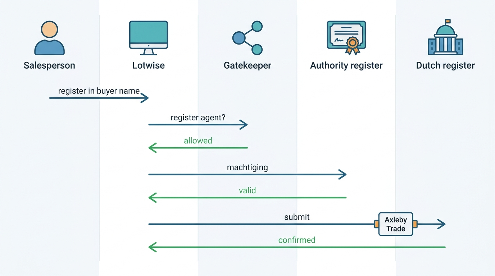

> **IN THIS CHAPTER, YOU WILL:** Design one identity for people and API clients across acquired products, choose between roles, attributes and relationships for dealer-group permissions, derive entitlements from subscriptions rather than flags, treat register authority as an authorization input, and decide how partners and data clients get delegated, auditable access.

> **WHY THE BUSINESS CARES:** A dealer group will not centralize pricing, leads and registrations on a platform whose answer to "who registered this car in the wrong name?" is a shared login. A data business whose API keys leak, or whose clients use data beyond their contract, loses money and its standing with the register that supplies it.

> **WHY ARCHITECTS SHOULD CARE:** Every product inherits the identity and permission model, and an acquired portfolio starts with several. Mixing up permissions, entitlements, feature flags, register authority and licenses produces access nobody can explain. It also produces bills nobody can defend and official transactions nobody can attribute.

> **KEY POINTS:**
>
> * **One identity per person and per client; the products keep none of their own.** Axleby ID links legacy accounts first, then retires them. Groups federate their own identity provider and provision users with SCIM, so a departed salesperson loses access within minutes, not at the next access review.
> * **An action is allowed only when five independent gates agree.** The tenant boundary, a relationship (who manages which rooftop), an entitlement (what the rooftop has bought), register authority (what the legal entity is recognized to do) and licensed purpose (what the data may be used for) each have a different owner and source of truth. Collapsing them into roles or flags is how access drifts.
> * **Credentials for machines are products with a lifecycle.** Data clients and partners get registered API clients with scoped, short-lived OAuth tokens, a dealer's explicit grant for each rooftop, and a decision log that answers who did what on whose behalf. Static API keys stay only where a leak costs little, and they are rate-limited and short-lived.

> **[FAILURE PATTERNS THIS CHAPTER ADDRESSES](where-vehicle-platforms-go-wrong.html):**
>
> * **The Acquisition Archipelago** — Axleby entered 2027 with three login systems, and the same person held up to three accounts with three different sets of permissions.
> * **The Tenant Blur** — Velto's central desk used shared logins, including for official register transactions, so nobody could say which employee registered a car in the wrong name.
> * **License Blindness** — a data client's key said who was calling but not for what purpose, so the License Breach and the leaked trial keys of the Plate Enumeration Attack were found late.

<br>
A salesperson at a Breda rooftop wants to reprice a 2021 Volkswagen Golf, open a lead assigned to a colleague, order a history report and register the car in the buyer's name. The platform answers four different questions. **Is this person who they claim to be?** **May they act on this rooftop's stock and this colleague's lead?** **Has the rooftop bought the module and the report allowance?** **Does the company hold the register's recognition for this transaction, and has the buyer authorized it?** Each question has a different owner: the person's employer, the group's management structure, the contract, the official register and the buyer.

Dealer software that answers all four with one role table ends up with roles like "Used-car manager, Breda and Tilburg, with registrations, without Appraise", and with **shared logins wherever the table is too awkward**. This chapter separates the questions into **authentication** (who you are), **authorization** (what you may do to which object), **entitlement** (what your organization has bought) and **authority** (what your organization is legally recognized to do). It then puts them back together in one auditable decision.

This chapter owns four terms: **entitlement**, **relationship-based authorization**, **register authority** and **API client**. It builds on [[tenancy-and-dealer-groups]] and hands configuration to [[onboarding-and-configuration]], pricing and usage to [[billing-and-metering]], and the license and purpose register to [[data-licensing-and-governance]].

## Setting the Scene at Axleby: Who Registered This Car?

Axleby, the fictional vehicle data and dealer software group this book follows (see [[meet-axleby]]), began 2027 with three login systems. **Axleby Portal accounts** in Connect XML (SQL Server) serve Axleby Data and Axleby Trade and are keyed by legal entity. **Lotwise users** (MySQL) belong to exactly one rooftop. **Showroomly users** (Rails) belong to an account that is sometimes a rooftop and sometimes a group. Odolo's consumer accounts are out of scope here.

In April 2027, as the One Dossier program started, Ines Marchetti (Group Chief Architect) asked Marta Nowak's platform team for an identity inventory. Its numbers, all Axleby illustrations:

| Measure | Value |
| --- | --- |
| Active Lotwise logins | about 41,000 across 7,200 rooftops |
| Active Showroomly logins | about 9,800 across 1,350 UK rooftops |
| Active Axleby Portal logins | about 15,600 across business customers |
| Distinct people behind them, matched by e-mail and phone | about 38,000 |
| Logins used from more than five devices in 30 days (likely shared) | about 3,900 |
| Logins with no MFA | all Lotwise and Axleby Portal logins; Showroomly offered an optional authenticator-app code |
| Data API credentials | 640 client organizations: static keys on JSON API v1, username and password plus IP allow-list on Connect XML |

The inventory became urgent because of a complaint from **Velto Mobility Group** (46 rooftops in the Netherlands and Belgium, a Lotwise customer). In March 2027 a Velto rooftop registered a car in the wrong customer's name (*tenaamstellen*, registration in a new name) through Axleby Trade. Before correcting it with the register, Velto's compliance officer wanted to know which employee had submitted it. Axleby Trade's log showed the login `velto-noord-admin`, used that week from 11 devices by people at 4 rooftops. Velto's own review then found that **57 Lotwise logins belonged to people who had left the group**, and that 9 of them had been used in the previous 30 days by colleagues who had inherited the passwords. In the first quarter, about 61% of Velto's roughly 2,100 register transactions had been submitted under four shared logins.

Lotwise had no way to let one person work across rooftops, so Velto's central desk shared logins; Axleby Trade had never asked which person acted, only which company. Ines put the forum's question in one line: **how does a request at Axleby become an allowed or denied action, and what record proves who did it, on whose behalf and with what right?**


**Figure 1:** *Under a shared login nobody could say who registered a car; one identity per person lets every register transaction name the person who acted.*

## Concepts: Five Questions, Five Sources of Truth

### Identity, membership and client

An **identity** is a person or a piece of software that can authenticate. At Axleby there are two kinds.

- A **user** is a person. A user exists once in **Axleby ID**, Axleby's identity service (Keycloak with organizations, self-hosted on Amazon EKS), whatever products they use. Users carry **memberships** that place them in a tenant's hierarchy ([[tenancy-and-dealer-groups]]): Mirjam Kuipers is a member of the Velto organization with a group role; a salesperson is staff at the Breda rooftop. External people, such as a group's marketing agency or a manufacturer's field manager, hold expiring external memberships.
- An **API client** is a registered piece of software that belongs to one organization and calls Axleby on its own behalf or on a dealer's. It has an owner, an environment (sandbox or production), credentials, scopes, rate limits, the licensed purposes recorded for it in Charter ([[data-licensing-and-governance]]), and a lifecycle. Rijnstaal Verzekeringen's claims system is an API client. DriveDesk's integration with Lotwise is an API client acting under grants from individual dealers. A static key is one possible credential of an API client, not the client itself.

**Authentication** establishes the identity. **Single sign-on (SSO)** lets a person authenticate once for several products. **Federation** lets a customer's own identity provider (IdP, such as Microsoft Entra ID or Okta) authenticate its staff for Axleby through SAML 2.0 or OpenID Connect (OIDC), the identity layer on top of OAuth 2.0 ([OpenID Foundation, 2023](https://openid.net/specs/openid-connect-core-1_0.html)). **SCIM** (System for Cross-domain Identity Management) lets that IdP create, update and deactivate users in Axleby automatically ([RFC 7644, 2015](https://www.rfc-editor.org/rfc/rfc7644.txt)). **Multi-factor authentication (MFA)** requires a second factor; phishing-resistant MFA (passkeys, security keys) binds that factor to the real site.

### The five gates

An action is allowed when five separate gates agree. They have different owners, change at different speeds and fail differently. Collapsing any two of them is the root of most access problems in dealer software.

| Gate | Question | Owner | Source of truth | Changes when | Example denial |
| --- | --- | --- | --- | --- | --- |
| **Tenant boundary** | Does this request belong to this tenant at all? | Platform | Tenant context from a verified token ([[tenancy-and-dealer-groups]]) | Never within a request | A Showroomly user's request for another dealer's lead |
| **Relationship** | Is this identity related to this object in a way that allows the action? | The customer's administrators | Gatekeeper relationship tuples | Staff join, move, leave; groups reorganize | A Breda salesperson opening a lead assigned to a Tilburg colleague |
| **Entitlement** | Has this tenant or rooftop bought the feature, and within which limits? | Commercial (contract) | Entitlement service, derived from subscriptions | Contract signed, upgraded, canceled | Ordering a valuation at a rooftop without Lotwise Appraise |
| **Register authority** | Is the legal entity recognized by the register for this transaction, with a valid credential, and has the customer authorized it? | The register and the dealer | Authority register (kept by Axleby Trade's register-transactions context, read here as a gate), fed by Turnstile's certificate monitor | Recognition granted or withdrawn; certificate expiry; customer authorization | Registering a car from a rooftop whose company lacks the recognition |
| **Licensed purpose** | May this data be used for this client's purpose under the source license? | Data governance | Charter ([[data-licensing-and-governance]]) | Contract and license changes | A lead-generation client requesting full history data for resale |


**Figure 2:** *An action is allowed only when five independent gates agree, and each gate has its own owner and source of truth.*

Two neighbors are deliberately **not** gates. **Release flags** decide whether code is switched on during a rollout; they may narrow what an entitlement allows, never widen it. **Configuration** decides how a rooftop has chosen to work (its approval thresholds, its lead-routing rules) and belongs to [[onboarding-and-configuration]]. Pete Hodgson's taxonomy notes that permissioning toggles "may be very-long lived", "at the scale of multiple years" ([martinfowler.com, revised 2017](https://martinfowler.com/articles/feature-toggles.html), older but still standard). A multi-year toggle that decides what a customer paid for is an entitlement without contract history, effective dates or audit trail.

### Roles, attributes and relationships

Three authorization models compete for the relationship gate.

| Model | Decides on | Dealer example | Where it breaks |
| --- | --- | --- | --- |
| **Role-based (RBAC)** | The user's role | "Used-car manager" may reprice stock | Role explosion: "used-car manager at Breda and Tilburg" is a new role, and a regional reorganization rewrites hundreds of assignments |
| **Attribute-based (ABAC)** | Attributes of user, object and context | May approve a deal if the discount is under the user's approval limit and the deal is at one of the user's rooftops | Policies become hard to audit: nobody can list who *can* approve, only test a given request |
| **Relationship-based (ReBAC)** | A graph of relationships between identities and objects | User is manager of region Noord-Brabant, which groups rooftop Breda, which holds this stock item | Needs a relationship store, a consistency model and tooling to answer "who can?" |

**Relationship-based authorization** derives permissions from paths in a graph: a user may reprice a stock item because they manage a region that groups the rooftop that holds it. Google's Zanzibar paper (USENIX ATC 2019) is the reference design. Its data model is the relation tuple, `object#relation@user`. Permissions inherit through parent objects, and the system served "millions of authorization requests per second" with 95th-percentile latency under 10 ms ([Pang et al., 2019](https://www.usenix.org/system/files/atc19-pang.pdf)). OpenFGA, a Cloud Native Computing Foundation project "inspired by" Zanzibar, supports this model and expresses some attribute rules through conditions on tuples ([OpenFGA, n.d., accessed 2026-10](https://openfga.dev/docs/fga)).

Dealer groups fit ReBAC because their authority **is** a hierarchy that changes. With ReBAC, a reorganization changes a few tuples (region groups rooftop) and every permission follows; with RBAC, it changes every user's roles. ABAC remains the right tool for **limits and context** (discount thresholds, time windows, expiry), which is why the recommendation below combines the two.

### Entitlement

An **entitlement** is a right a tenant or rooftop has bought: a module, a feature, a quota or an allowance, with effective dates and the contract it came from. At Axleby an entitlement record has the shape (tenant, rooftop or none, product, feature, limit, effective from, effective to, source contract line, market). Entitlements are **rooftop-scoped as often as tenant-scoped**: a group may buy a module only for some rooftops, and the allowances inside a module may be per rooftop or pooled. Velto buys Lotwise Appraise (€99 per rooftop per month, including 25 history reports, an Axleby list price) for all 46 rooftops and pools the included reports across the group, 46 × 25 = 1,150 a month ([[billing-and-metering]]).

Entitlements answer "has the customer paid for this?", not "may this person do it?": a group administrator with every relationship still cannot use a module nobody bought.

### Register authority

**Register authority** is the legal capacity of an organization to perform an official transaction with a vehicle register, together with the credential that proves it and, where required, the vehicle owner's authorization for the specific transaction. Software cannot grant it; it can only record it, check it and prove its use.

In the Netherlands the documented model is concrete. The Dutch vehicle authority (RDW, *Rijksdienst voor het Wegverkeer*) grants companies **recognitions** (*erkenningen*): a base recognition first, then recognitions such as trade stock (*bedrijfsvoorraad*) and registering vehicles in customers' names. If the base recognition is withdrawn, the others lapse automatically. Whether a company works through a provider or directly with the RDW, it needs an RDW-issued **certificate**, "as it were the key to RDW's electronic front door", valid for two years and renewed automatically ([RDW information folder, 2026](https://www.rdw.nl/-/media/rdwnl/documenten/bedrijf-met-rdw-erkenning/toezichtbeleid/tbb-en-informatiemap-2026/informatiemap.pdf)). For a registration in the customer's name, the customer first signs a digital authorization (*machtiging*) with DigiD or eHerkenning (the Dutch government logins for individuals and companies), valid for three months ([RDW, n.d., accessed 2026-10](https://www.rdw.nl/zakelijke-partners/bedrijven-met-rdw-erkenning/op-naam-zetten/voertuig-op-naam-van-een-klant-zetten)).

The RDW publishes a list of providers, the companies that carry recognized dealers' digital traffic ([RDW, n.d., accessed 2026-10](https://www.rdw.nl/zakelijke-partners/erkende-bedrijven/voorwaarden-en-gebruik/providers)). Axleby is fictional and is not on it. In this book Axleby is an **authorized information provider**, a book term defined in [[registers-and-official-data]] rather than an RDW title: it holds a contractual data-supply and transaction-provider relationship with the Dutch register, dating from 1999, and Axleby Trade submits transactions for dealers who hold their own recognitions. **The authority belongs to the dealer's legal entity; the platform is the channel.** [[registration-and-trade-services]] owns the transactions; this chapter owns the authorization around them.

## Architecture: Axleby ID, Gatekeeper and the Decision Path

### Components and responsibilities

| Component | Responsibility | Owns | Does not own |
| --- | --- | --- | --- |
| **Axleby ID** (Keycloak 26 with organizations) | Authenticate users and API clients; federation per organization; MFA and passkeys; token issuance; SCIM endpoint; legacy account linking | Credentials, sessions, linked legacy accounts, IdP settings per organization | Permissions, hierarchy, entitlements |
| **Tenant directory** | Hierarchy of organizations, legal entities, regions, rooftops, departments; lifecycle events | Hierarchy and memberships' placement ([[tenancy-and-dealer-groups]]) | What members may do |
| **Gatekeeper** (OpenFGA) | Relationship tuples and the authorization model; `check` and `list objects` answers | Who relates to what | Commercial rights, legal authority |
| **Entitlement service** | Derive entitlements from subscriptions and contract overrides; publish changes | Effective-dated entitlements per tenant and rooftop | Prices and invoices ([[billing-and-metering]]) |
| **Authority register** (owned by Axleby Trade's register-transactions context; consumed by the access path as a gate) | Recognitions per legal entity and rooftop, certificate validity, designated register agents, customer authorizations per transaction | Evidence of legal authority | The transactions ([[registration-and-trade-services]]) |
| **Charter** | Licensed purposes per client and source; request-path purpose check | License and purpose register | Identity |
| **Decision log** | Append-only record of significant authorization decisions and administrative changes | Audit evidence | Business events |

Keycloak's organizations feature arrived as a technology preview in Keycloak 25 in June 2024 to address "Business-to-Business (B2B) and Business-to-Business-to-Customer (B2B2C)" use cases, including onboarding members by invitation or brokering and adding organization metadata to tokens ([Keycloak, 2024](https://www.keycloak.org/2024/06/announcement-keycloak-organizations)). It became fully supported in Keycloak 26 (October 2024) ([Keycloak, 2024](https://www.keycloak.org/2024/10/keycloak-2600-released)). Axleby uses one organization per tenant, with that tenant's IdP linked to it, so a Velto employee who types a Velto e-mail address is routed to Velto's own sign-in page. **Rooftops are not Keycloak organizations**: the hierarchy lives in the tenant directory and relationships live in Gatekeeper, so Keycloak never has to model regions or departments.


**Figure 3:** *Authentication happens once, in Axleby ID; the decision happens in the product, which asks each gate's own source of truth. Subscriptions feed entitlements, the tenant directory feeds relationships, and every significant decision is written to one log.*

### What goes in a token, and what does not

A token is a cache of facts at issue time. It should carry facts that change rarely: user or client id, organization (tenant) id, authentication strength, audience and expiry. It should **not** carry permissions, rooftop lists or entitlements, which change with reorganizations, cancellations and suspensions and would stay wrong until the token expired. Axleby looks entitlements up from a local cache filled by events.

The IETF's OAuth security best current practice (RFC 9700, January 2025) supports this design. It says access-token privileges "SHOULD be restricted to the minimum required", tokens "SHOULD be audience-restricted to a specific resource server", and servers "SHOULD use mechanisms for sender-constraining access tokens, such as mutual TLS ... or ... DPoP" ([RFC 9700, 2025](https://www.rfc-editor.org/rfc/rfc9700.txt)). Axleby's access tokens live 10 minutes for users and 15 minutes for API clients *(Axleby choices)*. Refresh tokens rotate, and the gateway rejects a token whose audience is another product.

### The relationship model in Gatekeeper

The model below is the core of Gatekeeper's schema in OpenFGA's modeling language, simplified for the chapter. It is an Axleby illustration, not taken from any vendor.

```
model
  schema 1.1
type user
type organization
  relations
    define admin: [user]
    define member: [user] or admin
type region
  relations
    define organization: [organization]
    define manager: [user] or admin from organization
type rooftop
  relations
    define organization: [organization]
    define region: [region]
    define manager: [user] or admin from organization or manager from region
    define staff: [user] or manager
    define register_agent: [user with not_expired]
type stock_item
  relations
    define rooftop: [rooftop]
    define can_view: staff from rooftop
    define can_reprice: manager from rooftop
type lead
  relations
    define rooftop: [rooftop]
    define assignee: [user]
    define can_view: assignee or manager from rooftop
condition not_expired(current_time: timestamp, expires_at: timestamp) {
  current_time < expires_at
}
```

Four properties carry the design.

- **Regions are optional and replaceable.** When Velto reorganized 46 rooftops into 9 regional hubs in September 2027, the change was 46 `rooftop#region` tuples and 9 `region#manager` tuples. No user's permissions were edited.
- **Leads are private by default within a rooftop.** Salespeople see their own leads, managers all of the rooftop's: leads are sensitive between rooftops and between colleagues competing for commission.
- **Register agents are designated per rooftop and expire.** A person may submit register transactions for a rooftop only if the dealer has designated them, for a period. This replaces "whoever knows the shared login".
- **Approval limits stay out of the graph.** A discount limit of €1,500 for a sales manager is an attribute of the membership checked in the product (or with a condition), not a relationship. Keeping the graph to structure keeps "who can see Breda's stock?" answerable with one `list users` call.

### Entitlements: derived, effective-dated, published

The entitlement service reads the same subscription records the rating engine uses ([[billing-and-metering]]), applies contract overrides (a group's negotiated trial, a market pack), and publishes `entitlement.changed` events. Products check entitlements locally from a cache filled by those events, with a fallback lookup. Because entitlements and billing read one source, **a module switched on is a module charged, from the same date**.

| Tenant | Rooftop | Product · feature | Limit | Effective | Source |
| --- | --- | --- | --- | --- | --- |
| Velto Mobility Group | all 46 | Lotwise Appraise | 25 reports per rooftop per month, pooled across the group (1,150) | 1 Feb 2027 – open | Group contract, line 4 |
| Velto Mobility Group | all 46 | Lotwise Syndication | unlimited channels | 1 Jan 2026 – open | Group contract, line 2 |
| Autobedrijf Brandsma | Leeuwarden | Lotwise Stock & Pricing | — | 2014 – open | Self-service subscription |
| Rijnstaal Verzekeringen | — | Valuation API | 400 calls per second burst; monthly commitment | 1 Jan 2027 – 31 Dec 2027 | Data contract, schedule B |

*Rows are Axleby illustrations.* The **market** column (omitted above) matters for a pan-European group. A Dutch rooftop may be entitled to register transactions and Dutch registration-tax (BPM, *belasting van personenauto's en motorrijwielen*) calculations, a UK rooftop to MOT (annual roadworthiness test) history, a German data client to German market data. One plan with a market dimension is simpler than one plan per country.

### Register authority as an authorization input

The authority register holds, per legal entity: the recognitions the register has granted and their status; the certificate's validity window, refreshed daily by Turnstile's certificate and session monitor ([[registers-and-official-data]]); the rooftops (locations) covered; and the designated register agents per rooftop. Per transaction it records the customer authorization (the *machtiging* reference for a registration in a customer's name).

A registration request therefore passes four checks before Axleby Trade submits it. Each check reads a different source of truth.


**Figure 4:** *A registration in a customer's name is allowed only when the person is a designated agent of the rooftop, the legal entity's recognition and certificate are valid, and the buyer's authorization exists. The record names all three, plus the register's receipt.*

Every register studied for this book **binds a legal actor to a credential**: the RDW certificate per recognized company, the German Federal Motor Transport Authority's (KBA) technical certificate plus qualified-signature powers of attorney, UK API keys and OAuth secrets with expiry. The platform must record, per transaction, the legal actor, the credential used, the human user and the customer's authorization. Axleby Trade's June 2027 redesign stores this authority chain per transaction ([[registration-and-trade-services]]); Axleby ID supplies the person in it.

### API clients, partners and delegated access

Three kinds of machine access look alike on the wire and differ completely in who decides.

1. **A data client calling on its own behalf.** Rijnstaal Verzekeringen calls the valuation and plate-to-specification APIs for its own claims and underwriting. Rijnstaal is the party, Charter holds its licensed purposes, and the entitlement service holds its contract limits.
2. **A partner acting for a dealer.** DriveDesk, the fictional dealer management system (DMS, the dealer's system of record for deals, accounting and workshop), writes sold status and reads leads for the rooftops that authorized it. The dealer is the party, and the partner holds a **grant**: dealer legal entity, rooftops, scopes, expiry and the agreement it rests on. Hitch, Axleby's DMS integration layer, keeps the same facts as its dealer authorization register ([[dms-integration]]); Gatekeeper enforces them as tuples.
3. **Axleby acting for a dealer.** Support staff who need to see what a dealer sees.

For partners, the grant is created by an act of the dealer's administrator, not by Axleby support. The administrator signs in, picks rooftops and scopes, and approves through an OAuth authorization-code flow. The partner's client then receives tokens limited to those rooftops and scopes. Auto Trader UK's partner API shows the same shape in public. Its documentation describes advertiser **capabilities** that "depend on advertiser subscriptions". It splits stock writes into "Stock Updates", "Availability Updates" and "Price Updates", and since 19 November 2025 it has offered an Integrations API that shows a partner which integrations and capabilities it holds ([Autotrader Connect documentation, n.d., accessed 2026-10](https://developers.autotrader.co.uk/); [[case-auto-trader-uk]]). A pricing tool can then change prices without being able to mark a car sold. That is a relationship (the advertiser authorized the partner) combined with an entitlement (the advertiser's package includes the feature).

For support, Axleby uses **delegation, not impersonation**. RFC 8693 distinguishes the two. Under impersonation, "A is B within the context of the rights authorized by the token". Under delegation, A uses "its own credentials ... along with an annotation of some form that A is acting on behalf of B" ([RFC 8693, 2020](https://www.rfc-editor.org/rfc/rfc8693.txt)). An Axleby support engineer's token carries both identities. Access is read-only by default, limited to 60 minutes and tied to a ticket, and it appears in the dealer's own audit view. Write access needs the dealer administrator's approval in the product.

### API keys or OAuth for data clients

| Credential | How it works | Right for | Risk | Axleby use |
| --- | --- | --- | --- | --- |
| **Static API key** | A long-lived secret sent with each request | Sandbox, trials, low-value public data | Leaks into code, logs and browser apps; no expiry unless enforced; one key often shared by every system at the client | Sandbox only: test vehicles, 30-day expiry, per-key and per-network rate limits *(Axleby choices)* |
| **OAuth 2.0 client credentials with a shared secret** | Client exchanges id and secret for a short-lived token | Server-to-server production calls | The secret can still leak, but tokens expire and scopes apply | Allowed until 2028 for small clients |
| **Client credentials with a private-key JWT or mutual TLS** | Client proves possession of a private key | High-volume or high-value production clients | Key management burden on the client | Default for JSON API v2 production clients |
| **Username and password in a SOAP header, IP allow-list** | Legacy | Nothing new | Credentials shared across a client's systems; no scopes | Connect XML only, frozen until its sunset on 31 December 2029 |

Public registers have moved the same way. The DVSA MOT history API, run by the UK's Driver and Vehicle Standards Agency, uses OAuth 2.0 client credentials plus an API key; tokens last 60 minutes, keys unused for 90 days are revoked, and client secrets expire every two years ([DVSA, n.d., accessed 2026-10](https://documentation.history.mot.api.gov.uk/mot-history-api/authentication/)). The DVLA Vehicle Enquiry Service, run by the UK's Driver and Vehicle Licensing Agency, still uses a single `x-api-key` and states that "only one API key can be issued per customer/company"; as of October 2026 its page reads "Registration closed" ([DVLA, n.d., accessed 2026-10](https://developer-portal.driver-vehicle-licensing.api.gov.uk/apis/vehicle-enquiry-service/vehicle-enquiry-service-description.html)). A key like that is a scarce group asset. Turnstile holds it, and no tenant's traffic can exhaust it.

The Plate Enumeration Attack (August 2027) is the case against long-lived trial keys. A scraper used 3,800 rotating IP addresses and **leaked trial API keys** to make about 9 million requests in six days against Odolo's free check and the JSON API ([[vehicle-platform-security]] owns the attack). Plates are guessable identifiers. The Open Worldwide Application Security Project (OWASP) lists broken object-level authorization (BOLA) first among API risks, and its own example is an API that takes a vehicle identification number (VIN) from the user and "fails to validate that the VIN represents a vehicle that belongs to the logged in user" ([OWASP API Security Top 10, 2023](https://owasp.org/API-Security/editions/2023/en/0xa1-broken-object-level-authorization/)). A trial key that returns production data for any plate turns enumeration into a bulk-export interface. That is why Axleby's sandbox keys now return only test vehicles.

### The decision log

Axleby logs **every denial**, every allowed **write or export** of tenant data, every **register transaction**, every **administrative change** (membership, role, grant, entitlement override, IdP setting) and every **support delegation**. Each entry carries actor, on-whose-behalf, tenant and rooftop, object, action, decision, the gate that decided, the Gatekeeper model version and the entitlement and authority record versions consulted.

The log serves customer administrators (who exported the lead list?), security auditors (MFA, role and SCIM events) and regulators or courts (the register transaction trail). Entries are append-only, hash-chained per tenant per hour, and exportable per tenant. Retention is set per record type, not globally: five years for redisclosure records in the US under the Driver's Privacy Protection Act (DPPA), for example ([18 U.S.C. 2721, accessed 2026-10](https://www.law.cornell.edu/uscode/text/18/2721)).

### Requirements per interaction

| Interaction | Consistency | Latency | Freshness | Availability |
| --- | --- | --- | --- | --- |
| Sign-in (federated or local) | Strong at the IdP | under 2 s end to end *(assumption)* | Federation metadata refreshed daily | If Axleby ID is down, existing sessions continue until token expiry; new sign-ins wait |
| Relationship check | Bounded staleness for grants; strong for revocations | p95 under 10 ms in-cell *(assumption)* | Revocations effective under 60 s, as [[tenancy-and-dealer-groups]] requires | Reads fail closed for writes and exports; cached decisions up to 30 s may serve views *(Axleby choice)* |
| Entitlement check | Eventually consistent from subscription events | under 1 ms from local cache | Changes applied within 5 minutes of the effective time *(assumption)* | Last known entitlements serve during an outage; reconciled hourly |
| SCIM provisioning and deprovisioning | Idempotent by external id | Seconds per call | Entra ID's cycle is 40 minutes; sessions bounded separately | Missed calls repaired by the next cycle |
| Register authority check | Strong at the moment of submission | under 50 ms *(assumption)* | Certificate status daily; recognition status checked again on rejection | Fail closed: no submission without evidence |
| Decision log write | Lossless, ordered per tenant | Asynchronous, under 5 s *(assumption)* | — | Buffered locally; a write that cannot be logged within the buffer is refused |

## In Practice: Linking, Federating and Granting

### What the public record shows

**Cox Automotive's Bridge ID** is the most detailed public description of identity unification across an acquired dealer-software portfolio. Its undated page (read October 2026) calls it "Cox Automotive's single sign-on" across Autotrader, Dealer.com, Dealertrack F&I and DMS, HomeNet, KBB Instant Cash Offer, vAuto, VinSolutions and Xtime. It says users "can attach a single solution account from each of these solutions", using each product's existing username and password. Its rollout text refers to the end of 2020 and the beginning of 2021 ([Cox Automotive, n.d., accessed 2026-10](https://www.coxautoinc.com/bridgeid/)). A separate **Bridge Federation** page lets dealerships with their own IdP sign in with existing credentials. It requires them to "Adopt OIDC [Open ID Connect] as the protocol for authenticating Bridge users" and to "Ensure all employees whose authentication will be federated are already Bridge Users"; enrollment starts with a request form ([Cox Automotive, n.d., accessed 2026-10](https://www.coxautoinc.com/bridge/federation/)). [[case-cox-automotive]] places this in Cox's integration sequence.

> **INFERENCE, NOT DOCUMENTED:** The linking model suggests that Bridge ID unified authentication while roles and dealer mappings stayed inside each product. Cox has not published how authorization or dealer entities are shared across products, so this is a reading of the public pages, not a description of Cox's systems.

**CDK Global's CDK Unify** is described as "a secure, cloud-based single sign-on" with multifactor authentication and "role-based dashboards" ([CDK Global, n.d., accessed 2026-10](https://www.cdkglobal.com/cdk-unify)); CDK publishes no further detail. The public pattern in both cases is **portfolio SSO added after acquisition**, which is the realistic first step for any acquired estate and the reason Axleby starts with linking too.

**Google's Zanzibar** documents the problem a dealer platform meets on day one: the "new enemy" problem, in which ignoring the order of permission changes lets a removed user see new content. Zanzibar prevents it with consistency tokens ("zookies") ([Pang et al., 2019](https://www.usenix.org/system/files/atc19-pang.pdf)). OpenFGA, which Gatekeeper uses, does not implement zookies as of October 2026; its documentation says it "is considering a similar feature". It offers a `HIGHER_CONSISTENCY` option that skips its cache ([OpenFGA, n.d., accessed 2026-10](https://openfga.dev/docs/interacting/consistency)). Axleby therefore uses `HIGHER_CONSISTENCY` for every check on a write or export within five minutes of a membership change for that user. Membership-ended events also evict the user's cached decisions in every product.

### Axleby worked example: Velto and Hartley

**Velto, July to September 2027.** Velto runs Microsoft Entra ID for its 1,000 or so staff. The migration had four steps.

1. **Link, then federate.** Axleby ID linked Velto's Entra tenant through OIDC and matched about 1,180 Lotwise logins and 160 Axleby Portal logins to people. That produced 905 persons. The 57 logins of departed staff and all shared logins were disabled at cut-over, after a 30-day warning in the product.
2. **Provision with SCIM.** Velto assigned an Axleby group per rooftop in Entra. Microsoft's provisioning service runs "every 40 minutes" and deprovisions by setting users inactive ([Microsoft Learn, 2026](https://learn.microsoft.com/en-us/entra/identity/app-provisioning/use-scim-to-provision-users-and-groups)). Because SCIM alone leaves a leaver active for up to 40 minutes, Axleby also bounds sessions: 10-minute access tokens, refresh refused for users the IdP has disabled, and an eight-hour maximum session *(Axleby choices)*.
3. **Model the hierarchy in Gatekeeper.** Rooftop staff and manager tuples came from the SCIM groups. Region tuples came from the tenant directory. Velto's seven-person central desk went from 322 logins to 7 people with the `admin` relation on the organization. Mirjam Kuipers's team designated **96 register agents** for Velto's Dutch rooftops, for 12 months each.
4. **Attach authority.** Velto's five Dutch legal entities had their recognitions and certificate validity recorded in the authority register, from the onboarding evidence ([[onboarding-and-configuration]]). Velto's Belgian rooftops have no Dutch recognition; their registrations run through Axleby's Belgian partner and carry that partner as the channel.

By October 2027 every Velto register transaction named a person, a legal entity, a credential and a customer authorization, and Velto's shared logins were gone. The September reorganization took 55 tuple writes and no user edits; the Lost Leads of Velto that month came from **routing rules** for three closed rooftop codes, under which hub-sized stock was still advertised, pointing at an inactive queue ([[journey-lead-to-dms]]), not from permissions.

**Hartley, fourth quarter 2027.** Hartley Motor Group (28 UK rooftops) was the first Showroomly customer moved onto Axleby ID ([[onboarding-and-configuration]]). SCIM matching against Hartley's Entra ID by e-mail address linked **571** of 640 Showroomly accounts automatically. **52** needed a manual match because staff used personal or old addresses. **17** belonged to people no longer in Hartley's directory and were disabled. Hartley sells finance as a credit broker, so its finance-application screens require phishing-resistant MFA at every sign-in to that screen, enforced by Axleby ID whatever Hartley's IdP did.

**Rijnstaal, data client.** Rijnstaal's claims system moved from a JSON API v1 static key to a JSON API v2 client with a private-key JWT, two scopes (`valuation:read`, `specification:read`), Charter purposes "claims handling" and "underwriting", and a production rate limit. Its weekend batch (the Saturday Batch of [[scale-and-cost]]) runs on a separate client with its own limits, so throttling it no longer slows interactive claims calls.

## Failure Handling

| Failure | Example | Detection | Recovery |
| --- | --- | --- | --- |
| **Duplicate persons** | One salesperson with a Lotwise login, an Axleby Portal login and a Showroomly login under three e-mail addresses | Matching on verified e-mail, phone and IdP subject; duplicate-person report per tenant | Link to one Axleby ID person; never auto-link on an unverified e-mail, which is an account-takeover path |
| **Conflicting updates** | Velto's SCIM removes a user from Breda while a Velto administrator adds them in the Axleby console | Source flag on each membership: SCIM-managed or console-managed | SCIM wins for SCIM-managed memberships; the console shows them read-only |
| **Incomplete records** | SCIM creates a user with no rooftop group; a legal entity without recorded recognition | Validation on provisioning and on activation | User exists with no access (default deny) and appears on the admin's to-do list; registrations blocked with a clear reason |
| **Retries** | SCIM retries a create after a timeout | Idempotency by SCIM `externalId` | Second create returns the existing user |
| **Partial failure** | A subscription canceled in billing, but the entitlement event lost | Hourly reconciliation of entitlements against subscriptions | Re-derive from subscriptions; billing and access agree again within the hour |
| **Stale permission** | A salesperson who left for a competitor still sees leads through a cached decision | Membership-ended events; consistency mode after changes; canary checks | Evict caches; refuse refresh; review the decision log for the window |
| **Expired authority** | A company's register certificate expires or a recognition is withdrawn | Turnstile's daily certificate check; register rejection codes | Block submissions for that entity; notify the dealer 60, 30 and 7 days before expiry; queued transactions wait, never re-route under another company's credential |
| **Customer IdP outage** | Velto's Entra ID unavailable on a Saturday | Federation errors per organization | Two break-glass local accounts per organization, phishing-resistant MFA, every use alerted to the customer |
| **Axleby ID outage** | Keycloak cluster unavailable | Synthetic sign-ins per cell | Existing tokens remain valid until expiry; products keep working; new sign-ins wait |
| **Gatekeeper outage** | OpenFGA unavailable or slow | Latency and error SLOs | Cached decisions serve views for up to 30 seconds; writes, exports and register transactions fail closed |
| **Leaked API credential** | A client's key posted in a public repository | Secret scanning feeds; unusual source networks; enumeration patterns | Revoke and reissue within minutes; client-scoped blast radius because the credential belongs to one API client with limited scopes |

The rule under the table: **fail closed where the action has legal or financial effect, degrade gracefully where it does not**. A dealer still sees stock during a Gatekeeper incident, but nobody registers a car. Signed tokens and cached entitlements keep the platform's own control plane from becoming Borrowed Uptime ([[reliability-and-dependencies]]).

## Trade-offs

### Authorization model

| Option | Strengths | Weaknesses | Right when |
| --- | --- | --- | --- |
| RBAC in each product | Simple; familiar to dealers | Role explosion in groups; every product reinvents roles; reorganizations rewrite assignments | A single-product vendor whose customers are mostly single rooftops |
| Central ABAC policy engine (Open Policy Agent, Cedar) | Expressive conditions; policies as code | "Who can see Breda?" is hard to answer; policy data still has to come from somewhere | Rules dominated by limits, time and context, not hierarchy |
| Central ReBAC (OpenFGA, SpiceDB, Zanzibar-style) with conditions | Hierarchy changes are tuple changes; "who can" queries; one model across products | New service to run; consistency to manage; teams must learn modeling | Groups, regions and rooftops across several products (Axleby) |

ReBAC's main cost at Axleby is operational: Gatekeeper sits on every product's request path, which is acceptable only with per-cell deployment, caching, fail-closed writes and a service-level objective owned by Marta Nowak's team. **If Axleby sold one product to single rooftops, I would not build Gatekeeper**; roles in the product would do.

### Identity platform

| Option | Strengths | Weaknesses |
| --- | --- | --- |
| Self-hosted Keycloak (Axleby's choice) | Organizations, federation, SCIM integration, data residency in the EU, no per-user pricing | Axleby runs, patches and scales it; upgrades are projects |
| Hosted customer-identity service (for example Auth0 Organizations, Microsoft Entra External ID) | Less operations; mature federation | Per-user pricing grows with dealer staff turnover; Auth0's documentation describes no nesting of organizations, so the hierarchy would stay in the application anyway ([Auth0, n.d., accessed 2026-10](https://auth0.com/docs/manage-users/organizations/organizations-overview)) |
| Keep each product's login and add an SSO broker | Fastest; the Bridge ID pattern | Permissions and dealer mappings stay fragmented; the Acquisition Archipelago survives |

## Across Markets: What Changes by Country

| Topic | Netherlands / Belgium | Germany | United Kingdom | United States |
| --- | --- | --- | --- | --- |
| **Register authority** | NL: RDW recognitions per company; a two-year RDW certificate; replacing a lost one requires eHerkenning level 3 ([RDW, 2026](https://www.rdw.nl/-/media/rdwnl/documenten/bedrijf-met-rdw-erkenning/toezichtbeleid/tbb-en-informatiemap-2026/informatiemap.pdf)). BE: Axleby uses a partner; the insurer or broker commonly submits registrations *(judgement; no primary source read)* | Large customers of the KBA's machine interface (*Großkundenschnittstelle*, GKS) need more than 500 transactions a year, KBA-issued credentials and "a technical certificate"; service providers act under qualified-electronic-signature powers of attorney ([KBA brochure, 2024](https://www.landkreis-eichstaett.de/fileadmin/Dateien/Website/Dateien/SG_52_Verkehrswesen_KFZ/Informationsbroschuere_GKS.pdf)) | Motor traders tell the DVLA about purchases and sales online ([GOV.UK, n.d., accessed 2026-10](https://www.gov.uk/sold-bought-vehicle)); no dealer certificate model comparable to the RDW's | Titles and registration through state motor vehicle agencies; dealer licenses per state and location |
| **Customer authorization per transaction** | NL: buyer's *machtiging* via DigiD or eHerkenning, valid 3 months | Power of attorney (*Vollmacht*) for registration services; qualified signature on the GKS route | Keeper details and V5C log book; no per-transaction digital mandate in Axleby's scope | State title and power-of-attorney forms; odometer disclosure on transfer |
| **Platform credentials to registers** | Provider channel with certificates | KBA credentials and technical certificate (not an Axleby service) | DVLA VES: one key per company, registration closed; DVSA: OAuth client credentials, two-year secrets, 90-day inactivity revocation | Approved providers for title-history data; DPPA limits on personal data |
| **Purpose as an authorization input** | GDPR purpose limitation; RDW provider terms | §39 of the Road Traffic Act (StVG): keeper data only for a shown legal claim ([StVG §39, accessed 2026-10](https://www.gesetze-im-internet.de/stvg/__39.html)) | Keeper data only with "reasonable cause" | DPPA permissible uses and five-year redisclosure records |
| **MFA required by law for dealers** | None dealer-specific; GDPR Art. 32 security measures | Same | Same | Federal Trade Commission (FTC) Safeguards Rule: MFA "for any individual accessing any information system" for most dealers that finance or lease ([16 CFR 314.4](https://www.law.cornell.edu/cfr/text/16/314.4)) |
| **Per-user decision logs** | NL: works-council consent for systems suitable for monitoring staff ([WOR art. 27](https://wetten.overheid.nl/BWBR0002747/)) | Works-council co-determination over monitoring devices ([BetrVG §87](https://www.gesetze-im-internet.de/betrvg/__87.html)) | No equivalent veto | Safeguards Rule requires logging authorized users' activity |

**What is common** is the whole architecture. The five gates, one identity, ReBAC over the hierarchy, entitlements from subscriptions and the decision log are the same in every market. **What is a market adapter** is register authority: its credential types, the customer-authorization evidence and the transaction channel differ completely. In the authority register they are typed records per market, validated by market rules, not columns on a user. **What is a rule set** is purpose: §39 StVG, the DPPA and GDPR purpose limitation all become purposes recorded in Charter and checked per request.

Two rows change product design. The **US Safeguards Rule** would require MFA enforcement reports in the product. The **German and Dutch works-council rules** make per-user logs a co-determination topic, so Axleby documents the log's purposes and lets tenants restrict per-user activity reports to named roles, without weakening the log itself.

## The Chief Architect's View

**What to decide, and who decides.**

- **One identity, owned by the group.** The decision to retire product logins is the Chief Architect's and the CTO's, with a dated plan. At Axleby: Lotwise and Axleby Portal logins retired by mid-2028, Showroomly by end of 2028 *(Axleby plan)*. Product teams decide the order of their migration, not whether.
- **The five gates and their owners.** Written down once: commercial owns entitlements, customers' administrators own relationships, the register and the dealer own authority, data governance owns purposes, the platform owns the tenant boundary. Any proposal to merge two gates ("let's put entitlements in roles") comes to the architecture forum.
- **The authorization model.** Gatekeeper's schema is a shared contract like an API: versioned, reviewed by the platform team and covered by the leak tests of [[tenancy-and-dealer-groups]].
- **Credential policy for machines.** Which credential types are allowed for which data, their lifetimes and the trial-key rules. This is set by the platform with security and data governance, not per product team.

**What to watch.**

- **Shared-login indicators**: logins used from many devices or places at once. The target is zero for anything with register or financial effect.
- **Legacy accounts not yet linked**, per product and per tenant. This is the Acquisition Archipelago's identity measure.
- **Leaver latency**: minutes from an IdP deactivation to the last successful request by that person.
- **Static keys in production**, by client and data value, trending to zero outside the Connect XML estate.
- **Entitlement–subscription mismatches** found by reconciliation. Each one is either revenue leakage or unauthorized access.
- **Authority expiry horizon**: legal entities whose certificates or recognitions expire within 60 days.

**Long-term considerations.** Identity and authorization outlive products: Lotwise Classic will be a shell by the end of 2029, while Axleby ID, Gatekeeper's model and the decision log stay. Two developments are worth planning for. AI agents acting in dealer workflows ([[ai-in-dealer-workflows]]) are a fourth kind of machine access. They need the delegation model (an agent acting for a named person, with narrower scopes), not a service account with every right. The EU's registration-document reform proposal, COM(2025) 179, not adopted as of October 2026, may change how dealers prove authority to registers across borders. An authority register with typed, per-market records can absorb that change; credentials hard-wired into user rows cannot.

## Questions to Ask

1. How many logins does one dealer employee need across our products, and how many people sit behind our active logins?
2. Which actions with legal or financial effect can be performed under a shared or generic login today?
3. When a dealer group's IdP deactivates a user, how many minutes pass before that person's last successful request?
4. Where do we decide what a customer has bought: in the subscription, in a flag tool, in roles, or in all three? Do they agree?
5. For a register transaction submitted last month, can we name the legal entity, the credential, the person and the customer's authorization within one query?
6. Which API clients still use static keys in production, what data do those keys return, and when do they expire?
7. Can a partner's access to a dealer be granted and revoked by the dealer alone, per rooftop and scope, without our support team?
8. What happens to writes, exports and registrations if the authorization service is slow or down for ten minutes?
9. Which of our access logs would a German or Dutch works council consider a monitoring system, and have we documented their purposes?

## From Rights to Running Customers

Identity and authorization decide who may do what once a customer exists. Getting a customer to that point means bringing in a group's users, rooftops, register recognitions, DMS grants and channel accounts without hand-copying them, and configuring the product without forking it. The next chapter, [[onboarding-and-configuration]], follows that path from a signed contract to the first live advert.

## Sources and Evidence

**Company, product and investor sources**

- [Bridge ID](https://www.coxautoinc.com/bridgeid/), Cox Automotive, n.d., accessed 2026-10: single sign-on across Cox dealer products, per-product account linking, 2020–2021 rollout.
- [Bridge Federation Single Sign On](https://www.coxautoinc.com/bridge/federation/), Cox Automotive, n.d., accessed 2026-10: OIDC federation requirements for dealers and lenders.
- [CDK Unify](https://www.cdkglobal.com/cdk-unify), CDK Global, n.d., accessed 2026-10: cloud single sign-on with MFA and role-based dashboards.
- [Autotrader Connect developer documentation](https://developers.autotrader.co.uk/), Autotrader, n.d., accessed 2026-10: advertiser capabilities that depend on subscriptions; split stock, availability and price capabilities; Integrations API from 19 November 2025.
- [Support for CIAM and Multi-tenancy (Keycloak Organizations)](https://www.keycloak.org/2024/06/announcement-keycloak-organizations), Keycloak, 2024: organizations for B2B use cases, technology preview in Keycloak 25.
- [Keycloak 26.0.0 released](https://www.keycloak.org/2024/10/keycloak-2600-released), Keycloak, 2024: organizations fully supported.
- [What is OpenFGA](https://openfga.dev/docs/fga), OpenFGA, n.d., accessed 2026-10: Zanzibar-inspired relationship-based authorization, CNCF ownership.
- [Query consistency](https://openfga.dev/docs/interacting/consistency), OpenFGA, n.d., accessed 2026-10: `HIGHER_CONSISTENCY`; zookies not implemented.
- [Auth0 Organizations overview](https://auth0.com/docs/manage-users/organizations/organizations-overview), Okta/Auth0, n.d., accessed 2026-10: B2B organizations and their limitations.
- [Use SCIM to provision users and groups](https://learn.microsoft.com/en-us/entra/identity/app-provisioning/use-scim-to-provision-users-and-groups), Microsoft Learn, 2026: 40-minute provisioning cycle; deprovisioning by `active: false`.

**Standards, regulation and official documentation**

- [OpenID Connect Core 1.0](https://openid.net/specs/openid-connect-core-1_0.html), OpenID Foundation, 2023 (errata set 2): the identity layer over OAuth 2.0.
- [RFC 7644: SCIM Protocol](https://www.rfc-editor.org/rfc/rfc7644.txt), IETF, 2015: standard user provisioning.
- [RFC 8693: OAuth 2.0 Token Exchange](https://www.rfc-editor.org/rfc/rfc8693.txt), IETF, 2020: delegation versus impersonation.
- [RFC 9700: Best Current Practice for OAuth 2.0 Security](https://www.rfc-editor.org/rfc/rfc9700.txt), IETF, 2025: least privilege, audience restriction, sender-constrained tokens.
- [NIST SP 800-63B-4: Authentication and Authenticator Management](https://pages.nist.gov/800-63-4/sp800-63b.html), NIST, 2025: assurance levels, phishing resistance, syncable authenticators.
- [OWASP API Security Top 10 2023: API1 Broken Object Level Authorization](https://owasp.org/API-Security/editions/2023/en/0xa1-broken-object-level-authorization/), OWASP, 2023: the VIN example.
- [RDW information folder for recognized companies 2026](https://www.rdw.nl/-/media/rdwnl/documenten/bedrijf-met-rdw-erkenning/toezichtbeleid/tbb-en-informatiemap-2026/informatiemap.pdf), RDW, 2026: recognitions, certificates, provider model.
- [Providers voor digitale diensten](https://www.rdw.nl/zakelijke-partners/erkende-bedrijven/voorwaarden-en-gebruik/providers), RDW, n.d., accessed 2026-10: provider model and pricing.
- [Voertuig op naam van een klant zetten](https://www.rdw.nl/zakelijke-partners/bedrijven-met-rdw-erkenning/op-naam-zetten/voertuig-op-naam-van-een-klant-zetten), RDW, n.d., accessed 2026-10: customer *machtiging* via DigiD or eHerkenning, valid three months.
- [Informationsbroschüre Großkundenschnittstelle](https://www.landkreis-eichstaett.de/fileadmin/Dateien/Website/Dateien/SG_52_Verkehrswesen_KFZ/Informationsbroschuere_GKS.pdf), Kraftfahrt-Bundesamt (KBA), 2024: large-customer threshold, technical certificate, qualified-signature powers of attorney.
- [StVG §39](https://www.gesetze-im-internet.de/stvg/__39.html), German Federal Ministry of Justice, accessed 2026-10: narrow private access to keeper data.
- [MOT history API: authentication](https://documentation.history.mot.api.gov.uk/mot-history-api/authentication/), DVSA, n.d., accessed 2026-10: OAuth client credentials, token and secret lifetimes, inactivity revocation.
- [Vehicle Enquiry Service API](https://developer-portal.driver-vehicle-licensing.api.gov.uk/apis/vehicle-enquiry-service/vehicle-enquiry-service-description.html), DVLA, n.d., accessed 2026-10: one key per company; registration closed.
- [Tell DVLA you've sold, transferred or bought a vehicle](https://www.gov.uk/sold-bought-vehicle), GOV.UK, n.d., accessed 2026-10: online notification by motor traders.
- [18 U.S.C. 2721 (DPPA)](https://www.law.cornell.edu/uscode/text/18/2721), Legal Information Institute, accessed 2026-10: permissible uses and five-year redisclosure records.
- [16 CFR 314.4](https://www.law.cornell.edu/cfr/text/16/314.4), Legal Information Institute, accessed 2026-10: Safeguards Rule MFA and activity logging.
- [Betriebsverfassungsgesetz §87](https://www.gesetze-im-internet.de/betrvg/__87.html), German Federal Ministry of Justice, accessed 2026-10: co-determination over monitoring devices.
- [Wet op de ondernemingsraden](https://wetten.overheid.nl/BWBR0002747/), Dutch government, accessed 2026-10: Article 27(1)(l) works-council consent.

**Research and practitioner sources**

- [Zanzibar: Google's Consistent, Global Authorization System](https://www.usenix.org/system/files/atc19-pang.pdf), R. Pang et al., USENIX ATC, 2019: relation tuples, scale and latency, the new-enemy problem and zookies.
- [Feature Toggles (aka Feature Flags)](https://martinfowler.com/articles/feature-toggles.html), P. Hodgson, martinfowler.com, revised 2017 (older than three years; still the standard taxonomy): permissioning toggles as long-lived.

Axleby is fictional; architectural recommendations, labeled inferences and labeled assumptions are the author's judgement.
