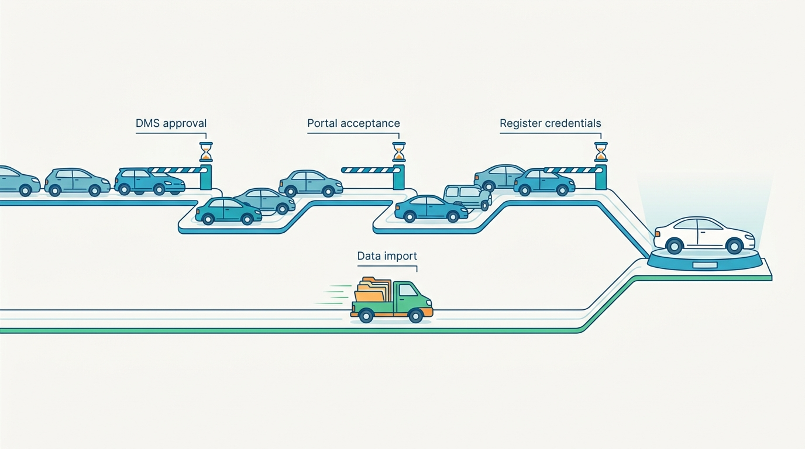
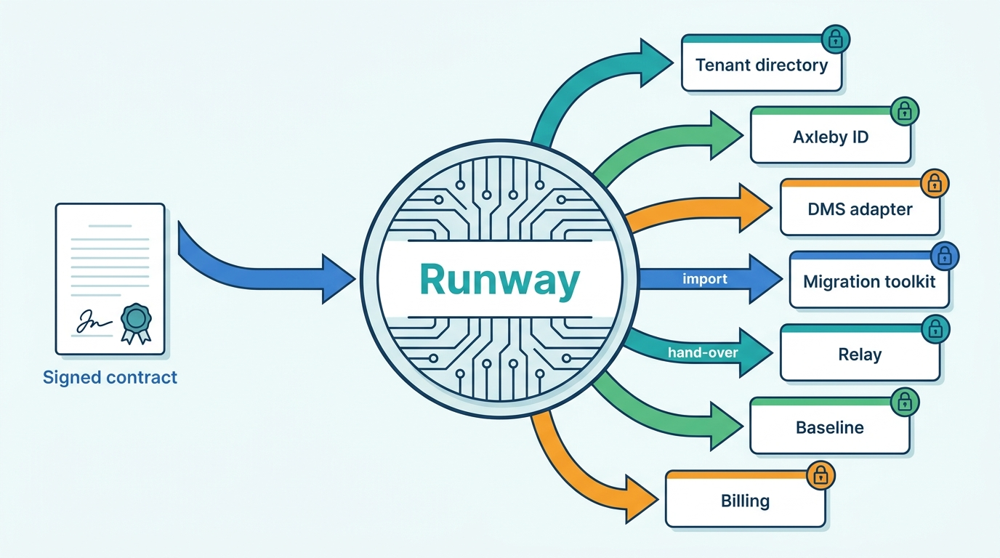
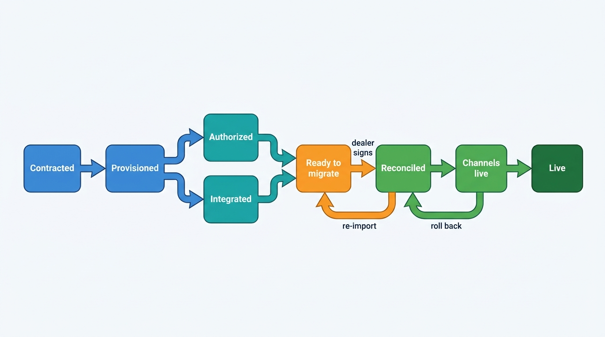
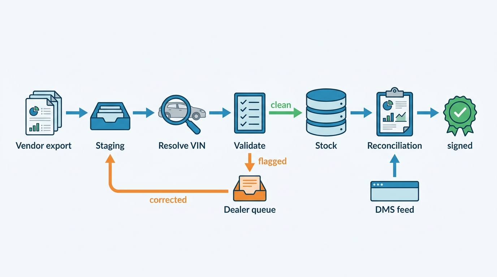
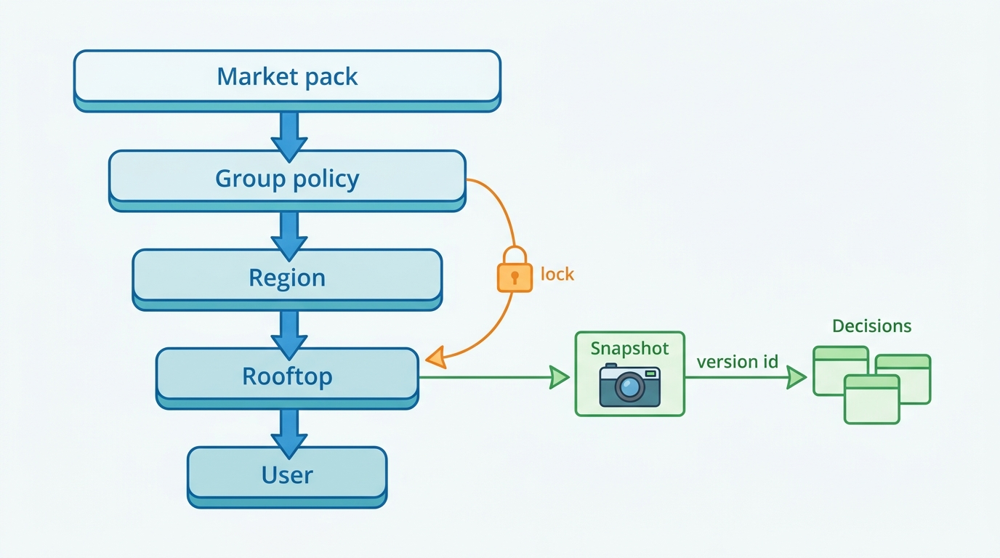

> **IN THIS CHAPTER, YOU WILL:** Follow a dealer group and a data client from signed contract to first advert, first sale and first billable call; design the onboarding pipeline, the migration from a competitor's tool and the channel hand-over; and draw the line between configuration, extension points and forks.

> **WHY THE BUSINESS CARES:** A rooftop pays from the day its contract starts but earns nothing from the software until its stock is live on the portals, and a group that waits three months for its last rooftop judges the vendor by that wait. Every special request answered with custom code becomes a cost that returns at every release, for as long as the customer stays.

> **WHY ARCHITECTS SHOULD CARE:** Onboarding touches every control-plane service at once (tenant directory, identity, entitlements, register authority, DMS adapters, channel accounts, billing), so it is where their contracts are tested first. Configuration decides whether one codebase can serve a one-rooftop dealer in Leeuwarden and a 46-rooftop group across two countries without a branch per customer.

> **KEY POINTS:**
>
> * **Onboarding is a pipeline with states, owners and a clock, and data import is rarely its long pole.** Model each rooftop's onboarding as a state machine with entry criteria and evidence, measure **time to first advert** per rooftop, and expect the wait to sit in third parties: register authority, the DMS vendor's approval and the portal's acceptance of a new feed supplier.
> * **Migration is coexistence plus reconciliation, and channel hand-over happens exactly once.** Imports must be idempotent and re-runnable, keyed on VIN through the identity graph, and closed by a reconciliation report the dealer signs. Portal feeds move from the old supplier to the new one in one recorded step per channel account, or the rooftop advertises every car twice.
> * **Configure, extend, never fork.** Treat tenant configuration as typed, versioned, validated, effective-dated data that a group sets and its rooftops inherit, with locks; meet the remaining requests with rules, templates, custom fields, webhooks and the partner API. A request that fits none of these is a product decision for everyone, not a branch for one customer.

> **[FAILURE PATTERNS THIS CHAPTER ADDRESSES](where-vehicle-platforms-go-wrong.html):**
>
> * **Customization Creep** — special requests from large groups land as tenant-conditional code, and every release must be tested against each customer's private behavior.
> * **The Zombie Listing** — a cut-over that switches the new feed on without switching the old one off leaves duplicate and orphaned adverts that nobody reconciles.
> * **The Acquisition Archipelago** — a customer moving between two products of the same group is onboarded twice, with two logins, two configurations and two vehicle keys.

 
A dealer group does not buy software on the day it signs. It buys software on the day its first car appears on a portal from the new system, its first lead arrives in the new inbox and its first sale is registered from the new dossier. Between those days lie a dozen steps that belong to other parties: the register that must recognize each rooftop as a trader, the dealer management system (DMS) vendor that must approve the new integration, the portals that must accept a new feed supplier, and the old vendor that must hand over the data. **Onboarding is the first workflow the customer runs on the platform, and it is the one with the most external dependencies.**

The same holds for a data client, which pays nothing until its first production call.

Once the customer is live, the second question arrives: how much of the product may this customer change? **Every answer is either configuration that the product owns or code that the customer owns in all but name.**

This chapter owns three terms: **tenant configuration**, **extension point** and **time to first advert**. It builds on the customer hierarchy of [[tenancy-and-dealer-groups]] and the entitlements of [[identity-access-and-entitlements]], and it hands the commercial side of a new contract to [[billing-and-metering]].

## Setting the Scene at Axleby: Forty-Six Rooftops and Fourteen Branches

Axleby, the fictional vehicle data and dealer software group this book follows (see [[meet-axleby]]), closed its largest Lotwise deal of 2026 on **12 May 2026**. Velto Mobility Group, **46** rooftops in the Netherlands and Belgium selling **11** franchise brands, moved its stock, pricing and advertising from a competing Benelux dealer-software vendor to Lotwise, keeping DriveDesk as its DMS. Mirjam Kuipers, Velto's group used-car director, wanted one group pricing policy, one dossier per car with history, valuation and register transactions in it, and stock she could move between rooftops without retyping.

The last Velto rooftop went live on **27 November 2026**, 199 days after signature. In January 2027 Ines Marchetti, Group Chief Architect, asked Tomás Ferreira (Product Director, Lotwise) and Hendrik Maes (Head of Partner Integrations) for a retrospective that answered one question: where did the 199 days go?

| Stage | Pilot rooftop (Tilburg) | Median of the last 18 rooftops | What held it |
| --- | --- | --- | --- |
| Account, rooftops and users provisioned | 6 days | 1 day | Rooftop list re-typed from the contract; legal entities unclear for 4 Belgian sites |
| Register authority confirmed (NL) | 11 days | 2 days | Copying each rooftop's register recognition and user credentials into Axleby Trade by hand |
| DMS integration approved and running | 35 days | 0 days (group-level, done once) | DriveDesk's approval of a new integration partner for Velto |
| Stock migrated and reconciled | 8 days | 3 days | 164 stock items without a VIN; 212 duplicates from internal transfers |
| Channels activated | 14 days | 9 days | Portal accounts registered the previous vendor as feed supplier |
| Training and go-live | 3 days | 2 days | Scheduling sales staff around trading days |
| **Time to first advert** (rooftop provisioned → first advert confirmed live) | **36 days** | **11 days** | |

*All figures are Axleby illustrations.* The stages overlapped, which is why the columns do not add up to the elapsed time.

Two findings surprised the room. First, **data migration was never the long pole.** Importing **2,640** stock vehicles and **41,800** sold-vehicle records took days; waiting for DriveDesk's approval, for the portals to accept Lotwise as Velto's new feed supplier, and for register credentials to be re-entered took weeks. Second, the worst customer-visible failure was not missing data but duplicate data: during the second wave, three rooftops in the Eindhoven region advertised **418** cars twice on one national portal for two days, because Lotwise's feed went live before the previous vendor's feed for those accounts was switched off.

**Figure 1:** *At Velto, importing 2,640 stock vehicles took days; the weeks went to waiting on DMS approval, portal acceptance of the new feed supplier and register credentials.*

Velto also sent **23** special requests during the project. Tomás's team met **17** with existing configuration, **4** with webhooks and an export to Velto's data warehouse, and declined **2**, one of which asked Lotwise to change how margin-scheme VAT was computed on invoices. None became code.

Callum Reid, Engineering Lead of Showroomly in Leeds, listened with a different problem. Hartley Motor Group, **28** UK rooftops and a Showroomly customer since 2019, was due to be the first Showroomly customer moved onto Axleby ID and the group's shared configuration service in the fourth quarter of 2027. Showroomly's codebase carried **14** code paths that tested for Hartley's tenant id, the oldest from 2020. Nobody could say which of them still mattered.

Ines framed the chapter's question for the architecture forum: **what must the platform own so that onboarding a group is a measured pipeline rather than a project, and so that no customer's request ever becomes a branch?**

## What Onboarding, Migration and Configuration Mean

### Onboarding and its stages

**Onboarding** is everything between a signed contract and a customer using the product for its core job without the vendor's help. For a dealer rooftop, that job is to stock, advertise and sell cars; for a data client, to call the API in production. Microsoft's multitenant guidance lists the generic questions (self-service or manual, data residency, compliance, recovery targets, billing, pre-production environments) ([Microsoft Azure Architecture Center, 2025](https://learn.microsoft.com/en-us/azure/architecture/guide/multitenant/considerations/tenant-lifecycle)). Dealer software adds stages that generic SaaS does not have.

| Stage | What must be true at exit | Usual owner | External party |
| --- | --- | --- | --- |
| **Contract** | Legal entities, rooftops, modules and prices recorded as data, not as a PDF | Sales, billing | — |
| **Account** | Tenant, legal entities, rooftops and administrators exist; login works | Platform | Customer's identity provider (if federated) |
| **Verification** | Each legal entity is a real trade business (company register number, VAT number) | Customer operations | Company register |
| **Authority** | Each legal entity's register recognition, the rooftops (locations) it covers and the users allowed to transact are recorded | Axleby Trade | The register |
| **Integrations** | DMS and other adapters approved, credentialed and passing a sync test | Partner integrations | DMS vendor |
| **Migration** | Stock, history and customers imported and reconciled; dealer signed off | Implementation | Previous vendor |
| **Channel activation** | Each portal account points at the new feed; the old feed is off | Partner integrations | Portals, previous vendor |
| **Configuration** | Pricing policy, templates, routing and roles set at group and rooftop level | Customer, with implementation | — |
| **Training** | Staff with roles have done the task once on their own stock | Customer success | — |
| **Go-live** | The rooftop runs its core job on the platform; the previous tool is read-only or off | Customer | — |

The stages are not sequential. Integrations, authority and channel activation are the waits; migration and configuration are the work. A good pipeline starts the waits on the day of signature.

The **register recognition** is a Dutch example of an authority stage with legal weight. A Dutch trader that wants to hold cars in trade stock (*bedrijfsvoorraad*) needs the register's trade-stock recognition (*erkenning Bedrijfsvoorraad*), which also enables registering a car in a new owner's name and for export; its conditions include a place to park the vehicles and a safe for documents ([Ondernemersplein, n.d., accessed 2026-10](https://ondernemersplein.overheid.nl/wetten-en-regels/erkenning-bedrijfsvoorraad-voor-voertuigen-aanvragen/)). Software cannot grant that authority; it can only record which rooftop holds it and which users may act on it. [[identity-access-and-entitlements]] owns register authority as an authorization input, and [[registration-and-trade-services]] owns the transactions it enables.

### Time to first advert

**Time to first advert** is the elapsed time from the moment a rooftop is provisioned on the platform to the moment its first advert is **confirmed live** by a channel, meaning the portal has acknowledged the insert or the advert has been observed on the portal, not merely that the platform queued it. Only 19 of Relay's 61 channels give confirmed-state feedback ([[observability-and-data-operations]]); for the rest, observation is the evidence. It is measured per rooftop, not per contract, because a group's median hides the rooftop that waited three months.

I prefer it to "time to go-live" because it is observable without asking anyone (the channel acknowledgment is an event), it crosses every stage that matters to a used-car dealer, and it marks the moment the customer starts getting value. Three companion metrics complete the picture:

- **Time to full stock live:** until 95% of the rooftop's eligible stock is live on every contracted channel.
- **Time to first register transaction:** for Dutch rooftops, the first registration in a new name (*tenaamstellen*) from the dossier.
- **Time to first production call:** for data clients, the first billable API call with a production key.

Auto Trader UK reported in its May 2026 results that its Co-Driver tool "anecdotally reduces the average time taken to list a vehicle from 28 minutes to 5 minutes" ([Auto Trader Group, 2026](https://plc.autotrader.co.uk/media/usjleen0/full-year-press-release-fy26.pdf)). Time to first advert applies the same idea to the setup itself.

### Migration

**Migration** moves a customer's data from the previous tool into the platform. In dealer software it is almost always a **coexistence migration**: the DMS stays the system of record for accounting, parts and service, and the new product takes over stock, pricing, advertising or leads. The DMS keeps sending stock and sold events throughout, so migration is a three-way problem (previous tool, DMS, new platform), not a copy. Three data sets matter:

| Data set | Why it is migrated | Typical depth | Key |
| --- | --- | --- | --- |
| **Current stock** | The rooftop cannot advertise without it | All units, with photos, prices, costs and channel status | VIN; dealer stock number as alias |
| **Sold history** | Stand-time, margin and pricing analytics; buy-back and warranty questions | Commonly two to three years | VIN plus sale date |
| **Customers and open leads** | Follow-up and repeat business | Open and recent only | Varies; personal data rules apply ([[privacy-and-retention]]) |

### Configuration, customization and extension points

**Tenant configuration** is the set of typed values, rules and templates that change a tenant's product behavior inside limits the product defines, and that the product stores, validates and versions as data. A group's minimum margin, a rooftop's opening hours, a routing rule and an invoice template are configuration.

**Customization** is any change to behavior the product did not anticipate. It ends in one of three places: a new configuration option offered to everyone, an extension point, or a fork.

An **extension point** is a documented, versioned place where code the vendor does not own may change or observe behavior, without running inside the vendor's process: a webhook on a domain event, a partner API call, a callout to a customer-hosted rule, a document template. The contract is the extension point's schema and its failure semantics.

A **fork** is vendor code that runs only for one customer: a branch, a tenant-conditional code path, a customer-specific build. On ServiceNow, a customized base record becomes a "skipped record" that an upgrade "will not automatically overwrite"; the advice is "configuration over code where possible" ([ServiceNow Community, 2024](https://www.servicenow.com/community/developer-blog/reducing-skipped-records-in-servicenow-upgrades/ba-p/3102307); a practitioner post, not official documentation).

| Lever | What the customer changes | Upgrade risk | Dealer example |
| --- | --- | --- | --- |
| **Settings** | Values of predefined options | None | Default margin target, working hours, VAT scheme default |
| **Policies** | Settings fixed at group level, locked for rooftops | None | Minimum advertised margin; mandatory history report before purchase |
| **Rules** | Declarative conditions and actions the product evaluates | Low, if the rule language is versioned | Lead routing by brand; reprice suggestion after 45 days |
| **Templates** | Documents, e-mails, advert text blocks | Low | Brand-specific offer PDF; Belgian French and Dutch versions |
| **Custom fields** | Schema extension stored as metadata | Low to medium | "Warranty provider" on the stock item |
| **Workflow steps** | Approvals and required steps | Medium | Purchase above €40,000 needs the regional manager |
| **Extension points** | Webhooks, partner API, customer-hosted callouts | Medium (contract-versioned) | Push sold cars to the group's data warehouse |
| **Forks** | Vendor source code | Very high, permanent | None, by policy |

Salesforce's description of its multitenant platform is the clearest public account of configuration as data at scale: customizations are stored as metadata that "the platform simply stores … that it can then use at runtime", org-specific objects and fields are virtual, and "every org-specific record in shared database tables has an OrgID" ([Salesforce Architects, n.d., accessed 2026-10](https://architect.salesforce.com/fundamentals/platform-multitenant-architecture)). A dealer-software vendor with a few thousand tenants should not build a metadata engine of that ambition. It should take the principle, **the product's behavior per tenant is data the product reads**, and apply it to a bounded set of levers.

## Architecture: An Onboarding Pipeline and a Configuration Service

Two control-plane components carry this chapter. The **onboarding orchestrator**, which Axleby calls **Runway**, runs each rooftop and each data client through the stages as a state machine and records evidence for each transition. The **configuration service**, **Baseline**, stores tenant configuration as versioned data, resolves the effective value for a rooftop, and publishes changes. Both sit beside the tenant directory, Axleby ID, Gatekeeper and the entitlement service described in [[tenancy-and-dealer-groups]] and [[identity-access-and-entitlements]].

**Figure 2:** *Runway does not own any of the data it touches. It drives each control-plane service through its part of onboarding, waits for third parties without blocking the rest, and records the evidence that each stage is done.*

### Runway: onboarding as a state machine

Runway keeps one record per rooftop being onboarded (and one per data client), with a state, the evidence collected and a clock per stage. A group onboarding is a set of rooftop records with a shared group-level part (identity federation, DMS approval, the group configuration template), which is done once and then inherited.

**Figure 3:** *A rooftop's onboarding as states with evidence. Authority and integration run in parallel; migration may be repeated until the dealer signs the reconciliation; channel hand-over can be rolled back without undoing the migration.*

Four design rules follow from the Velto retrospective.

1. **The contract is data before it is a PDF.** Legal entities, rooftops, addresses, modules per rooftop and start dates are captured once, in the tenant directory, at signature. Velto's rooftop list was re-typed three times (sales, billing, implementation) and two Belgian rooftops were attached to the wrong legal entity for a month.
2. **Waits start on day one.** Requests to the DMS vendor and to portals go out when the contract is recorded, not when migration is finished. Velto's DriveDesk approval took 35 days; started a month earlier, it would have cost nothing.
3. **Every transition needs evidence.** "Channels live" means each channel account has a confirmed first insert from the new feed and a confirmed stop of the old one, not that someone ticked a box.
4. **Group-level work is done once.** Federation, DMS approval and the configuration template are group stages; the forty-sixth rooftop should inherit them and take days, not weeks. In Velto's case the last 18 rooftops had a median time to first advert of 11 days against 36 for the pilot, almost entirely because group stages were already done.

Self-service and assisted onboarding run the same state machine. Sietse Brandsma's one-rooftop business in Leeuwarden should pass every state in one sitting; a group gets an implementation manager watching the clocks.

### The migration toolkit

The migration toolkit turns a previous vendor's export into platform records through a staging area, never directly.

**Figure 4:** *Migration as a re-runnable pipeline. Every record passes through staging and identity resolution, flagged records go back to the dealer rather than into stock, and the rooftop is reconciled only when the import, the DMS's view and the dealer's sign-off agree.*

The properties that matter:

- **Idempotent and re-runnable.** Each record is upserted under a key of (tenant, rooftop, source system, source record id), with the VIN resolved through Anchor as the vehicle key. Running the same batch twice changes nothing; running a corrected batch changes only the corrected records. Velto's pilot rooftop was imported five times before sign-off.
- **Identity first.** Every stock item is resolved to an Axleby Vehicle Key (AVK) through Anchor before it becomes a stock record, as [[vehicle-identity]] requires. A plate without a VIN is resolved through Anchor's time-bounded plate assignments; a record that cannot be resolved does not enter stock.
- **Provenance kept.** Imported facts carry their source ("previous vendor export, 3 August 2026") so that a later conflict with DriveDesk or the register can be explained ([[provenance-and-data-quality]]).
- **Reconciliation the dealer signs.** The report compares three counts per rooftop: units in the export, units in the DMS stock feed and units in Lotwise, with every difference listed by VIN. The dealer's used-car manager signs it in the product. A signature is evidence for Runway and a defense in any later dispute.

### Channel hand-over

Channel activation is the stage most likely to hurt the dealer in public. A portal account commonly accepts stock from one feed supplier at a time, and the portal must be told which one. Either the new feed starts before the old one stops, and every car appears twice, or the old feed stops first, and the dealer disappears from the portal for days.

Relay therefore treats hand-over as a recorded step per channel account with three states: *pending* (credentials linked, nothing sent), *handed over* (the portal confirms the new supplier, the previous vendor confirms its feed is off, Relay sends the first full stock) and *verified* (Relay's reconciliation finds the advert count on the portal equal to the eligible stock count, with no adverts that Relay did not create). Adverts that Relay did not create, found after hand-over, raise an alert. [[listing-syndication]] owns Relay's desired-state model; onboarding adds only the rule that the first sync of a new account starts with an inventory of what is already there.

### Baseline: configuration as versioned data

Baseline stores every setting, policy, rule and template as data with a schema. Each **setting definition** declares its type, allowed values, default, the levels at which it may be set (market pack, group, region, rooftop, user), whether a higher level may **lock** it, its owner, and whether a change takes effect immediately or from a date.

**Figure 5:** *Configuration resolves from the provider's market pack through group, region and rooftop to user, with locks that stop a lower level overriding a group policy. Every decision made with configuration records the snapshot version it used.*

The design rules:

- **Typed and validated on write.** A routing rule that names a rooftop, a queue or a salesperson is checked against the tenant directory and the integration registry when it is saved, and again when the target changes state. The Lost Leads of Velto (September 2027), in which routing rules sent the leads of three closed rooftop codes, under which hub-sized stock was still advertised, to an inactive DriveDesk customer relationship management (CRM) queue for **9 days**, is a configuration defect of exactly this kind: a rule that pointed at something that no longer accepted work. [[journey-lead-to-dms]] tells that story; the configuration lesson is that **closing a rooftop must invalidate every rule that names it**.
- **Versioned and effective-dated.** Every change creates a new version with author, reason and an effective time. Groups schedule policy changes (a new margin floor from the first of the month); auditors and dealers ask what the policy was on the day a car was priced.
- **Stamped on decisions.** A price suggestion, a routing decision or a generated document records the configuration snapshot version it used. That is what makes "why did the system do this?" answerable months later.
- **Simulated before applied.** A rule change can be previewed against current stock or the last month's leads: "this repricing rule would change 312 prices today", "this routing change would move 18% of Breda's leads". [[used-car-pricing]] describes simulation for pricing rules; the same mechanism serves every rule.
- **Inherited with locks.** The group sets defaults and locks what it wants uniform (minimum margin, legal texts, mandatory checks); rooftops override what is delegated (opening hours, local templates, who receives leads). The resolution order is fixed and shown in the administration screen, so a rooftop manager can see why a value is what it is.
- **Separate from entitlements and release flags.** What a rooftop has bought lives in the entitlement service; what a feature's rollout state is lives in the flag service; what the rooftop has chosen lives in Baseline. Pete Hodgson's taxonomy of feature toggles separates release, experiment, ops and permissioning toggles and warns that permissioning toggles live for years ([martinfowler.com, revised 2017](https://martinfowler.com/articles/feature-toggles.html); older than three years and still the standard reference). Storing configuration in a flag tool gives it a flag tool's lifecycle: no schema, no effective dates and no owner.

**Market packs** are configuration the provider owns: Dutch registration-tax (*BPM*) fields, Belgian language and e-invoicing rules, German registration data, UK document formats. They sit at the top of the resolution order and change with law, not with customers. Keeping them separate from tenant configuration is what lets Axleby update the Belgian e-invoicing format for 1,600 rooftops without touching any tenant's settings. [[multi-country-platforms]] in LISTED treats the same separation for marketplaces.

### Extension points

Requests that configuration cannot meet go to an extension point, never into the product's process:

- **Webhooks** on domain events (stock item changed, advert published or removed, lead received, deal signed), with the delivery semantics of [[events-webhooks-and-sync]]: signed, retried, idempotent by event id.
- **The partner API** for reads and writes the customer's own systems need, governed like any API client ([[vehicle-data-apis]]).
- **Customer-hosted callouts** for a small number of decision points (a purchase approval, a price check) with a strict timeout and a defined default when the callout fails. A callout that can block a dealer's sale is a dependency the platform has accepted on the customer's behalf; [[reliability-and-dependencies]] applies.
- **Templates** with a sandboxed template language and no access to data outside the document's context.

No customer code runs inside the platform's process in this design. That rules out the most flexible option, and I accept the loss: in a platform serving thousands of rooftops, the cost of isolating, versioning and supporting customer code in-process exceeds what a few large groups would pay for it.

### Requirements per interaction

| Interaction | Consistency | Latency | Freshness | Availability |
| --- | --- | --- | --- | --- |
| Read effective configuration on the request path (pricing, routing, documents) | Snapshot-consistent per decision; version stamped | Under 5 ms from a local cache *(assumption)* | Changes visible within 60 seconds *(assumption)* | As high as the calling product; serve last known good snapshot if Baseline is down |
| Save configuration change | Strong, with validation against tenant and integration registries | Under 1 s | Read-your-writes for the editor | 99.9% *(assumption)*; editing can wait, reading cannot |
| Runway stage transition | Strong per rooftop record | Seconds | Real time for the implementation dashboard | 99.5% *(assumption)*; onboarding pauses, nothing breaks |
| Migration batch import | Idempotent upsert per record; batch-level report | Minutes to hours per batch | Not applicable | Re-runnable; no availability target |
| Channel hand-over | One confirmed supplier per channel account | Hours to days (portal-bound) | Reconciled daily until verified | Depends on the portal; manual fallback |
| Data client sandbox key issuance | Strong | Seconds | Immediate | 99.5% *(assumption)* |

The pattern is the usual control-plane split: **writing configuration may be slow and strictly validated; reading it must be fast, local and survive the configuration service's outage**.

## In Practice

### What the public record shows

Dealer-software vendors publish little about onboarding mechanics; the public evidence is about timelines, identity and rollout control.

**Large-group implementations take years, not weeks.** When Pinewood Technologies bought Lithia's 51% stake in their North American joint venture in June 2025, Lithia committed for five years to use the Pinewood platform at all current and future US and Canadian stores, with a pilot in the second half of 2025 and full rollout from 2026 to the end of 2028 ([Auto Remarketing, 2025](https://www.autoremarketing.com/?p=72829)). A DMS replacement is a bigger job than moving stock and advertising, but the shape is the same: pilot, waves, years.

**Group identity has its own lead time.** Cox Automotive's Bridge Federation, which lets dealerships sign in through their own identity provider over OpenID Connect, handles enrollment by request form with follow-up "within 5 business days" ([Cox Automotive, n.d., accessed 2026-10](https://www.coxautoinc.com/bridge/federation/)). Federation is a group stage with an external dependency, and it belongs on the day-one list.

**Integration partners pass a review before they get access.** Keyloop's developer portal describes a single interface to several DMSs, with endpoint availability varying by DMS and a security review for partners ([Keyloop, n.d., accessed 2026-10](https://developer.keyloop.io/)). [[dms-integration]] treats such approval as a commercial dependency, not a technical task.

**Dealers react commercially to product changes they did not choose.** Auto Trader Group's results for the year to March 2026 cite retailer "concerns with the speed and nature of our Deal Builder product roll-out"; it paused automatic rollout and added a "request a reservation" option after some retailers cut advertised stock from November 2025 ([Auto Trader Group, 2026](https://plc.autotrader.co.uk/media/usjleen0/full-year-press-release-fy26.pdf)). Auto Trader has not described its rollout mechanics. The general lesson for configuration is that **per-tenant and per-rooftop opt-in, with a default that changes slowly, is a commercial control**, not only an engineering one.

**Switching is now regulated in the EU.** The Data Act (Regulation (EU) 2023/2854), applicable from 12 September 2025, treats software as a service as a data processing service (Recital 81). Its switching chapter sets a notice period of at most two months, a transitional period of at most 30 days with "reasonable assistance", an exhaustive list of portable data, a retrieval period of at least 30 days and, from **12 January 2027**, no switching charges; services custom-built for one customer are exempt from some duties ([Regulation (EU) 2023/2854, 2023](http://publications.europa.eu/resource/celex/32023R2854), Articles 25, 29 and 31). This cuts both ways: incoming customers can demand a complete export from their previous vendor, and outgoing customers the same from you, so the tenant export is the mirror image of the import and belongs in the same design.

### Worked example: what changed after Velto

The retrospective produced five changes, all built in the first half of 2027 and used for every group onboarding since. *All figures are Axleby illustrations.*

**1. Runway replaced the spreadsheet.** Velto's onboarding was run from a shared spreadsheet with 46 rows and 31 columns. Runway now holds the same information as rooftop records with states, owners and clocks, and its dashboard shows, per rooftop, which stage is waiting and on whom. The first group onboarded with Runway, a 12-rooftop group in Gelderland in April 2027, reached its last first advert 41 days after signature.

**2. Waits start at signature.** Runway sends the DMS vendor's approval request, the portal supplier-change notices and the register-authority checklist when the contract is recorded. For DriveDesk, Hendrik Maes agreed with Karin Smit (DriveDesk's CTO) a standing approval for Lotwise as an integration partner, so a new DriveDesk group needs a per-group authorization rather than a partner review.

**3. Identity resolution runs before import, not during it.** Velto's export held **164** stock items without a VIN (about 6% of stock), mostly recent trade-ins entered by plate. Anchor resolved **151** of them through current plate assignments; **13** went to a work queue for Velto's staff, of which **4** turned out to be cars already sold. The export also held **212** pairs of records with the same VIN, cars transferred between Velto rooftops that the previous tool had kept as two stock items. The import collapsed each pair into one stock item at the receiving rooftop and kept the transfer as a dossier event, which is what Lotwise's model of stock transfer expects ([[inventory-and-vehicle-dossier]]).

**4. Hand-over is verified per channel account.** Relay's verification step would have flagged the Eindhoven double feed on its first day, as **418** adverts that Relay did not create, before the portal or the dealer noticed.

**5. Special requests have a decision record.** Each of Velto's 23 requests is now a row in Baseline's request register with its outcome: setting, policy, rule, template, custom field, extension point, product backlog item for everyone, or declined. The two declined requests carry their reason. One, the change to margin-scheme VAT, was declined because the product follows the law for every customer; the other, a group-specific stand-time formula to be computed inside Lotwise, was declined because Velto's own warehouse already computes it; the result now comes back as a custom field through the partner API.

The result Tomás reports is a group onboarding target, not a promise: **time to first advert under 10 working days for any rooftop after the group's first**, measured from the rooftop's provisioning, with the group stages tracked separately.

Velto's commercial weight explains the attention. At 2027 list prices, Stock & Pricing, Syndication and Appraise for 46 rooftops come to 46 × (€189 + €129 + €99) = **€19,182 a month**, about **€230,000 a year** before discounts and usage.

### Worked example: unwinding fourteen branches at Hartley

The Hartley migration, planned for the fourth quarter of 2027, is the opposite case: not a customer arriving from a competitor, but a customer moving between two Axleby products' foundations. Showroomly's own user accounts and per-tenant settings give way to Axleby ID and Baseline; done by hand, it would be the Acquisition Archipelago in miniature, a second onboarding of a customer the group already has.

Callum Reid's team classified the **14** Hartley-specific code paths in Showroomly:

| Hartley code path (examples) | Count | Destination |
| --- | --- | --- |
| Values that differ by tenant (lead response target, website colors per brand, finance-quote disclaimer text) | 9 | Existing or new Baseline settings and templates, available to every Showroomly customer |
| Behavior others would want (route leads by brand within a rooftop; hide price on cars under preparation) | 3 | New product options, built once and offered to all |
| A nightly export of leads to Hartley's warehouse | 1 | Webhook on lead events plus the partner API |
| A 2020 workaround for a website provider Hartley no longer uses | 1 | Deleted |

**Figure 6:** *None of Hartley's 14 tenant-specific code paths needed to stay code: 9 became settings and templates, 3 became product options for every customer, 1 became a webhook and 1 was deleted.*

None of the 14 needed to stay code. Three became features for everyone, which is the usual dividend of unwinding a fork: a large customer's request was often a good product idea that was implemented in the cheapest place.

The plan runs Hartley through Runway's states like a new customer. About 640 staff accounts move to Axleby ID with federation to Hartley's Microsoft Entra ID and SCIM provisioning ([[identity-access-and-entitlements]]). A script writes the configuration as Baseline versions, and a comparison over 2,000 recent leads and 500 website pages checks that the new configuration makes the same decisions as the old code. The tenant-id checks are removed only after one release in which they logged instead of acting.

### Onboarding a data client

Data clients run a shorter pipeline with different risks. Rijnstaal Verzekeringen, the fictional insurer that calls Axleby Data's APIs, would go through: contract with licensed purposes recorded in Charter ([[data-licensing-and-governance]]); an API client in Axleby ID with a sandbox key; sandbox calls against a fixed set of test vehicles and recorded responses; a production key scoped to the licensed purposes and rate limits; and the first billable call, which starts the clock for [[billing-and-metering]].

Two rules come from Axleby's 2027 incidents. The License Breach (January 2027) showed that purposes must be recorded at onboarding, when the client describes its use, not reconstructed after a complaint. The Plate Enumeration Attack (August 2027), in which leaked trial API keys helped a scraper make about **9 million** requests in six days, showed that **a trial or sandbox key must not reach production data**: sandbox keys return only test vehicles, expire, and are rate-limited per key and per source network. [[vehicle-platform-security]] owns the attack; onboarding owns the key lifecycle that made it cheaper.

For the **210** API clients still on Connect XML only, re-onboarding onto the JSON API is a migration with the same shape as Velto's: a sandbox, parallel calls compared field by field, and a cut-over per client. [[modernizing-the-platform]] covers it.

## Failure Handling

Onboarding fails in the places where two systems hold the same thing for a while. The table lists the cases Runway and the migration toolkit are designed for.

| Failure | Example | Detection | Recovery |
| --- | --- | --- | --- |
| **Duplicate records in the export** | 212 VIN pairs from internal transfers | VIN resolution in staging finds two source records for one AVK | Merge by rule (latest rooftop owns, transfer kept as event); ambiguous pairs to the work queue |
| **Duplicate imports** | A batch re-run after a timeout | Upsert key (tenant, rooftop, source, source id) already present with the same hash | No-op; report counts unchanged records separately |
| **Incomplete records** | Stock without VIN, photos missing, no specification | Validation in staging | Resolve through Anchor; otherwise hold out of stock and queue for the dealer; never invent a VIN or a specification |
| **Conflicting values** | Import says €18,950, DriveDesk says €19,450 | Reconciliation compares the three sources per VIN | Rule agreed with the dealer before import (Velto: DMS wins for price and cost, the import wins for photos and advert text); remaining conflicts listed, not overwritten |
| **Changes during coexistence** | A car sold in DriveDesk after the export | DMS sold event arrives for a staged record | DMS events are applied after import by event time; the import never resurrects a car the DMS has sold |
| **Double feed at hand-over** | 418 cars advertised twice | Relay finds adverts it did not create on a handed-over account | Ask the previous vendor and the portal to stop the old feed; Relay keeps its adverts; daily verification until clean |
| **Dark period at hand-over** | Old feed stopped before the new one was accepted | Advert count on the portal falls to zero | Restore the old feed if still possible; otherwise prioritize the new account with the portal; record the hours offline |
| **Partial wave failure** | 7 of 9 rooftops ready on the wave date | Runway states per rooftop | Go-live is per rooftop; the other two wait without blocking the wave |
| **External outage during cut-over** | DMS offline (the DriveDesk Outage, November 2027, lasted 12 days) | DMS adapter circuit breaker | Do not hand over channels while the DMS is down; complete migration from the export, freeze go-live, reconcile against the DMS on recovery before resuming |
| **Bad configuration change** | A routing rule pointing at a closed rooftop | Validation on save and on target state change; simulation | Reject the save, or mark the rule invalid and route to the group's fallback queue; roll back to the previous version by id |

Three principles sit under the table: **every step can be re-run**, **nothing is overwritten silently**, and **go-live is per rooftop**.

Configuration has one failure mode of its own: a change that is valid, simulated, approved and still wrong. The defense is the version stamp on every decision. If a group's new margin floor prices 312 cars too high, the stamp tells you exactly which decisions used the bad version, and rolling back is a new version that restores the old values, with the affected cars listed for re-pricing.

## Trade-offs

| Choice | Option A | Option B | When A is right | When B is right |
| --- | --- | --- | --- | --- |
| **Onboarding mode** | Self-service | Assisted project | One rooftop, standard modules, file or known-vendor import | Groups, DMS integration, several legal entities or countries |
| **Rollout of a group** | Big bang (all rooftops on one date) | Pilot and waves | Small groups (under about five rooftops *(assumption)*) with one DMS | Larger groups; any group with mixed countries, brands or DMSs |
| **History depth** | Current stock only | Two to three years of sold history | Dealer has no analytics need; previous data is poor | Pricing and stand-time analytics from day one; buy-back and warranty questions |
| **Previous tool after go-live** | Switched off | Read-only for a period | Clean export and signed reconciliation | Open deals and warranty claims still reference it |
| **Customer special request** | New configuration for everyone | Extension point for this customer | Others will want it; it fits the product's model | It is about the customer's own systems (warehouse, ERP, intranet) |
| **Group policy** | Lock at group | Delegate to rooftop | Legal texts, margin floors, mandatory checks | Opening hours, local templates, lead assignment |
| **Configuration store** | Central service (Baseline) | Each product keeps its own settings | More than one product shares a tenant; groups want one policy | A single product with no group features |
| **Customer code** | Webhooks and partner API outside the process | In-process scripts or plug-ins | Thousands of tenants; strict isolation; one release train | A few very large tenants paying for a dedicated deployment |

My recommendation for a group of Axleby's shape rests on three requirements: thousands of rooftops on one release train, groups that span legal entities and countries, and an acquisition history that left several products serving the same customers. Under those conditions a central configuration service with inheritance and locks, a closed set of levers and no in-process customer code is the cheaper design over five years, even though it says "no" more often in year one. If the business were a few dozen very large groups, each on a dedicated deployment, the balance would move toward in-process extensions.

## Across Markets: What Changes by Country

| Concern | Netherlands / Belgium | Germany | United Kingdom | United States |
| --- | --- | --- | --- | --- |
| **Business verification** | Company register and VAT numbers; Belgian enterprise number | Commercial register (*Handelsregister*) and VAT number | Companies House and VAT registration | State dealer license per location; federal tax id |
| **Register authority to record** | NL: the register's trade-stock recognition per legal entity, the rooftops it covers and the users allowed to transact; BE: access to the Belgian register through a partner | Registration through local registration offices; authority is not a single national dealer recognition *(judgement)* | Dealers notify the DVLA online as motor traders when a keeper sells to them | Title and registration through state motor vehicle agencies; varies by state |
| **DMS approval** | Long tail of local and brand-approved DMSs; per-vendor partner terms | Most manufacturer-shaped market; brand-captive DMSs hold large networks | Keyloop, Pinewood and a tail of smaller vendors | Certified integration programs with fees and certification |
| **Channel hand-over** | Marktplaats, AutoScout24, brand portals; feed supplier set per account | mobile.de, AutoScout24 | Auto Trader UK dominant; one feed supplier per account is common practice *(judgement)* | Many portals and manufacturer programs |
| **Market pack contents** | BPM fields (NL); NL and FR templates and e-invoicing in Belgium (mandatory B2B since 1 January 2026) | Registration data; e-invoice issuing obligations phasing in from 2027 *(widely reported)* | V5C registration certificate and MOT (annual roadworthiness test) data; e-invoicing for VAT invoices from 2029 announced | State forms, sales tax, Buyers Guide |
| **Employee monitoring** | NL: works-council consent for systems suitable for monitoring staff performance | Works-council co-determination over monitoring devices | No equivalent veto | No equivalent veto |
| **Switching law** | EU Data Act switching rules; no switching charges from 12 January 2027 | Same | Not in scope for UK customers | No equivalent law |
| **MFA expectation** | Customer policy and GDPR security duty | Same | UK GDPR security duty | FTC Safeguards Rule requires MFA for covered dealers |

Sources for the table: Belgian e-invoicing ([FPS Finance, n.d., accessed 2026-10](https://einvoice.belgium.be/en)); German e-invoicing dates as summarized by [KPMG, 2024](https://kpmg.com/us/en/taxnewsflash/news/2024/10/tnf-germany-guidelines-for-complying-with-first-phase-of-e-invoicing-mandate.html); UK e-invoicing ([HM Treasury Budget 2025, 2025](https://www.gov.uk/government/publications/budget-2025-document/budget-2025-html)); DVLA trader notification ([DVLA blog, 2021](https://insidedvla.blog.gov.uk/2021/05/13/do-you-know-how-to-tell-dvla-online-that-youve-sold-or-transferred-your-vehicle/)); works councils (Dutch Works Councils Act Article 27(1)(l), [wetten.overheid.nl](https://wetten.overheid.nl/BWBR0002747/); German BetrVG §87(1) no. 6, [gesetze-im-internet.de](https://www.gesetze-im-internet.de/betrvg/__87.html)); FTC Safeguards Rule 16 CFR 314.4(c)(5) ([Cornell LII](https://www.law.cornell.edu/cfr/text/16/314.4)).

The pipeline, states, migration toolkit, reconciliation, hand-over protocol and Baseline's resolution order are common. What changes by country fits in two places: the **market pack** (tax fields, templates, languages, invoice formats, document rules) and the **onboarding checklist per market** (verification sources, authority to record, DMS and portal processes), which tells Runway which stages a Dutch rooftop has that a British one does not. Works-council rules touch both: a German or Dutch group may need user-level analytics pseudonymized by configuration before its works council consents, so ask early. Axleby does not sell in the US; the column is for readers who do.

## The Chief Architect's View

Onboarding and configuration look like product operations. At group scale they decide what the control plane must own and how many codebases the company really runs.

**Decide what the platform owns.** The contract-as-data record, the onboarding state machine, the migration toolkit with identity resolution, the channel hand-over protocol and the configuration service are shared platform components with owners and service levels. In Axleby's case Runway and Baseline sit in Marta Nowak's platform organization, not in Lotwise, because Showroomly and the data APIs need them too ([[one-platform-from-many-products]]).

**Set the fork policy in writing.** The rule I use: **no tenant-conditional code paths in any product**, enforced by a static check that fails the build on comparisons against tenant ids, with an exception register that needs the Group Chief Architect's approval and an end date. Every special request gets a recorded outcome in the request register. A product team that wants to say yes to a large customer has three ways to do it, and none of them is a branch.

**Govern configuration like an API.** Setting definitions are a contract with customers: removing a setting or changing its meaning is a breaking change with notice, and the market packs follow law with a named owner per country.

**Watch four numbers.** Time to first advert per rooftop (median and 90th percentile, by segment); the share of rooftops whose group stages were already done when they started; the number of open exception-register entries for tenant-specific code; and the share of special requests that ended as product features for everyone. The last is the healthiest sign: large customers improving the product rather than bending it.

**Plan exit as carefully as entry.** The tenant export that the EU Data Act requires is the same machinery as the import, run in reverse. Building it once, documented and complete, is cheaper than building it under a switching deadline.

**Who decides.** Product directors decide which levers a product offers and which requests become features. The Group Chief Architect owns the fork policy, the configuration contract and Runway's stage model. Customer operations owns the clocks. Femke de Boer's team signs off on the personal data a migration may bring in and on the employee-monitoring settings that German and Dutch groups need.

## Questions to Ask

1. Which onboarding stage takes longest for a group's first rooftop, and which for its tenth? If they are the same, which group stages are not being reused?
2. Is the contract captured as data (legal entities, rooftops, modules, dates) at signature, or re-typed by sales, billing and implementation?
3. Can a migration batch be run twice without changing anything, and does every imported vehicle resolve to the platform's vehicle key before it becomes stock?
4. Who signs the reconciliation report, and what does it compare?
5. On the day a channel account is handed over, how do you know the previous supplier's feed is off?
6. How many code paths test for a specific tenant, and who approved each one?
7. Can a rooftop manager see why a configuration value is what it is: which level set it, which level locked it, and since when?
8. When a rooftop closes or a routing target is deactivated, which configuration becomes invalid, and what happens to the work it would have routed?
9. Do sandbox and trial keys reach production data, and when do they expire?
10. Could you give a departing customer a complete, documented export within the Data Act's timelines, free of charge, today?

Onboarding ends when the first invoice is right. The contract recorded at signature becomes subscriptions per rooftop, the first billable report and API call become usage events, and a migration that imported history must not bill for it. [[billing-and-metering]] picks up the contract from here.

## Sources and Evidence

*Company, product and investor sources*

- [Full year results for the year ended 31 March 2026](https://plc.autotrader.co.uk/media/usjleen0/full-year-press-release-fy26.pdf), Auto Trader Group plc, 2026: Co-Driver listing time; Deal Builder rollout concerns, paused auto-rollout and retailer stock cuts from November 2025.
- [Report on Pinewood Technologies' purchase of Lithia's North American joint-venture stake](https://www.autoremarketing.com/?p=72829), Auto Remarketing, 2025: Lithia's five-year commitment and pilot-then-rollout timeline from 2025 to 2028.
- [Bridge Federation Single Sign On](https://www.coxautoinc.com/bridge/federation/), Cox Automotive, n.d., accessed 2026-10: OIDC federation for dealer groups and enrollment follow-up within five business days.
- [Keyloop developer portal](https://developer.keyloop.io/), Keyloop, n.d., accessed 2026-10: Open Platform across DMSs with a partner security review.
- [Platform multitenant architecture](https://architect.salesforce.com/fundamentals/platform-multitenant-architecture), Salesforce Architects, n.d., accessed 2026-10: customizations stored as runtime metadata with an OrgID on every record.

*Standards, regulation and official documentation*

- [Regulation (EU) 2023/2854 (Data Act)](http://publications.europa.eu/resource/celex/32023R2854), EU Publications Office, 2023: SaaS as a data processing service; switching notice, transition and retrieval periods; no switching charges from 12 January 2027; exemption for custom-built services.
- [Erkenning bedrijfsvoorraad voor voertuigen aanvragen](https://ondernemersplein.overheid.nl/wetten-en-regels/erkenning-bedrijfsvoorraad-voor-voertuigen-aanvragen/), Ondernemersplein (RVO), n.d., accessed 2026-10: Dutch trade-stock recognition, its conditions and the powers it enables.
- [Tenant life cycle considerations](https://learn.microsoft.com/en-us/azure/architecture/guide/multitenant/considerations/tenant-lifecycle), Microsoft Azure Architecture Center, 2025: onboarding questions, trials and offboarding.
- [e-invoice Belgium](https://einvoice.belgium.be/en), FPS Finance, n.d., accessed 2026-10: mandatory B2B e-invoicing from 1 January 2026.
- [Budget 2025](https://www.gov.uk/government/publications/budget-2025-document/budget-2025-html), HM Treasury, 2025: UK e-invoicing for VAT invoices from 2029.
- [Wet op de ondernemingsraden](https://wetten.overheid.nl/BWBR0002747/), Dutch government, current text, accessed 2026-10: works-council consent for monitoring systems (Article 27(1)(l)).
- [Betriebsverfassungsgesetz §87](https://www.gesetze-im-internet.de/betrvg/__87.html), German Federal Ministry of Justice, current text, accessed 2026-10: co-determination over monitoring devices.
- [16 CFR 314.4 (Safeguards Rule)](https://www.law.cornell.edu/cfr/text/16/314.4), Cornell LII, current text, accessed 2026-10: MFA requirement for covered dealers.

*Research and practitioner sources*

- [Feature Toggles (aka Feature Flags)](https://martinfowler.com/articles/feature-toggles.html), Pete Hodgson on martinfowler.com, revised 2017: toggle categories and long-lived permissioning toggles.
- [Reducing skipped records in ServiceNow upgrades](https://www.servicenow.com/community/developer-blog/reducing-skipped-records-in-servicenow-upgrades/ba-p/3102307), ServiceNow Community, 2024: upgrade cost of customized records; configuration over code.
- [Germany: guidelines for first phase of e-invoicing mandate](https://kpmg.com/us/en/taxnewsflash/news/2024/10/tnf-germany-guidelines-for-complying-with-first-phase-of-e-invoicing-mandate.html), KPMG, 2024: German e-invoicing phase-in (secondary summary).
- [Do you know how to tell DVLA online that you've sold or transferred your vehicle?](https://insidedvla.blog.gov.uk/2021/05/13/do-you-know-how-to-tell-dvla-online-that-youve-sold-or-transferred-your-vehicle/), DVLA blog, 2021: online notification when selling to a motor trader.

Axleby is fictional; architectural recommendations, labeled inferences and labeled assumptions are the author's judgement.
